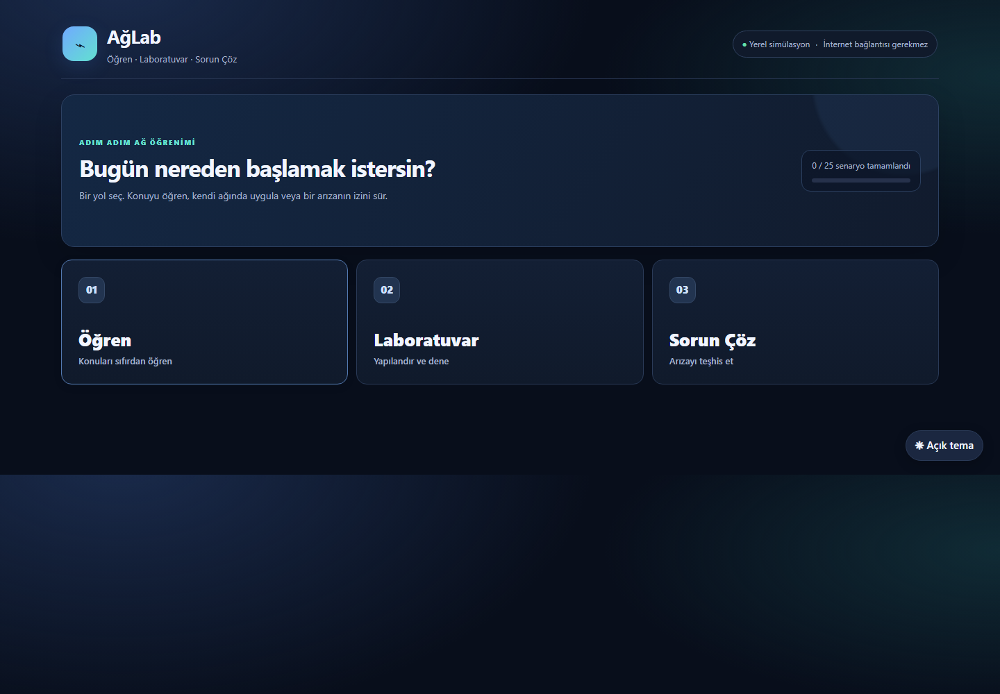
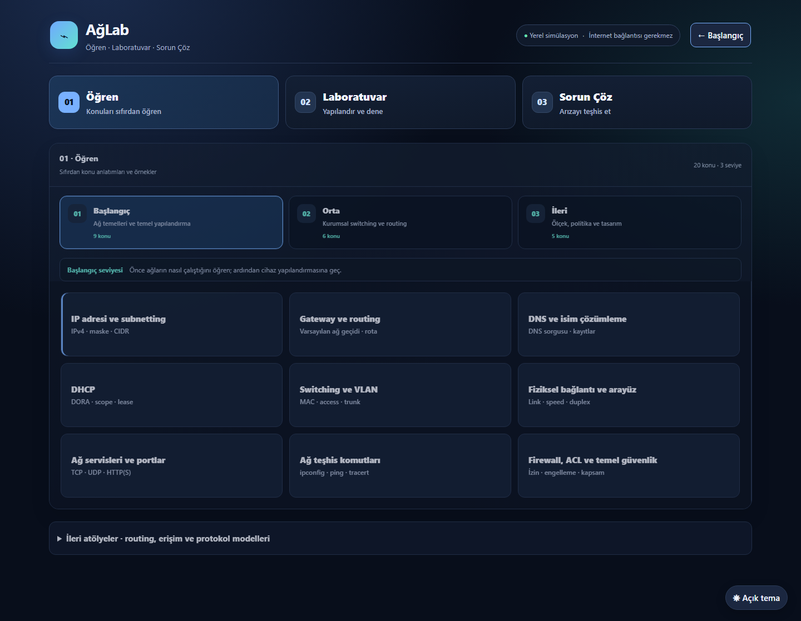
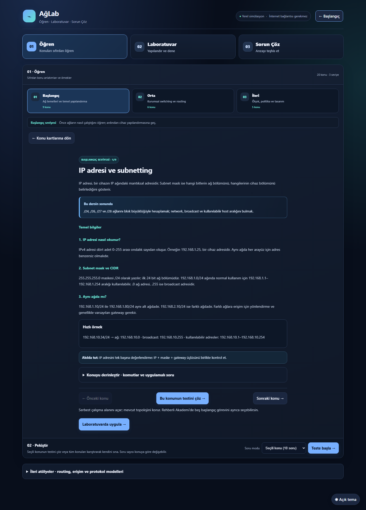
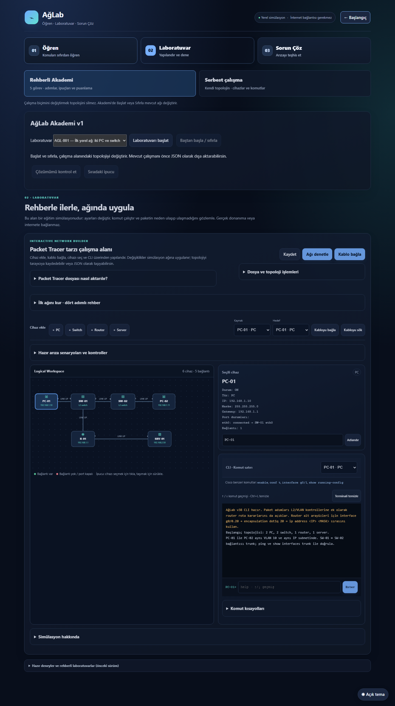
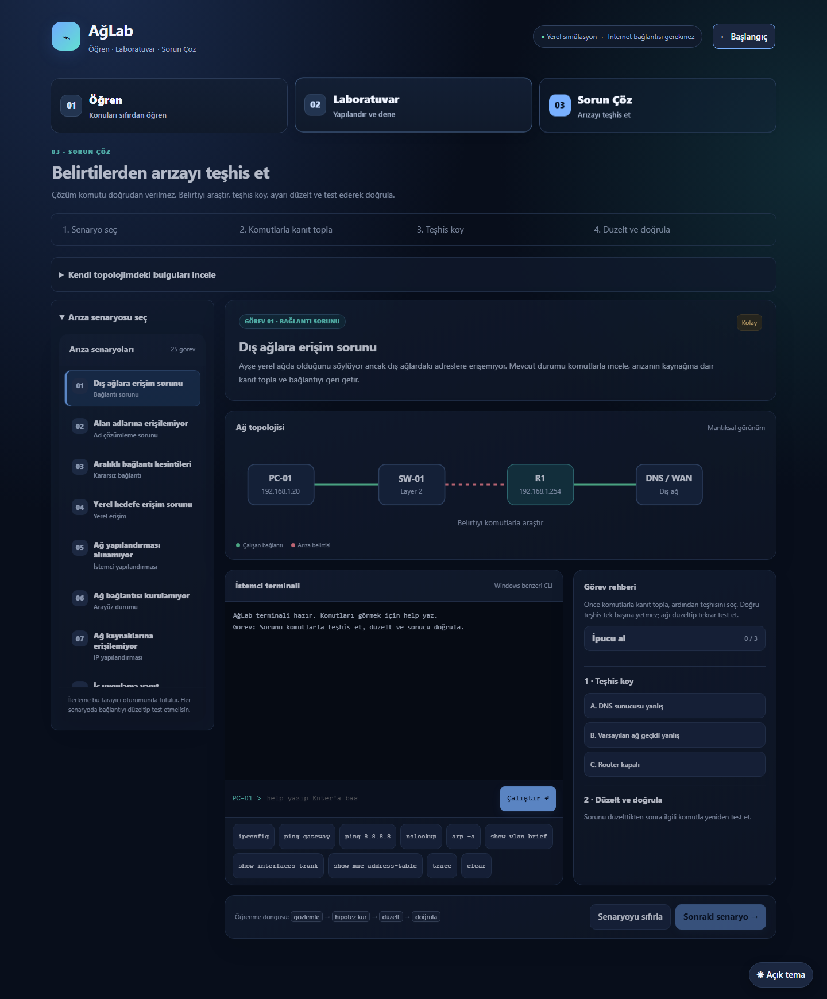
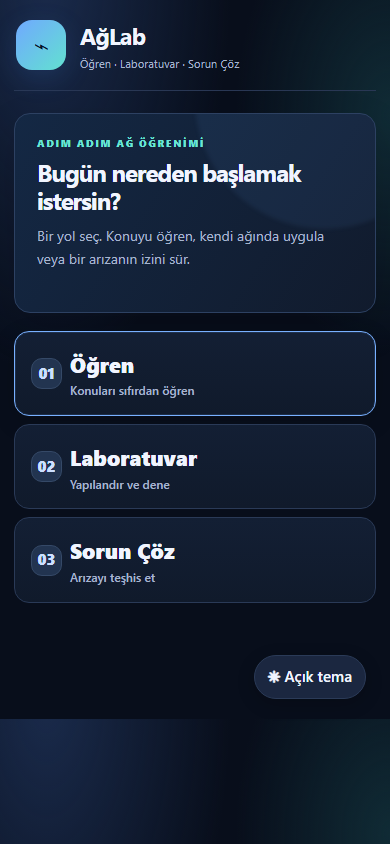
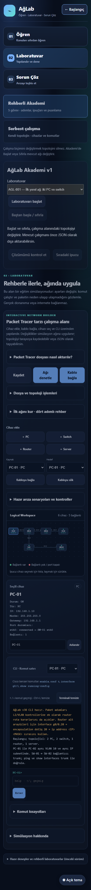

# AğLab arayüz sadeleştirme raporu

29 Ekim 2026 — PR #4 (`feat/academy-v1-first-five`, `37a48cda`) üzerine ayrı `feat/ui-three-paths` dalı.

## Kullanıcı akışları

- Başlangıç: Öğren / Laboratuvar / Sorun Çöz kartları; bölümden başlangıca dönüş.
- Öğren: üç seviye → konu kartları → anlatım → konu testi veya Laboratuvarda uygula. Derin içerik ve ileri atölyeler açılır alanlarda. Mevcut 20 ders ve karma test korunur. Uygula bağlantısı serbest çalışmayı açar; ileri konular için yeni otomatik Akademi görevi varmış gibi davranmaz.
- Laboratuvar: Rehberli Akademi / Serbest çalışma seçimi. Mod değişimi topolojiyi korur; Akademi başlat/sıfırla mevcut davranışıyla ağı değiştirir ve bu durum görünür biçimde açıklanır. AGL-001–005 içeriği, değerlendirme ve ipuçları korunur.
- Kaydet, denetle ve kablo bağla görünür kalır. Dosya/topoloji işlemleri, aktarım açıklaması, hızlı rehber, hazır senaryolar, komut kısayolları ve simülasyon ayrıntıları açılır alanlara taşınır.
- Sorun Çöz: senaryo → kanıt toplama → teşhis → düzeltme/doğrulama rehberi. Kendi topolojisinin bulguları ayrı açılır alanda. Mobilde senaryo listesi seçimden sonra kapanır; masaüstünde liste kendi içinde kaydırılır.

## Doğrulama

`python run_pipeline.py`: **12/12 test grubu PASS**. Mevcut 10 regresyon, Akademi ve yeni `test_aglab_ui.py` birlikte çalıştırıldı. Öğrenci ve ayrı öğretmen ZIP'leri kalite kapısından sonra üretildi. Testlerin ayrıntılı çıktısı CI ve `dist/test-results.json` içinde.

Yeni test eski sürümde `#journeyHome` bulunamadığı için başarısız oldu. Son sürümde giriş, tüm seviyeler, konu kartları, test yanıtı, laboratuvara geçiş, AGL-005'in gerçek CLI ile 100/100 çözümü, modlar arasında durum koruma, teşhis, mobil senaryo seçimi, klavyeyle giriş/açılır menü ve tema geçişleri doğrulandı.

360, 390, 768 ve 1440 piksel genişliklerinde dört ana ekran için yatay taşma kontrolü geçti. Görünür odak çizgileri, en az 44 piksel form/düğme yüksekliği, giriş etiketleri, aktif bölüm/mod bilgisi ve azaltılmış hareket tercihi eklendi. Bu kontroller tam WCAG sertifikası veya ekran okuyucuyla kapsamlı kullanıcı testi anlamına gelmez.

Chromium ekran görüntüleri görsel olarak incelendi: giriş, konu kartları, ders anlatımı, Akademi/çalışma alanı ve teşhis ekranı; mobil giriş ve laboratuvar. Görsel inceleme sonrası uzun senaryo listesi, mobil rehber yoğunluğu ve içeriğin üstünü örten sabit tema düğmesi düzeltildi.

## Kapsam ve birleştirme

Yeni PR'ın hedefi PR #4 dalıdır; `main` ve PR #4 değişmez. Önce Akademi PR'ı birleştirilirse yeni PR güncel tabanla karşılaştırılarak `main`e yeniden hedeflenebilir. Otomatik birleştirme yapılmaz.

`convert_pkt_to_aglab.py`, ağ/CLI/ping motoru, Akademi JSON kaynakları ve puanlayıcı değiştirilmedi. HTML'nin sonundaki sunum katmanı mevcut işlevleri kullanır. Böylece eşzamanlı Packet Tracer motoru geliştirmesiyle çakışma alanı sınırlıdır; aynı HTML dosyasına gelen sonraki değişikliklerde yine normal birleştirme incelemesi gerekir. İçe aktarma testi yalnız dışa aktarma menüsünü açan bir adım ekler; arşiv, hash, ping ve roundtrip doğrulamaları korunur. Yeni PKT senaryosu veya destek iddiası yoktur; mevcut kapsam sınırları geçerlidir.

## Görseller

