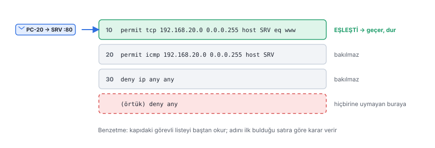
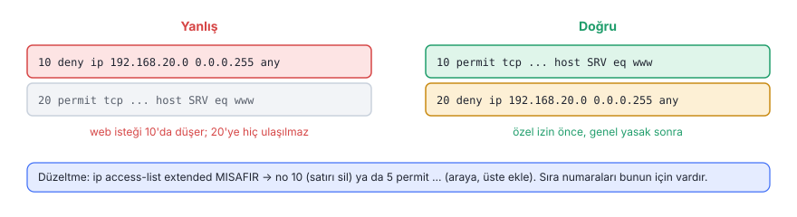
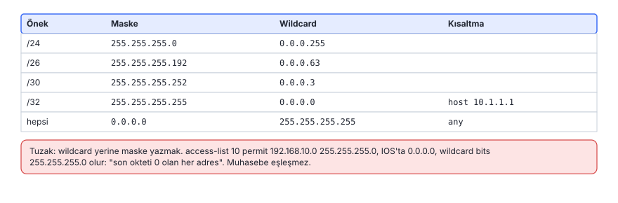
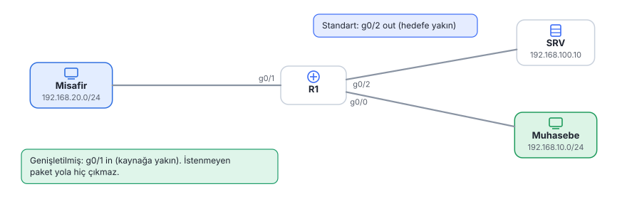
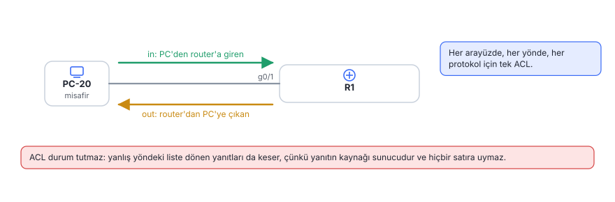
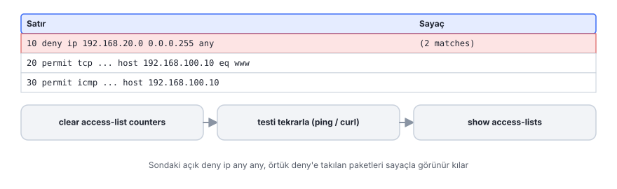
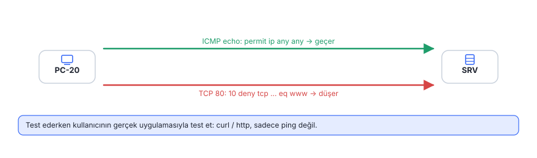

# AğLab Konu #19: ACL (standart ve genişletilmiş)

> Uygulamadaki `acl` dersi bu belgeyle uyumludur. Senaryolar Sorun Çöz'de `acl-*` kimlikleriyle
> Labber'da çalışır; başlangıçtaki ACL'ler kaydedilmiş yapılandırma olarak yüklenir (`pending`).
> Ön koşul: IP adresleme (Konu #2), statik routing (Konu #8), teşhis araçları (Konu #24).
> Şemalar: `docs/dersler/gorseller/acl.py`.

Bu konu bittiğinde öğrenci standart ve genişletilmiş ACL yazar, wildcard maskeyi hesaplar ve listeyi doğru arayüze, doğru yönde uygular. `show access-lists` sayaçlarıyla hangi satırın trafiği yakaladığını görür. Satır sırası, örtük deny, yanlış yön ve maske/wildcard karışıklığı arızalarını kanıtla ayırır. Seviye 2 (CCNA), süre yaklaşık 70 dakika.

## 0. Bir bakışta

- ACL yukarıdan aşağı okunur; **ilk eşleşen satır** kazanır.
- Sonda görünmez bir **örtük deny** vardır: yalnız deny'lardan oluşan liste her şeyi keser.
- **Standart** ACL yalnız kaynağa bakar → **hedefe yakın**. **Genişletilmiş** ACL protokol/kaynak/hedef/port → **kaynağa yakın**.
- **Wildcard** maskenin tersidir: /24 → `0.0.0.255`. Maske yazmak klasik hatadır.
- Yön router'ın gözündendir: arayüze **giren** `in`, **çıkan** `out`.
- `show access-lists` **sayaçları** hangi satırın trafiği yakaladığını gösterir.

> **Akılda kalsın:** ACL arızasında kablo, VLAN ve rota kusursuzdur; paket bir satıra takılıp sessizce düşer. Sayaçlara bak.



## 1. Neden önemli

Şubede misafir ağı, muhasebe ve sunucular aynı router'a bağlıdır; kimin kime ulaşacağını ACL belirler. ACL arızaları sinsidir: kablo, VLAN ve rota kusursuzdur, ama paket bir satıra takılıp sessizce düşer. Tipik şikâyet "dün kural ekledik, bugün başka bir şey çalışmıyor"dur. Çoğu zaman kural doğru niyetle yazılmıştır, ama sırası, yönü ya da wildcard'ı yanlıştır.

## 2. Kavram

### 2.1 Liste nasıl okunur

> **Benzetme:** Bir düğünde kapıdaki görevli davetli listesini baştan okur ve adını **ilk** gördüğü satıra göre karar verir. Listenin sonunda yazılı olmayan ama herkesin bildiği bir kural vardır: "listede yoksan giremezsin".

- Paket satırları sırayla dener; ilk eşleşmede durur.
- Hiçbir satıra uymayan paket **örtük deny** ile düşer.
- Sonuç: listede en az bir `permit` olmalıdır.

### 2.2 Wildcard ve sıra



Özel satırlar üstte, genel satırlar altta. Genel bir deny özel bir permit'in üstündeyse permit'e hiç sıra gelmez.



> **Dikkat:** Wildcard yerine maske yazarsan IOS itiraz etmez; satırı kabul eder ama bambaşka bir anlamla. Listeyi yazdıktan sonra `show access-lists` ile IOS'un nasıl okuduğunu gör.

### 2.3 Standart ve genişletilmiş; nereye?

- **Standart** (1–99 ya da `ip access-list standard AD`): yalnız kaynak.
- **Genişletilmiş** (100–199 ya da `ip access-list extended AD`): `permit tcp 192.168.20.0 0.0.0.255 host 192.168.100.10 eq www`.



> **Benzetme:** Yalnız "kimden geldiğine" bakan görevliyi (standart) sunucu odasının kapısına koyarsın; binanın girişine koyarsan o kişinin kafeteryaya gitmesini de engeller. Her şeye bakabilen görevliyi (genişletilmiş) binanın girişine koyarsın; istenmeyen misafir koridorda hiç dolaşmaz.

### 2.4 Yön: in ve out



- `ip access-group AD in` arayüze giren, `out` çıkan paketi süzer.
- Her arayüzde, her yönde, her protokol için **tek** ACL.
- ACL durum tutmaz; yanlış yön dönüş trafiğini de keser.

### 2.5 Düzenleme

- İsimli (ve numaralı) listelerde satırların sıra numarası vardır.
- `ip access-list extended AD` altında `no 10` tek satırı siler, `15 permit …` araya satır ekler.
- `no access-list 10` numaralı listenin **tamamını** siler.

### 2.6 Sayaçlarla teşhis





> **Sahada:** Kural eklemeden önce `show access-lists` çıktısını kaydet; "dün kural ekledik, bugün başka şey çalışmıyor" şikâyetinde ilk bakılacak şey farktır.

## 3. Çıktı okuma

```
R1#show access-lists
Extended IP access list MISAFIR
    10 deny   ip 192.168.20.0 0.0.0.255 any (2 matches)        ← web isteği de burada düştü
    20 permit tcp 192.168.20.0 0.0.0.255 host 192.168.100.10 eq www
    30 permit icmp 192.168.20.0 0.0.0.255 host 192.168.100.10
                                                                 ← 20 ve 30'un sayacı yok: hiç ulaşılmıyor
Standard IP access list 10
    10 permit 0.0.0.0, wildcard bits 255.255.255.0              ← maske yazılmış; kimse eşleşmez

R1#show ip interface g0/1
GigabitEthernet0/1 is up, line protocol is up
  Internet address is 192.168.20.1/24
  Outgoing access list is not set
  Inbound  access list is MISAFIR                               ← hangi yönde, hangi liste

PC-20> ping 192.168.100.10
*192.168.20.1 icmp_seq=1 ttl=255 (ICMP type:3, ...)             ← gateway "geçemezsin" diyor
```

| Soru | Komut |
| --- | --- |
| Hangi satır trafiği yakalıyor? | `show access-lists` (sayaçlar); `clear access-list counters` ile sıfırla, testi tekrarla |
| Liste nerede, hangi yönde? | `show ip interface <if>` ya da `show running-config interface <if>` |
| Wildcard doğru mu? | Listedeki adres beklenen ağ mı, yoksa 0.0.0.0'a mı dönmüş? |

## 4. Yönlendirmeli lab

Topoloji: R1 g0/0 muhasebe (192.168.10.0/24, PC-10), g0/1 misafir (192.168.20.0/24, PC-20), g0/2 sunucu (SRV 192.168.100.10, web). Kural: misafir SRV'ye yalnız web ve ping ile ulaşır, başka hiçbir yere ulaşamaz; muhasebe her yere ulaşır.

1. **Önce test:** PC-20'den `ping 192.168.100.10` ve `curl http://192.168.100.10`; PC-10'dan aynıları. Hepsi çalışıyor.
2. **Listeyi yaz:** `ip access-list extended MISAFIR` → `permit tcp 192.168.20.0 0.0.0.255 host 192.168.100.10 eq www` → `permit icmp 192.168.20.0 0.0.0.255 host 192.168.100.10` → `deny ip any any`. *Neden:* İzin önce; sondaki açık deny sayaç gösterir (örtük deny göstermez).
3. **Uygula:** `interface g0/1` → `ip access-group MISAFIR in`. *Neden:* Genişletilmiş liste kaynağa yakın; misafir trafiği g0/1'e girer.
4. **Test:** PC-20'den SRV'ye curl ve ping çalışır, PC-10'a ping çalışmaz; PC-10'dan her şey çalışır.
5. **Sayaçlar:** `show access-lists`; her testten sonra hangi satırın arttığını yaz. *Neden:* sayaç, kuralın gerçekten çalıştığının tek kanıtıdır.
6. **Standart liste:** sunucu ağına yalnız muhasebe: `access-list 10 permit 192.168.10.0 0.0.0.255`, `interface g0/2` → `ip access-group 10 out`. *Neden:* Standart liste hedefe yakın.
7. **Düzenle:** `show access-lists MISAFIR` ile sıra numaralarını oku; ping satırını `no 20` ile sil (hangi numaradaysa), PC-20'den ping'in düştüğünü ve `deny ip any any` sayacının arttığını gör; aynı numarayla geri ekle. Kaydet.

> **Benzetme:** Lab, kapıdaki görevliye liste yazmaktır: önce "şu kişiler şu odaya girebilir", en sonda "başka kimse giremez".

## 5. Sık hatalar

| Kod | Hata | Belirti | Kanıt | Düzeltme |
| --- | --- | --- | --- | --- |
| E1 | Satır sırası | İzin verilen trafik de düşüyor | Geniş deny satırının sayacı artıyor, izin satırınınki artmıyor | Deny'i kaldır ya da izni öne al (sıra numarası) |
| E2 | Örtük deny'i unutmak | Engellemek istenen dışındaki her şey de kesildi | Listede yalnız deny satırı | Sona `permit ip any any` (ya da gereken izinler) |
| E3 | Yanlış yön / arayüz | Kural hiç çalışmıyor ya da dönüş trafiği kesiliyor | `show ip interface`: liste beklenmeyen yönde | `no ip access-group … out` → `ip access-group … in` |
| E4 | Yanlış wildcard (yanlış hesap ya da maske yazmak) | Ağın bir kısmı ya da kimse eşleşmiyor | Listedeki aralık ağı kapsamıyor (0.0.0.127 bir /25'tir); maske yazıldıysa adres 0.0.0.0'a dönmüş | Doğru wildcard (0.0.0.255) ile yeniden yaz |
| E5 | Standart ACL'yi kaynağa yakın koymak | Kaynağın başka yerlere giden izinli trafiği de kesiliyor | Liste kaynak arayüzde `in` | Standart listeyi hedefe yakın uygula |
| E6 | Kural uygulamanın portunu engelliyor | Ping geçiyor, uygulama (ör. web) açılmıyor | Web isteğinden sonra `deny tcp … eq www` satırının sayacı artıyor | Engelleyen satırı kaldır ya da daralt; ping'in geçmesi uygulamanın geçtiğini kanıtlamaz |

## 6. Arıza senaryoları

> **Uygulamada:** S1–S5 Sorun Çöz'de `acl-order`, `acl-implicit-deny`, `acl-wrong-direction`,
> `acl-wildcard`, `acl-two-faults` kimlikleriyle Labber'da çalışır. Hedefler yalnız erişimin
> gelmesini değil, **kuralın korunmasını** da sınar: misafirin engellenmesi gereken trafik
> engelli kalmalı.
> Önce kendin çöz; neden ve çözüm kapalı kutularda.

### S1 · Orta · Misafirler izinli sunucuya da ulaşamıyor (E1)

- **Belirti:** Kural: misafir SRV'ye yalnız web ve ping. Misafirler SRV'ye hiç ulaşamıyor; ACL'de izin satırları var.
- **Hedef:** misafir → SRV web ve ping ✓; misafir → muhasebe ✗; muhasebe → SRV ✓

<details><summary>Neden ve çözüm</summary>

MISAFIR satır 10 `deny ip 192.168.20.0 0.0.0.255 any`; izinler (20, 30) altında kalmış. Çözüm: R1 → `ip access-list extended MISAFIR` → `no 10`

</details>

### S2 · Başlangıç · Misafiri engelleyen kural muhasebeyi kesti (E2)

- **Belirti:** Muhasebenin misafire erişmemesi için g0/0'a ACL uygulandı; muhasebe hiçbir yere ulaşamıyor.
- **Hedef:** muhasebe → SRV ping ve web ✓; muhasebe → misafir ✗

<details><summary>Neden ve çözüm</summary>

MUHASEBE listesinde yalnız deny var; örtük deny geri kalanı kesiyor. Çözüm: R1 → `ip access-list extended MUHASEBE` → `permit ip any any`

</details>

### S3 · Orta · Doğru liste, yanlış yön (E3)

- **Belirti:** MISAFIR doğru yazıldı ve g0/1'e uygulandı; misafirler SRV'ye ulaşamıyor, muhasebe misafire ping atamıyor.
- **Hedef:** S1 ile aynı

<details><summary>Neden ve çözüm</summary>

Liste `out` yönünde: misafire giden yanıtları süzüyor. Çözüm: R1 → `interface g0/1` → `no ip access-group MISAFIR out` → `ip access-group MISAFIR in`

</details>

### S4 · Orta · Yeni muhasebe PC'si sunucu odasına giremiyor (E4)

- **Belirti:** Sunucu ağına yalnız muhasebe ulaşabilir (g0/2'de standart ACL 10). Muhasebe ağı /25'ten /24'e büyütüldü; eski PC'ler ulaşıyor, yeni PC-10 (192.168.10.150) ulaşamıyor.
- **Hedef:** muhasebe (.150) → SRV ✓; misafir → SRV ✗

<details><summary>Neden ve çözüm</summary>

ACL 10 hâlâ `permit 192.168.10.0 0.0.0.127`: yalnız .0–.127. Çözüm: R1 → `no access-list 10` → `access-list 10 permit 192.168.10.0 0.0.0.255`

</details>

### S5 · İleri · İki hata: sıra ve yön (E3 + E1)

- **Belirti:** Misafir kuralı yeni uygulandı, misafirler SRV'ye ulaşamıyor; yön düzeltildi, yine ulaşamıyor.
- **Hedef:** S1 ile aynı

<details><summary>Neden ve çözüm</summary>

Liste `out` yönünde ve ilk satır misafirden her şeyi engelliyor. Çözüm: R1 → `interface g0/1` → `no ip access-group MISAFIR out` → `ip access-group MISAFIR in`; `ip access-list extended MISAFIR` → `no 10`

</details>

### Ek · L6'dan gelen senaryo

- `acl-http-blocked` · **Sunucuya ping gidiyor, web sayfası açılmıyor (E6).** Eski Sorun Çöz metin
  senaryosu (motor yok) gerçek topolojiye çevrildi; S1 topolojisi. R1 g0/1'deki WEB listesinin 10.
  satırı misafir ağından sunucuya TCP 80'i engelliyor, ICMP `permit ip any any`'ye uyuyor. Ders:
  ACL katman 4'e göre süzer; ping'in geçmesi uygulamanın geçtiğini kanıtlamaz. Çözüm: `no 10`.
  Hedef: PC-20 → SRV `http` ve `ping`.

## 7. Kısa sınav

**1.** Bir paket iki satıra da uyuyorsa hangisi uygulanır?

<details><summary>Cevap</summary>

İlk (en üstteki) satır.

</details>

**2.** /26 ağın wildcard'ı?

<details><summary>Cevap</summary>

`0.0.0.63` (255 − 192).

</details>

**3.** Standart ACL neden hedefe yakın uygulanır?

<details><summary>Cevap</summary>

Yalnız kaynağa baktığı için; kaynağa yakın konursa o kaynağın başka yerlere giden trafiğini de keser.

</details>

**4.** Yalnız `deny ip 10.1.1.0 0.0.0.255 any` satırı olan liste ne yapar?

<details><summary>Cevap</summary>

Her şeyi engeller: diğer her paket örtük deny'e takılır.

</details>

**5.** Misafirden gelen trafiği misafir arayüzünde süzmek için yön?

<details><summary>Cevap</summary>

`in`.

</details>

**6.** `show access-lists`'te `permit tcp … eq www` satırının sayacı hiç artmıyor ama web açılmıyor. İlk ne düşünürsün?

<details><summary>Cevap</summary>

Paket o satıra ulaşmıyor: ya üstteki bir satır onu yakalıyor (sayacı artan satıra bak) ya da liste yanlış arayüzde/yönde.

</details>

## 8. Özet kartı

| Komut | Ne işe yarar |
| --- | --- |
| `ip access-list extended AD` | İsimli genişletilmiş liste |
| `permit tcp <kaynak> <wc> host <hedef> eq www` | Port bazlı satır |
| `access-list 10 permit <ağ> <wildcard>` | Numaralı standart liste |
| `ip access-group AD in\|out` | Arayüze uygula |
| `no 10`, `15 permit …` | Satır sil / araya ekle |
| `show access-lists`, `clear access-list counters` | Sayaçlar |
| `show ip interface <if>` | Hangi liste, hangi yönde |

**Unutma:**

1. İlk eşleşme kazanır; özel üstte.
2. Örtük deny; en az bir permit.
3. Wildcard = 255 − maske.
4. Standart hedefe, genişletilmiş kaynağa yakın.
5. Yön router'ın gözünden.

## 9. Doğrulama notları

**Lab'ın otomatik değerlendirmesi:** `q.http('PC-20', SRV).ok` ve `q.ping('PC-20', SRV).ok` doğru, `q.ping('PC-20', PC-10).ok` yanlış, `q.ping('PC-10', SRV).ok` doğru.

Kaynaklar: INET CCNA 200-301 v1.1 (ACL); Cisco IOS "Configuring IP Access Lists" (ilk eşleşme, örtük deny, sıra numaralarıyla düzenleme, standart listenin adres/wildcard normalizasyonu), CCNA 200-301 5.6 (ACL yapılandırma ve doğrulama).

| İddia | Sonuç |
| --- | --- |
| İlk eşleşen satır uygulanır; sonda örtük deny | Doğru |
| Arayüz başına yön başına protokol başına tek ACL | Doğru |
| Standart ACL hedefe, genişletilmiş kaynağa yakın (Cisco önerisi) | Doğru |
| `access-list 10 permit 192.168.10.0 255.255.255.0` IOS'ta `0.0.0.0, wildcard bits 255.255.255.0` olarak saklanır | Doğru (adres wildcard'ın tersiyle maskelenir) |
| `no access-list N` numaralı listenin tamamını siler | Doğru |
| Uygulanmış ama tanımsız ACL her şeye izin verir | Doğru (IOS) |

**Motor gereksinimleri** (Labber'da denendi)

- [x] Numaralı ve isimli standart/genişletilmiş ACL, sıra numarasıyla ekleme/silme, `ip access-group in|out`, sayaçlar, `show ip interface` ACL satırları; HTTP isteği ACL'den geçiyor
- [x] Beş senaryo başta başarısız, çözümle başarılı; engellenmesi gereken trafik de sınanıyor
- [ ] ACL'nin düşürdüğü pakete gateway ICMP tip 3 **kod 1** (host unreachable) dönüyor; IOS kod 13 (administratively prohibited) döner (motor işi)
- [ ] VTY `access-class` yok (Konu #22 ile)
- [ ] AğLab modeli ACL satırında ICMP türünü (`echo`) ifade edemiyor; Labber destekliyor ama senaryolar kayıt/dışa aktarma için türsüz `permit icmp` kullanıyor
- [ ] AğLab topoloji modeli ardışık olmayan wildcard'ları (ör. maske yazılmış 255.255.255.0) kabul etmiyor; bu yüzden "maske yerine wildcard" senaryo olarak değil kavram olarak anlatılıyor (S4 yanlış hesaplanmış wildcard)
