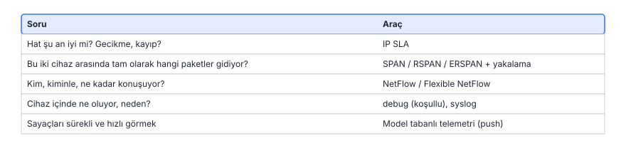
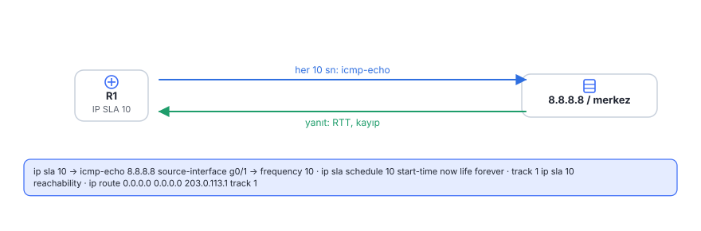
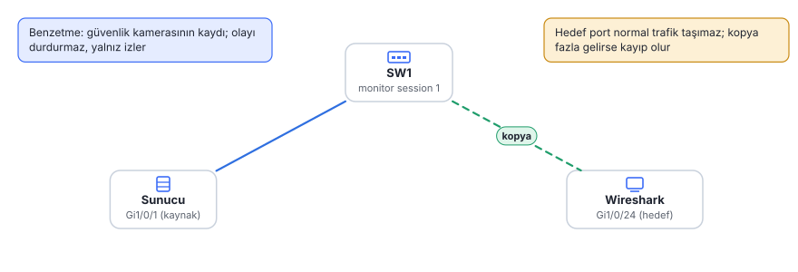
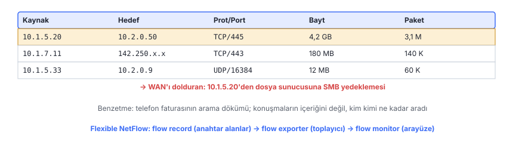
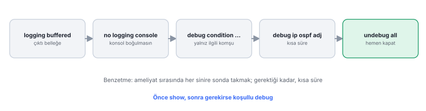
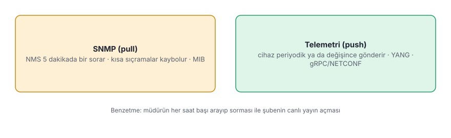
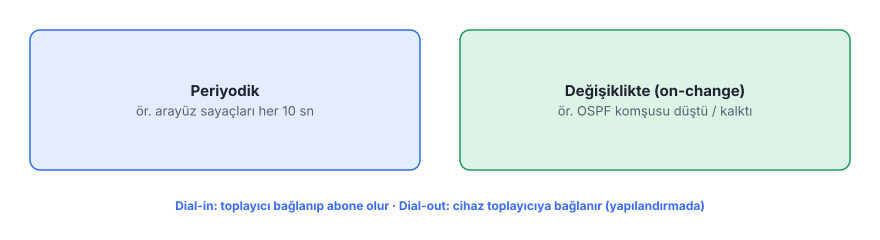

# AğLab Konu #37: Ağ izleme: IP SLA, SPAN, NetFlow, debug ve telemetri

> Uygulamadaki `telemetry` dersi bu belgeyle uyumludur. **Okuma dersi + Simülatör labı (Seviye 3, CCNP):** Labber IP SLA (icmp-echo) ve track'i çalıştırır: Simülatör'deki **hsrp-sla-track** ve **statik-yedek** labları. Paket Dedektifi SPAN + yakalamanın basit bir karşılığıdır; NetFlow ve telemetri Labber'da yok.
> Ön koşul: Teşhis araçları (Konu #24), ağ servisleri: Syslog ve SNMP (Konu #23), FHRP ve track (Konu #18). Şemalar: `docs/dersler/gorseller/ag-izleme.py`.

Bu konu bittiğinde öğrenci bir şikâyete hangi izleme aracıyla yaklaşacağını seçer. IP SLA ile hat kalitesini ölçer ve track ile bir statik rotayı ya da HSRP önceliğini bu ölçüme bağlar. SPAN/RSPAN/ERSPAN ile trafiğin kopyasını çıkarır; NetFlow kayıtlarından WAN'ı dolduran akışı bulur. debug'ı güvenle (bellek, koşul, süre) kullanır; SNMP sorgusu ile model tabanlı telemetrinin farkını açıklar. Süre yaklaşık 50 dakika.

## 0. Bir bakışta

- Her araç başka bir soru içindir: **IP SLA** (hat iyi mi?), **SPAN** (hangi paketler?), **NetFlow** (kim kiminle ne kadar?), **debug** (cihaz içinde ne oluyor?), **telemetri** (sayaçlar canlı).
- **IP SLA** sentetik test trafiği üretir; **track** ile statik rota/HSRP önceliği hat kalitesine bağlanır.
- **SPAN** port/VLAN trafiğinin **kopyasını** analiz portuna gönderir; **RSPAN** VLAN ile, **ERSPAN** GRE ile uzağa taşır.
- **NetFlow** akış özetidir (5'li anahtar + sayaçlar), içerik değil.
- **debug** CPU'yu yorar: belleğe yaz, koşulla daralt, kısa tut, **undebug all**.
- **Telemetri** push'tur: cihaz veriyi kendisi, saniyeler içinde, YANG modeliyle gönderir.

> **Akılda kalsın:** Ölçmeden tahmin etme: 'hat yavaş' şikâyetinde önce IP SLA ve NetFlow, sonra yakalama.



## 1. Neden önemli

Kullanıcılar "yavaş" der, "bazen kopuyor" der; kanıt getirmez. İzleme araçları bu şikâyetleri sayılara ve paketlere dönüştürür: hangi saatte, hangi hatta, hangi uygulama, ne kadar kayıp. CCNP ENCOR'un 'Network Assurance' bölümü bu araçları sorar; sahada da IP SLA + track ile yedek internet hattına otomatik geçiş en çok kurulan çözümlerden biridir.

## 2. Kavram

### 2.1 IP SLA

> **Benzetme:** Bir nöbetçi her on saniyede bir karşı kıyıya taş atıp sesin ne kadar sürede geldiğini not eder. Ses gelmezse "köprü yıkılmış" der ve trafiği diğer köprüye yönlendirir (track).



- Testler: `icmp-echo`, `udp-jitter` (ses kalitesi: gecikme, jitter, kayıp, MOS), `http`, `tcp-connect`.
- **track** nesnesi IP SLA sonucunu (reachability ya da state) izler; statik rota, HSRP önceliği ya da EEM ona bağlanır.
- Hedef seçimi önemlidir: yalnız ISP'nin router'ını değil, ISP'nin ötesinde güvenilir bir adresi ölç.

### 2.2 SPAN, RSPAN, ERSPAN



```
monitor session 1 source interface gi1/0/1 both
monitor session 1 destination interface gi1/0/24
```

> **Dikkat:** Kaynak 1 Gbps'te iki yönü birden izlemek hedef porta 2 Gbps'e kadar kopya gönderebilir; 1 Gbps hedef port taşar ve yakalama eksik olur. Eksik yakalama yanlış teşhise götürür.

### 2.3 NetFlow



- Akış anahtarı: kaynak/hedef IP, kaynak/hedef port, protokol, ToS, giriş arayüzü.
- Kayıtlar toplayıcıya (UDP, ör. 2055) **NetFlow v9** ya da **IPFIX** formatıyla gönderilir.
- Örnekleme (sampled NetFlow) yükü azaltır ama küçük akışları gözden kaçırabilir.

### 2.4 debug'ı güvenle kullanmak



### 2.5 Model tabanlı telemetri





> **Sahada:** Catalyst Center Assurance ve benzeri platformlar telemetri, NetFlow ve syslog'u birleştirip 'şu kullanıcının şu saatteki deneyimi' düzeyinde gösterir; altında yine bu dersin araçları vardır.

## 3. Çıktı okuma

```
R1#show ip sla statistics 10
IPSLAs Latest Operation Statistics
IPSLA operation id: 10
        Latest RTT: 28 milliseconds
Latest operation start time: 10:41:07 TRT Sun Nov 15 2026
Latest operation return code: OK
Number of successes: 362
Number of failures: 3
                                        ← hat şu an iyi; 365 denemede 3 başarısız

R1#show track 1
Track 1
  IP SLA 10 reachability
  Reachability is Down
    2 changes, last change 00:00:41
  Tracked by:
    Static IP Routing 0
                                        ← SLA başarısız → varsayılan rota tablodan çıktı, yedek devrede

SW1#show monitor session 1
Session 1
---------
Type                     : Local Session
Source Ports             :
    Both                 : Gi1/0/1
Destination Ports        : Gi1/0/24
    Encapsulation        : Native
          Ingress        : Disabled

R1#show flow monitor WAN-IZLE cache sort highest counter bytes top 3
IPV4 SRC ADDR  IPV4 DST ADDR  TRNS SRC PORT  TRNS DST PORT  IP PROT  bytes long
10.1.5.20      10.2.0.50      51022          445            6        4512331200
                                        ← en çok bayt: SMB yedeklemesi
```

| Soru | Komut |
| --- | --- |
| Hat kalitesi ve geçmiş? | `show ip sla statistics [aggregated]` |
| Track durumu ve neyi etkiliyor? | `show track` |
| SPAN oturumu doğru mu? | `show monitor session` |
| WAN'ı kim dolduruyor? | `show flow monitor … cache` |
| debug açık kaldı mı? | `show debugging` |

## 4. Yönlendirmeli lab

> **Kısmen simülatörde:** IP SLA + track adımlarını Simülatör'deki **hsrp-sla-track** ve **statik-yedek** labları ile dene (Pratik adımında). SPAN, NetFlow ve debug adımlarını kâğıt üstünde Bölüm 3'teki çıktılarla karşılaştır.

Şube R1: birincil internet (g0/1, 203.0.113.1 next-hop), yedek LTE (g0/2).

1. IP SLA 10: `icmp-echo 8.8.8.8 source-interface g0/1`, `frequency 10`; zamanla. *Neden:* source-interface testin birincil hattan gitmesini garanti eder.
2. `track 1 ip sla 10 reachability`; birincil varsayılan rotaya `track 1`, yedek rotaya AD 10 (floating).
3. Bölüm 3'teki `show track` çıktısını yorumla: hangi rota tabloda?
4. Dosya sunucusu portuna SPAN kur; hedef port hızını kaynakla karşılaştır.
5. WAN arayüzünde Flexible NetFlow: record (kaynak, hedef, port, protokol), exporter (toplayıcı 192.168.99.80), monitor; en çok bayt gönderen akışı bul.
6. OSPF komşuluk sorununu yalnız ilgili komşu için koşullu debug ile incele; sonra `undebug all`.

> **Benzetme:** 1–3. adım, köprüye nöbetçi koyup köprü yıkılınca trafiği kendiliğinden yan köprüye yönlendiren tabelayı kurmaktır.

## 5. Sık hatalar

| Kod | Hata | Belirti | Kanıt | Düzeltme |
| --- | --- | --- | --- | --- |
| E1 | IP SLA hedefi yalnız ISP router'ı | ISP içindeki arıza fark edilmez | Hedef next-hop | Ötesinde güvenilir hedef(ler) |
| E2 | source-interface yok | Test yedek hattan gidiyor, hep başarılı | SLA hep OK, birincil kopuk | source-interface ver |
| E3 | SPAN hedef portu taşıyor | Yakalama eksik | Hedefte drop, kaynak toplamı > hedef hızı | Tek yön ya da daha hızlı hedef |
| E4 | debug konsolda, koşulsuz | Cihaz yanıt vermiyor | CPU %100 | logging buffered, debug condition, undebug all |
| E5 | NetFlow yanlış yönde/arayüzde | Beklenen akış yok | `show flow interface` | Doğru arayüz ve yön |

## 6. Arıza senaryoları

> **Uygulamada:** Kâğıt üstü vakalar; motor ya da Gerçek Lab desteği gelince Sorun Çöz'e `mon-*` kimlikleriyle eklenecek. Önce kendin çöz; neden ve çözüm kapalı kutularda.

### S1 · Başlangıç · İnternet koptu, yedeğe geçilmedi (E2)

- **Belirti:** Birincil internet ISP tarafında koptu; R1 yedek LTE'ye geçmedi, `show ip sla statistics` OK diyor.
- **Hedef:** Birincil kopunca yedeğe geçilsin.

<details><summary>Neden ve çözüm</summary>

IP SLA'da source-interface yok; test paketleri yedek rota üzerinden de gidebiliyor ya da hedef ISP'nin kopmayan yerel router'ı. Çözüm: `source-interface g0/1` ve ISP ötesinde bir hedef.

</details>

### S2 · Orta · Wireshark'ta paketler eksik (E3)

- **Belirti:** SPAN ile sunucu trafiği yakalanıyor ama TCP akışlarında çok sayıda 'kayıp segment' görünüyor; kullanıcılar şikâyetçi değil.
- **Hedef:** Güvenilir yakalama.

<details><summary>Neden ve çözüm</summary>

Kaynak 1 Gbps iki yön izleniyor, hedef 1 Gbps; yoğunlukta kopyalar düşüyor. Eksik olan yakalama, ağ değil. Çözüm: tek yön ya da daha hızlı hedef port; yakalama filtresi.

</details>

### S3 · Orta · Her sabah WAN dolu (NetFlow)

- **Belirti:** 09:00–10:00 arası şube WAN'ı %100; kimse büyük iş yapmadığını söylüyor.
- **Hedef:** Trafiği kimin ürettiğini bul.

<details><summary>Neden ve çözüm</summary>

NetFlow cache'inde en çok bayt 10.1.5.20 → 10.2.0.50 TCP/445: zamanlanmış yedekleme. Çözüm: yedeklemeyi mesai dışına al ya da QoS ile düşük sınıfa koy.

</details>

### S4 · İleri · debug sonrası router kilitlendi (E4)

- **Belirti:** Teknisyen yoğun bir router'da `debug ip packet` yazdı; konsol ve SSH yanıt vermiyor.
- **Hedef:** Bir daha olmasın.

<details><summary>Neden ve çözüm</summary>

Koşulsuz paket debug'ı her paketi CPU'ya çekti. Çözüm: güç döngüsü/konsoldan `undebug all`; bundan sonra logging buffered, ACL'li/koşullu debug, kısa süre.

</details>

## 7. Kısa sınav

**1.** Bir hattın gecikme ve kayıp değerlerini sürekli ölçmek için araç?

<details><summary>Cevap</summary>

IP SLA (icmp-echo ya da udp-jitter).

</details>

**2.** IP SLA ile statik rotayı hat durumuna bağlamak için?

<details><summary>Cevap</summary>

track nesnesi (`track 1 ip sla 10 reachability`) ve rotaya `track 1`.

</details>

**3.** SPAN ile RSPAN farkı?

<details><summary>Cevap</summary>

SPAN kopyayı aynı switch'teki bir porta, RSPAN özel bir VLAN ile başka switch'teki porta gönderir (ERSPAN GRE ile L3 üzerinden).

</details>

**4.** NetFlow ne verir, ne vermez?

<details><summary>Cevap</summary>

Akış özetini (kim, kiminle, hangi port, kaç bayt) verir; paket içeriğini vermez.

</details>

**5.** debug'ı güvenle kullanmanın üç kuralı?

<details><summary>Cevap</summary>

Çıktıyı belleğe yaz (konsolu kapat), koşulla daralt, kısa tut ve `undebug all`.

</details>

**6.** SNMP ile telemetrinin temel farkı?

<details><summary>Cevap</summary>

SNMP yöneticinin sorduğu pull modelidir; telemetri cihazın kendisi gönderdiği push modelidir (YANG ile yapılandırılmış).

</details>

## 8. Özet kartı

| Komut | Ne işe yarar |
| --- | --- |
| `ip sla <n>` + `ip sla schedule` | Sentetik test |
| `track <n> ip sla <n> reachability` | Sonucu izle |
| `ip route … track <n>` | Rotayı hat durumuna bağla |
| `monitor session` source/destination | SPAN |
| `flow record / exporter / monitor` | Flexible NetFlow |
| `debug condition …`, `undebug all` | Güvenli debug |
| `show ip sla statistics`, `show track` | Doğrulama |

**Unutma:**

1. Soruya göre araç.
2. IP SLA'da source-interface ve doğru hedef.
3. SPAN hedef portu taşmasın.
4. NetFlow kim/ne kadar; içerik değil.
5. debug kısa, koşullu, bellekte.

## 9. Doğrulama notları

Kaynaklar: INE ENCOR (Network Assurance: IP SLA, SPAN/RSPAN/ERSPAN, NetFlow/Flexible NetFlow, debug, telemetri) ve CCNP ENCOR v1.0 (yalnız kapsam kontrolü için); RFC 7011 (IPFIX); Cisco IOS XE yapılandırma kılavuzları. Ders metni, örnek çıktılar ve şemalar özgün yazıldı.

| İddia | Sonuç |
| --- | --- |
| IP SLA sentetik trafik üretir; track ile statik rota/HSRP'ye bağlanır | Doğru |
| RSPAN özel VLAN, ERSPAN GRE ile kopya taşır | Doğru |
| NetFlow akış anahtarı 5'li ve ToS/arayüz alanlarını içerir | Doğru |
| Flexible NetFlow record, exporter, monitor bileşenlerinden oluşur | Doğru |
| Model tabanlı telemetri periyodik ve on-change abonelik destekler | Doğru |

**Motor gereksinimleri**

- [x] IP SLA (icmp-echo), track ve HSRP/statik rota bağlantısı Labber'da var: Simülatör'deki **hsrp-sla-track** (HSRP önceliğini internet erişimine bağlama, preempt) ve **statik-yedek** (track'li varsayılan rota) labları.
- [ ] SPAN için Paket Dedektifi yakalaması kullanılır; NetFlow özeti motorda yok. Eklenirse S3 `mon-*` kimliğiyle uygulanır.
