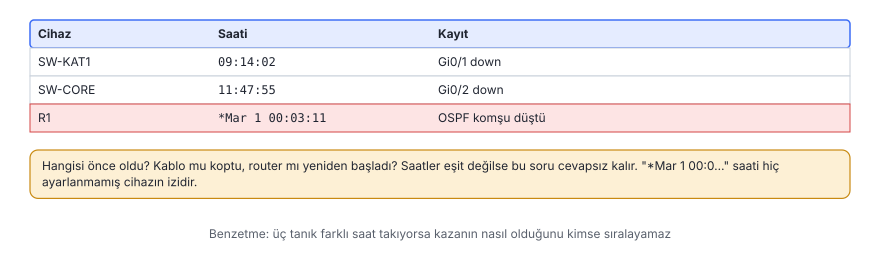
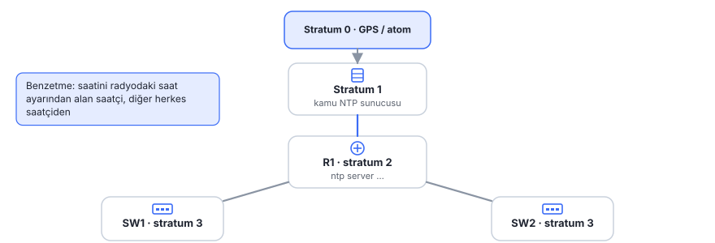
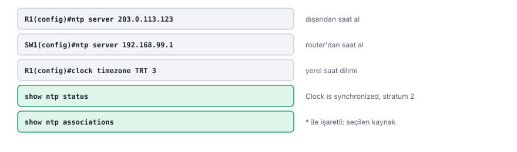
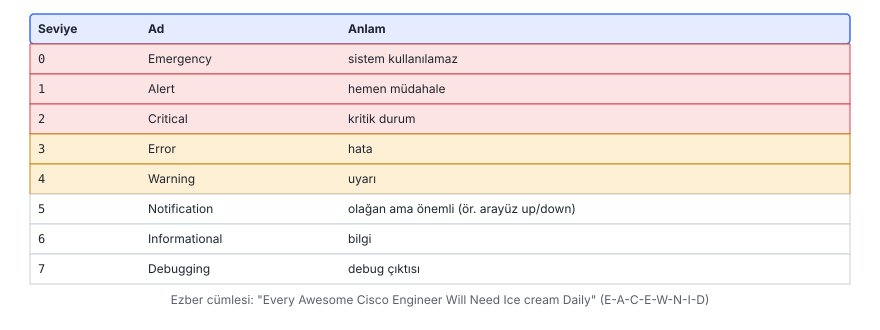
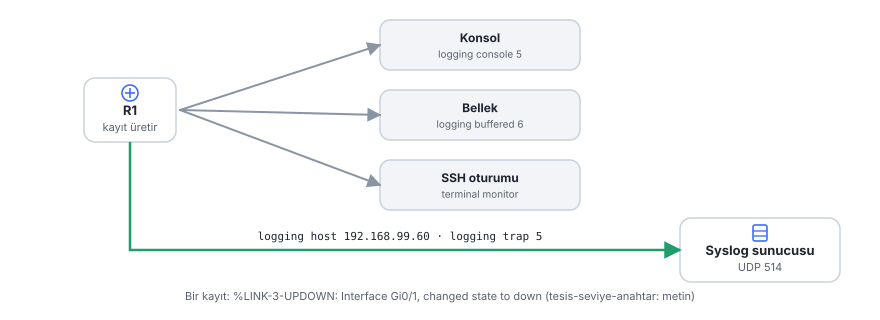
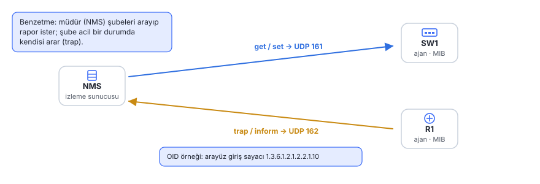
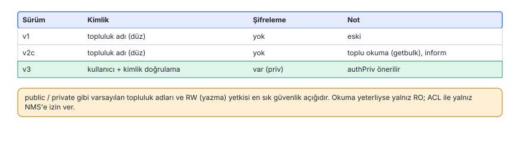

# AğLab Konu #23: Ağ servisleri: NTP, Syslog ve SNMP

> Uygulamadaki `services` dersi bu belgeyle uyumludur. **Okuma dersi:** NTP, Syslog ve SNMP Labber'da
> modellenmez; vakalar kâğıt üstünde, beklenen çıktılarla çözülür. Ön koşul: cihaz yönetimi (Konu #11),
> ACL (Konu #19). Şemalar: `docs/dersler/gorseller/ag-servisleri.py`.

Bu konu bittiğinde öğrenci bütün cihazların saatini NTP ile tek kaynağa bağlar ve `show ntp status` çıktısından senkron olup olmadığını okur. Syslog önem seviyelerini sıralar, kayıtların konsola, belleğe ve uzak sunucuya hangi seviyeden gideceğini ayarlar ve bir log satırını parçalarına ayırır. SNMP'de yönetici ile ajanın rolünü, get/set/trap farkını ve v2c ile v3'ün güvenlik farkını açıklar. Seviye 2 (CCNA), süre yaklaşık 50 dakika.

## 0. Bir bakışta

- **NTP** bütün cihazların saatini aynı kaynağa bağlar; saatler farklıysa kayıtlardan olay sırası çıkarılamaz.
- **Stratum** kaynağa uzaklıktır: 1 kaynağa doğrudan bağlı sunucu, sayı büyüdükçe uzaklaşır; 16 senkron değil.
- **Syslog** seviyeleri 0 (Emergency) ile 7 (Debugging) arasıdır; seçilen seviye ve **daha acil** olanların hepsi gönderilir.
- Kayıtlar konsola, belleğe, SSH oturumuna ve **uzak syslog sunucusuna** (UDP 514) ayrı ayrı gider.
- **SNMP**: yönetici (NMS) ajandan **get/set** ile okur/yazar (UDP 161), ajan olayı **trap/inform** ile bildirir (UDP 162).
- SNMP v1/v2c topluluk adını düz gönderir; **v3** kimlik doğrulama ve şifreleme ekler.

> **Akılda kalsın:** Bu üç servis arızayı çözmez; arızayı **görmeni** ve **sıralamanı** sağlar. Kurulmazlarsa ilk büyük arızada fark edilirler.



## 1. Neden önemli

Bir sabah üç şubeden "ağ yavaş" şikâyeti gelir. Cevap cihazların kayıtlarındadır, ama kayıtlar cihaz yeniden başlayınca silinmişse, saatler birbirini tutmuyorsa ya da kimse arayüz sayaçlarını izlemiyorsa elde kanıt kalmaz. NTP olayları sıralar, syslog onları kalıcı bir yerde toplar, SNMP de grafikleri ve alarmları besler. Sahada "sorun dün gece 02:14'te başlamış" diyebilmek bu üçüne bağlıdır.

## 2. Kavram

### 2.1 NTP: herkes aynı saati göstersin

> **Benzetme:** Bir mahalledeki bütün saatler saatçiye göre ayarlanır, saatçi de saatini radyodaki resmî saat ayarından alır. Herkes aynı kaynağa bağlı olduğu için "saat kaçta oldu?" sorusunun tek cevabı olur.



- `ntp server <adres>`: bu cihaz o sunucudan saat alır (istemci).
- Bir router hem istemci hem şubedeki switch'lere sunucu olabilir.
- `clock timezone TRT 3`: yerel saat dilimi; kayıtlar yerel saatle okunur.
- `service timestamps log datetime msec localtime`: kayıtlara tarih ve milisaniye yazılır.



> **Dikkat:** Saati hiç ayarlanmamış Cisco cihazı kayıtlarda `*Mar 1 00:00:…` gibi bir tarih gösterir; baştaki yıldız "bu saate güvenme" demektir.

### 2.2 Syslog: seviyeler

> **Benzetme:** Hastanede triyaj: kırmızı (0–2) hemen, sarı (3–4) yakında, yeşil (5–7) sırası gelince. `logging trap 4` demek "sarıdan ağır olan her şeyi bana bildir" demektir.



Bir log satırının parçaları:

```
*Nov 15 09:14:02.331: %LINK-3-UPDOWN: Interface GigabitEthernet0/1, changed state to down
 └─ zaman damgası      └tesis└seviye└anahtar  └─ açıklama
```

### 2.3 Syslog: hedefler



- `logging console 5`: konsola seviye 0–5.
- `logging buffered 16384 6`: cihazın belleğine; `show logging` ile okunur, yeniden başlatmada silinir.
- `terminal monitor`: SSH oturumunda kayıtları göster (oturum başına).
- `logging host 192.168.99.60` + `logging trap 5`: uzak sunucuya.

> **Sahada:** Debug çalıştırırken konsola seviye 7 basmak yavaş bir cihazı kilitleyebilir; debug çıktısını belleğe yönlendir (`logging buffered 7`) ve konsolu düşük tut.

### 2.4 SNMP: izleme

> **Benzetme:** Genel müdürlük (NMS) şubeleri periyodik arayıp "kasada ne var?" diye sorar (get); gerekirse talimat verir (set). Şubede yangın çıkarsa şube aranmayı beklemez, kendisi arar (trap).



- **MIB:** cihazın sunduğu değerlerin ağacı; her değerin bir **OID**'i vardır.
- **Trap** onaysızdır; **inform** onay ister (v2c ve v3).

### 2.5 SNMP sürümleri ve güvenlik



```
R1(config)#ip access-list standard NMS
R1(config-std-nacl)#permit host 192.168.99.70
R1(config)#snmp-server community Izle-2026 RO NMS
R1(config)#snmp-server host 192.168.99.70 version 2c Izle-2026
R1(config)#snmp-server enable traps
```

> **Dikkat:** `snmp-server community public RW` gibi bir satır cihazı ağdaki herkesin yapılandırabileceği hale getirir. Okuma yeterliyse RO, ACL ile yalnız NMS; mümkünse v3 authPriv.

## 3. Çıktı okuma

```
R1#show ntp status
Clock is synchronized, stratum 2, reference is 203.0.113.123
nominal freq is 250.0000 Hz, actual freq is 250.0001 Hz, precision is 2**10
reference time is E8F1A2C3.1A2B3C4D (09:14:02.102 TRT Sat Nov 15 2026)
                                       ← synchronized + stratum: tamam

SW1#show ntp status
Clock is unsynchronized, stratum 16, no reference clock
                                       ← senkron değil: sunucuya ulaşılıyor mu?

SW1#show ntp associations
  address         ref clock       st   when   poll reach  delay  offset   disp
 ~192.168.99.1    203.0.113.123    2     45     64     0    0.0    0.00  16000.
                                       ← reach 0: hiç yanıt alınamamış
 * sys.peer, # selected, + candidate, - outlyer, x falseticker, ~ configured

R1#show logging
Syslog logging: enabled
    Console logging: level notifications, 41 messages logged
    Buffer logging:  level informational, 58 messages logged
    Trap logging: level warnings, 12 message lines logged
        Logging to 192.168.99.60  (udp port 514, audit disabled, link up)
                                       ← sunucuya yalnız 0–4 gidiyor: arayüz up/down (5) gitmez!
```

| Soru | Komut |
| --- | --- |
| Saat senkron mu, kaynağı ne? | `show ntp status`, `show ntp associations`, `show clock detail` |
| Hangi kayıt nereye, hangi seviyeden? | `show logging` |
| SNMP topluluk ve hedefler? | `show running-config | include snmp`, `show snmp` |

## 4. Yönlendirmeli lab

> **Simülatörde yok:** Lab'ı kâğıt üstünde yürüt; her adımda Bölüm 3'teki beklenen çıktıyla karşılaştır.

Topoloji: R1 (dışarıda NTP 203.0.113.123), SW1 ve SW2 (yönetim VLAN 99, gateway 192.168.99.1); yönetim ağında syslog (.60) ve NMS (.70).

1. R1: `ntp server 203.0.113.123`, `clock timezone TRT 3`. `show ntp status` synchronized olana kadar bekle. *Neden:* ilk senkron birkaç dakika sürebilir.
2. SW1 ve SW2: `ntp server 192.168.99.1`; `show ntp associations`'ta `*` işaretini gör.
3. Üç cihazda `service timestamps log datetime msec localtime`.
4. `logging host 192.168.99.60`, `logging trap 5`; bir arayüzü kapatıp aç, sunucuya `%LINK-3-UPDOWN` geldiğini düşün. *Neden:* seviye 3 ≤ 5.
5. `logging trap 4` yap: hangi kayıtlar artık gitmez? (5: `%LINEPROTO-5-UPDOWN`, ayarlar değişti mesajları vb.)
6. SNMP: RO topluluk, NMS ACL'si, trap hedefi. `public` ve RW yazmamanın nedenini bir cümleyle yaz.

> **Benzetme:** Lab sonunda üç cihaz aynı saati gösteren ve her olayı aynı deftere yazan üç nöbetçi gibidir.

## 5. Sık hatalar

| Kod | Hata | Belirti | Kanıt | Düzeltme |
| --- | --- | --- | --- | --- |
| E1 | NTP sunucusuna ulaşılamıyor | Saat senkron değil | `unsynchronized`, `reach 0` | Rota, ACL (UDP 123), adres |
| E2 | Saat dilimi yok | Kayıtlar 3 saat geride | `show clock` UTC | `clock timezone TRT 3` |
| E3 | `logging trap` seviyesi çok düşük | Arayüz up/down sunucuya gelmiyor | `Trap logging: level warnings` | `logging trap 5` (ya da 6) |
| E4 | Kayıtlar yalnız bellekte | Yeniden başlatmadan sonra iz yok | `logging host` yok | Uzak syslog |
| E5 | SNMP `public` RW | Güvenlik açığı | `snmp-server community public RW` | RO + ACL ya da v3 |

## 6. Arıza senaryoları

> **Uygulamada:** Kâğıt üstü vakalar; motor desteği gelince Sorun Çöz'e `svc-*` kimlikleriyle eklenecek. Önce kendin çöz; neden ve çözüm kapalı kutularda.

### S1 · Başlangıç · Kayıtlar mantıksız sırada (E2)

- **Belirti:** R1'in kaydına göre OSPF komşusu 06:14'te düştü, SW-CORE'a göre uplink 09:14'te koptu; teknisyen "önce router çöktü" diyor.
- **Hedef:** Olayları doğru sıralamak.

<details><summary>Neden ve çözüm</summary>

İki cihaz da NTP ile senkron ama R1'de saat dilimi yok (UTC), SW-CORE'da TRT 3. Aslında iki olay aynı anda. Çözüm: R1'de `clock timezone TRT 3`; kayıtları yeniden yorumla: uplink koptu, komşuluk bu yüzden düştü.

</details>

### S2 · Orta · Switch'in saati hiç tutmuyor (E1)

- **Belirti:** SW2 kayıtlarında `*Mar 1` tarihleri; `ntp server 192.168.99.1` yazılı.
- **Hedef:** SW2 synchronized.

<details><summary>Neden ve çözüm</summary>

SW2'de `ip default-gateway` yok ve R1'deki yönetim ACL'si UDP 123'e izin vermiyor; `show ntp associations`'ta reach 0. Çözüm: yönetim erişimini (gateway, ACL'de NTP) düzelt.

</details>

### S3 · Orta · Kablo koptu, syslog sunucusunda iz yok (E3)

- **Belirti:** Gece bir uplink kopup geri geldi; konsolda kayıt var, syslog sunucusunda yok.
- **Hedef:** Arayüz olayları sunucuya gitsin.

<details><summary>Neden ve çözüm</summary>

`logging trap 4`: `%LINEPROTO-5-UPDOWN` seviye 5 olduğu için gönderilmiyor (`%LINK-3` gider ama sunucu filtresi kaçırmış olabilir). Çözüm: `logging trap 5` (ya da 6).

</details>

### S4 · İleri · Biri switch'in adını değiştirmiş (E5)

- **Belirti:** SW1'in hostname'i gece "TEST" olmuş; kimse SSH ile bağlanmamış (AAA kayıtlarında oturum yok).
- **Hedef:** Değişikliğin yolunu bul ve kapat.

<details><summary>Neden ve çözüm</summary>

`snmp-server community public RW`: ağdaki herkes SNMP set ile `sysName` değerini değiştirebilir. Çözüm: RW topluluğu kaldır, RO + ACL ya da v3 authPriv.

</details>

## 7. Kısa sınav

**1.** `show ntp status` "unsynchronized, stratum 16" diyor. Anlamı?

<details><summary>Cevap</summary>

Cihaz hiçbir NTP kaynağına senkron değil; sunucuya erişimi ve `show ntp associations`'taki reach değerini kontrol et.

</details>

**2.** `logging trap 4` ile hangi seviyeler sunucuya gider?

<details><summary>Cevap</summary>

0–4 (Emergency, Alert, Critical, Error, Warning).

</details>

**3.** Bellekteki (buffered) kayıtların zayıf yanı?

<details><summary>Cevap</summary>

Cihaz yeniden başlayınca silinir; kalıcı kayıt için uzak syslog gerekir.

</details>

**4.** SNMP'de ajanın kendiliğinden gönderdiği bildirim ve portu?

<details><summary>Cevap</summary>

Trap (onaysız) ya da inform (onaylı); UDP 162.

</details>

**5.** Topluluk adını düz metin göndermeyen, kimlik doğrulama ve şifreleme sunan SNMP sürümü?

<details><summary>Cevap</summary>

SNMPv3 (authPriv).

</details>

**6.** `%LINK-3-UPDOWN` satırındaki 3 neyi gösterir?

<details><summary>Cevap</summary>

Önem seviyesini: 3 = Error.

</details>

## 8. Özet kartı

| Komut | Ne işe yarar |
| --- | --- |
| `ntp server <adres>` | Saat kaynağı |
| `clock timezone TRT 3` | Saat dilimi |
| `show ntp status`, `show ntp associations` | Senkron mu, kaynak hangisi |
| `service timestamps log datetime msec localtime` | Kayıtlara tarih |
| `logging host <adres>`, `logging trap 5` | Uzak syslog |
| `logging buffered 6`, `show logging` | Bellek ve okuma |
| `snmp-server community <ad> RO <ACL>` | Salt okunur SNMP |
| `snmp-server host <NMS> version 2c <ad>` | Trap hedefi |

**Unutma:**

1. Saat yoksa kanıt yok: NTP + saat dilimi.
2. Seviye seçilince o ve daha acil olanlar gider.
3. Bellek geçici, sunucu kalıcı.
4. SNMP 161 sorgu, 162 trap.
5. RW topluluk ve `public` kullanma.

## 9. Doğrulama notları

Kaynaklar: INET CCNA 200-301 v1.1 ve INE ENCOR (NTP, Syslog, SNMP bölümleri, yalnız kapsam kontrolü için); RFC 5905 (NTPv4), RFC 5424 (Syslog), RFC 3411–3418 (SNMP); Cisco IOS yapılandırma kılavuzları. Ders metni, örnek çıktılar ve şemalar özgün yazıldı.

| İddia | Sonuç |
| --- | --- |
| NTP UDP 123; stratum 16 senkron değil | Doğru |
| Syslog seviyeleri 0–7; trap seviyesi o ve daha düşük numaraları gönderir | Doğru |
| Syslog UDP 514 (varsayılan) | Doğru |
| SNMP sorgu UDP 161, trap/inform UDP 162 | Doğru |
| v1/v2c topluluk adı düz metin; v3 USM ile auth ve priv | Doğru |
| Saati ayarlanmamış IOS'ta zaman damgası `*` ile başlar | Doğru |

**Motor gereksinimleri**

- [ ] NTP, syslog hedefleri ve SNMP Labber'da yok (motor işi). Hazır olunca S1–S4 `svc-*` kimlikleriyle Sorun Çöz'e eklenir.
