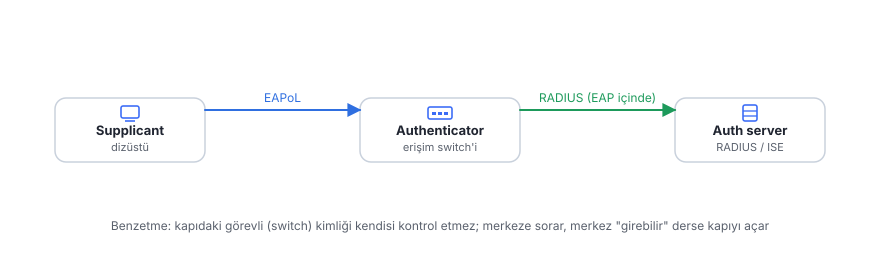
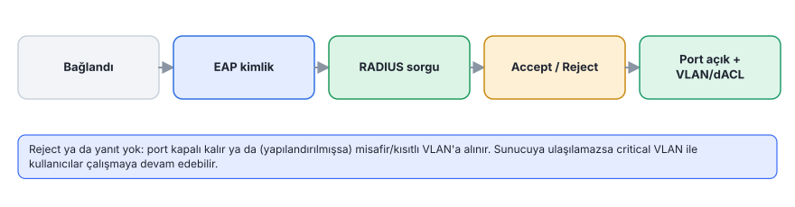
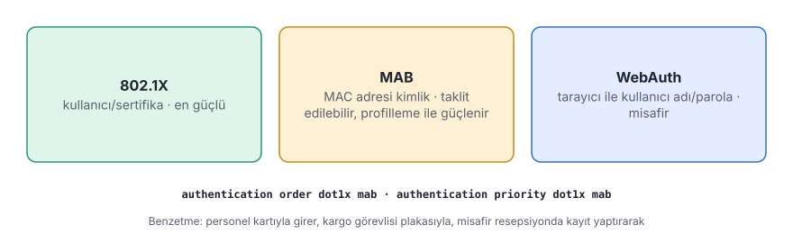
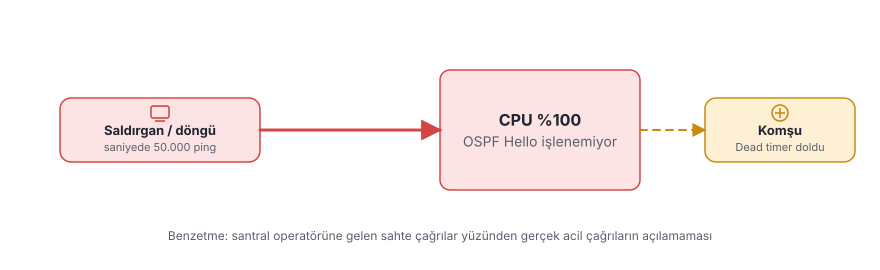
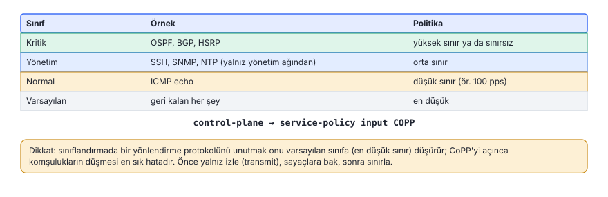
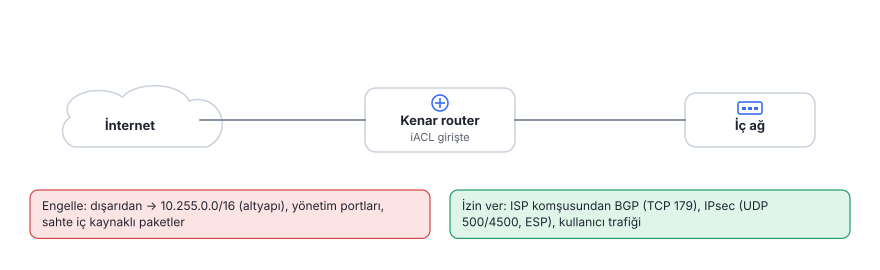
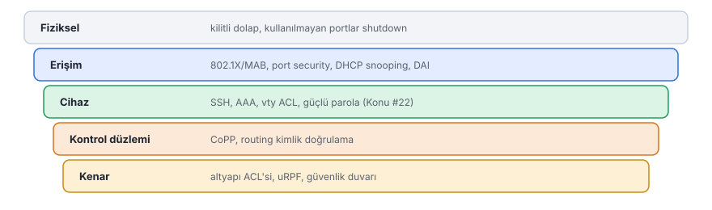

# AğLab Konu #38: Altyapı güvenliği: 802.1X, MAB, CoPP ve altyapı ACL'leri

> Uygulamadaki `dot1x` dersi bu belgeyle uyumludur. **Okuma dersi (Seviye 3, CCNP):** 802.1X, RADIUS ve CoPP Labber'da yok; ACL motoru mevcut ACL derslerini destekler.
> Ön koşul: L2 güvenlik (Konu #21), erişim güvenliği ve RADIUS (Konu #22), ACL (Konu #19), iletim mekanizmaları ve punt (Konu #28). Şemalar: `docs/dersler/gorseller/altyapi-guvenligi.py`.

Bu konu bittiğinde öğrenci 802.1X'in üç rolünü ve bir portun kimlik doğrulama sürecindeki durumlarını açıklar; RADIUS'un VLAN ve ACL atayabildiğini bilir. 802.1X yapamayan cihazlar için MAB ve misafirler için WebAuth'u konumlandırır. Kontrol düzleminin neden saldırıya açık olduğunu ve CoPP'nin CPU'ya giden trafiği nasıl sınıflayıp sınırladığını anlatır; ağ kenarında altyapı ACL'siyle router'ın kendisini korur. Süre yaklaşık 55 dakika.

## 0. Bir bakışta

- **802.1X**: **supplicant** (kullanıcı cihazı), **authenticator** (switch/WLC), **authentication server** (RADIUS/ISE).
- Doğrulanmamış port yalnız **EAPoL** geçirir; **Access-Accept** gelince açılır, sunucu **VLAN/dACL** atayabilir.
- Supplicant'ı olmayan cihazlar **MAB** (MAC ile), misafirler **WebAuth** ile.
- Kontrol düzlemi (CPU) boğulursa komşuluklar düşer: **CoPP** CPU'ya giden trafiği sınıflar ve sınırlar.
- CoPP'de yönlendirme protokolünü unutmak onu en düşük sınıfa düşürür: önce izle, sonra sınırla.
- **Altyapı ACL'si** kenarda router'ın kendi adreslerine yönelik dış trafiği engeller.
- Savunma katmanlıdır: fiziksel, erişim, cihaz, kontrol düzlemi, kenar.

> **Akılda kalsın:** 802.1X'te 'kullanıcı bağlanamıyor' şikâyetinin yarısı RADIUS tarafındadır: önce switch'in sunucuya ulaştığını ve paylaşılan anahtarı doğrula.



## 1. Neden önemli

Bir şubede herhangi bir duvar prizine takılan cihazın ağa girebilmesi, port security'nin (Konu #21) ötesinde bir kimlik kontrolü gerektirir: kim bağlanıyor, hangi ağa girmeli, hangi kurallarla? 802.1X bu soruyu kullanıcı ya da cihaz kimliğiyle cevaplar. Öte yandan router ve switch'lerin kendi CPU'ları da korunmalıdır; bir ping seli ya da döngüdeki paketler kontrol düzlemini boğduğunda ağ çöker. CCNP ENCOR'un altyapı güvenliği bölümü bu iki konuyu birlikte sorar.

## 2. Kavram

### 2.1 802.1X

> **Benzetme:** Bir binanın turnikesi (switch) kimin gireceğine kendisi karar vermez; kartı okutursun, turnike merkeze sorar, merkez "bu kişi 3. kata girebilir" derse turnike açılır ve asansör yalnız 3. kata gider (VLAN ataması).



- **EAP** yöntemleri: PEAP (kullanıcı adı/parola, TLS tüneli içinde), EAP-TLS (iki tarafta sertifika; en güçlü).
- Switch ile RADIUS arası: UDP 1812/1813, paylaşılan anahtar (Konu #22).

```
aaa new-model
aaa authentication dot1x default group radius
dot1x system-auth-control
interface gi1/0/5
 switchport mode access
 authentication port-control auto
 dot1x pae authenticator
 mab
```

### 2.2 MAB ve WebAuth



> **Dikkat:** MAB'da kimlik MAC adresidir ve kolayca taklit edilir. Yazıcı için MAB kullanılıyorsa o porta verilen yetki yazıcının ihtiyacı kadar (dACL ile yalnız baskı sunucusu) olmalıdır.

### 2.3 Kontrol düzlemini korumak





```
class-map match-any COPP-KRITIK
 match access-group name ROUTING
policy-map COPP
 class COPP-KRITIK
  police 512000 conform-action transmit exceed-action transmit
 class COPP-ICMP
  police 64000 conform-action transmit exceed-action drop
 class class-default
  police 32000 conform-action transmit exceed-action drop
control-plane
 service-policy input COPP
```

### 2.4 Altyapı ACL'si



### 2.5 Katmanlı savunma



> **Sahada:** 802.1X'i bir anda bütün portlarda zorunlu yapmak (closed mode) yüzlerce kullanıcıyı dışarıda bırakabilir. Önce **monitor mode** (izin ver, kaydet), sonra **low impact**, en son **closed** modla aşamalı geçilir.

## 3. Çıktı okuma

```
SW1#show authentication sessions interface gi1/0/5 details
            Interface:  GigabitEthernet1/0/5
          MAC Address:  3c22.fb11.2233
         IPv4 Address:  10.1.10.55
            User-Name:  ayse.k
               Status:  Authorized
               Domain:  DATA
       Oper host mode:  multi-auth
         Vlan Policy:  10
              ACS ACL:  xACSACLx-IP-PERSONEL-6f2a1b3c
      Method status list:
       Method           State
       dot1x            Authc Success
                                        ← 802.1X ile doğrulandı, ISE VLAN 10 ve dACL atadı

SW1#show authentication sessions interface gi1/0/9 details
               Status:  Unauthorized
       Method           State
       dot1x            Stopped
       mab              Authc Failed
                                        ← supplicant yok (dot1x durdu), MAC tanınmıyor (MAB başarısız)

R1#show policy-map control-plane
 Control Plane
  Service-policy input: COPP
    Class-map: class-default (match-any)
      18233 packets, 1450122 bytes
      police: cir 32000 bps
        conformed 4122 packets; actions: transmit
        exceeded 14111 packets; actions: drop
                                        ← varsayılan sınıfta çok kayıp: hangi trafik bu? OSPF mi?
```

| Soru | Komut |
| --- | --- |
| Port doğrulandı mı, hangi yöntemle? | `show authentication sessions interface <if> details` |
| Switch RADIUS'a ulaşıyor mu? | `show aaa servers`, `test aaa group radius …` |
| CoPP hangi sınıfta ne atıyor? | `show policy-map control-plane` |
| CPU'ya ne geliyor? | `show processes cpu sorted`, punt sayaçları |

## 4. Yönlendirmeli lab

> **Simülatörde yok:** Lab'ı kâğıt üstünde yürüt; her adımda Bölüm 3'teki beklenen çıktıyla karşılaştır.

Şube: erişim switch'i, ISE (192.168.99.50), personel dizüstüleri (PEAP), yazıcılar (MAB), misafir SSID (WebAuth); kenar router internet bağlantılı.

1. Switch'te RADIUS sunucusu ve `dot1x system-auth-control`. *Neden:* switch yalnız aracıdır, kararı sunucu verir.
2. Kullanıcı portlarında `authentication port-control auto`, `dot1x pae authenticator`, `mab`; sıra dot1x → mab.
3. Önce monitor mode (`authentication open`) ile bir hafta kayıt topla; sonra kapat.
4. ISE'de personel için VLAN 10 + dACL, yazıcılar için VLAN 30 + yalnız baskı sunucusu dACL'si.
5. Kenar router'da CoPP: ROUTING ACL'sine OSPF ve BGP'yi ekle; önce bütün sınıflarda exceed-action transmit ile sayaçları izle.
6. Kenar router girişine iACL: dışarıdan 10.255.0.0/16'ya giden her şeyi engelle, ISP'den BGP'ye izin ver.

> **Benzetme:** 3. adım, yeni turnike sistemini ilk hafta açık bırakıp yalnız kaydı izlemektir: kimin kartının çalışmadığını kapıda kimseyi bekletmeden öğrenirsin.

## 5. Sık hatalar

| Kod | Hata | Belirti | Kanıt | Düzeltme |
| --- | --- | --- | --- | --- |
| E1 | RADIUS'a ulaşılamıyor / anahtar farklı | Hiç kimse doğrulanamıyor | `show aaa servers` DEAD; ISE'de 'unknown NAD' | Erişim ve paylaşılan anahtar |
| E2 | Supplicant'sız cihazda MAB yok | Yazıcı/telefon bağlanamıyor | dot1x Stopped, mab yok | Porta `mab` |
| E3 | Doğrudan closed mode | Toplu kullanıcı şikâyeti | Çok sayıda Unauthorized | Monitor → low impact → closed |
| E4 | CoPP'de routing protokolü sınıflanmamış | CoPP sonrası komşuluklar düşüyor | class-default'ta exceeded artıyor | ROUTING sınıfına ekle |
| E5 | iACL gerekli protokolü engelliyor | BGP/IPsec kesildi | iACL sayaçları | İzin satırlarını üste |

## 6. Arıza senaryoları

> **Uygulamada:** Kâğıt üstü vakalar; motor ya da Gerçek Lab desteği gelince Sorun Çöz'e `infsec-*` kimlikleriyle eklenecek. Önce kendin çöz; neden ve çözüm kapalı kutularda.

### S1 · Başlangıç · Bütün şube bağlanamıyor (E1)

- **Belirti:** 802.1X açıldıktan sonra hiçbir kullanıcı doğrulanamıyor; port durumları Unauthorized.
- **Hedef:** Kullanıcılar doğrulansın.

<details><summary>Neden ve çözüm</summary>

ISE'de switch bir ağ cihazı olarak tanımlı ama paylaşılan anahtar farklı; ISE istekleri yok sayıyor. Çözüm: anahtarı eşitle, `test aaa` ile doğrula.

</details>

### S2 · Orta · Yazıcı ağdan düştü (E2)

- **Belirti:** 802.1X sonrası yazıcı IP almıyor; dizüstüler sorunsuz.
- **Hedef:** Yazıcı ağa girsin, yalnız gerekeni görsün.

<details><summary>Neden ve çözüm</summary>

Yazıcının supplicant'ı yok ve portta MAB yok. Çözüm: porta `mab`, ISE'de yazıcının MAC'ini/profilini yazıcı grubuna ekle, dACL ile yalnız baskı sunucusu.

</details>

### S3 · Orta · CoPP açıldı, OSPF komşulukları düştü (E4)

- **Belirti:** Kenar router'da CoPP politikası uygulandıktan birkaç dakika sonra OSPF komşulukları sürekli düşüp kalkıyor.
- **Hedef:** Komşuluklar kararlı olsun.

<details><summary>Neden ve çözüm</summary>

ROUTING ACL'sinde yalnız BGP var, OSPF (protokol 89) yok; OSPF paketleri class-default'a düşüp 32 kbps'te atılıyor. Çözüm: ROUTING ACL'sine `permit ospf any any`.

</details>

### S4 · İleri · Gece ping seli (CoPP'nin işe yaraması)

- **Belirti:** Gece bir istemci döngüsü router'a saniyede on binlerce ping gönderdi; geçen ay aynı olayda OSPF düşmüştü, bu kez düşmedi.
- **Hedef:** Neden bu kez ağ ayakta kaldı, açıkla.

<details><summary>Neden ve çözüm</summary>

CoPP'de ICMP sınıfı 64 kbps ile sınırlı; fazla ping CPU'ya ulaşmadan atıldı, OSPF kritik sınıfta işlenmeye devam etti.

</details>

## 7. Kısa sınav

**1.** 802.1X'in üç rolü?

<details><summary>Cevap</summary>

Supplicant (kullanıcı cihazı), authenticator (switch/WLC), authentication server (RADIUS).

</details>

**2.** Doğrulanmamış bir 802.1X portu hangi trafiğe izin verir?

<details><summary>Cevap</summary>

Yalnız EAPoL (ve CDP/LLDP gibi bazı denetim trafiği).

</details>

**3.** Supplicant'ı olmayan yazıcı nasıl doğrulanır?

<details><summary>Cevap</summary>

MAB: MAC adresi kimlik olarak RADIUS'a sorulur.

</details>

**4.** CoPP neyi korur?

<details><summary>Cevap</summary>

Router/switch'in kontrol düzlemini (CPU): CPU'ya giden trafiği sınıflar ve sınırlar.

</details>

**5.** CoPP uygulandıktan sonra OSPF düşüyorsa ilk şüphe?

<details><summary>Cevap</summary>

OSPF trafiği kritik sınıfa alınmamış, class-default'ta sınırlanıyor.

</details>

**6.** 802.1X'e geçişte önerilen sıra?

<details><summary>Cevap</summary>

Monitor mode → low impact → closed mode.

</details>

## 8. Özet kartı

| Komut | Ne işe yarar |
| --- | --- |
| `dot1x system-auth-control` | 802.1X'i aç |
| `authentication port-control auto` | Portta doğrulama |
| `mab` | MAC ile doğrulama |
| `show authentication sessions …` | Durum, yöntem, VLAN/dACL |
| `control-plane` → `service-policy input` | CoPP |
| `show policy-map control-plane` | CoPP sayaçları |
| Kenar girişte iACL | Altyapı adreslerini koru |

**Unutma:**

1. Switch aracıdır, kararı RADIUS verir.
2. Supplicant yoksa MAB.
3. Monitor → low impact → closed.
4. CoPP'de routing protokollerini unutma.
5. Önce izle, sonra sınırla.

## 9. Doğrulama notları

Kaynaklar: INE ENCOR (Security: 802.1X, MAB, WebAuth, CoPP, device access) ve CCNP ENCOR v1.0 (yalnız kapsam kontrolü için); IEEE 802.1X; RFC 3580 (802.1X RADIUS kullanımı); Cisco CoPP ve IBNS yapılandırma kılavuzları. Ders metni, örnek çıktılar ve şemalar özgün yazıldı.

| İddia | Sonuç |
| --- | --- |
| 802.1X rolleri supplicant, authenticator, authentication server | Doğru |
| Doğrulanmamış port EAPoL dışında trafiği engeller | Doğru |
| MAB MAC adresini kimlik olarak RADIUS'a gönderir | Doğru |
| RADIUS VLAN ve indirilebilir ACL atayabilir | Doğru |
| CoPP control-plane altında service-policy input ile uygulanır | Doğru |
| Varsayılan sınıfa düşen yönlendirme trafiği sınırlanırsa komşuluklar düşebilir | Doğru |

**Motor gereksinimleri**

- [ ] 802.1X, RADIUS ve CoPP Labber'da yok. Bir 'RADIUS sunucusu' cihazı ve port kimlik durumu motora eklenirse S1–S2 `infsec-*` kimlikleriyle uygulanabilir; CoPP okuma olarak kalır.
