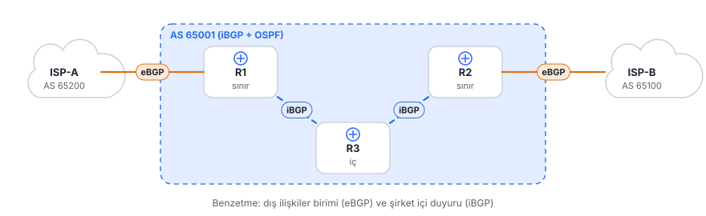
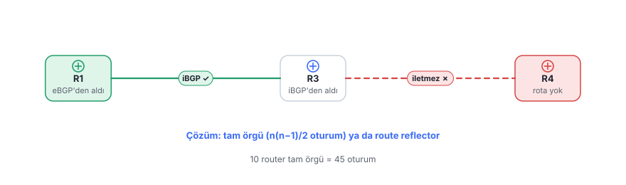
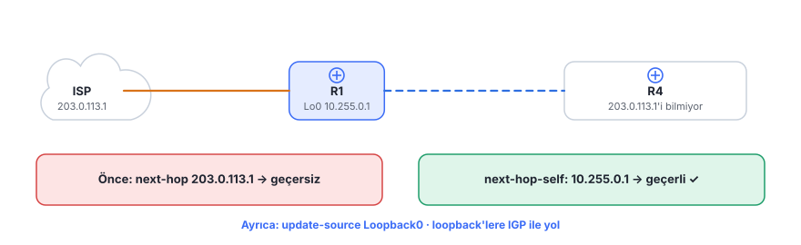
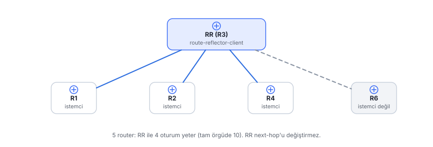
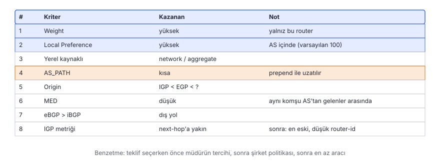
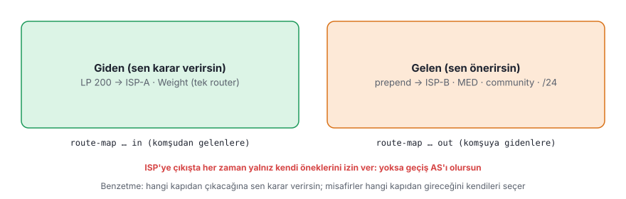
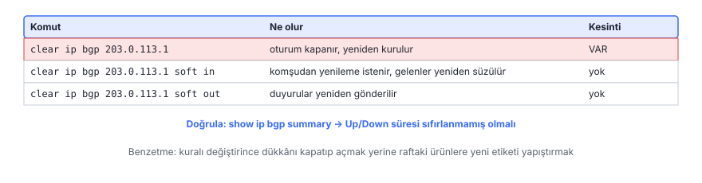

# AğLab Konu #43: İleri BGP: iBGP, route reflector, attribute'lar ve politika

> Uygulamadaki `bgpadv` dersi bu belgeyle uyumludur. **Okuma dersi (Seviye 3, CCNP):** Labber'da basit eBGP var; iBGP, route reflector, community ve route-map politikası Gerçek Lab (FRR) ile denenir.
> Ön koşul: BGP temeli (Konu #32), redistribution ve route-map (Konu #44), OSPF (Konu #15). Şemalar: `docs/dersler/gorseller/bgp-ileri.py`.

Bu konu bittiğinde öğrenci iBGP'nin neden tam örgü (full mesh) istediğini ve bunun yerine route reflector'ın nasıl çalıştığını açıklar. iBGP'de next-hop'un neden değişmediğini, `next-hop-self` ve `update-source loopback`'in hangi sorunu çözdüğünü bilir. Yol seçiminin sırasını ezbere değil mantığıyla anlatır; Weight, Local Preference, AS_PATH, MED ve community ile çıkış ve giriş trafiğini yönlendirir. Politikayı komşu başına route-map ile uygular ve oturumu düşürmeden yeniler. Süre yaklaşık 70 dakika.

## 0. Bir bakışta

- **iBGP** aynı AS içindeki BGP oturumudur; **iBGP'den öğrenilen rota başka bir iBGP komşusuna iletilmez** (iBGP split horizon).
- Bu yüzden iBGP ya **tam örgü** ister ya da **route reflector** (RR) / konfederasyon.
- iBGP **next-hop'u değiştirmez**: dış komşunun adresi aynen taşınır; içeride ulaşılamıyorsa rota kullanılmaz → `next-hop-self`.
- iBGP oturumları genelde **loopback** arasında kurulur: `update-source Loopback0` + loopback'e IGP ile yol.
- Yol seçimi sırası: **Weight → Local Pref → yerel kaynak → AS_PATH → Origin → MED → eBGP > iBGP → IGP metriği → …**
- **Çıkışı** Weight/Local Pref; **girişi** AS_PATH prepend, MED ve community belirler.
- Politika komşu başına route-map ile uygulanır; değişiklik sonrası `clear ip bgp … soft`.

> **Akılda kalsın:** BGP'de "rota var ama kullanılmıyor" demek çoğu zaman "next-hop'a ulaşılamıyor" demektir. `show ip bgp`'de `>` (best) işareti yoksa önce next-hop'a bak.



## 1. Neden önemli

İki ISP'ye bağlı bir şirkette sınırda birden çok router olur; dışarıdan öğrenilen rotaların içerideki router'lar arasında tutarlı paylaşılması iBGP ile yapılır. Hangi trafiğin hangi ISP'den çıkacağı, hangisinden geleceği, yedek hattın gerçekten yedek kalması, ISP'ye hangi öneklerin duyurulacağı: bunların hepsi BGP attribute'ları ve politikayla belirlenir. Yanlış bir route-map ile bütün internet trafiğini pahalı hatta göndermek ya da bir ISP'ye müşteri olmayan önekleri duyurup geçiş AS'ı olmak sahada gerçekten yaşanan, pahalı hatalardır.

## 2. Kavram

### 2.1 iBGP split horizon ve tam örgü

> **Benzetme:** Bir şirkette dışarıdan gelen haberi yalnız dış ilişkilerden sorumlu kişi alır ve her çalışana tek tek söylemek zorundadır; çalışanların duydukları haberi birbirlerine aktarmaları yasaktır (dedikodu döngüsü olmasın diye). Çalışan sayısı artınca bu yük taşınmaz; bir "duyuru sorumlusu" (route reflector) atanır.



- eBGP'de döngü AS_PATH ile önlenir: rota kendi AS numaranı taşıyorsa reddedilir. iBGP'de AS_PATH değişmez, bu yüzden başka bir kural gerekir: iBGP'den öğrenileni iBGP'ye verme.
- n router için tam örgü n(n−1)/2 oturum ister: 10 router = 45 oturum.

### 2.2 Next-hop ve loopback oturumları



```
router bgp 65001
 neighbor 10.255.0.2 remote-as 65001
 neighbor 10.255.0.2 update-source Loopback0
 neighbor 10.255.0.2 next-hop-self
 neighbor 203.0.113.1 remote-as 65200
```

- `update-source Loopback0`: oturum fiziksel bir arayüze bağlı kalmasın; bir hat kopsa da IGP başka yoldan loopback'e ulaştırır.
- `next-hop-self`: dışarıdan öğrenilen rotanın next-hop'u olarak sınır router'ın kendi adresini koyar. Alternatif: sınır bağlantısının alt ağını IGP'ye dahil etmek (passive arayüz olarak).
- eBGP oturumları genelde doğrudan bağlı adresler arasındadır; loopback kullanılacaksa `ebgp-multihop` gerekir.

### 2.3 Route reflector



```
router bgp 65001
 neighbor 10.255.0.3 remote-as 65001
 neighbor 10.255.0.3 route-reflector-client
```

| Rota nereden geldi | RR kime yansıtır |
| --- | --- |
| eBGP komşusundan | Herkese (istemci ve istemci olmayan) |
| İstemciden | Diğer istemcilere ve istemci olmayanlara |
| İstemci olmayan iBGP komşusundan | Yalnız istemcilere |

- Yalnız RR'da yapılandırma gerekir; istemci, RR olduğunu bilmez.
- Döngü önleme: RR rotaya **ORIGINATOR_ID** ve **CLUSTER_LIST** ekler; kendi kimliğini görürse rotayı reddeder.
- RR yansıtırken **next-hop'u değiştirmez**; rota yalnız RR'ın seçtiği **en iyi** yoldur.

### 2.4 Yol seçimi



Rota önce **geçerli** olmalıdır: next-hop'a ulaşılabilmeli, AS_PATH'te kendi AS'ın olmamalı. Sonra sırayla, ilk farklı olan kriter kazananı belirler:

1. En yüksek **Weight** (Cisco'ya özel, yalnız o router'da geçerli)
2. En yüksek **Local Preference** (AS içinde yayılır, varsayılan 100)
3. Yerel kaynaklı rota (network, aggregate, redistribute)
4. En kısa **AS_PATH**
5. En düşük **Origin** (IGP < EGP < incomplete)
6. En düşük **MED** (varsayılan olarak yalnız aynı komşu AS'tan gelen yollar arasında)
7. **eBGP** yolu iBGP'ye tercih edilir
8. Next-hop'a en düşük **IGP metriği**
9. Sonraki kriterler: en eski eBGP yolu, en düşük router-id, en düşük komşu adresi

> **Benzetme:** Bir iş için teklif seçmek gibi: önce "bu firma bizimle çalışabilir mi" (geçerlilik), sonra müdürün kişisel tercihi (Weight), sonra şirket politikası (Local Pref), sonra en az aracı (AS_PATH)… Bir aşamada fark çıkınca gerisine bakılmaz.

### 2.5 Çıkışı ve girişi yönlendirmek



| Hedef | Araç | Nerede | Etki alanı |
| --- | --- | --- | --- |
| Çıkış ISP-A'dan olsun | Local Preference 200 (gelen rotalara) | Sınır router, komşudan **in** | Bütün AS |
| Bu router ISP-A'yı seçsin | Weight | Tek router | Yalnız o router |
| Giriş ISP-A'dan olsun | AS_PATH prepend (ISP-B'ye giden duyuruda) | Sınır router, komşuya **out** | Dünya (öneri niteliğinde) |
| Komşu AS'a hangi girişi kullanacağını söyle | MED | Komşuya **out** | Yalnız komşu AS |
| ISP'den davranış iste | Community (ör. ISP'nin LP community'leri) | Komşuya **out** | ISP'nin tanımına göre |

İyi bilinen community'ler:

- `no-export`: rota AS dışına duyurulmasın (eBGP'ye verilmez).
- `no-advertise`: rota hiçbir komşuya duyurulmasın.
- `local-AS`: konfederasyon alt AS'ı dışına çıkmasın.

```
route-map ISP-A-IN permit 10
 set local-preference 200
route-map ISP-B-OUT permit 10
 match ip address prefix-list BIZIM
 set as-path prepend 65001 65001 65001
router bgp 65001
 neighbor 203.0.113.1 route-map ISP-A-IN in
 neighbor 198.51.100.1 route-map ISP-B-OUT out
 neighbor 198.51.100.1 send-community
```

> **Dikkat:** Community'ler varsayılan olarak komşuya gönderilmez; `neighbor … send-community` gerekir. Ve ISP'ye çıkışta her zaman yalnız kendi öneklerini izin veren bir prefix-list kullan: yoksa bir ISP'den öğrendiğini diğerine duyurup geçiş AS'ı olursun.

### 2.6 Politikayı uygulamak: soft reset



- Route-map değişikliği mevcut rotalara kendiliğinden uygulanmaz.
- `clear ip bgp 203.0.113.1` oturumu düşürür: kesinti.
- `clear ip bgp 203.0.113.1 soft in` / `soft out`: oturum açık kalır; gelen rotalar yeniden değerlendirilir (route refresh) ya da duyurular yeniden gönderilir.

## 3. Çıktı okuma

```
R3#show ip bgp
     Network          Next Hop            Metric LocPrf Weight Path
 * i 0.0.0.0          198.51.100.1             0    100      0 65100 i
 *>i                  10.255.0.1               0    200      0 65200 i
 *>i 172.20.0.0/16    10.255.0.1               0    200      0 65200 65300 i
 * i 192.0.2.0/24     198.51.100.1             0    100      0 65100 65400 i
                                        ← 192.0.2.0'da '>' yok: tek yol var ama next-hop 198.51.100.1
                                          (ISP-B) içeride bilinmiyor: R2'de next-hop-self eksik

R3#show ip route 198.51.100.1
% Network not in table

R3#show ip bgp 172.20.0.0
BGP routing table entry for 172.20.0.0/16, version 41
Paths: (1 available, best #1, table default)
  65200 65300
    10.255.0.1 (metric 20) from 10.255.0.5 (10.255.0.5)
      Origin IGP, metric 0, localpref 200, valid, internal, best
      Originator: 10.255.0.1, Cluster list: 10.255.0.5
      Community: 65001:200
                                        ← RR (10.255.0.5) üzerinden yansıtılmış; next-hop R1'in loopback'i

R2#show ip bgp neighbors 198.51.100.1 advertised-routes
     Network          Next Hop            Metric LocPrf Weight Path
 *>  10.0.0.0/16      0.0.0.0                  0         32768 i
 *>  172.20.0.0/16    10.255.0.1               0    200      0 65200 65300 i
                                        ← kendi önekin dışında ISP-A'dan öğrenilen rota ISP-B'ye gidiyor: geçiş AS'ı oldun
```

| Soru | Komut |
| --- | --- |
| Hangi yol en iyi, neden? | `show ip bgp <önek>` |
| Oturum durumu ve alınan önek sayısı? | `show ip bgp summary` |
| Komşuya ne duyuruyorum? | `show ip bgp neighbors <ip> advertised-routes` |
| Komşudan ne geldi (politika öncesi)? | `show ip bgp neighbors <ip> received-routes` (soft-reconfiguration inbound gerekir) |
| Next-hop'a yol var mı? | `show ip route <next-hop>` |
| Route-map eşleşmeleri? | `show route-map` |

## 4. Yönlendirmeli lab

> **Simülatörde yok:** Lab'ı kâğıt üstünde (ya da Gerçek Lab'da) yürüt; her adımda Bölüm 3'teki beklenen çıktıyla karşılaştır.

Topoloji: AS 65001 içinde R1 (ISP-A'ya), R2 (ISP-B'ye), R3 ve R4 iç router; OSPF ile loopback'ler duyuruluyor.

1. R1–R2–R3–R4 arasında yalnız R1–R3 ve R2–R3 iBGP oturumları kur. R4 rota alıyor mu? R3'ün R1'den aldığını R4'e vermediğini gör. *Neden:* iBGP split horizon.
2. R3'ü route reflector yap, diğerlerini istemci. R4'ün rotaları aldığını gör; `show ip bgp <önek>`'te Originator ve Cluster list'e bak.
3. R4'te rotalar `>` almıyor: next-hop ISP adresi. R1 ve R2'de `next-hop-self` ekle.
4. R1'de ISP-A'dan gelen rotalara LP 200; R4'ün çıkışı ISP-A'ya kaydı mı?
5. R2'de ISP-B'ye giden duyuruya üç prepend; ISP-B tarafından bakınca yolun uzadığını gör.
6. R2'de ISP-B'ye çıkış prefix-list'ini kaldır ve `advertised-routes` ile geçiş AS'ı olduğunu gör; sonra geri koy.
7. Her değişiklikten sonra `clear ip bgp … soft` kullan; oturumun düşmediğini `show ip bgp summary`'deki süreden doğrula.

## 5. Sık hatalar

| Kod | Hata | Belirti | Kanıt | Düzeltme |
| --- | --- | --- | --- | --- |
| E1 | iBGP tam örgü yok, RR yok | Bazı iç router'larda rota yok | Rota bir hop ötede var, sonrakinde yok | Tam örgü ya da RR |
| E2 | next-hop-self yok | Rota var, `>` yok | `show ip route <next-hop>`: yok | next-hop-self ya da sınır alt ağını IGP'ye ekle |
| E3 | update-source yok | Loopback oturumu Active/Idle'da | `show ip bgp summary` State | update-source Loopback0 |
| E4 | Çıkışta prefix-list yok | Geçiş AS'ı olundu | `advertised-routes`'ta başka AS'ların önekleri | Yalnız kendi öneklerine izin ver |
| E5 | send-community yok | ISP community'ye tepki vermiyor | Komşuda community görünmüyor | send-community |
| E6 | Politika değişti, uygulanmadı | Eski davranış sürüyor | `show ip bgp`'te eski LocPrf | clear ip bgp … soft in/out |

## 6. Arıza senaryoları

> **Uygulamada:** Kâğıt üstü vakalar; Gerçek Lab desteği geldikçe Sorun Çöz'e `bgpx-*` kimlikleriyle eklenecek. Önce kendin çöz; neden ve çözüm kapalı kutularda.

### S1 · Başlangıç · İç router'lar internete çıkamıyor (E2)

- **Belirti:** R4'ün BGP tablosunda varsayılan rota var ama `*` ile; `>` yok. Rota tablosunda varsayılan rota yok.
- **Hedef:** R4 ISP üzerinden çıksın.

<details><summary>Neden ve çözüm</summary>

Next-hop 203.0.113.1 (ISP'nin adresi) R4'te bilinmiyor. Çözüm: R1'de `neighbor <iç komşular> next-hop-self` ya da R1–ISP alt ağını OSPF'e passive olarak ekle.

</details>

### S2 · Orta · Yeni eklenen router hiç dış rota almıyor (E1)

- **Belirti:** R5 eklendi, yalnız R3 ile iBGP komşusu. R3 rotaları R1'den alıyor; R5'e hiçbiri gelmiyor.
- **Hedef:** R5 dış rotaları alsın.

<details><summary>Neden ve çözüm</summary>

iBGP split horizon: R3 iBGP'den öğrendiğini iBGP'ye vermez. Çözüm: R3'ü RR yapıp R5'i istemci yap (`route-reflector-client`) ya da R5'i R1 ve R2 ile de komşu yap.

</details>

### S3 · Orta · ISP-B'den şikâyet: "Bize ISP-A'nın rotalarını duyuruyorsunuz" (E4)

- **Belirti:** ISP-B, sizin AS'tan binlerce önek aldığını ve trafiğin sizin üzerinizden aktığını söylüyor.
- **Hedef:** Yalnız 10.0.0.0/16 duyurulsun.

<details><summary>Neden ve çözüm</summary>

R2'nin ISP-B'ye çıkışında filtre yok; iBGP'den öğrendiği ISP-A rotalarını eBGP'ye veriyor. Çözüm: `neighbor 198.51.100.1 prefix-list BIZIM out` (BIZIM: yalnız 10.0.0.0/16) ve soft out. Ek güvenlik: ISP-A'dan gelenlere no-export community'si.

</details>

### S4 · İleri · LP 200 yazıldı, çıkış hâlâ ISP-B'den (E6)

- **Belirti:** R1'de ISP-A'dan gelen rotalara LP 200 veren route-map yazıldı ve komşuya `in` yönünde bağlandı; trafik hâlâ ISP-B'den çıkıyor.
- **Hedef:** Çıkış ISP-A'dan olsun.

<details><summary>Neden ve çözüm</summary>

Route-map mevcut rotalara uygulanmadı; `show ip bgp`'te LocPrf hâlâ 100. Çözüm: `clear ip bgp 203.0.113.1 soft in`. (R2'de Weight ile ISP-B'ye tercih verilmişse o router için Weight LP'den önce gelir: bunu da kontrol et.)

</details>

### S5 · İleri · Prepend yapıldı, gelen trafik değişmedi

- **Belirti:** ISP-B'ye giden duyuruya üç prepend eklendi; gelen trafiğin çoğu hâlâ ISP-B'den.
- **Hedef:** Girişi ISP-A'ya kaydırmak.

<details><summary>Neden ve çözüm</summary>

Prepend bir öneridir; uzak AS'lar LP ile kendi tercihlerini uygular (ör. müşteri rotalarını peer rotalarına tercih eder). ISP-B kendi müşterisinin rotasını her zaman tercih ediyor olabilir. Çözüm: ISP-B'nin yayımladığı LP community'leri (ör. 65100:80) ile "beni düşük tercih et" de; ayrıca daha spesifik öneklerin (/24'ler) yalnız ISP-A'ya duyurulması seçeneğini tartış.

</details>

## 7. Kısa sınav

**1.** iBGP'den öğrenilen rota neden başka bir iBGP komşusuna verilmez?

<details><summary>Cevap</summary>

AS_PATH AS içinde değişmediği için döngüyü önleyecek başka bir kural gerekir: iBGP split horizon.

</details>

**2.** Route reflector, istemci olmayan bir iBGP komşusundan aldığı rotayı kime yansıtır?

<details><summary>Cevap</summary>

Yalnız istemcilerine.

</details>

**3.** `next-hop-self` hangi sorunu çözer?

<details><summary>Cevap</summary>

iBGP next-hop'u değiştirmediği için iç router'ların ulaşamadığı dış komşu adresinin next-hop olarak kalmasını.

</details>

**4.** Weight ile Local Preference arasındaki fark nedir?

<details><summary>Cevap</summary>

Weight yalnız yapılandırıldığı router'da geçerlidir ve önce değerlendirilir; Local Preference AS içinde bütün iBGP komşularına yayılır.

</details>

**5.** Gelen trafiği etkilemek için hangi araçlar kullanılır?

<details><summary>Cevap</summary>

AS_PATH prepend, MED (yalnız komşu AS için), community ve daha spesifik önek duyurmak.

</details>

**6.** Politika değiştikten sonra oturumu düşürmeden nasıl uygularsın?

<details><summary>Cevap</summary>

`clear ip bgp <komşu> soft in` ya da `soft out`.

</details>

## 8. Özet kartı

| Komut | Ne işe yarar |
| --- | --- |
| `neighbor x update-source Loopback0` | iBGP oturumunu loopback'ten kur |
| `neighbor x next-hop-self` | Next-hop olarak kendini yaz |
| `neighbor x route-reflector-client` | RR istemcisi tanımla |
| `set local-preference 200` (in) | AS'ın çıkışını seç |
| `set as-path prepend …` (out) | Girişi caydır |
| `set community no-export` + `send-community` | Duyuru kapsamını sınırla |
| `clear ip bgp x soft in/out` | Politikayı kesintisiz uygula |

**Unutma:**

1. `>` yoksa next-hop'a bak.
2. iBGP'den öğrenilen iBGP'ye verilmez: RR ya da tam örgü.
3. Çıkış LP, giriş prepend/MED/community.
4. ISP'ye çıkışta her zaman prefix-list.
5. Politika değişince soft reset.

## 9. Doğrulama notları

Kaynaklar: INE ENCOR BGP Fundamentals ve CCNP ENCOR v1.0 (kapsam kontrolü için), ENARSI konu listesi (iBGP, route reflector, path selection, route maps); RFC 4271 (BGP-4), RFC 4456 (route reflection), RFC 1997 (communities). Ders metni, örnek çıktılar ve şemalar özgün yazıldı.

| İddia | Sonuç |
| --- | --- |
| iBGP'den öğrenilen rota başka iBGP komşusuna iletilmez (RR/konfederasyon hariç) | Doğru |
| iBGP varsayılan olarak next-hop'u değiştirmez | Doğru |
| RR, istemci olmayan iBGP komşusundan aldığını yalnız istemcilere yansıtır | Doğru |
| Weight yerel ve Cisco'ya özel; Local Preference AS içinde yayılır, varsayılan 100 | Doğru |
| MED varsayılan olarak yalnız aynı komşu AS'tan gelen yollar arasında karşılaştırılır | Doğru |
| Community'ler komşuya ancak send-community ile gönderilir (Cisco IOS) | Doğru |

**Motor gereksinimleri**

- [ ] iBGP ve route reflector, Local Preference / AS_PATH prepend / community içeren route-map politikası Labber'da yok; Gerçek Lab (FRR) bunları destekler. Hazır olunca S1–S5 `bgpx-*` kimlikleriyle eklenir.
