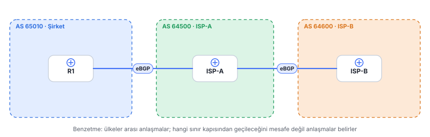
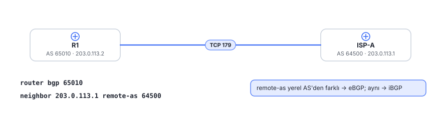
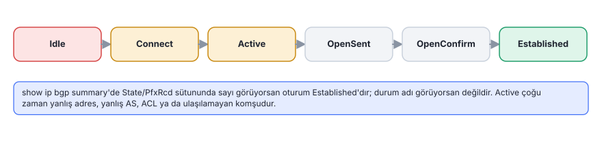
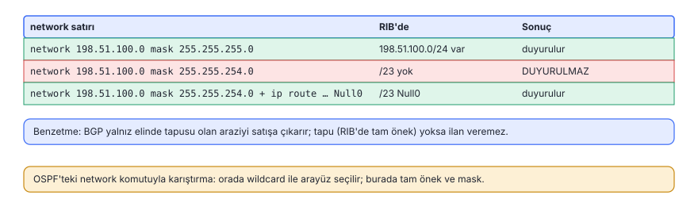
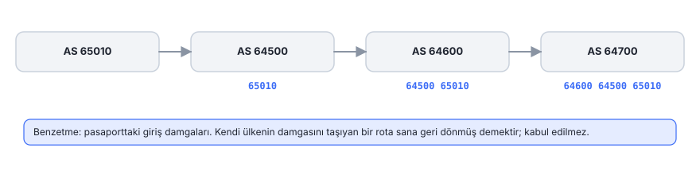
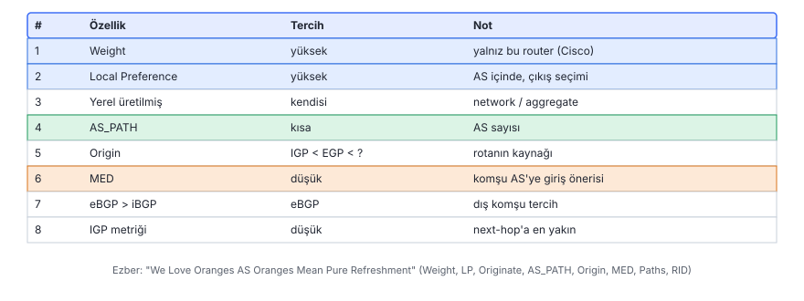
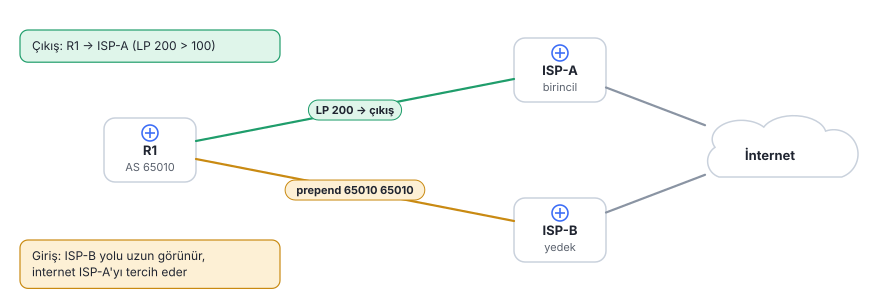

# AğLab Konu #32: BGP: eBGP, önek duyurma ve yol seçimi

> Uygulamadaki `bgp` dersi bu belgeyle uyumludur. **Okuma dersi (Seviye 3, CCNP):** Labber eBGP'yi (kademe 1) çalıştırır: oturum ve kurulmama nedenleri, network tam eşleşme, AS_PATH ve döngü önleme, en iyi yol seçimi (Weight, Local Preference, AS_PATH, ORIGIN, MED, router-id), AD 20. Prefix-list, route-map (match ip address [prefix-list], set local-preference / metric / weight / as-path prepend) ve soft clear da var: politika değişikliği `clear ip bgp … soft` yapılana kadar uygulanmaz. iBGP, route reflector ve community modellenmez (Gerçek Lab / FRR). Simülatör'deki **bgp-iki-isp** labı S1–S3'ü ve Bölüm 4'ün prepend adımını bir arada çalıştırır.
> Ön koşul: Statik ve varsayılan rota (Konu #8), OSPF (Konu #15), ACL (Konu #19). Şemalar: `docs/dersler/gorseller/bgp.py`.

Bu konu bittiğinde öğrenci BGP'nin IGP'lerden farkını ve otonom sistem kavramını açıklar; eBGP komşuluğunu kurar ve `show ip bgp summary` çıktısından oturumun durumunu okur. network komutunun neden tam önek istediğini bilir. AS_PATH'in döngüyü nasıl önlediğini, en iyi yol seçiminin ilk adımlarını (Weight, Local Preference, AS_PATH, Origin, MED) sırasıyla uygular. İki ISP'li bir şubede çıkan trafiği Local Preference/Weight ile, gelen trafiği AS_PATH prepend ile yönlendirir. Süre yaklaşık 60 dakika.

## 0. Bir bakışta

- BGP **otonom sistemleri (AS)** birbirine bağlar; en kısa değil **politikaya uygun** yolu seçer.
- Komşular **elle** tanımlanır, oturum **TCP 179**; farklı AS = **eBGP**, aynı AS = **iBGP**.
- `show ip bgp summary`: State/PfxRcd'de **sayı** varsa Established; **Active/Idle** ise oturum yok.
- `network` **tam önek ve maske** ister; önek RIB'de birebir yoksa duyurulmaz.
- **AS_PATH** döngüyü önler (kendi AS'ini gören reddeder) ve kısa yol tercih edilir.
- Yol seçimi: **Weight > Local Pref > yerel > AS_PATH > Origin > MED > eBGP > IGP metriği**.
- Çıkışı **LP/Weight**, girişi **AS_PATH prepend/MED** etkiler.

> **Akılda kalsın:** BGP'de 'rota neden gelmedi' sorusunun üç cevabı: oturum yok, önek duyurulmadı ya da politika (filtre, yol seçimi) onu eledi.



## 1. Neden önemli

İki internet bağlantısı olan bir şube, kendi IP bloğunu duyuran bir kurum ya da bir veri merkezi bağlantısı BGP ile çalışır. Internetin kendisi BGP'dir. CCNP'de eBGP komşuluğu, önek duyurma ve yol seçimi temel beklentidir; sahada en sık iş ise "birincil ISP'den çık, yedeği yalnız arızada kullan" politikasını kurmaktır.

## 2. Kavram

### 2.1 AS ve BGP'nin farkı

> **Benzetme:** Ülke içinde en kısa yolu navigasyon (OSPF) bulur. Ülkeler arasında ise hangi sınır kapısından geçileceğini anlaşmalar, vizeler ve tercihler belirler; en kısa yol her zaman seçilmez.

- **AS numarası:** genel (1–64495) ya da özel (64512–65534; 4 baytlık özel aralık da var).
- BGP **path-vector** bir protokoldür: rotayla birlikte geçtiği AS'lerin listesini taşır.
- AD: **eBGP 20**, **iBGP 200**.

### 2.2 Komşuluk





- eBGP komşuları varsayılan olarak **doğrudan bağlı** olmalıdır (TTL 1). Loopback'ler arası eBGP için `ebgp-multihop` ve `update-source` gerekir.
- iBGP komşuları genelde loopback'lerle kurulur ve IGP ile birbirine ulaşır; iBGP'den öğrenilen rota başka bir iBGP komşusuna aktarılmaz (split horizon), bu yüzden tam örgü ya da route reflector gerekir.

### 2.3 Önek duyurmak



> **Dikkat:** Kurumun /23 bloğunu duyurmak isteyip yalnız iki /24'ü RIB'de tutmak en sık hatadır. Ya `ip route 198.51.100.0 255.255.254.0 Null0` ile /23'ü RIB'e koy ya da `aggregate-address` kullan.

### 2.4 AS_PATH



### 2.5 En iyi yol seçimi



> **Benzetme:** İş başvurusu elemesi: önce referans mektubu (Weight), sonra şirket politikası (Local Preference), sonra deneyim (AS_PATH kısalığı)… İlk ölçütte biri öne çıkarsa diğerlerine bakılmaz.

- **Weight** yalnız o router'da geçerlidir, kimseye duyurulmaz.
- **Local Preference** AS içindeki bütün router'lara iBGP ile taşınır; varsayılan 100.
- **MED** komşu AS'ye "bana bu kapıdan gir" önerisidir; düşük tercih edilir, yalnız aynı AS'den gelen yollar arasında karşılaştırılır.

### 2.6 İki ISP'li şube



```
route-map ISP-A-IN permit 10
 set local-preference 200
route-map ISP-B-OUT permit 10
 set as-path prepend 65010 65010
router bgp 65010
 neighbor 203.0.113.1 route-map ISP-A-IN in
 neighbor 192.0.2.1 route-map ISP-B-OUT out
```

> **Sahada:** Politikayı değiştirdikten sonra `clear ip bgp <komşu> soft` ile oturumu koparmadan yeniden değerlendir.

## 3. Çıktı okuma

```
R1#show ip bgp summary
BGP router identifier 10.255.0.1, local AS number 65010
Neighbor        V    AS MsgRcvd MsgSent   TblVer  InQ OutQ Up/Down  State/PfxRcd
192.0.2.1       4 64600     312     298       45    0    0 04:51:02      812
203.0.113.1     4 64500       0       0        1    0    0 never    Active
                                        ← ISP-B Established (812 önek); ISP-A Active: oturum yok

R1#show ip bgp
     Network          Next Hop            Metric LocPrf Weight Path
 *>  0.0.0.0          192.0.2.1                0             0 64600 i
 *>  198.51.100.0/23  0.0.0.0                  0         32768 i
 *   203.0.114.0/24   192.0.2.1                0             0 64600 64700 i
 *>                   203.0.113.1              0    200      0 64500 64700 i
                                        ← * geçerli, > en iyi; LP 200 olan ISP-A yolu seçildi
                                        ← yerel önek: next-hop 0.0.0.0, weight 32768

R1#show ip bgp neighbors 192.0.2.1 advertised-routes
     Network          Next Hop            Metric LocPrf Weight Path
 *>  198.51.100.0/23  0.0.0.0                  0         32768 i
                                        ← ISP-B'ye ne duyuruyorum?
```

| Soru | Komut |
| --- | --- |
| Oturum kurulu mu, kaç önek? | `show ip bgp summary` |
| Bir önek için adaylar ve seçilen? | `show ip bgp <önek>` |
| Komşuya ne duyuruyorum / ne alıyorum? | `show ip bgp neighbors <ip> advertised-routes / routes` |
| Rota RIB'e girdi mi? | `show ip route bgp` |

## 4. Yönlendirmeli lab

> **Simülatörde:** 1–6. adımlar Simülatör'deki **bgp-iki-isp** labında denenir (Pratik adımında). Labda adresler aynıdır; R1 arızalı başlar (S1–S3), adım adım kurmak yerine arızaları bularak aynı yapılandırmaya varırsın. 6. adım için R1'de `neighbor 203.0.113.1 shutdown` ya da Gi0/1'i kapat. Labda politika değişikliği `clear ip bgp … soft` yapılana kadar uygulanmaz.

Topoloji: g7'deki gibi; R1 AS 65010, blok 198.51.100.0/23; ISP-A AS 64500 (203.0.113.1), ISP-B AS 64600 (192.0.2.1).

1. `router bgp 65010`, iki `neighbor … remote-as`. `show ip bgp summary`: iki komşu Established olana kadar bekle. *Neden:* önek alışverişi oturumdan sonra başlar.
2. `network 198.51.100.0 mask 255.255.254.0`; `show ip bgp`'de görünmüyorsa nedenini bul ve `ip route … Null0` ekle.
3. Aynı hedef için iki yolu `show ip bgp <önek>` ile incele; hangi adımda seçildi?
4. ISP-A'dan gelenlere LP 200: çıkışın ISP-A'ya kaydığını gör.
5. ISP-B'ye giden duyuruya iki kez prepend: gelen trafiğin ISP-A'yı tercih edeceğini açıkla.
6. ISP-A oturumunu kapat (`neighbor 203.0.113.1 shutdown`): çıkışın ISP-B'ye geçtiğini izle.

> **Benzetme:** 4. ve 5. adım, hem kendi araçlarına "A kapısını kullan" demek, hem de misafirlere B kapısının yolunu uzun göstermektir.

## 5. Sık hatalar

| Kod | Hata | Belirti | Kanıt | Düzeltme |
| --- | --- | --- | --- | --- |
| E1 | Komşu adresi ya da AS yanlış | State Active/Idle | `show ip bgp summary`, log'da `BGP notification` | Doğru remote-as ve adres |
| E2 | TCP 179 engelli | Active | ACL ya da güvenlik duvarı | 179'a izin ver |
| E3 | network önek RIB'de birebir yok | Önek duyurulmuyor | `show ip bgp`'de yok | Null0 statik rota ya da aggregate |
| E4 | Loopback'ler arası eBGP'de multihop yok | Oturum kurulmuyor | TTL 1, kaynak adres farklı | `ebgp-multihop 2`, `update-source` |
| E5 | Politika ters yönde uygulanmış | Trafik yanlış ISP'den | route-map in/out karışık | LP girişte (in), prepend çıkışta (out) |

## 6. Arıza senaryoları

> **Uygulamada:** S1 (yanlış remote-as), S2 (/23 duyurulmuyor) ve S3 (LP'nin yanlış komşuya uygulanması ve soft clear) Simülatör'deki **bgp-iki-isp** labında birlikte çözülür; S4 kavramsaldır. Önce kendin çöz; neden ve çözüm kapalı kutularda.

### S1 · Başlangıç · ISP-A oturumu kurulmuyor (E1)

- **Belirti:** Yeni devre bağlandı; `show ip bgp summary`'de ISP-A sürekli Active.
- **Hedef:** Oturum Established.

<details><summary>Neden ve çözüm</summary>

Komşu tanımında `remote-as 64501` yazılmış; ISP'nin AS'i 64500. Karşı taraf OPEN mesajını reddediyor (bad peer AS). Çözüm: `neighbor 203.0.113.1 remote-as 64500`.

</details>

### S2 · Orta · Şirketin bloğu internette görünmüyor (E3)

- **Belirti:** Oturumlar kurulu; dış dünyadan 198.51.100.0/23'e ulaşılamıyor.
- **Hedef:** Blok duyurulsun.

<details><summary>Neden ve çözüm</summary>

RIB'de yalnız iki /24 (bağlı ağlar) var, /23 yok; network satırı tam eşleşme bulamıyor. Çözüm: `ip route 198.51.100.0 255.255.254.0 Null0`.

</details>

### S3 · Orta · Yedek ISP'ye yük biniyor (E5)

- **Belirti:** Birincil ISP-A olmasına rağmen çıkan trafiğin çoğu ISP-B'den gidiyor.
- **Hedef:** Çıkış ISP-A'dan.

<details><summary>Neden ve çözüm</summary>

LP 200 ayarı ISP-B komşusunun `in` yönüne uygulanmış. Çözüm: route-map'i ISP-A komşusunun girişine taşı, `clear ip bgp * soft`.

</details>

### S4 · İleri · Gelen trafik hâlâ yedekten (girişin doğası)

- **Belirti:** Prepend yapıldı ama bazı kullanıcıların trafiği hâlâ ISP-B'den geliyor.
- **Hedef:** Bunun neden tamamen önlenemediğini açıkla.

<details><summary>Neden ve çözüm</summary>

Gelen trafiğin yolunu karşı AS'ler seçer; kendi LP politikaları AS_PATH'ten önce gelir. Prepend yalnız etkiler, garanti etmez. Gerekirse ISP ile topluluk (community) tabanlı politika konuşulur.

</details>

## 7. Kısa sınav

**1.** BGP oturumu hangi protokol ve port üzerinden kurulur?

<details><summary>Cevap</summary>

TCP 179.

</details>

**2.** `show ip bgp summary`'de State sütununda Active görmek ne demektir?

<details><summary>Cevap</summary>

Oturum kurulamıyor; router bağlantı kurmaya çalışıyor (adres, AS, ulaşılabilirlik, ACL).

</details>

**3.** network komutu ile duyurulmak için önek nerede ve nasıl bulunmalı?

<details><summary>Cevap</summary>

Rota tablosunda (RIB) aynı önek ve maskeyle birebir.

</details>

**4.** AS_PATH döngüyü nasıl önler?

<details><summary>Cevap</summary>

Router kendi AS numarasını yolda görürse rotayı reddeder.

</details>

**5.** Weight ile Local Preference farkı?

<details><summary>Cevap</summary>

Weight yalnız o router'da geçerlidir (Cisco); Local Preference AS içindeki bütün router'lara iBGP ile taşınır.

</details>

**6.** Gelen trafiği yedek ISP'den uzaklaştırmak için ne yapılır?

<details><summary>Cevap</summary>

Yedek ISP'ye yapılan duyuruya AS_PATH prepend (ya da MED/community); karar karşı tarafındır.

</details>

## 8. Özet kartı

| Komut | Ne işe yarar |
| --- | --- |
| `router bgp <AS>`, `neighbor <ip> remote-as <AS>` | Komşu tanımı |
| `network <önek> mask <maske>` | Önek duyur (RIB'de tam olmalı) |
| `show ip bgp summary` | Oturumlar ve önek sayıları |
| `show ip bgp [önek]` | Adaylar, en iyi yol |
| `set local-preference 200` (in) | Çıkışı seç |
| `set as-path prepend …` (out) | Girişi etkile |
| `clear ip bgp <ip> soft` | Politikayı yeniden uygula |

**Unutma:**

1. Komşular elle, TCP 179.
2. Sayı = Established; Active = yok.
3. network tam önek ister.
4. Önce Weight, sonra LP, sonra AS_PATH.
5. Çıkışı sen seçersin, girişi yalnız etkilersin.

## 9. Doğrulama notları

Kaynaklar: INE ENCOR (BGP Fundamentals and Basic Configuration, path selection) ve CCNP ENCOR v1.0 (yalnız kapsam kontrolü için); RFC 4271 (BGP-4); Cisco IOS BGP yapılandırma kılavuzu. Ders metni, örnek çıktılar ve şemalar özgün yazıldı.

| İddia | Sonuç |
| --- | --- |
| BGP TCP 179 kullanır | Doğru |
| eBGP AD 20, iBGP AD 200 | Doğru |
| network komutu RIB'de tam eşleşen önek ister | Doğru |
| Cisco seçim sırası Weight, LP, yerel, AS_PATH, Origin, MED, eBGP>iBGP, IGP metriği | Doğru |
| Local Preference varsayılan 100, yerel rotaların Weight'i 32768 | Doğru |
| eBGP varsayılan TTL 1; loopback eBGP için ebgp-multihop gerekir | Doğru |

**Motor gereksinimleri**

- [x] eBGP kademe 1 Labber'da: oturum (Idle/Active/Established; yanlış remote-as, karşıda tanım yok, rota yok, multihop, update-source, TCP 179 ACL'si, MD5 parolası, `neighbor shutdown` ayrı nedenler; `%BGP-5-ADJCHANGE`, `%BGP-3-NOTIFICATION` günlüğü), `network` tam eşleşme ve `ip route … Null0`, `redistribute static|connected`, AS_PATH/NEXT_HOP/ORIGIN/MED/Weight/LP, Cisco sırasıyla en iyi yol, AD 20, `show ip bgp`, `summary`, `neighbors [… advertised-routes|routes]`, `show ip bgp <önek>`, `show ip route bgp`, `clear ip bgp`. Zamanlayıcılar ve MsgRcvd/MsgSent sabittir (UYUMLULUK_MATRISI "eBGP"). S1 ve S2 bununla çalışır.
- [x] Prefix-list, route-map, `neighbor … route-map|prefix-list in|out` ve soft clear (kademe 1b): politika oturum kurulunca dondurulur, değişiklik `clear ip bgp … soft in|out` ile uygulanır; `show ip bgp neighbors` bekleyen değişikliği söyler. S3 bununla çalışır.
- [x] Simülatör labı **bgp-iki-isp**: S1–S3 ve prepend ile gelen trafik (Bölüm 4).
- [ ] iBGP, route reflector, community, aggregate-address (kademe 2): Gerçek Lab (FRR).
