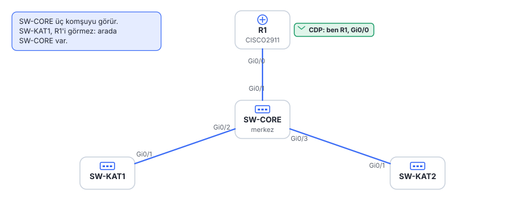
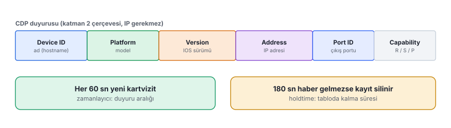
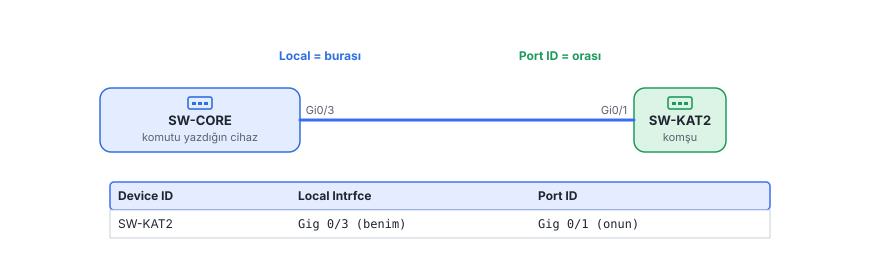
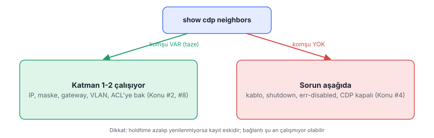
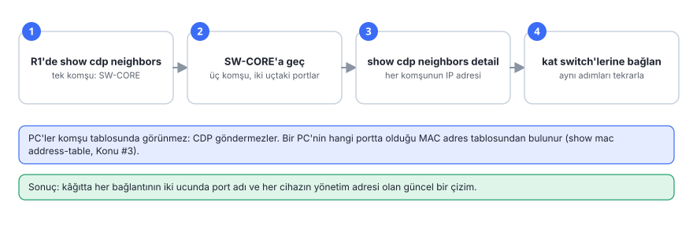
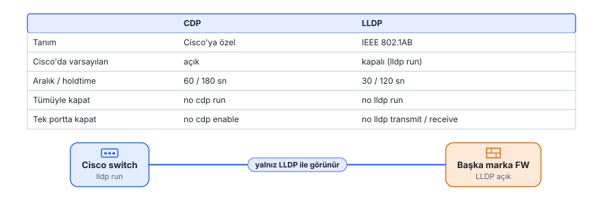
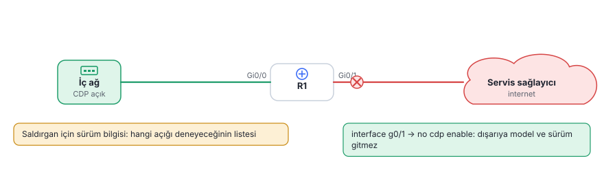

# AğLab Konu #12: CDP/LLDP ile komşu keşfi

> Uygulamadaki `discovery` dersi bu belgeyle uyumludur. Senaryolar Sorun Çöz'de `cdp-*`
> kimlikleriyle Labber'da çalışır. Şemalar: `docs/dersler/gorseller/cdp-lldp.py`.

Bu konu bittiğinde öğrenci, elinde topoloji çizimi olmayan bir ağda CDP ve LLDP ile hangi cihazın hangi porttan hangi cihaza bağlı olduğunu çıkarır. Komşu tablosunu kanıt olarak kullanıp bir arızanın katman 1, katman 2 ya da katman 3'te olduğuna karar verir. CDP'nin nerede kapatılması gerektiğini bilir. Seviye 1, süre yaklaşık 60 dakika.

## 0. Bir bakışta

- **CDP**, Cisco cihazlarının doğrudan komşularına kendilerini tanıttığı katman 2 protokolüdür; varsayılan **açıktır**.
- **LLDP** aynı işi yapan açık standarttır (IEEE 802.1AB); Cisco'da varsayılan **kapalıdır**, iki uçta da `lldp run` gerekir.
- `show cdp neighbors`: **Local Intrfce** senin portun, **Port ID** komşunun portu.
- `show cdp neighbors detail`: komşunun **IP adresi**, modeli ve yazılım sürümü.
- **Komşu görünüyorsa** katman 1–2 sağlamdır, sorun yukarıdadır; **görünmüyorsa** sorun aşağıdadır.
- Şirket dışına bakan portta `no cdp enable`.

> **Akılda kalsın:** CDP yalnız kapı komşusunu gösterir. PC'ler CDP göndermez; onları MAC tablosunda ararsın.



## 1. Neden önemli

Şubelerde ağ çizimi ya hiç yoktur ya da yıllar önce çizilmiştir. Dolapta onlarca kablo vardır, etiketler silinmiştir. "2. kat switch'i merkeze hangi porttan bağlı?" sorusunun cevabını kabloları tek tek takip ederek bulmak saatler sürer. `show cdp neighbors` ise aynı cevabı tek satırda verir.

Komşu tablosu sorun gidermede de kanıttır. CDP komşusu görünüyorsa iki cihaz arasındaki kablo ve port çalışıyordur, sorun daha yukarıdadır. Komşu yoksa sorun en alttadır: kablo, port ya da cihazın kendisi.

## 2. Kavram

### 2.1 CDP: kapı komşusuna kartvizit

> **Benzetme:** Yeni taşındığın apartmanda kapı komşularına kartvizit bırakırsın: adın, mesleğin, telefonun. Komşun kartı buzdolabına asar; uzun süre senden haber almazsa atar. Ama kartını iki kat yukarıdaki daireye o götürmez.

- Her Cisco cihazı her porttan **60 saniyede bir** duyuru gönderir: adı, modeli, yazılım sürümü, IP adresi, duyurunun çıktığı port.
- Komşu bu bilgiyi **180 saniye** (holdtime) saklar; yeni duyuru gelmezse siler.
- **IP gerektirmez:** katman 2'de çalışır; adres yanlış olsa bile komşu görünür.
- **Yalnız doğrudan komşu:** duyuru bir sonraki cihaza aktarılmaz.
- **PC'ler CDP göndermez:** tabloda yalnız ağ cihazları (switch, router, IP telefon, erişim noktası) görünür.



### 2.2 Komşu tablosunu doğru okumak

Satırdaki iki port sütunu en çok karıştırılan yerdir.

- **Local Intrfce:** **senin** cihazındaki port ("SW-KAT2 benim Gi0/3'ümde").
- **Port ID:** **komşunun** portu ("kablo SW-KAT2'nin Gi0/1'ine gidiyor").



> **Dikkat:** Holdtime sürekli 120–180 arasında dolaşmalıdır. Aşağı inip yenilenmiyorsa kayıt eskidir; kablo yeni çıkmış olabilir. Taze olmayan bir kayıt bağlantının şu an çalıştığını kanıtlamaz.

### 2.3 Teşhis aracı olarak CDP

> **Benzetme:** Komşunun kapısını çalıyorsun ve "kim o?" diye cevap geliyor: duvar da kapı da sağlam. Ama telefonla aradığında açmıyorsa sorun numaradadır (IP), duvarda değil.



- Komşu **görünüyor**, ping **gitmiyor**: IP, maske, gateway, VLAN. `detail`'deki adres beklenen ağda mı?
- Komşu **görünmüyor**: `show interfaces status` ile port durumu, kablo, `shutdown`, CDP kapalı mı?

### 2.4 Bilinmeyen ağı çizmek

Bildiğin tek cihazdan başla ve komşudan komşuya ilerle. Her bağlantının iki ucuna port adlarını, her cihaza `detail`'den aldığın adresi yaz.



### 2.5 LLDP: herkesin konuştuğu dil

> **Benzetme:** CDP bir şirketin iç dilidir; LLDP herkesin bildiği ortak dil. Binaya başka şirketten bir komşu (başka marka firewall, IP telefon) taşındıysa ortak dille konuşursun.



> **Dikkat:** LLDP iki uçta da açık olmalıdır. Yalnız bir tarafta `lldp run` yapmak komşu tablosunu doldurmaz.

### 2.6 Güvenlik

CDP duyurusu cihazın modelini, yazılım sürümünü ve IP adresini açıkça yayınlar; bu bilgi bir saldırgana hangi açıkları deneyeceğini söyler. Şirket dışına bakan portlarda (servis sağlayıcı, misafir ağı) CDP kapatılır: `interface g0/1` → `no cdp enable`. İç ağda açık bırakılır; sorun giderme değeri riskten büyüktür.



> **Sahada:** Gerçek switch'te iki uçtaki native VLAN farklıysa CDP konsola `%CDP-4-NATIVE_VLAN_MISMATCH` yazar. Bu uyarı çoğu zaman trunk hatasının ilk ipucudur (Konu #6).

## 3. Çıktı okuma

Bu konuda iki çıktı okunur: kısa komşu tablosu ve ayrıntılı komşu kaydı. İkisi birlikte "kim, nereye, hangi adresle bağlı?" sorusunu cevaplar.

### show cdp neighbors — kim hangi porttan bağlı?

```
SW-CORE#show cdp neighbors
Capability Codes: R - Router, T - Trans Bridge, B - Source Route Bridge
                  S - Switch, H - Host, I - IGMP, r - Repeater, P - Phone,
                  D - Remote, C - CVTA, M - Two-port Mac Relay

Device ID        Local Intrfce     Holdtme    Capability  Platform  Port ID
R1               Gig 0/1           163        R B S I     CISCO2911 Gig 0/0
SW-KAT1          Gig 0/2           141        S I         WS-C2960- Gig 0/1
SW-KAT2          Gig 0/3           177        S I         WS-C2960- Gig 0/1

Total cdp entries displayed : 3
```

- **Device ID:** Komşunun adı (hostname). Belgelerdeki adla aynı olmalıdır; değilse ya belge eskidir ya da cihaz başka bir cihazdır.
- **Local Intrfce:** **Senin** cihazındaki port. "SW-KAT2 benim Gi0/3'ümde."
- **Port ID:** **Komşunun** portu. "Kablo SW-KAT2'nin Gi0/1'ine gidiyor." En sık yapılan okuma hatası bu iki sütunu karıştırmaktır.
- **Holdtme:** Bu kaydın silinmesine kalan saniye. Sürekli 120–180 arasında dolaşır. 180'den aşağı inip hiç yenilenmiyorsa komşu artık duyuru göndermiyordur: kablo yeni çıkmış olabilir. Kayıt silinene kadar tabloda görünmeye devam eder; bu yüzden **taze olmayan bir kayıt, bağlantının şu an çalıştığını kanıtlamaz.**
- **Capability:** Komşunun ne olduğu. `R` router, `S` switch, `I` IGMP, `P` IP telefon.
- **Platform:** Model; 10 karakterden sonrası kesilir (`WS-C2960-`).

### show cdp neighbors detail — komşunun adresi ve sürümü

```
SW-CORE#show cdp neighbors detail
-------------------------
Device ID: R1
Entry address(es):
  IP address: 192.168.10.1
Platform: Cisco CISCO2911/K9,  Capabilities: Router Source-Route-Bridge Switch IGMP
Interface: GigabitEthernet0/1,  Port ID (outgoing port): GigabitEthernet0/0
Holdtime : 163 sec

Version :
Cisco IOS Software, C2900 Software (C2900-UNIVERSALK9-M), Version 15.7(3)M8, RELEASE SOFTWARE (fc2)
...
advertisement version: 2
Duplex: full
Management address(es):
  IP address: 192.168.10.1
```

- **Entry address(es):** Komşunun bu bağlantıdaki IP adresi. Yönetim adresi bilinmeyen bir cihaza SSH ile bağlanmanın en hızlı yolu budur.
- Adres beklediğin ağda değilse (ör. kullanıcıların gateway'i 192.168.10.1 olmalıyken burada 192.168.100.1 yazıyorsa) kablo ve port sağlamdır, ama adres yanlıştır. Bu, sorunu doğrudan katman 3'e yerleştirir.
- **Version:** Komşunun yazılım sürümü; güncelleme planlarken envanter çıkarmanın kısa yolu.
- Gerçek bir switch'te bu çıktıda komşunun **Native VLAN** ve **VTP** bilgisi de bulunur. İki uçtaki native VLAN farklıysa switch konsola `%CDP-4-NATIVE_VLAN_MISMATCH` uyarısını yazar.

### show lldp neighbors

```
SW-CORE#show lldp neighbors
Capability codes:
    (R) Router, (B) Bridge, (T) Telephone, (C) DOCSIS Cable Device
    (W) WLAN Access Point, (P) Repeater, (S) Station, (O) Other

Device ID           Local Intf     Hold-time  Capability      Port ID
SW-KAT1             Gi0/2          120        B               Gi0/1

Total entries displayed: 1
```

Okuması CDP'yle aynıdır. Switch burada `B` (Bridge) olarak görünür. Komşu tabloda yoksa önce iki uçta da `lldp run` yapılıp yapılmadığına bak; `show lldp neighbors` LLDP kapalıyken `% LLDP is not enabled` der.

## 4. Yönlendirmeli lab

> **Simülatörde:** bu labın hazır topolojisi ve otomatik kontrolü Simülatör'deki **cdp-kesif** labıdır (dersin Pratik adımı). Simülatör labı bu adımların özüdür; ayrıntılar labın görev metnindedir.

Topoloji: R1, merkez switch SW-CORE, iki kat switch'i (SW-KAT1, SW-KAT2), her katta iki PC ve SW-CORE'a bağlı bir yönetim PC'si (ADMIN). Sana yalnız R1'in adı verildi; ağın geri kalanını CDP ile çıkaracaksın.

| Cihaz | Yönetim adresi |
| --- | --- |
| R1 | 192.168.10.1 (kullanıcıların gateway'i) |
| SW-CORE / SW-KAT1 / SW-KAT2 | 192.168.1.2 / .3 / .4 (VLAN 1) |

1. **R1'den başla.** `show cdp neighbors`. Tek komşu var: SW-CORE, R1'in Gi0/0'ında, SW-CORE'un Gi0/1'inde. *Neden:* Bilinmeyen bir ağa her zaman bildiğin tek cihazdan başlanır ve komşudan komşuya ilerlenir.
2. **SW-CORE'a geç** ve `show cdp neighbors`. Üç komşu: R1 (Gi0/1), SW-KAT1 (Gi0/2), SW-KAT2 (Gi0/3). Kâğıda bir çizim yap: her bağlantının iki ucuna port adlarını yaz. *Neden:* Local Intrfce senin, Port ID komşunun portudur; çizime ikisi de girer.
3. **ADMIN'i ara.** SW-CORE'un komşu tablosunda ADMIN yok, kat switch'lerinde PC'ler de yok. *Neden:* PC'ler CDP göndermez. Bir PC'nin hangi porta bağlı olduğunu bulmak için MAC tablosuna bakılır (Konu #3).
4. **Adresleri topla.** `show cdp neighbors detail`. Her komşunun IP adresini çizime ekle. *Neden:* Artık kat switch'lerine bu adreslerle bağlanabilirsin; belgede olmayan yönetim adresini bulmanın en kısa yolu budur.
5. **Zamanlayıcılar.** `show cdp interface`. Her portta "Sending CDP packets every 60 seconds, Holdtime is 180 seconds" yazar. *Neden:* Bir kablo çıktığında gerçek cihazda kaydın tablodan düşmesi 3 dakikaya kadar sürebilir. AğLab'da kayıt anında düşer.
6. **LLDP'yi aç.** SW-CORE'da `configure terminal` → `lldp run`, sonra `show lldp neighbors`: tablo boş. SW-KAT1'de de `lldp run` yap ve SW-CORE'da tekrar bak: SW-KAT1 göründü, SW-KAT2 görünmüyor. *Neden:* LLDP iki uçta da açık olmalıdır; yalnız bir tarafta açmak yetmez.
7. **Dışa bakan portu kapat.** R1'in Gi0/1'i internet servis sağlayıcısına gidiyor. `interface g0/1` → `no cdp enable`, ardından `show cdp interface`: Gi0/1 artık listede yok. *Neden:* Şirket dışına cihaz modeli ve sürüm bilgisi gönderilmez.
8. **CDP'yi tümüyle kapat ve geri aç.** SW-KAT2'de `no cdp run`; SW-CORE'da `show cdp neighbors`: SW-KAT2 kayboldu. SW-KAT2'de `show cdp neighbors` "CDP is not enabled" der. `cdp run` ile geri aç. *Neden:* CDP kapalı bir cihaz ağda "görünmez" olur; envanter araçları onu bulamaz.

> **Benzetme:** Bu lab, karanlık bir binada her kapıyı çalıp "yanında kim oturuyor?" diye sorarak kat planını çıkarmaktır.

## 5. Sık hatalar

Bu konudaki hatalar iki türlüdür. Bir kısmı CDP'nin kendisiyle ilgilidir (E5); çoğu ise CDP'nin **kanıt olarak** bulduğu başka arızalardır.

| Kod | Hata | Belirti | Kanıt | Düzeltme |
| --- | --- | --- | --- | --- |
| E1 | Uplink yanlış porta takılmış ya da port yanlış yapılandırılmış | Bütün bir kat ya da switch dışarı çıkamıyor; kendi içinde çalışıyor | `show cdp neighbors`: komşu belgedeki porttan değil başka bir porttan görünüyor | Portu belgedeki uplink gibi yapılandır ya da kabloyu doğru porta tak |
| E2 | Native VLAN uyuşmazlığı | Kullanıcı VLAN'ları çalışıyor; native VLAN'daki trafik (çoğu zaman yönetim) çalışmıyor | `%CDP-4-NATIVE_VLAN_MISMATCH`; iki uçta `show interfaces trunk`'ta Native vlan farklı | İki ucu aynı native VLAN'a getir (Konu #6) |
| E3 | Kablo sağlam, adres yanlış | Işıklar yanıyor, ping gitmiyor | `show cdp neighbors detail`'de komşunun IP adresi beklenen ağda değil | Arayüzün IP adresini düzelt (Konu #2, #8) |
| E4 | Port kapalı ya da kablo kopuk | Komşuyla hiçbir iletişim yok | Komşu tablosu boş; `show interfaces status`: `disabled` / `notconnect` | `no shutdown` ya da kablo (Konu #4) |
| E5 | CDP gereksiz yerde açık ya da gerekli yerde kapalı | Dışarıya cihaz bilgisi sızıyor; ya da envanter aracında cihaz görünmüyor | `show cdp interface`; `show cdp neighbors`'ta "CDP is not enabled" | Dış portlarda `no cdp enable`; iç ağda `cdp run` |

**En önemli kural:** CDP komşusu **görünüyorsa** katman 1 ve 2 çalışıyordur, sorunu yukarıda ara (E3). Komşu **görünmüyorsa** sorun aşağıdadır (E4). Bu tek gözlem teşhisin yarısını yapar.

## 6. Arıza senaryoları

> **Uygulamada:** S1–S5 Sorun Çöz'de `cdp-uplink-park-port`, `cdp-native-mismatch`,
> `cdp-gateway-typo`, `cdp-no-neighbor`, `cdp-two-faults` kimlikleriyle Labber'da çalışır
> (`simulator/network-scenarios.json`, `verify.kind: "query"`). Önce kendin çöz; neden ve çözüm kapalı kutularda.

Temel topoloji lab'dakiyle aynıdır. Kullanıcılar VLAN 10'da (192.168.10.0/24, gateway R1 192.168.10.1), switch yönetimi VLAN 1'de (192.168.1.0/24). SW-CORE'da Gi0/2 ve Gi0/3 uplink trunk'larıdır (izinli VLAN 1,10,20). Gi0/4 ise kullanılmayan portlar için ayrılan VLAN 99'da (park).

### S1 · Başlangıç · Dünkü kablolamadan sonra 2. kat ağdan koptu (E1)

- **Belirti:** 2. kattaki bilgisayarlar birbirine ulaşıyor ama ne 1. kata ne gateway'e ulaşabiliyor.
- **Hedef:** `q.ping('PC-21', '192.168.10.11').ok`; `q.ping('PC-21', '192.168.10.1').ok`
- **İpuçları:** (1) Bütün kat etkileniyorsa sorun katın ortak noktasında. (2) SW-CORE'da `show cdp neighbors`: SW-KAT2 hangi porttan görünüyor? (3) O portu belgedeki uplink'le karşılaştır: `show running-config interface gi0/4` ve `gi0/3`.

<details><summary>Neden ve çözüm</summary>

SW-KAT2'nin uplink kablosu SW-CORE'da Gi0/3 yerine Gi0/4'e takılmış; Gi0/4 VLAN 99'da access port. Çözüm: SW-CORE → `interface gi0/4` → `switchport trunk allowed vlan 1,10,20` → `switchport mode trunk`

Kabloyu Gi0/3'e taşımak da doğru bir çözümdür; Sorun Çöz terminalden yapılan düzeltmeyi değerlendirdiği için burada port yapılandırılır.

</details>

### S2 · Başlangıç · Kullanıcılar çalışıyor, 1. kat switch'i yönetilemiyor (E2)

- **Belirti:** Kullanıcılardan şikâyet yok. ADMIN, SW-KAT1'in yönetim adresine (192.168.1.3) ulaşamıyor; diğer switch'lere ulaşıyor.
- **Hedef:** `q.ping('ADMIN', '192.168.1.3').ok`; `q.ping('PC-11', '192.168.10.21').ok`
- **İpuçları:** (1) Kullanıcı VLAN'ı çalışıyor, yönetim VLAN'ı çalışmıyor: ikisi trunk'ta nasıl taşınıyor? (2) SW-CORE'da `show cdp neighbors` ile bağlantının iki ucunu bul. (3) İki switch'te de `show interfaces trunk` ile native VLAN'ları karşılaştır.

<details><summary>Neden ve çözüm</summary>

SW-KAT1 Gi0/1 trunk'ında native VLAN 99 yapılmış; SW-CORE tarafı 1. Çözüm: SW-KAT1 → `interface gi0/1` → `switchport trunk native vlan 1`

</details>

### S3 · Orta · Kimse gateway'e ulaşamıyor, kablo sağlam (E3)

- **Belirti:** Hafta sonu R1'in yapılandırması yenilendi. Pazartesi hiçbir kullanıcı kendi ağı dışına çıkamıyor; katlar arası trafik çalışıyor. Teknisyen "kablo takılı, ışıklar yanıyor" diyor.
- **Hedef:** `q.ping('PC-11', '192.168.10.1').ok`; `q.ping('PC-21', '192.168.10.1').ok`
- **İpuçları:** (1) Switch R1'i gerçekten görüyor mu? (2) SW-CORE'da `show cdp neighbors detail`: R1'in kaydındaki IP adresi ne? (3) Komşu görünüyor ama ping yoksa sorun katman 3'te.

<details><summary>Neden ve çözüm</summary>

R1 Gi0/0'a 192.168.10.1 yerine 192.168.100.1 yazılmış. Çözüm: R1 → `interface g0/0` → `ip address 192.168.10.1 255.255.255.0`

</details>

### S4 · Orta · 1. kat kendi içinde çalışıyor, dışarı çıkamıyor (E4)

- **Belirti:** 1. kattaki iki bilgisayar birbirine ulaşıyor; ikisi de 2. kata ve gateway'e ulaşamıyor.
- **Hedef:** `q.ping('PC-11', '192.168.10.21').ok`; `q.ping('PC-12', '192.168.10.1').ok`
- **İpuçları:** (1) Kat içi çalışıyorsa kat switch'i ayakta; sorun yukarı bağlantıda. (2) SW-KAT1'de `show cdp neighbors`: SW-CORE görünüyor mu? (3) `show interfaces status`: Gi0/1'in durumu ne?

<details><summary>Neden ve çözüm</summary>

SW-KAT1'in uplink portu Gi0/1 `shutdown`. Çözüm: SW-KAT1 → `interface gi0/1` → `no shutdown`

</details>

### S5 · İleri · İki hata birden: belgelenmemiş değişiklikler (E1 + E3)

- **Belirti:** 2. kat hiçbir yere çıkamıyor; 1. kat kendi arasında konuşuyor ama gateway'e ulaşamıyor.
- **Hedef:** `q.ping('PC-21', '192.168.10.11').ok`; `q.ping('PC-21', '192.168.10.1').ok`; `q.ping('PC-11', '192.168.10.1').ok`
- **İpuçları:** (1) İki farklı belirti var; tek bir hata ikisini birden açıklıyor mu? (2) SW-CORE'da `show cdp neighbors` ve `detail`: komşular belgedeki portlarda mı, adresleri doğru mu? (3) Hataları tek tek düzelt ve her düzeltmeden sonra hangi belirtinin gittiğini ping ile gör.

<details><summary>Neden ve çözüm</summary>

S1 ve S3 birlikte. Çözüm: S1'in ve S3'ün çözümü.

</details>

## 7. Kısa sınav

**1.** SW-CORE'daki satır: `SW-KAT2  Gig 0/3  151  S I  WS-C2960-  Gig 0/1`. Kablo SW-KAT2'nin hangi portuna gidiyor?

<details><summary>Cevap</summary>

Gi0/1. Port ID komşunun portudur; Gi0/3 SW-CORE'un kendi portudur.

</details>

**2.** CDP tablosunda R1 görünüyor, holdtime 120–180 arasında dolaşıyor, ama ping gitmiyor. Sorun nerede?

<details><summary>Cevap</summary>

Katman 3'te: IP adresi, maske ya da gateway. Taze bir CDP kaydı katman 1–2'nin çalıştığını kanıtlar.

</details>

**3.** Switch'e bağlı PC'lerin hiçbiri `show cdp neighbors`'ta görünmüyor. Neden?

<details><summary>Cevap</summary>

PC'ler CDP duyurusu göndermez. PC'nin portu MAC tablosundan bulunur.

</details>

**4.** Başka marka bir firewall'un Cisco switch'e hangi porttan bağlı olduğunu nasıl bulursun?

<details><summary>Cevap</summary>

İki cihazda da LLDP'yi açıp `show lldp neighbors`. CDP Cisco'ya özeldir.

</details>

**5.** Servis sağlayıcıya giden router portunda CDP için doğru uygulama?

<details><summary>Cevap</summary>

O portta `no cdp enable`. Router'ın tamamında kapatmak iç ağdaki sorun giderme değerini de götürür.

</details>

**6.** SW-KAT1'de çalışırken R1'i komşu tablosunda göremiyorsun, ama kullanıcılar internete çıkabiliyor. Bir sorun var mı?

<details><summary>Cevap</summary>

Hayır. R1 SW-KAT1'in doğrudan komşusu değil, arada SW-CORE var; CDP duyuruları aktarılmaz.

</details>

## 8. Özet kartı

| Komut | Ne işe yarar |
| --- | --- |
| `show cdp neighbors` | Komşular, iki uçtaki portlar |
| `show cdp neighbors detail` | Komşunun IP adresi, modeli, sürümü |
| `show cdp interface` | CDP açık portlar ve zamanlayıcılar |
| `no cdp run` / `cdp run` | Cihazın tamamında kapat / aç |
| `no cdp enable` (arayüzde) | Tek portta kapat |
| `lldp run`, `show lldp neighbors` | LLDP'yi aç, komşuları gör |

**Unutma:**

1. Local Intrfce benim, Port ID onun.
2. Komşu var → sorun yukarıda; komşu yok → sorun aşağıda.
3. CDP yalnız doğrudan komşuyu gösterir; PC'leri göstermez.
4. LLDP iki uçta da açık olmalı.
5. Dışa bakan portta `no cdp enable`.

## 9. Doğrulama notları

Kaynaklar: INET CCNA 200-301 v1.1 (CDP ve LLDP); Cisco Catalyst yapılandırma kılavuzlarının CDP ve LLDP bölümleri; CCNA 200-301 sınav konuları (1.0'da "CDP ve LLDP" başlığı). ENCOR slaytları yalnız kapsam kontrolü için kullanıldı. Ders metni ve bütün topolojiler özgün yazıldı.

**Lab'ın otomatik değerlendirmesi** (motordan bağımsız yazım):

- `q.ping('ADMIN', '192.168.1.3').ok` ve `q.ping('ADMIN', '192.168.1.4').ok`: CDP ile bulunan yönetim adreslerine erişim.
- SW-CORE'da LLDP komşusu olarak SW-KAT1 görünür (LabQuery'de LLDP sorgusu eklenince).
- R1 Gi0/1'de CDP kapalı (LabQuery'de CDP sorgusu eklenince).

**Kontrol edilen iddialar**

| İddia | Sonuç |
| --- | --- |
| CDP duyuru aralığı varsayılan 60 sn, holdtime 180 sn; varsayılan sürüm CDPv2 | Doğru |
| LLDP IEEE 802.1AB; Cisco Catalyst'te varsayılan kapalı; aralık 30 sn, holdtime 120 sn, reinit 2 sn | Doğru |
| CDP ve LLDP duyuruları yalnız doğrudan komşuya gider, iletilmez | Doğru |
| CDP katman 2'de çalışır; arayüzde IP olmadan da komşu görünür | Doğru |
| `show cdp neighbors`'ta Platform alanı kısaltılır | Doğru (sütun genişliği kadar) |
| İki uçta native VLAN farklıysa CDP `%CDP-4-NATIVE_VLAN_MISMATCH` uyarısı üretir | Doğru |
| Dışa bakan portlarda `no cdp enable` önerisi | Doğru; Cisco güvenlik sıkılaştırma kılavuzlarıyla uyumlu |

**Motor gereksinimleri** (Labber'da denendi)

- [x] `show cdp neighbors [detail]`, `show lldp neighbors [detail]`, `show cdp interface` — L5-f
- [x] `cdp run` / `no cdp run`, `no cdp enable`, `lldp run`; LLDP kapalıyken "LLDP is not enabled"
- [x] Kablo, güç ve shutdown değişince komşu anında düşer (holdtime simüle edilmez; matriste)
- [x] Beş senaryo başta başarısız, terminalden çözümle başarılı (`tests/test_aglab_lesson_scenarios.py`)
- [ ] 2960 gibi L2 switch'lerin yeteneği CDP'de `S I` olmalı; motor `R S I` gösteriyor (LLDP'de `B,R` yerine `B`)
- [ ] `%CDP-4-NATIVE_VLAN_MISMATCH` motorda yalnız durum değiştiğinde yazılıyor; gerçek cihaz başlangıçta ve dakikada bir yazar. S2 bu yüzden uyarıya dayanmıyor.
- [ ] `show cdp`, `show cdp entry <ad>`, `show cdp neighbors <port> [detail]`, `show cdp traffic`, `show lldp`, `show interfaces description` yok
- [ ] CDP detail'de Native VLAN ve VTP satırları yok; detail'deki sürüm `show version`'daki sürümle uyuşmuyor
- [ ] LabQuery'de CDP/LLDP sorgusu yok; lab'ın LLDP ve `no cdp enable` hedefleri bu yüzden otomatik değerlendirilemiyor
