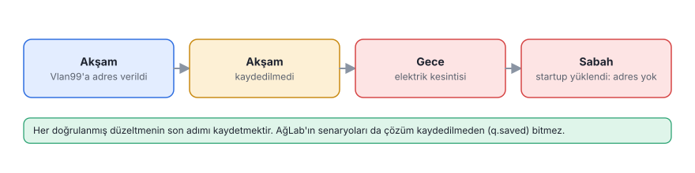
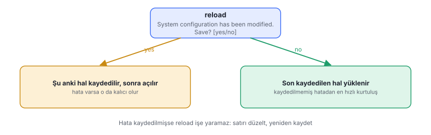
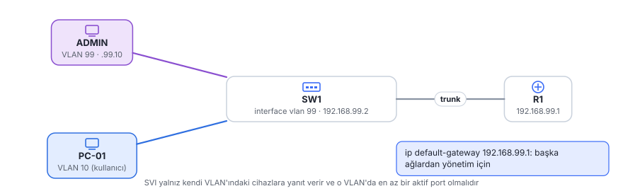
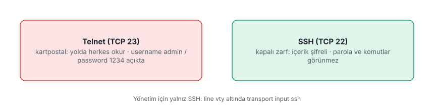
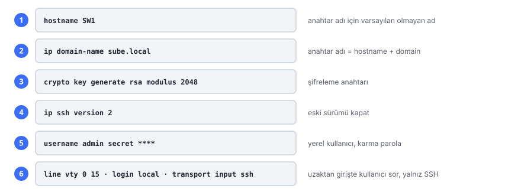
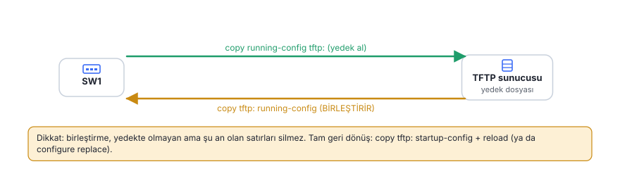

# AğLab Konu #11: Cihaz yönetimi ve yedekleme

> Uygulamadaki `devicemgmt` dersi bu belgeyle uyumludur. Senaryolar Sorun Çöz'de `mgmt-*`
> kimlikleriyle Labber'da çalışır (`verify.kind: "query"`, kayıt durumu ve güç döngüsü dahil).
> Şemalar: `docs/dersler/gorseller/cihaz-yonetimi.py`.

Bu konu bittiğinde öğrenci running-config ile startup-config farkını açıklar ve değişikliği kaydeder. Kaydedilmemiş hatalı bir değişikliği `reload` ile geri alır ve "Save?" sorusunu doğru cevaplar. Switch'e yönetim SVI'si ve gerekirse `ip default-gateway` ile adres verir. SSH'ın adımlarını ve parolaların nasıl saklandığını açıklar, yapılandırmayı yedekler. Seviye 1, süre yaklaşık 75 dakika.

## 0. Bir bakışta

- Cihazın iki yapılandırması vardır: **running-config** (RAM, şu an çalışan) ve **startup-config** (NVRAM, açılışta yüklenen).
- **Kaydetmek**, running'i startup'a kopyalamaktır: `copy running-config startup-config`. Kaydedilmeyen her şey kesintide kaybolur.
- **reload** kaydedilmemiş değişiklik varsa "Save?" diye sorar: `no` son kaydedilen hale döndürür.
- Katman 2 switch'e ağdan ulaşmak için bir **SVI**'ya (ör. `interface vlan 99`) **yönetim adresi** verilir.
- Uzaktan yönetim **SSH** ile yapılır; Telnet her şeyi düz metin gönderir. Yapılandırmanın **yedeği** alınır.

> **Akılda kalsın:** "Dün çalışıyordu, bugün çalışmıyor" diyorsan önce running ile startup'ı karşılaştır. Fark, kaydedilmemiş değişikliktir.


## 1. Neden önemli

"Dün çalışıyordu, bugün çalışmıyor" şikâyetlerinin önemli bir kısmı yapılandırma yönetiminden gelir. Kaydedilmemiş bir ayar gece kesintisinde kaybolur. Aceleyle "yes" denmiş bir reload hatayı kalıcı yapar. Yönetim adresi olmayan bir switch'e uzaktan ulaşılamaz. Yedeği olmayan bir cihaz arızalanınca ayarları sıfırdan yazmak gerekir.

## 2. Kavram

### 2.1 İki yapılandırma

> **Benzetme:** Bir tarifi önce kurşun kalemle karalarsın: denersin, silersin, düzeltirsin. Beğenince tükenmez kalemle temize çekersin. Karalama defteri (RAM) elektrik gidince silinir; temize çekilen sayfa (NVRAM) kalır ve her sabah oradan okunur.

- **running-config** RAM'dedir; her komut **anında** buraya yazılır ve hemen etkili olur.
- **startup-config** NVRAM'dedir; cihaz **açılırken** buradan yüklenir.
- **Kaydetmek** running'i startup'a kopyalamaktır: `copy running-config startup-config` ya da kısaca `write memory`.
- `erase startup-config` ve ardından `reload` cihazı fabrika ayarına döndürür.



### 2.2 reload ve "Save?" sorusu

Kaydedilmemiş değişiklik varken `reload`, "System configuration has been modified. Save? [yes/no]" diye sorar, ardından onay ister.

- `yes`: şu anki hali kaydeder; **hata varsa o da kalıcı olur**.
- `no`: kaydetmeden açılır; cihaz **son kaydedilen hale** döner.

Kaydedilmemiş bir hatadan kurtulmanın en hızlı yolu `reload` ve `no`'dur. Hata kaydedilmişse reload işe yaramaz: satır düzeltilip yeniden kaydedilir.



> **Dikkat:** Gerçek bir ağda reload, cihazın üzerinden geçen bütün trafiği birkaç dakika keser. Mesai içinde yapılmaz; yapılacaksa önce haber verilir.

### 2.3 Yönetim adresi: switch'in kapısı

> **Benzetme:** Apartmanın her dairesinin kapısı var (portlar), ama yöneticinin odasının da ayrı bir kapısı ve zili olmalı ki yönetici kendisine ulaşılabilsin. Switch'in yönetim SVI'si o zildir.

- Katman 2 switch'in portlarının IP'si yoktur. Ağdan ulaşmak için bir **SVI**'ya adres verilir: `interface vlan 99` → `ip address 192.168.99.2 255.255.255.0` → `no shutdown`.
- SVI yalnız **kendi VLAN'ındaki** cihazlara yanıt verir ve o VLAN'da en az bir **aktif port** olmalıdır.
- Başka ağdan yönetim için `ip default-gateway 192.168.99.1` (switch yönlendirme yapmadığı için bu, onun "gateway"idir).
- Yönetimi kullanıcı VLAN'larından ve VLAN 1'den ayırmak iyi uygulamadır.



### 2.4 Parolalar ve SSH

> **Simülatörde yok:** SSH, parola ve TFTP Labber'da modellenmez; bu bölüm okuma konusudur.

- `enable secret` parolayı **karma** (hash) olarak saklar ve `enable password`'ün önüne geçer.
- `service password-encryption` yalnız zayıf **type 7** gizlemesi yapar; kolayca çözülür. Gerçek koruma değildir, yalnız ekrana bakanın okumasını engeller.
- **Telnet** (TCP 23) her şeyi düz metin gönderir; **SSH** (TCP 22) oturumu şifreler.

> **Benzetme:** Telnet kartpostaldır: postacı da, kapıcı da okur. SSH kapalı zarftır.



SSH'ı açmanın adımları:



### 2.5 Yedekleme

- `copy running-config tftp:` yapılandırmayı dışarıdaki bir sunucuya yedekler.
- `copy tftp: running-config` yedeği mevcut ayarla **birleştirir**, yerine koymaz: yedekte olmayan ama şu an olan satırlar kalır.
- Tam geri dönüş için yedek **startup-config**'e kopyalanıp reload yapılır ya da `configure replace` kullanılır.



> **Sahada:** Her değişiklikten önce `show running-config` çıktısını bir yere kaydetmek en basit yedektir (Konu #1).

## 3. Çıktı okuma

```
SW1#show running-config | section interface FastEthernet0/2
interface FastEthernet0/2
 switchport access vlan 20               ← çalışan hal
SW1#show startup-config | section interface FastEthernet0/2
interface FastEthernet0/2
 switchport access vlan 10               ← kaydedilmiş hal: fark kaydedilmemiş değişikliktir

SW1#reload
System configuration has been modified. Save? [yes/no]: no
Proceed with reload? [confirm]

SW1#show ip interface brief | include Vlan
Vlan1                  unassigned      YES unset  administratively down down
Vlan99                 192.168.99.2    YES manual up                    up
        ← "administratively down" olsaydı: no shutdown eksik
```

| Soru | Komut |
| --- | --- |
| Kaydedilmemiş değişiklik var mı? | `show running-config` ile `show startup-config` karşılaştır |
| Yönetim adresi hangi SVI'da, açık mı? | `show ip interface brief` |
| Başka ağdan yönetim mümkün mü? | `show running-config \| include default-gateway` |
| SSH açık mı? | `show ip ssh` |

## 4. Yönlendirmeli lab

Topoloji: SW1'de PC-01, PC-02 (VLAN 10) ve ADMIN (VLAN 99, 192.168.99.10).

1. **Yönetim SVI'si:**
   ```
   SW1(config)#interface vlan 99
   SW1(config-if)#ip address 192.168.99.2 255.255.255.0
   SW1(config-if)#no shutdown
   ```
   *Doğrula:* ADMIN'den `ping 192.168.99.2`; `show ip interface brief`'te Vlan99 up/up.
2. **Farkı gör:** `show running-config` ve `show startup-config`; Vlan99 yalnız birinde. *Neden:* değişiklik henüz yalnız RAM'de.
3. **Kaydet:** `copy running-config startup-config`; tekrar karşılaştır: artık ikisinde de.
4. **Hatalı değişiklik:** `interface fa0/2` → `switchport access vlan 20`; PC-01 → PC-02 kopar.
5. **Geri al:** `reload` → `no` → onay. PC-01 → PC-02 geri gelir. *Neden:* kaydedilmemiş hata yalnız running'teydi.
6. **Kaydedilmiş hata:** aynı değişikliği yap, bu kez kaydet ve reload et; hata kalır. Düzelt ve kaydet.
7. **Okuma:** SSH adımlarını bir kâğıda sırayla yaz; `enable secret` ile `enable password` farkını açıkla.

> **Benzetme:** 5. ve 6. adım, kaydetmeden kapattığın bir belgeyi geri açmak ile kaydedip kapattığın belgeyi geri açmak arasındaki farktır.

## 5. Sık hatalar

| Kod | Hata | Belirti | Kanıt | Düzeltme |
| --- | --- | --- | --- | --- |
| E1 | Kaydetmeyi unutmak | Kesinti ya da reload sonrası ayar eski haline döner | startup-config'te satırlar yok | Ayarı yeniden yap, kaydet |
| E2 | Hatalı değişiklikle "Save? yes" | Hata kalıcı olur, reload düzeltmez | running ile startup aynı, ikisinde de hata | Satırı düzelt, kaydet |
| E3 | Yönetim SVI'si kapalı | Kullanıcılar çalışır, switch'e ping yok | Vlan99 administratively down | `no shutdown` |
| E4 | Adres yanlış SVI'da ya da default-gateway yok | Yönetici VLAN'ından ya da başka ağdan erişim yok | Adres Vlan1'de; `ip default-gateway` yok | Adresi doğru SVI'ya taşı; default-gateway ekle |
| E5 | SSH çalışmıyor (okuma) | Bağlantı reddediliyor | `show ip ssh` Disabled; `login local` ya da kullanıcı yok | RSA anahtarı, kullanıcı, `login local`, `transport input ssh` |

## 6. Arıza senaryoları

> **Uygulamada:** S1–S5 Sorun Çöz'de `mgmt-unsaved-lost`, `mgmt-reload-revert`, `mgmt-saved-fault`,
> `mgmt-svi-down`, `mgmt-wrong-vlan` kimlikleriyle Labber'da çalışır. Hepsinde son hedef
> `q.saved('SW1')`: çözüm kaydedilmeden senaryo bitmez. Önce kendin çöz; neden ve çözüm kapalı kutularda.

### S1 · Başlangıç · Gece kesintiden sonra switch'e ulaşılamıyor (E1)

- **Belirti:** Dün Vlan99'a yönetim adresi verildi, ADMIN ping atabiliyordu. Gece elektrik kesildi; sabah ulaşılamıyor.
- **Hedef:** ADMIN → 192.168.99.2; SW1 kayıtlı.

<details><summary>Neden ve çözüm</summary>

Yönetim ayarı kaydedilmemişti. Çözüm: SW1 → `interface vlan 99` → `ip address 192.168.99.2 255.255.255.0` → `no shutdown` → `copy running-config startup-config`.

</details>

### S2 · Başlangıç · Kaydedilmemiş hatalı değişikliği geri al (reload / no)

- **Belirti:** Biri bir port ayarını değiştirdi, PC-02 düştü; ne yapıldığı bilinmiyor, kaydedilmemiş.
- **Hedef:** PC-01 → PC-02; SW1 kayıtlı.

<details><summary>Neden ve çözüm</summary>

SW1 Fa0/2 kaydedilmeden VLAN 20'ye alındı. Çözüm: SW1 → `reload` → `no` → onay.

</details>

### S3 · Orta · Yeniden başlatma hatayı düzeltmiyor (E2)

- **Belirti:** PC-02 ulaşamıyor; switch yeniden başlatıldı, sorun sürüyor.
- **Hedef:** PC-01 → PC-02; SW1 kayıtlı.

<details><summary>Neden ve çözüm</summary>

Fa0/2 kapatılmış ve kaydedilmiş. Çözüm: SW1 → `interface fa0/2` → `no shutdown` → kaydet.

</details>

### S4 · Orta · Kullanıcılar çalışıyor, switch yönetilemiyor (E3)

- **Belirti:** PC'ler sorunsuz; ADMIN 192.168.99.2'ye ping atamıyor.
- **Hedef:** ADMIN → 192.168.99.2; PC-01 → PC-02; SW1 kayıtlı.

<details><summary>Neden ve çözüm</summary>

Vlan99 administratively down. Çözüm: SW1 → `interface vlan 99` → `no shutdown` → kaydet.

</details>

### S5 · İleri · Yönetim adresi yanlış VLAN arayüzünde (E4)

- **Belirti:** Adres 192.168.99.2, arayüz up görünüyor ama VLAN 99'daki ADMIN ulaşamıyor.
- **Hedef:** ADMIN → 192.168.99.2; SW1 kayıtlı.

<details><summary>Neden ve çözüm</summary>

Adres Vlan1'de. Çözüm: SW1 → `interface vlan 1` → `no ip address` → `shutdown`; `interface vlan 99` → `ip address 192.168.99.2 255.255.255.0` → `no shutdown` → kaydet.

</details>

## 7. Kısa sınav

**1.** running-config nerede durur, startup-config nerede?

<details><summary>Cevap</summary>

running-config RAM'de, startup-config NVRAM'de.

</details>

**2.** Kaydedilmemiş hatalı değişiklikten en hızlı dönüş?

<details><summary>Cevap</summary>

`reload`, "Save?" sorusuna `no`.

</details>

**3.** Kaydedilmiş bir hata reload ile düzelir mi?

<details><summary>Cevap</summary>

Hayır; satırı düzeltip yeniden kaydetmek gerekir.

</details>

**4.** Katman 2 switch'e ağdan ulaşmak için adres nereye verilir?

<details><summary>Cevap</summary>

Bir SVI'ya (ör. `interface vlan 99`); başka ağdan erişim için `ip default-gateway`.

</details>

**5.** `enable secret` ile `enable password` farkı?

<details><summary>Cevap</summary>

secret karma olarak saklanır ve önceliklidir; password düz ya da zayıf type 7 ile saklanır.

</details>

**6.** `copy tftp: running-config` ile eski bir yedeği yükledin ama bugün eklenen yanlış bir satır hâlâ duruyor. Neden?

<details><summary>Cevap</summary>

Bu komut birleştirir; yedekte olmayan satırları silmez. Tam geri dönüş için yedeği startup'a kopyalayıp reload et.

</details>

## 8. Özet kartı

| Komut | Ne işe yarar |
| --- | --- |
| `show running-config` / `show startup-config` | Çalışan ve kaydedilmiş hal |
| `copy running-config startup-config` (`write memory`) | Kaydeder |
| `reload` → `no` | Kaydedilmemiş değişiklikleri atarak yeniden başlatır |
| `interface vlan 99` → `ip address` → `no shutdown` | Yönetim adresi |
| `ip default-gateway <adres>` | Switch'in başka ağlardan yönetimi |
| `enable secret`, `username ... secret` | Karma parola |
| `ip ssh version 2`, `transport input ssh` | Yalnız SSH ile yönetim |
| `copy running-config tftp:` | Yedek |

**Unutma:**

1. Komut anında running'e yazılır; kaydetmezsen kesintide gider.
2. reload + `no` = son kaydedilen hal.
3. Kaydedilmiş hata reload ile düzelmez.
4. Yönetim adresi SVI'da; SVI'nın VLAN'ında aktif port olmalı.
5. Telnet değil SSH.

## 9. Doğrulama notları

Kaynaklar: INET CCNA 200-301 v1.1 (cihaz yönetimi, SSH, parolalar); Cisco IOS yapılandırma dosyası yönetimi (running/startup, `copy`, `configure replace`), Catalyst yönetim SVI'si ve `ip default-gateway`, IOS SSH yapılandırma kılavuzu; CCNA 200-301 4.8 (SSH), 5.3 (parolalar).

| İddia | Sonuç |
| --- | --- |
| `copy tftp: running-config` birleştirir, değiştirmez | Doğru |
| reload kaydedilmemiş değişiklikte "Save? [yes/no]" sorar | Doğru |
| SSH için RSA anahtarı ve domain-name gerekir | Doğru |
| `service password-encryption` type 7, kolay çözülür | Doğru |

Lab'ın otomatik değerlendirmesi: `q.ping('ADMIN', '192.168.99.2').ok`; `q.ping('PC-01', <PC-02>).ok`; `q.saved('SW1')`; güç döngüsünden sonra da.

**Motor gereksinimleri** (Labber'da denendi)

- [x] running/startup, `copy running-config startup-config`, `reload` ve "Save?", güç döngüsü, yönetim SVI'si
- [x] Beş senaryo `query` doğrulamasıyla, `q.saved` dahil
- [ ] SSH, parola, TFTP, `configure replace` yok (okuma)
