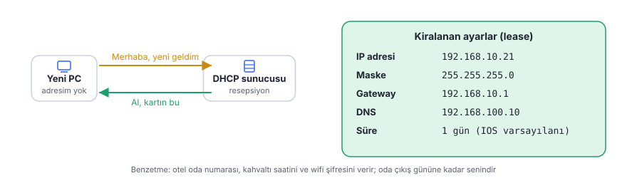
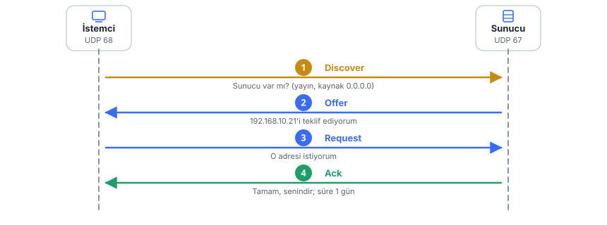
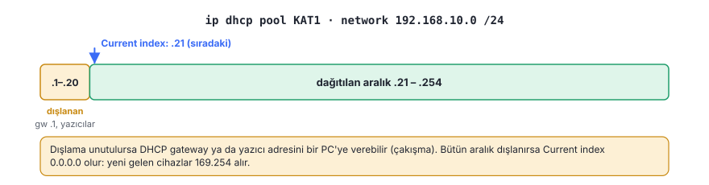
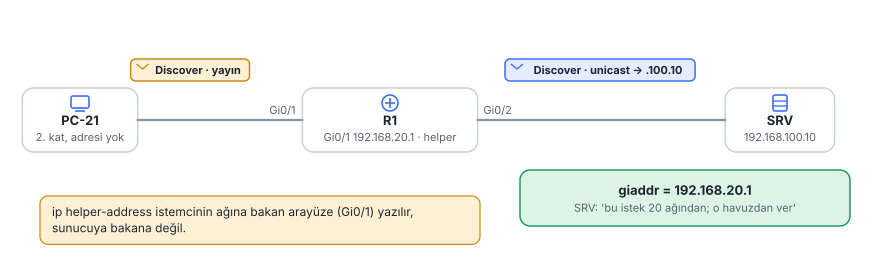
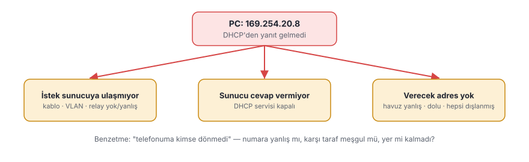
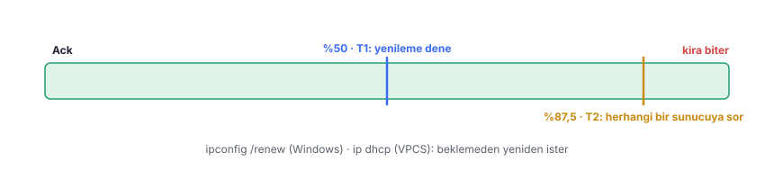
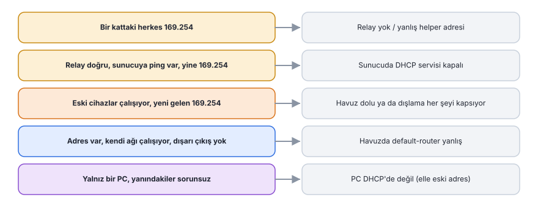

# AğLab Konu #9: DHCP

> Uygulamadaki `dhcp` dersi bu belgeye göre yazıldı. Senaryolar Sorun Çöz'de `dhcp-*` kimlikleriyle
> Labber'da çalışır. Şemalar: `docs/dersler/gorseller/dhcp.py`.

Bu konu bittiğinde öğrenci bir Cisco router'da DHCP havuzu kurar, başka ağdaki sunucuya relay (`ip helper-address`) ile istek taşır ve "169.254 aldı" şikâyetini adım adım teşhis eder: sunucuya ulaşılamıyor mu, havuz yanlış mı, havuz dolu mu? Seviye 1, süre yaklaşık 75 dakika (ders 20, lab 25, senaryolar 20, sınav 10).

## 0. Bir bakışta

- **DHCP**, cihaza ağ ayarlarının tamamını otomatik verir: **adres, maske, gateway, DNS**. Bunlar bir süreliğine **kiralanır** (lease).
- Adres **dört mesajla** alınır: Discover → Offer → Request → Ack (**DORA**). İlk mesaj yayındır.
- Router'da bir **havuz** (pool) tanımlanır; gateway ve yazıcılar gibi sabit adresler **dışlanır** (excluded-address).
- Router yayını başka ağa geçirmez. Sunucu başka ağdaysa istemcinin ağına bakan arayüze **`ip helper-address`** yazılır (relay).
- **169.254.x.x** "sunucudan cevap gelmedi" demektir: bir belirtidir, neden değil.

> **Akılda kalsın:** DHCP yalnız adres değil, cihazın bütün ağ ayarını dağıtır. "Adres var ama dışarı çıkamıyorum" diyorsan DHCP'nin verdiği **gateway**'e bak.



## 1. Neden önemli

Şubede kimse bilgisayarlara tek tek IP yazmaz; adresi DHCP verir. Bu yüzden DHCP bozulduğunda belirti genelde "internet yok" diye gelir, oysa bilgisayarın elinde kullanılabilir bir adres bile yoktur. Ekranda 169.254 ile başlayan bir adres görürsün.

İkinci yaygın durum daha sinsidir: bilgisayar adres alır, kendi ağında herkese ulaşır, ama dışarı çıkamaz. Adres doğrudur, yanlış olan DHCP'nin adresle birlikte verdiği gateway'dir.

## 2. Kavram

### 2.1 DHCP neyi verir?

> **Benzetme:** Otele girdiğinde resepsiyon sana bir oda anahtarı (IP adresi), katın krokisi (maske), çıkış kapısının yeri (gateway) ve danışma numarası (DNS) verir. Oda çıkış gününe kadar senindir (lease); kalmak istersen süreyi uzatırsın.

- **IP adresi ve maske:** cihazın ağdaki kimliği (Konu #2).
- **Varsayılan ağ geçidi (default-router):** başka ağlara çıkış kapısı (Konu #8).
- **DNS sunucusu:** isimleri adrese çeviren sunucu (Konu #10).
- **Kira süresi (lease):** Cisco router'da süre belirtilmezse **1 gün**.
- İstemci **UDP 68**'den, sunucu **UDP 67**'den konuşur.

### 2.2 DORA: dört mesajda adres

1. **Discover:** İstemci "DHCP sunucusu var mı?" diye **yayın** (broadcast) gönderir. Henüz adresi yoktur (kaynak 0.0.0.0) ve sunucunun adresini bilmez.
2. **Offer:** Sunucu bir adres teklif eder.
3. **Request:** İstemci teklifi ister (birden çok teklif geldiyse birini seçer).
4. **Ack:** Sunucu onaylar; adres artık istemcinindir.



> **Dikkat:** İlk mesajın yayın olması önemlidir: router'lar yayınları başka ağa geçirmez. Sunucu başka ağdaysa bu mesaj sunucuya hiç ulaşmaz; relay gerekir (2.4).

### 2.3 Havuz ve dışlanan adresler

Router'da hangi ağa hangi adreslerin dağıtılacağını havuz tanımlar:

```
ip dhcp excluded-address 192.168.10.1 192.168.10.20
ip dhcp pool KAT1
 network 192.168.10.0 255.255.255.0
 default-router 192.168.10.1
 dns-server 192.168.100.10
```

- `excluded-address`, havuzun **dağıtmayacağı** adreslerdir: gateway, yazıcılar, sunucular. Havuz bu adresleri atlar ve ilk boş adresten (.21) başlar.
- Dışlama yapılmazsa DHCP, elle verilmiş bir adresi başka bir bilgisayara da verip **çakışma** yaratabilir (Konu #2).
- Dışlamayı havuzdan **önce** yazmak, havuz açılır açılmaz birinin bu adresleri almasını önler.



### 2.4 Relay: başka binadaki resepsiyon

> **Benzetme:** Resepsiyon başka binada. Misafir kendi katında "oda istiyorum" diye seslenir ama sesi binadan çıkmaz. Kattaki görevli (relay) isteği telefonla resepsiyona iletir ve "2. kattan arıyorum" der; resepsiyon da 2. katın oda listesinden oda verir.

- DHCP sunucusu başka bir ağdaysa, **istemcinin ağına bakan** router arayüzüne `ip helper-address <sunucu>` yazılır.
- Router yayını yakalar ve sunucuya **unicast** paket olarak iletir.
- Pakete isteğin geldiği arayüzün adresini (**giaddr**) koyar; sunucu buna bakarak **hangi ağın havuzundan** adres vereceğine karar verir.



### 2.5 169.254: belirti, neden değil

DHCP'den yanıt alamayan istemci kendine **169.254.0.0/16** aralığından bir adres verir (APIPA). Bu adresle yalnız aynı kablodaki başka 169.254'lü cihazlarla konuşulabilir. Nedeni üçten biridir:



### 2.6 Kira süresi ve yenileme

İstemci kiranın **yarısında** (T1) aynı sunucudan yenilemeyi dener; olmazsa **%87,5**'inde (T2) herhangi bir sunucuya sorar. Kira bitene kadar adresini kullanmaya devam eder. Bu yüzden havuz bozulsa bile **eski cihazlar bir süre çalışır**, sorun önce **yeni gelenlerde** görülür.



> **Sahada:** Bir DHCP düzeltmesinden sonra istemcinin kendiliğinden düzelmesini bekleme; `ipconfig /renew` (Windows) ya da AğLab'da `ip dhcp` ile yeniden iste. Gerçek bilgisayar kirası yenilenene kadar eski ayarla kalır.

## 3. Çıktı okuma

### İstemcide: show ip (VPCS) / ipconfig /all (Windows)

```
PC-21> show ip
IP/MASK     : 192.168.20.100/24
GATEWAY     : 192.168.20.1
DNS         : 192.168.100.10
DHCP SERVER : 192.168.100.10
```

- **IP/MASK 169.254.x.x/16** ise DHCP'den yanıt gelmemiştir.
- **GATEWAY:** DHCP'nin verdiği gateway. Adres doğru ama dışarı çıkılamıyorsa ilk bakılacak satır budur.
- **DHCP SERVER:** Adresi veren sunucu. Relay'le gelen istemcide burada uzaktaki sunucu görünür.
- Windows'ta `ipconfig /all`: "DHCP Enabled", "DHCP Server" ve "Lease Obtained/Expires" satırları aynı bilgiyi verir. `ipconfig /renew` yeniden ister.

### Router'da: show ip dhcp binding

```
R1#show ip dhcp binding
Bindings from all pools not associated with VRF:
IP address          Client-ID/              Lease expiration        Type
                    Hardware address/
                    User name
192.168.10.21       0102.0000.0000.06       Mar 02 2026 01:02 AM    Automatic
192.168.10.22       0102.0000.0000.07       Mar 02 2026 01:05 AM    Automatic
```

- Her satır bir kiralamadır: hangi adres, hangi istemciye (Client-ID'de MAC), ne zamana kadar.
- Bir bilgisayar 169.254 alıyor ve burada satırı yoksa istek router'a hiç ulaşmamıştır ya da router verecek adres bulamamıştır.

### Router'da: show ip dhcp pool

```
R1#show ip dhcp pool
Pool KAT1 :
 Total addresses                : 254
 Leased addresses               : 2
 Current index        IP address range                    Leased addresses
 192.168.10.23        192.168.10.1     - 192.168.10.254    2
```

- **Leased addresses:** Kiralanmış adres sayısı.
- **Current index:** Sıradaki verilecek adres. **0.0.0.0** görünüyorsa havuzda verilecek adres kalmamıştır: ya gerçekten dolmuştur ya da dışlama bütün havuzu kapsıyordur.
- Toplam adres sayısına dışlanan adresler de dahildir; dışlamayı kontrol etmek için `show running-config | include excluded`.

## 4. Yönlendirmeli lab

> **Simülatörde:** bu labın hazır topolojisi ve otomatik kontrolü Simülatör'deki **dhcp-kurulum** labıdır (dersin Pratik adımı). Simülatör labı bu adımların özüdür; ayrıntılar labın görev metnindedir.

Topoloji: R1'in üç arayüzü var. Gi0/0 1. kata (192.168.10.0/24), Gi0/1 2. kata (192.168.20.0/24), Gi0/2 sunucu odasına (192.168.100.0/24) bakıyor. Sunucu odasında SRV (192.168.100.10) DHCP ve DNS sunucusu. Başlangıçta R1'de havuz ve relay yok; PC'lerin hepsi DHCP istemcisi.

1. **Sunucusuz dene.** PC-11'de `ip dhcp`. Çıktı: `Can't find dhcp server`, adres 169.254.x.x. *Neden:* 1. katta DHCP veren kimse yok; istemci kendine link-local adres verdi.
2. **Dışlamayı yaz.** R1'de `ip dhcp excluded-address 192.168.10.1 192.168.10.20`. *Neden:* Gateway ve ileride yazıcılara verilecek adresler dağıtılmasın. Dışlamayı havuzdan **önce** yazmak, havuz açılır açılmaz birinin bu adresleri almasını önler.
3. **Havuzu kur.** `ip dhcp pool KAT1` → `network 192.168.10.0 255.255.255.0` → `default-router 192.168.10.1` → `dns-server 192.168.100.10`.
4. **Yeniden iste.** PC-11'de `ip dhcp`: `DDORA IP 192.168.10.21/24 GW 192.168.10.1`. *Neden:* "DDORA" dört mesajın gittiğini gösterir; ilk boş adres dışlanan aralıktan sonraki .21'dir.
5. **Kiralamayı gör.** R1'de `show ip dhcp binding` ve `show ip dhcp pool`. PC-11'in adresi ve MAC'i listede; havuzda 1 kiralama var.
6. **2. kattan dene.** PC-21'de `ip dhcp`: yine 169.254. *Neden:* SRV başka ağda; PC-21'in yayını R1'de duruyor.
7. **Relay ekle.** R1'de `interface g0/1` → `ip helper-address 192.168.100.10`. PC-21'de tekrar `ip dhcp`: adres 192.168.20.x, gateway 192.168.20.1. `show ip`'te **DHCP SERVER 192.168.100.10**. *Neden:* Relay isteği giaddr 192.168.20.1 ile sunucuya taşıdı; sunucu 192.168.20.0/24 için adres verdi.
8. **Uçtan uca kontrol.** PC-21'den `ping 192.168.10.21` ve `nslookup SRV`. İkisi de çalışır: DHCP gateway'i ve DNS sunucusunu da doğru vermiştir.

> **Benzetme:** 6. ve 7. adım, 2. kattaki misafirin resepsiyonu duyamamasına benzer: resepsiyon başka binada. Relay, kattaki görevlinin misafirin isteğini telefonla resepsiyona iletmesidir; görevli "2. kattan arıyorum" der (giaddr), resepsiyon da 2. katın oda listesinden oda verir.

## 5. Sık hatalar

| Kod | Hata | Belirti | Kanıt | Düzeltme |
| --- | --- | --- | --- | --- |
| E1 | Relay yok | Sunucunun bulunmadığı ağdaki herkes 169.254 alıyor; sunucunun kendi ağı çalışıyor | İstemci arayüzünde `ip helper-address` yok (`show running-config interface`) | İstemcinin ağına bakan arayüze `ip helper-address <sunucu>` |
| E2 | Relay yanlış adrese | Relay tanımlı ama yine 169.254 | Helper adresine ping yok ya da o adreste DHCP servisi yok | Doğru sunucu adresini yaz, yanlışını `no ip helper-address` ile kaldır |
| E3 | Havuzda yanlış gateway | Adres alınıyor, aynı ağ çalışıyor, dışarı çıkış yok | İstemcide GATEWAY yanlış; havuzda `default-router` yanlış | Havuzda `default-router`'ı düzelt, istemcide yenile |
| E4 | Havuzda adres kalmadı | Eski cihazlar çalışıyor, **yeni** gelen 169.254 alıyor | `show ip dhcp pool`'da Current index 0.0.0.0; dışlama havuzun tamamını kapsıyor ya da havuz gerçekten dolu | Dışlamayı daralt, havuzu büyüt ya da kira süresini kısalt |
| E5 | Dışlama unutulmuş | Ağda aralıklı "IP çakışması" uyarıları | Gateway ya da yazıcı adresi `show ip dhcp binding`'de bir PC'ye verilmiş | Statik adresleri `excluded-address` ile dışla |
| E6 | İstemci DHCP'de değil | Yalnız o bilgisayar ulaşamıyor; yanındakiler sorunsuz | `show ip`'te adres elle yazılmış ve ağın planına uymuyor (ör. eski şubeden kalma); kira yok | İstemciyi DHCP'ye al (`ip dhcp` / `ipconfig /renew`) |
| E7 | Sunucuda DHCP servisi kapalı | Relay doğru, sunucuya ping var, yine 169.254 | Sunucuda `show services`: DHCP kapalı | Servisi aç, istemcide yenile |

> **Akılda kalsın:** E7 ile E2'yi ayıran şey helper adresidir: E2'de adres yanlış, E7'de adres doğru ve sunucuya ping gidiyor ama servis kapalı. E6 tek bir bilgisayarı etkiler; havuz ve relay sağlamdır. E3 ile E1'i ayıran şey 169.254'tür: E1'de istemcinin adresi yoktur, E3'te adresi vardır ama yanlış gateway'i vardır. E4'ün ayırt edici izi, sorunun yalnız **yeni** cihazlarda görülmesidir; eski cihazlar kiraları bitene kadar çalışmaya devam eder.



## 6. Arıza senaryoları

> **Uygulamada:** S1–S5 Sorun Çöz'de `dhcp-no-helper`, `dhcp-wrong-helper`, `dhcp-pool-gateway`,
> `dhcp-excluded-all`, `dhcp-two-faults` kimlikleriyle Labber'da çalışır. Hedefler `dhcpLease`
> (adres hangi sunucudan alındı) ve `ping` ile yazıldı. Düzeltmeden sonra istemcide `ip dhcp` ile
> yeniden istemek gerekir. Temel topoloji labın bitmiş hâlidir. Önce kendin çöz; neden ve çözüm
> kapalı kutularda.

### S1 · Başlangıç · Yeni açılan 2. kat 169.254 alıyor (E1)

- **Belirti:** 2. kat yeni devreye alındı; oradaki bilgisayarlar 169.254.x.x alıyor. 1. kat sorunsuz.
- **Hedef:** PC-21 adresini SRV'den alıyor; PC-21 → SRV başarılı.

<details><summary>Neden ve çözüm</summary>

R1 Gi0/1'de `ip helper-address` yok; 2. katın yayını R1'de duruyor. Çözüm: R1 → `interface g0/1` → `ip helper-address 192.168.100.10`; PC-21 → `ip dhcp`.

</details>

### S2 · Başlangıç · Relay var ama 2. kat yine adres alamıyor (E2)

- **Belirti:** 2. kat 169.254 alıyor; yönetici "relay'i dün ekledim" diyor.
- **Hedef:** PC-21 adresini SRV'den alıyor; PC-21 → SRV başarılı.

<details><summary>Neden ve çözüm</summary>

Helper adresi 192.168.100.10 yerine 192.168.100.100 yazılmış. Çözüm: R1 → `interface g0/1` → `no ip helper-address 192.168.100.100` → `ip helper-address 192.168.100.10`; PC-21 → `ip dhcp`.

</details>

### S3 · Orta · Adres var, dışarı çıkış yok (E3)

- **Belirti:** 1. kat adres alıyor, birbirine ulaşıyor; sunucu odasına ve 2. kata ulaşamıyor.
- **Hedef:** PC-11 adresini R1'den alıyor; PC-11 → SRV başarılı.

<details><summary>Neden ve çözüm</summary>

KAT1 havuzunda `default-router 192.168.10.254`. Çözüm: R1 → `ip dhcp pool KAT1` → `default-router 192.168.10.1`; PC-11 → `ip dhcp`.

</details>

### S4 · Orta · Eski bilgisayarlar çalışıyor, yeni gelen adres alamıyor (E4)

- **Belirti:** Yeni bilgisayar 169.254 aldı; eski bilgisayar sorunsuz. Sabah "yazıcılar için birkaç adres ayırdım" denmişti.
- **Hedef:** PC-12 adresini R1'den alıyor; PC-12 ve PC-11 → SRV başarılı.

<details><summary>Neden ve çözüm</summary>

`ip dhcp excluded-address 192.168.10.1 192.168.10.254`: bütün havuz dışlanmış. Çözüm: R1 → `no ip dhcp excluded-address 192.168.10.1 192.168.10.254` → `ip dhcp excluded-address 192.168.10.1 192.168.10.20`; PC-12 → `ip dhcp`.

</details>

### S5 · İleri · İki kat, iki farklı belirti (E1 + E3)

- **Belirti:** 2. kat 169.254 alıyor; 1. kat adres alıyor ama sunucu odasına ulaşamıyor.
- **Hedef:** PC-21 adresini SRV'den alıyor; PC-21 ve PC-11 → SRV başarılı.

<details><summary>Neden ve çözüm</summary>

S1 ve S3 birlikte: relay yok ve havuzun gateway'i yanlış. İki düzeltme; iki kattan da birer PC'de `ip dhcp`.

</details>

### Ek · İki senaryo daha

- `dhcp-client-static` · **Bilgisayarda eski ağın adresi kalmış (E6).** Yalnız PC-11 ulaşamıyor; havuz ve relay sağlam.
- `dhcp-service-down` · **Sunucu ayakta ama 2. kat adres alamıyor (E7).** Relay doğru, sunucuya ping gidiyor.

<details><summary>Neden ve çözüm</summary>

`dhcp-client-static`: PC-11 DHCP istemcisi değil, kartında 192.168.50.20/24 elle yazılı; çözüm PC-11'de `ip dhcp`. `dhcp-service-down`: SRV'de DHCP servisi kapalı; çözüm SRV'de `service dhcp on`, PC-21'de `ip dhcp`.

</details>

## 7. Kısa sınav

**1.** Bir bilgisayar 169.254.20.8/16 adresine sahip. Anlamı?

<details><summary>Cevap</summary>

DHCP'den yanıt alınamadı; istemci kendine link-local adres verdi. Neden ayrıca aranır (yol, servis, havuz).

</details>

**2.** Sunucu 192.168.100.10, istemciler 192.168.20.0/24'te. `ip helper-address` nereye yazılır?

<details><summary>Cevap</summary>

R1'in 192.168.20.0/24'e bakan arayüzüne: yayının geldiği arayüz.

</details>

**3.** PC'ler adres alıyor ve birbirine ulaşıyor, dışarı çıkamıyor. `show ip`'te GATEWAY 192.168.10.254. Sorun nerede?

<details><summary>Cevap</summary>

Havuzun `default-router` satırında. DHCP gateway'i de dağıtır.

</details>

**4.** `show ip dhcp pool`'da Current index `0.0.0.0` ve yeni cihazlar 169.254 alıyor. En olası neden?

<details><summary>Cevap</summary>

Havuzda verilecek adres kalmamış: dolmuş ya da dışlama bütün aralığı kapsıyor.

</details>

**5.** DORA'da istemcinin ilk mesajı neden yayındır?

<details><summary>Cevap</summary>

İstemcinin henüz adresi yok ve sunucunun adresini bilmiyor. Bu yüzden ilk mesaj router'dan geçmez ve relay gerekir.

</details>

**6.** Havuz dün bozuldu ama eski bilgisayarlar hâlâ çalışıyor, yalnız yeni gelenler adres alamıyor. Neden?

<details><summary>Cevap</summary>

Eski bilgisayarların kirası henüz bitmedi; adreslerini kullanmaya devam ediyorlar. Sorun önce yeni gelenlerde görülür.

</details>

## 8. Özet kartı

| Komut | Ne işe yarar |
| --- | --- |
| `ip dhcp excluded-address <ilk> <son>` | Dağıtılmayacak adresler (gateway, yazıcılar) |
| `ip dhcp pool <ad>` → `network`, `default-router`, `dns-server` | Havuz ve dağıtılan ayarlar |
| `ip helper-address <sunucu>` | Relay: istemcinin ağına bakan arayüzde |
| `show ip dhcp binding` | Kim hangi adresi kiralamış |
| `show ip dhcp pool` | Havuzun doluluğu; Current index |
| `show ip` (VPCS), `ipconfig /all` (Windows) | İstemcinin aldığı ayarlar, DHCP SERVER |
| `ip dhcp` (VPCS), `ipconfig /renew` (Windows) | Yeniden adres ister |

**Unutma:**

1. 169.254 = cevap gelmedi; nedeni ayrıca bul.
2. Relay istemcinin ağına bakan arayüze yazılır.
3. DHCP gateway'i de dağıtır: adres var, dışarı yok → `default-router`.
4. Sabit adresleri dışla, ama bütün havuzu değil.
5. Düzeltmeden sonra istemcide yenile.

## 9. Doğrulama notları

Kaynaklar: INET CCNA 200-301 v1.1 (DHCP, DORA, relay); RFC 2131 (DHCP, T1/T2 yenileme süreleri); Cisco IOS DHCP Server ve DHCP Relay Agent yapılandırma kılavuzları; CCNA 200-301 sınav konuları (4.3 DHCP istemci/relay, 4.6 DHCP). Eski `dhcp` dersi Kavram parçasına kaynak oldu; metin yeniden yazıldı.

**Kontrol edilen iddialar**

| İddia | Sonuç |
| --- | --- |
| DORA sırası Discover, Offer, Request, Ack; ilk mesaj yayın | Doğru |
| Sunucu UDP 67, istemci UDP 68 | Doğru |
| IOS havuzunda `lease` belirtilmezse kira 1 gün | Doğru (Cisco IOS komut başvurusu: "Command Default 1 day") |
| Relay, isteği unicast olarak iletir ve giaddr'a gelen arayüzün adresini yazar; sunucu havuzu giaddr'a göre seçer | Doğru |
| `ip helper-address` DHCP dışında birkaç UDP servisini de (DNS, TFTP, Time, NetBIOS, TACACS) iletir | Doğru; Seviye 1'e alınmadı, CCNA'da anılabilir |
| Yanıt alamayan istemci 169.254.0.0/16'dan adres verir | Doğru (Windows ve VPCS) |
| İstemci kiranın %50'sinde (T1) yenilemeyi, %87,5'inde (T2) herhangi bir sunucuya sormayı dener | Doğru (RFC 2131 varsayılanları) |

Lab'ın otomatik değerlendirmesi:

- `q.dhcpLease('PC-11').server === 'R1'` ve `q.dhcpLease('PC-21').server === 'SRV'`
- `q.ping('PC-21', '192.168.10.21').ok`
- `q.dnsLookup('PC-21', 'SRV').ok`

**Motor gereksinimleri** (Labber'da denendi)

- [x] `ip dhcp pool`, `network`, `default-router`, `dns-server`, `ip dhcp excluded-address` ve `no` biçimleri — L5-b
- [x] `ip helper-address` ve `no ip helper-address` — L5-b
- [x] VPCS `ip dhcp` (DDORA çıktısı, sunucu yoksa 169.254), `show ip`'te DHCP SERVER satırı
- [x] `show ip dhcp binding`, `show ip dhcp pool` (havuz tükenince Current index 0.0.0.0)
- [x] Beş senaryo başta başarısız, terminalden çözümle başarılı
- [ ] Senaryonun başında hazır kirası olan PC'ler router'ın `show ip dhcp binding` tablosunda görünmüyor (köprü kiralamayı tohumlamıyor); S4'te PC-11 için tutarsız görünür
- [ ] `lease` komutu ve kira süresinin dolması modellenmiyor (okuma)
