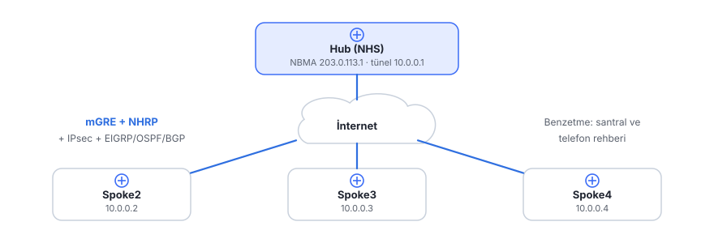
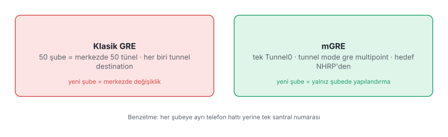
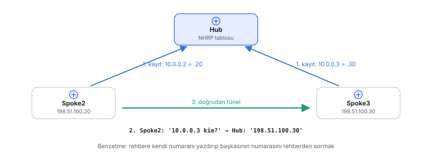
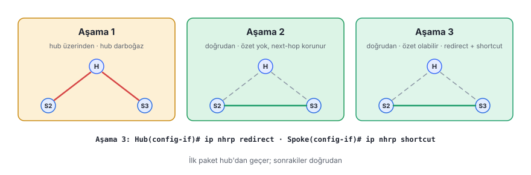
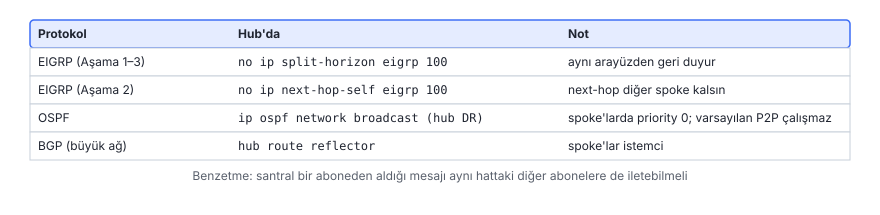
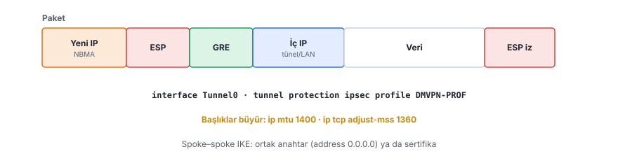
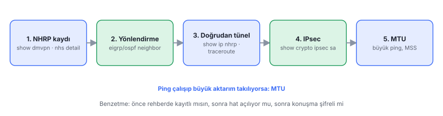

# AğLab Konu #46: DMVPN: mGRE, NHRP ve üç aşama

> Uygulamadaki `dmvpn` dersi bu belgeyle uyumludur. **Okuma dersi (Seviye 3, CCNP):** DMVPN Labber'da ve Gerçek Lab'da yok (FRR'ın NHRP desteği sınırlı); ders kâğıt üstü lab ve çıktı okumayla işlenir.
> Ön koşul: VRF ve GRE tünelleri (Konu #33), IPsec (Konu #34), OSPF (Konu #15), EIGRP (Konu #41). Şemalar: `docs/dersler/gorseller/dmvpn.py`.

Bu konu bittiğinde öğrenci çok sayıda şubeyi internet üzerinden bağlarken neden her şube için ayrı tünel yazmanın ölçeklenmediğini açıklar. DMVPN'in üç parçasını ayırır: tek bir çok noktalı GRE arayüzü (mGRE), tünel adresini gerçek internet adresine çeviren NHRP ve trafiği koruyan IPsec. Aşama 1, 2 ve 3 arasındaki farkı şubeden şubeye trafiğin yolu üzerinden anlatır; her aşamada yönlendirme protokolünün nasıl ayarlanması gerektiğini bilir. `show dmvpn` ve `show ip nhrp` çıktılarından kayıt ve dinamik tünel sorunlarını teşhis eder. Süre yaklaşık 60 dakika.

## 0. Bir bakışta

- **DMVPN** = **mGRE** (tek tünel arayüzü, çok uç) + **NHRP** (tünel IP → gerçek IP eşlemesi) + isteğe bağlı **IPsec** (şifreleme) + bir **yönlendirme protokolü**.
- **Hub** (merkez) NHRP sunucusudur (**NHS**); **spoke**'lar (şubeler) açılışta hub'a **kayıt** olur.
- Spoke'un internet adresi değişebilir (DHCP); hub yine de bulur, çünkü spoke kendini kaydeder.
- **Aşama 1**: şubeden şubeye trafik hub üzerinden geçer.
- **Aşama 2**: spoke'lar arasında **dinamik doğrudan tünel**; next-hop korunmalı (hub next-hop'u değiştirmemeli).
- **Aşama 3**: hub **NHRP redirect**, spoke **shortcut**; hub özet ya da varsayılan rota gönderebilir, ölçeklenir.

> **Akılda kalsın:** NHRP, tünelin "telefon rehberi"dir: "10.0.0.3'ü arıyorum" diyen spoke'a hub "onun gerçek numarası 198.51.100.30" der. Rehber kaydı yoksa doğrudan arama yapılamaz.



## 1. Neden önemli

Elli şubesi olan bir şirket her şubeyi merkeze ayrı bir GRE/IPsec tüneliyle bağlarsa merkezde elli tünel arayüzü, elli kripto tanımı olur; yeni şube eklemek merkezde değişiklik ister. Şubeler arası trafik (ör. iki şube arasındaki görüntülü görüşme) merkezden dolaşır, merkezin bant genişliğini ve gecikmeyi artırır. DMVPN merkezde tek bir tünel arayüzüyle bütün şubeleri karşılar, yeni şube yalnız kendi yapılandırmasıyla katılır ve şubeler gerektiğinde birbirleriyle doğrudan konuşur. Kurumsal WAN'ın ve SD-WAN öncesi dünyanın temel yapı taşıdır; ENARSI'de ayrı bir konudur.

## 2. Kavram

### 2.1 Neden tek tünel yetmiyor: mGRE

> **Benzetme:** Klasik GRE, her şubeye ayrı bir telefon hattı çekmektir. mGRE ise merkezde tek bir santral numarasıdır: herkes aynı numarayı arar, santral kimin aradığını bilir.



```
interface Tunnel0
 ip address 10.0.0.1 255.255.255.0
 tunnel source GigabitEthernet0/0
 tunnel mode gre multipoint
```

- Klasik GRE'de `tunnel destination` vardır; mGRE'de **yoktur**. Hedef her paket için NHRP'den bulunur.
- Tünel alt ağı (10.0.0.0/24) bütün DMVPN üyeleri için ortaktır: hepsi aynı "sanal LAN"dadır.

### 2.2 NHRP: kayıt ve çözümleme



```
! Hub
interface Tunnel0
 ip nhrp network-id 1
 ip nhrp map multicast dynamic
 ip nhrp authentication DMVPNKEY
! Spoke
interface Tunnel0
 ip address 10.0.0.2 255.255.255.0
 ip nhrp network-id 1
 ip nhrp nhs 10.0.0.1 nbma 203.0.113.1 multicast
 tunnel source GigabitEthernet0/0
 tunnel mode gre multipoint
```

- **NBMA adresi**: gerçek internet (taşıyıcı) adresi. **Tünel adresi**: DMVPN içindeki adres.
- Spoke açılışta hub'a **Registration Request** gönderir: "10.0.0.2 benim, NBMA adresim 198.51.100.20".
- Hub bu eşlemeyi dinamik olarak tutar. `ip nhrp map multicast dynamic` sayesinde yönlendirme protokolünün multicast paketlerini (OSPF/EIGRP hello) kayıtlı her spoke'a kopyalar.
- Spoke, başka bir spoke'u bilmiyorsa hub'a **Resolution Request** gönderir.

### 2.3 Aşamalar



| | Aşama 1 | Aşama 2 | Aşama 3 |
| --- | --- | --- | --- |
| Spoke tüneli | Noktadan noktaya GRE de olabilir | mGRE | mGRE |
| Spoke → spoke trafiği | Hub üzerinden | Doğrudan (dinamik tünel) | Doğrudan (dinamik tünel) |
| Spoke'ların rota tablosu | Hub'ı next-hop görür; özet/varsayılan olabilir | Diğer spoke'u next-hop görmeli: **özet yok**, next-hop korunmalı | Özet/varsayılan olabilir |
| Tetikleyen | — | Spoke'un kendi çözümleme isteği | Hub'ın **redirect**'i, spoke'un **shortcut**'ı |
| Ölçeklenme | İyi, ama hub darboğaz | Rota tablosu büyük | En iyi |

```
! Aşama 3 eki
Hub(config-if)#ip nhrp redirect
Spoke(config-if)#ip nhrp shortcut
```

### 2.4 Yönlendirme protokolü ayarları



- **EIGRP, hub'da**: `no ip split-horizon eigrp 100` (Aşama 1–2: bir spoke'tan öğrendiğini aynı tünel arayüzünden diğer spoke'lara verebilmek için). Aşama 2'de ayrıca `no ip next-hop-self eigrp 100` (next-hop diğer spoke kalsın).
- **OSPF**: tünel arayüzü varsayılan olarak `point-to-point` tipindedir; mGRE'de bu çalışmaz. Aşama 2'de `broadcast` (hub DR olmalı, spoke'larda `ip ospf priority 0`); Aşama 1 ve 3'te `point-to-multipoint` da kullanılabilir. OSPF tek alan ve LSDB tüm spoke'larda aynı olduğu için büyük DMVPN'lerde EIGRP ya da BGP daha çok tercih edilir.
- **BGP**: büyük ağlarda hub route reflector, spoke'lar istemci.

### 2.5 IPsec ile korumak



```
crypto ipsec profile DMVPN-PROF
 set transform-set TS
interface Tunnel0
 tunnel protection ipsec profile DMVPN-PROF
```

- Kripto harita (crypto map) ve ACL yazılmaz: tünel arayüzünden geçen her şey korunur.
- Spoke'lar arası dinamik tünel için IPsec oturumu da dinamik kurulur; bu yüzden IKE'de spoke'lar birbirlerini tanımalıdır (ortak ön paylaşımlı anahtar `address 0.0.0.0` ya da sertifika).
- MTU: GRE + IPsec başlıkları paketi büyütür; tünelde `ip mtu 1400` ve `ip tcp adjust-mss 1360` yaygındır (Konu #33'teki sorun burada da geçerlidir).

### 2.6 Sorun giderme sırası



> **Sahada:** DMVPN arızalarının çoğu üç yerden çıkar: spoke hub'a kayıt olamıyor (NBMA adresi, network-id, authentication, ACL), yönlendirme protokolü komşuluğu kurulamıyor (multicast eşlemesi, OSPF ağ tipi), ya da dinamik tünel kuruluyor ama IPsec kurulamıyor (anahtar, NAT).

## 3. Çıktı okuma

```
Hub#show dmvpn
Interface: Tunnel0, IPv4 NHRP Details
Type:Hub, NHRP Peers:3,
 # Ent  Peer NBMA Addr  Peer Tunnel Add State  UpDn Tm Attrb
 ----- --------------- --------------- ----- -------- -----
     1 198.51.100.20         10.0.0.2    UP 02:11:45     D
     1 198.51.100.30         10.0.0.3    UP 02:11:40     D
     1 198.51.100.40         10.0.0.4  NHRP 00:00:12     D
                                        ← üç spoke dinamik (D) kayıtlı; 10.0.0.4 "NHRP" durumunda:
                                          kayıt var ama tünel/IPsec henüz UP değil

Spoke2#show dmvpn
Type:Spoke, NHRP Peers:2,
 # Ent  Peer NBMA Addr  Peer Tunnel Add State  UpDn Tm Attrb
     1 203.0.113.1           10.0.0.1    UP 02:11:44     S
     1 198.51.100.30         10.0.0.3    UP 00:01:02     D
                                        ← hub statik (S); Spoke3'e dinamik tünel kurulmuş: Aşama 2/3 çalışıyor

Spoke4#show ip nhrp nhs detail
Legend: E=Expecting replies, R=Responding, W=Waiting
Tunnel0:
10.0.0.1  E priority = 0 cluster = 0  req-sent 41  req-failed 0  repl-recv 0
                                        ← istek gidiyor, yanıt gelmiyor: NBMA adresi, network-id ya da
                                          authentication anahtarı yanlış olabilir

Spoke2#traceroute 10.30.0.1
  1 10.0.0.1 4 msec
  2 10.0.0.3 8 msec
                                        ← ilk paket hub'dan geçer (Aşama 3'te redirect tetikler);
                                          tekrar dene: tek atlama (10.0.0.3) görmelisin
```

| Soru | Komut |
| --- | --- |
| Hangi spoke kayıtlı, tüneller UP mı? | `show dmvpn [detail]` |
| NHRP eşleme tablosu? | `show ip nhrp` |
| Spoke hub'a kayıt olabiliyor mu? | `show ip nhrp nhs detail`, `debug nhrp` |
| IPsec oturumları? | `show crypto ikev2 sa` / `show crypto isakmp sa`, `show crypto ipsec sa` |
| Yönlendirme komşuluğu? | `show ip eigrp neighbors` / `show ip ospf neighbor` |
| Trafik nereden geçiyor? | `traceroute` (iki kez) |

## 4. Yönlendirmeli lab

> **Simülatörde yok:** Lab'ı kâğıt üstünde yürüt; her adımda Bölüm 3'teki beklenen çıktıyla karşılaştır.

Topoloji: Hub (NBMA 203.0.113.1, tünel 10.0.0.1), Spoke2 (10.0.0.2, LAN 10.20.0.0/24), Spoke3 (10.0.0.3, LAN 10.30.0.0/24), Spoke4 (10.0.0.4, LAN 10.40.0.0/24); EIGRP 100.

1. Hub'da mGRE ve NHRP (network-id, map multicast dynamic) yapılandır; spoke'larda `ip nhrp nhs … nbma …`. `show dmvpn`'de üç kayıt gör.
2. EIGRP'yi tünelde çalıştır. Spoke2 Spoke3'ün LAN'ını görmüyor. *Neden:* hub'da split horizon.
3. Hub'da split horizon'u kapat. Spoke2'de 10.30.0.0'ın next-hop'u kim? Hub ise Aşama 1 davranışı.
4. Aşama 2: hub'da `no ip next-hop-self eigrp 100`; next-hop 10.0.0.3 olsun. traceroute ile doğrudan tüneli gör.
5. Aşama 3: hub'da yalnız varsayılan rota gönder (özet), `ip nhrp redirect` / `ip nhrp shortcut` ekle; Spoke2'nin tablosunda NHRP rotasını (`H` ya da `%` işaretli) bul.
6. Spoke4'te `ip nhrp authentication` anahtarını yanlış yaz; `show ip nhrp nhs detail`'de yanıt alınmadığını gör.
7. IPsec profilini ekle ve `show crypto ipsec sa` ile spoke–spoke oturumunu doğrula.

## 5. Sık hatalar

| Kod | Hata | Belirti | Kanıt | Düzeltme |
| --- | --- | --- | --- | --- |
| E1 | NHS/NBMA adresi, network-id ya da NHRP anahtarı yanlış | Spoke hub'da görünmüyor | `show ip nhrp nhs detail`: istek var, yanıt yok | Değerleri düzelt |
| E2 | Hub'da `map multicast dynamic` yok | Yönlendirme komşuluğu yok | EIGRP/OSPF hello spoke'a gitmiyor | Ekle |
| E3 | EIGRP split horizon açık (hub) | Spoke'lar birbirinin ağını görmüyor | Hub'da var, spoke'larda yok | `no ip split-horizon eigrp` |
| E4 | Aşama 2'de next-hop/özet | Trafik hep hub'dan | Spoke'ta next-hop 10.0.0.1 | `no ip next-hop-self`, özet yok ya da Aşama 3 |
| E5 | OSPF ağ tipi point-to-point (varsayılan) | Komşuluk sürekli kurulup düşüyor | Tek komşu, sürekli değişiyor | broadcast/point-to-multipoint; spoke priority 0 |
| E6 | Spoke–spoke IPsec anahtarı | NHRP UP, trafik geçmiyor | `show crypto` oturum yok | Joker ön paylaşımlı anahtar ya da sertifika |

## 6. Arıza senaryoları

> **Uygulamada:** Kâğıt üstü vakalar. Önce kendin çöz; neden ve çözüm kapalı kutularda.

### S1 · Başlangıç · Yeni şube hub'a bağlanmıyor (E1)

- **Belirti:** Spoke4 kuruldu; hub'ın `show dmvpn` çıktısında yok. Spoke4 hub'ın internet adresine ping atabiliyor.
- **Hedef:** Spoke4 kayıt olsun.

<details><summary>Neden ve çözüm</summary>

`show ip nhrp nhs detail`'de istekler gidiyor, yanıt yok; Spoke4'te `ip nhrp authentication` farklı yazılmış (ya da network-id). Çözüm: değerleri hub ile eşitle.

</details>

### S2 · Orta · Şubeler merkezi görüyor, birbirini görmüyor (E3)

- **Belirti:** EIGRP komşulukları hub ile kurulu. Spoke2'nin tablosunda 10.30.0.0/24 yok.
- **Hedef:** Şubeler birbirinin LAN'ını görsün.

<details><summary>Neden ve çözüm</summary>

Hub, Spoke3'ten Tunnel0 üzerinden öğrendiği rotayı aynı arayüzden geri duyurmuyor: split horizon. Çözüm: hub'da `no ip split-horizon eigrp 100`.

</details>

### S3 · Orta · Doğrudan tünel hiç kurulmuyor (E4)

- **Belirti:** Aşama 2 hedefleniyor; şubeler arası trafik çalışıyor ama traceroute her zaman hub'ı gösteriyor.
- **Hedef:** Spoke'tan spoke'a doğrudan.

<details><summary>Neden ve çözüm</summary>

Hub, EIGRP rotalarında next-hop'u kendisi yapıyor (varsayılan next-hop-self) ve ayrıca özet gönderiyor; spoke'lar diğer spoke'u hiç next-hop görmüyor. Çözüm: hub'da `no ip next-hop-self eigrp 100` ve özeti kaldır; ya da Aşama 3'e geç (`redirect` / `shortcut`).

</details>

### S4 · İleri · OSPF komşuluğu dalgalanıyor (E5)

- **Belirti:** DMVPN üzerinde OSPF; hub'da komşu listesi sürekli değişiyor, rotalar gelip gidiyor.
- **Hedef:** Kararlı komşuluk.

<details><summary>Neden ve çözüm</summary>

Tünel arayüzlerinin OSPF ağ tipi varsayılan point-to-point; mGRE'de hub her spoke'u tek komşu sanıp sürekli değiştiriyor. Çözüm: hepsinde `ip ospf network broadcast`, spoke'larda `ip ospf priority 0` (hub DR); ya da point-to-multipoint.

</details>

### S5 · İleri · Doğrudan tünel UP, uygulama çalışmıyor (E6)

- **Belirti:** `show dmvpn` Spoke2'de Spoke3'e D kaydını UP gösteriyor; ama büyük dosya aktarımı başlamıyor, ping çalışıyor.
- **Hedef:** Uygulama çalışsın.

<details><summary>Neden ve çözüm</summary>

Ping'in çalışıp büyük aktarımın takılması MTU işaretidir. GRE + IPsec başlıkları 1500'ü aşıyor, DF bitli paketler düşüyor. Çözüm: tünelde `ip mtu 1400`, `ip tcp adjust-mss 1360`.

</details>

## 7. Kısa sınav

**1.** DMVPN'in dört bileşeni nelerdir?

<details><summary>Cevap</summary>

mGRE, NHRP, (isteğe bağlı) IPsec ve bir yönlendirme protokolü.

</details>

**2.** NHRP neyi neye çevirir?

<details><summary>Cevap</summary>

Tünel adresini taşıyıcı (NBMA, internet) adresine.

</details>

**3.** Aşama 1'de spoke'tan spoke'a trafik nereden geçer?

<details><summary>Cevap</summary>

Hub üzerinden.

</details>

**4.** Aşama 2 ile Aşama 3 arasındaki temel fark?

<details><summary>Cevap</summary>

Aşama 2'de spoke'lar diğer spoke'u next-hop olarak görmelidir (özet yok); Aşama 3'te hub özet/varsayılan gönderebilir, doğrudan tüneli NHRP redirect ve shortcut kurar.

</details>

**5.** EIGRP'yi DMVPN'de çalıştırırken hub'da neden split horizon kapatılır?

<details><summary>Cevap</summary>

Bir spoke'tan Tunnel0 üzerinden öğrenilen rota aynı arayüzden diğer spoke'lara duyurulabilsin diye.

</details>

**6.** `ip nhrp map multicast dynamic` ne işe yarar?

<details><summary>Cevap</summary>

Hub'ın yönlendirme protokolü multicast paketlerini kayıt olan her spoke'a kopyalamasını sağlar.

</details>

## 8. Özet kartı

| Komut | Ne işe yarar |
| --- | --- |
| `tunnel mode gre multipoint` | mGRE |
| `ip nhrp network-id n` | DMVPN kimliği |
| `ip nhrp nhs <tünel> nbma <gerçek> multicast` | Spoke: hub'a kayıt |
| `ip nhrp map multicast dynamic` | Hub: multicast'i spoke'lara kopyala |
| `ip nhrp redirect` / `ip nhrp shortcut` | Aşama 3 |
| `tunnel protection ipsec profile X` | Şifreleme |
| `show dmvpn`, `show ip nhrp`, `show ip nhrp nhs detail` | Doğrulama |

**Unutma:**

1. NHRP = tünelin telefon rehberi.
2. Spoke kaydı yoksa hiçbir şey çalışmaz.
3. Hub'da EIGRP split horizon kapalı.
4. Aşama 2'de next-hop korunur; Aşama 3'te redirect/shortcut.
5. GRE + IPsec: MTU ve MSS.

## 9. Doğrulama notları

Kaynaklar: INE ENCOR Remote Site Connectivity (GRE/IPsec) ve CCNP ENCOR v1.0 (kapsam kontrolü için), ENARSI konu listesi (DMVPN: mGRE, NHRP, Phase 1/2/3, IPsec); RFC 2332 (NHRP); Cisco "Dynamic Multipoint VPN Configuration Guide". Ders metni, örnek çıktılar ve şemalar özgün yazıldı.

| İddia | Sonuç |
| --- | --- |
| mGRE tünelinde `tunnel destination` yoktur; hedef NHRP ile bulunur | Doğru |
| Spoke'lar NHS'ye (hub) registration request ile kayıt olur | Doğru |
| Aşama 3, hub'da `ip nhrp redirect` ve spoke'ta `ip nhrp shortcut` ile çalışır | Doğru |
| DMVPN'de EIGRP için hub'da split horizon kapatılır; Aşama 2'de next-hop-self de kapatılır | Doğru |
| Tünel arayüzünün varsayılan OSPF ağ tipi point-to-point'tir | Doğru |
| `tunnel protection ipsec profile` ile crypto map ve ACL gerekmez | Doğru |

**Motor gereksinimleri**

- [ ] DMVPN (mGRE, NHRP, IPsec profili) Labber'da yok; FRR'ın NHRP desteği sınırlı olduğu için Gerçek Lab'da da kapsam dışı. Okuma dersi olarak kalır.
