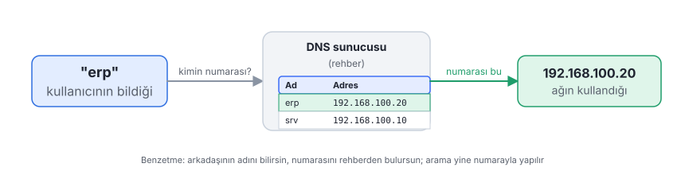
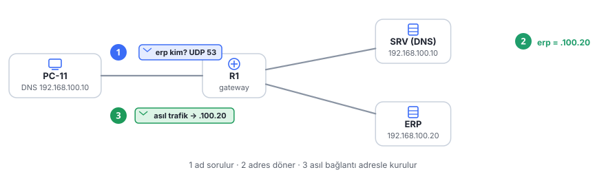
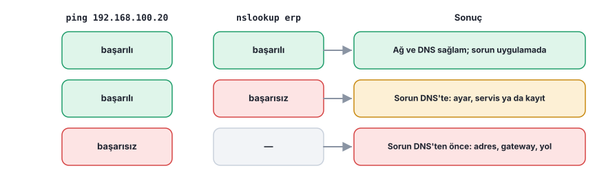
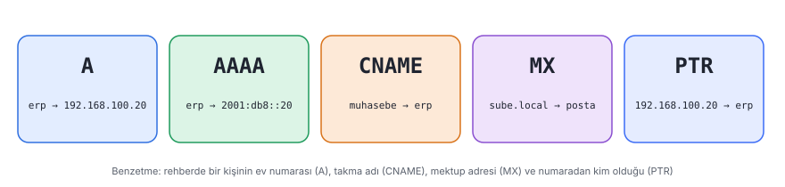
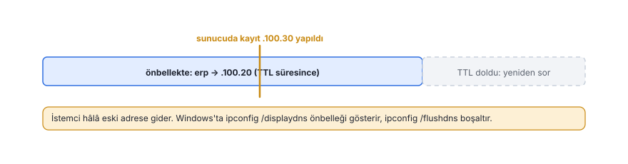
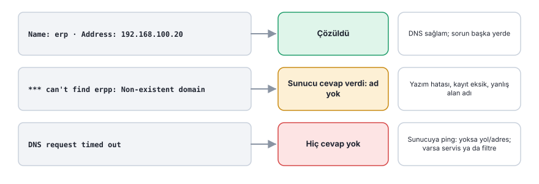
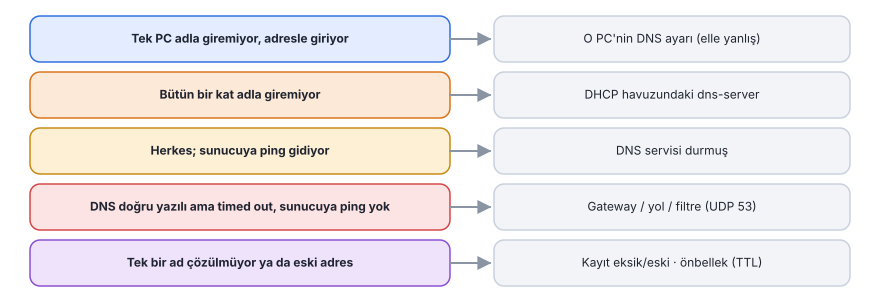

# AğLab Konu #10: DNS

> Uygulamadaki `dns` dersi bu belgeye göre yazıldı. Senaryolar Sorun Çöz'de `dns-*` kimlikleriyle
> Labber'da çalışır. Pratik türü: Motor + okuma (kayıt türleri ve önbellek okuma). Şemalar:
> `docs/dersler/gorseller/dns.py`.

Bu konu bittiğinde öğrenci "internet yok" şikâyetini iki soruya ayırır: adresle ulaşılabiliyor mu, adla ulaşılabiliyor mu? `nslookup` çıktısından sorunun DNS sunucusuna ulaşamamak mı, sunucunun yanıt vermemesi mi, yoksa kaydın olmaması mı olduğunu okur. İstemcinin DNS ayarının nereden geldiğini (elle ya da DHCP) bulur ve düzeltir. Seviye 1, süre yaklaşık 60 dakika (ders 15, lab 15, senaryolar 20, sınav 10).

## 0. Bir bakışta

- **DNS**, ağın telefon rehberidir: kullanıcının bildiği adı (`erp`) ağın kullandığı adrese (`192.168.100.20`) çevirir.
- İstemci ayarındaki **DNS sunucusuna** sorar (çoğunlukla **UDP 53**). DNS adresi ya **DHCP'den** ya **elle** gelir.
- DNS sunucusu genelde başka ağdadır: sorgunun gidebilmesi için **gateway** de doğru olmalıdır.
- `nslookup`'ın üç sonucu vardır: **yanıt**, **Non-existent domain** (sunucu "ad yok" dedi), **timed out** (hiç yanıt yok).
- Yanıtlar **TTL** süresince önbellekte saklanır; sunucuda yapılan düzeltme istemciye hemen yansımaz.

> **Akılda kalsın:** Önce iki testi ayır: adresle ping gidiyor mu, adla gidiyor mu? Adresle gidip adla gitmiyorsa kabloya, switch'e, gateway'e dokunma; sorun DNS'te.



## 1. Neden önemli

Kullanıcı "ERP açılmıyor" ya da "internet yok" dediğinde çoğu zaman ağ çalışıyordur; çalışmayan şey isimden adrese çeviridir. DNS bozulduğunda her şey bozulmuş gibi görünür, çünkü kullanıcı hiçbir sisteme adresle değil adla girer.

Bu yüzden ilk iş iki testi ayırmaktır. Adresle ping gidiyor ama adla açılmıyorsa sorun DNS'tedir. Adresle de gitmiyorsa sorun DNS'ten öncedir.

## 2. Kavram

### 2.1 Rehber: adı numaraya çevirmek

> **Benzetme:** Arkadaşını aramak istiyorsun; adını biliyorsun ama numarasını ezbere bilmiyorsun. Rehbere bakarsın, numarayı bulursun, aramayı numarayla yaparsın. Rehber kaybolursa arkadaşın hâlâ oradadır ama ulaşamazsın. DNS çökünce sunucular da yerindedir; yalnız kullanıcı onları adıyla bulamaz.

DNS, `erp.sube.local` gibi bir adı `192.168.100.20` gibi bir adrese çevirir. Sorgu çoğunlukla **UDP 53** ile gider; büyük yanıtlarda ve sunucular arası bölge aktarımında **TCP 53** kullanılır. Ad çözüldükten sonra asıl bağlantı **adresle** kurulur.



### 2.2 İstemcinin DNS ayarı nereden gelir?

- **DHCP'den:** havuzdaki `dns-server` satırı (Konu #9). Yanlışsa **bütün bir ağ** etkilenir.
- **Elle:** bilgisayara tek tek yazılır. Yanlışsa **yalnız o bilgisayar** etkilenir.

DNS sunucusu genellikle kullanıcılarla **aynı ağda değildir**; sunucu odasındadır. Bu yüzden sorgunun oraya gidebilmesi için istemcinin **gateway'i** de doğru olmalıdır. Gateway'i olmayan bir bilgisayar doğru DNS adresi yazılı olsa bile isim çözemez.

### 2.3 İki test



### 2.4 Kayıt türleri

> **Simülatörde kısmen:** AğLab'ın DNS sunucusu cihaz adlarını A kaydı gibi çözer; diğer türler okuma konusudur.

| Tür | Ne döndürür | Örnek |
| --- | --- | --- |
| A | IPv4 adresi | `erp → 192.168.100.20` |
| AAAA | IPv6 adresi | `erp → 2001:db8::20` |
| CNAME | Başka bir ad (takma ad) | `muhasebe → erp` |
| MX | E-posta sunucusu | `sube.local → posta.sube.local` |
| PTR | Adresten ad (ters sorgu) | `192.168.100.20 → erp` |



### 2.5 Önbellek ve TTL

> **Benzetme:** Sık aradığın bir numarayı rehbere bakmadan aklında tutarsın. Arkadaşın numarasını değiştirirse sen eski numarayı aramaya devam edersin, ta ki unutana ya da yeniden sorana kadar.

Her yanıt, ne kadar süre saklanabileceğini söyleyen bir **TTL** ile gelir. İstemci yanıtı bu süre boyunca **önbellekte** tutar ve tekrar sormaz. Sunucudaki bir kaydı düzeltmek, istemcilerin önbelleğini hemen değiştirmez. Windows'ta önbelleği `ipconfig /displaydns` gösterir, `ipconfig /flushdns` boşaltır.



## 3. Çıktı okuma

Bu konunun ana aracı `nslookup`'tır. Üç farklı sonucu birbirinden ayırmayı öğrenmek, DNS teşhisinin neredeyse tamamıdır.

### Başarılı yanıt

```
PC-11> nslookup ERP
Server:  UnKnown
Address:  192.168.100.10

Name:    ERP
Address:  192.168.100.20
```

- **Server / Address (üst kısım):** Sorulan DNS sunucusu. Beklediğin sunucu değilse istemcinin ayarı yanlıştır.
- **Server: UnKnown** bir arıza değildir. nslookup, DNS sunucusunun kendi adını da ters sorguyla (PTR) bulmaya çalışır; o kayıt yoksa "UnKnown" yazar. Yanıtın geri kalanı doğrudur.
- **Name / Address (alt kısım):** Asıl cevap.



### Kayıt yok: Non-existent domain

```
PC-11> nslookup ERPP
Server:  UnKnown
Address:  192.168.100.10

*** UnKnown can't find ERPP: Non-existent domain
```

Sunucu **yanıt verdi**: "böyle bir ad yok" (NXDOMAIN). Ağ sağlam, sunucu çalışıyor; sorun adın kendisinde: yazım hatası, kayıt eksik ya da yanlış alan adı.

### Yanıt yok: timed out

```
PC-12> nslookup ERP
DNS request timed out.
    timeout was 2 seconds.
*** Request to UnKnown timed-out
```

Sunucudan **hiç yanıt gelmedi.** Üç olasılık var:

1. Sorgu sunucuya ulaşmıyor: yanlış DNS adresi, gateway yok, yol kopuk.
2. Sunucu ayakta ama DNS servisi çalışmıyor.
3. Arada bir filtre UDP 53'ü engelliyor (Konu #19 ACL).

Ayırmak için DNS sunucusunun adresine **ping** at. Ping gitmiyorsa 1. maddeye, gidiyorsa 2. ya da 3. maddeye bak.

### İstemcinin ayarı

```
PC-11> show ip
IP/MASK     : 192.168.10.21/24
GATEWAY     : 192.168.10.1
DNS         : 192.168.100.10
```

Windows'ta `ipconfig /all` içinde "DNS Servers" satırı. Etkilenen bilgisayarın DNS satırını sağlam bir bilgisayarınkiyle karşılaştırmak, en hızlı teşhis yöntemidir.

## 4. Yönlendirmeli lab

> **Simülatörde:** bu labın hazır topolojisi ve otomatik kontrolü Simülatör'deki **dns-kurulum** labıdır (dersin Pratik adımı). Simülatör labı bu adımların özüdür; ayrıntılar labın görev metnindedir.

Topoloji Konu #9'un bitmiş ağıdır: R1, iki kat, sunucu odasında DHCP ve DNS sunucusu SRV (192.168.100.10) ve ERP sunucusu (192.168.100.20). AğLab'ın DNS sunucusu, ağdaki her cihazı kendi adıyla tanır.

1. **Ayarı oku.** PC-11'de `show ip`: DNS 192.168.100.10. *Neden:* PC-11 bu adresi DHCP'den aldı; havuzda `dns-server` böyle yazılı.
2. **Başarılı sorgu.** `nslookup ERP`: 192.168.100.20. Sonra `ping 192.168.100.20`. *Neden:* Ad çözüldü ve adres erişilebilir; iki katman ayrı ayrı sağlam.
3. **Olmayan ad.** `nslookup ERPP`: "Non-existent domain". *Neden:* Sunucu yanıt verdi ama kayıt yok; sorun ağda değil, adda.
4. **Sunucunun kayıtları.** SRV'de `show dns`: sunucunun bildiği adlar ve adresler.
5. **Servisi durdur.** SRV'de `service dns off`. PC-11'de `nslookup ERP`: "timed out". Sonra `ping 192.168.100.10`: başarılı. *Neden:* Sunucu ayakta, yalnız servis yanıt vermiyor. "Ping gidiyor" demek "DNS çalışıyor" demek değildir. Servisi `service dns on` ile geri aç.
6. **DNS ayarını sil.** PC-11'de `ip dns 0.0.0.0`, sonra `nslookup ERP`: "Default servers are not available". Doğru adresi `ip dns 192.168.100.10` ile geri yaz. *Neden:* Bu üçüncü hata türü: istemcinin sorabileceği bir sunucu yok.
7. **Sonuçları tabloya yaz.** Üç çıktıyı (yanıt, NXDOMAIN, timed out) ve her birinin olası nedenini bir kenara not et; senaryolarda bu tabloyu kullanacaksın.

> **Benzetme:** 5. adım, rehber görevlisinin işe gelip telefonu açmamasına benzer: bina açık (ping gidiyor), ama soruya cevap veren yok (servis kapalı).

## 5. Sık hatalar

| Kod | Hata | Belirti | Kanıt | Düzeltme |
| --- | --- | --- | --- | --- |
| E1 | İstemcide yanlış DNS sunucusu (elle) | Yalnız bir bilgisayar adla hiçbir yere giremiyor, adresle giriyor | `show ip` / `ipconfig /all`'da DNS farklı; nslookup timed out | Doğru DNS'i yaz ya da istemciyi DHCP'ye bırak |
| E2 | DHCP havuzunda yanlış DNS | Bütün bir ağ adla giremiyor; başka ağlar sorunsuz | O ağdaki her istemcide aynı yanlış DNS satırı | Havuzda `dns-server`'ı düzelt, istemcilerde yenile |
| E3 | DNS servisi durmuş | Her yerde isim çözülmüyor; sunucuya ping gidiyor | nslookup timed out, sunucuya ping başarılı | Servisi başlat |
| E4 | Sorgu sunucuya ulaşmıyor (gateway yok, yol kopuk, UDP 53 engelli) | DNS adresi doğru yazılı ama isim çözülmüyor | nslookup timed out; DNS sunucusuna ping yok; gateway boş ya da yanlış | Önce IP bağlantısını düzelt (Konu #8, #19) |
| E5 | Kayıt yok ya da eski | Tek bir ad çözülmüyor ya da eski adrese gidiyor | nslookup Non-existent domain; ya da yanıt eski adres (önbellek, TTL) | Kaydı ekle/düzelt; istemcide `ipconfig /flushdns` |

> **Akılda kalsın:** E1 ile E2'yi ayıran şey etki alanıdır: tek bilgisayar mı, bütün ağ mı? E3 ile E4'ü ayıran şey DNS sunucusuna ping'dir. E5, sunucunun yanıt vermesiyle diğerlerinden ayrılır.



## 6. Arıza senaryoları

> **Uygulamada:** S1–S5 Sorun Çöz'de `dns-wrong-server-pc`, `dns-pool-wrong-server`,
> `dns-service-down`, `dns-no-gateway`, `dns-two-faults` kimlikleriyle Labber'da çalışır.
> Hedefler `dnsLookup` ile yazıldı: istemci `erp` adını kendi DNS sunucusuna sorup yanıt almalı.
> Önce kendin çöz; neden ve çözüm kapalı kutularda.

### S1 · Başlangıç · Yalnız benim bilgisayarım ERP'yi adıyla açamıyor (E1)

- **Belirti:** PC-11'in kullanıcısı ERP'ye adıyla giremiyor, adresle giriyor; yan masada sorun yok.
- **Hedef:** PC-11 `erp` adını çözüyor; PC-11 → ERP başarılı.

<details><summary>Neden ve çözüm</summary>

PC-11'e elle DNS 192.168.100.11 yazılmış. Çözüm: PC-11 → `ip dns 192.168.100.10`.

</details>

### S2 · Başlangıç · 1. katta hiçbir isim çözülmüyor (E2)

- **Belirti:** 1. katta hiçbir sistem adıyla açılmıyor; adresle çalışıyor. 2. kat sorunsuz.
- **Hedef:** PC-11 adresini R1'den alıyor ve `erp` adını çözüyor.

<details><summary>Neden ve çözüm</summary>

KAT1 havuzunda `dns-server 192.168.100.11`. Çözüm: R1 → `ip dhcp pool KAT1` → `dns-server 192.168.100.10`; PC-11 → `ip dhcp`.

</details>

### S3 · Orta · Sabahtan beri hiçbir yerde isim çözülmüyor (E3)

- **Belirti:** İki katta da isimler çözülmüyor; adresle her şey çalışıyor, SRV'ye ping gidiyor.
- **Hedef:** PC-21 ve PC-11 `erp` adını çözüyor.

<details><summary>Neden ve çözüm</summary>

SRV'de DNS servisi kapalı (nslookup timed out, ping başarılı). Çözüm: SRV → `service dns on`.

</details>

### S4 · Orta · Yeni bilgisayarda DNS doğru ama isim çözülmüyor (E4)

- **Belirti:** Yeni PC yan masadaki PC-11'e ulaşıyor ama hiçbir sistem adıyla açılmıyor. Kuran kişi "DNS'i doğru yazdım" diyor.
- **Hedef:** PC-12 `erp` adını çözüyor; PC-12 → ERP başarılı.

<details><summary>Neden ve çözüm</summary>

PC-12'ye elle 192.168.10.12/24 ve DNS 192.168.100.10 yazılmış ama gateway boş; sorgu sunucu odasına gidemiyor. Çözüm: PC-12 → `ip 192.168.10.12 255.255.255.0 192.168.10.1`.

</details>

### S5 · İleri · Hiçbir yerde isim yok, düzeltince yalnız 2. kat geldi (E3 + E2)

- **Belirti:** İki katta da isimler çözülmüyor. Gece hem SRV güncellendi hem havuz düzenlendi.
- **Hedef:** iki kat da `erp` adını çözüyor; PC-11 adresini R1'den alıyor.

<details><summary>Neden ve çözüm</summary>

S3 ve S2 birlikte: servis kapalı **ve** KAT1 havuzunda yanlış DNS. Çözüm: SRV → `service dns on`; R1 → havuzda `dns-server 192.168.100.10`; PC-11 → `ip dhcp`.

</details>

## 7. Kısa sınav

**1.** `ping 192.168.100.20` başarılı, `nslookup erp` "timed out". Sorun hangi katmanda?

<details><summary>Cevap</summary>

İsim çözümleme: DNS sunucusuna ulaşılamıyor ya da servis yanıt vermiyor. Adresle erişim var.

</details>

**2.** `nslookup` "Non-existent domain" diyor. Anlamı?

<details><summary>Cevap</summary>

Sunucu yanıt verdi ama bu ad için kayıt yok. Ağ ve sunucu sağlam; ad yanlış ya da kayıt eksik.

</details>

**3.** nslookup çıktısında "Server: UnKnown" yazıyor ama ad doğru çözülüyor. Ne yapmalı?

<details><summary>Cevap</summary>

Hiçbir şey: sunucunun kendi adresi için ters (PTR) kaydı yok. Arıza değildir.

</details>

**4.** Yalnız 1. kattaki bilgisayarlar isim çözemiyor; hepsinin DNS satırı 192.168.100.11. Nereye bakılır?

<details><summary>Cevap</summary>

1. katın DHCP havuzundaki `dns-server` satırına. Bütün bir ağ aynı yanlış ayarı taşıyorsa kaynak DHCP'dir.

</details>

**5.** DNS kaydı düzeltildi ama bir bilgisayar hâlâ eski adrese gidiyor. Neden?

<details><summary>Cevap</summary>

İstemci eski yanıtı TTL süresince önbellekte tutuyor. `ipconfig /flushdns` önbelleği boşaltır.

</details>

**6.** DNS doğru yazılı, nslookup timed out, DNS sunucusuna ping de gitmiyor. Önce neye bakarsın?

<details><summary>Cevap</summary>

IP bağlantısına: gateway, yol, filtre. Sorun DNS'ten önce.

</details>

## 8. Özet kartı

| Komut | Ne işe yarar |
| --- | --- |
| `nslookup <ad>` | Adı DNS sunucusuna sorar; sorulan sunucuyu da gösterir |
| `ping <adres>` | Adresle erişimi ayrıca dener |
| `show ip` (VPCS), `ipconfig /all` (Windows) | İstemcinin DNS ayarı |
| `ip dns <adres>` (VPCS) | DNS sunucusunu elle yazar |
| `ipconfig /flushdns` / `/displaydns` (Windows) | Önbelleği boşaltır / gösterir |
| `show services`, `service dns on` (AğLab sunucu) | DNS servisinin durumu |

**Unutma:**

1. Önce adresle, sonra adla dene.
2. NXDOMAIN = sunucu cevap verdi, ad yok; timed out = cevap yok.
3. Tek PC → elle ayar; bütün kat → DHCP havuzu.
4. DNS doğru ama gateway yoksa sorgu gitmez.
5. Düzeltmeden sonra önbelleği unutma.

## 9. Doğrulama notları

Kaynaklar: INET CCNA 200-301 v1.1 (DNS'in işlevi, kayıt türleri); RFC 1034/1035 (DNS kavramları ve kayıt türleri), Microsoft nslookup belgeleri; CCNA 200-301 sınav konuları (4.3 DNS'in işlevi). Eski `dns` dersi Kavram ve kayıt türleri için kaynak oldu; metin yeniden yazıldı. Recursive/authoritative ayrımı Seviye 1'den çıkarıldı (CCNA'da #23'te anılabilir).

**Kontrol edilen iddialar**

| İddia | Sonuç |
| --- | --- |
| DNS sorguları çoğunlukla UDP 53; büyük yanıt ve bölge aktarımı TCP 53 | Doğru |
| A IPv4, AAAA IPv6, CNAME takma ad, MX posta, PTR ters sorgu | Doğru |
| "Server: UnKnown", nslookup'ın DNS sunucusunun kendi adresini ters sorguyla bulamamasıdır | Doğru (DNS sunucusu için PTR kaydı yok) |
| Yanıtlar TTL süresince önbellekte tutulur; `ipconfig /flushdns` Windows önbelleğini boşaltır | Doğru |
| "Non-existent domain" sunucunun NXDOMAIN yanıtıdır; "timed out" yanıt gelmediğidir | Doğru |

Lab'ın otomatik değerlendirmesi: `q.dnsLookup('PC-11', 'erp').ok`; `q.ping('PC-11', '192.168.100.20').ok`.

**Motor gereksinimleri** (Labber'da denendi)

- [x] VPCS `nslookup` (yanıt, Non-existent domain, timed out, "Default servers are not available")
- [x] VPCS `ip dns <adres>`, DHCP ile DNS dağıtımı — L5-b
- [x] Sunucuda `service dns on|off`, `show services`, `show dns`
- [x] Beş senaryo başta başarısız, terminalden çözümle başarılı
- [ ] VPCS'te adla `ping ERP` "Cannot resolve" diyor; gerçek VPCS DNS sunucusu tanımlıysa adı çözer. Lab bu yüzden ad ile ping kullanmıyor.
- [ ] DNS kayıtları yalnız cihaz adlarından oluşuyor; elle A/CNAME kaydı, alan adı (`erp.sube.local`), PTR ve TTL/önbellek yok (okuma)
- [ ] Senaryo hedeflerinde büyük harfli bir ad cihaz kimliğine çevriliyor; `dnsLookup` için ad küçük harfle yazıldı (uygulamadaki `sharedQueryCheck`)
