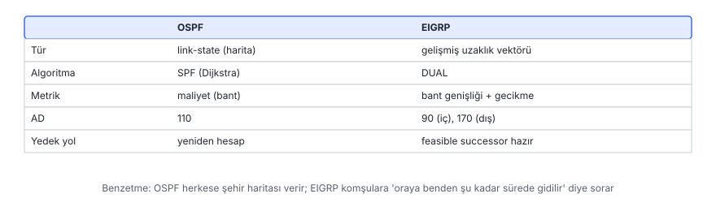
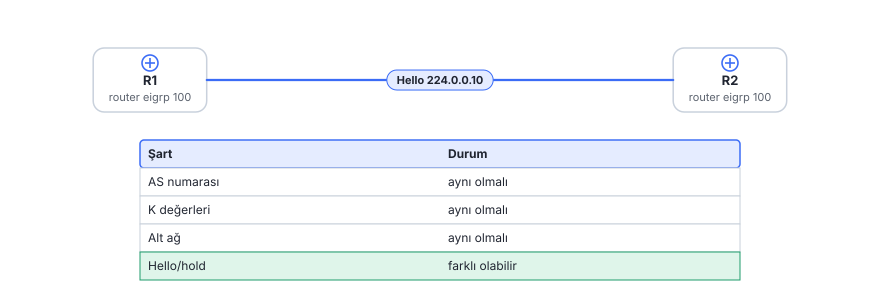
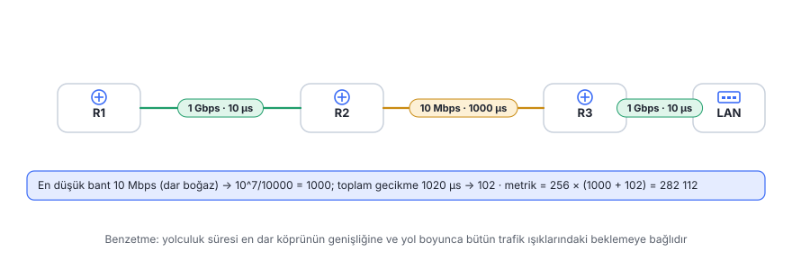
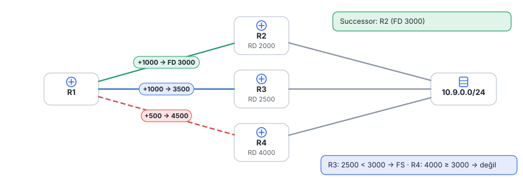
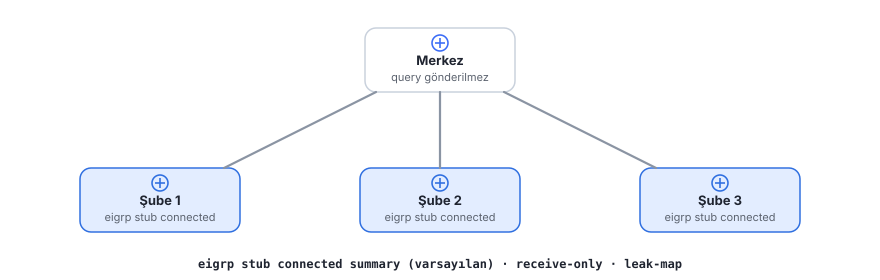
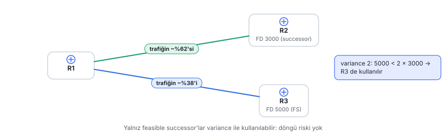

# AğLab Konu #41: EIGRP: DUAL, metrik, feasible successor, stub ve variance

> Uygulamadaki `eigrp` dersi bu belgeyle uyumludur. **Okuma dersi (Seviye 3, CCNP):** EIGRP Labber'da yok; FRR desteği sınırlı. Kavramlar ve topoloji tablosu kâğıt üstünde çalışılır.
> Ön koşul: Statik routing (Konu #8), OSPF (Konu #15), OSPF çok alan (Konu #31) karşılaştırma için. Şemalar: `docs/dersler/gorseller/eigrp.py`.

Bu konu bittiğinde öğrenci EIGRP'yi OSPF'ten ayıran özellikleri (gelişmiş uzaklık vektörü, DUAL, AD 90/170) açıklar. Komşuluk şartlarını sayar ve neden komşu olunmadığını bulur. Varsayılan K değerleriyle metriğin bant genişliği ve gecikmeden nasıl hesaplandığını gösterir. FD, RD, successor ve feasible successor kavramlarını yapılabilirlik şartıyla uygular. Stub ile sorgu alanını küçültür, variance ile eşit olmayan yük paylaşımı yapar. Süre yaklaşık 55 dakika.

## 0. Bir bakışta

- EIGRP **gelişmiş uzaklık vektörüdür**; **DUAL** döngüsüz yolu ve yedeğini önceden hesaplar. AD **90** (iç), **170** (dış).
- Komşuluk: aynı **AS numarası**, aynı **K değerleri**, aynı alt ağ; Hello 5 sn / hold 15 sn (farklı olabilir).
- Metrik: yoldaki **en düşük bant** + **toplam gecikme** (varsayılan K değerleri).
- **FD** benim toplam metriğim, **RD** komşunun bildirdiği metrik; en iyi yol **successor**.
- **Yapılabilirlik şartı**: komşunun RD'si < successor'ın FD'si ise o komşu **feasible successor** (hazır yedek).
- FS yoksa rota **active** olur, sorgu gönderilir; **stub** sorgu alanını küçültür.
- **variance** ile FS'ler arasında eşit olmayan yük paylaşımı.

> **Akılda kalsın:** EIGRP'de hızlı yakınsama feasible successor'a bağlıdır: yedek yoksa EIGRP de sorgu yapıp bekler.



## 1. Neden önemli

Pek çok kurumsal ağda (özellikle Cisco ağırlıklı eski kampüs ve WAN'larda) EIGRP hâlâ çalışır. CCNP ENCOR v1.0 ve ENARSI EIGRP'yi ayrıntılı sorar: metrik hesabı, feasible successor seçimi, stub ve variance. Sahada en sık arıza AS ya da K değeri uyuşmazlığı ve büyük sorgu alanlarında stuck-in-active'dir.

## 2. Kavram

### 2.1 Komşuluk



- Hello multicast 224.0.0.10; güvenilir taşıma için RTP (Reliable Transport Protocol, IP protokol 88).
- Tablolar: komşu tablosu, topoloji tablosu (bütün yollar ve RD'leri), rota tablosu (successor'lar).
- **Klasik:** `router eigrp 100` + `network`; **named mode:** `router eigrp SUBE` → `address-family ipv4 unicast autonomous-system 100` (ayarlar tek yerde, IPv4 ve IPv6 birlikte).

### 2.2 Metrik

> **Benzetme:** Bir yolculuğun süresini iki şey belirler: yol üzerindeki en dar köprü (hepsinden geçmek zorundasın, en dar olan seni yavaşlatır) ve bütün trafik ışıklarında beklediğin süre (toplanır).



> **Dikkat:** EIGRP metriği arayüzdeki `bandwidth` ve `delay` ayarlarından gelir, gerçek hızdan değil. Bir seri ya da tünel arayüzünde yanlış bırakılmış `bandwidth` değeri yolu sessizce değiştirir. Bant genişliğini değiştirmek QoS'u da etkiler; yol seçimi için `delay` değiştirmek daha güvenlidir.

### 2.3 DUAL: successor ve feasible successor



> **Benzetme:** Bir komşu "oraya benden 2500'de gidilir" diyorsa ve senin şu anki yolun 3000 ise, o komşunun yolu kesinlikle senin üzerinden geçmiyordur (geçseydi 3000'den büyük olurdu). Bu yüzden döngü riski olmadan yedek olarak hazır tutulabilir.

### 2.4 Active durum ve stub




### 2.5 Eşit olmayan yük paylaşımı



### 2.6 Özetleme

- EIGRP özetlemeyi **herhangi bir arayüzde** yapabilir (OSPF'te yalnız ABR/ASBR): `ip summary-address eigrp 100 10.1.0.0 255.255.252.0` (named mode'da af-interface altında `summary-address`).
- Özet sorgu alanını da sınırlar: özet arkasındaki bir alt ağ kaybolunca sorgular özet noktasında durur.
- Eski IOS'ta `auto-summary` sınıflı sınırda özetler; kesintili ağlarda soruna yol açar, kapatılır.

> **Sahada:** "EIGRP neden bu yolu seçti?" sorusunun cevabı `show ip eigrp topology` çıktısındadır: FD, RD ve hangi komşunun FS olduğu orada yazar.

## 3. Çıktı okuma

```
R1#show ip eigrp neighbors
EIGRP-IPv4 Neighbors for AS(100)
H   Address        Interface   Hold Uptime   SRTT   RTO  Q  Seq
                               (sec)         (ms)       Cnt Num
1   10.0.13.3      Gi0/2         13 02:11:40    2   100  0  41
0   10.0.12.2      Gi0/1         12 02:11:52    1   100  0  57
                                        ← iki komşu; Q Cnt 0 (bekleyen paket yok)

R1#show ip eigrp topology 10.9.0.0/24
EIGRP-IPv4 Topology Entry for AS(100)/ID(1.1.1.1) for 10.9.0.0/24
  State is Passive, Query origin flag is 1, 1 Successor(s), FD is 3000
  Descriptor Blocks:
  10.0.12.2 (GigabitEthernet0/1), from 10.0.12.2, Send flag is 0x0
      Composite metric is (3000/2000), route is Internal
  10.0.13.3 (GigabitEthernet0/2), from 10.0.13.3, Send flag is 0x0
      Composite metric is (3500/2500), route is Internal
                                        ← (FD/RD): R3'ün RD'si 2500 < 3000 → feasible successor

R1#show ip route 10.9.0.0
Routing entry for 10.9.0.0/24
  Known via "eigrp 100", distance 90, metric 3000, type internal
                                        ← AD 90, successor metriği

R1#show ip protocols | section eigrp
  EIGRP-IPv4 Protocol for AS(100)
    Metric weight K1=1, K2=0, K3=1, K4=0, K5=0
    Maximum path: 4
    Variance: 1
```

| Soru | Komut |
| --- | --- |
| Komşular? | `show ip eigrp neighbors` |
| Bütün yollar, FD/RD, FS? | `show ip eigrp topology [önek \| all-links]` |
| AS, K değerleri, variance? | `show ip protocols` |
| Hangi arayüzler EIGRP'de? | `show ip eigrp interfaces` |

## 4. Yönlendirmeli lab

> **Simülatörde:** Komşuluk, metrik, feasible successor, variance ve auto-summary adımları Simülatör'deki **eigrp-ariza** labında denenir (Pratik adımında). Sorgu/yanıt (SIA) ve karşılıklı aktarım adımlarını kâğıt üstünde Bölüm 3'teki çıktılarla karşılaştır.

Topoloji: g4'teki gibi; R1'den 10.9.0.0/24'e R2, R3, R4 üzerinden üç yol.

1. Üç komşuluğu kur; `show ip eigrp neighbors`. *Neden:* topoloji tablosu komşulardan dolar.
2. `show ip eigrp topology 10.9.0.0/24`: FD ve her yolun (FD/RD) değerlerini yaz; successor ve FS'leri işaretle.
3. R2 bağlantısını kapat: rota hiç active olmadan R3'e geçti mi? Neden?
4. R3'ü de kapat: R4 FS değildi; rota active oldu mu, sorgu gitti mi?
5. Bağlantıları aç; `variance 2` yaz ve R3'ün de rota tablosuna girdiğini gör.
6. Şube router'larını `eigrp stub connected` yap; merkezin onlara sorgu göndermediğini açıkla.

> **Benzetme:** 3. adım, cebindeki yedek anahtarla kapıyı hemen açmaktır; 4. adım, yedek yokken komşuları tek tek aramaktır.

## 5. Sık hatalar

| Kod | Hata | Belirti | Kanıt | Düzeltme |
| --- | --- | --- | --- | --- |
| E1 | AS numarası farklı | Komşuluk yok | `show ip protocols` AS | Aynı AS |
| E2 | K değerleri farklı | Komşuluk yok, log'da K-value mismatch | `show ip protocols` K1–K5 | Varsayılana döndür |
| E3 | Yanlış bandwidth/delay | Beklenmeyen yol seçimi | `show interfaces` BW/DLY | Arayüz değerlerini düzelt |
| E4 | FS yok, büyük sorgu alanı | Stuck in active, komşuluk sıfırlanıyor | log'da SIA | Stub, özetleme |
| E5 | auto-summary açık (eski IOS) | Kesintili ağda yanlış yönlendirme | Sınıflı özet rotaları | `no auto-summary` |

## 6. Arıza senaryoları

> **Uygulamada:** Kâğıt üstü vakalar; motor ya da Gerçek Lab desteği gelince Sorun Çöz'e `eigrp-*` kimlikleriyle eklenecek. Önce kendin çöz; neden ve çözüm kapalı kutularda.

### S1 · Başlangıç · Yeni router komşu olmuyor (E1/E2)

- **Belirti:** Merkeze eklenen R5'te EIGRP açık ama hiçbir komşu yok; log'da `K-value mismatch`.
- **Hedef:** R5 komşu olsun.

<details><summary>Neden ve çözüm</summary>

R5'te `metric weights 0 1 1 1 0 0` yazılmış (K2 ve K4 açık). Çözüm: `metric weights 0 1 0 1 0 0` (varsayılan).

</details>

### S2 · Orta · Trafik yavaş yoldan gidiyor (E3)

- **Belirti:** 10.9.0.0'a trafik 100 Mbps'lik yedek hattan gidiyor; 1 Gbps hat boşta.
- **Hedef:** Trafik hızlı hattan gitsin.

<details><summary>Neden ve çözüm</summary>

Yeni 1 Gbps hattın arayüzünde eski şablondan kalan `bandwidth 1544`. Çözüm: `no bandwidth` (ya da doğru değer).

</details>

### S3 · Orta · Bağlantı kopunca uzun kesinti (FS yok)

- **Belirti:** R2 bağlantısı kopunca 10.9.0.0'a birkaç saniye erişilemiyor; başka bir hedefte kesinti yok.
- **Hedef:** Kopmada anında geçiş.

<details><summary>Neden ve çözüm</summary>

10.9.0.0 için FS yok: R3'ün RD'si successor'ın FD'sinden büyük, rota active oluyor. Çözüm: R3 yolunun delay değerini düzenleyerek yapılabilirlik şartını sağla ya da topolojiyi gözden geçir.

</details>

### S4 · İleri · Stuck in active (E4)

- **Belirti:** Merkezde bir şube bağlantısı kopunca başka bir şubenin komşuluğu da sıfırlanıyor; log'da `SIA`.
- **Hedef:** Sorgu alanını küçült.

<details><summary>Neden ve çözüm</summary>

Sorgular 80 şubeye kadar yayılıyor; yavaş bir şube yanıt vermeyince komşuluk sıfırlanıyor. Çözüm: şubeleri `eigrp stub connected`, merkezde şube bloklarını özetle.

</details>

## 7. Kısa sınav

**1.** EIGRP iç ve dış rotaların AD'si?

<details><summary>Cevap</summary>

90 ve 170.

</details>

**2.** Komşuluk için hangi değerler aynı olmalıdır?

<details><summary>Cevap</summary>

AS numarası, K değerleri, alt ağ (ve kimlik doğrulama). Zamanlayıcılar farklı olabilir.

</details>

**3.** Varsayılan K değerleriyle metriği belirleyen iki değer?

<details><summary>Cevap</summary>

Yoldaki en düşük bant genişliği ve toplam gecikme.

</details>

**4.** Yapılabilirlik şartı nedir?

<details><summary>Cevap</summary>

Bir komşunun RD'si successor'ın FD'sinden küçükse o komşu feasible successor olur.

</details>

**5.** FS yokken successor düşerse ne olur?

<details><summary>Cevap</summary>

Rota active olur ve komşulara sorgu gönderilir; yanıtlar beklenir.

</details>

**6.** variance 2 ne yapar?

<details><summary>Cevap</summary>

Metriği en iyi metriğin 2 katından küçük olan feasible successor'ları da yük paylaşımına katar.

</details>

## 8. Özet kartı

| Komut / kavram | Hatırla |
| --- | --- |
| `router eigrp 100` / named mode | AS aynı olmalı |
| `show ip eigrp topology` | FD/RD, successor, FS |
| FD / RD | Benim toplamım / komşunun bildirdiği |
| RD < FD | Feasible successor |
| `eigrp stub connected` | Sorgu alanını küçült |
| `variance n` | Eşit olmayan yük paylaşımı |
| `ip summary-address eigrp …` | Herhangi bir arayüzde özet |

**Unutma:**

1. AS ve K değerleri aynı.
2. Metrik: en dar bant + toplam gecikme.
3. RD < FD ise FS.
4. FS yoksa sorgu; stub ile küçült.
5. Variance yalnız FS'lerle.

## 9. Doğrulama notları

Kaynaklar: INE ENCOR (EIGRP Fundamentals) ve CCNP ENCOR v1.0 (yalnız kapsam kontrolü için); RFC 7868 (EIGRP); Cisco IOS EIGRP yapılandırma kılavuzu. Ders metni, örnek çıktılar ve şemalar özgün yazıldı.

| İddia | Sonuç |
| --- | --- |
| EIGRP AD iç 90, dış 170 | Doğru |
| Hello 5 sn / hold 15 sn (yüksek hızlı); zamanlayıcılar uyuşmak zorunda değil | Doğru |
| Varsayılan K1=1, K3=1, diğerleri 0 | Doğru |
| Feasibility condition: RD < FD | Doğru |
| EIGRP multicast 224.0.0.10, IP protokol 88 | Doğru |
| EIGRP herhangi bir arayüzde özetleme yapabilir | Doğru |

**Motor gereksinimleri**

- [x] Klasik EIGRP (AS kipi) Labber'da var: komşuluk şartları, bileşik metrik, FD/RD, feasible successor, variance, auto-summary (12.2 varsayılanı), summary-address, stub, redistribute static/connected. Simülatör'deki **eigrp-ariza** labı (auto-summary ile süreksiz ağ, K değeri uyuşmazlığı, variance).
- [ ] DUAL sorgu/yanıt ve stuck-in-active, named mode, IPv6 EIGRP ve OSPF ↔ EIGRP karşılıklı aktarımı yok. Gerekirse kalan vakalar `eigrp-*` kimlikleriyle eklenir.
