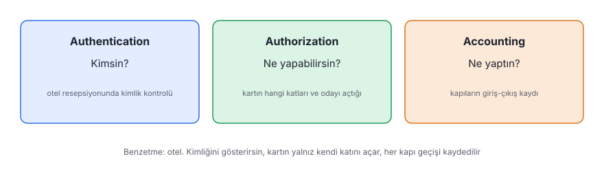
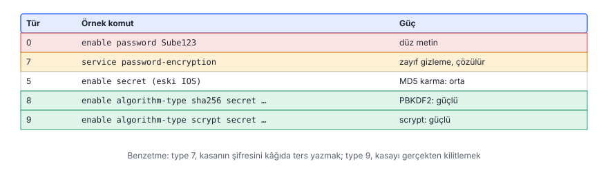
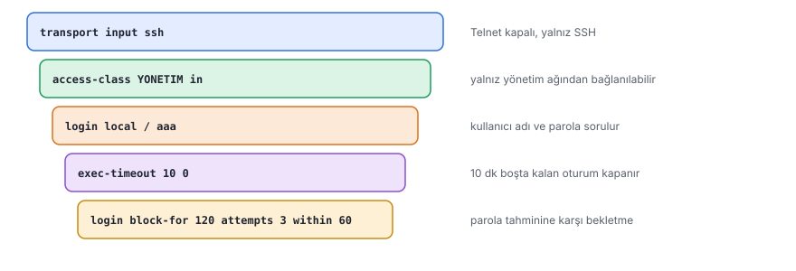
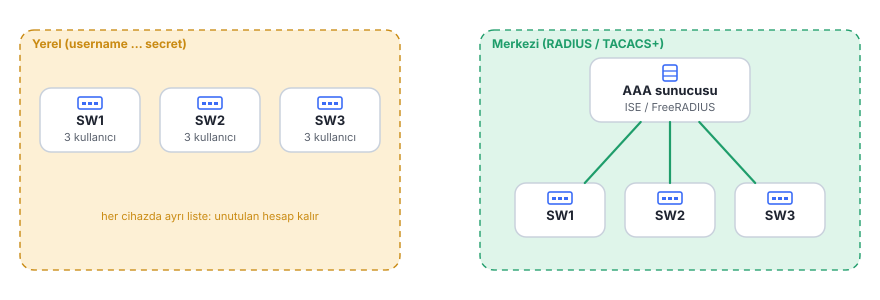
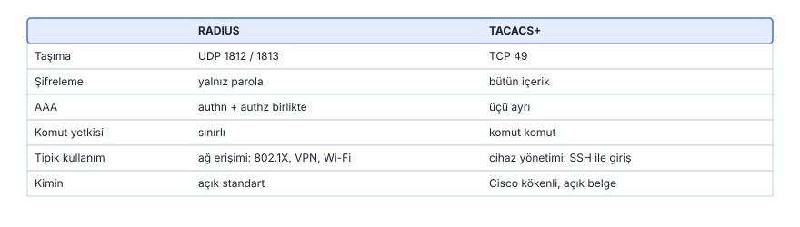
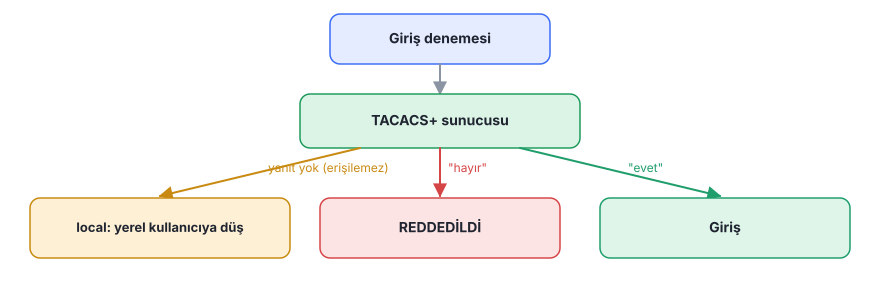
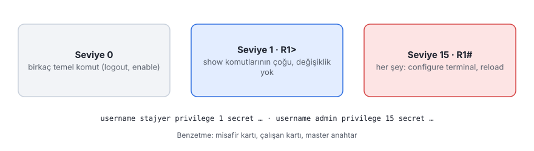

# AğLab Konu #22: Cihaza erişim güvenliği: SSH, parolalar ve AAA

> Uygulamadaki `aaa` dersi bu belgeyle uyumludur. **Okuma dersi:** SSH, parola türleri ve AAA Labber'da
> modellenmez; vakalar kâğıt üstünde, beklenen çıktılarla çözülür. Ön koşul: cihaz yönetimi (Konu #11),
> ACL (Konu #19). Şemalar: `docs/dersler/gorseller/erisim-guvenligi.py`.

Bu konu bittiğinde öğrenci bir router ya da switch'e uzaktan erişimi katman katman kapatır: yalnız SSH, yalnız yönetim ağından, boşta kalan oturumun kapanması ve parola tahminine karşı bekletme. Parola türlerini (0, 7, 5, 8, 9) güçlerine göre sıralar. AAA'nın üç sorusunu ayırır; RADIUS ile TACACS+'ı karşılaştırır. Yöntem listesinde yerel yedeğin ne zaman devreye girdiğini açıklar. Seviye 2 (CCNA), süre yaklaşık 50 dakika.

## 0. Bir bakışta

- Uzaktan yönetim **yalnız SSH** ile: `transport input ssh`.
- vty satırına **access-class** ile yalnız yönetim ağına izin ver.
- `enable secret` ve `username … secret` **karma** saklar; `service password-encryption` yalnız zayıf **type 7** gizlemesidir.
- **AAA**: kimsin (authentication), ne yapabilirsin (authorization), ne yaptın (accounting).
- **RADIUS**: UDP, yalnız parola şifreli, ağ erişiminde yaygın. **TACACS+**: TCP 49, bütün içerik şifreli, komut yetkisi, cihaz yönetiminde yaygın.
- `group tacacs+ local`: sunucu **ulaşılamazsa** yerel kullanıcıya düşülür; sunucu "hayır" derse düşülmez.

> **Akılda kalsın:** Cihazın kendisi de bir hedeftir. Ağı korurken yönetim kapısını açık bırakma.



## 1. Neden önemli

Bir switch'in yönetim parolasını ele geçiren biri VLAN'ları değiştirir, trafiği kopyalar ya da cihazı kapatır. Şubelerde en sık görülen zayıflıklar şunlardır: Telnet'in açık kalması, herkesin aynı "admin" hesabını kullanması, parolaların type 7 ile "şifrelendi" sanılması, ayrılan çalışanın hesabının 30 cihazda unutulması. Bu ders bu kapıları sırayla kapatır.

## 2. Kavram

### 2.1 Parolalar

> **Benzetme:** Type 0, parolayı kapının üstüne yazmaktır. Type 7, aynı parolayı tersten yazmaktır: bakan biri hemen çözer. Type 8 ve 9, parolayı gerçekten kasaya kilitlemektir.



- `enable secret` her zaman `enable password`'ün önüne geçer.
- `username admin algorithm-type scrypt secret …` yerel kullanıcıyı güçlü karma ile saklar.
- `security passwords min-length 10` kısa parolaları reddeder.

> **Dikkat:** `service password-encryption` "parolalar şifreli" demek değildir. Bir yapılandırma dosyası paylaşıldığında type 7 satırlar internetteki araçlarla saniyede çözülür.

### 2.2 SSH ve vty satırlarını sıkılaştırmak

SSH'ın kurulumu Konu #11'de: hostname, domain adı, RSA anahtarı, `ip ssh version 2`, yerel kullanıcı. Burada kapıyı kat kat kapatıyoruz:



```
R1(config)#ip access-list standard YONETIM
R1(config-std-nacl)#permit 192.168.99.0 0.0.0.255
R1(config)#line vty 0 15
R1(config-line)#transport input ssh
R1(config-line)#access-class YONETIM in
R1(config-line)#login local
R1(config-line)#exec-timeout 10 0
R1(config)#login block-for 120 attempts 3 within 60
R1(config)#banner motd #Yalnız yetkili personel.#
```

- **access-class** ACL'yi vty satırına uygular (arayüze değil); yalnız yönetim ağından bağlanılabilir.
- **login block-for**: 60 saniyede 3 yanlış denemede 120 saniye giriş kabul edilmez.

> **Benzetme:** Bina kapısında kart okuyucu (SSH), yalnız personel girişinden girilebilmesi (access-class), masada uzun süre boş kalan bilgisayarın kilitlenmesi (exec-timeout) ve üç yanlış kartta turnikenin bir süre kilitlenmesi (login block-for).

### 2.3 AAA'nın üç sorusu

- **Authentication:** kullanıcı adı ve parola doğru mu?
- **Authorization:** bu kullanıcı hangi komutları çalıştırabilir, hangi yetki seviyesinde başlar?
- **Accounting:** kim, ne zaman bağlandı, hangi komutu yazdı?



### 2.4 RADIUS ve TACACS+



### 2.5 AAA'yı açmak ve yedek yöntem

```
R1(config)#aaa new-model
R1(config)#tacacs server ISE
R1(config-server-tacacs)#address ipv4 192.168.99.50
R1(config-server-tacacs)#key <paylaşılan anahtar>
R1(config)#aaa authentication login default group tacacs+ local
R1(config)#aaa authorization exec default group tacacs+ local
R1(config)#aaa accounting commands 15 default start-stop group tacacs+
```



> **Dikkat:** `aaa new-model` yazıldığı anda vty ve konsol girişleri AAA'ya geçer. Yerel bir kullanıcı ve `local` yedeği tanımlamadan bu komutu uzaktan yazmak, kendini cihazın dışında bırakmanın en kısa yoludur.

### 2.6 Yetki seviyeleri



> **Sahada:** Stajyerlere ve izleme hesaplarına seviye 15 verilmez; TACACS+ ile komut yetkilendirmesi kullanılan ağlarda "show" yazabilen ama "configure" yazamayan roller tanımlanır.

## 3. Çıktı okuma

```
R1#show running-config | section line vty
line vty 0 4
 access-class YONETIM in
 exec-timeout 10 0
 login local
 transport input ssh
line vty 5 15
 login local
 transport input telnet ssh          ← 5–15'te Telnet açık ve ACL yok: açık kapı

R1#show ip ssh
SSH Enabled - version 2.0
Authentication timeout: 120 secs; Authentication retries: 3

R1#show login
     A login delay has not been applied.
     Router enabled to watch for login Attacks.
     If more than 3 login failures occur in 60 seconds or less,
       logins will be disabled for 120 seconds.
     Router presently in Normal-Mode.

R1#show running-config | include username|enable
enable secret 9 $9$…                 ← güçlü karma
username destek password 7 0822455D0A16   ← type 7: çözülebilir
```

| Soru | Komut |
| --- | --- |
| Hangi vty satırlarında ne açık? | `show running-config | section line vty` |
| SSH sürümü? | `show ip ssh` |
| Parola tahmini koruması? | `show login` |
| Kim bağlı? | `show users`, `show ssh` |
| AAA sunucusuna ulaşılıyor mu? | `show tacacs`, `show aaa servers` |

## 4. Yönlendirmeli lab

> **Simülatörde yok:** Lab'ı kâğıt üstünde yürüt; her adımda Bölüm 3'teki beklenen çıktıyla karşılaştır.

Topoloji: R1; yönetim ağı 192.168.99.0/24 (ADMIN 192.168.99.10), kullanıcı ağı 192.168.10.0/24 (PC-10); TACACS+ sunucusu 192.168.99.50.

1. `show running-config | section line vty`: hangi satırlarda Telnet açık? *Neden:* 0–4 ve 5–15 ayrı ayarlanır; biri unutulur.
2. `ip access-list standard YONETIM` → `permit 192.168.99.0 0.0.0.255`.
3. `line vty 0 15` → `transport input ssh` → `access-class YONETIM in` → `login local` → `exec-timeout 10 0`. *Neden:* `0 15` yazmak iki grubu birlikte kapatır.
4. `username admin algorithm-type scrypt secret …`; type 7'li eski `destek` hesabını sil.
5. `login block-for 120 attempts 3 within 60`; `show login`.
6. AAA: önce yerel kullanıcının çalıştığını doğrula, **sonra** `aaa new-model` ve `group tacacs+ local`.
7. Okuma: TACACS+ sunucusunun kablosu çıkarılsa admin nasıl girer? Sunucu "hayır" derse?

> **Benzetme:** 6. adım, yeni kilidi takmadan önce yedek anahtarın cebinde olduğundan emin olmaktır.

## 5. Sık hatalar

| Kod | Hata | Belirti | Kanıt | Düzeltme |
| --- | --- | --- | --- | --- |
| E1 | vty 5–15 unutulmuş | Telnet hâlâ açık | `section line vty`'de `transport input telnet` | `line vty 0 15` ile hepsini ayarla |
| E2 | Type 7'ye güvenmek | Paylaşılan config'ten parola çözülür | `password 7` satırları | `secret` ile yeniden tanımla |
| E3 | `aaa new-model` öncesi yerel yedek yok | Uzaktan girilemiyor | Yöntem listesinde `local` yok | Konsoldan bağlan, `local` ekle |
| E4 | access-class yanlış ağ | Yöneticiler de giremiyor | ACL ağı yönetim ağıyla uyuşmuyor | ACL'yi düzelt |
| E5 | Sunucu "hayır" derken yerelin denenmesini beklemek | Yerel parola doğru ama giriş yok | Sunucu erişilebilir, kullanıcı reddedilmiş | Sunucudaki hesabı düzelt |

## 6. Arıza senaryoları

> **Uygulamada:** Kâğıt üstü vakalar; motor desteği gelince Sorun Çöz'e `aaa-*` kimlikleriyle eklenecek. Önce kendin çöz; neden ve çözüm kapalı kutularda.

### S1 · Başlangıç · Denetim raporu: "Telnet açık" (E1)

- **Belirti:** Herkes SSH kullanıyor, ama denetim aracı R1'de TCP 23'ün açık olduğunu raporluyor.
- **Hedef:** Uzaktan yalnız SSH.

<details><summary>Neden ve çözüm</summary>

Yalnız `line vty 0 4` ayarlanmış; `line vty 5 15` hâlâ `transport input telnet ssh`. Çözüm: `line vty 0 15` → `transport input ssh` → `access-class YONETIM in`.

</details>

### S2 · Orta · AAA açıldı, kimse giremiyor (E3)

- **Belirti:** Teknisyen uzaktan `aaa new-model` ve `aaa authentication login default group tacacs+` yazdı; TACACS+ sunucusu henüz kurulmamış. Oturum kapandı, kimse bağlanamıyor.
- **Hedef:** Yeniden yönetim erişimi.

<details><summary>Neden ve çözüm</summary>

Yöntem listesinde `local` yedeği yok; sunucuya ulaşılamayınca giriş reddediliyor. Çözüm: konsoldan bağlan (konsolda da AAA geçerli olduğu için gerekirse parola kurtarma), `aaa authentication login default group tacacs+ local` ve yerel kullanıcı.

</details>

### S3 · Orta · Yöneticiler de dışarıda kaldı (E4)

- **Belirti:** access-class eklendikten sonra ADMIN (192.168.99.10) SSH ile bağlanamıyor; "connection refused".
- **Hedef:** ADMIN bağlanır, PC-10 bağlanamaz.

<details><summary>Neden ve çözüm</summary>

ACL'de `permit 192.168.9.0 0.0.0.255` yazılmış (yazım hatası). Çözüm: satırı `permit 192.168.99.0 0.0.0.255` olarak düzelt.

</details>

### S4 · İleri · Yerel parola doğru, giriş yok (E5)

- **Belirti:** Ayrılan bir çalışanın hesabı TACACS+'ta kapatıldı. Başka bir yönetici, kendi TACACS+ hesabının süresi dolduğu için R1'deki yerel `admin` hesabıyla girmeye çalışıyor; reddediliyor.
- **Hedef:** Durumun neden doğru davranış olduğunu açıkla ve doğru çözümü seç.

<details><summary>Neden ve çözüm</summary>

Sunucu erişilebilir ve "hayır" dediği için yerel yönteme düşülmez; `local` yalnız sunucuya ulaşılamazsa devreye girer. Çözüm: TACACS+'ta yöneticinin hesabını yenile; yerel hesap acil durum (sunucu yok) içindir.

</details>

## 7. Kısa sınav

**1.** `service password-encryption` parolaları hangi türe çevirir ve bu güvenli mi?

<details><summary>Cevap</summary>

Type 7; güvenli değildir, kolayca çözülür. Yalnız ekrana bakanın okumasını engeller.

</details>

**2.** vty satırına ACL hangi komutla uygulanır?

<details><summary>Cevap</summary>

`access-class <ACL> in` (arayüzdeki `ip access-group` değil).

</details>

**3.** AAA'nın üç A'sı?

<details><summary>Cevap</summary>

Authentication (kimsin), authorization (ne yapabilirsin), accounting (ne yaptın).

</details>

**4.** Bütün paketi şifreleyen ve komut komut yetki veren protokol?

<details><summary>Cevap</summary>

TACACS+ (TCP 49).

</details>

**5.** `aaa authentication login default group tacacs+ local`: sunucu "hayır" derse yerel kullanıcı denenir mi?

<details><summary>Cevap</summary>

Hayır. Yerel yöntem yalnız sunucuya ulaşılamazsa (hata) denenir.

</details>

**6.** Denetimde Telnet açık çıktı; vty 0–4'te `transport input ssh` var. Nereye bakarsın?

<details><summary>Cevap</summary>

`line vty 5 15`'e; çoğu zaman o grup unutulmuştur. `line vty 0 15` ile hepsini birlikte ayarla.

</details>

## 8. Özet kartı

| Komut | Ne işe yarar |
| --- | --- |
| `enable algorithm-type scrypt secret …` | Güçlü enable parolası |
| `username … algorithm-type scrypt secret …` | Güçlü yerel kullanıcı |
| `transport input ssh` | Yalnız SSH |
| `access-class YONETIM in` (vty) | Yalnız yönetim ağı |
| `exec-timeout 10 0` | Boştaki oturumu kapat |
| `login block-for 120 attempts 3 within 60` | Parola tahmini koruması |
| `aaa new-model` | AAA'yı aç (önce yerel yedek!) |
| `aaa authentication login default group tacacs+ local` | Sunucu, yoksa yerel |

**Unutma:**

1. vty 0 15'in hepsi.
2. Type 7 şifre değildir.
3. AAA'dan önce yerel yedek.
4. `local` yalnız sunucu yoksa.
5. RADIUS ağ erişimi, TACACS+ cihaz yönetimi.

## 9. Doğrulama notları

Kaynaklar: INET CCNA 200-301 v1.1 ve INE ENCOR (cihaz erişimi, AAA, RADIUS/TACACS+ bölümleri, yalnız kapsam kontrolü için); Cisco IOS güvenlik yapılandırma kılavuzu (AAA yöntem listeleri, `login block-for`, parola türleri); RFC 2865 (RADIUS), RFC 8907 (TACACS+). Ders metni, örnek çıktılar ve şemalar özgün yazıldı.

| İddia | Sonuç |
| --- | --- |
| RADIUS UDP 1812/1813, yalnız parola alanını gizler | Doğru |
| TACACS+ TCP 49, gövdenin tamamını gizler, AAA'yı ayırır | Doğru |
| Yöntem listesinde sonraki yöntem yalnız ERROR'da denenir, FAIL'de denenmez | Doğru |
| Type 7 tersine çevrilebilir; type 8 PBKDF2-SHA256, type 9 scrypt | Doğru |
| `enable secret`, `enable password`'ün önüne geçer | Doğru |
| `aaa new-model` sonrası vty girişleri AAA yöntem listesine tabi | Doğru |

**Motor gereksinimleri**

- [ ] SSH, `line vty` seçenekleri, `access-class`, `login block-for`, AAA ve TACACS+/RADIUS Labber'da yok (motor işi). Hazır olunca S1–S4 `aaa-*` kimlikleriyle Sorun Çöz'e eklenir.
