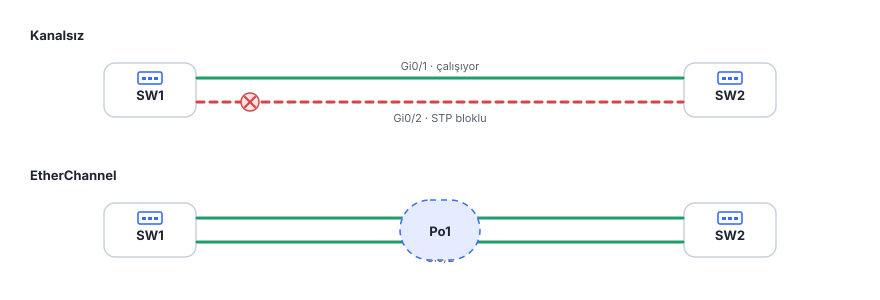
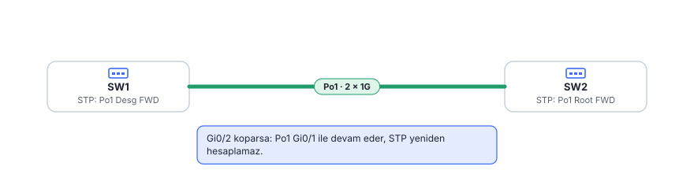
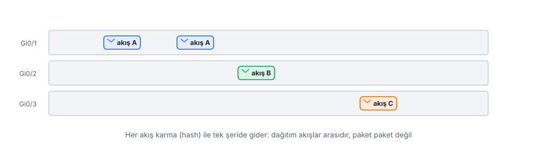
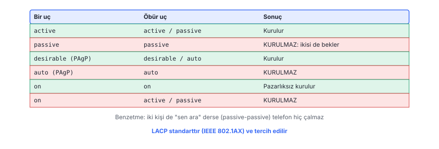
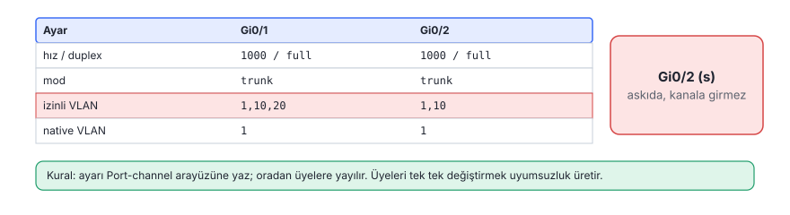
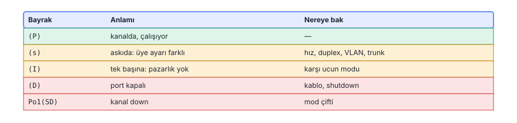
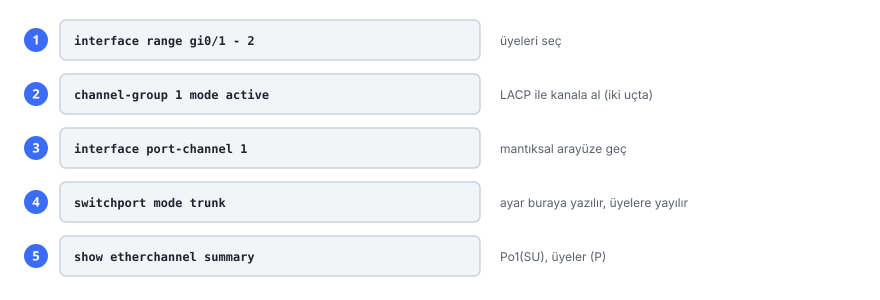

# AğLab Konu #14: EtherChannel (LACP)

> Uygulamadaki `etherchannel` dersi bu belgeyle uyumludur. Senaryolar Sorun Çöz'de `ec-*` kimlikleriyle
> Labber'da çalışır (AğLab modeli `channelGroup` ve `po<N>`, #80). Ön koşul: VLAN ve trunk (Konu #5–6),
> STP (Konu #13). Şemalar: `docs/dersler/gorseller/etherchannel.py`.

Bu konu bittiğinde öğrenci birden çok fiziksel bağlantıyı neden tek mantıksal bağlantıda topladığımızı açıklar. LACP ile EtherChannel kurar ve hangi mod çiftlerinin kanal oluşturduğunu bilir. Üyelerin hangi ayarlarda aynı olması gerektiğini sayar. `show etherchannel summary` bayraklarından askıya alınmış, tek başına kalmış ve paketlenmiş portları ayırır. Seviye 2 (CCNA), süre yaklaşık 45 dakika.

## 0. Bir bakışta

- İkinci kablo tek başına hız getirmez: **STP onu bloklar**.
- **EtherChannel** 2–8 bağlantıyı tek mantıksal **Port-channel** yapar; STP onu tek bağlantı görür.
- **LACP**: en az bir uç `active` olmalı. `passive`–`passive` kurulmaz; `on` yalnız `on` ile eşleşir.
- Üyeler **ikiz** olmalı: hız, duplex, mod, VLAN listesi, native VLAN. Farklı olan **askıya** alınır `(s)`.
- Ayar **Port-channel** arayüzüne yazılır.
- Dağıtım **akış** bazlıdır: tek dosya aktarımı tek üyenin hızını aşamaz.

> **Akılda kalsın:** "Kanal up" demek "her şey yolunda" demek değildir; üyelerin `(P)` olduğunu gör.



## 1. Neden önemli

İki switch arasına ikinci bir kablo çekmek tek başına bant genişliğini artırmaz. STP döngüyü önlemek için ikinci kabloyu bloklar. EtherChannel iki (en çok sekiz) bağlantıyı tek mantıksal bağlantı (Port-channel) yapar: STP onu tek link görür, trafik üyelere dağıtılır ve bir üye kopunca kanal kesintisiz devam eder. Arızaları sinsidir: kanal "up" görünür ama bir üye askıdadır; bağlantı çalışır ama yedeksizdir ve yarı hızdadır.

## 2. Kavram

### 2.1 Neden kanal?

> **Benzetme:** İki köy arasında iki köprü var, ama trafik polisi (STP) "kaza olmasın" diye birini kapatmış. EtherChannel iki köprüyü tek, iki şeritli bir köprü olarak kaydettirmektir: polis artık tek köprü görür, ikisi de açık kalır.

- STP iki ucu tek **Po1** olarak görür; bloklayacak ikinci yol kalmaz.
- Bir üye koparsa kanal kalan üyelerle devam eder; STP yeniden hesap yapmaz.



### 2.2 Yük dağıtımı



- Her akış bir **karma** (hash) ile tek üyeye gider: `port-channel load-balance src-dst-ip`.
- Çok kullanıcı varken toplam kapasite artar; tek bir büyük aktarım hızlanmaz.
- En çok 8 etkin üye; 2, 4 ya da 8 üye karmayı dengeli dağıtır.

> **Dikkat:** "Kanal kurdum, dosya kopyalama iki kat hızlanmadı" bir arıza değildir (E5).

### 2.3 Mod çiftleri

> **Benzetme:** `active` telefonu açıp arayan, `passive` yalnız gelen aramayı açan kişidir. İkisi de passive ise telefon hiç çalmaz. `on` ise telefonu hiç kullanmadan "biz zaten anlaştık" diyen kişidir: karşısında da aynı inatçı olmalıdır.



- **LACP** (IEEE 802.3ad/802.1AX) standarttır ve tercih edilir.
- **PAgP** Cisco'ya özeldir (`desirable` / `auto`).
- **`on`** pazarlık yapmaz; yanlış kablolamayı fark etmez ve döngü riski taşır.

### 2.4 Üye tutarlılığı



Bütün üyelerde hız, duplex, switchport modu (access/trunk), access VLAN'ı ya da trunk izinli listesi ve native VLAN aynı olmalıdır. Farklı olan üye **askıya alınır** `(s)` ve kanala girmez. Ayar Port-channel arayüzüne yazılır, üyelere yayılır.

> **Sahada:** Bir üyeyi tek başına düzenlemek yerine `interface port-channel 1` altında çalış; `interface range` ile üyeleri birlikte seç.

### 2.5 Bayraklarla teşhis



## 3. Çıktı okuma

```
SW1#show etherchannel summary
Flags:  D - down        P - bundled in port-channel
        I - stand-alone s - suspended
        S - Layer2      U - in use
Group  Port-channel  Protocol    Ports
------+-------------+-----------+-----------------------------------------------
1      Po1(SU)         LACP      Gi0/1(P)    Gi0/2(s)
                                              ← Gi0/2 askıda: ayarı Gi0/1'den farklı

SW1#show interfaces trunk
Port        Mode         Encapsulation  Status        Native vlan
Po1         on           802.1q         trunking      1
                                              ← trunk Po1 üzerinde, üyeler ayrıca listelenmez
```

| Bayrak | Anlamı | Bakılacak |
| --- | --- | --- |
| `(P)` | Kanalda, çalışıyor | — |
| `(s)` | Askıda: üye ayarı uyumsuz | Üyenin hız/duplex/VLAN/trunk ayarı |
| `(I)` | Tek başına: karşı taraf kanal pazarlığına girmiyor | Karşı ucun modu |
| `(D)` | Port kapalı | Kablo, `shutdown` |
| `Po1(SD)` | Kanal down: hiç üye yok | Mod çifti |

## 4. Yönlendirmeli lab

Topoloji: SW1 Gi0/1–Gi0/2 ↔ SW2 Gi0/1–Gi0/2 (trunk, VLAN 1, 10, 20); her switch'te VLAN 10 ve 20'de birer PC.

1. **Kanalsız:** `show spanning-tree vlan 10`: iki bağlantıdan biri bloklu.
2. **LACP:** iki switch'te Gi0/1 ve Gi0/2'de `channel-group 1 mode active` (sahada `interface range gi0/1 - 2` ile).
3. **Port-channel:** `interface port-channel 1` → `switchport mode trunk`.
4. **Oku:** `show etherchannel summary` (P bayrakları), `show spanning-tree vlan 10` (artık tek port: Po1).
5. **Üye kaybı:** SW2'de Gi0/2'yi `shutdown`; kanal Gi0/1 ile devam eder, ping kesilmez. Geri aç. *Neden:* kanal bir üyeyle de ayaktadır; yalnız kapasite düşer.
6. **Mod deneyi:** SW2'de modu `passive` yap (kurulur), iki uçta `passive` (kurulmaz). *Neden:* passive yalnız cevap verir, kimse ilk adımı atmaz.
7. **Protokol değişimi:** SW1'de bir üyeyi `on` yapmayı dene: grupta LACP üye varken reddedilir ("protocol mismatch"). Önce bütün üyelerde `no channel-group`, sonra yeni mod.



## 5. Sık hatalar

| Kod | Hata | Belirti | Kanıt | Düzeltme |
| --- | --- | --- | --- | --- |
| E1 | İki uç passive (ya da auto) | Kanal yok, bir bağlantı STP'de bloklu | summary'de `(I)`, Po1 `SD` | Bir ucu `active` yap |
| E2 | Bir uç `on`, öbürü LACP | Kanal yok | `on` tarafında Po var ama karşıda `(I)` | İki ucu da LACP yap |
| E3 | Üye ayarı farklı (izinli VLAN, native, mod) | Kanal up ama bir üye yok, bant yarıda | Üye `(s)` | Ayarı Port-channel'a yaz, üyeleri eşitle |
| E4 | Hız/duplex farklı üye | Üye askıda | `(s)`; `show interfaces` hız farkı | Üyeleri aynı hız/duplex'e getir |
| E5 | "Kanal var, hız iki katı" beklemek | Tek aktarım hızlanmıyor | Bütün üyeler `(P)` | Normal: dağıtım akış bazlı |

## 6. Arıza senaryoları

> **Uygulamada:** S1–S5 Sorun Çöz'de `ec-passive-passive`, `ec-on-vs-lacp`, `ec-member-allowed`, `ec-po-allowed`,
> `ec-two-faults` kimlikleriyle Labber'da çalışır. Hedefler `etherchannel` sorgusuyla kanalın up olmasını
> ve iki üyenin de kanalda (P) olmasını, ayrıca iki VLAN'da katlar arası ping'i sınar.
> Önce kendin çöz; neden ve çözüm kapalı kutularda.

### S1 · Başlangıç · İkinci kablo boşta (E1)

- **Belirti:** İkinci kablo çekildi, LACP yazıldı; bir kablo STP'de bloklu, hız artmadı.
- **Hedef:** iki switch'te Po1 up, iki üye P; VLAN 10 ve 20 katlar arası

<details><summary>Neden ve çözüm</summary>

iki uçta `channel-group 1 mode passive`; üyeler `(I)`, `Po1(SD)`. Çözüm: SW1 → Gi0/1 ve Gi0/2'de `channel-group 1 mode active`

</details>

### S2 · Orta · Bir uç on, öbürü LACP (E2)

- **Belirti:** SW2 değiştirildi; kanal kurulmuyor, SW2'de üyeler `(I)`.
- **Hedef:** S1 ile aynı

<details><summary>Neden ve çözüm</summary>

SW1 `mode on`, SW2 `mode active`. Çözüm: SW1 → önce iki üyede `no channel-group`, sonra ikisinde `channel-group 1 mode active` (grupta tek protokol: biri `on` kalırken öbürü reddedilir)

</details>

### S3 · Orta · Kanal up, bir üye askıda (E3)

- **Belirti:** Bağlantı yarı hızda; SW1'de `Gi0/2(s)`.
- **Hedef:** S1 ile aynı

<details><summary>Neden ve çözüm</summary>

SW1 Gi0/2'nin izinli listesi 1,10; Po1 ve Gi0/1'de 1,10,20. Çözüm: SW1 → `interface gi0/2` → `switchport trunk allowed vlan 1,10,20`

</details>

### S4 · Orta · Satış VLAN'ı katlar arası geçmiyor (E3, kanal düzeyi)

- **Belirti:** `Po1(SU)`, iki üye P; VLAN 10 çalışıyor, VLAN 20 çalışmıyor.
- **Hedef:** SW2 Po1 up, iki üye P; VLAN 10 ve 20

<details><summary>Neden ve çözüm</summary>

SW2 Po1'in izinli listesi 1,10. Çözüm: SW2 → `interface port-channel 1` → `switchport trunk allowed vlan add 20`

</details>

### S5 · İleri · Kanal kuruldu, yine yarım (E1 + E3)

- **Belirti:** iki uç passive'ti; SW1 active yapılınca kanal kuruldu ama SW2'de `Gi0/2(s)`.
- **Hedef:** S1 ile aynı

<details><summary>Neden ve çözüm</summary>

passive–passive ve SW2 Gi0/2'de native VLAN 99. Çözüm: SW1 → üyelerde `channel-group 1 mode active`; SW2 → `interface gi0/2` → `no switchport trunk native vlan`

</details>

## 7. Kısa sınav

**1.** LACP `passive`–`passive` kanal kurar mı?

<details><summary>Cevap</summary>

Hayır; iki uç da karşıdan pazarlık bekler. En az bir uç `active` olmalı.

</details>

**2.** Hangi bayrak, üyenin ayar farkı yüzünden kanala alınmadığını gösterir?

<details><summary>Cevap</summary>

`(s)` suspended.

</details>

**3.** Bir uç `on`, öbürü `active` ise?

<details><summary>Cevap</summary>

Kanal kurulmaz; `on` pazarlık paketi göndermez, LACP tarafı `(I)` kalır.

</details>

**4.** Tek bir dosya aktarımı iki üyeli kanalda iki kat hızlanır mı?

<details><summary>Cevap</summary>

Hayır; bir akış tek üyeye gider.

</details>

**5.** STP iki üyeli bir kanalı nasıl görür?

<details><summary>Cevap</summary>

Tek bağlantı (Po1); bloklayacak ikinci yol yoktur.

</details>

**6.** Po1(SU) görünüyor ama yalnız Gi0/1 `(P)`, Gi0/2 `(s)`. Kullanıcılar şikâyet etmiyor. Sorun var mı?

<details><summary>Cevap</summary>

Var: bağlantı yedeksiz ve yarı kapasitede. Gi0/2'nin ayarını (çoğu zaman izinli VLAN listesi) Gi0/1 ile eşitle; en iyisi ayarı Port-channel'a yaz.

</details>

## 8. Özet kartı

| Komut | Ne işe yarar |
| --- | --- |
| `channel-group 1 mode active` | Üyeyi LACP ile kanala al |
| `interface port-channel 1` | Kanalın ayarları buraya |
| `show etherchannel summary` | Bayraklar: P, s, I, D |
| `show interfaces trunk` | Trunk Po1 üzerinde mi? |
| `port-channel load-balance src-dst-ip` | Dağıtım yöntemi |

**Unutma:**

1. En az bir uç active.
2. Üyeler ikiz; ayar Port-channel'a.
3. `(s)` ayar farkı, `(I)` karşı taraf pazarlığa girmiyor.
4. Dağıtım akış bazlı.
5. `on` yalnız `on` ile.

## 9. Doğrulama notları

**Lab'ın otomatik değerlendirmesi:** `q.etherchannel('SW1', 1)`: `up` doğru, `bundled` 2; VLAN 10 ve 20'de katlar arası ping.

Kaynaklar: INET CCNA 200-301 v1.1 ve INE ENCOR (EtherChannel); IEEE 802.1AX (LACP), Cisco Catalyst EtherChannel yapılandırma kılavuzu (modlar, uyumluluk şartları, `show etherchannel summary` bayrakları, yük dağıtımı), CCNA 200-301 2.4 (L2/L3 LACP).

| İddia | Sonuç |
| --- | --- |
| active–passive kurar, passive–passive kurmaz; desirable–auto kurar, auto–auto kurmaz | Doğru |
| `on` LACP/PAgP göndermez; karşı taraf pazarlık bekliyorsa kurulmaz | Doğru |
| Üyelerde hız, duplex, mod, VLAN/izinli liste, native VLAN aynı olmalı | Doğru |
| En çok 8 etkin üye | Doğru |

**Motor gereksinimleri** (Labber'da denendi)

- [x] `channel-group` (on, active, passive, desirable, auto), Port-channel, `show etherchannel summary`, `show interfaces trunk` (Po1), STP'de Po1 (2×1G maliyeti 3), grupta protokol uyuşmazlığının reddi
- [x] AğLab modeli: üyede `channelGroup {id, mode}`, switch'te `po<N>` (#80); senaryo sorgusu `etherchannel`
- [x] Beş senaryo başta başarısız, terminalden çözümle başarılı; iki hatalı senaryonun ara hali (`Gi0/2(s)`) doğrulandı
- [ ] Hız/duplex AğLab modelinde yok; "hızı farklı üye" (E4) kâğıt üstünde kalır
