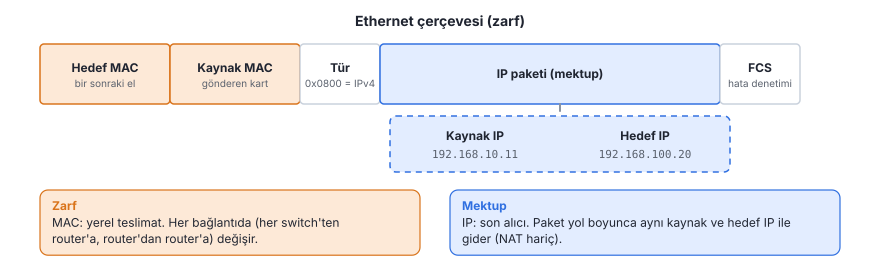
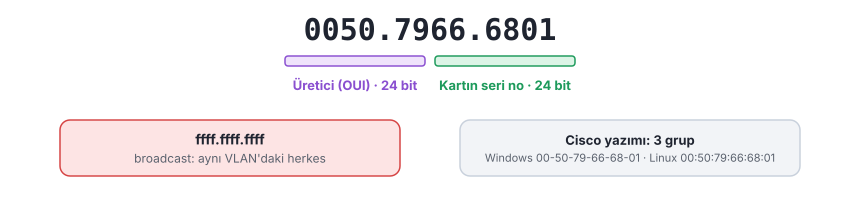
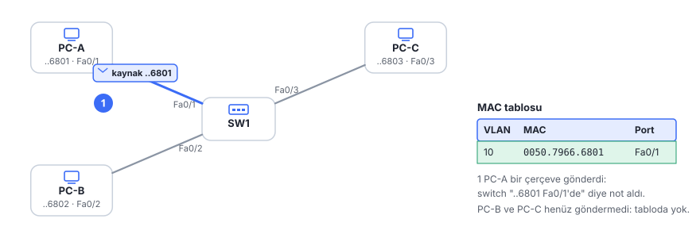
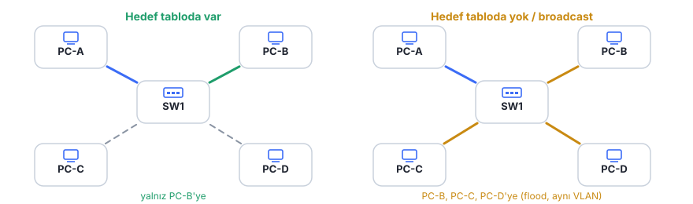
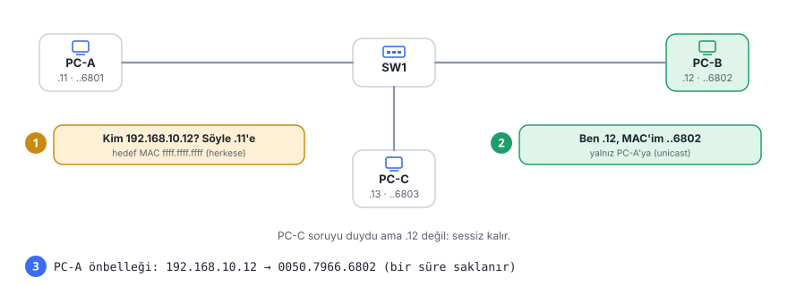
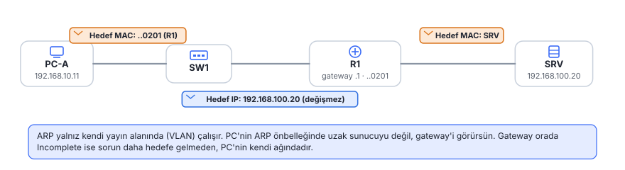
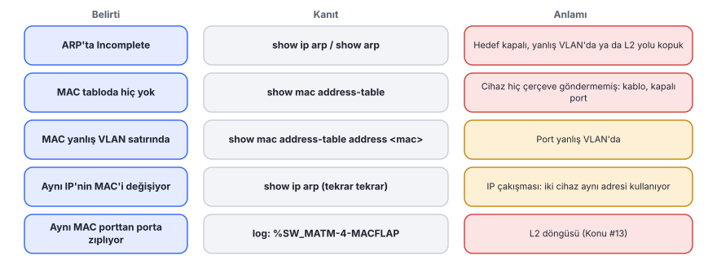

# AğLab Konu #3: Ethernet, MAC ve ARP

> Uygulamadaki `ethernet` dersi bu belgeden üretildi. Senaryolar Sorun Çöz'de `eth-*` kimlikleriyle
> Labber'da çalışır. Şemalar: `docs/dersler/gorseller/ethernet-mac-arp.py`.

Bu konu bittiğinde öğrenci bir switch'in MAC adreslerini nasıl öğrendiğini ve çerçeveleri nasıl ilettiğini, bir PC'nin ARP ile komşusunun MAC adresini nasıl bulduğunu açıklar; MAC tablosu ve ARP önbelleğinden "aynı ağdayım ama ulaşamıyorum" arızalarını teşhis eder. Seviye 1, süre yaklaşık 80 dakika (ders 20, lab 25, senaryolar 25, sınav 10).

## 0. Bir bakışta

- **IP adresi** paketin son alıcısıdır; **MAC adresi** kablodaki bir sonraki eldir. IP paketi, Ethernet çerçevesinin (zarfın) içindeki mektuptur.
- **Switch** kimin hangi portta olduğunu **kendisi öğrenir**: gelen çerçevenin kaynak MAC'ini, geldiği portla birlikte tablosuna yazar.
- Hedefi biliyorsa çerçeveyi **tek porta** gönderir; bilmiyorsa ya da hedef "herkes" ise aynı VLAN'daki **bütün portlara** gönderir (flood).
- **ARP** "bu IP kimin?" sorusudur: herkese sorulur, yalnız sahibi cevap verir. Cevap bir süre önbellekte tutulur.
- Uzak bir hedef için PC hedefin değil, **gateway'in** MAC'ini sorar.

> **Akılda kalsın:** "IP doğru, aynı ağdayız ama ping gitmiyor" diyorsan iki tabloya bak: ARP'ta hedefin MAC'i çözülmüş mü, switch'in MAC tablosunda o MAC doğru port ve VLAN'da mı?



## 1. Neden önemli

IP adresi bir paketin **nereye** gideceğini söyler, ama kablodaki her çerçeve bir **MAC adresine** gönderilir. PC, aynı ağdaki yazıcıya bir paket göndermeden önce "192.168.10.50'nin MAC adresi ne?" diye sormak zorundadır; bu sorunun adı ARP'tir. Switch ise kimin hangi portta olduğunu MAC tablosundan bilir.

Sahada bu katman genelde şu cümleyle gelir: *"İkisi de aynı ağda, IP'ler doğru, ama ping gitmiyor"* ya da *"Bazen gidiyor bazen gitmiyor."* İkinci cümlenin arkasında çoğu zaman aynı IP'yi kullanan iki cihaz vardır; ARP önbelleğinde aynı IP'nin MAC'i bir gidip bir gelir.

## 2. Kavram

### 2.1 Mektup ve zarf: IP ile MAC'in farkı

> **Benzetme:** İstanbul'dan Ankara'daki bir arkadaşına mektup yolluyorsun. Mektubun üstündeki adres (Ankara'daki arkadaşın) yol boyunca değişmez: bu IP adresidir. Ama mektup önce mahalle postanesine, oradan aktarma merkezine, oradan Ankara'ya taşınır; her taşımada "bir sonraki durak" etiketi yeniden yazılır: bu MAC adresidir.

- **Ethernet çerçevesi** sırayla hedef MAC, kaynak MAC, içeriğin türü (EtherType) ve içeriği (çoğunlukla bir IP paketi) taşır. Sonda FCS (hata denetimi) vardır.
- EtherType içeriği söyler: IPv4 **0x0800**, ARP **0x0806**, IPv6 **0x86DD**, 802.1Q etiketi **0x8100** (Konu #5–6).
- Router bir paketi bir ağdan öbürüne geçirirken **zarfı değiştirir** (yeni kaynak ve hedef MAC), **mektuba dokunmaz** (kaynak ve hedef IP aynı kalır; NAT hariç, Konu #20).

### 2.2 MAC adresi: kartın kimliği

- **MAC adresi** 48 bittir ve ağ kartına üretimde yazılır. İlk 24 bit üretici kodudur (**OUI**), son 24 bit kartın seri numarasıdır.
- Cisco cihazlar üç grupta yazar: `0050.7966.6801`. Windows `00-50-79-66-68-01`, Linux `00:50:79:66:68:01` gösterir; hepsi aynı adrestir.
- `ffff.ffff.ffff` **yayın (broadcast)** adresidir: "aynı VLAN'daki herkese".



### 2.3 Switch MAC adreslerini nasıl öğrenir?

> **Benzetme:** Apartman görevlisi kapıdan giren herkesin adını ve hangi daireye girdiğini defterine yazar. Bir kargo geldiğinde deftere bakar: alıcının dairesi yazılıysa doğrudan oraya götürür; yazılı değilse bütün dairelerin kapısını çalar.

- Bir çerçeve geldiğinde switch **kaynak** MAC'i, geldiği port ve VLAN ile birlikte **MAC tablosuna** yazar.
- Bir cihaz hiç çerçeve göndermediyse switch onu **tanımaz**. Kablosu takılı ama kapalı bir PC tabloda yoktur.
- Dinamik kayıtlar **300 saniye** (5 dakika) trafik gelmezse silinir (aging). Bir cihaz başka porta taşınırsa, o porttan ilk çerçeve gelir gelmez kayıt güncellenir.



### 2.4 İletme kararı: tek porta mı, herkese mi?

Switch **hedef** MAC'e bakar:

- **Tabloda varsa:** çerçeveyi yalnız o porta gönderir.
- **Tabloda yoksa** (bilinmeyen unicast) **ya da hedef broadcast ise:** geldiği port **hariç**, aynı VLAN'daki bütün portlara gönderir. Buna **flood** (taşırma) denir.
- Flood **VLAN sınırını aşmaz**: VLAN 10'dan gelen bilinmeyen çerçeve VLAN 20 portlarına gitmez.



> **Dikkat:** Hedefe giden ilk çerçeve genelde flood edilir; cevap gelince switch hedefi de öğrenir ve sonraki çerçeveler tek porta gider. Ağda flood'un sürekli olması (tablo dolması ya da döngü) bir sorun işaretidir.

### 2.5 ARP: "Bu IP kimin?"

> **Benzetme:** Kalabalık bir salonda "Ahmet Yılmaz kim?" diye bağırırsın. Herkes duyar ama yalnız Ahmet "Benim, şuradayım" der ve sana el sallar. Bir daha sormamak için yerini aklında tutarsın, ama bir süre sonra unutursun.

1. PC-A, 192.168.10.12'ye bir şey gönderecek ama MAC'ini bilmiyor. Önce **ARP önbelleğine** bakar.
2. Yoksa **broadcast** bir ARP isteği gönderir: "Kim 192.168.10.12? Söyle 192.168.10.11'e." Hedef MAC `ffff.ffff.ffff`.
3. Yalnız .12'nin sahibi PC-B, **unicast** bir ARP yanıtı verir: "192.168.10.12 benim, MAC'im 0050.7966.6802."
4. PC-A bunu önbelleğe yazar ve asıl paketi gönderir. Cisco cihazlar ARP kaydını varsayılan **4 saat**, PC'ler çok daha kısa (dakikalar) saklar.



### 2.6 Uzak hedef: gateway'in MAC'i sorulur

ARP **yalnız kendi yayın alanında** (aynı VLAN) çalışır. PC başka ağdaki bir hedefe gidecekse (Konu #2'deki karar) o hedefin değil, **gateway'in** MAC'ini sorar. Çerçeve gateway'e gider; gateway mektubu yeni bir zarfa koyup yola devam ettirir.



Bu yüzden "ARP çözülüyor mu?" sorusu, katman 2 yolunun sağlam olup olmadığının en hızlı testidir.

### 2.7 İki uyarı işareti

- **Aynı MAC iki porttan sürekli öğreniliyorsa** (`%SW_MATM-4-MACFLAP`): neredeyse her zaman bir L2 döngüsüdür (Konu #13).
- **Aynı IP iki farklı MAC'ten yanıt veriyorsa** (`%IP-4-DUPADDR`): IP çakışmasıdır (Konu #2).

## 3. Çıktı okuma

Bu katmanda üç tablo okunur: switch'in MAC tablosu, router/L3 switch'in ARP tablosu ve PC'nin ARP önbelleği. Üçü birlikte "çerçeve nereye gidiyor ve kime gidiyor" sorusunu cevaplar.

### show mac address-table — kim hangi portta?

```
SW1#show mac address-table dynamic
          Mac Address Table
-------------------------------------------

Vlan    Mac Address       Type        Ports
----    -----------       --------    -----
  10    0050.7966.6801    DYNAMIC     Fa0/1
  10    0050.7966.6802    DYNAMIC     Fa0/2
  10    0050.7966.6803    DYNAMIC     Fa0/3
  10    5254.0010.0201    DYNAMIC     Gi0/1
Total Mac Addresses for this criterion: 4
```

- Her satır "bu VLAN'da bu MAC, bu porttan geldi" der. Bir PC'nin MAC'i burada yoksa, switch o PC'den henüz hiç çerçeve almamıştır: kablo, port ya da PC kapalıdır.
- **Aynı MAC'in yanlış VLAN'da görünmesi**, portun yanlış VLAN'a atandığını gösterir.
- **Tek porttan çok sayıda MAC** (Gi0/1 gibi) normaldir: o port başka bir switch'e ya da router'a gider.
- Belirli bir PC'yi aramak için: `show mac address-table address 0050.7966.6802`.

### show ip arp — IP hangi MAC'e eşlendi?

```
SW1#show ip arp
Protocol  Address          Age (min)  Hardware Addr   Type   Interface
Internet  192.168.10.1            -   5254.0010.0164  ARPA   Vlan10
Internet  192.168.10.11           3   0050.7966.6801  ARPA   Vlan10
Internet  192.168.10.12           0   0050.7966.6802  ARPA   Vlan10
Internet  192.168.10.13           -   Incomplete      ARPA
```

- **Age `-`** cihazın kendi adresidir (burada SVI'nın kendisi).
- **Incomplete**: ARP isteği gönderildi ama yanıt gelmedi. Hedef kapalı, yanlış VLAN'da ya da L2 yolu kopuk. "IP doğru ama ulaşamıyorum" arızasının en net kanıtıdır.
- Aynı IP'nin MAC'i her bakışta değişiyorsa iki cihaz aynı IP'yi kullanıyordur.

### PC'de ARP önbelleği

```
PC-A> show arp
00:50:79:66:68:02  192.168.10.12 expires in 117 seconds
```

Windows'ta aynı bilgi `arp -a` ile görülür. PC başka ağdaki bir hedefe ulaşmaya çalışıyorsa önbellekte o hedefi değil, **gateway'in** IP ve MAC'ini görmek gerekir. Gateway burada yoksa ya da Incomplete ise sorun daha hedefe gelmeden, PC'nin kendi ağındadır.

## 4. Yönlendirmeli lab

Tek switch, üç PC, hepsi VLAN 10'da. Bu labda yapılandırma neredeyse yok; amaç switch'in ve PC'lerin tablolarının nasıl dolduğunu kendi gözünle izlemek.

| Cihaz | Port | IP / maske | MAC |
| --- | --- | --- | --- |
| PC-A | SW1 Fa0/1 | 192.168.10.11/24 | 0050.7966.6801 |
| PC-B | SW1 Fa0/2 | 192.168.10.12/24 | 0050.7966.6802 |
| PC-C | SW1 Fa0/3 | 192.168.10.13/24 | 0050.7966.6803 |

1. **Tabloyu boşalt.** SW1'de `clear mac address-table dynamic`, ardından `show mac address-table dynamic`. Tablo boş olmalı. *Neden:* Neyin ne zaman öğrenildiğini görebilmek için temiz başlıyoruz.
2. **PC-A'dan PC-B'ye ping at** (`ping 192.168.10.12`). Ardından PC-A'nın ARP önbelleğine bak. Yalnız PC-B görünmeli. *Neden:* PC-A yalnız konuşmak istediği adresi sorar; PC-C'yi sormadı.
3. **MAC tablosuna tekrar bak.** PC-A (Fa0/1) ve PC-B (Fa0/2) var, PC-C yok. *Neden:* Switch yalnız kendisine çerçeve gönderen cihazları öğrenir. PC-C ARP isteğini almıştı ama hiç yanıt vermediği için tabloya girmedi.
4. **PC-C'den PC-A'ya ping at.** MAC tablosunda artık üç PC de var.
5. **Olmayan bir adrese ping at:** PC-A'dan `ping 192.168.10.99`. Ping başarısız olur, MAC tablosuna yeni kayıt eklenmez. *Neden:* Kimse ARP isteğine yanıt vermedi; gerçek bir router'da bu adres `show ip arp`'ta Incomplete görünürdü.
6. **Kabloyu taşı.** PC-B'nin kablosunu Fa0/2'den Fa0/5'e tak, PC-B'den PC-A'ya ping at, MAC tablosuna bak. PC-B'nin MAC'i artık Fa0/5'te. *Neden:* Switch, bir MAC'i yeni bir porttan duyduğu anda kaydı günceller. Bu, ofiste masası değişen birinin neden ayar gerektirmeden çalışmaya devam ettiğini açıklar.
7. **Belirli bir cihazı bul.** `show mac address-table address 0050.7966.6802` ile PC-B'nin hangi portta olduğunu tek satırda gör.

> **Benzetme:** Bu lab, apartman görevlisinin defterini izlemek gibidir: kim kapıdan girerse adını ve dairesini yazar; hiç görünmeyenin adı defterde olmaz; taşınanın kaydı yeni daireyle güncellenir.

## 5. Sık hatalar

Bu konunun hataları "IP doğru, aynı ağdayız, yine de olmuyor" ailesindendir. Teşhisin anahtarı: hedefin MAC'i ARP'ta çözülmüş mü, switch o MAC'i nerede görüyor?

| Kod | Hata | Belirti | Kanıt | Düzeltme |
| --- | --- | --- | --- | --- |
| E1 | IP çakışması | Erişim aralıklı: bazen gidiyor, bazen gitmiyor; bazen yanlış cihaz yanıt veriyor | `show ip arp`'ta aynı IP'nin MAC'i değişiyor; gerçek cihazda `%IP-4-DUPADDR` | Cihazlardan birinin IP'sini değiştir |
| E2 | Yanlış maske | İki PC aynı kabloda ama biri diğerini "başka ağda" sanıyor; ARP yerine gateway'e gönderiyor | PC'de `show ip` / `ipconfig`: maske farklı | Maskeyi ağın maskesiyle eşitle |
| E3 | Port kapalı ya da kablo kopuk | PC hiçbir yere ulaşamıyor | MAC tablosunda PC'nin MAC'i yok; `show interfaces status`: `disabled` / `notconnect` | `no shutdown` ya da kablo |
| E4 | Port yanlış VLAN'da | ARP yanıtsız, PC kimseye ulaşamıyor | MAC tablosunda PC'nin MAC'i **yanlış VLAN** satırında | `switchport access vlan <doğru>` (Konu #5) |
| E5 | L2 döngüsü | Ağ bir anda yavaşlar ya da tamamen durur, ışıklar sürekli yanıp söner | Aynı MAC hızla porttan porta geçiyor; `%SW_MATM-4-MACFLAP` logu | Fazladan kabloyu çıkar, STP'yi kontrol et (Konu #13) |

> **Akılda kalsın:** E4'ü VLAN konusundan ayıran nokta kanıttır: burada sorun MAC tablosundan bulunur. Aynı belirtiye iki farklı yoldan ulaşmayı öğrenmek, sahadaki teşhisi hızlandırır.



## 6. Arıza senaryoları

> **Uygulamada:** S1–S5 Sorun Çöz'de `eth-printer-port`, `eth-wrong-mask`,
> `eth-duplicate-ip`, `eth-moved-cable-vlan`, `eth-two-switch-vlan` kimlikleriyle Labber'da çalışır.
> Hedefteki ping'ler değerlendirmede gerçek trafik gibi çalışır; `macPort`/`macVlan` o trafikle
> öğrenilen MAC'e bakar. Temel topoloji labdakiyle aynıdır: SW1, VLAN 10, PC-A .11, PC-B .12,
> PC-C .13; gerektiğinde yazıcı PRN .50 eklenir. Önce kendin çöz; neden ve çözüm kapalı kutularda.

### S1 · Başlangıç · Yeni yazıcı kimseye görünmüyor (E3)

- **Belirti:** Yazıcı kuruldu, IP ayarlandı, ama hiçbir PC ona ping atamıyor.
- **Hedef:** PC-A → yazıcı başarılı; SW1 yazıcıyı Fa0/4'te öğrenmiş.

<details><summary>Neden ve çözüm</summary>

PRN SW1 Fa0/4'e bağlı ve Fa0/4 `shutdown`; MAC tablosunda yazıcı hiç yok. Çözüm: SW1 → `interface fa0/4` → `no shutdown`.

</details>

### S2 · Başlangıç · PC-C kendi ağındakilere ulaşamıyor (E2)

- **Belirti:** PC-C'nin IP'si "doğru ağda" görünüyor ama PC-A'ya ve PC-B'ye ping gitmiyor; onlar da PC-C'ye ulaşamıyor.
- **Hedef:** PC-C ↔ PC-A başarılı.

<details><summary>Neden ve çözüm</summary>

PC-C 192.168.10.130 **/25**; diğerleri /24. PC-C, .11'i başka ağda sanıyor ve ARP sormuyor. Çözüm: PC-C → `ip 192.168.10.130/24`.

</details>

### S3 · Orta · Muhasebe PC'sine bazen ulaşılıyor, bazen ulaşılamıyor (E1)

- **Belirti:** PC-A, PC-B'deki paylaşıma bazen ulaşıyor bazen ulaşamıyor. Sorun yeni bir dizüstü gelince başladı.
- **Hedef:** .12 tek cihazda; PC-A'nın .12'ye ping'ini PC-B yanıtlıyor.

<details><summary>Neden ve çözüm</summary>

Yeni dizüstü (LAPTOP, Fa0/6) yanlışlıkla 192.168.10.12 ile yapılandırılmış. Çözüm: LAPTOP → `ip 192.168.10.14/24`.

</details>

### S4 · Orta · Masası değişen çalışan ağa giremiyor (E4)

- **Belirti:** PC-B yeni masasına geçti, IP ayarları aynı, ama artık hiçbir yere ulaşamıyor.
- **Hedef:** PC-B → PC-A başarılı; PC-B'nin MAC'i VLAN 10'da.

<details><summary>Neden ve çözüm</summary>

PC-B'nin kablosu Fa0/7'ye taşınmış; Fa0/7 misafir ağı için VLAN 20'de. MAC tablosunda PC-B'nin MAC'i VLAN 20 satırında. Çözüm: SW1 → `interface fa0/7` → `switchport access vlan 10`.

</details>

### S5 · İleri · Yeni switch'e bağlananlar ofise ulaşamıyor (E4, iki switch)

- **Belirti:** SW2 eklendi; ona bağlı PC-D ile PC-E birbirine ulaşıyor ama SW1'deki PC'lere ulaşamıyor.
- **Hedef:** PC-D → PC-A ve PC-E → PC-B başarılı; SW1, PC-D'yi Fa0/8'de VLAN 10'da öğrenmiş.

<details><summary>Neden ve çözüm</summary>

SW2'nin portları VLAN 10'da; SW1 Fa0/8 (SW2'ye giden) VLAN 1'de bırakılmış. Çözüm: SW1 → `interface fa0/8` → `switchport access vlan 10` (birden çok VLAN taşınacaksa trunk, Konu #5–6).

</details>

### Ek · İki gözlem senaryosu

Arıza içermeyen iki gözlem senaryosu: başlangıçta tablolar boş olduğu için hedef başarısızdır, trafik üretilince başarılı olur.

- `eth-mac-learning`: PC-A → PC-B ping'inden sonra SW1, PC-A'yı Fa0/1'de, PC-B'yi (yanıttan) Fa0/2'de öğrenir.
- `eth-unknown-unicast`: PC-A → PC-D ping'inden sonra SW2, PC-A'yı uplink'te, SW1, PC-D'yi uplink'te öğrenir; hiç göndermeyen PC-E hiçbir tabloda yoktur.

## 7. Kısa sınav

**1.** Switch, hedef MAC'i tablosunda bulamadığı bir çerçeveyi ne yapar? (A) Düşürür (B) Geldiği port hariç aynı VLAN'daki tüm portlara gönderir (C) Tüm VLAN'lardaki tüm portlara gönderir (D) Gateway'e gönderir

<details><summary>Cevap</summary>

**B.** Bilinmeyen unicast, broadcast gibi yalnız kendi VLAN'ı içinde flood edilir.

</details>

**2.** `show ip arp` çıktısında 192.168.10.13 için `Incomplete` yazıyor. Anlamı?

<details><summary>Cevap</summary>

ARP isteği gönderildi ama yanıt gelmedi. Hedef kapalı, yanlış VLAN'da ya da L2 yolu kopuk.

</details>

**3.** `show mac address-table` çıktısında Gi0/1 portunda 14 farklı MAC görünüyor. En olası açıklama?

<details><summary>Cevap</summary>

Gi0/1'e başka bir switch ya da router bağlı; arkasındaki bütün cihazlar o porttan öğrenilir. Binlerce MAC ve log uyarıları varsa saldırı akla gelir.

</details>

**4.** PC-A başka ağdaki 8.8.8.8'e ping atıyor. ARP önbelleğinde hangi IP'nin kaydını görmeyi beklersin?

<details><summary>Cevap</summary>

Gateway'in IP'sinin. ARP yalnız kendi ağında çalışır; uzak hedef için çerçeve gateway'in MAC'ine gönderilir.

</details>

**5.** Ağa bir dizüstü eklendikten sonra PC-B'ye erişim aralıklı hale geldi. PC-A'nın ARP önbelleğinde .12'nin MAC'i her bakışta değişiyor. Sorun?

<details><summary>Cevap</summary>

Dizüstü ile PC-B aynı IP'yi kullanıyor; ikisi de ARP yanıtı veriyor, önbellek son gelene göre değişiyor.

</details>

**6.** Bir paket iki router'dan geçerek sunucuya gidiyor. Yol boyunca hangisi değişmez: kaynak MAC mi, hedef IP mi?

<details><summary>Cevap</summary>

Hedef IP (NAT yoksa). MAC adresleri her bağlantıda yeniden yazılır.

</details>

## 8. Özet kartı

| Komut | Ne işe yarar |
| --- | --- |
| `show mac address-table dynamic` | Switch'in öğrendiği MAC'ler: VLAN, MAC, port |
| `show mac address-table address <mac>` | Bir cihazın hangi port ve VLAN'da olduğu |
| `clear mac address-table dynamic` | Dinamik kayıtları siler (yeniden öğrenmeyi izlemek için) |
| `show ip arp` (router/L3 switch) | IP → MAC eşlemesi; `Incomplete` = yanıt yok |
| `show arp` (VPCS), `arp -a` (Windows) | PC'nin ARP önbelleği |
| `show interfaces <ad>` | Arayüzün kendi MAC'i ("address is") |

**Unutma:**

1. IP son alıcı, MAC bir sonraki el.
2. Switch kaynak MAC'ten öğrenir, hedef MAC'e göre iletir.
3. Bilinmeyen hedef ve broadcast aynı VLAN'da flood edilir.
4. ARP yalnız kendi ağında; uzak hedef için gateway'in MAC'i sorulur.
5. `Incomplete` = ARP yanıtı yok; aynı IP'nin MAC'i değişiyorsa çakışma.

## 9. Doğrulama notları

Kaynaklar: INET CCNA 200-301 v1.1 (Ethernet çerçevesi, MAC öğrenme, ARP); Layer8 Bölüm 1.2.5 (ARP) ve Bölüm 2 (Ethernet ve Switching). Bölüm 2 büyük ölçüde CCNP düzeyinde (CAM/TCAM, ASIC hattı, SDM şablonları, hata sayaçları); Seviye 1 için yalnız MAC öğrenme, flood ve ARP alındı. Ders metni özgün yazıldı; kaynakta hata bulunmadı.

**Kontrol edilen iddialar**

| İddia | Sonuç |
| --- | --- |
| EtherType: IPv4 0x0800, ARP 0x0806, IPv6 0x86DD, 802.1Q 0x8100 | Doğru |
| Dinamik MAC kaydı varsayılan 300 saniyede yaşlanır | Doğru |
| IOS'ta ARP kaydı varsayılan 4 saat (14400 sn) saklanır | Doğru |
| Bilinmeyen unicast ve broadcast yalnız kendi VLAN'ında, geldiği port hariç flood edilir | Doğru |
| `%SW_MATM-4-MACFLAP` L2 döngüsünün tipik işaretidir; `%IP-4-DUPADDR` IP çakışmasını bildirir | Doğru |
| MAC aging (5 dk) ile ARP timeout (4 sa) farkı unicast flooding'e yol açabilir; `mac address-table aging-time 14400` önerisi | Doğru ama asimetrik yönlendirme gibi özel durumlar için. Seviye 1'e alınmadı; Konu #13/CCNP'de anılabilir |

**Lab'ın otomatik değerlendirmesi** (motordan bağımsız yazım):

- `q.macPort('SW1', '0050.7966.6802') === 'Fa0/5'`: PC-B yeni porttan öğrenilmiş.
- `q.macTable('SW1', 10).length === 3`: üç PC de VLAN 10'da öğrenilmiş.
- `q.ping('PC-A', '192.168.10.12').ok` ve `q.ping('PC-C', '192.168.10.11').ok`: başarılı.
- `!q.ping('PC-A', '192.168.10.99').ok`: olmayan adrese erişim başarısız.

**Motor gereksinimleri** (Labber motorunda denendi; öğrencinin göreceği her şey için)

- [x] `show mac address-table` gerçek IOS biçiminde, CPU/STATIC satırlarıyla
- [x] `show ip arp` gerçek biçimde, kendi adresi için Age `-`
- [x] `clear mac address-table dynamic` (komut listesinde var)
- [x] `show mac address-table address <mac>` (lab adım 7, S4) — L2-C
- [x] PC'de `show arp` (VPCS'teki gibi; lab adım 2, S3) — L2-C
- [x] `show ip arp`'ta yanıtsız hedef için `Incomplete` satırı — L2-C
- [x] Aynı IP'yi kullanan iki cihazın modellenmesi ve `%IP-4-DUPADDR` syslog'u (S3) — L2-C; yanıtlayan: yayın alanında lab tanım sırasındaki ilk cihaz
- [x] Kablonun başka porta taşınması (lab adım 6, S4) — L2-C `LabRuntime.moveCable`; ürün arayüzüne bağlanması L2-D
- [x] Yeni `LabQuery` yardımcıları: `macPort`, `macVlan`, `macTable`, `ipUnique`, `ping().replier` (+ `duplicates`) — L2-C
- [ ] L2 döngüsü ve MAC flap: modellenmiyor; derste okuma olarak kalır
