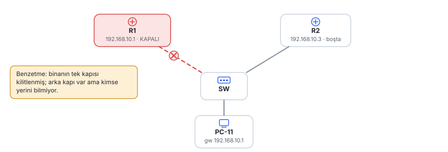
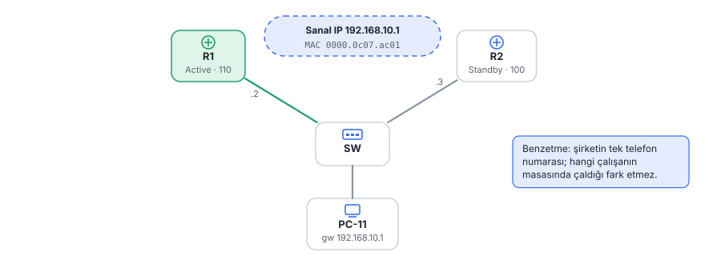
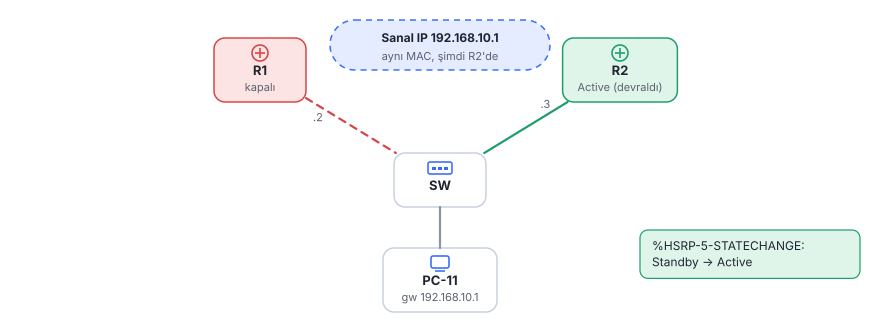
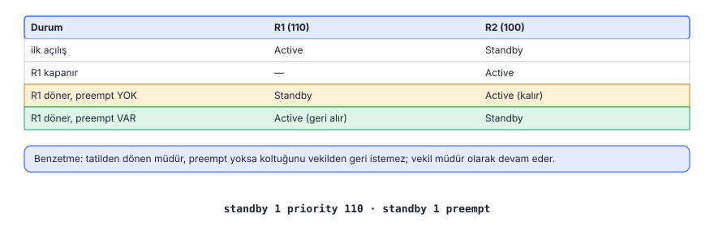
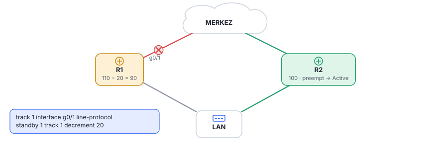
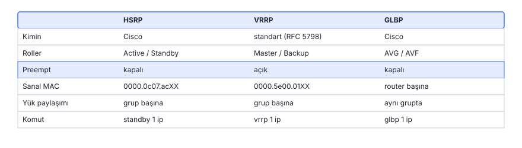
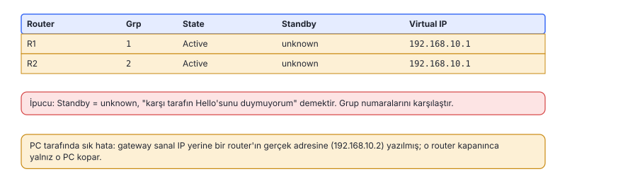

# AğLab Konu #18: FHRP: HSRP ve VRRP

> Uygulamadaki `fhrp` dersi bu belgeyle uyumludur. Senaryolar Sorun Çöz'de `fhrp-*` kimlikleriyle Labber'da
> çalışır (HSRP v1 ve VRRP v2, #82; senaryolar HSRP üzerine). Ön koşul: gateway ve statik routing
> (Konu #8), VLAN'lar arası yönlendirme (Konu #7). Şemalar: `docs/dersler/gorseller/fhrp.py`.

Bu konu bittiğinde öğrenci tek bir varsayılan ağ geçidinin neden tek hata noktası olduğunu açıklar. HSRP ile iki router'ı tek bir sanal gateway arkasında çalıştırır: sanal IP ve MAC, öncelik, preempt, izleme. `show standby brief` çıktısından aktif ve yedek router'ı okur. HSRP ile VRRP'nin farklarını bilir. Seviye 2 (CCNA), süre yaklaşık 45 dakika.

## 0. Bir bakışta

- PC'nin gateway'i tek bir router'sa o router **tek hata noktasıdır**.
- FHRP iki router'ı tek bir **sanal IP ve MAC** arkasında çalıştırır; PC'lerin gateway'i **sanal IP**'dir.
- **Aktif** router trafiği taşır, **yedek** bekler; aktif düşünce yedek devralır, PC fark etmez.
- Yüksek **öncelik** aktif olur. HSRP'de **preempt varsayılan kapalı**, VRRP'de açık.
- **track** ile WAN kopunca öncelik düşer ve preempt'li yedek devralır.
- İki router da Active ise birbirini görmüyordur: **grup**, sanal IP, sürüm.

> **Akılda kalsın:** "Yedek var ama devralmadı" çoğu zaman preempt ya da track eksikliğidir; "bir PC kopuk" çoğu zaman o PC'nin gateway'inin gerçek adrese yazılmasıdır.



## 1. Neden önemli

PC'lerin varsayılan ağ geçidi tek bir adrestir. O router kapanırsa yanında yedek bir router dursa bile PC'ler onu kullanamaz, çünkü gateway adresi elle ya da DHCP ile verilmiştir ve değişmez. FHRP (First Hop Redundancy Protocol) iki router'ın ortak bir **sanal** IP ve MAC'i paylaşmasını sağlar; PC'ler sanal adresi gateway olarak kullanır, arıza anında yedek router devralır. Tipik arızalar devralmanın olmaması ("yedek var ama çalışmadı") ya da yanlış router'ın aktif kalmasıdır ("WAN koptu ama trafik hâlâ ona gidiyor").

## 2. Kavram

### 2.1 Tek gateway sorunu

PC'nin gateway adresi elle ya da DHCP ile verilir ve değişmez. O adresin sahibi kapanınca yanındaki yedek router bir işe yaramaz: PC ona gitmeyi bilmez.

### 2.2 Sanal gateway

> **Benzetme:** Şirketin müşterilere verdiği tek bir telefon numarası vardır. Arkada hangi çalışanın masasında çaldığı müşteriyi ilgilendirmez; biri izne çıkınca numara diğerine yönlendirilir.



- R1 ve R2 gerçek adresleriyle (192.168.10.2, .3) durur, sanal IP'yi (192.168.10.1) paylaşır.
- Sanal IP'nin ARP yanıtı **sanal MAC**'tir (HSRP v1 grup 1: `0000.0c07.ac01`).
- Devralmada MAC değişmez; PC'nin ARP tablosu geçerli kalır.



### 2.3 HSRP: öncelik ve preempt

- Öncelik varsayılan **100**; yüksek olan aktif olur, eşitse yüksek IP kazanır.
- Hello 3 sn, hold 10 sn.
- **Preempt varsayılan kapalıdır.**
- Komutlar: `standby 1 ip 192.168.10.1`, `standby 1 priority 110`, `standby 1 preempt`.



### 2.4 İzleme (track)

> **Dikkat:** HSRP yalnız LAN tarafındaki Hello'lara bakar. R1'in WAN hattı kopsa da LAN'ı ayaktaysa R1 aktif kalır ve trafiği ölü hatta yollar. track bu boşluğu kapatır.



### 2.5 HSRP, VRRP ve GLBP



- **VRRP** (RFC 5798): master/backup, preempt varsayılan açık, sanal MAC `0000.5e00.01XX`. Sanal IP router'lardan birinin gerçek adresi olabilir (o router "sahip"tir, öncelik 255).
- **GLBP:** Cisco'ya özel; birden çok router'ı aynı anda kullanarak yük paylaştırır (okuma).

### 2.6 Uyuşması gerekenler



Grup numarası, sanal IP, sürüm ve (varsa) kimlik doğrulama iki uçta aynı olmalıdır.

> **Sahada:** Yük paylaşımı için iki grup kurulur: VLAN 10'da R1 aktif, VLAN 20'de R2 aktif. İki router da çalışır, biri düşünce öteki ikisini birden taşır.

## 3. Çıktı okuma

```
R1#show standby brief
                     P indicates configured to preempt.
                     |
Interface   Grp  Pri P State   Active          Standby         Virtual IP
Gi0/0       1    110 P Active  local           192.168.10.3    192.168.10.1
R2#show standby brief
Gi0/0       1    100   Standby 192.168.10.2    local           192.168.10.1
                     ← P yok: R2'de preempt kapalı (yedekte sorun değil)

! Arıza izi: iki taraf da Active
R1#show standby brief
Gi0/0       1    110 P Active  local           unknown         192.168.10.1
R2#show standby brief
Gi0/0       2    100   Active  local           unknown         192.168.10.1
                     ← grup numaraları farklı (1 ve 2): birbirlerini görmüyorlar
```

| Soru | Nereye bakılır |
| --- | --- |
| Kim aktif? | `show standby brief` State/Active sütunu |
| Neden geri almıyor? | P sütunu (preempt) |
| WAN düşünce devrediyor mu? | `show standby` → Track, öncelik düşüşü |
| PC doğru gateway'i mi kullanıyor? | PC'de gateway = sanal IP mi? |

## 4. Yönlendirmeli lab

Topoloji: R1 (192.168.10.2) ve R2 (192.168.10.3) aynı LAN'da; PC'lerin gateway'i 192.168.10.1; iki router da kendi WAN hattıyla MERKEZ'e bağlı. MERKEZ'in şubeye dönüşü birincil olarak R1, yedek (AD 5) R2 üzerinden.

1. R1: `interface g0/0` → `standby 1 ip 192.168.10.1` → `standby 1 priority 110` → `standby 1 preempt`.
2. R2: `standby 1 ip 192.168.10.1`.
3. `show standby brief`: R1 Active, R2 Standby.
4. PC'de gateway 192.168.10.1; `show arp`'ta sanal MAC. *Neden:* PC gerçek router'ı değil, sanal adresi tanır.
5. R1'i kapat (uygulama terminalinde `device power off`): R2 Active olur, PC'nin ping'i devam eder; R2'de `%HSRP-5-STATECHANGE` logu.
6. R1'i aç: preempt sayesinde R1 geri aktif olur. Preempt'i kaldırıp tekrarla. *Neden:* preempt yoksa dönen R1 yedekte kalır.
7. İzleme: R1'de `track 1 interface g0/1 line-protocol`, `interface g0/0` → `standby 1 track 1 decrement 20`; R2'de `standby 1 preempt`. R1'in WAN'ını kapat (`interface g0/1` → `shutdown`): R1 90'a düşer, R2 devralır. `show track` ve `show standby`.
8. VRRP'yi dene: aynı yapıyı `vrrp 1 ip 192.168.10.1` ile kur; `show vrrp brief`. Preempt'in varsayılan açık olduğunu gör.

> **Benzetme:** 7. adım, müdürün telefonu çalışıyor ama dışarıya hattı kopmuşsa çağrıları vekile yönlendirmektir.

## 5. Sık hatalar

| Kod | Hata | Belirti | Kanıt | Düzeltme |
| --- | --- | --- | --- | --- |
| E1 | PC'nin gateway'i gerçek IP | R1 kapanınca o PC kopuyor, diğerleri çalışıyor | PC gateway 192.168.10.2 | Gateway'i sanal IP yap (DHCP'de de) |
| E2 | Grup numarası ya da sanal IP farklı | İki router da Active | brief'te iki Active, Standby `unknown` | Grup ve sanal IP'yi eşitle |
| E3 | Preempt yok | R1 döndü ama R2 aktif kalıyor | R1'de P yok | `standby 1 preempt` |
| E4 | İzleme yok | WAN koptu, trafik hâlâ R1'e gidip düşüyor | R1 Active, WAN down | `track` + `standby 1 track … decrement` |
| E5 | Öncelik eşit, beklenmeyen aktif | Yüksek IP'li router aktif | İki tarafta Pri 100 | Tasarımdaki aktife yüksek öncelik |

## 6. Arıza senaryoları

> **Uygulamada:** S1–S5 Sorun Çöz'de `fhrp-pc-real-gw`, `fhrp-group-mismatch`, `fhrp-no-preempt`, `fhrp-no-track`,
> `fhrp-two-faults` kimlikleriyle Labber'da çalışır. Hedefler `fhrpActive` sorgusuyla kimin aktif olduğunu
> ve PC'lerden merkezdeki sunucuya erişimi sınar.
> Önce kendin çöz; neden ve çözüm kapalı kutularda.

### S1 · Başlangıç · R1 bakımda, bir bilgisayar kopuk (E1)

- **Belirti:** R1 kapalı, HSRP devretti, PC'ler çalışıyor; yalnız PC-12 sunucuya ulaşamıyor.
- **Hedef:** PC-12 ve PC-11 → SRV; R2 Active

<details><summary>Neden ve çözüm</summary>

PC-12'nin gateway'i 192.168.10.2 (R1'in gerçek adresi). Çözüm: PC-12 → `ip 192.168.10.12 255.255.255.0 192.168.10.1`

</details>

### S2 · Orta · İki router da aktif (E2)

- **Belirti:** İki router'da show standby brief Active, Standby `unknown`.
- **Hedef:** R1 grup 1'de Active; R2 grup 2'de aktif değil ve grup 1'de Standby; PC-11 → SRV

<details><summary>Neden ve çözüm</summary>

R2 grup 2'de, R1 grup 1'de. Çözüm: R2 → `interface g0/0` → `no standby 2 ip 192.168.10.1` → `no standby 2 preempt` → `standby 1 ip 192.168.10.1` → `standby 1 preempt`

</details>

### S3 · Orta · Bakımdan dönen R1 aktif olmuyor (E3)

- **Belirti:** R1 bakımda ve kapalı, R2 Active. R1 açılacak (`device power on`); tasarımda açıldıktan sonra aktif olmalı.
- **Hedef:** R1 Active; PC-11 → SRV

<details><summary>Neden ve çözüm</summary>

R1'de preempt yok: açılınca Standby kalır. Çözüm: R1 → `device power on`; `interface g0/0` → `standby 1 preempt` (yalnız açmak yetmez)

</details>

### S4 · Orta · WAN koptu, şube merkeze gidemiyor (E4)

- **Belirti:** R1'in WAN hattı operatör arızasıyla kopuk; R1 hâlâ Active, kimse merkeze ulaşamıyor.
- **Hedef:** R2 Active; PC-11 ve PC-12 → SRV

<details><summary>Neden ve çözüm</summary>

R1 WAN'ı izlemiyor. Çözüm: R1 → `track 1 interface g0/1 line-protocol` → `interface g0/0` → `standby 1 track 1 decrement 20`

</details>

### S5 · İleri · WAN koptu, yedek de devralmıyor (E4 + E3)

- **Belirti:** R1'in WAN'ı kopuk, R1 Active; R2'nin yapılandırması hiç kontrol edilmemiş.
- **Hedef:** S4 ile aynı

<details><summary>Neden ve çözüm</summary>

R1'de izleme yok ve R2'de preempt yok (izleme tek başına yetmez: R1 90'a düşer ama R2 aktifliği almaz). Çözüm: R1'de izleme ve decrement; R2 → `standby 1 preempt`

</details>

## 7. Kısa sınav

**1.** PC'lerin gateway'i hangi adres olmalı?

<details><summary>Cevap</summary>

Sanal IP (192.168.10.1); router'ların gerçek adresleri değil.

</details>

**2.** HSRP'de preempt varsayılan olarak açık mı?

<details><summary>Cevap</summary>

Kapalı. VRRP'de açıktır.

</details>

**3.** İki router da Active görünüyorsa ilk şüphe?

<details><summary>Cevap</summary>

Grup numarası ya da sanal IP uyuşmazlığı; birbirlerinin Hello'sunu kabul etmiyorlar.

</details>

**4.** HSRP v1 grup 1'in sanal MAC'i?

<details><summary>Cevap</summary>

`0000.0c07.ac01`.

</details>

**5.** WAN kopunca yedeğin devralması için ne gerekir?

<details><summary>Cevap</summary>

Aktifte track ile öncelik düşürmek ve yedekte preempt.

</details>

**6.** R1 kapalıyken bütün PC'ler çalışıyor, yalnız PC-12 dışarı çıkamıyor. Nereye bakarsın?

<details><summary>Cevap</summary>

PC-12'nin gateway'ine: büyük olasılıkla R1'in gerçek adresi (192.168.10.2) yazılmış. Sanal IP'ye düzelt.

</details>

## 8. Özet kartı

| Komut | Ne işe yarar |
| --- | --- |
| `standby 1 ip 192.168.10.1` | Sanal gateway |
| `standby 1 priority 110` | Aktif olmak için öncelik |
| `standby 1 preempt` | Dönünce aktifliği geri al |
| `track 1 interface g0/1 line-protocol` | WAN'ı izle |
| `standby 1 track 1 decrement 20` | WAN düşünce önceliği düşür |
| `show standby brief` | Kim aktif, kim yedek, P sütunu |
| `vrrp 1 ip …`, `show vrrp brief` | VRRP karşılıkları |

**Unutma:**

1. Gateway = sanal IP.
2. HSRP'de preempt elle açılır.
3. WAN için track + yedekte preempt.
4. İki Active = grup/sanal IP uyuşmazlığı.
5. Sanal MAC değişmez; PC fark etmez.

## 9. Doğrulama notları

**Lab'ın otomatik değerlendirmesi:** `q.fhrpActive('R1', 'g0/0', 1)`; R1 kapalıyken `q.fhrpActive('R2', 'g0/0', 1)`; PC'lerden MERKEZ'deki sunucuya ping.

Kaynaklar: INET CCNA 200-301 v1.1 ve INE ENCOR (FHRP); RFC 2281 (HSRP), RFC 5798 (VRRPv3), Cisco IOS First Hop Redundancy Protocols yapılandırma kılavuzu (öncelik, preempt, track, sanal MAC biçimleri, `show standby brief`), CCNA 200-301 3.5 (FHRP'nin amacı).

| İddia | Sonuç |
| --- | --- |
| HSRP öncelik varsayılan 100, eşitlikte yüksek IP | Doğru |
| HSRP preempt varsayılan kapalı, VRRP'de açık | Doğru |
| HSRP v1 sanal MAC 0000.0c07.acXX, v2 0000.0c9f.fXXX; VRRP 0000.5e00.01XX | Doğru |
| HSRP hello 3 sn / hold 10 sn | Doğru |

**Motor gereksinimleri** (Labber'da denendi)

- [x] HSRP v1 (`standby ip/priority/preempt/track`), VRRP v2, `track … interface … line-protocol`, `show standby [brief]`, `show vrrp brief`, `show track`; aynı grup + farklı VIP'te tek seçim ve `%HSRP-4-DIFFVIP1` (#82)
- [x] AğLab modeli: arayüzde `hsrp`/`vrrp`, router'da `tracks`; senaryo sorgusu `fhrpActive`
- [x] Beş senaryo başta başarısız, çözümle başarılı; yarım çözüm (S5'te yalnız izleme) başarısız kalıyor
- [ ] VPCS `trace`'in ilk atlamasında sanal IP (192.168.10.1) görünüyor; router Time Exceeded'i arayüzünün gerçek adresinden (192.168.10.2) göndermeli (motor işi)
- [ ] HSRP v2, zamanlayıcılar, kimlik doğrulama, `vrrp … track` modellenmiyor (#82 açıklaması)
