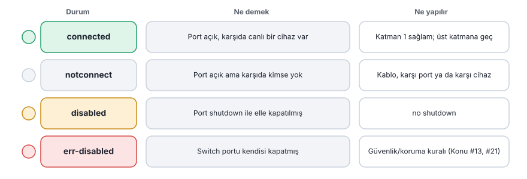
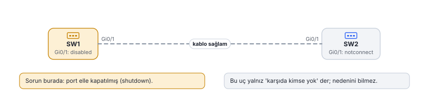
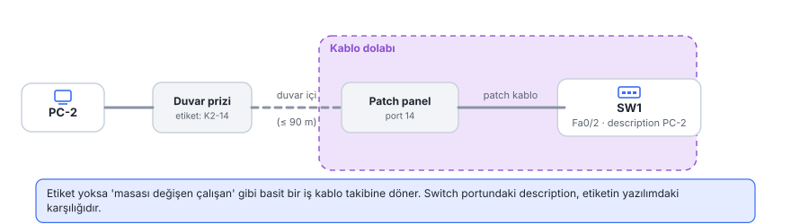
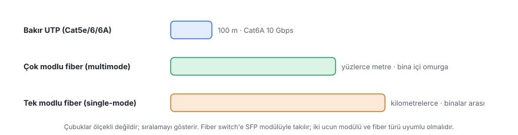
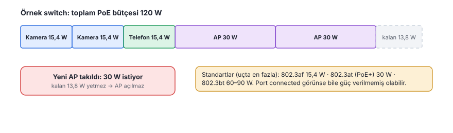
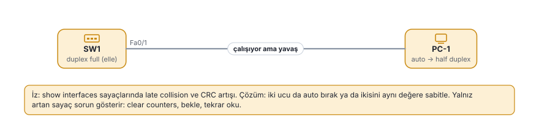
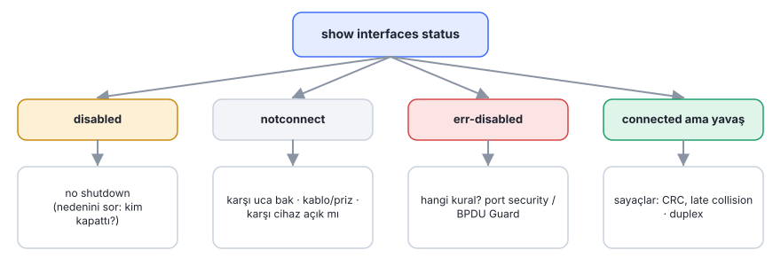

# AğLab Konu #4: Fiziksel bağlantı ve kablolama

> Uygulamadaki `physical` dersi bu belgeye göre yazıldı. Senaryolar Sorun Çöz'de `phy-*`
> kimlikleriyle Labber'da çalışır. Pratik türü: Motor + okuma (kablo türleri, PoE, hız/duplex ve
> hata sayaçları okuma). Şemalar: `docs/dersler/gorseller/fiziksel-baglanti.py`.

Bu konu bittiğinde öğrenci bir portun durumunu (connected, notconnect, disabled, err-disabled) ve `show interfaces` satırlarını yorumlar. Kapalı portu, kopuk kabloyu, yanlış porta takılmış kabloyu ve kapalı cihazı birbirinden ayırır. Bir bağlantının iki ucunu birlikte kontrol etmeyi alışkanlık edinir. Kablo türlerini, PoE'yi ve etiketlemenin neden önemli olduğunu bilir. Seviye 1, süre yaklaşık 65 dakika (ders 20, lab 15, senaryolar 20, sınav 10).

## 0. Bir bakışta

- Şubedeki arızaların büyük kısmı fizikseldir: çıkmış kablo, yanlış priz, açılmamış switch, kapatılmış port.
- Port dört durumdan birindedir: **connected** (sağlam), **notconnect** (karşıda kimse yok), **disabled** (elle kapatılmış), **err-disabled** (switch kendisi kapatmış).
- **İki uç kuralı:** bir bağlantının iki ucu vardır. Bir uç kapalıysa karşı uç yalnız "kimse yok" der; nedenini bilmez.
- Bakır kablo en fazla **100 metre**; daha uzağı fiber. PoE cihazlar gücü kablodan alır; switch'in **güç bütçesi** vardır.
- Bağlantı var ama yavaşsa **duplex** ve **hata sayaçlarına** bakılır.

> **Akılda kalsın:** Işık yanmıyorsa IP ayarlarıyla uğraşma. Önce `show interfaces status`, sonra kablonun öbür ucu.



## 1. Neden önemli

Şubede gelen arızaların büyük kısmı fizikseldir: çıkmış bir kablo, yanlış prize takılmış bir bilgisayar, kesintiden sonra açılmamış bir switch, "kullanılmayan" diye kapatılmış ama aslında kullanılan bir port. Bu arızalar basittir ama yanlış katmanda aranırsa saatler kaybettirir. IP ayarlarıyla uğraşırken sorun kablodaysa hiçbir şey ilerlemez.

Sorun gidermenin ilk kuralı bu yüzden aşağıdan başlamaktır (Konu #1): ışık yanıyor mu, port ne diyor? Bu konunun komutları her teşhisin ilk adımıdır.

## 2. Kavram

### 2.1 Port durumu: iki soru

> **Benzetme:** Bir evin kapısını düşün. Kapı kilitli mi (yönetimsel olarak kapalı mı)? Kilitli değilse, kapının öbür tarafında biri var mı (karşı uçta canlı bir cihaz var mı)? Port durumu bu iki sorunun cevabıdır. Bir de kapıyı alarm sistemi kendiliğinden kilitlemiş olabilir: err-disabled.

| `show interfaces status` | `show interfaces` | Anlamı |
| --- | --- | --- |
| connected | up, line protocol is up | Port açık, bağlantı kurulmuş |
| notconnect | down, line protocol is down | Port açık ama karşıda bir şey yok: kablo çıkmış, kopuk, karşı cihaz kapalı ya da karşı port kapalı |
| disabled | administratively down | Port `shutdown` ile elle kapatılmış |
| err-disabled | down (err-disabled) | Switch portu bir güvenlik ya da koruma kuralı yüzünden kendisi kapatmış: port security ihlali (Konu #21), BPDU Guard (Konu #13) |

### 2.2 İki uç kuralı

Bir uçta port `shutdown` ise o uç **disabled**, karşı uç **notconnect** görünür. Karşı uca bakan teknisyen "notconnect, kablo bozuk" diyebilir; oysa kablo sağlamdır. Teşhis her zaman **iki ucun birlikte** okunmasıyla yapılır.



> **Dikkat:** notconnect "kablo bozuk" demek değildir. Kablo çıkmış, karşı port kapalı ya da karşı cihaz kapalı olabilir. Üçünü ayırmak için karşı uca (ya da karşı cihazın yönetim adresine) bakılır.

### 2.3 Masadan switch'e: yapısal kablolama

> **Benzetme:** Masadaki priz evdeki elektrik prizine benzer: duvarın içinden bir yere gider ama nereye gittiği görünmez. Sigorta kutusundaki etiketler "mutfak", "salon" diye yazılı değilse sigortayı bulmak için her şeyi tek tek kapatırsın.

- Masadaki **priz**, duvar içinden kablo dolabındaki **patch panele** gider (sabit kablo, en fazla 90 metre).
- Panelden kısa bir **patch kablo** ile switch portuna bağlanır.
- Priz, panel portu ve switch portu **etiketli** olmalıdır. Switch portuna yazılan `description`, etiketin yazılımdaki karşılığıdır ve `show interfaces status`'ta Name sütununda görünür.



### 2.4 Kablo türleri

- **Bakır (UTP):** Cat5e ve Cat6 1 Gbps'e kadar, en fazla **100 metre** (90 m sabit + 10 m patch). Cat6A 10 Gbps'i 100 metrede taşır.
- **Düz ve çapraz kablo:** Eskiden aynı tür cihazlar (switch–switch) çapraz kabloyla bağlanırdı. Bugünkü cihazların çoğunda **Auto-MDIX** vardır ve kablo türünü kendileri ayarlar.
- **Fiber:** Uzun mesafe ve binalar arası bağlantı için; switch'e **SFP** modülüyle takılır. Çok modlu (multimode) fiber yüzlerce metre, tek modlu (single-mode) kilometrelerce taşır. İki ucun modülü ve fiber türü **uyumlu** olmalıdır.



### 2.5 PoE: kablodan gelen elektrik

> **Benzetme:** Bir çoklu priz düşün: toplam kaç watt çekebileceği yazar. Prize ütü, su ısıtıcı ve fırın birden takarsan sigorta atar. PoE switch'in de toplam bir güç bütçesi vardır; dolunca yeni cihaza güç vermez.

IP telefon, erişim noktası (AP) ve kamera gibi cihazlar gücü ağ kablosundan alır (**PoE**, Power over Ethernet). Uçtaki en fazla güç: 802.3af **15,4 W**, 802.3at (PoE+) **30 W**, 802.3bt **60–90 W**. Bütçe dolarsa yeni takılan cihaz açılmaz, ama port bağlantıda (connected) görünebilir.



> **Simülatörde yok:** Kablo türü, PoE ve güç bütçesi Labber'da modellenmez; okuma konusudur.

### 2.6 Hız ve duplex

İki uç hızı ve duplex'i **otomatik anlaşır** (`a-full`, `a-1000`). Bir uç elle sabitlenip öteki otomatikte bırakılırsa **duplex uyuşmazlığı** olur: otomatik uç half duplex'e düşer. Bağlantı çalışır ama yavaştır; `show interfaces`'ta CRC ve **late collision** sayaçları artar.



> **Sahada:** "Ping gidiyor ama dosya kopyalamak sonsuza kadar sürüyor" şikâyeti çoğu zaman duplex uyuşmazlığı ya da bozuk bir kablodur. Sayaçları `clear counters` ile sıfırlayıp birkaç dakika sonra tekrar oku; yalnız **artan** sayaç bir sorun gösterir.

## 3. Çıktı okuma

### show interfaces status

```
SW1#show interfaces status
Port      Name               Status       Vlan       Duplex  Speed Type
Gi0/1     Uplink SW2         disabled     1          auto     auto 10/100/1000BaseTX
Fa0/1     PC-1               connected    1          a-full  a-100 10/100BaseTX
Fa0/2                        notconnect   1          auto     auto 10/100BaseTX
Fa0/5                        disabled     1          auto     auto 10/100BaseTX
```

- **Name:** Port açıklaması (`description`). Boşsa port belgelenmemiştir.
- **Status:** Tablodaki dört durum. Önce bu sütuna bakılır.
- **Duplex / Speed:** `a-` öneki otomatik anlaşma demektir. `a-full a-100` sağlıklı bir bağlantıdır. Bağlantı yoksa `auto` görünür.
- Bu çıktıda üç ipucu var: Gi0/1 (uplink) elle kapatılmış; Fa0/2'de cihaz yok; Fa0/5 kapalı. Bir PC "ağa bağlanmıyor" diyorsa önce hangisine bağlı olduğunu bul.

### show interfaces <port>

```
SW1#show interfaces fa0/2
FastEthernet0/2 is down, line protocol is down (notconnect)
  Hardware is Fast Ethernet, address is 0200.0000.0103
  ...
     0 input errors, 0 CRC, 0 frame, 0 overrun, 0 ignored
     0 output errors, 0 collisions, 0 interface resets
     0 late collision, 0 deferred
```

- **İlk satır:** Katman 1 ("is down") ve katman 2 ("line protocol is down") durumu, parantez içinde nedeni.
- **Hata sayaçları** (gerçek cihazda; simülatörde yok, okuma): CRC ve input errors artıyorsa kablo ya da konnektör bozuktur, ya da duplex uyuşmazlığı vardır. **late collision**, duplex uyuşmazlığının tipik izidir. Sayaçlar `clear counters` ile sıfırlanıp bir süre sonra tekrar okunur; yalnız **artan** sayaç bir sorun gösterir.

## 4. Yönlendirmeli lab

Topoloji: SW1'e PC-1 (Fa0/1) ve PC-2 (Fa0/2) bağlı. SW2 (yazıcı ve PC-3) SW1'e Gi0/1 ile bağlı. Fa0/3–Fa0/5 boş; Fa0/5 kapalı.

1. **Durum tablosu.** SW1'de `show interfaces status`. connected, notconnect ve disabled portları ayır. *Neden:* Her teşhis bu tabloyla başlar.
2. **Port kapat.** `interface fa0/2` → `shutdown`. Tabloda Fa0/2 **disabled**. PC-2'den `ping 192.168.10.11`: başarısız. PC-2'de bağlantı yok (gerçek cihazda kartın ışığı söner).
3. **İki ucu oku.** SW1'de `interface gi0/1` → `shutdown`. SW1'de Gi0/1 **disabled**; SW2'de `show interfaces status`: Gi0/1 **notconnect**. *Neden:* Bir uç kapatılınca karşı uç bağlantıyı kaybeder ama nedenini bilmez. İki portu da `no shutdown` ile aç.
4. **Belgele (okuma).** Gerçek bir switch'te `interface fa0/1` → `description PC-1` yazınca tablodaki Name sütunu dolar; bir sonraki arızada "bu port kimin?" sorusu tek bakışta cevaplanır. AğLab'da açıklama komutu çalışır ama kayda geçmez; bu adımı okuma olarak geç.
5. **Cihazı kapat.** SW2'yi seç ve `device power off`. SW1'de Gi0/1 **notconnect**; SW2'nin yönetim adresine (192.168.10.3) ping yok. `device power on` ile aç. *Neden:* Karşı cihazın kapalı olması da bu uçta notconnect olarak görünür; ayırmak için karşı cihaza başka yoldan (konsol, yönetim adresi) bakılır.
6. **Ayrıntılı çıktı.** `show interfaces fa0/1`: ilk satır ve sayaçlar.

> **Benzetme:** Bu lab bir elektrikçinin kontrol turudur: önce sigorta (port açık mı), sonra kablo (karşı uç), en son prizdeki cihaz (açık mı). Her kontrolde tek bir şeyi değiştirip sonucu görürsün.

## 5. Sık hatalar

| Kod | Hata | Belirti | Kanıt | Düzeltme |
| --- | --- | --- | --- | --- |
| E1 | Port elle kapatılmış | Tek cihaz ağa bağlanmıyor, kart ışığı yanmıyor | `show interfaces status`: disabled; `show interfaces`: administratively down | `no shutdown` |
| E2 | Bağlantının öbür ucu kapalı | Bir switch'in tamamı kopuk; bu uçta notconnect | Karşı uçta disabled | Karşı ucu aç; iki ucu birlikte oku |
| E3 | Kablo yanlış porta takılmış | Taşınan cihaz bağlanmıyor; belgedeki port notconnect | Belgedeki port notconnect, başka bir port disabled ya da yanlış VLAN'da | Doğru portu yapılandır ya da kabloyu taşı; `description` güncelle |
| E4 | Cihaz kapalı | Bir switch'e bağlı her şey birden gitti | Uplink notconnect; cihazın yönetim adresine ping yok; güç ışığı sönük | Gücü kontrol et, cihazı aç |
| E5 | Bozuk kablo ya da duplex uyuşmazlığı | Bağlantı var ama yavaş ya da kesik kesik | CRC, input errors, late collision sayaçları artıyor; bir uç sabit, öbürü auto | Kabloyu değiştir; iki ucu da auto ya da ikisini de aynı değere sabitle |

> **Akılda kalsın:** E1 ile E2'yi ayıran şey hangi uca baktığındır. E3'te kablo sağlamdır, yanlış yerdedir. E5 bağlantıyı koparmaz, bozar; bu yüzden ping "çalışıyor" ama kullanıcı "çok yavaş" der.



## 6. Arıza senaryoları

> **Uygulamada:** S1–S5 Sorun Çöz'de `phy-port-shutdown`, `phy-uplink-one-side`,
> `phy-wrong-port`, `phy-power-off`, `phy-two-faults` kimlikleriyle Labber'da çalışır.
> Cihaz gücü AğLab terminalinde `device power on|off` ile değişir; gerçekte bu adım dolaba gidip
> prizi ve güç ışığını kontrol etmektir. Önce kendin çöz; neden ve çözüm kapalı kutularda.

### S1 · Başlangıç · Kullanılmayan portlar kapatılınca bir PC gitti (E1)

- **Belirti:** Dün kullanılmayan portlar kapatıldı; bu sabah PC-2 hiçbir yere ulaşamıyor, kart ışığı yanmıyor.
- **Hedef:** PC-2 bağlı; PC-2 → PC-1 başarılı.

<details><summary>Neden ve çözüm</summary>

SW1 Fa0/2 (PC-2) `shutdown` (disabled). Çözüm: SW1 → `interface fa0/2` → `no shutdown`.

</details>

### S2 · Başlangıç · 2. switch'teki herkes kopuk (E2)

- **Belirti:** SW2'deki cihazlar SW1'dekilere ulaşamıyor. Teknisyen SW2'nin portuna bakıp "notconnect, kablo bozuk" demiş.
- **Hedef:** PC-3 → PC-1 ve PC-1 → yazıcı başarılı.

<details><summary>Neden ve çözüm</summary>

SW1 Gi0/1 `shutdown`; SW2 tarafı açık ama notconnect görünüyor. Kablo sağlam. Çözüm: SW1 → `interface gi0/1` → `no shutdown`.

</details>

### S3 · Orta · Masası değişen çalışanın bilgisayarı ağa bağlanmıyor (E3)

- **Belirti:** Belgede PC-2'nin portu Fa0/2; teknisyen "Fa0/2 açık ama notconnect" diyor.
- **Hedef:** PC-2 bağlı; PC-2 → PC-1 başarılı.

<details><summary>Neden ve çözüm</summary>

PC-2'nin kablosu artık SW1 Fa0/5'te; Fa0/5 kullanılmayan port olarak kapalı. Çözüm: SW1 → `interface fa0/5` → `no shutdown` (gerçek ağda ardından `description PC-2` ve belgeyi güncelle).

</details>

### S4 · Orta · Sabah 2. switch'e bağlı her şey yok (E4)

- **Belirti:** Gece elektrik kesintisi oldu; PC-3 ve yazıcıya kimse ulaşamıyor, SW2'ye uzaktan bağlanılamıyor.
- **Hedef:** SW2 açık; PC-1 → yazıcı başarılı.

<details><summary>Neden ve çözüm</summary>

SW2 kapalı; SW1'de Gi0/1 notconnect. Çözüm: SW2 → `device power on`.

</details>

### S5 · İleri · Kesintiden sonra iki ayrı sorun (E4 + E1)

- **Belirti:** 2. switch'e bağlı her şey yok; ayrıca PC-2, SW1'deki PC-1'e bile ulaşamıyor.
- **Hedef:** PC-1 → yazıcı ve PC-2 → PC-1 başarılı.

<details><summary>Neden ve çözüm</summary>

SW2 kapalı **ve** SW1 Fa0/2 `shutdown`. Çözüm: SW2 → `device power on`; SW1 → `interface fa0/2` → `no shutdown`.

</details>

## 7. Kısa sınav

**1.** `show interfaces status`'ta bir port **disabled**. Anlamı? (A) Kablo takılı değil (B) Port `shutdown` ile elle kapatılmış (C) Güvenlik ihlali (D) Karşı cihaz kapalı

<details><summary>Cevap</summary>

**B.** Kablo yoksa notconnect, güvenlik ihlalinde err-disabled görünür.

</details>

**2.** SW2'nin uplink portu notconnect; SW1'deki karşı port disabled. Sorun nerede?

<details><summary>Cevap</summary>

SW1'deki portun kapatılmasında. Bir uç kapatılınca karşı uç notconnect görünür; iki uç birlikte okunur.

</details>

**3.** Bakır Ethernet (Cat5e/Cat6) kablonun standart en uzun mesafesi nedir?

<details><summary>Cevap</summary>

100 metre. Daha uzun mesafeler için fiber kullanılır.

</details>

**4.** Bağlantı çalışıyor ama çok yavaş; `show interfaces`'ta late collision ve CRC sayaçları artıyor. En olası neden?

<details><summary>Cevap</summary>

Duplex uyuşmazlığı ya da bozuk kablo. Late collision duplex uyuşmazlığının tipik izidir.

</details>

**5.** Yeni bir erişim noktası takıldı; port connected ama cihaz açılmıyor. Switch'e daha önce birkaç PoE kamera eklenmişti. İlk kontrol?

<details><summary>Cevap</summary>

Switch'in PoE güç bütçesi. Bütçe dolduysa yeni cihaza güç verilmez.

</details>

**6.** Bir switch'e bağlı her şey aynı anda gitti; uplink'in bu ucu notconnect. İlk düşünülecek ne?

<details><summary>Cevap</summary>

Karşı switch'in kendisi: kapalı mı (güç), uplink portu kapalı mı? Karşı cihazın yönetim adresine ping ve karşı uçtaki port durumuna bakılır.

</details>

## 8. Özet kartı

| Komut | Ne işe yarar |
| --- | --- |
| `show interfaces status` | Bütün portların durumu, VLAN'ı, hız/duplex'i, açıklaması |
| `show interfaces <port>` | Tek portun ayrıntısı: ilk satır (katman 1/2) ve sayaçlar |
| `shutdown` / `no shutdown` | Portu kapatır / açar |
| `description <metin>` | Portu belgeler (Name sütunu) |
| `clear counters` | Sayaçları sıfırlar; sonra artışı izle (gerçek cihazda) |
| `device power on\|off` (AğLab) | Cihazın gücünü değiştirir |

**Unutma:**

1. Işık yoksa önce katman 1.
2. disabled = elle kapatılmış; notconnect = karşıda kimse yok.
3. Bir bağlantının iki ucunu birlikte oku.
4. Bakır 100 metre; daha uzağı fiber.
5. Yavaş ama çalışıyorsa duplex ve sayaçlar.

## 9. Doğrulama notları

Kaynaklar: INET CCNA 200-301 v1.1 (kablolama, arayüz durumları, PoE); Cisco Catalyst arayüz yapılandırma kılavuzu (`show interfaces status` durumları), IEEE 802.3 (100 m bakır sınırı, 802.3af/at/bt PoE güçleri); CCNA 200-301 sınav konuları (1.3 fiziksel arayüz ve kablo türleri, 1.4 arayüz ve kablo sorunları: çakışma, hatalar, duplex/hız uyuşmazlığı). Eski `physical` dersi Kavram için kaynak oldu; metin yeniden yazıldı.

**Kontrol edilen iddialar**

| İddia | Sonuç |
| --- | --- |
| UTP Ethernet kanal uzunluğu en fazla 100 m | Doğru |
| PoE: 802.3af 15,4 W, 802.3at 30 W, 802.3bt 60–90 W (PSE çıkışı) | Doğru |
| Bir uç `shutdown` iken karşı uç notconnect görünür | Doğru |
| Late collision duplex uyuşmazlığının tipik göstergesidir | Doğru |
| Auto-MDIX kablo türünü (düz/çapraz) otomatik ayarlar | Doğru |

Lab'ın otomatik değerlendirmesi: `q.linkUp('PC-2')`; `q.ping('PC-1', '192.168.10.50').ok`; `q.powered('SW2')`.

**Motor gereksinimleri** (Labber'da denendi)

- [x] `show interfaces status` (connected / notconnect / disabled, Name sütunu), `show interfaces <port>` ilk satırı
- [x] `shutdown` / `no shutdown`; bir uç kapalıyken karşı uçta notconnect
- [ ] `description` Labber'da çalışıyor ama AğLab modeline yazılamıyor ("Labber durumu AğLab görünümüne yazılamadı" uyarısı); kayıt ve dışa aktarma içermiyor
- [x] Cihaz gücü (`device power on|off`), kablo durumu — L2-B
- [x] Beş senaryo başta başarısız, terminalden çözümle başarılı
- [ ] `speed` / `duplex` komutları yok; duplex uyuşmazlığı ve hata sayaçları modellenmiyor (okuma)
- [ ] `show interfaces counters errors` ve `clear counters` yok
- [ ] Kablo türü (düz/çapraz/fiber), PoE ve güç bütçesi modellenmiyor (okuma)
