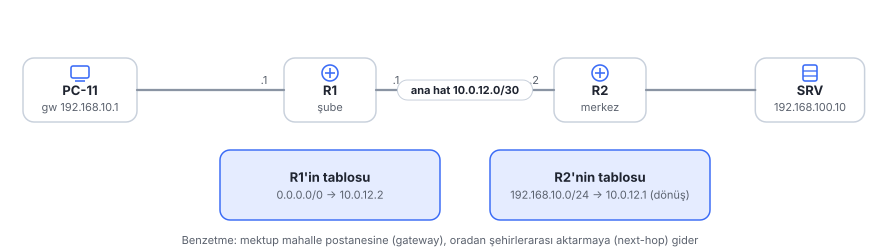
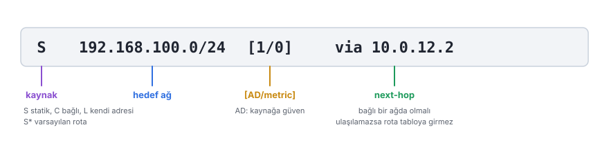
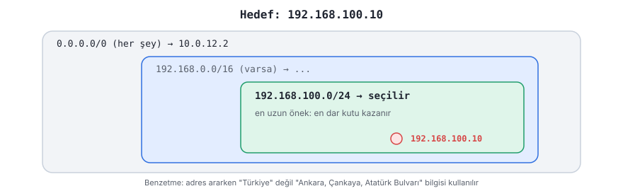
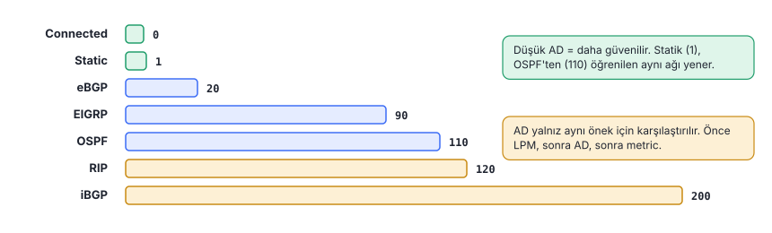
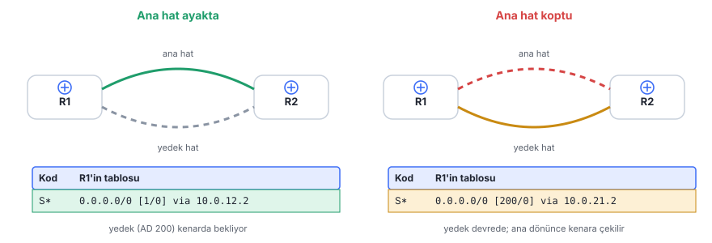
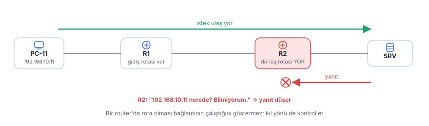
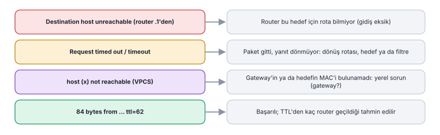

# AğLab Konu #8: Gateway ve statik routing

> Uygulamadaki `routing` dersi bu belgeye göre yazıldı; eski "Routing kararları: LPM, AD ve
> metric" konusu da buraya katıldı. Senaryolar Sorun Çöz'de `gw-*` kimlikleriyle Labber'da çalışır.
> Şemalar: `docs/dersler/gorseller/gateway-statik-routing.py`.

Bu konu bittiğinde öğrenci bir PC'nin başka ağa giden paketi neden gateway'e gönderdiğini açıklar. Router'da statik rota ve varsayılan rota yazar. Bir paket için tablodan hangi rotanın seçileceğini en uzun önek (LPM) ve yönetimsel uzaklık (AD) kurallarıyla bulur. Yedek hat için floating static kurar. Arıza ararken gidiş ve dönüş yolunu ayrı ayrı kontrol eder. Seviye 1, süre yaklaşık 85 dakika (ders 22, lab 25, senaryolar 25, sınav 12).

## 0. Bir bakışta

- PC başka ağa giden paketi **gateway'e** verir; gateway, PC ile aynı ağdaki router arayüzüdür.
- Router her paket için **yönlendirme tablosuna** bakar. Satırlar bağlı ağlardan (C), elle yazılan rotalardan (S) ve dinamik protokollerden (O) gelir.
- **Seçim sırası:** önce **en uzun önek** (en özgül satır), aynı önekte **en düşük AD**, aynı kaynakta **en düşük metric**.
- **Varsayılan rota** (`0.0.0.0/0`) "bilmediğin her şeyi buraya gönder" demektir. **Floating static**, yüksek AD ile kenarda bekleyen yedek rotadır.
- Her bağlantı **iki yönlüdür**: gidiş için bir router'da, dönüş için karşı router'da rota gerekir.

> **Akılda kalsın:** Ping'in "unreachable"dan "timeout"a dönmesi iyi haberdir: gidiş yolu tamamlandı, artık dönüş yoluna bak.



## 1. Neden önemli

Şube ile merkez arasındaki trafiğin tamamı birkaç satırlık rotaya dayanır. Bir satır eksikse ya da yanlışsa şube merkezdeki sunuculara ulaşamaz. Üstelik en sık görülen hata yarımdır: **gidiş yolu vardır, dönüş yolu yoktur.** Paket hedefe ulaşır ama yanıt geri dönemez; belirti "ping gitmiyor" olur.

Kullanıcı tarafında da durum benzerdir. PC'nin gateway'i yanlışsa yan masadaki bilgisayara ulaşır ama başka hiçbir yere ulaşamaz. "Bir şeyler çalışıyor, bir şeyler çalışmıyor" şikâyetlerinin çoğu bu konudan gelir.

## 2. Kavram

### 2.1 Gateway: mahalle postanesi

> **Benzetme:** Aynı sokaktaki komşuya mektubu elden verirsin (aynı ağ, doğrudan). Başka şehre giden mektubu mahalle postanesine bırakırsın (gateway). Postane mektubu kendi bildiği yola göre şehirlerarası aktarmaya (next-hop) verir; her aktarma merkezi bir sonraki durağı kendi listesinden (yönlendirme tablosu) bulur.

PC hedef adresi kendi adresi ve maskesiyle karşılaştırır (Konu #2). Hedef **aynı ağdaysa** paketi doğrudan gönderir. **Başka ağdaysa** paketi **varsayılan ağ geçidine** gönderir. Gateway yanlışsa ya da boşsa PC kendi ağı dışına çıkamaz.

### 2.2 Router'ın tablosu: üç kaynak

- **C (connected) ve L (local):** Router'ın adres verilmiş ve ayakta olan arayüzleri. C ağın kendisi, L router'ın o ağdaki adresi (/32). Arayüz düşerse bu satırlar tablodan çıkar.
- **S (static):** Elle yazılan rotalar: `ip route <ağ> <maske> <next-hop> [AD]`. **Next-hop'a ulaşılamıyorsa rota tabloya girmez.**
- **Dinamik:** OSPF gibi protokollerin öğrendikleri (Konu #15).



### 2.3 Seçim kuralı 1: en uzun önek (LPM)

Hedefle eşleşen satırlardan **maskesi en uzun** olan seçilir. 192.168.100.10 için hem `0.0.0.0/0` hem `192.168.100.0/24` eşleşiyorsa /24 seçilir. Varsayılan rota yalnız daha özgül bir satır yoksa kullanılır.

> **Benzetme:** Bir adres tarifinde "Türkiye'de" bilgisi doğrudur ama işe yaramaz; "Ankara, Çankaya, Atatürk Bulvarı No 5" kazanır. Router da en ayrıntılı tarifi seçer.



> **Dikkat:** LPM yüzünden eskiden kalma, daha özgül ve yanlış bir rota doğru varsayılan rotayı **sessizce ezer**. "Varsayılan rota doğru ama bir ağa gidilemiyor" şikâyetinde `show ip route <hedef>` ile router'a hangi satırı seçtiğini sor.

### 2.4 Seçim kuralı 2: yönetimsel uzaklık (AD)

Aynı ağ **ve aynı maske** için birden fazla kaynak varsa AD'si düşük olan tabloya girer. AD, "bu kaynağa ne kadar güveniyorum" demektir.

| Kaynak | AD |
| --- | --- |
| Connected | 0 |
| Static | 1 |
| eBGP | 20 |
| EIGRP (iç) | 90 |
| OSPF | 110 |
| RIP | 120 |
| iBGP | 200 |



**Seçim kuralı 3: metric.** Aynı protokolün aynı ağ için iki yolu varsa (ör. OSPF cost) düşük metric seçilir.

### 2.5 Varsayılan rota ve floating static

- **Varsayılan rota** (`ip route 0.0.0.0 0.0.0.0 <next-hop>`): tabloda `S*` olarak görünür ve "Gateway of last resort" satırını doldurur. Tek çıkışlı şube router'ı için en temiz çözümdür.
- **Floating static:** AD'si yüksek yazılmış (ör. 200) yedek statik rota. Ana rota tablodayken AD'si yüksek olduğu için tabloya girmez, "yüzer". Ana hat düşüp ana rota tablodan çıkınca devreye girer; ana hat dönünce yine kenara çekilir.

> **Benzetme:** Yedek oyuncu kenarda ısınır; as oyuncu sahadayken oyuna girmez. As sakatlanınca girer, as dönünce yine kenara çıkar.



### 2.6 Gidiş ve dönüş

Her bağlantı iki yönlüdür. Şubeden merkeze giden paket için **şube router'ında**, yanıt için **merkez router'ında** rota gerekir. Bir router'da rota olması bağlantının çalıştığını göstermez.



## 3. Çıktı okuma

### show ip route

```
R1#show ip route
...
Gateway of last resort is 10.0.12.2 to network 0.0.0.0

S*    0.0.0.0/0 [1/0] via 10.0.12.2
      10.0.0.0/8 is variably subnetted, 4 subnets, 3 masks
C        10.0.12.0/30 is directly connected, GigabitEthernet0/1
L        10.0.12.1/32 is directly connected, GigabitEthernet0/1
C        10.0.21.0/29 is directly connected, GigabitEthernet0/2
L        10.0.21.1/32 is directly connected, GigabitEthernet0/2
      192.168.10.0/24 is variably subnetted, 2 subnets, 2 masks
C        192.168.10.0/24 is directly connected, GigabitEthernet0/0
L        192.168.10.1/32 is directly connected, GigabitEthernet0/0
      192.168.100.0/24 is subnetted, 1 subnets
S        192.168.100.0/24 [1/0] via 10.0.21.5
```

- **Kod sütunu:** `C` bağlı ağ, `L` router'ın kendi adresi (/32), `S` statik, `S*` varsayılan rota adayı.
- **[1/0]:** `[AD/metric]`. Statik rotada AD 1'dir; floating static'te yazdığın değer görünür (ör. `[200/0]`).
- **via:** Next-hop. Paket bu adrese gönderilir; adres bir bağlı ağda olmalıdır.
- **Gateway of last resort:** Varsayılan rotanın next-hop'u. "not set" yazıyorsa varsayılan rota yok demektir.
- **Bu çıktıda hata var:** 192.168.100.0/24 için daha özgül bir satır var ve eski bir cihaza (10.0.21.5) gidiyor. LPM gereği sunucu trafiği varsayılan rotayı değil bu satırı kullanır.

### show ip route <adres> — bu paket hangi satırı kullanır?

```
R1#show ip route 192.168.100.10
Routing entry for 192.168.100.0/24
  Known via "static", distance 1, metric 0
  Routing Descriptor Blocks:
  * 10.0.21.5
```

LPM'yi kafadan yapmak yerine router'a sorarsın: seçilen satır, kaynağı, AD'si ve next-hop'u. Sonra next-hop'a ping atarak orada gerçekten bir cihaz olup olmadığını görürsün.



### traceroute — paket nerede kayboluyor?

```
PC-11> trace 192.168.100.10
 1   192.168.10.1   0.600 ms
 2   10.0.12.2   1.100 ms
 3   *192.168.100.10   1.700 ms
```

Her satır yoldaki bir router'dır. Yanıt veren son satır, paketin ulaştığı son yerdir. Satırlar `* * *` ile kesiliyorsa sorun o noktadan sonradır: ya ileri yön (sonraki router'da rota yok), ya da yanıtların dönüş yolu. Router'da `traceroute`, PC'de (VPCS) `trace`, Windows'ta `tracert`.

## 4. Yönlendirmeli lab

Topoloji: Şube router'ı R1 (LAN 192.168.10.0/24) ile merkez router'ı R2 (sunucu ağı 192.168.100.0/24, SRV .10) arasında iki hat var. Ana hat Gi0/1 (10.0.12.0/30), yedek hat Gi0/2 (10.0.21.0/29). Başlangıçta iki router'da da statik rota yok.

1. **Bağlı ağları gör.** R1'de `show ip route`: yalnız C ve L satırları; "Gateway of last resort is not set". *Neden:* Router yalnız kendi arayüzlerinin ağlarını bilir.
2. **Ping'i dene.** PC-11'den `ping 192.168.100.10`: "Destination host unreachable", yanıtı 192.168.10.1 veriyor. *Neden:* Paket gateway'e kadar geldi; R1'in bu ağ için rotası olmadığı için R1 "ulaşılamıyor" yanıtı döndü.
3. **Gidiş rotası.** R1'de `ip route 192.168.100.0 255.255.255.0 10.0.12.2`. PC-11'den tekrar ping: bu kez **timeout**. *Neden:* Paket SRV'ye ulaştı, ama R2 yanıtı 192.168.10.0/24'e nasıl göndereceğini bilmiyor. Hata mesajının değişmesi, sorunun bir adım ilerlediğini gösterir.
4. **Dönüş rotası.** R2'de `ip route 192.168.10.0 255.255.255.0 10.0.12.1`. Ping başarılı. `trace 192.168.100.10`: 192.168.10.1 → 10.0.12.2 → SRV.
5. **Varsayılan rotaya geç.** R1'de özgül rotayı kaldır (`no ip route 192.168.100.0 255.255.255.0 10.0.12.2`) ve `ip route 0.0.0.0 0.0.0.0 10.0.12.2` yaz. `show ip route`: `S*` ve "Gateway of last resort is 10.0.12.2". *Neden:* Şube router'ı için "bilmediğin her şeyi merkeze gönder" yeterlidir.
6. **Yedek hat için floating static.** R1'de `ip route 0.0.0.0 0.0.0.0 10.0.21.2 200`; R2'de `ip route 192.168.10.0 255.255.255.0 10.0.21.1 200`. `show ip route`: yedek rotalar **görünmez**. *Neden:* Aynı ağ için AD 1'lik rota tabloda; AD 200'lük rota bekler.
7. **Ana hattı düşür.** R1'de `interface g0/1` → `shutdown`. `show ip route`: varsayılan rota artık `[200/0] via 10.0.21.2`. PC-11'den ping yine başarılı. *Neden:* Ana rotanın next-hop'una ulaşılamadığı için tablodan çıktı; floating static devreye girdi.
8. **Ana hattı geri aç.** `no shutdown`: tablo yine `[1/0] via 10.0.12.2`. *Neden:* Floating static ana hat dönünce kendiliğinden kenara çekilir.

> **Benzetme:** 2. ve 3. adımda hata mesajının "unreachable"dan "timeout"a dönmesi, kayıp bir kargonun takip ekranında "adres bulunamadı"dan "teslim edildi, cevap gelmedi"ye geçmesi gibidir: sorun ilerledi, artık karşı tarafta.

## 5. Sık hatalar

| Kod | Hata | Belirti | Kanıt | Düzeltme |
| --- | --- | --- | --- | --- |
| E1 | PC'nin gateway'i yanlış ya da boş | PC kendi ağına ulaşıyor, başka ağlara ulaşamıyor | `show ip` / `ipconfig`: GATEWAY yanlış; gateway adresine ping yok | Gateway'i router'ın o ağdaki arayüz adresi yap |
| E2 | Dönüş rotası yok | Gidiş rotası var ama ping timeout; karşı router bu ağı bilmiyor | Karşı router'da `show ip route`'ta kaynak ağ yok | Karşı router'a dönüş rotası |
| E3 | Daha özgül, yanlış bir rota (LPM) | Varsayılan rota doğru ama belirli bir ağa gidilemiyor | `show ip route <hedef>` beklenmeyen bir satırı ve next-hop'u gösteriyor | Yanlış rotayı `no ip route` ile kaldır ya da düzelt |
| E4 | Yedek yol için rota yok ya da AD yanlış | Ana hat düşünce bağlantı tamamen kesiliyor; ya da ana hat varken trafik yedekten akıyor | Yedek hat ayakta ama tabloda rota yok; ya da yedek rota AD 1 | İki yönde floating static (yüksek AD) |
| E5 | Next-hop yanlış (yazım, maske, ulaşılamayan adres) | Rota yazılı ama tabloda yok ya da trafik kayboluyor | `show ip route`'ta rota görünmüyor; next-hop bağlı bir ağda değil | Next-hop'u bağlı ağdaki komşu adresiyle yaz |

> **Akılda kalsın:** E1'i ötekilerden ayıran şey etki alanıdır: tek bir PC mi, bütün ağ mı? E2'nin en net izi, ping'in "unreachable"dan "timeout"a dönmesidir: gidiş tamam, dönüş yok.

## 6. Arıza senaryoları

> **Uygulamada:** S1–S5 Sorun Çöz'de `gw-pc-wrong-gateway`, `gw-missing-return`,
> `gw-lpm-leftover`, `gw-backup-floating`, `gw-two-faults` kimlikleriyle Labber'da çalışır.
> Temel topoloji labın 5. adımdaki hâlidir: R1'de varsayılan rota, R2'de şubeye dönüş rotası.
> Önce kendin çöz; neden ve çözüm kapalı kutularda.

### S1 · Başlangıç · Yan masaya gidiyor, sunucuya gitmiyor (E1)

- **Belirti:** PC-11 yan masadaki PC-12'ye ulaşıyor ama merkezdeki sunucuya ulaşamıyor; PC-12 sunucuya ulaşıyor.
- **Hedef:** PC-11 → sunucu ve PC-12 başarılı.

<details><summary>Neden ve çözüm</summary>

PC-11'in gateway'i 192.168.10.254. Çözüm: PC-11 → `ip 192.168.10.11 255.255.255.0 192.168.10.1`.

</details>

### S2 · Başlangıç · Ping gidiyor ama geri gelmiyor (E2)

- **Belirti:** Şube ağı yeniden numaralandırıldı. Şubeden sunucuya hiçbir şey ulaşmıyor; R1'in tablosunda merkeze giden yol duruyor.
- **Hedef:** PC-11 ve PC-12 → sunucu başarılı.

<details><summary>Neden ve çözüm</summary>

R2'de eski numaralandırmanın rotası (192.168.1.0/24) kalmış; 192.168.10.0/24 için dönüş rotası yok. Çözüm: R2 → `no ip route 192.168.1.0 255.255.255.0 10.0.12.1` → `ip route 192.168.10.0 255.255.255.0 10.0.12.1`.

</details>

### S3 · Orta · Varsayılan rota var, sunucuya yine gidilmiyor (E3)

- **Belirti:** Şubeden merkezdeki her şeye ulaşılıyor, yalnız sunucu ağına ulaşılamıyor.
- **Hedef:** PC-11 → sunucu başarılı.

<details><summary>Neden ve çözüm</summary>

R1'de eskiden kalma `ip route 192.168.100.0 255.255.255.0 10.0.21.5` var; LPM gereği varsayılan rotayı eziyor ve 10.0.21.5'te artık cihaz yok. Çözüm: R1 → `no ip route 192.168.100.0 255.255.255.0 10.0.21.5`.

</details>

### S4 · Orta · Ana hat koptu, yedek hat boşta duruyor (E4)

- **Belirti:** Operatör ana hattı onarana kadar şube merkeze ulaşamıyor.
- **Hedef:** PC-11 → sunucu başarılı (yedek hattan).

<details><summary>Neden ve çözüm</summary>

Yedek hat ayakta ama iki yönde de rota yok. Çözüm: R1 → `ip route 0.0.0.0 0.0.0.0 10.0.21.2 200`; R2 → `ip route 192.168.10.0 255.255.255.0 10.0.21.1 200`. AD yazmadan eklenen rota da bağlantıyı getirir, ama ana hat dönünce iki AD 1'lik rota yarışır; doğru çözüm floating static'tir.

</details>

### S5 · İleri · İki hata birden (E2 + E1)

- **Belirti:** Şubeden kimse sunucuya ulaşamıyor; bir düzeltmeden sonra PC-11 hâlâ ulaşamıyor.
- **Hedef:** PC-12 ve PC-11 → sunucu başarılı.

<details><summary>Neden ve çözüm</summary>

R2'de dönüş rotası yok **ve** PC-11'in gateway'i yanlış. Önce herkesi etkileyeni düzelt: R2 → `ip route 192.168.10.0 255.255.255.0 10.0.12.1`; sonra PC-11 → `ip 192.168.10.11 255.255.255.0 192.168.10.1`.

</details>

## 7. Kısa sınav

**1.** R1'de iki rota var: `0.0.0.0/0 via 10.0.12.2` ve `192.168.100.0/24 via 10.0.21.5`. 192.168.100.10'a giden paket hangisini kullanır?

<details><summary>Cevap</summary>

/24 rotayı: daha özgül. Önce en uzun önek; AD yalnız aynı ağ ve maske için karşılaştırılır.

</details>

**2.** Aynı ağ için OSPF'ten (AD 110) ve statik rotadan (AD 1) birer rota var. Tabloya hangisi girer?

<details><summary>Cevap</summary>

Statik. Aynı önekte düşük AD kazanır.

</details>

**3.** PC'den ping'in yanıtı önce "Destination host unreachable" iken, R1'e rota eklenince "timeout" oldu. Bu ne gösterir?

<details><summary>Cevap</summary>

Gidiş yolu tamamlandı; yanıtın dönüş yolu eksik. Karşı router'a bak.

</details>

**4.** `ip route 0.0.0.0 0.0.0.0 10.0.21.2 200` ne yapar?

<details><summary>Cevap</summary>

Ana rota tablodan çıkana kadar bekleyen yedek varsayılan rota (floating static) tanımlar.

</details>

**5.** Bir PC kendi ağındaki herkese ulaşıyor, başka hiçbir ağa ulaşamıyor; diğer PC'ler sorunsuz. İlk kontrol?

<details><summary>Cevap</summary>

PC'nin gateway'i. Tek PC etkileniyorsa sorun o PC'nin ayarındadır.

</details>

**6.** `ip route 192.168.100.0 255.255.255.0 10.9.9.9` yazdın ama `show ip route`'ta görünmüyor. Neden olabilir?

<details><summary>Cevap</summary>

Next-hop 10.9.9.9'a ulaşılamıyor: bağlı bir ağda değil ve başka bir rotayla da çözülemiyor. Çözülemeyen statik rota tabloya girmez.

</details>

## 8. Özet kartı

| Komut | Ne işe yarar |
| --- | --- |
| `ip route <ağ> <maske> <next-hop>` | Statik rota |
| `ip route 0.0.0.0 0.0.0.0 <next-hop>` | Varsayılan rota |
| `ip route ... <next-hop> 200` | Floating static (yedek) |
| `no ip route ...` | Rotayı kaldırır |
| `show ip route` | Bütün tablo; `[AD/metric]`, "Gateway of last resort" |
| `show ip route <adres>` | Bu hedef için seçilen satır |
| `traceroute` (router), `trace` (VPCS), `tracert` (Windows) | Paketin yolu, nerede kaybolduğu |

**Unutma:**

1. Başka ağa giden paket gateway'e gider.
2. Önce en uzun önek, sonra AD, sonra metric.
3. Next-hop'u çözülemeyen rota tabloya girmez.
4. Her bağlantı iki yönlü: dönüş rotasını unutma.
5. Yedek hat için yüksek AD (floating static).

## 9. Doğrulama notları

Kaynaklar: INET CCNA 200-301 v1.1 (statik routing, AD tablosu, floating static); Cisco IOS IP Routing yapılandırma kılavuzu (statik rotalar, yönetimsel uzaklık), CCNA 200-301 sınav konuları (3.1 yönlendirme tablosunu yorumlama, 3.2 yönlendirme kararı: LPM, AD, metric; 3.3 IPv4 statik rota, varsayılan rota, floating static). Eski `routing` ve `routechoice` dersleri Kavram için kaynak oldu; metin yeniden yazıldı.

**Kontrol edilen iddialar**

| İddia | Sonuç |
| --- | --- |
| Seçim sırası: önce en uzun önek, aynı önekte düşük AD, aynı kaynakta düşük metric | Doğru |
| Varsayılan AD'ler: connected 0, static 1, eBGP 20, EIGRP 90, OSPF 110, RIP 120, iBGP 200 | Doğru |
| Next-hop'u çözülemeyen statik rota tabloya girmez; arayüz düşünce o arayüzden çözülen rotalar çıkar | Doğru |
| Floating static: yüksek AD'li yedek rota, ana rota tablodan çıkınca devreye girer | Doğru |
| Router'da rota yokken PC'ye "Destination host unreachable" (ICMP tip 3) döner | Doğru (router ICMP unreachable üretir) |

Lab'ın otomatik değerlendirmesi: `q.ping('PC-11', '192.168.100.10').ok`; `q.routeFor('R1', '192.168.100.10').nh === '10.0.12.2'` (ana hat ayaktayken).

**Motor gereksinimleri** (Labber'da denendi)

- [x] `ip route` / `no ip route`, AD'li statik rota, varsayılan rota, özyinelemeli next-hop çözümü — L4
- [x] `show ip route`, `show ip route <adres>`, `show ip route static`, router `traceroute`, VPCS `trace` — L4, L5-i
- [x] Router'da rota yokken PC'ye ICMP unreachable; dönüş yolu yokken timeout
- [x] Beş senaryo başta başarısız, terminalden çözümle başarılı
- [ ] **Hata (öncelikli):** Ana hat düşünce `0.0.0.0/0 via 10.0.12.2` rotası, next-hop'u aynı önekteki floating rota (`0.0.0.0/0 via 10.0.21.2 200`) üzerinden "çözülmüş" sayılıyor ve tabloda `[1/0]` olarak kalıyor. İletim doğru (yedek hattan) ama `show ip route` yanlış. Lab 7. adım bu yüzden gerçek IOS'taki çıktıyı göstermiyor. Bir rota aynı önekteki başka bir rota üzerinden çözülmemeli (`src/sim/net.ts` `routeTable` / `resolve`).
- [x] LabQuery `routeFor` senaryo sorgu listesinde (#94); `default-route` ve `floating-static` senaryoları rota türünü de denetliyor (#95)
