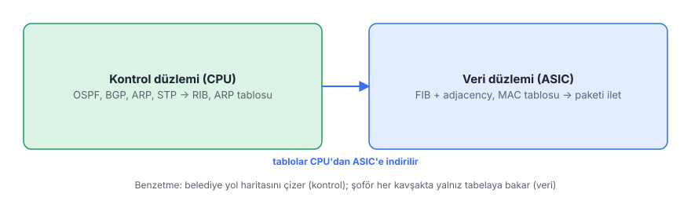
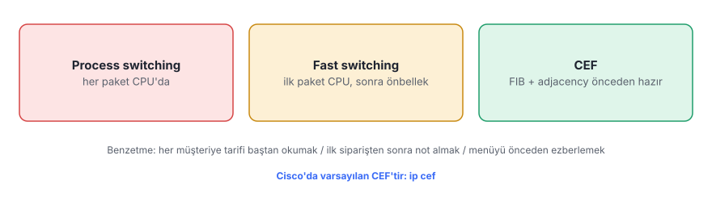
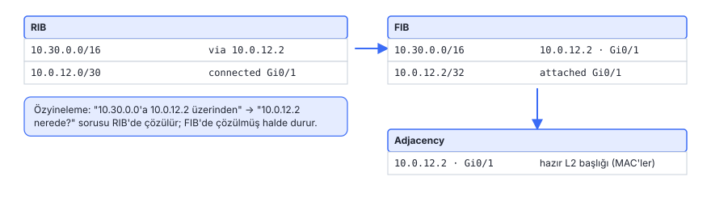
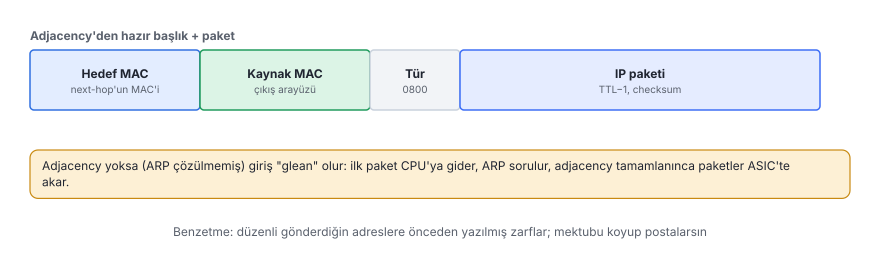
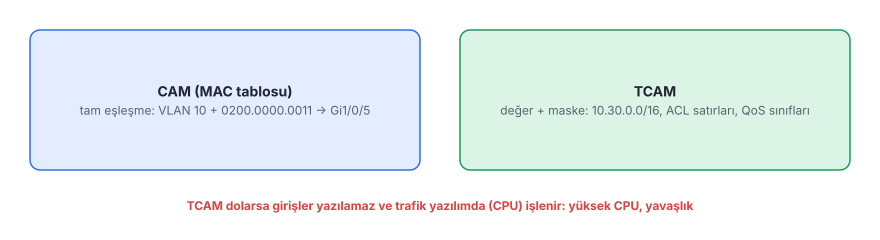
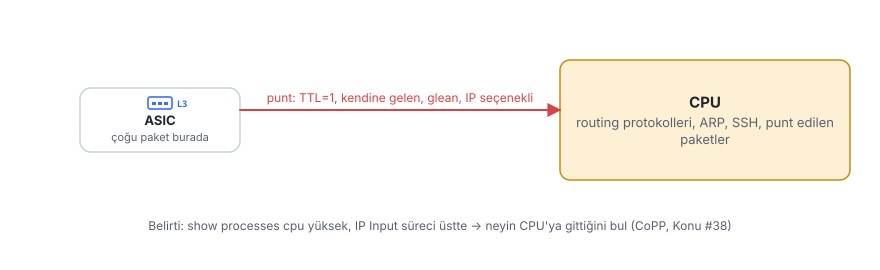
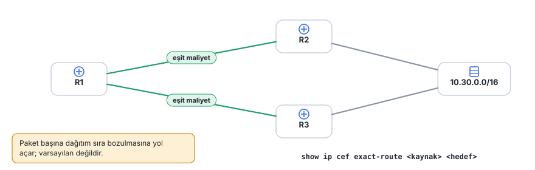

# AğLab Konu #28: L2/L3 iletim mekanizmaları: CEF, FIB, adjacency ve TCAM

> Uygulamadaki `forwarding` dersi bu belgeyle uyumludur. **Okuma dersi (Seviye 3, CCNP):** Labber paketleri kavramsal olarak iletir; Paket Dedektifi her adımda hangi tabloya bakıldığını gösterir, CEF/TCAM ayrıntısı okuma konusudur.
> Ön koşul: Ethernet, MAC ve ARP (Konu #3), statik routing (Konu #8), OSPF (Konu #15). Şemalar: `docs/dersler/gorseller/iletim-mekanizmalari.py`.

Bu konu bittiğinde öğrenci kontrol düzlemi ile veri düzlemini ayırır ve bir paketin router ya da L3 switch'te hangi tablolara bakılarak iletildiğini sırasıyla anlatır. Process switching, fast switching ve CEF farkını açıklar; RIB, FIB ve adjacency tablolarının ilişkisini kurar. `show ip cef` ve `show adjacency` çıktılarını okur; CAM ve TCAM'in görevini, CPU'ya gönderilen (punt) paketlerin nedenlerini söyler. Süre yaklaşık 45 dakika.

## 0. Bir bakışta

- **Kontrol düzlemi** (OSPF, ARP) tabloları kurar; **veri düzlemi** her paket için yalnız tablolara bakar.
- **CEF** tabloları önceden kurar: **FIB** (rota, özyinelemesi çözülmüş) + **adjacency** (hazır L2 başlığı).
- RIB = `show ip route`; FIB = `show ip cef`; adjacency = `show adjacency`.
- Switch'te **CAM** tam eşleşme (MAC + VLAN → port), **TCAM** maskeli eşleşme (önek, ACL, QoS).
- Bazı paketler CPU'ya gider (**punt**): kendine gelenler, TTL'i bitenler, ARP'si çözülmemişler (glean).
- CEF yük paylaşımı varsayılan **akış başına**: aynı kaynak-hedef hep aynı yoldan.

> **Akılda kalsın:** Rota tablosunda olan her şey FIB'de olmalı; olmuyorsa ya da adjacency eksikse paket donanımda iletilemez.



## 1. Neden önemli

"Rota var ama trafik gitmiyor", "switch'in CPU'su %99", "iki eşit yoldan biri hiç kullanılmıyor" şikâyetleri rota tablosuna bakarak çözülmez; cevap paketin donanımda nasıl iletildiğindedir. CCNP sınavı da bu mekanizmaları sorar: CEF'in iki tablosu, TCAM'in rolü ve hangi paketlerin CPU'ya gittiği.

## 2. Kavram

### 2.1 Kontrol ve veri düzlemi

> **Benzetme:** Belediye yol haritasını çizer ve tabelaları diker (kontrol düzlemi). Şoför her kavşakta yalnız tabelaya bakar, haritayı yeniden çizmez (veri düzlemi). Tabela yanlışsa ya da hiç yoksa şoför belediyeyi aramak zorunda kalır (punt).

- Kontrol düzlemi CPU'da çalışır: OSPF/BGP rotaları RIB'e, ARP sonuçları ARP tablosuna, STP portların durumuna karar verir.
- Veri düzlemi ASIC'lerde çalışır: her paket için FIB, adjacency, MAC tablosu ve TCAM'e bakar.

### 2.2 İletim yöntemleri



### 2.3 RIB, FIB ve adjacency



- **RIB** her protokolün en iyi rotasını AD ve metriğe göre seçer.
- **FIB** RIB'in ayna görüntüsüdür; özyinelemeli rotalar çözülmüş, her önek doğrudan bir adjacency'ye bağlıdır.
- **Adjacency** her sonraki adım için önceden yazılmış L2 başlığını tutar; ARP ile doldurulur.



Özel adjacency türleri:

| Tür | Anlamı |
| --- | --- |
| glean | Bağlı ağ, hedefin ARP'si henüz yok: ilk paket CPU'ya |
| punt | Donanım iletemez, CPU'ya gönder |
| drop / null | Düşür (ör. `Null0`'a giden özet rota) |
| discard | Kasıtlı atma (ör. ACL) |

### 2.4 CAM ve TCAM

> **Benzetme:** CAM, kimlik numarasıyla kişi aramaktır: tam numara verirsin, tek sonuç gelir. TCAM, "adı A ile başlayan ve Ankara'da oturan" gibi joker karakterli bir aramayı aynı hızda yapmaktır.



- TCAM her girişi değer + maske olarak tutar ve bütün girişleri **aynı anda** karşılaştırır; en uzun önek, ACL ve QoS kararları tek döngüde verilir.
- TCAM kapasitesi sınırlıdır; SDM şablonları (`show sdm prefer`) kapasitenin yönlendirmeye, ACL'ye ya da IPv6'ya nasıl ayrılacağını belirler.

### 2.5 CPU'ya giden paketler



> **Dikkat:** CPU'ya giden trafik sınırsız olursa (ör. bir döngüde TTL'i biten binlerce paket, ARP taraması) kontrol düzlemi boğulur; OSPF komşulukları düşer. Bunu sınırlayan özellik CoPP'tir (Konu #38).

### 2.6 Yük paylaşımı



> **Sahada:** Paket Dedektifi (AğLab) bir testte her cihazda hangi tabloya bakıldığını adım adım gösterir; bu dersin "tablo zinciri" mantığını gözle görmek için kullan.

## 3. Çıktı okuma

```
R1#show ip route 10.30.0.0
Routing entry for 10.30.0.0/16
  Known via "ospf 1", distance 110, metric 3
  * 10.0.12.2, from 3.3.3.3, via GigabitEthernet0/1
                                        ← RIB: en iyi rota

R1#show ip cef 10.30.0.0/16
10.30.0.0/16
  nexthop 10.0.12.2 GigabitEthernet0/1
                                        ← FIB: aynı rota, çıkış arayüzü çözülmüş

R1#show adjacency GigabitEthernet0/1 detail
Protocol Interface                 Address
IP       GigabitEthernet0/1        10.0.12.2(9)
                                   0 packets, 0 bytes
                                   epoch 0
                                   sourced in sev-epoch 1
                                   Encap length 14
                                   0200000000220200000000110800
                                   ARP
                                        ← hazır başlık: hedef MAC 0200.0000.0022, kaynak …11, tür 0800

R1#show ip cef 10.0.12.9
10.0.12.0/30
  attached to GigabitEthernet0/1
                                        ← bağlı ağ; .9 için adjacency yoksa ilk paket glean

R1#show ip cef exact-route 10.10.0.5 10.30.0.7
10.10.0.5 -> 10.30.0.7 =>IP adj out of GigabitEthernet0/2, addr 10.0.13.2
                                        ← bu akış iki eşit yoldan hangisini kullanıyor?
```

| Soru | Komut |
| --- | --- |
| Hangi rota seçildi? | `show ip route <hedef>` |
| Donanım ne kullanıyor? | `show ip cef <hedef>` |
| L2 başlığı hazır mı? | `show adjacency [detail]`, `show arp` |
| Bir akış hangi yoldan? | `show ip cef exact-route <kaynak> <hedef>` |
| CPU neden yüksek? | `show processes cpu sorted` |

## 4. Yönlendirmeli lab

> **Simülatörde yok:** Lab'ı kâğıt üstünde yürüt; her adımda Bölüm 3'teki beklenen çıktıyla karşılaştır.

R1'de iki eşit maliyetli yol (R2 ve R3 üzerinden) 10.30.0.0/16'ya gidiyor.

1. `show ip route 10.30.0.0`: kaç yol var? *Neden:* RIB'de iki yol, ECMP'nin ön şartıdır.
2. `show ip cef 10.30.0.0/16`: iki nexthop görünüyor mu?
3. `show adjacency`: iki next-hop için de adjacency var mı (ARP çözülmüş mü)?
4. İki farklı kaynakla `show ip cef exact-route`: aynı hedef için farklı yollar seçilebildiğini gör.
5. R2'ye giden arayüzü kapat; RIB, FIB ve adjacency'den 10.0.12.2'nin kalktığını izle.
6. Kâğıt üstünde: TTL'i 1 olan bir paket R1'e gelirse hangi düzlem işler? (CPU, Time Exceeded üretir.)

> **Benzetme:** Bu lab, harita değişince tabelaların da kendiliğinden değiştiğini görmektir.

## 5. Sık hatalar

| Kod | Hata | Belirti | Kanıt | Düzeltme |
| --- | --- | --- | --- | --- |
| E1 | CEF kapalı (`no ip cef`) | Yüksek CPU, yavaş iletim | `show ip cef` boş, `IP Input` süreci üstte | `ip cef` |
| E2 | ARP çözülmüyor | Rota ve FIB var, trafik yok | Adjacency eksik ya da glean/incomplete | L2 sorunu: VLAN, kablo, ARP |
| E3 | TCAM dolu | Yeni rotalar ya da ACL'ler yazılımda | Syslog'da TCAM uyarısı, `show platform` kullanım | SDM şablonu, özetleme, ACL sadeleştirme |
| E4 | Aşırı punt | CPU %90+, komşuluklar düşüyor | `show processes cpu sorted`, punt sayaçları | Kaynağı bul (döngü, TTL, ARP taraması); CoPP |
| E5 | Paket başına yük paylaşımı | Uygulamada sıra bozulması, TCP yavaş | `ip load-sharing per-packet` | Akış başına dağıtıma dön |

## 6. Arıza senaryoları

> **Uygulamada:** Kâğıt üstü vakalar; motor ya da Gerçek Lab desteği gelince Sorun Çöz'e `fwd-*` kimlikleriyle eklenecek. Önce kendin çöz; neden ve çözüm kapalı kutularda.

### S1 · Başlangıç · Rota var, ping yok (E2)

- **Belirti:** R1'de 10.0.12.9'a (bağlı ağdaki yeni sunucu) rota var, ping gitmiyor; diğer hedefler çalışıyor.
- **Hedef:** Paketin neden iletilemediğini tablolarla göster.

<details><summary>Neden ve çözüm</summary>

`show adjacency` ya da `show arp`'ta 10.0.12.9 incomplete: sunucu yanlış VLAN'da, ARP yanıtı gelmiyor. FIB girişi glean'de kalıyor. Çözüm: sunucunun switch portunu doğru VLAN'a al.

</details>

### S2 · Orta · CPU sürekli yüksek (E1)

- **Belirti:** Eski bir router'da CPU %95; trafik artmamış.
- **Hedef:** CPU'yu kim kullanıyor, bul.

<details><summary>Neden ve çözüm</summary>

`show processes cpu sorted`'da IP Input üstte; `show ip cef` boş: biri `no ip cef` yazmış, paketler process switching ile işleniyor. Çözüm: `ip cef`.

</details>

### S3 · Orta · İki yoldan biri boşta (ECMP beklentisi)

- **Belirti:** R1'den iki eşit yol var ama izleme grafiğinde R3 yolu neredeyse boş.
- **Hedef:** Bunun normal olup olmadığına karar ver.

<details><summary>Neden ve çözüm</summary>

Trafiğin büyük kısmı tek bir yedekleme sunucusu çiftinden geliyor; CEF akış başına dağıttığı için bu akış hep tek yoldan gidiyor. Normal davranış; daha iyi dağılım için karma algoritmasına port bilgisi eklenebilir (platforma bağlı).

</details>

### S4 · İleri · Döngü sırasında OSPF düştü (E4)

- **Belirti:** İki router arasında yanlış statik rotalar döngü oluşturdu; birkaç dakika sonra OSPF komşulukları da koptu.
- **Hedef:** Komşulukların neden düştüğünü açıkla.

<details><summary>Neden ve çözüm</summary>

Döngüdeki paketlerin TTL'i bitince her biri CPU'ya punt edildi ve ICMP Time Exceeded üretildi; CPU boğuldu, Hello'lar işlenemedi. Çözüm: döngüyü kaldır; CoPP ile punt trafiğini sınırla.

</details>

## 7. Kısa sınav

**1.** FIB ile RIB arasındaki fark?

<details><summary>Cevap</summary>

RIB protokollerin seçtiği rotaları tutar; FIB aynı bilgiyi özyinelemesi çözülmüş, doğrudan adjacency'ye bağlı biçimde veri düzlemi için tutar.

</details>

**2.** Adjacency tablosunda ne saklanır?

<details><summary>Cevap</summary>

Her sonraki adım için önceden yazılmış L2 başlığı (hedef ve kaynak MAC, tür).

</details>

**3.** Glean adjacency ne demektir?

<details><summary>Cevap</summary>

Bağlı ağdaki hedefin ARP'si henüz çözülmemiş; ilk paket CPU'ya gider, ARP sorulur.

</details>

**4.** CAM ile TCAM farkı?

<details><summary>Cevap</summary>

CAM tam eşleşme (MAC + VLAN); TCAM değer + maske ile en uzun önek, ACL ve QoS eşleşmesi.

</details>

**5.** CEF eşit yollarda varsayılan olarak nasıl dağıtır?

<details><summary>Cevap</summary>

Akış başına: aynı kaynak-hedef çifti hep aynı yoldan.

</details>

**6.** Hangi paketler CPU'ya punt edilir? İki örnek.

<details><summary>Cevap</summary>

Router'ın kendisine gelenler, TTL'i biten paketler, ARP'si çözülmemiş hedefler, IP seçenekli paketler.

</details>

## 8. Özet kartı

| Komut / kavram | Hatırla |
| --- | --- |
| `show ip route` | RIB: seçilen rota |
| `show ip cef` | FIB: donanımın kullandığı |
| `show adjacency detail` | Hazır L2 başlığı |
| `show ip cef exact-route` | Akışın yolu |
| CAM / TCAM | Tam eşleşme / maskeli eşleşme |
| Punt | CPU'ya giden paketler; CoPP ile sınırla |

**Unutma:**

1. Karar CPU'da, iletim ASIC'te.
2. RIB → FIB → adjacency.
3. Adjacency yoksa ARP'ye bak.
4. ECMP akış başına.
5. CPU yüksekse punt edilen trafiği bul.

## 9. Doğrulama notları

Kaynaklar: INE ENCOR (Packet Forwarding: CEF, FIB, adjacency, TCAM) ve CCNP ENCOR v1.0 (yalnız kapsam kontrolü için); Cisco IOS CEF yapılandırma kılavuzu. Ders metni, örnek çıktılar ve şemalar özgün yazıldı.

| İddia | Sonuç |
| --- | --- |
| CEF iki tablodan oluşur: FIB ve adjacency | Doğru |
| CEF varsayılan yük paylaşımı per-destination (akış başına) | Doğru |
| Glean adjacency, bağlı ağda ARP'si çözülmemiş hedef içindir | Doğru |
| TCAM değer/maske/sonuç ile maskeli eşleşme yapar | Doğru |
| TTL'i biten ve router'a yönelik paketler CPU'ya gönderilir | Doğru |

**Motor gereksinimleri**

- [ ] Paket Dedektifi tablo zincirini (MAC, rota, ARP) gösteriyor; FIB/adjacency ayrımı ve `show ip cef` çıktısı motor işi. Hazır olunca S1 ve S4 `fwd-*` kimlikleriyle eklenir.
