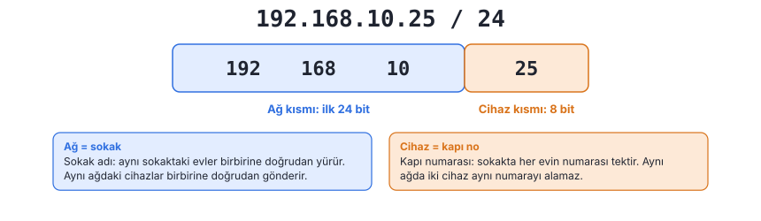
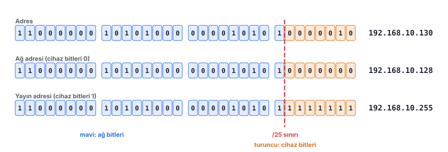
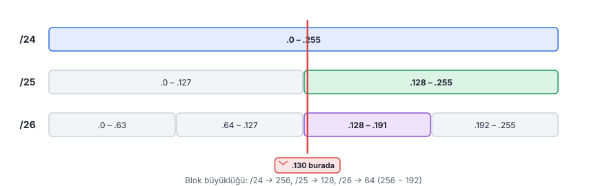
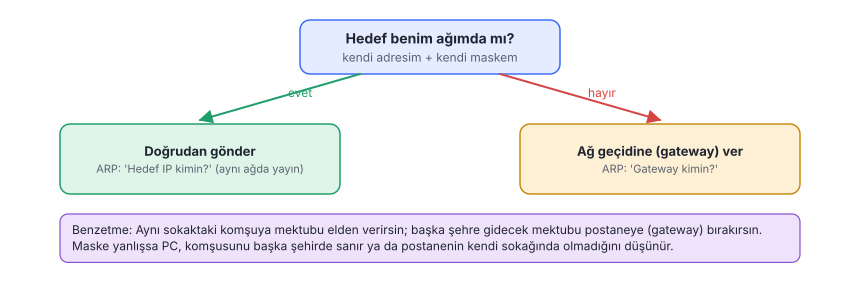
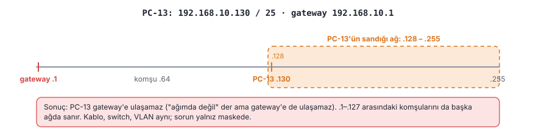
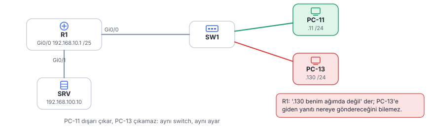
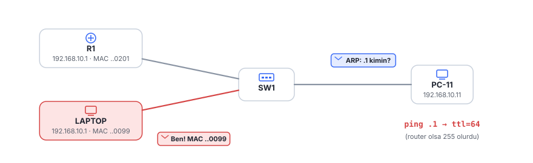

# AğLab Konu #2: IP adresleme ve subnetting

> Uygulamadaki `ip` dersi (kısa kart) ve `ipv4` ayrıntılı dersi bu belgeye göre yazıldı; `subnet`
> ayrıntılı dersi (alt ağlara bölme, VLSM) bu konunun ikinci parçasıdır. Senaryolar Sorun Çöz'de
> `ip-*` kimlikleriyle Labber'da çalışır. Şemalar: `docs/dersler/gorseller/ip-adresleme.py`.

Bu konu bittiğinde öğrenci bir adres ve maskeden ağ adresini, yayın adresini ve kullanılabilir aralığı bulur. İki cihazın aynı ağda olup olmadığına karar verir. Yanlış maske, yanlış ağ ve adres çakışması arızalarını cihaz ayarlarından teşhis eder. Seviye 1, süre yaklaşık 80 dakika (ders 25, lab 20, senaryolar 25, sınav 10).

## 0. Bir bakışta

- Bir cihazın ağdaki kimliği üç değerdir: **adres**, **maske**, **ağ geçidi (gateway)**. Biri yanlışsa cihaz ya hiç konuşamaz ya da bazılarıyla konuşur, bazılarıyla konuşamaz.
- **Adres** sokak adı + kapı numarası gibidir. **Maske**, adresin ne kadarının sokak (ağ), ne kadarının kapı numarası (cihaz) olduğunu söyler.
- Her ağda iki adres cihaza verilmez: **ağ adresi** (kapı numarası 0) ve **yayın adresi** (kapı numarası en büyük).
- PC her pakette "hedef benim ağımda mı?" diye sorar: evetse doğrudan gönderir, hayırsa gateway'e verir. Maske yanlışsa bu cevap yanlış çıkar.
- Hesabın kısa yolu: **blok büyüklüğü = 256 − maskenin son okteti**.

> **Akılda kalsın:** "Kablo sağlam, bazı şeyler çalışıyor" ama bazıları çalışmıyorsa önce üç değere bak: adres, maske, gateway. Sonra tek bir hesap yap: gateway benim ağımda mı?



## 1. Neden önemli

Şubeye yeni bir yazıcı geldi, kurulumu yapan firma "adresi biz verdik" dedi ve gitti. Ertesi sabah kimse yazdıramıyor. Ya da yeni bir PC kuruldu; ışık yanıyor, kablo sağlam ama PC ne internete ne sunucuya çıkıyor. Bu arızaların çoğu tek bir rakamdan çıkar: yanlış maske, yanlış ağ ya da başka bir cihazla çakışan adres.

Bu konunun asıl hedefi şu soruyu kafadan hızlıca cevaplayabilmektir: **192.168.10.130/25 ile 192.168.10.1 aynı ağda mı?** (Değil. Dersin sonunda nedenini bir saniyede söyleyeceksin.)

## 2. Kavram

### 2.1 Adres ve maske: sokak adı ve kapı numarası

> **Benzetme:** "Atatürk Caddesi No: 25" adresini düşün. Cadde adı ağdır; o caddedeki bütün evler aynı caddededir. Kapı numarası cihazdır; aynı caddede iki ev aynı numarayı alamaz. Postacı önce caddeye, sonra kapıya bakar.

- **IPv4 adresi** 32 bittir. Okumayı kolaylaştırmak için dört parçaya (oktet) bölünüp ondalık yazılır: `192.168.10.25`. Her oktet 0–255 arasıdır.
- **Maske** bu 32 bitin kaçının **ağ**, kaçının **cihaz** olduğunu söyler. İki yazımı vardır: `255.255.255.0` ve kısaca `/24` ("ilk 24 bit ağdır"). İkisi aynı şeydir.
- /24'te ilk üç oktet ağdır (192.168.10), son oktet cihazdır (25). Aynı ağdaki her cihazın ilk üç okteti aynıdır.

### 2.2 Bit görünümü: maske bir çizgidir

Maske, 32 bitin üzerine çekilmiş bir çizgidir. Çizginin solu ağ, sağı cihaz. /24'te çizgi tam oktet sınırındadır; /25'te son oktetin **içine** girer: son oktetin ilk biti de ağa aittir.

- **Ağ adresi:** cihaz bitlerinin hepsi **0**. Ağın adıdır, cihaza verilmez.
- **Yayın adresi (broadcast):** cihaz bitlerinin hepsi **1**. "Bu ağdaki herkese" demektir, cihaza verilmez.
- **Kullanılabilir aralık:** ikisinin arasındaki adresler. Sayısı **2^(cihaz biti) − 2**'dir.



### 2.3 Kısa yol: blok büyüklüğü

Bit yazmadan hesap yapmanın yolu **blok büyüklüğüdür**: `256 − maskenin son okteti`.

> **Benzetme:** Son oktet 0'dan 255'e bir cetveldir. Maske cetveli eşit parçalara keser: /25 ikiye, /26 dörde, /27 sekize. Adresin hangi parçaya düştüğünü bulursan parçanın ilk sayısı ağ adresi, son sayısı yayın adresidir.

| Önek | Maske | Blok | Kullanılabilir | 192.168.10.130 için |
| --- | --- | --- | --- | --- |
| /24 | 255.255.255.0 | 256 | 254 | ağ .0, yayın .255 |
| /25 | 255.255.255.128 | 128 | 126 | ağ .128, yayın .255 |
| /26 | 255.255.255.192 | 64 | 62 | ağ .128, yayın .191 |
| /27 | 255.255.255.224 | 32 | 30 | ağ .128, yayın .159 |
| /28 | 255.255.255.240 | 16 | 14 | ağ .128, yayın .143 |
| /30 | 255.255.255.252 | 4 | 2 | ağ .128, yayın .131 |

**Örnek, adım adım:** 192.168.10.130/26 → blok 256 − 192 = **64**. Bloklar .0, .64, .128, .192. 130, 128 ile 191 arasındadır. Ağ **.128**, yayın **.191**, kullanılabilir **.129–.190**.



> **Dikkat:** /31 ve /32 özel durumlardır. /32 tek bir adrestir (bir cihazın kendisi). /31 iki router arasındaki noktadan noktaya bağlantılarda ağ ve yayın adresi ayırmadan iki adres kullanmaya yarar. Bu derste "−2" kuralı /30 ve daha geniş ağlar içindir.

### 2.4 PC'nin her pakette sorduğu soru

> **Benzetme:** Aynı sokaktaki komşuna mektubu elden verirsin. Başka şehre gidecek mektubu postaneye bırakırsın. Postane gateway'dir.

PC bir paket göndermeden önce **kendi adresi ve kendi maskesiyle** hedefin ağını hesaplar:

1. Hedef kendi ağındaysa: hedefin MAC adresini ARP ile sorar ve **doğrudan** gönderir (Konu #3).
2. Değilse: **gateway'in** MAC adresini sorar ve paketi gateway'e verir (Konu #8).



Bu basit karardan üç arıza çıkar:

- **PC'nin maskesi yanlışsa** PC bazı komşularını "başka ağda" sanar, gateway bile kendi ağının dışında kalabilir. PC hiçbir yere çıkamaz.
- **Ağ kısmı yanlışsa** (192.168.11.50 gibi) cihaz aynı switch'e takılı olsa bile kimseyle konuşamaz. Aynı switch'e takılı olmak aynı ağda olmak değildir.
- **Router arayüzünün maskesi yanlışsa** router, kullanıcıların bir kısmını kendi ağında görmez ve onlara yanıt gönderemez.





### 2.5 Özel adresler ve özel anlamlı adresler

| Aralık | Anlamı |
| --- | --- |
| 10.0.0.0/8, 172.16.0.0/12, 192.168.0.0/16 | **Özel adresler** (RFC 1918). Kurum içinde kullanılır; internete NAT ile çıkar (Konu #20). |
| 127.0.0.0/8 | Cihazın kendisi (loopback). `ping 127.0.0.1` ağ kartını değil yazılımı dener. |
| 169.254.0.0/16 | DHCP'den yanıt alamayan istemcinin kendine verdiği adres (Konu #9). Görürsen "adres sunucusuna ulaşılamadı" de. |
| 0.0.0.0 | "Henüz adresim yok" ya da varsayılan rota (Konu #8). |

> **Sahada:** Şubelerde genelde 192.168.x.0/24 ya da 10.x.y.0/24 kullanılır ve üçüncü oktet VLAN numarasıyla eşlenir (VLAN 10 → 192.168.10.0/24). Bu alışkanlık teşhiste çok zaman kazandırır.

### 2.6 Adres çakışması: aynı kapı numarası iki evde

> **Benzetme:** Aynı caddede iki ev "No: 1" yazarsa postacı mektubu hangisine bırakacağını şaşırır; bazen birine, bazen öbürüne bırakır.

Aynı adresi iki cihaz kullanırsa ARP sorusuna ("bu adres kimin?") ikisi de cevap verebilir ve trafik yanlış cihaza gider. En zararlısı **gateway adresinin çakışmasıdır**: bir ziyaretçi dizüstüsüne elle `192.168.10.1` yazarsa bütün katın dışarı giden trafiği o dizüstüye akar.

İki ipucu çakışmayı ele verir:

- **ARP tablosundaki MAC** beklenen cihazınki değildir.
- **TTL değeri** tutmaz: Cisco router'lar ping yanıtını TTL 255 ile, Windows 128 ile, Linux ve VPCS 64 ile gönderir. "Router'a" ping atıp TTL 64 görüyorsan yanıtı router vermiyordur.



## 3. Çıktı okuma

### PC'de: show ip

```
PC-13> show ip
NAME        : PC-13[1]
IP/MASK     : 192.168.10.130/25
GATEWAY     : 192.168.10.1
DNS         :
MAC         : 02:00:00:00:00:13
```

Okuma sırası:

1. **Adres ve maske** → blok 128; .130 ikinci blokta: ağ **192.168.10.128**, yayın **.255**.
2. **Gateway bu aralıkta mı?** .1 değil.
3. **Sonuç:** PC gateway'ine ulaşamaz, dışarı çıkamaz. .0–.127 aralığındaki komşularını da "başka ağda" sanar ve onlara da ulaşamaz.

### Router'da: show ip interface brief ve maske

```
R1#show ip interface brief
Interface              IP-Address      OK? Method Status                Protocol
GigabitEthernet0/0     192.168.10.1    YES manual up                    up
GigabitEthernet0/1     192.168.100.1   YES manual up                    up

R1#show running-config interface g0/0
interface GigabitEthernet0/0
 ip address 192.168.10.1 255.255.255.128
```

- `show ip interface brief` **maskeyi göstermez**. Adres doğru görünür ama maske yanlış olabilir.
- Maskeyi görmenin üç yolu: `show running-config interface`, `show ip interface` ve `show ip route`'taki `C` satırı (`192.168.10.0/25 is directly connected`).
- Router'ın maskesi kullanıcılarınkinden daha uzunsa (/25 > /24) bazı kullanıcılar router'a göre "başka ağda" kalır.

### Çakışmanın izi: ARP ve TTL

```
PC-11> ping 192.168.10.1
84 bytes from 192.168.10.1 icmp_seq=1 ttl=64 time=1.100 ms

PC-11> show arp
02:00:00:00:00:99  192.168.10.1 expires in 120 seconds

R1#show interfaces g0/0
GigabitEthernet0/0 is up, line protocol is up
  Hardware is Gigabit Ethernet, address is 0200.0000.0201
```

- Gateway yanıt veriyor ama **TTL 64**; router olsa 255 olurdu.
- ARP'taki MAC (`...00:99`), R1'in Gi0/0 MAC'iyle (`0200.0000.0201`) aynı değil. Gateway adresini başka bir cihaz kullanıyor.

| Ne arıyorsun | Nereye bakarsın |
| --- | --- |
| PC'nin adresi, maskesi, gateway'i | PC'de `show ip` (Windows'ta `ipconfig`) |
| Router arayüzünün maskesi | `show running-config interface`, `show ip route` `C` satırı |
| Adresi gerçekte kim kullanıyor? | `show arp` (MAC) + `ping` (TTL) |
| Router'ın MAC'i | `show interfaces <arayüz>` "address is" |

## 4. Yönlendirmeli lab

Topoloji: R1 Gi0/0 kullanıcı ağı 192.168.10.0/24 (.1), Gi0/1 sunucu ağı 192.168.100.0/24 (SRV .10). SW1'e bağlı PC-11 (.11), PC-12 (.12), PC-13 (.130) ve YAZICI (.50).

1. **Hesapla, sonra doğrula.** Kâğıtta 192.168.10.130/24'ün ağını, yayınını, aralığını bul. PC-13'te `show ip` ile karşılaştır. PC-13'ten `ping 192.168.100.10`: başarılı.
2. **Maskeyi daralt.**
   ```
   PC-13> ip 192.168.10.130 255.255.255.128 192.168.10.1
   ```
   *Neden:* yeni ağ 192.168.10.128/25; gateway .1 bu aralıkta değil. *Doğrula:* `show ip`'te IP/MASK /25.
3. **Sonucu gör.** PC-13'ten sunucuya ve PC-11'e ping: ikisi de başarısız. PC-11'den PC-13'e ping de başarısız. *Neden:* kablo aynı, switch aynı; ama PC-13 komşularını başka ağda sanıyor ve paketleri ulaşamadığı bir gateway'e vermeye çalışıyor.
4. **Geri al.** Maskeyi `255.255.255.0` yap; ping'ler döner.
5. **Router tarafı.** R1'de `show ip route`: `192.168.10.0/24 is directly connected, GigabitEthernet0/0`. *Neden:* router'ın kendi ağını bildiği satır budur; maske burada da görünür.
6. **Yanlış ağ.** YAZICI'da `ip 192.168.11.50 255.255.255.0 192.168.10.1` yaz. PC-11'den yazıcıya ping: başarısız. *Neden:* 192.168.11.0/24 başka ağ; aynı switch'e takılı olması bir şey değiştirmez. Adresi 192.168.10.50 yap.
7. **Cetveli böl.** /26 ile 192.168.10.0/24'ü dörde böl: .0, .64, .128, .192. PC-13 (.130) hangi bloğa düşer, yayın adresi ne? (Cevap: .128 bloğu, yayın .191.)

> **Benzetme:** Bu labda kabloya, switch'e, VLAN'a hiç dokunmadın; yalnız "kapı numarasını" ve "sokak sınırını" değiştirdin ve iletişim koptu. IP arızalarının sinsi yanı budur: fiziksel olarak her şey sağlam görünür.

## 5. Sık hatalar

| Kod | Hata | Belirti | Kanıt | Düzeltme |
| --- | --- | --- | --- | --- |
| E1 | PC'de yanlış maske | PC bazı komşularına ya da hiçbir yere ulaşamıyor; gateway kendi ağının dışında kalıyor olabilir | `show ip`: maske ağınkinden farklı; hesaplanan ağ gateway'i kapsamıyor | Maskeyi ağın maskesiyle eşitle |
| E2 | Adres çakışması | Aralıklı ya da toplu erişim kaybı; gateway çakışıyorsa bütün ağ dışarı çıkamaz | ARP'ta adresin MAC'i yanlış; TTL beklenenden farklı; gerçek cihazda `%IP-4-DUPADDR` | Yanlış cihaza boş bir adres ver |
| E3 | Yanlış ağdan adres | Cihaz aynı kabloda ama kimseyle konuşamıyor | Adresin ağ kısmı (192.168.11) diğerlerinden farklı | Doğru ağdan, kullanılmayan bir adres ver |
| E4 | Router arayüzünde yanlış maske | Aynı ağdaki PC'lerin bir kısmı dışarı çıkıyor, bir kısmı çıkamıyor | Etkilenenler bir maske sınırının öbür yanında; router'ın `C` satırı daha uzun önek gösteriyor | Router arayüzünün maskesini düzelt |
| E5 | Ağ ya da yayın adresini cihaza vermek | Cihaz ağda görünmüyor ya da adres reddediliyor | Adres bloğun ilk ya da son adresi | Aralıktan bir adres ver |

> **Akılda kalsın:** E1 ile E4 aynı hatanın iki ucudur. Ayırmak için etkilenenlere bak: **tek PC** etkileniyorsa PC'nin ayarı; adres aralığının **bir yarısı** etkileniyorsa router'ın maskesi.

## 6. Arıza senaryoları

> **Uygulamada:** S1–S5 Sorun Çöz'de `ip-gw-outside-subnet`, `ip-duplicate-gateway`,
> `ip-wrong-network`, `ip-router-mask`, `ip-two-faults` kimlikleriyle Labber'da çalışır. Önce kendin çöz;
> neden ve çözüm kapalı kutularda.

### S1 · Başlangıç · Yeni PC kimseye, kimse ona ulaşamıyor (E1)

- **Belirti:** PC-13 ne gateway'e ne sunucuya ulaşıyor; PC-11 de PC-13'e ping atamıyor.
- **Hedef:** PC-13 → sunucu (192.168.100.10) ve PC-11 → PC-13 başarılı.

<details><summary>Neden ve çözüm</summary>

PC-13 192.168.10.130 **/25**; gateway .1 bu ağın dışında. Çözüm: PC-13 → `ip 192.168.10.130 255.255.255.0 192.168.10.1`.

</details>

### S2 · Başlangıç · Dizüstü bağlandı, bütün kat dışarı çıkamıyor (E2)

- **Belirti:** Ziyaretçi dizüstüsünü taktığından beri kimse sunucuya ulaşamıyor; birbirlerine ulaşıyorlar.
- **Hedef:** 192.168.10.1 tek cihazda; PC-11 → sunucu başarılı.

<details><summary>Neden ve çözüm</summary>

LAPTOP'a elle 192.168.10.1 yazılmış; gateway adresi çakışıyor. Çözüm: LAPTOP → `ip 192.168.10.30 255.255.255.0 192.168.10.1`.

</details>

### S3 · Orta · Yeni yazıcıya kimse yazdıramıyor (E3)

- **Belirti:** Firma yazıcıyı kurdu; kattaki hiçbir bilgisayar yazıcıya ulaşamıyor.
- **Hedef:** PC-11 → yazıcı başarılı.

<details><summary>Neden ve çözüm</summary>

YAZICI 192.168.11.50/24: başka ağ. Çözüm: YAZICI → `ip 192.168.10.50 255.255.255.0 192.168.10.1`.

</details>

### S4 · Orta · Aynı kattaki bazı PC'ler sunucuya ulaşıyor, bazıları ulaşamıyor (E4)

- **Belirti:** PC-11 ve PC-12 sunucuya ulaşıyor; PC-13 (.130) ulaşamıyor ama PC-11'e ulaşıyor. PC'lerin ayarları aynı.
- **Hedef:** PC-13 ve PC-11 → sunucu başarılı.

<details><summary>Neden ve çözüm</summary>

R1 Gi0/0 192.168.10.1 **255.255.255.128**: router .128–.255'i kendi ağında görmüyor. Çözüm: R1 → `interface g0/0` → `ip address 192.168.10.1 255.255.255.0`.

</details>

### S5 · İleri · Hem yazıcı hem bir PC dışarıda kaldı (E3 + E4)

- **Belirti:** Yazıcıya kimse yazdıramıyor; ayrıca PC-13 sunucuya ulaşamıyor.
- **Hedef:** PC-11 → yazıcı ve PC-13 → sunucu başarılı.

<details><summary>Neden ve çözüm</summary>

S3 ve S4 birlikte: yazıcı yanlış ağda, router'ın maskesi /25. İki düzeltme de gerekli; birini yapıp durma.

</details>

## 7. Kısa sınav

**1.** 192.168.10.130/25 adresinin ağ adresi ve yayın adresi nedir? (A) .0 ve .255 (B) .128 ve .255 (C) .128 ve .191 (D) .130 ve .255

<details><summary>Cevap</summary>

**B.** /25'te blok 128; bloklar .0 ve .128'den başlar; .130 ikinci blokta.

</details>

**2.** PC 192.168.10.130/25, gateway 192.168.10.1. Ne olur?

<details><summary>Cevap</summary>

Gateway PC'nin ağının (.128–.255) dışında kalır; PC dışarı çıkamaz. Gateway, PC ile aynı ağda olmalıdır.

</details>

**3.** /26 ağında kaç kullanılabilir adres vardır?

<details><summary>Cevap</summary>

2^6 − 2 = **62**.

</details>

**4.** 10.1.1.77/27 adresinin ağ adresi nedir?

<details><summary>Cevap</summary>

Blok 256 − 224 = 32; bloklar .0, .32, .64, .96. 77, 64–95 arasında: ağ **10.1.1.64**, yayın 10.1.1.95.

</details>

**5.** Bir PC gateway'e ping atıyor ve yanıtın TTL'i 64. Gateway bir Cisco router. Bu neye işaret eder?

<details><summary>Cevap</summary>

Yanıtı router değil başka bir cihaz veriyor; adres çakışması olabilir. Cisco router'lar ICMP yanıtını TTL 255 ile gönderir.

</details>

**6.** Aynı kattaki .1–.127 aralığındaki PC'ler dışarı çıkıyor, .128–.254 aralığındakiler çıkamıyor. PC'lerin ayarları doğru. En olası neden?

<details><summary>Cevap</summary>

Router arayüzünün maskesi /25: router ağın yalnız bir yarısını kendi ağı sayıyor.

</details>

## 8. Özet kartı

| Komut / formül | Ne işe yarar |
| --- | --- |
| `show ip` (VPCS), `ipconfig` (Windows) | PC'nin adresi, maskesi, gateway'i |
| `ip <adres> <maske> <gateway>` (VPCS) | PC'ye elle adres verir |
| `show ip interface brief` | Router arayüzleri ve adresleri (maske yok!) |
| `show running-config interface <ad>` | Arayüzün maskesi |
| `show ip route` | Router'ın bağlı ağları (`C` satırları, maskeyle) |
| `show arp` | Hangi IP'yi hangi MAC kullanıyor |
| Blok = 256 − maskenin son okteti | Ağ ve yayın adresini hızlı bulmak |
| Kullanılabilir = 2^(cihaz biti) − 2 | Ağdaki cihaz sayısı |

**Unutma:**

1. Adres + maske + gateway birlikte doğru olmalı.
2. Gateway, PC ile aynı ağda olmalı.
3. Ağ adresi ve yayın adresi cihaza verilmez.
4. Aynı switch'e takılı olmak aynı ağda olmak değildir.
5. `show ip interface brief` maskeyi göstermez.

## 9. Doğrulama notları

Kaynaklar: RFC 791 (IPv4), RFC 1918 (özel adresler), RFC 3927 (169.254 link-local), RFC 950 (alt ağlar), RFC 3021 (/31 noktadan noktaya); CCNA 200-301 sınav konuları (1.6 IPv4 adresleme ve alt ağlar, 1.7 özel adresler); INET CCNA 200-301 v1.1 (IPv4 adresleme ve alt ağ tablosu). Eski `ip` ve `ipv4` dersleri Kavram için kaynak oldu; metin yeniden yazıldı. `subnet` dersi değişmedi.

| İddia | Sonuç |
| --- | --- |
| Kullanılabilir adres sayısı 2^(32 − önek) − 2 (/31 ve /32 hariç) | Doğru |
| /31 noktadan noktaya bağlantıda iki adres kullanılabilir | Doğru (RFC 3021) |
| Özel aralıklar 10/8, 172.16/12, 192.168/16 | Doğru (RFC 1918) |
| 169.254.0.0/16 link-local; 127.0.0.0/8 loopback | Doğru |
| Cisco IOS ICMP echo-reply'yi TTL 255 ile gönderir; Windows 128, Linux/VPCS 64 | Doğru (varsayılan değerler) |
| `show ip interface brief` maske göstermez | Doğru |

Lab'ın otomatik değerlendirmesi: `q.ping('PC-13', '192.168.100.10').ok`; `q.ping('PC-11', '192.168.10.50').ok`; `q.ipUnique('192.168.10.1')`.

**Motor gereksinimleri** (Labber'da denendi)

- [x] VPCS `ip <adres> <maske> <gateway>`, `show ip`, `show arp`, ping TTL'i
- [x] Router arayüz maskesi, `show ip interface brief`, `show running-config interface`, `show interfaces` (MAC)
- [x] Aynı adresi kullanan iki cihazda ARP'a ilk tanımlı cihazın yanıt vermesi; `ipUnique` — L2-C
- [x] Beş senaryo başta başarısız, terminalden çözümle başarılı
- [ ] Senaryo başında var olan çakışma için `%IP-4-DUPADDR` yazılmıyor (yalnız durum değişince)
