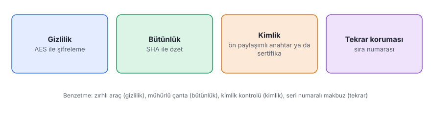
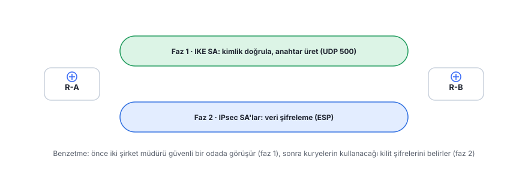
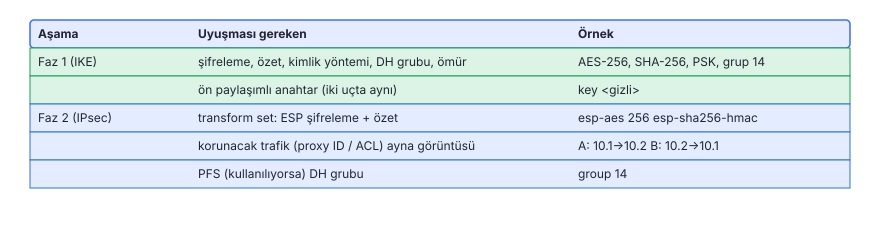
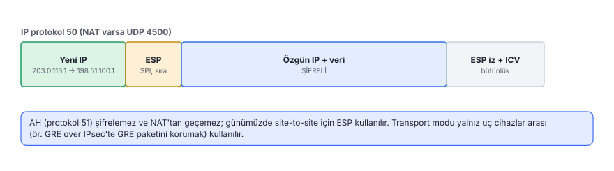
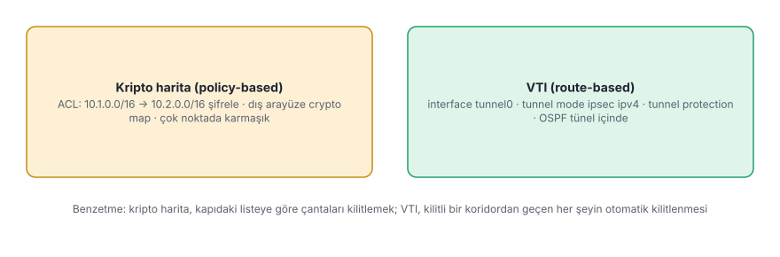
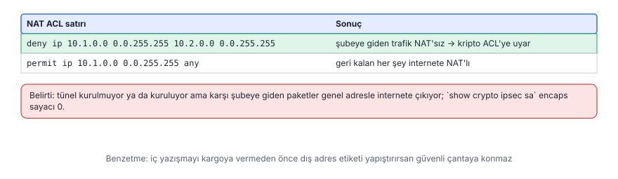
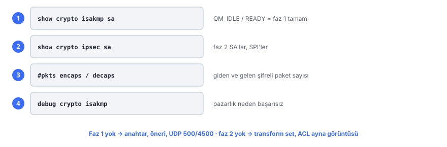

# AğLab Konu #34: IPsec site-to-site VPN

> Uygulamadaki `ipsec` dersi bu belgeyle uyumludur. **Okuma dersi (Seviye 3, CCNP):** IPsec Labber'da yok; kavramlar ve teşhis çıktıları kâğıt üstünde çalışılır.
> Ön koşul: ACL (Konu #19), NAT/PAT (Konu #20), GRE (Konu #33). Şemalar: `docs/dersler/gorseller/ipsec.py`.

Bu konu bittiğinde öğrenci IPsec'in sağladığı dört güvenlik hizmetini açıklar; IKE faz 1 ve faz 2'nin görevlerini ve iki ucun nelerde uyuşması gerektiğini sıralar. ESP tünel modunun paketi nasıl sardığını ve AH'tan farkını söyler. Kripto harita ile VTI'yi karşılaştırır. NAT ile IPsec çakışmasını tanır ve NAT istisnası yazar. `show crypto isakmp sa` ve `show crypto ipsec sa` çıktılarıyla arızanın hangi aşamada olduğunu bulur. Süre yaklaşık 55 dakika.

## 0. Bir bakışta

- IPsec **gizlilik, bütünlük, kimlik doğrulama** ve **tekrar koruması** sağlar.
- **IKE faz 1** iki router arasında güvenli yönetim kanalı (IKE SA) kurar; **faz 2** veriyi şifreleyecek **IPsec SA**'ları kurar.
- İki ucun önerileri (şifreleme, özet, DH grubu, anahtar, transform set) **kesişmeli**; korunan trafik ACL'leri **ayna** olmalı.
- Site-to-site'ta **ESP tünel modu**: paketin tamamı şifrelenir, yeni IP başlığı eklenir. AH şifrelemez.
- **Kripto harita** ACL ile seçer; **VTI** tünel arayüzüdür, içinde yönlendirme protokolü çalışır.
- NAT kripto'dan önce çalışır: VPN trafiği **NAT'tan hariç tutulmalı**.
- Faz 1 yok → anahtar/öneri/UDP 500; faz 2 yok → transform set/ACL; encaps var decaps yok → dönüş yolu.

> **Akılda kalsın:** IPsec arızasında sorulacak ilk soru: hangi aşamada takıldı? Faz 1, faz 2 ya da trafik.



## 1. Neden önemli

Şubeleri merkeze kiralık hat yerine internet üzerinden bağlamak ucuzdur, ama internet güvensizdir. IPsec bu bağlantıyı şifreler ve doğrular. DMVPN, SD-WAN ve bulut bağlantıları da arka planda IPsec kullanır; bu yüzden faz 1/faz 2 mantığını ve en sık iki hatayı (öneri uyuşmazlığı, NAT çakışması) bilmek her CCNP ağcısının işidir.

## 2. Kavram

### 2.1 Hizmetler

> **Benzetme:** Bankalar arası para taşıyan zırhlı araç: içi görünmez (gizlilik), çantalar mühürlüdür (bütünlük), teslim alan kimlik gösterir (kimlik), her teslimatın seri numarası vardır, eski makbuzla ikinci kez teslim alınamaz (tekrar koruması).

- Şifreleme: **AES** (128/256). Bütünlük: **SHA-256** gibi HMAC. Anahtar değişimi: **Diffie-Hellman** (grup 14 ve üzeri).
- Kimlik: **ön paylaşımlı anahtar (PSK)** ya da **sertifika**.

### 2.2 IKE ve SA'lar



- **IKEv1**: faz 1 main mode (6 mesaj) ya da aggressive mode; faz 2 quick mode.
- **IKEv2**: daha az mesaj (ilk değişim 4 mesaj), daha sağlam; yeni kurulumlarda tercih edilir.
- SA'ların **ömrü** vardır; süre dolmadan yenilenir. Faz 2'de **PFS** her yenilemede yeni DH anahtarı üretir.



> **Dikkat:** Korunan trafik ACL'leri iki uçta **ayna** olmalıdır: A'da 10.1.0.0/16 → 10.2.0.0/16 ise B'de 10.2.0.0/16 → 10.1.0.0/16. Biri /16, diğeri /24 yazılırsa faz 2 "proxy ID" uyuşmazlığıyla başarısız olur.

### 2.3 ESP ve modlar



- ESP IP protokol **50**; AH **51**; IKE **UDP 500**; arada NAT varsa **NAT-T** ile UDP **4500**.

### 2.4 Kripto harita ve VTI



VTI örneği:

```
crypto ipsec profile VTI-PROF
 set transform-set TS
interface Tunnel0
 ip address 172.16.0.1 255.255.255.252
 tunnel source g0/1
 tunnel destination 198.51.100.1
 tunnel mode ipsec ipv4
 tunnel protection ipsec profile VTI-PROF
```

### 2.5 NAT ile birlikte



### 2.6 Teşhis



> **Sahada:** Hub-and-spoke ağlarda her şubeye ayrı tünel yerine **DMVPN** (mGRE + NHRP + IPsec) kullanılır: şubeler merkeze kayıt olur ve gerektiğinde birbirine doğrudan tünel kurar (okuma, MUFREDAT #46).

## 3. Çıktı okuma

```
R-A#show crypto isakmp sa
IPv4 Crypto ISAKMP SA
dst             src             state          conn-id status
198.51.100.1    203.0.113.1     QM_IDLE           1001 ACTIVE
                                        ← faz 1 tamam (IKEv1). MM_NO_STATE görürsen faz 1 yok

R-A#show crypto ipsec sa
interface: GigabitEthernet0/1
    Crypto map tag: VPN, local addr 203.0.113.1
   protected vrf: (none)
   local  ident (addr/mask/prot/port): (10.1.0.0/255.255.0.0/0/0)
   remote ident (addr/mask/prot/port): (10.2.0.0/255.255.0.0/0/0)
   current_peer 198.51.100.1 port 500
    #pkts encaps: 1240, #pkts encrypt: 1240, #pkts digest: 1240
    #pkts decaps: 0, #pkts decrypt: 0, #pkts verify: 0
                                        ← giden şifreleniyor, gelen yok: karşı uçta dönüş/ACL/NAT

     inbound esp sas:
      spi: 0x5A3C11F2(1513886194)
        transform: esp-256-aes esp-sha256-hmac ,
        in use settings ={Tunnel, }
                                        ← ESP tünel modu, AES-256/SHA-256

R-A#show crypto isakmp sa
dst             src             state          conn-id status
198.51.100.1    203.0.113.1     MM_NO_STATE       1002 ACTIVE (deleted)
                                        ← başka bir gün: faz 1 kurulamıyor (anahtar/öneri/UDP 500)
```

| Soru | Komut |
| --- | --- |
| Faz 1 kuruldu mu? | `show crypto isakmp sa` (IKEv2: `show crypto ikev2 sa`) |
| Faz 2 ve sayaçlar? | `show crypto ipsec sa` |
| Ayarlar? | `show crypto map`, `show crypto isakmp policy` |
| Pazarlık neden başarısız? | `debug crypto isakmp` / `debug crypto ikev2` |

## 4. Yönlendirmeli lab

> **Simülatörde yok:** Lab'ı kâğıt üstünde yürüt; her adımda Bölüm 3'teki beklenen çıktıyla karşılaştır.

Topoloji: R-A (dış 203.0.113.1, LAN 10.1.0.0/16), R-B (dış 198.51.100.1, LAN 10.2.0.0/16); ikisi de internete PAT ile çıkıyor.

1. Faz 1 politikası: AES-256, SHA-256, PSK, DH 14; iki uçta aynı anahtar. *Neden:* öneriler kesişmezse faz 1 kurulmaz.
2. Transform set: `esp-aes 256 esp-sha256-hmac`.
3. Kripto ACL: A'da 10.1/16 → 10.2/16, B'de ayna görüntüsü.
4. Kripto haritayı dış arayüze uygula.
5. NAT ACL'sine VPN istisnası (`deny` satırı) en üste.
6. A LAN'dan B LAN'a ping at; `show crypto isakmp sa` ve `show crypto ipsec sa` çıktılarını Bölüm 3 ile karşılaştır.
7. Kâğıt üstü: aynı bağlantıyı VTI ile kur; OSPF'i tünel içinde çalıştır.

> **Benzetme:** 5. adım, iç yazışmaların posta odasında "dış kargo etiketi" yapıştırılmadan zırhlı araca konmasını sağlamaktır.

## 5. Sık hatalar

| Kod | Hata | Belirti | Kanıt | Düzeltme |
| --- | --- | --- | --- | --- |
| E1 | Faz 1 önerisi ya da PSK farklı | MM_NO_STATE, tünel yok | `debug crypto isakmp`: no proposal chosen / auth failed | Politika ve anahtarı eşitle |
| E2 | UDP 500/4500 engelli | Faz 1 başlamıyor | ISP ya da güvenlik duvarı ACL'si | 500/4500 ve ESP'ye izin |
| E3 | Kripto ACL'ler ayna değil | Faz 1 tamam, faz 2 yok | proxy identities not supported | ACL'leri ayna yap |
| E4 | NAT istisnası yok | Encaps 0, trafik genel adresle gidiyor | NAT çevirilerinde 10.2.x hedefli girişler | NAT ACL'sine deny satırı |
| E5 | Karşı uçta dönüş sorunu | Encaps artıyor, decaps 0 | Karşı uçta rota ya da NAT | Karşı ucu kontrol et |

## 6. Arıza senaryoları

> **Uygulamada:** Kâğıt üstü vakalar; motor ya da Gerçek Lab desteği gelince Sorun Çöz'e `ipsec-*` kimlikleriyle eklenecek. Önce kendin çöz; neden ve çözüm kapalı kutularda.

### S1 · Başlangıç · Tünel hiç kurulmuyor (E1)

- **Belirti:** Yeni şube R-B kuruldu; `show crypto isakmp sa` MM_NO_STATE; debug'da `no proposal chosen`.
- **Hedef:** Faz 1 kurulsun.

<details><summary>Neden ve çözüm</summary>

R-A'da AES-256/SHA-256/grup 14, R-B'de AES-128/SHA-1/grup 2 politikası var; ortak öneri yok. Çözüm: R-B'ye R-A ile aynı (güçlü) politikayı ekle.

</details>

### S2 · Orta · Faz 1 tamam, trafik geçmiyor (E3)

- **Belirti:** QM_IDLE görünüyor; `show crypto ipsec sa` boş, log'da proxy kimliği hatası.
- **Hedef:** Faz 2 kurulsun.

<details><summary>Neden ve çözüm</summary>

R-A ACL'si 10.1.0.0/16 → 10.2.0.0/16, R-B'nin ACL'si 10.2.1.0/24 → 10.1.0.0/16. Çözüm: R-B ACL'sini 10.2.0.0/16 → 10.1.0.0/16 yap.

</details>

### S3 · Orta · Şube trafiği şifrelenmeden internete gidiyor (E4)

- **Belirti:** Tünel tanımlı; `#pkts encaps: 0`; şubeye giden paketler ISP'de genel kaynak adresle görülüyor.
- **Hedef:** Şube trafiği tünelden gitsin.

<details><summary>Neden ve çözüm</summary>

NAT önce çalışıp kaynağı genel adrese çeviriyor; paket kripto ACL'sine (özel → özel) uymuyor. Çözüm: NAT ACL'sinin başına `deny ip 10.1.0.0 0.0.255.255 10.2.0.0 0.0.255.255`.

</details>

### S4 · İleri · Gidiyor ama dönmüyor (E5)

- **Belirti:** R-A'da encaps 1240, decaps 0; R-B'de decaps 1240, encaps 0.
- **Hedef:** İki yönlü trafik.

<details><summary>Neden ve çözüm</summary>

R-B paketleri çözüyor ama B LAN'daki sunucuların gateway'i başka bir router; yanıt R-B'ye dönmüyor. Çözüm: B LAN'da 10.1.0.0/16 için R-B'ye rota (ya da gateway'i düzelt).

</details>

## 7. Kısa sınav

**1.** IKE faz 1 ile faz 2 arasındaki fark?

<details><summary>Cevap</summary>

Faz 1 iki router arasında güvenli yönetim kanalı (IKE SA) kurar; faz 2 bu kanal üzerinden veri şifreleyecek IPsec SA'ları kurar.

</details>

**2.** ESP ile AH farkı?

<details><summary>Cevap</summary>

ESP şifreler ve bütünlük sağlar (protokol 50); AH yalnız bütünlük ve kimlik sağlar, şifrelemez, NAT'tan geçemez (protokol 51).

</details>

**3.** IKE hangi portu kullanır, NAT varken ne değişir?

<details><summary>Cevap</summary>

UDP 500; NAT-T ile UDP 4500 üzerinden kapsüllenir.

</details>

**4.** Kripto ACL'lerin iki uçta nasıl olması gerekir?

<details><summary>Cevap</summary>

Birbirinin ayna görüntüsü (kaynak ve hedef yer değiştirmiş, aynı önekler).

</details>

**5.** Neden NAT istisnası gerekir?

<details><summary>Cevap</summary>

NAT kripto'dan önce çalışır; çevrilen trafik kripto ACL'sine uymaz ve şifrelenmeden gider.

</details>

**6.** Encaps artıyor, decaps 0. Sorun nerede?

<details><summary>Cevap</summary>

Paketler şifrelenip gidiyor ama dönüş gelmiyor: karşı uçta dönüş rotası, ACL ya da NAT.

</details>

## 8. Özet kartı

| Komut / kavram | Hatırla |
| --- | --- |
| `crypto isakmp policy` / `crypto ikev2 proposal` | Faz 1 önerisi |
| `crypto ipsec transform-set` | Faz 2 şifreleme ve özet |
| `crypto map` + ACL | Policy-based VPN |
| `tunnel mode ipsec ipv4` + `tunnel protection` | VTI |
| `show crypto isakmp sa` | QM_IDLE = faz 1 tamam |
| `show crypto ipsec sa` | Encaps/decaps sayaçları |
| UDP 500 / 4500, ESP 50 | Güvenlik duvarında izin |

**Unutma:**

1. Önce faz 1, sonra faz 2, sonra sayaçlar.
2. Öneriler kesişmeli, PSK aynı.
3. Kripto ACL'ler ayna.
4. VPN trafiğini NAT'tan hariç tut.
5. Encaps var decaps yok = dönüş yolu.

## 9. Doğrulama notları

Kaynaklar: INE ENCOR (Virtualization: IPsec, GRE over IPsec, VTI) ve CCNP ENCOR v1.0 (yalnız kapsam kontrolü için); RFC 4301 (IPsec mimarisi), RFC 4303 (ESP), RFC 7296 (IKEv2); Cisco IOS IPsec yapılandırma kılavuzu. Ders metni, örnek çıktılar ve şemalar özgün yazıldı.

| İddia | Sonuç |
| --- | --- |
| ESP IP protokol 50, AH 51 | Doğru |
| IKE UDP 500, NAT-T UDP 4500 | Doğru |
| AH şifreleme sağlamaz ve NAT ile uyumsuzdur | Doğru |
| QM_IDLE IKEv1 faz 1 SA'nın kurulu olduğunu gösterir | Doğru |
| NAT, kripto haritadan önce uygulanır (iç→dış) | Doğru |
| Site-to-site için ESP tünel modu kullanılır | Doğru |

**Motor gereksinimleri**

- [ ] IPsec Labber'da yok; Gerçek Lab'da (strongSwan/FRR) S1–S4 `ipsec-*` kimlikleriyle kurulabilir.
