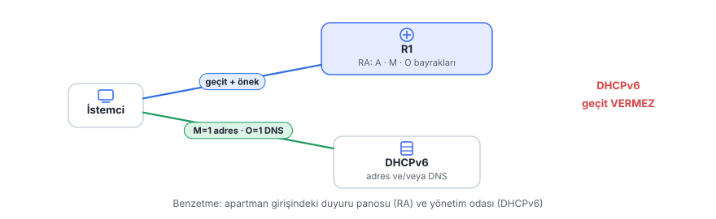
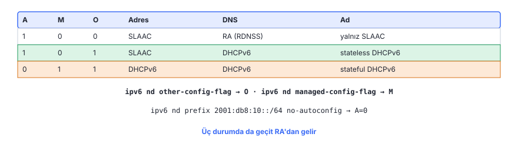
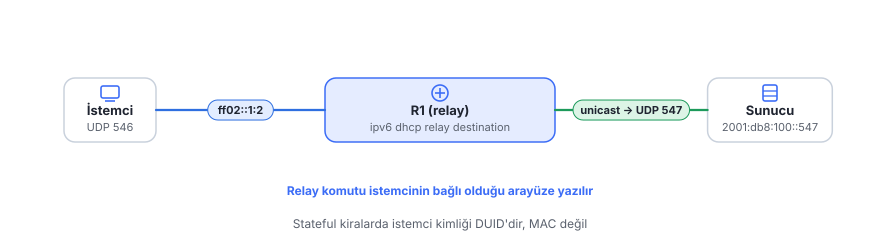
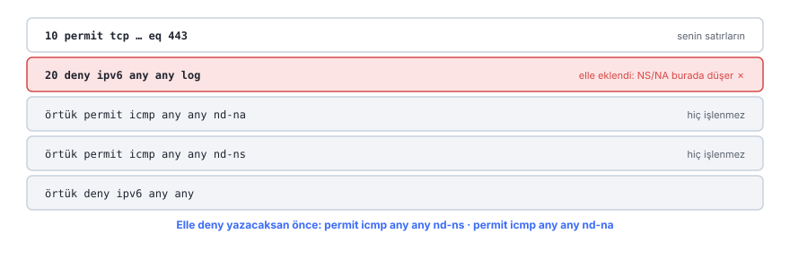
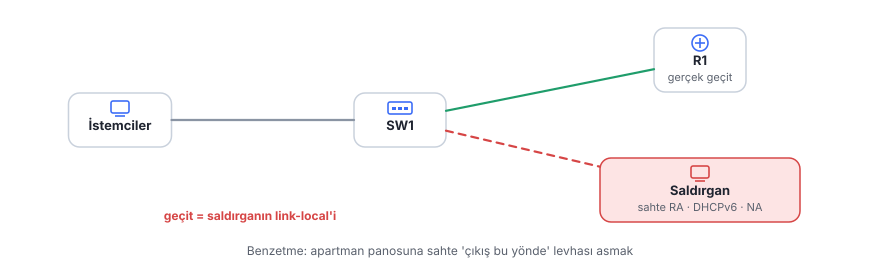
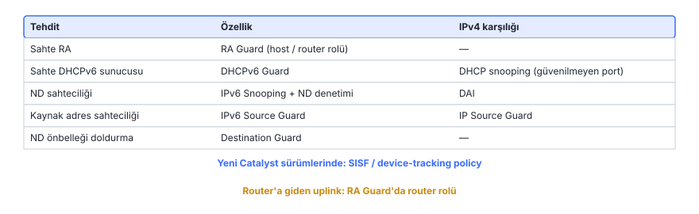
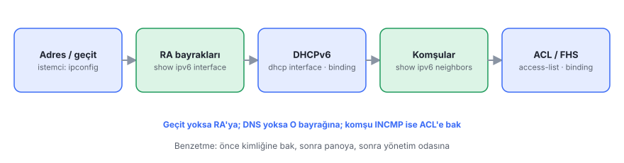

# AğLab Konu #47: IPv6 ileri: DHCPv6, IPv6 ACL ve first-hop security

> Uygulamadaki `ipv6adv` dersi bu belgeyle uyumludur. **Okuma dersi (Seviye 3, CCNP):** Labber'da IPv6 yok; IPv6 temeli Konu #16'da, OSPFv3 Konu #17'de. Bu ders kâğıt üstü lab ve çıktı okumayla işlenir.
> Ön koşul: IPv6 adresleme ve yönlendirme (Konu #16), ACL (Konu #19), L2 güvenlik: DHCP snooping ve DAI (Konu #21). Şemalar: `docs/dersler/gorseller/ipv6-ileri.py`.

Bu konu bittiğinde öğrenci bir IPv6 istemcisinin adresini SLAAC'tan mı DHCPv6'dan mı alacağına router'ın RA bayraklarıyla (M ve O) nasıl karar verildiğini açıklar; stateful ve stateless DHCPv6'yı ve DHCPv6 relay'i yapılandırır. IPv6 ACL'lerin IPv4'ten farkını, özellikle sondaki örtük ND izinlerini ve elle yazılan `deny ipv6 any any`'ın komşu keşfini nasıl bozduğunu bilir. Bir LAN'daki IPv6 tehditlerini (sahte RA, sahte DHCPv6 sunucusu, ND sahteciliği) ve bunlara karşı switch özelliklerini (RA Guard, DHCPv6 Guard, IPv6 Snooping, Source Guard) eşleştirir. Süre yaklaşık 60 dakika.

## 0. Bir bakışta

- Router'ın **RA** mesajındaki bayraklar istemciye yol gösterir: **A** (SLAAC kullan), **M** (adresi DHCPv6'dan al), **O** (diğer bilgileri, ör. DNS, DHCPv6'dan al).
- **Stateless DHCPv6**: adres SLAAC'tan, DNS DHCPv6'dan (O=1). **Stateful DHCPv6**: adres de DHCPv6'dan (M=1).
- DHCPv6 istemcileri **varsayılan ağ geçidini DHCPv6'dan almaz**: geçit her zaman RA'dan gelir.
- **IPv6 ACL**: `ipv6 traffic-filter` ile uygulanır; sonunda örtük **`permit icmp any any nd-na`**, **`permit icmp any any nd-ns`** ve ardından **`deny ipv6 any any`** vardır.
- Elle `deny ipv6 any any` yazmak örtük ND izinlerinin **önüne geçer**: komşu keşfi bozulur.
- **First-hop security**: **RA Guard** (sahte router), **DHCPv6 Guard** (sahte sunucu), **IPv6 Snooping** (bağlama tablosu, ND denetimi), **Source Guard** (sahte kaynak adres).

> **Akılda kalsın:** IPv4'te ARP'ı korumak için DAI kullanırdın; IPv6'da ARP yok, onun yerini ND aldı. IPv6'yı kapatmamış her ağda (ve çoğu işletim sisteminde IPv6 varsayılan açıktır) sahte bir RA bütün LAN'ın trafiğini bir saldırgana çevirebilir.



## 1. Neden önemli

Çoğu kurumsal ağda IPv6 "kullanılmıyor" diye düşünülür; oysa Windows, macOS ve Linux IPv6'yı varsayılan olarak açık getirir ve bir RA gördüğü anda adres alır, DNS'i ve geçidi değiştirir. Yani IPv6 kullanmayan bir LAN'da bile sahte bir RA, trafiği saldırganın makinesine çekebilir. IPv6'yı gerçekten kullanan ağlarda ise adres dağıtımı (SLAAC mı DHCPv6 mı), DHCPv6 relay ve ACL'ler IPv4 alışkanlıklarıyla yapıldığında sessiz arızalar çıkar: adres alınıyor ama DNS yok, ACL yazıldı ve komşu keşfi durdu. ENARSI bu konuları IPv6 sorun giderme başlığı altında ister.

## 2. Kavram

### 2.1 RA bayrakları: istemci nereden ne alır?

> **Benzetme:** RA, apartman girişindeki duyuru panosudur: "Adresinizi kendiniz belirleyin (A), adres için yönetime başvurun (M), diğer bilgiler (su kesintisi, DNS) için yönetim odasına uğrayın (O). Kapıdan çıkış şu yöndedir (geçit)."



| A | M | O | Sonuç |
| --- | --- | --- | --- |
| 1 | 0 | 0 | Yalnız SLAAC; DNS RA'dan (RDNSS destekleniyorsa) |
| 1 | 0 | 1 | Stateless DHCPv6: adres SLAAC, DNS DHCPv6 |
| 0 | 1 | 1 | Stateful DHCPv6: adres ve DNS DHCPv6 |

```
interface GigabitEthernet0/1
 ipv6 address 2001:db8:10::1/64
 ipv6 nd other-config-flag                 ← O=1 (stateless DHCPv6)
 ! stateful için:
 ipv6 nd managed-config-flag               ← M=1
 ipv6 nd prefix 2001:db8:10::/64 no-autoconfig   ← A=0 (SLAAC'ı kapat)
```

> **Dikkat:** DHCPv6'da varsayılan geçit seçeneği yoktur. Stateful DHCPv6 kullanan bir istemci de geçidi RA'nın kaynak adresinden (router'ın link-local adresi) öğrenir. RA gelmezse istemcinin adresi olur ama geçidi olmaz.

### 2.2 DHCPv6 sunucusu ve relay



```
! Router üzerinde stateless havuz
ipv6 dhcp pool DNS-ONLY
 dns-server 2001:db8:100::53
 domain-name sube.local
interface GigabitEthernet0/1
 ipv6 dhcp server DNS-ONLY
 ipv6 nd other-config-flag
! Merkezdeki sunucuya relay
interface GigabitEthernet0/2
 ipv6 dhcp relay destination 2001:db8:100::547
```

- İstemci DHCPv6 mesajlarını **ff02::1:2** (bütün DHCPv6 sunucu ve relay'ler) çok noktaya yayın adresine, **UDP 546 → 547** ile gönderir.
- Relay, mesajı sunucuya unicast iletir ve istemcinin linkini belirten adresi ekler (IPv4'teki `ip helper-address`'in karşılığı).
- Stateful DHCPv6'da istemci kimliği **DUID**'dir, MAC değil; rezervasyon yazarken bunu unutma.

### 2.3 IPv6 ACL: örtük ND izinleri



```
ipv6 access-list SUNUCU-KORU
 permit tcp 2001:db8:10::/64 host 2001:db8:100::80 eq 443
 deny ipv6 any host 2001:db8:100::80
 permit ipv6 any any
interface GigabitEthernet0/2
 ipv6 traffic-filter SUNUCU-KORU out
```

- IPv6 ACL'ler her zaman **isimlidir**; wildcard yok, önek uzunluğu var.
- Sonda üç örtük satır: `permit icmp any any nd-na`, `permit icmp any any nd-ns`, `deny ipv6 any any`.
- Bir ACL'in sonuna "temiz olsun" diye elle `deny ipv6 any any log` yazarsan, örtük ND izinleri ondan **sonra** kalır ve hiç işlenmez: router komşu çözümleyemez. Elle deny yazıyorsan önce ND izinlerini elle ekle.
- RA'lar (`router-advertisement`) ve RS'ler örtük izinde yoktur; bir arayüzün gelen yönüne ACL koyuyorsan gerekiyorsa onlara da izin ver.

### 2.4 LAN'daki IPv6 tehditleri



| Tehdit | Nasıl | Sonuç |
| --- | --- | --- |
| Sahte RA | Saldırgan RA yayınlar | İstemciler saldırganı geçit yapar (araya girme) ya da yanlış önekle adres alır |
| Sahte DHCPv6 sunucusu | Saldırgan DHCPv6 yanıtı verir | Sahte DNS → sahte siteler |
| ND sahteciliği | Sahte NA ile "o IPv6 adresi benim" der | Trafik saldırgana (ARP zehirlemenin IPv6 hali) |
| Adres sahteciliği | Başkasının IPv6 adresiyle paket gönderir | ACL'leri ve izlemeyi atlatır |
| ND önbelleğini doldurma | Router'a var olmayan adreslere trafik | Router'ın ND tablosu dolar (DoS) |

### 2.5 First-hop security özellikleri



```
ipv6 nd raguard policy HOSTLAR
 device-role host
ipv6 dhcp guard policy ISTEMCI
 device-role client
interface range GigabitEthernet1/0/1 - 46
 ipv6 nd raguard attach-policy HOSTLAR
 ipv6 dhcp guard attach-policy ISTEMCI
interface GigabitEthernet1/0/48
 description Router'a uplink (güvenilir)
 ipv6 nd raguard attach-policy ROUTER    ← device-role router olan bir politika
```

- **RA Guard**: `device-role host` portundan gelen RA'ları atar. Router'a giden portta `device-role router`.
- **DHCPv6 Guard**: istemci portlarından gelen DHCPv6 sunucu mesajlarını (Advertise, Reply) atar.
- **IPv6 Snooping**: ND ve DHCPv6 mesajlarını izleyerek **bağlama tablosu** (IPv6 adresi ↔ MAC ↔ port ↔ VLAN) kurar; ND denetimi bu tabloya uymayan NA'ları atar. (IPv4'teki DHCP snooping + DAI'ın karşılığı.)
- **IPv6 Source Guard**: bağlama tablosunda olmayan kaynak adresle gelen trafiği atar (IP Source Guard'ın karşılığı).
- **Destination Guard**: router'ın, bağlama tablosunda olmayan hedefler için ND çözümlemesi yapmasını engeller (önbellek doldurmaya karşı).

> **Sahada:** Yeni Catalyst yazılımlarında bu özellikler **SISF** (Switch Integrated Security Features) altında `device-tracking policy` olarak birleşti; komut biçimi sürüme göre değişir ama kavramlar aynıdır.

### 2.6 Sorun giderme sırası



## 3. Çıktı okuma

```
R1#show ipv6 interface g0/1
GigabitEthernet0/1 is up, line protocol is up
  IPv6 is enabled, link-local address is FE80::1
  Global unicast address(es):
    2001:DB8:10::1, subnet is 2001:DB8:10::/64
  ND advertised reachable time is 0 (unspecified)
  ND router advertisements are sent every 200 seconds
  Hosts use stateless autoconfig for addresses.
  Hosts use DHCP to obtain other configuration.
                                        ← A=1, O=1: stateless DHCPv6; DNS DHCPv6'dan gelmeli

R1#show ipv6 dhcp binding
                                        ← boş: stateless'ta normaldir (sunucu adres kaydı tutmaz)

R1#show ipv6 dhcp interface g0/1
GigabitEthernet0/1 is in server mode
  Using pool: DNS-ONLY
  Preference value: 0
  Rapid-Commit: disabled

R1#show ipv6 access-list SUNUCU-KORU
IPv6 access list SUNUCU-KORU
    permit tcp 2001:DB8:10::/64 host 2001:DB8:100::80 eq 443 (812 matches) sequence 10
    deny ipv6 any host 2001:DB8:100::80 (31 matches) sequence 20
    deny ipv6 any any log (4410 matches) sequence 30
                                        ← elle yazılmış deny any any: örtük ND izinleri hiç işlenmiyor,
                                          4410 eşleşmenin çoğu NS/NA olabilir

SW1#show ipv6 neighbors binding
Binding Table has 3 entries, 2 dynamic (limit 200)
    IPv6 address              Link-Layer addr Interface vlan prlvl age   state
ND  FE80::1                   0011.2233.4401  Gi1/0/48   10  0005  2mn  REACHABLE
ND  2001:DB8:10::1A2B         5254.00AB.0012  Gi1/0/7    10  0005  30s  REACHABLE
DH  2001:DB8:10::200          5254.00AB.0044  Gi1/0/9    10  0024  1mn  REACHABLE
                                        ← IPv6 snooping tablosu: kim hangi portta (ND = keşiften, DH = DHCPv6'dan)

SW1#show ipv6 nd raguard policy HOSTLAR
RA guard policy HOSTLAR configuration:
  Device Role: host
Policy HOSTLAR is applied on the following targets:
Target               Type  Policy               Feature        Target range
Gi1/0/1              PORT  HOSTLAR              RA guard       vlan all
```

| Soru | Komut |
| --- | --- |
| Router hangi bayraklarla RA gönderiyor? | `show ipv6 interface <arayüz>` |
| DHCPv6 sunucu/relay modu? | `show ipv6 dhcp interface` |
| Stateful kiralar? | `show ipv6 dhcp binding` |
| Komşu tablosu? | `show ipv6 neighbors` |
| ACL eşleşmeleri? | `show ipv6 access-list` |
| FHS bağlama tablosu ve politikalar? | `show ipv6 neighbors binding`, `show ipv6 nd raguard policy`, `show device-tracking database` |

## 4. Yönlendirmeli lab

> **Simülatörde yok:** Lab'ı kâğıt üstünde yürüt; her adımda Bölüm 3'teki beklenen çıktıyla karşılaştır.

Topoloji: R1 (geçit, Gi0/1 → kullanıcı VLAN 10, 2001:db8:10::/64), SW1 (erişim switch'i, Gi1/0/48 R1'e uplink), merkezde DHCPv6 sunucusu 2001:db8:100::547.

1. R1'de yalnız IPv6 adresini yaz. İstemci SLAAC adres alır; DNS'i var mı? *Neden:* O bayrağı yok, RDNSS yoksa DNS gelmez.
2. Stateless DHCPv6: R1'de DNS-ONLY havuzu ve `other-config-flag`. İstemcide DNS'i doğrula; `show ipv6 dhcp binding`'in boş olduğunu gör.
3. Stateful'a geç: `managed-config-flag`, `prefix … no-autoconfig`, merkez sunucuya relay. İstemcinin adresi sunucunun havuzundan mı?
4. Sunucu ACL'ine `deny ipv6 any any log` ekle; R1'in sunucu tarafındaki komşu girdisinin INCMP'ye düştüğünü gör. Önce `permit icmp any any nd-ns` ve `nd-na` ekleyerek düzelt.
5. SW1'in bir erişim portuna RA yayınlayan bir makine bağla (sahte router); istemcilerin geçidinin değiştiğini gör. RA Guard (`device-role host`) ile engelle; uplink portuna router politikası koymayı unutma.
6. IPv6 snooping bağlama tablosunu incele; Source Guard açıkken bir makineye elle başka bir adres ver ve trafiğinin düştüğünü gör.

## 5. Sık hatalar

| Kod | Hata | Belirti | Kanıt | Düzeltme |
| --- | --- | --- | --- | --- |
| E1 | O/M bayrağı yok | Adres var, DNS yok | `show ipv6 interface`: "Hosts use stateless autoconfig" yalnız | other-config-flag / managed-config-flag |
| E2 | Geçidi DHCPv6'dan beklemek | Stateful adres var, internet yok | İstemcide varsayılan rota yok; RA bastırılmış | RA'yı açık bırak (`no ipv6 nd ra suppress`) |
| E3 | Relay eksik ya da yanlış arayüzde | Merkez sunucudan adres gelmiyor | Sunucuda istek yok | İstemci tarafındaki arayüzde `ipv6 dhcp relay destination` |
| E4 | Elle `deny ipv6 any any` | ACL sonrası komşular INCMP, trafik yok | `show ipv6 neighbors`: INCMP | ND izinlerini elle ekle |
| E5 | RA Guard uplink'te host rolünde | Kimse geçit bulamıyor | Router'ın RA'ları atılıyor | Uplink'e router rolü |
| E6 | FHS yok | Sahte RA ile trafik saldırgana | İstemcide geçit tanımadık bir link-local | RA Guard, DHCPv6 Guard, snooping |

## 6. Arıza senaryoları

> **Uygulamada:** Kâğıt üstü vakalar; IPv6 motor desteği geldikçe Sorun Çöz'e `ipv6x-*` kimlikleriyle eklenecek. Önce kendin çöz; neden ve çözüm kapalı kutularda.

### S1 · Başlangıç · IPv6 adresi var, siteler isimle açılmıyor (E1)

- **Belirti:** İstemciler 2001:db8:10::/64'ten adres alıyor, IPv6 adresle ping çalışıyor; isimle hiçbir şey açılmıyor.
- **Hedef:** DNS gelsin.

<details><summary>Neden ve çözüm</summary>

R1'in RA'sında O bayrağı yok ve DHCPv6 havuzu yok; istemciler DNS öğrenmiyor. Çözüm: DNS havuzu + `ipv6 dhcp server` + `ipv6 nd other-config-flag` (ya da RA'da RDNSS).

</details>

### S2 · Orta · Stateful DHCPv6'ya geçince internet gitti (E2)

- **Belirti:** Adresler artık sunucudan geliyor, DNS de; ama istemcilerin varsayılan geçidi yok.
- **Hedef:** İnternete çıkış.

<details><summary>Neden ve çözüm</summary>

Geçiş sırasında R1'de `ipv6 nd ra suppress all` yazılmış ("adres DHCPv6'dan gelsin" diye). DHCPv6 geçit vermez; geçit RA'dan gelir. Çözüm: RA'yı aç; SLAAC'ı istemiyorsan yalnız önekte `no-autoconfig` kullan.

</details>

### S3 · Orta · ACL eklenince sunucu tamamen kayboldu (E4)

- **Belirti:** Sunucuya giden arayüze "yalnız 443'e izin" ACL'i eklendi; 443 de dahil hiçbir şey çalışmıyor.
- **Hedef:** 443 çalışsın.

<details><summary>Neden ve çözüm</summary>

ACL'in sonunda elle `deny ipv6 any any log` var; router'ın sunucuya gönderdiği NS ve sunucunun NA'ları bu satıra takılıyor, komşu çözülemiyor. Çözüm: deny'dan önce `permit icmp any any nd-ns` ve `permit icmp any any nd-na` (ya da elle deny satırını kaldır).

</details>

### S4 · İleri · Sabah bütün kat yavaş ve garip sertifika uyarıları (E6)

- **Belirti:** Bir kattaki kullanıcıların IPv6 geçidi tanımadık bir link-local adres; bazı sitelerde sertifika uyarısı.
- **Hedef:** Saldırıyı durdur ve tekrarını önle.

<details><summary>Neden ve çözüm</summary>

Bir makine (paylaşım açılmış bir dizüstü ya da kötü niyetli biri) RA yayınlıyor; istemciler onu geçit seçmiş. Çözüm: o portu bul (`show ipv6 neighbors binding` ile MAC → port), RA Guard'ı bütün erişim portlarında host rolüyle aç; DHCPv6 Guard ve snooping ekle.

</details>

### S5 · İleri · RA Guard açıldı, kimse geçit bulamıyor (E5)

- **Belirti:** Güvenlik ekibi RA Guard'ı VLAN'ın bütün portlarına uyguladı; o andan beri kimsenin IPv6 geçidi yok.
- **Hedef:** Gerçek router'ın RA'ları geçsin.

<details><summary>Neden ve çözüm</summary>

Politika uplink portuna (Gi1/0/48) da host rolüyle uygulanmış; gerçek router'ın RA'ları da atılıyor. Çözüm: uplink'e `device-role router` politikası.

</details>

## 7. Kısa sınav

**1.** Stateless DHCPv6 için RA'da hangi bayrak gerekir?

<details><summary>Cevap</summary>

O (other-config) bayrağı; adres SLAAC'tan gelir.

</details>

**2.** Stateful DHCPv6 kullanan istemci varsayılan geçidi nereden öğrenir?

<details><summary>Cevap</summary>

RA'dan (router'ın link-local adresi); DHCPv6'da geçit seçeneği yoktur.

</details>

**3.** IPv6 ACL'in sonundaki örtük satırlar nelerdir?

<details><summary>Cevap</summary>

`permit icmp any any nd-na`, `permit icmp any any nd-ns`, `deny ipv6 any any`.

</details>

**4.** ACL'in sonuna elle `deny ipv6 any any` yazmak neden sorun çıkarır?

<details><summary>Cevap</summary>

Örtük ND izinlerinden önce gelir; NS/NA mesajları düşer, komşu keşfi bozulur.

</details>

**5.** Sahte RA'ya karşı hangi özellik kullanılır ve router'a giden portta ne yapılmalıdır?

<details><summary>Cevap</summary>

RA Guard; erişim portlarında host rolü, router'a giden portta router rolü.

</details>

**6.** IPv4'teki DHCP snooping + DAI'ın IPv6 karşılığı nedir?

<details><summary>Cevap</summary>

IPv6 Snooping (bağlama tablosu ve ND denetimi); kaynak adres doğrulaması için IPv6 Source Guard.

</details>

## 8. Özet kartı

| Komut | Ne işe yarar |
| --- | --- |
| `ipv6 nd other-config-flag` / `managed-config-flag` | O / M bayrağı |
| `ipv6 nd prefix <önek> no-autoconfig` | SLAAC'ı kapat (A=0) |
| `ipv6 dhcp pool` · `ipv6 dhcp server` | Router üzerinde DHCPv6 |
| `ipv6 dhcp relay destination <adres>` | DHCPv6 relay |
| `ipv6 traffic-filter <ACL> in/out` | IPv6 ACL uygula |
| `ipv6 nd raguard attach-policy` | RA Guard |
| `ipv6 dhcp guard attach-policy` | DHCPv6 Guard |
| `show ipv6 neighbors binding` | Bağlama tablosu |

**Unutma:**

1. Geçit RA'dan gelir, DHCPv6'dan değil.
2. O = diğer bilgiler, M = adres.
3. IPv6 ACL'de elle deny yazmadan önce ND izinleri.
4. IPv6 kullanmasan da sahte RA tehdittir.
5. Uplink'e router rolü.

## 9. Doğrulama notları

Kaynaklar: INE CCNA 200-301 IPv6 bölümleri ve CCNP ENCOR v1.0 (kapsam kontrolü için), ENARSI konu listesi (IPv6 ACL, DHCPv6, IPv6 first-hop security); RFC 4861 (ND, RA bayrakları), RFC 8415 (DHCPv6), RFC 6105 (RA Guard); Cisco IPv6 First-Hop Security yapılandırma kılavuzu. Ders metni, örnek çıktılar ve şemalar özgün yazıldı.

| İddia | Sonuç |
| --- | --- |
| RA'daki M bayrağı adresin, O bayrağı diğer bilgilerin DHCPv6'dan alınacağını bildirir | Doğru |
| DHCPv6'da varsayılan geçit seçeneği yoktur; geçit RA'dan öğrenilir | Doğru |
| IPv6 ACL'in sonunda örtük nd-na, nd-ns izinleri ve deny ipv6 any any vardır | Doğru |
| DHCPv6 istemcileri ff02::1:2 adresine UDP 546 → 547 ile gönderir | Doğru |
| RA Guard, host rolündeki portlardan gelen RA'ları atar | Doğru |
| Stateful DHCPv6'da istemci kimliği DUID'dir | Doğru |

**Motor gereksinimleri**

- [ ] IPv6 adresleme, RA/SLAAC, DHCPv6 ve IPv6 ACL Labber'da yok; IPv6 motor desteği (Faz C) gelince S1–S3 `ipv6x-*` kimlikleriyle eklenir. FHS (S4–S5) okuma olarak kalır.
