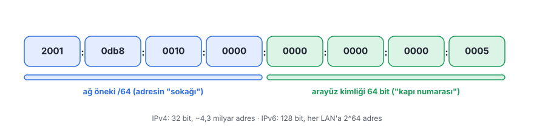
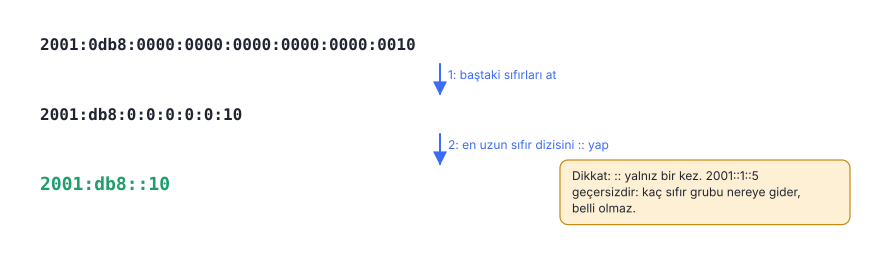
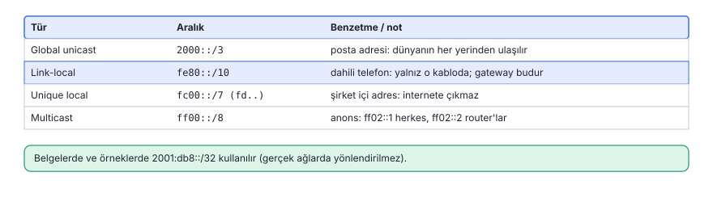
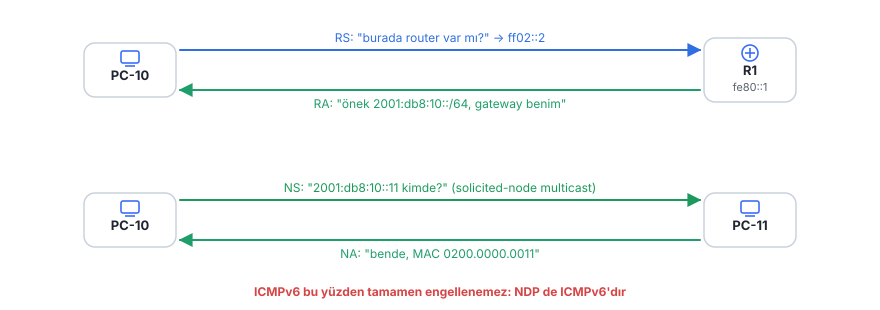
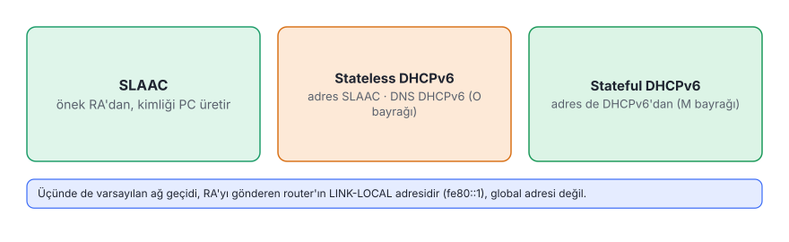
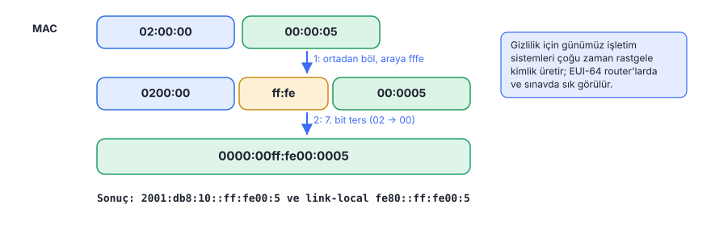
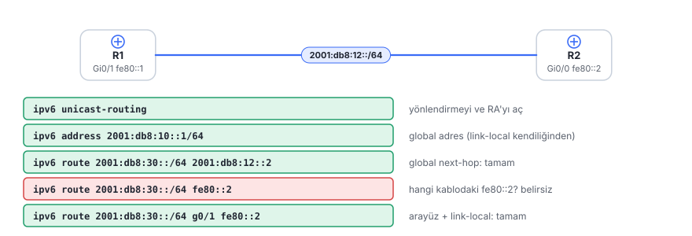

# AğLab Konu #16: IPv6 adresleme, SLAAC, NDP ve statik rota

> Uygulamadaki `ipv6` dersi bu belgeyle uyumludur. **Okuma dersi:** IPv6 Labber'da henüz yok; Sorun Çöz
> senaryoları motor desteği gelince eklenecek. Vakalar kâğıt üstünde, beklenen çıktılarla çözülür.
> Ön koşul: IP adresleme (Konu #2), statik routing (Konu #8). Şemalar: `docs/dersler/gorseller/ipv6.py`.

Bu konu bittiğinde öğrenci IPv6 adresini kısaltıp açar ve adres türlerini (global, link-local, unique local, multicast) tanır. NDP'nin ARP'nin ve router keşfinin yerini nasıl aldığını açıklar. SLAAC ile bir istemcinin adresini nasıl oluşturduğunu, EUI-64'ü ve DHCPv6 seçeneklerini bilir. Router'da IPv6 adresi ve statik rota yazar. `show ipv6 interface brief`, `show ipv6 route` ve `show ipv6 neighbors` çıktılarını okur. Seviye 2 (CCNA), süre yaklaşık 70 dakika.

## 0. Bir bakışta

- IPv6 adresi **128 bit**, 8 grup onaltılık sayı. LAN'larda **/64**: ilk yarı ağ, ikinci yarı arayüz kimliği.
- Kısaltma: baştaki sıfırları at; en uzun sıfır dizisini **bir kez** `::` yap.
- Her arayüzde kendiliğinden bir **link-local** (fe80::) adres olur; istemcinin **gateway'i budur**.
- **Broadcast yok**, ARP yok: yerine **NDP** (ICMPv6) vardır: RS/RA, NS/NA, DAD.
- İstemci adresini **SLAAC** ile kendisi üretebilir; DHCPv6 ek bilgi ya da adres verir.
- Router'da üç şey: `ipv6 unicast-routing`, arayüz adresi, rota. Link-local next-hop'ta **çıkış arayüzü** de yazılır.

> **Akılda kalsın:** Mantık IPv4 ile aynıdır (adres, gateway, gidiş ve dönüş rotası); farklı olan, adresin nasıl alındığı ve komşunun nasıl bulunduğudur.



## 1. Neden önemli

Operatörler, bulut hizmetleri ve telefonlar artık IPv6 konuşuyor; şube ağları çoğunlukla çift yığın (dual stack) çalışıyor. IPv6'nın mantığı IPv4'e benzer ama ayrıntıları farklıdır: broadcast ve ARP yoktur, adresi istemci kendisi üretir, gateway'in adresi link-local'dir. Bu farkları bilmeyen biri "IPv4 çalışıyor, IPv6 neden çalışmıyor?" sorusunda yanlış yerde arar.

## 2. Kavram

### 2.1 Yazım ve kısaltma

> **Benzetme:** Uzun bir telefon numarasını "sıfırları atlayarak" söylemek gibi; ama kaç sıfır atladığını dinleyenin çıkarabilmesi gerekir. Bu yüzden `::` yalnız bir kez kullanılır.



- Her grup 16 bit, 4 onaltılık hane.
- `2001:0db8:0000:0000:0000:0000:0000:0010` → `2001:db8::10`.
- Önek uzunluğu `/64` gibi yazılır; LAN'da hep /64 kullanılır, SLAAC bunu ister.

### 2.2 Adres türleri



> **Dikkat:** Link-local adres yalnız o kabloda geçerlidir. Her router arayüzünde aynı fe80::1 olabilir; çakışmaz, çünkü her kablo ayrı bir dünyadır.

### 2.3 NDP: komşuyu ve router'ı bulmak

> **Benzetme:** Yeni taşındığın binada önce "yönetici kim?" diye anons edersin (RS); yönetici "sokağın adı bu, çıkış kapısı benim" der (RA). Bir komşunun kapısını bulmak için "3 numarada kim oturuyor?" diye sorarsın (NS), o da "benim" der (NA).



- **RS/RA:** istemci router'ı ve öneki öğrenir.
- **NS/NA:** ARP'nin yerini alır; soru solicited-node multicast adresine (`ff02::1:ffXX:XXXX`) gider, herkese değil.
- **DAD:** adres kullanılmadan önce "bu adresi kullanan var mı?" diye sorulur.

### 2.4 Adresi almak: SLAAC ve DHCPv6



- **SLAAC:** RA'daki /64 önek + istemcinin ürettiği arayüz kimliği (EUI-64 ya da rastgele).
- **Stateless DHCPv6:** adres SLAAC'tan, DNS gibi bilgiler DHCPv6'dan (RA'da O bayrağı).
- **Stateful DHCPv6:** adres DHCPv6'dan (M bayrağı).

### 2.5 EUI-64



### 2.6 Router'da IPv6



- `ipv6 unicast-routing`: bu olmadan router IPv6 yönlendirmez ve RA göndermez.
- `ipv6 address 2001:db8:10::1/64`: link-local kendiliğinden oluşur.
- `ipv6 route 2001:db8:30::/64 2001:db8:12::2`; link-local next-hop'ta `ipv6 route ::/0 g0/1 fe80::2`.
- **Yol MTU:** IPv6'da router'lar paket parçalamaz; büyük paket için kaynağa ICMPv6 "Packet Too Big" döner. Bu mesajları engellemek bazı bağlantıları sessizce bozar.

> **Sahada:** Çoğu şube **çift yığın** (dual stack) çalışır: her arayüzde hem IPv4 hem IPv6. "IPv4 çalışıyor, IPv6 çalışmıyor" şikâyetinde önce `ipv6 unicast-routing` ve RA'ya bak.

## 3. Çıktı okuma

```
R1#show ipv6 interface brief
GigabitEthernet0/0     [up/up]
    FE80::1
    2001:DB8:10::1
GigabitEthernet0/1     [up/up]
    FE80::1
    2001:DB8:12::1

R1#show ipv6 route
C   2001:DB8:10::/64 [0/0]
     via GigabitEthernet0/0, directly connected
L   2001:DB8:10::1/128 [0/0]
     via GigabitEthernet0/0, receive
S   2001:DB8:30::/64 [1/0]
     via 2001:DB8:12::2

R1#show ipv6 neighbors
IPv6 Address                              Age Link-layer Addr State Interface
FE80::FF:FE00:5                             0 0200.0000.0005  REACH Gi0/0
```

| Soru | Komut |
| --- | --- |
| Arayüzde hangi adresler var? | `show ipv6 interface brief` |
| Router yönlendiriyor ve RA gönderiyor mu? | `show running-config \| include unicast-routing`; `show ipv6 interface g0/0` |
| Hedefe rota var mı? | `show ipv6 route` |
| Komşunun MAC'i çözülmüş mü? | `show ipv6 neighbors` |

## 4. Yönlendirmeli lab (motor desteği gelince Labber'da)

Topoloji: PC-10 ─ R1 ─ 2001:db8:12::/64 ─ R2 ─ PC-30; LAN'lar 2001:db8:10::/64 ve 2001:db8:30::/64.

1. R1 ve R2: `ipv6 unicast-routing`. *Neden:* bu satır olmadan router ne yönlendirir ne RA gönderir.
2. Adresler: R1 g0/0 `2001:db8:10::1/64`, g0/1 `2001:db8:12::1/64`; R2 karşılıkları.
3. `show ipv6 interface brief`: global ve link-local adresler.
4. PC'lerde SLAAC (`ip auto` gibi); PC'nin adresini EUI-64'le elle hesapla ve karşılaştır. *Neden:* SLAAC adresinin nereden geldiğini görmek RA'yı anlamaktır.
5. Statik rotalar: R1 `ipv6 route 2001:db8:30::/64 2001:db8:12::2`, R2 dönüşü.
6. Test: `ping 2001:db8:30::...`, `show ipv6 neighbors`.
7. Link-local next-hop: R1'deki rotayı `ipv6 route 2001:db8:30::/64 g0/1 fe80::2` ile yeniden yaz; arayüzsüz yazınca neden reddedildiğini açıkla.

> **Simülatörde yok:** IPv6 Labber'da henüz modellenmez. Lab'ı kâğıt üstünde, beklenen çıktılarla (Bölüm 3) yürüt.

## 5. Sık hatalar

| Kod | Hata | Belirti | Kanıt | Düzeltme |
| --- | --- | --- | --- | --- |
| E1 | `ipv6 unicast-routing` yok | PC'ler yalnız link-local alıyor, ağlar arası IPv6 yok | RA yok; running-config'te satır yok | `ipv6 unicast-routing` |
| E2 | LAN öneki /64 değil | SLAAC adres üretmiyor | Arayüzde /56 ya da /80 | LAN'da /64 |
| E3 | Link-local next-hop'u arayüzsüz yazmak | Rota kabul edilmiyor ya da çalışmıyor | `ipv6 route … fe80::2` | Çıkış arayüzünü ekle |
| E4 | Dönüş rotası eksik | Gidiş var, yanıt yok (IPv4'teki gibi) | Karşı router'da `show ipv6 route` | Dönüş rotası |
| E5 | ICMPv6'yı tamamen engellemek | Komşu bulunamıyor, bazı siteler açılmıyor | ACL'de `deny icmp any any` | NDP ve Packet Too Big'e izin ver |

## 6. Arıza senaryoları

> **Uygulamada:** Kâğıt üstü vakalar; motor desteği gelince Sorun Çöz'e `v6-*` kimlikleriyle eklenecek. Önce kendin çöz; neden ve çözüm kapalı kutularda.

### S1 · Başlangıç · PC'ler yalnız fe80 adresi alıyor (E1)

- **Belirti:** PC'lerde yalnız `fe80::` ile başlayan adres var; başka ağlara IPv6 ile ulaşılamıyor.
- **Hedef:** PC'ler 2001:db8:10::/64'ten adres alır.

<details><summary>Neden ve çözüm</summary>

R1'de `ipv6 unicast-routing` yok; router RA göndermiyor. Çözüm: R1 → `ipv6 unicast-routing`.

</details>

### S2 · Orta · SLAAC adres üretmiyor (E2)

- **Belirti:** Router çalışıyor, RA gidiyor ama PC global adres oluşturmuyor.
- **Hedef:** PC SLAAC ile global adres alır.

<details><summary>Neden ve çözüm</summary>

R1 g0/0 `2001:db8:10::1/80`; SLAAC /64 ister. Çözüm: `no ipv6 address 2001:db8:10::1/80` → `ipv6 address 2001:db8:10::1/64`.

</details>

### S3 · Orta · Rota yazıldı, trafik gitmiyor (E3)

- **Belirti:** R1'de B ağına rota görünüyor sanılıyor ama ping gitmiyor.
- **Hedef:** PC-10 → PC-30 IPv6 ping.

<details><summary>Neden ve çözüm</summary>

Rota `ipv6 route 2001:db8:30::/64 fe80::2` olarak arayüzsüz yazılmış. Çözüm: `ipv6 route 2001:db8:30::/64 g0/1 fe80::2`.

</details>

### S4 · Orta · Gidiş var, dönüş yok (E4)

- **Belirti:** R1'den R2'ye rota var; PC-10'un ping'i PC-30'a ulaşıyor ama yanıt dönmüyor.
- **Hedef:** İki yönde ping.

<details><summary>Neden ve çözüm</summary>

R2'de 2001:db8:10::/64 için rota yok. Çözüm: R2 → `ipv6 route 2001:db8:10::/64 2001:db8:12::1`.

</details>

### S5 · İleri · İki hata birden (E1 + E4)

- **Belirti:** B şubesindeki PC'ler yalnız link-local alıyor; A şubesinden B'ye de ulaşılamıyor.
- **Hedef:** İki şube de global adres alır, iki yönde ping.

<details><summary>Neden ve çözüm</summary>

R2'de `ipv6 unicast-routing` yok ve dönüş rotası eksik. Çözüm: ikisini de ekle.

</details>

## 7. Kısa sınav

**1.** `2001:0db8:0000:0000:0000:0000:0000:0010` adresinin kısaltılmış hali?

<details><summary>Cevap</summary>

`2001:db8::10`

</details>

**2.** Her arayüzde kendiliğinden oluşan, yalnız o bağlantıda geçerli adres türü?

<details><summary>Cevap</summary>

Link-local (`fe80::/10`).

</details>

**3.** IPv6'da ARP'nin yerini ne alır?

<details><summary>Cevap</summary>

NDP: Neighbor Solicitation / Neighbor Advertisement.

</details>

**4.** SLAAC için LAN öneki kaç bit olmalı?

<details><summary>Cevap</summary>

/64.

</details>

**5.** Router IPv6 yönlendirmiyor ve RA göndermiyor. Eksik komut?

<details><summary>Cevap</summary>

`ipv6 unicast-routing`.

</details>

**6.** MAC `0200.0000.0005` olan bir PC, 2001:db8:10::/64 önekinden EUI-64 ile hangi adresi üretir?

<details><summary>Cevap</summary>

`2001:db8:10::ff:fe00:5` (araya fffe, 7. bit ters: 02 → 00).

</details>

## 8. Özet kartı

| Komut | Ne işe yarar |
| --- | --- |
| `ipv6 unicast-routing` | Yönlendirme ve RA |
| `ipv6 address <adres>/64` | Arayüz adresi |
| `ipv6 route <önek> <next-hop>` | Statik rota |
| `ipv6 route <önek> <arayüz> fe80::x` | Link-local next-hop |
| `show ipv6 interface brief` | Arayüz adresleri |
| `show ipv6 route` | Rota tablosu |
| `show ipv6 neighbors` | NDP komşu tablosu (ARP tablosunun karşılığı) |

**Unutma:**

1. `::` yalnız bir kez.
2. LAN'da /64.
3. Gateway link-local'dir.
4. Broadcast ve ARP yok; NDP var, ICMPv6'yı tamamen kapatma.
5. Link-local next-hop'a arayüz yaz.

## 9. Doğrulama notları

Kaynaklar: INET CCNA 200-301 v1.1 (IPv6 adresleme, SLAAC, statik rota); RFC 4291 (adres mimarisi, türler, yazım), RFC 5952 (önerilen kısaltma), RFC 4861 (NDP), RFC 4862 (SLAAC), RFC 8200 (IPv6; router'da parçalama yok), Cisco IOS IPv6 yapılandırma kılavuzu (`ipv6 unicast-routing`, link-local next-hop'ta arayüz), CCNA 200-301 1.8–1.9 ve 3.3 (IPv6 adresleme ve statik rota).

| İddia | Sonuç |
| --- | --- |
| `::` adreste yalnız bir kez kullanılır | Doğru |
| EUI-64: araya fffe, 7. bit ters | Doğru |
| IPv6'da broadcast yok | Doğru |
| `ipv6 unicast-routing` olmadan IOS RA göndermez ve IPv6 yönlendirmez | Doğru |
| Link-local next-hop'lu statik rotada çıkış arayüzü gerekir | Doğru |

**Motor gereksinimleri**

- [ ] IPv6 Labber'da yok: adresleme, link-local, NDP, SLAAC, `ipv6 route`, `show ipv6 …`, VPCS IPv6 (motor işi). AğLab modeline de alan gerekir. Hazır olunca S1–S5 `v6-*` kimlikleriyle Sorun Çöz'e eklenir
