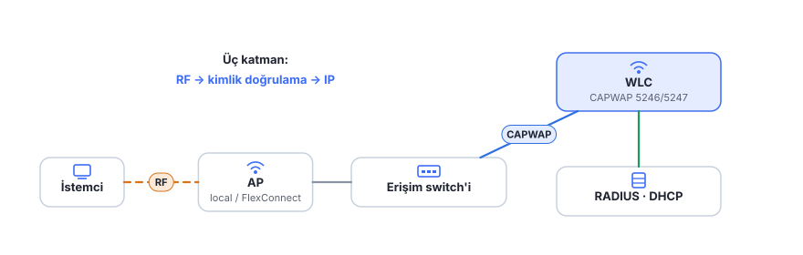
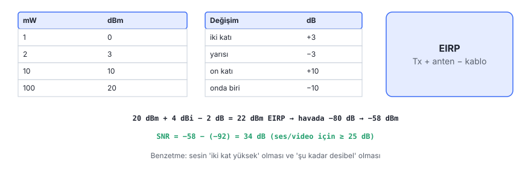
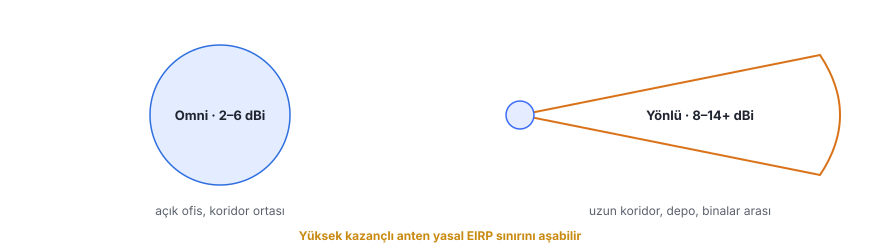
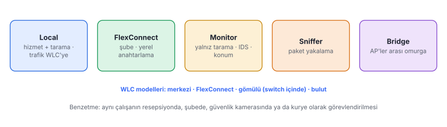
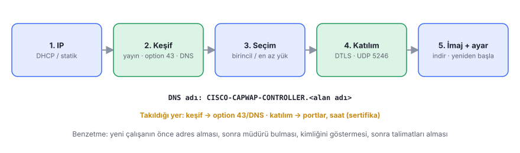
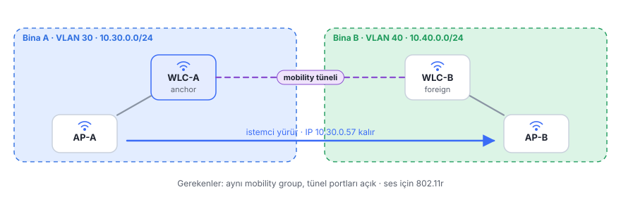
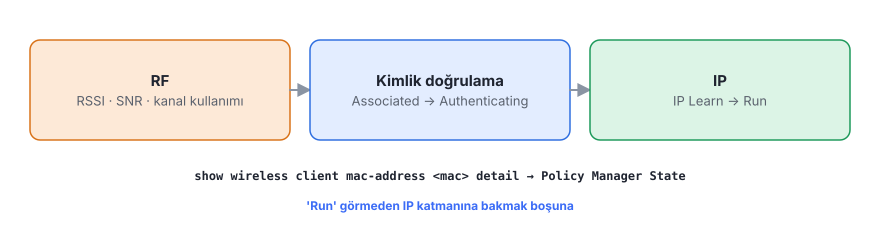

# AğLab Konu #40: Kurumsal kablosuz: RF, AP katılımı, dolaşım ve istemci sorunları

> Uygulamadaki `wlanadv` dersi bu belgeyle uyumludur. **Okuma dersi (Seviye 3, CCNP):** Kablosuz motorda kapsam dışıdır; ders kâğıt üstü hesap, lab ve çıktı okumayla işlenir. Temeli Konu #25'tedir.
> Ön koşul: Kablosuz ağlar: 802.11, AP, WLC ve güvenlik (Konu #25), DHCP (Konu #9), DNS (Konu #10), 802.1X (Konu #38). Şemalar: `docs/dersler/gorseller/kablosuz-ileri.py`.

Bu konu bittiğinde öğrenci RF gücünü dB ve dBm ile hesaplar: "3 dB iki kat, 10 dB on kat" kuralıyla bir bağlantının sinyal bütçesini çıkarır, EIRP'yi ve SNR'ı yorumlar. AP modlarını (local, FlexConnect, monitor, sniffer, bridge) ve WLC dağıtım modellerini (merkezi, FlexConnect, gömülü, bulut) ihtiyaca göre seçer. Bir AP'nin denetleyiciye katılma sürecini (DHCP, keşif, DTLS, imaj ve yapılandırma) adım adım anlatır ve takıldığı adımı bulur. Dolaşımın (aynı denetleyicide, denetleyiciler arasında L2 ve L3) nasıl çalıştığını ve istemcinin IP adresini nasıl koruduğunu açıklar. Bir istemcinin bağlanamaması arızasını RF, kimlik doğrulama ve IP katmanlarına ayırır. Süre yaklaşık 70 dakika.

## 0. Bir bakışta

- **dB** iki güç arasındaki orandır: **+3 dB ≈ iki kat, +10 dB = on kat**; −3 dB yarı, −10 dB onda bir.
- **dBm** 1 mW'a göre mutlak güçtür: 0 dBm = 1 mW, 10 dBm = 10 mW, 20 dBm = 100 mW.
- **EIRP** = verici gücü + anten kazancı (dBi) − kablo kaybı. **SNR** = sinyal (dBm) − gürültü (dBm); ses ve video için genelde ≥ 25 dB, sinyal ≥ −67 dBm hedeflenir.
- **AP modları**: local (merkezi, istemci + tarama), FlexConnect (şube; WLC bağlantısı kopsa da yerel çalışır), monitor, sniffer, bridge/mesh.
- **CAPWAP**: AP ile WLC arası tünel; **UDP 5246 kontrol (DTLS ile şifreli), UDP 5247 veri**.
- **AP katılımı**: IP al (DHCP) → WLC'yi keşfet (yayın, DHCP option 43, DNS `CISCO-CAPWAP-CONTROLLER`, önceden bilinen) → WLC seç → DTLS ile katıl → imaj/yapılandırma indir.
- **Dolaşım**: istemci aynı denetleyicide hızla taşınır; denetleyiciler arası L2 dolaşımda istemci kaydı taşınır; L3 dolaşımda istemci IP'sini korur, trafik **anchor** WLC'ye tünellenir.

> **Akılda kalsın:** Kablosuz arızanın üç katmanı vardır: RF (duyuyor mu?), kimlik doğrulama (içeri alınıyor mu?), IP (adres ve geçit alıyor mu?). Kullanıcının "Wi-Fi çalışmıyor" cümlesi bu üçünden hangisi olduğunu söylemez; sen bulursun.



## 1. Neden önemli

Bir ofiste kullanıcıların çoğu artık kablo takmaz; ağın "yüzü" kablosuzdur. Kablosuz arızalar ise en zor anlatılanlardır: "toplantı odasında kopuyor", "koridorda yürürken görüşme düşüyor", "yeni AP'ler ışık yakmıyor". Bunların arkasında fizik (sinyal, gürültü, kanal), denetleyici mimarisi (AP'nin WLC'ye katılamaması) ve kimlik doğrulama (802.1X, sertifika) vardır. ENCOR, kablosuzu sınav ağırlığının önemli bir parçası olarak ister: RF hesapları, AP modları, katılım süreci, dolaşım ve istemci sorun giderme.

## 2. Kavram

### 2.1 RF'yi sayılarla konuşmak: dB ve dBm

> **Benzetme:** dB, "iki kat daha yüksek sesle konuş" gibi göreli bir ifadedir; dBm ise "şu kadar desibel" gibi mutlak. Kulağımız da radyo dalgası gibi logaritmik çalışır: on kat daha güçlü ses bize "on kat yüksek" gelmez, biraz daha yüksek gelir.



| Değişim | dB |
| --- | --- |
| İki katı | +3 dB |
| Yarısı | −3 dB |
| On katı | +10 dB |
| Onda biri | −10 dB |

Örnek hesap: AP vericisi 20 dBm (100 mW), anten kazancı 4 dBi, kablo kaybı 2 dB → **EIRP = 20 + 4 − 2 = 22 dBm**. Havada 80 dB kayıp ve istemci anteninde 0 dBi → alınan sinyal **22 − 80 = −58 dBm**. Ortam gürültüsü −92 dBm ise **SNR = −58 − (−92) = 34 dB**: iyi.

- **RSSI**: istemcinin ölçtüğü alınan sinyal gücü (genelde dBm olarak gösterilir; −30 çok güçlü, −67 ses için alt sınır, −80 zayıf).
- **SNR**: sinyalin gürültünün ne kadar üstünde olduğu. Güçlü sinyal yetmez; gürültü de yüksekse veri hızı düşer.
- **Serbest uzay kaybı** mesafeyle ve frekansla artar: 5 GHz, 2,4 GHz'e göre aynı mesafede daha çok kaybeder; duvarlar ek kayıp ekler.

### 2.2 Antenler



- **Omni** (her yöne): koridor ortası, açık ofis; kazanç düşük (2–6 dBi).
- **Yönlü** (patch, panel, Yagi): uzun koridor, depo, binalar arası bağlantı; kazanç yüksek, demet dar.
- Kazanç enerji yaratmaz; enerjiyi bir yöne toplar. Bu yüzden yüksek kazançlı anten yasal EIRP sınırını aşabilir.

### 2.3 AP modları ve denetleyici modelleri



| AP modu | Ne yapar |
| --- | --- |
| Local | Varsayılan; istemcilere hizmet verir, boşta kanalları tarar; trafik CAPWAP ile WLC'ye gider |
| FlexConnect | Şube; trafiği yerelde switch'e bırakabilir (local switching); WLC'ye erişim kopsa da mevcut istemcilere hizmet sürer |
| Monitor | İstemciye hizmet vermez; sürekli tarar (sahte AP, konum, IDS) |
| Sniffer | Belirli kanalda paketleri yakalayıp bir analizöre gönderir |
| Bridge / mesh | AP'ler arası kablosuz omurga, binalar arası bağlantı |

| WLC modeli | Nerede | Not |
| --- | --- | --- |
| Merkezi (centralized) | Veri merkezinde donanım/sanal WLC | Büyük kampüs; trafik merkeze tünellenir |
| FlexConnect | WLC merkezde, AP'ler şubede | WAN üzerinden yönetim, yerel trafik |
| Gömülü (embedded) | Switch içinde WLC | Küçük-orta site |
| Bulut | Meraki gibi | Yönetim bulutta, veri yerelde |

### 2.4 AP'nin denetleyiciye katılması



1. **IP adresi**: AP DHCP'den adres alır (statik de olabilir).
2. **Keşif (discovery)**: AP bildiği yollarla WLC'leri arar:
   - Yerel alt ağa yayın (WLC aynı VLAN'daysa).
   - **DHCP option 43**: DHCP sunucusu WLC'nin yönetim adresini verir.
   - **DNS**: `CISCO-CAPWAP-CONTROLLER.<alan adı>` adını çözer.
   - Daha önce katıldığı ve hafızasında tuttuğu WLC'ler, yapılandırılmış birincil/ikincil WLC.
3. **Seçim**: AP'ye tanımlı birincil/ikincil/üçüncül WLC varsa ona; yoksa yükü en az olana.
4. **Katılım (join)**: DTLS ile şifreli CAPWAP kontrol kanalı kurulur (sertifikalarla karşılıklı doğrulama).
5. **İmaj ve yapılandırma**: AP'nin yazılımı WLC'ninkinden farklıysa indirilir ve AP yeniden başlar; sonra WLAN ve RF ayarları gelir.

> **Dikkat:** AP ile WLC arasında **UDP 5246 ve 5247** açık olmalı. Bir firewall ya da ACL bunları kapatırsa AP keşfeder ama katılamaz ya da katılır ama istemci trafiği geçmez. Saat farkı da (NTP yok) DTLS sertifika doğrulamasını bozabilir.

### 2.5 Dolaşım (roaming)



- Dolaşım kararını **istemci** verir: sinyal zayıflayınca başka AP arar. AP ve WLC yalnız yardımcı olur (802.11k komşu listesi, 802.11v yönlendirme, 802.11r hızlı geçiş).
- **Aynı WLC'de (intra-controller)**: istemci kaydı aynı denetleyicide; yalnız AP değişir. Hızlıdır.
- **WLC'ler arası, aynı alt ağ (L2)**: istemci kaydı yeni WLC'ye taşınır; IP değişmez.
- **WLC'ler arası, farklı alt ağ (L3)**: istemci eski IP'sini korur; ilk WLC **anchor** olur, yeni WLC **foreign**. Trafik foreign'dan anchor'a mobility tüneliyle gider. WLC'lerin aynı **mobility group**'ta olması gerekir.
- 802.1X ile her dolaşımda tam kimlik doğrulama yüzlerce milisaniye sürebilir; sesli görüşme kesilir. **802.11r (FT)** ve önbelleğe alınmış anahtarlar bunu kısaltır.

### 2.6 İstemci bağlanamıyor: üç katman



| Katman | Soru | Kanıt |
| --- | --- | --- |
| RF | SSID'yi görüyor mu, sinyal ve SNR yeterli mi? | İstemcinin RSSI/SNR'ı, AP kanal kullanımı, girişim |
| İlişkilenme ve kimlik doğrulama | Association reddediliyor mu, 802.1X/PSK başarısız mı? | WLC istemci durumu, RADIUS log'u |
| IP | Adres, geçit, DNS alıyor mu? | WLC'de istemci IP'si, DHCP, VLAN eşlemesi |

> **Sahada:** WLC'nin istemci ayrıntı sayfası ya da `show wireless client mac-address <mac> detail` istemcinin hangi aşamada olduğunu gösterir (ör. "Authenticating", "IP Learn", "Run"). "Run" görmeden IP katmanına bakmak boşunadır.

## 3. Çıktı okuma

```
WLC#show ap summary
Number of APs: 3
AP Name     Slots  AP Model          Ethernet MAC    Radio MAC       Location   Country  IP Address    State
------------------------------------------------------------------------------------------------------------
AP-KAT1-01  2      C9120AXI-E        a0b4.39aa.0101  a0b4.39bb.0100  Kat 1      TR       10.50.0.21    Registered
AP-KAT1-02  2      C9120AXI-E        a0b4.39aa.0102  a0b4.39bb.0200  Kat 1      TR       10.50.0.22    Registered
AP-KAT2-01  2      C9120AXI-E        a0b4.39aa.0201  a0b4.39bb.0300  Kat 2      TR       10.50.0.23    Downloading
                                        ← Kat 2'deki AP imaj indiriyor: birkaç dakika bekle, sonra yeniden başlayıp Registered olur

WLC#show wireless client mac-address 3c22.fb11.2233 detail
Client MAC Address : 3c22.fb11.2233
Client IPv4 Address : 0.0.0.0
AP Name: AP-KAT1-02
Wireless LAN Name: KURUMSAL
Policy Manager State: IP Learn
Authentication Method : Dot1x
VLAN : 30
Radio Signal Strength Indicator : -61 dBm
Signal to Noise Ratio : 31 dB
                                        ← RF iyi (−61 dBm, SNR 31), 802.1X geçmiş; "IP Learn"de takılı:
                                          VLAN 30'da DHCP sorunu (helper, havuz, VLAN trunk'ta yok)

AP-KAT3-01#show capwap client config
  ...
  Primary controller IP: 0.0.0.0
AP-KAT3-01#show capwap ip config
  IP Address : 10.60.0.31
  Gateway : 10.60.0.1
  DNS Server : 10.0.100.53
  Domain Name : kurum.local
                                        ← AP adres almış ama birincil WLC yok; option 43 ya da
                                          CISCO-CAPWAP-CONTROLLER.kurum.local DNS kaydı gerekli
```

| Soru | Komut / yer |
| --- | --- |
| AP'ler katıldı mı, durumları? | `show ap summary` |
| AP neden katılamıyor? | `show ap join stats summary`, AP konsolunda `show capwap client …` |
| İstemci hangi aşamada? | `show wireless client mac-address <mac> detail` |
| RF durumu, kanal, güç? | `show ap dot11 5ghz summary`, `show ap auto-rf dot11 5ghz` |
| Dolaşım, mobility? | `show wireless mobility summary` |

## 4. Yönlendirmeli lab

> **Simülatörde yok:** Hesapları ve adımları kâğıt üstünde yürüt; Bölüm 3'teki çıktılarla karşılaştır.

1. **Sinyal bütçesi**: AP 17 dBm, anten 3 dBi, kablo kaybı 1 dB, havada 75 dB kayıp, gürültü −95 dBm. EIRP, alınan sinyal ve SNR'ı hesapla (cevap: 19 dBm, −56 dBm, 39 dB).
2. Aynı AP'nin gücünü yarıya indir (−3 dB); yeni alınan sinyal? (−59 dBm)
3. Yeni bir binada AP'ler WLC'den farklı bir VLAN'da. DHCP sunucusunda option 43 ya da DNS'te `CISCO-CAPWAP-CONTROLLER` kaydı ekle; `show ap summary` ile katılımı gör.
4. AP ile WLC arasındaki firewall'da UDP 5246'yı kapat; AP'nin katılamadığını, `show ap join stats` ile hangi aşamada kaldığını yorumla.
5. Bir şube için FlexConnect modu seç; WAN koptuğunda mevcut istemcilerin yerel trafiğinin sürdüğünü açıkla.
6. Bir istemcinin "IP Learn"de kaldığı çıktıyı al (Bölüm 3) ve DHCP tarafında üç olası nedeni say.
7. İki WLC arasında L3 dolaşımı tasarla: mobility group, anchor/foreign; istemci IP'sinin neden değişmediğini açıkla.

## 5. Sık hatalar

| Kod | Hata | Belirti | Kanıt | Düzeltme |
| --- | --- | --- | --- | --- |
| E1 | AP WLC'yi bulamıyor | AP ışığı yanıp sönüyor, WLC'de yok | AP'de birincil WLC 0.0.0.0 | Option 43 / DNS kaydı / birincil WLC tanımı |
| E2 | CAPWAP portları kapalı | Keşif var, katılım yok | join stats: DTLS/join başarısız | UDP 5246/5247 izin |
| E3 | Saat farkı | DTLS sertifika hatası | AP/WLC saatleri farklı | NTP |
| E4 | Düşük SNR / girişim | Bağlı ama yavaş, kopuyor | RSSI iyi, SNR düşük; kanal kullanımı yüksek | Kanal planı, güç, girişim kaynağı |
| E5 | Kimlik doğrulama | İlişkilendi, ağa giremedi | İstemci "Authenticating"; RADIUS reddi | Sertifika, kullanıcı, EAP yöntemi |
| E6 | WLAN'ın VLAN'ı/DHCP'si | 802.1X geçti, IP yok | İstemci "IP Learn" | VLAN trunk'ta mı, helper, havuz |
| E7 | Mobility group uyuşmuyor | Binalar arası yürürken bağlantı kopuyor | L3 dolaşımda istemci yeniden IP alıyor ya da düşüyor | Aynı mobility group, tünel portları açık |

## 6. Arıza senaryoları

> **Uygulamada:** Kâğıt üstü vakalar. Önce kendin çöz; neden ve çözüm kapalı kutularda.

### S1 · Başlangıç · Yeni kattaki AP'ler denetleyicide görünmüyor (E1)

- **Belirti:** 3. kata 6 AP takıldı; PoE ile açıldılar ama `show ap summary`'de yoklar. AP'ler DHCP'den 10.60.0.x adres almış.
- **Hedef:** AP'ler katılsın.

<details><summary>Neden ve çözüm</summary>

WLC başka bir alt ağda; yayınla bulunamıyor, AP'ler daha önce hiç katılmadığı için hafızalarında WLC yok. Çözüm: 10.60.0.0 havuzuna DHCP option 43 (WLC yönetim adresi) ya da DNS'e `CISCO-CAPWAP-CONTROLLER.kurum.local` kaydı.

</details>

### S2 · Orta · Toplantı odasında sinyal tam ama video takılıyor (E4)

- **Belirti:** Kullanıcılar dört çizgi sinyal görüyor (−55 dBm); görüntülü görüşmeler donuyor. Aynı odada mikrodalga fırın yok.
- **Hedef:** Akıcı video.

<details><summary>Neden ve çözüm</summary>

İstemci SNR'ı 12 dB: gürültü yüksek. Komşu firmanın AP'leri aynı 2,4 GHz kanalında; kanal kullanımı %80. Çözüm: istemcileri 5 GHz'e yönlendir (band steering), 2,4 GHz'te kanal planı 1/6/11, gerekiyorsa gücü ve kapsama hücrelerini yeniden düzenle.

</details>

### S3 · Orta · AP'ler katıldı, istemciler internetsiz (E6)

- **Belirti:** KURUMSAL SSID'ye 802.1X ile bağlanılıyor; istemciler 169.254 adres alıyor. WLC'de istemciler "IP Learn".
- **Hedef:** İstemciler adres alsın.

<details><summary>Neden ve çözüm</summary>

WLAN VLAN 30'a eşlenmiş; ama WLC'nin bağlı olduğu switch portunda trunk izinli VLAN listesinde 30 yok (ya da VLAN 30 geçidinde helper yok). Çözüm: trunk'a VLAN 30'u ekle, helper'ı doğrula.

</details>

### S4 · İleri · Binalar arası yürürken sesli görüşme düşüyor (E7)

- **Belirti:** A binasından B binasına geçen kullanıcıların telefon görüşmeleri kopuyor; B'de telefon yeni bir IP alıyor.
- **Hedef:** Görüşme kesilmeden geçiş.

<details><summary>Neden ve çözüm</summary>

İki bina farklı WLC'lere ve farklı alt ağlara bağlı; WLC'ler aynı mobility group'ta değil, L3 dolaşım yapılamıyor, istemci sıfırdan bağlanıyor. Çözüm: aynı mobility group ve mobility tünel portlarının açılması (anchor/foreign); ses için 802.11r (FT).

</details>

### S5 · İleri · Hafta sonu güncellemesinden sonra hiçbir AP katılmıyor (E3)

- **Belirti:** WLC yeniden kuruldu; AP'ler keşfediyor ama katılamıyor. `show ap join stats`: DTLS el sıkışması başarısız.
- **Hedef:** AP'ler katılsın.

<details><summary>Neden ve çözüm</summary>

WLC'nin saati fabrika varsayılanında (yıllar geride); AP sertifikaları WLC'ye göre "henüz geçerli değil". Çözüm: WLC'de NTP yapılandır ya da saati düzelt.

</details>

## 7. Kısa sınav

**1.** 100 mW kaç dBm'dir?

<details><summary>Cevap</summary>

20 dBm (1 mW = 0 dBm, ×10 = +10 dB, ×100 = +20 dB).

</details>

**2.** Verici 20 dBm, anten 6 dBi, kablo kaybı 3 dB. EIRP?

<details><summary>Cevap</summary>

23 dBm.

</details>

**3.** Sinyal −65 dBm, gürültü −90 dBm. SNR?

<details><summary>Cevap</summary>

25 dB.

</details>

**4.** CAPWAP hangi portları kullanır?

<details><summary>Cevap</summary>

UDP 5246 (kontrol, DTLS ile) ve UDP 5247 (veri).

</details>

**5.** AP, WLC'yi farklı alt ağda nasıl bulabilir?

<details><summary>Cevap</summary>

DHCP option 43, DNS'te CISCO-CAPWAP-CONTROLLER kaydı, daha önce katıldığı ya da tanımlı birincil WLC.

</details>

**6.** L3 dolaşımda istemci IP'sini nasıl korur?

<details><summary>Cevap</summary>

İlk WLC anchor olur; yeni WLC (foreign) istemci trafiğini mobility tüneliyle anchor'a taşır.

</details>

## 8. Özet kartı

| Kavram | Hatırla |
| --- | --- |
| dB | +3 iki kat, +10 on kat |
| dBm | 0 = 1 mW, 20 = 100 mW |
| EIRP | Tx + anten − kablo |
| SNR | sinyal − gürültü; ses için ≥ 25 dB |
| CAPWAP | UDP 5246 kontrol (DTLS), 5247 veri |
| Keşif | yayın, option 43, DNS, önceki/tanımlı WLC |
| Dolaşım | intra, inter L2, inter L3 (anchor/foreign) |

**Unutma:**

1. RF → kimlik doğrulama → IP.
2. Güçlü sinyal yetmez, SNR'a bak.
3. AP katılmıyorsa: keşif mi, DTLS mi, saat mi?
4. FlexConnect şubede WAN kopsa da çalışır.
5. Dolaşımı istemci başlatır.

## 9. Doğrulama notları

Kaynaklar: CCNP ENCOR v1.0 (wireless theory, wireless LAN topologies, AP join, roaming, client troubleshooting; kapsam kontrolü için), INE CCNA 200-301 kablosuz bölümleri; IEEE 802.11 (RSSI tanımı), RFC 5415 ve RFC 5416 (CAPWAP); Cisco Catalyst 9800 yapılandırma kılavuzu. Ders metni, örnek çıktılar ve şemalar özgün yazıldı.

| İddia | Sonuç |
| --- | --- |
| +3 dB yaklaşık iki kat, +10 dB on kat güç demektir; 0 dBm = 1 mW | Doğru |
| EIRP = verici gücü + anten kazancı − kablo kaybı | Doğru |
| CAPWAP kontrol UDP 5246 (DTLS), veri UDP 5247 kullanır | Doğru |
| AP, WLC'yi DHCP option 43 ve DNS CISCO-CAPWAP-CONTROLLER kaydıyla bulabilir | Doğru |
| FlexConnect AP'ler WLC bağlantısı kopunca yerel anahtarlamayla hizmeti sürdürebilir | Doğru |
| L3 dolaşımda ilk WLC anchor, yeni WLC foreign olur ve trafik tünellenir | Doğru |

**Motor gereksinimleri**

- [ ] Kablosuz (RF, AP katılımı, dolaşım) motor kapsamı dışında; okuma dersi olarak kalır.
