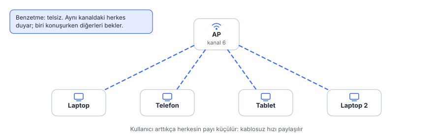
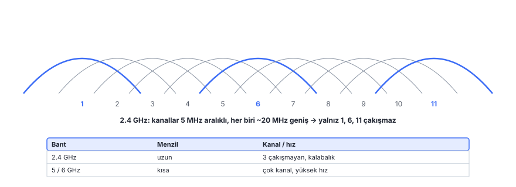
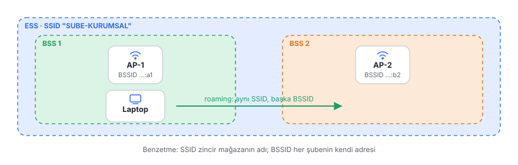
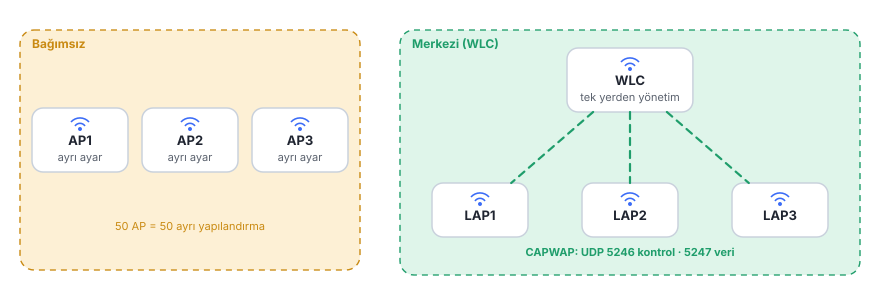
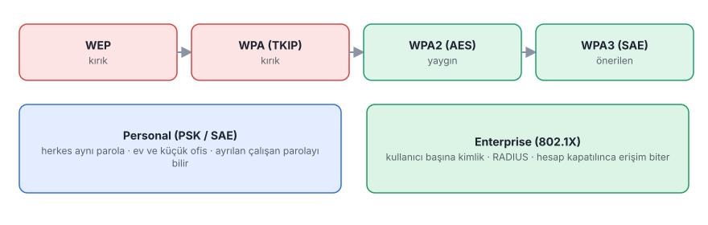
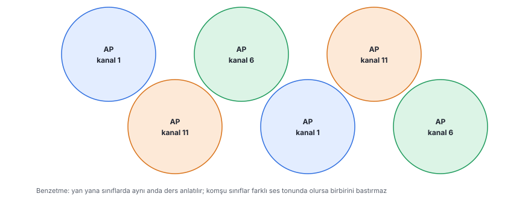
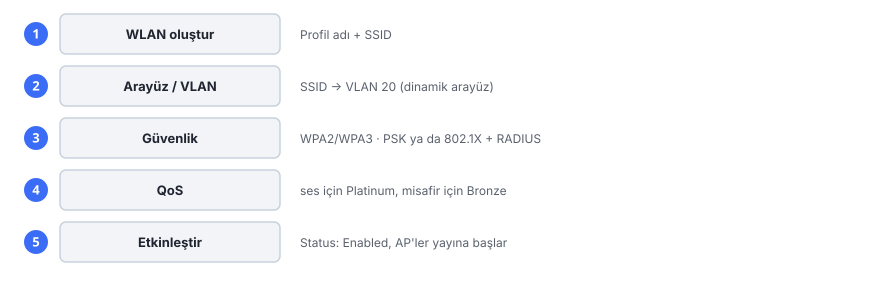

# AğLab Konu #25: Kablosuz ağlar: 802.11, AP, WLC ve güvenlik

> Uygulamadaki `wireless` dersi bu belgeyle uyumludur. **Okuma dersi:** radyo ortamı Labber'da
> modellenmez; vakalar kâğıt üstünde çözülür. Ön koşul: VLAN ve trunk (Konu #5–6), DHCP (Konu #9),
> erişim güvenliği ve RADIUS (Konu #22). Şemalar: `docs/dersler/gorseller/kablosuz.py`.

Bu konu bittiğinde öğrenci kablosuzun neden paylaşılan, yarı çift yönlü bir ortam olduğunu açıklar. 2.4 ve 5 GHz bantlarını ve 2.4 GHz'deki üç çakışmayan kanalı bilir. SSID, BSSID, BSS ve ESS kavramlarını ayırır. Bağımsız AP ile WLC'ye bağlı lightweight AP'yi karşılaştırır ve CAPWAP'ın rolünü söyler. WPA2/WPA3 Personal ile Enterprise farkını açıklar ve bir WLAN'ın WLC'de hangi adımlarla tanımlandığını sıralar. Seviye 2 (CCNA), süre yaklaşık 50 dakika.

## 0. Bir bakışta

- Hava **paylaşılan** bir ortamdır: aynı kanalda aynı anda yalnız biri konuşur (yarı çift yönlü, CSMA/CA).
- **2.4 GHz** uzağa gider ama yalnız **1, 6, 11** çakışmaz; **5/6 GHz** daha çok kanal ve hız sunar.
- **SSID** ağın adı, **BSSID** AP radyosunun MAC'i; aynı SSID'li AP'ler bir **ESS** oluşturur, istemci aralarında **dolaşır**.
- **Lightweight AP**'ler **WLC**'ye **CAPWAP** tüneliyle (UDP 5246/5247) bağlanır; yönetim merkezden yapılır.
- **WPA2/WPA3**: Personal tek parola, **Enterprise** kullanıcı başına **802.1X + RADIUS**.
- Her SSID kablolu tarafta bir **VLAN**'a bağlanır.

> **Akılda kalsın:** "Wi-Fi'ye bağlı ama internet yok" çoğu zaman kablosuz değil, kablolu tarafın sorunudur: VLAN, trunk, DHCP. Önce o tarafı ele.



## 1. Neden önemli

Şubelerde kullanıcıların çoğu artık kablosuzdadır: dizüstü bilgisayarlar, telefonlar, el terminalleri, kart okuyucular. "Wi-Fi yavaş", "toplantı odasında kopuyor", "misafir ağı şirket sunucularını görüyor" şikâyetleri sahada en sık duyulanlar arasındadır. Bu dersin amacı radyo mühendisi yetiştirmek değil; şikâyetin radyodan mı, kablolu taraftan mı, güvenlik ayarından mı geldiğini ayırmayı öğretmektir.

## 2. Kavram

### 2.1 Paylaşılan ortam

> **Benzetme:** Telsizle konuşan bir ekip: aynı kanaldaki herkes her şeyi duyar, biri konuşurken diğerleri bekler. Ekibe yeni kişi katıldıkça herkesin konuşma payı azalır.

- Kablolu switch portu tam çift yönlüdür ve her port ayrıdır; kablosuzda bir AP'nin bir kanalındaki bütün istemciler hızı **paylaşır**.
- Çarpışma algılanamadığı için önce dinlenir, boşsa gönderilir: **CSMA/CA**. Her çerçeve onaylanır (ACK); onay gelmezse yeniden gönderilir.
- Duvarlar, mikrodalga fırın, komşu ağlar sinyali zayıflatır ya da gürültü ekler.

### 2.2 Bantlar ve kanallar



- 2.4 GHz'de kanallar 5 MHz arayla dizilir, ama her kanal yaklaşık 20 MHz yer kaplar: yalnız **1, 6, 11** birbirine taşmaz.
- 5 GHz'de çok sayıda çakışmayan kanal vardır; kanallar birleştirilip (40/80/160 MHz) hız artırılabilir ama kanal sayısı azalır.
- Wi-Fi 6E ve 7 ile 6 GHz bandı da kullanılır.

### 2.3 SSID, BSSID ve dolaşım



- Bir AP birden çok SSID yayınlayabilir (kurumsal, misafir); her SSID genelde ayrı bir VLAN'a gider.
- İstemci sinyal zayıflayınca aynı SSID'yi yayan başka bir AP'ye geçer: **roaming**. Kararı istemci verir.

> **Dikkat:** Aynı SSID'yi farklı güvenlik ayarlarıyla yayan iki AP dolaşımı bozar; istemci geçince yeniden kimlik doğrulama ister ya da hiç bağlanamaz.

### 2.4 AP mimarileri ve WLC

> **Benzetme:** Bağımsız AP'ler kendi menüsünü yazan zincirsiz kafeler gibidir; WLC'ye bağlı AP'ler bir zincirin şubeleri: menü, fiyat ve kurallar genel merkezden gelir.



- **Autonomous:** her AP ayrı yapılandırılır; küçük ofisler için.
- **Lightweight + WLC:** AP açılınca WLC'yi bulur (DHCP seçeneği 43, DNS, yayın) ve **CAPWAP** tüneli kurar. Kontrol trafiği UDP 5246, veri UDP 5247.
- WLC kanal ve gücü otomatik ayarlar (RRM), istemcileri izler, dolaşımı yönetir.
- **Cloud** yönetimli AP'ler (ör. Meraki) yönetimi internetteki bir panele taşır.
- AP'yi besleyen switch portu çoğu zaman **PoE** verir; lightweight AP'nin portu genelde access (yönetim VLAN'ı), bağımsız AP'ninki trunk'tır.

### 2.5 Güvenlik



- **WPA2-Personal / WPA3-Personal:** herkes aynı parolayı bilir. Ayrılan çalışan parolayı da götürür; değiştirmek herkesi etkiler.
- **WPA2/WPA3-Enterprise:** her kullanıcı kendi kimliğiyle girer; AP (ya da WLC) bir **802.1X** doğrulayıcısıdır ve RADIUS sunucusuna sorar (Konu #22).
- Misafir ağı: ayrı SSID, ayrı VLAN, ACL ile yalnız internete çıkış; çoğu zaman bir karşılama sayfası (captive portal).

> **Sahada:** WPA3 eski cihazları desteklemeyebilir; geçiş modunda (WPA2/WPA3 karışık) yayın yapılıp eski cihazlar zamanla değiştirilir.

### 2.6 Kanal planı ve kapsama



- Komşu AP'ler farklı kanalda: eş kanal girişimi azalır.
- Güç gereğinden yüksek olursa AP'ler birbirini duyar, istemci uzaktaki AP'ye "yapışır" (sticky client).
- Kapsama keşfi (site survey) duvarları, kalabalık alanları ve bant seçimini hesaba katar.

### 2.7 WLC'de WLAN tanımlamak



## 3. Çıktı okuma

WLC'nin (AireOS) komut satırından örnekler:

```
(WLC) >show wlan summary
WLAN ID  WLAN Profile Name / SSID        Status    Interface Name
-------  ------------------------------  --------  --------------
1        KURUMSAL / SUBE-KURUMSAL        Enabled   kurumsal-vlan20
2        MISAFIR  / SUBE-MISAFIR         Enabled   management       ← misafir yönetim ağında!

(WLC) >show ap summary
AP Name   Slots  AP Model          Ethernet MAC       Location   Port  Country
AP-1      2      AIR-AP2802I-E-K9  70:db:98:aa:aa:a1  Kat-1      1     TR
AP-2      2      AIR-AP2802I-E-K9  70:db:98:bb:bb:b2  Kat-2      1     TR
                                                         ← iki AP de WLC'ye bağlı (CAPWAP kurulmuş)

(WLC) >show client summary
MAC Address        AP Name  Slot  Status      WLAN  Auth  Protocol  Port
3c:22:fb:11:22:33  AP-1     1     Associated  1     Yes   802.11ax(5 GHz)  1
3c:22:fb:44:55:66  AP-2     0     Associated  2     Yes   802.11n(2.4 GHz) 1
```

| Soru | Nereye bak |
| --- | --- |
| SSID hangi VLAN'a çıkıyor? | `show wlan summary` → Interface Name |
| AP'ler WLC'ye bağlı mı? | `show ap summary` |
| İstemci hangi AP'de, hangi bantta, doğrulandı mı? | `show client summary` |
| Kablolu taraf? | AP'nin switch portu: VLAN, trunk, PoE (`show power inline`) |

## 4. Yönlendirmeli lab

> **Simülatörde yok:** Lab'ı kâğıt üstünde yürüt.

Şube: iki kat, iki AP, bir WLC; kurumsal kullanıcılar VLAN 20, misafirler VLAN 30 (yalnız internet), RADIUS 192.168.99.50.

1. Kat planına iki AP yerleştir; 2.4 GHz kanallarını seç. *Neden:* yan yana AP'ler aynı kanalda olmamalı.
2. 5 GHz'yi birincil bant yap; 2.4 GHz'yi eski cihazlar için bırak.
3. WLAN 1: SSID `SUBE-KURUMSAL`, arayüz VLAN 20, WPA2/WPA3-Enterprise, RADIUS sunucusu.
4. WLAN 2: SSID `SUBE-MISAFIR`, arayüz VLAN 30, WPA3-Personal ya da karşılama sayfası, ACL ile yalnız internet.
5. AP'lerin switch portlarını yaz: access, yönetim VLAN'ı, PoE.
6. Bölüm 3'teki `show wlan summary` çıktısında hatayı bul ve düzelt.

> **Benzetme:** Lab, iki şubesi olan bir kafe zincirinin menüsünü genel merkezden yazmaktır: şubeler (AP) yalnız uygular.

## 5. Sık hatalar

| Kod | Hata | Belirti | Kanıt | Düzeltme |
| --- | --- | --- | --- | --- |
| E1 | SSID yanlış VLAN'a bağlı | Bağlanıyor ama adres yok ya da yanlış ağ | `show wlan summary` arayüz | Doğru dinamik arayüz |
| E2 | VLAN trunk'ta yok (WLC ya da AP uplink) | Bağlı ama DHCP yok | `show interfaces trunk` | VLAN'ı izinli listeye ekle |
| E3 | Yan AP'ler aynı kanalda | Yavaş, yeniden gönderim çok | Kanal planı | 1/6/11 dağıt, RRM |
| E4 | RADIUS paylaşılan anahtar farklı | Enterprise SSID'de herkes reddediliyor | RADIUS kayıtları | Anahtarı eşitle |
| E5 | Misafir VLAN'ı iç ağa açık | Misafir sunucuları görüyor | ACL yok | Misafir ACL'si |

## 6. Arıza senaryoları

> **Uygulamada:** Kâğıt üstü vakalar. Önce kendin çöz; neden ve çözüm kapalı kutularda.

### S1 · Başlangıç · Bağlı ama internet yok (E2)

- **Belirti:** Kurumsal SSID'ye bağlanan herkes 169.254.x.x adresi alıyor; kablolu PC'ler sorunsuz.
- **Hedef:** Kablosuz istemciler VLAN 20'den adres alır.

<details><summary>Neden ve çözüm</summary>

WLC'nin bağlı olduğu switch portundaki trunk'ta VLAN 20 izinli değil; DHCP istekleri kablolu tarafa çıkamıyor. Çözüm: `switchport trunk allowed vlan add 20`.

</details>

### S2 · Orta · Misafir ağı yazıcıyı görüyor (E1, E5)

- **Belirti:** Misafir telefonundan şirket yazıcısına baskı gönderilebiliyor.
- **Hedef:** Misafirler yalnız internete çıkar.

<details><summary>Neden ve çözüm</summary>

`SUBE-MISAFIR` WLAN'ı `management` arayüzüne bağlı: misafirler yönetim ağında. Çözüm: misafir WLAN'ını VLAN 30 arayüzüne al ve misafir ACL'sini uygula.

</details>

### S3 · Orta · Öğleden sonra her şey yavaşlıyor (E3)

- **Belirti:** Kat 2'de kalabalık saatlerde kablosuz çok yavaş; sinyal güçlü görünüyor.
- **Hedef:** Yavaşlığın nedenini bul.

<details><summary>Neden ve çözüm</summary>

AP-2 ve yan kattaki AP-1 2.4 GHz kanal 6'da; istemcilerin çoğu 2.4 GHz'de. Eş kanal girişimi ve paylaşılan ortam. Çözüm: kanalları ayır (1 ve 11), 5 GHz'yi öne çıkar (band steering), gerekirse AP ekle.

</details>

### S4 · İleri · Enterprise SSID'de kimse giremiyor (E4)

- **Belirti:** RADIUS sunucusu yenilendi; bütün kullanıcılar "kimlik doğrulama başarısız" alıyor, sunucuda istek görünüyor ama "bilinmeyen istemci" kaydı var.
- **Hedef:** Kullanıcılar kendi hesaplarıyla bağlanır.

<details><summary>Neden ve çözüm</summary>

Yeni sunucuda WLC bir RADIUS istemcisi olarak tanımlanmamış ya da paylaşılan anahtar farklı. Çözüm: sunucuya WLC'nin adresini ve WLC'deki anahtarla aynı anahtarı ekle.

</details>

## 7. Kısa sınav

**1.** 2.4 GHz'de birbirine taşmayan üç kanal?

<details><summary>Cevap</summary>

1, 6, 11.

</details>

**2.** SSID ile BSSID farkı?

<details><summary>Cevap</summary>

SSID ağın adıdır; BSSID bir AP radyosunun MAC adresidir.

</details>

**3.** Lightweight AP'ler WLC ile hangi protokolle konuşur?

<details><summary>Cevap</summary>

CAPWAP (UDP 5246 kontrol, 5247 veri).

</details>

**4.** Ayrılan çalışanın erişimini parolayı herkes için değiştirmeden kesmek için hangi güvenlik modu?

<details><summary>Cevap</summary>

WPA2/WPA3-Enterprise (802.1X + RADIUS): hesabı kapatmak yeter.

</details>

**5.** Kablosuz neden kablolu switch portu gibi tam çift yönlü değildir?

<details><summary>Cevap</summary>

Aynı kanaldaki herkes aynı radyo ortamını paylaşır; aynı anda yalnız biri gönderebilir (CSMA/CA).

</details>

**6.** Kablosuz istemciler bağlanıyor ama 169.254 adresi alıyor; kablolu PC'ler sorunsuz. İlk nereye bakarsın?

<details><summary>Cevap</summary>

Kablolu tarafa: SSID'nin bağlı olduğu VLAN'ın WLC/AP uplink trunk'ında izinli olup olmadığına ve DHCP'ye.

</details>

## 8. Özet kartı

| Kavram | Hatırla |
| --- | --- |
| Ortam | Paylaşılan, yarı çift yönlü, CSMA/CA |
| 2.4 GHz | Uzun menzil, yalnız 1/6/11 |
| 5/6 GHz | Çok kanal, yüksek hız, kısa menzil |
| SSID / BSSID / ESS | Ad / AP radyosu MAC'i / aynı SSID'li AP'ler |
| WLC + CAPWAP | Merkezi yönetim, UDP 5246/5247 |
| Güvenlik | WPA2/WPA3; Enterprise = 802.1X + RADIUS |

**Unutma:**

1. Bağlı ama internet yok → önce kablolu taraf.
2. Komşu AP'ler farklı kanalda.
3. Her SSID doğru VLAN'a.
4. Kurumda Enterprise, misafire ayrı VLAN + ACL.
5. WEP ve WPA (TKIP) kullanılmaz.

## 9. Doğrulama notları

Kaynaklar: INET CCNA 200-301 v1.1 ve INE ENCOR (kablosuz temelleri, AP modları, WLC, güvenlik; yalnız kapsam kontrolü için); IEEE 802.11; RFC 5415/5416 (CAPWAP); Cisco WLC yapılandırma kılavuzu. Ders metni, örnek çıktılar ve şemalar özgün yazıldı.

| İddia | Sonuç |
| --- | --- |
| 2.4 GHz'de 1, 6, 11 çakışmayan kanallar (20 MHz) | Doğru |
| CAPWAP kontrol UDP 5246, veri UDP 5247 | Doğru (RFC 5415) |
| 802.11 ortam erişimi CSMA/CA | Doğru |
| WPA3-Personal SAE kullanır | Doğru |
| Enterprise modunda AP/WLC 802.1X doğrulayıcısı, RADIUS sunucusuna sorar | Doğru |
| AP, WLC'yi DHCP seçeneği 43 ve DNS ile bulabilir | Doğru |

**Motor gereksinimleri**

- [ ] Radyo ortamı, AP/WLC ve CAPWAP Labber'da yok. Kablolu taraf (VLAN, trunk, DHCP) senaryoları mevcut motorla kurulabilir: S1 için "WLC uplink trunk'ında VLAN eksik" vakası `wifi-*` kimliğiyle eklenebilir.
