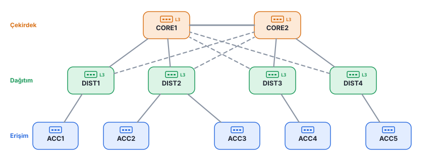
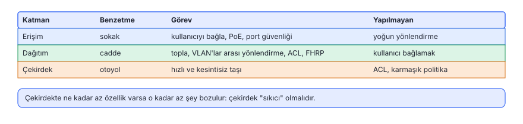
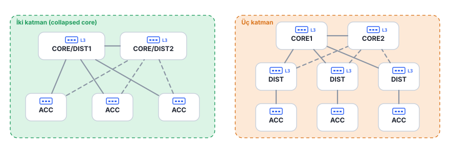
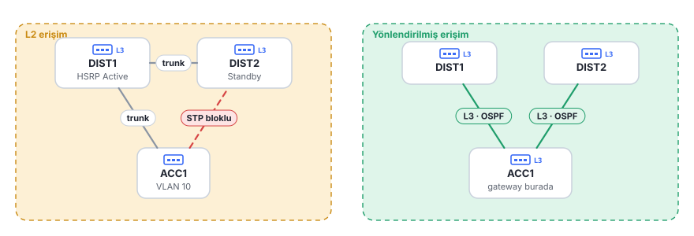
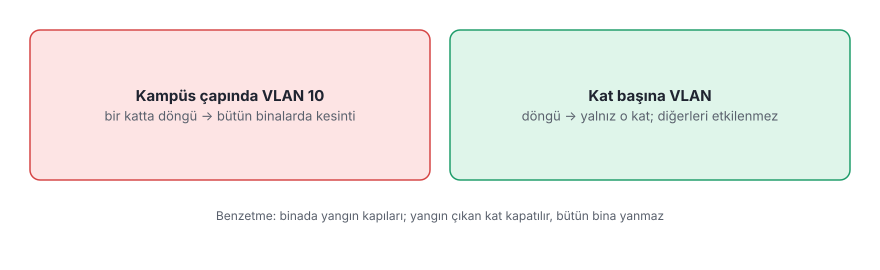
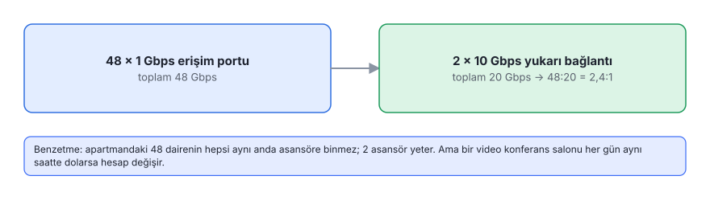
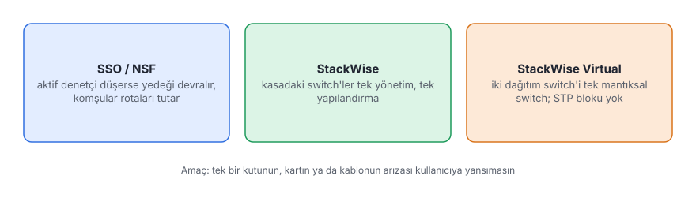

# AğLab Konu #27: Kampüs ve kurumsal ağ tasarımı

> Uygulamadaki `design` dersi bu belgeyle uyumludur. **Okuma dersi (Seviye 3, CCNP):** tasarım kararları kâğıt üstünde verilir; Labber'daki topolojiler küçük ölçekli örneklerdir.
> Ön koşul: STP (Konu #13), EtherChannel (Konu #14), OSPF (Konu #15), FHRP (Konu #18). Şemalar: `docs/dersler/gorseller/kampus-tasarim.py`.

Bu konu bittiğinde öğrenci hiyerarşik kampüs modelinin (erişim, dağıtım, çekirdek) her katmanının görevini açıklar; iki ve üç katmanlı tasarım arasında ölçeğe göre seçim yapar. Katman 2 erişim ile yönlendirilmiş erişimi STP, FHRP ve yük paylaşımı açısından karşılaştırır. Hata alanı ve aşırı abonelik kavramlarıyla bir tasarımı değerlendirir; SSO/NSF ve StackWise gibi yüksek erişilebilirlik seçeneklerinin neyi koruduğunu söyler. Süre yaklaşık 50 dakika.

## 0. Bir bakışta

- **Erişim** kullanıcıyı bağlar, **dağıtım** toplar ve politika uygular, **çekirdek** hızlı ve sade taşır.
- Küçük kampüste dağıtım ve çekirdek birleşir (**collapsed core**); bina sayısı artınca ayrı çekirdek gerekir.
- **L2 erişim**: VLAN'lar trunk ile dağıtıma, gateway FHRP ile dağıtımda, STP bir yolu bloklar.
- **Yönlendirilmiş erişim**: gateway erişim switch'inde, bağlantılar L3, STP döngüsü yok, iki yol birden (ECMP).
- **Hata alanı** küçük tutulur: VLAN'ı binalara yaymak bir döngünün bütün kampüsü vurması demektir.
- **Aşırı abonelik** kuralı: erişim→dağıtım ≤ 20:1, dağıtım→çekirdek ≤ 4:1.
- Yüksek erişilebilirlik: **SSO/NSF**, **StackWise (Virtual)**, çift bağlantı, çift güç.

> **Akılda kalsın:** İyi tasarım, arızayı küçük bir alana hapseden ve sorun giderirken nereye bakacağını belli eden tasarımdır.



## 1. Neden önemli

Şube ağı büyüyüp bir kampüse dönüştüğünde "her switch'i bir yere bağla" yaklaşımı çöker: VLAN'lar binalara yayılır, STP ağacı derinleşir, bir döngü bütün kampüsü durdurur, hangi cihazın neyi yaptığını kimse bilmez. CCNP'de tasarım bir sınav konusu olmanın ötesinde sorun gidermenin haritasıdır: "gateway nerede, STP kökü nerede, trafik hangi bağlantıdan çekirdeğe çıkıyor?" sorularının cevabı tasarımdan gelir.

## 2. Kavram

### 2.1 Üç katman ve görevleri

> **Benzetme:** Bir şehrin yolları: evlerin önünde sokaklar (erişim), sokakları toplayan caddeler (dağıtım), şehirleri bağlayan otoyollar (çekirdek). Otoyolda trafik ışığı olmaz; sokakta 120 ile gidilmez.



- **Erişim:** kullanıcı portları, PoE, port security, 802.1X, QoS işaretleme, VLAN atama.
- **Dağıtım:** erişim switch'lerini toplar; VLAN'lar arası yönlendirme, ACL, FHRP, rota özetleme; L2 ile L3'ün sınırı çoğu zaman buradadır.
- **Çekirdek:** dağıtımları birbirine ve veri merkezine/WAN'a bağlar; az özellik, yüksek hız, hızlı yakınsama.

### 2.2 İki katman mı, üç katman mı?



- Tek bina ya da birkaç dağıtım bloğu: **collapsed core** ucuz ve yeterlidir.
- Dağıtım bloğu sayısı arttıkça her dağıtımı diğerlerine kablolamak (tam örgü) imkânsızlaşır; ayrı bir çekirdek bağlantı sayısını doğrusal tutar.

### 2.3 L2 erişim ve yönlendirilmiş erişim



| | L2 erişim | Yönlendirilmiş erişim |
| --- | --- | --- |
| Gateway | Dağıtımda, FHRP ile | Erişim switch'inde (SVI) |
| Yukarı bağlantı | Trunk | L3 (OSPF/EIGRP) |
| STP | Bir bağlantıyı bloklar | Döngü yok, yalnız koruma için |
| Yük paylaşımı | VLAN başına (STP kökü + HSRP) | ECMP ile iki yol birden |
| Yakınsama | STP/FHRP zamanlayıcıları | Yönlendirme protokolü, genelde daha hızlı |
| Kısıt | VLAN birden çok erişime yayılabilir | VLAN tek erişim switch'inde kalır |

> **Dikkat:** L2 erişimde STP kökü ve HSRP aktif router'ı **aynı** dağıtım switch'inde olmalıdır. Kök DIST1'de, HSRP aktif DIST2'deyse trafik gereksiz yere DIST1 → DIST2 bağlantısından dolaşır.

### 2.4 Hata alanları



- Bir VLAN ne kadar çok switch'e yayılırsa bir döngünün, broadcast fırtınasının ya da STP hesaplamasının etkilediği alan o kadar büyür.
- Dağıtım katmanında L3 sınırı ve **rota özetleme**, bir bloktaki değişikliğin (ör. arayüz kopması) bütün kampüse duyurulmasını önler.

### 2.5 Kapasite: aşırı abonelik



### 2.6 Yüksek erişilebilirlik



- **Çift her şey:** iki yukarı bağlantı, iki dağıtım switch'i, iki güç kaynağı; bağlantılar farklı modüllere.
- **SSO/NSF:** çift denetçili kasada aktif denetçi düşünce yedeği devralır; NSF komşuların rotaları silmemesini sağlar.
- **StackWise Virtual:** iki dağıtım switch'i tek mantıksal switch olur; erişim switch'i ikisine **tek** EtherChannel ile bağlanır (multichassis), STP bloku kalmaz, FHRP gerekmez.

> **Sahada:** Tasarım belgesi olmayan bir kampüste ilk iş: STP kökleri, HSRP aktifleri ve L2/L3 sınırının nerede olduğunu çıkarmaktır (Konu #12 ve #13).

## 3. Çıktı okuma

Tasarımın sahadaki izini doğrulamak:

```
DIST1#show spanning-tree root
                                        Root    Hello Max Fwd
Vlan                   Root ID          Cost    Time  Age Dly  Root Port
---------------- -------------------- --------- ----- --- ---  ------------
VLAN0010         24586 aabb.cc00.0100         0    2   20  15
VLAN0020         28692 aabb.cc00.0200         4    2   20  15  Po1
                                        ← VLAN 10 kökü DIST1 (Cost 0), VLAN 20 kökü DIST2

DIST1#show standby brief
Interface   Grp  Pri P State   Active          Standby         Virtual IP
Vl10        10   110 P Active  local           10.1.10.3       10.1.10.1
Vl20        20   100 P Standby 10.1.20.3       local           10.1.20.1
                                        ← HSRP aktifleri STP kökleriyle aynı yerde: tasarım tutarlı

ACC1#show ip route ospf | include 0.0.0.0
O*E2  0.0.0.0/0 [110/1] via 10.0.1.1, 00:12:44, TenGigabitEthernet1/1/1
                [110/1] via 10.0.2.1, 00:12:44, TenGigabitEthernet1/1/2
                                        ← yönlendirilmiş erişim: iki eşit yol (ECMP)
```

| Soru | Komut |
| --- | --- |
| STP kökleri nerede? | `show spanning-tree root` |
| Gateway'ler (FHRP) nerede? | `show standby brief`, `show vrrp brief` |
| Yukarıya kaç yol var? | `show ip route`, `show etherchannel summary` |
| Yukarı bağlantı ne kadar dolu? | `show interfaces <if> | include rate` |

## 4. Yönlendirmeli lab

> **Simülatörde yok:** Lab'ı kâğıt üstünde yürüt; her adımda Bölüm 3'teki beklenen çıktıyla karşılaştır.

Senaryo: 3 binalı bir kampüs; her binada 4 kat, her katta bir 48 portlu erişim switch'i, binada iki dağıtım switch'i; veri merkezi ve WAN ayrı.

1. İki katman mı, üç katman mı? Gerekçeni yaz. *Neden:* 3 dağıtım bloğu + veri merkezi + WAN, tam örgü yerine çekirdek ister.
2. Her kat için VLAN planı yap (kat başına veri ve ses VLAN'ı); hiçbir VLAN iki erişim switch'ine yayılmasın.
3. L2 erişim seçersen: her VLAN için STP kökü ve HSRP aktifini aynı dağıtım switch'ine yaz; VLAN'ları iki dağıtım arasında paylaştır.
4. Yönlendirilmiş erişim seçersen: erişim–dağıtım bağlantılarına /31 adresler ve OSPF alanı planla.
5. 48 × 1G erişim, 2 × 10G yukarı: oran nedir? 20:1'in altında mı?
6. Bölüm 3'teki çıktılarda tasarımın tutarlı olduğunu gösteren iki kanıtı işaretle.

> **Benzetme:** Bu lab, bir şehrin imar planını yapmaktır: önce yollar ve kavşaklar, sonra evler.

## 5. Sık hatalar

| Kod | Hata | Belirti | Kanıt | Düzeltme |
| --- | --- | --- | --- | --- |
| E1 | Kampüs çapında VLAN | Bir katta döngü bütün binaları vurur | VLAN çok sayıda switch'te | VLAN'ı tek erişim/blokla sınırla |
| E2 | STP kökü ile HSRP aktifi farklı switch'te | Gereksiz dolaşma, dağıtımlar arası bağlantı dolu | `show spanning-tree root` ve `show standby brief` uyuşmuyor | Aynı switch'e hizala |
| E3 | Çekirdekte ACL ve karmaşık politika | Çekirdekte arıza, yavaş yakınsama | Çekirdek yapılandırması kalabalık | Politikayı dağıtıma taşı |
| E4 | Tek yukarı bağlantı | Bir kablo bütün katı koparır | Erişimde tek uplink | İki uplink, farklı dağıtıma/modüle |
| E5 | Aşırı abonelik hesabı yok | Belirli saatlerde yavaşlık | Uplink kullanımı %90+ | Uplink ekle ya da hızlandır |

## 6. Arıza senaryoları

> **Uygulamada:** Kâğıt üstü vakalar; motor ya da Gerçek Lab desteği gelince Sorun Çöz'e `tas-*` kimlikleriyle eklenecek. Önce kendin çöz; neden ve çözüm kapalı kutularda.

### S1 · Başlangıç · Bir kattaki döngü üç binayı durdurdu (E1)

- **Belirti:** B binasında biri iki duvar prizini kabloyla birleştirdi; A ve C binalarında da kesinti oldu.
- **Hedef:** Arızanın yalnız o kata kalmasını sağlayacak tasarım değişikliği.

<details><summary>Neden ve çözüm</summary>

VLAN 10 bütün binalara trunk ile yayılmış; döngü bütün STP alanını etkiledi. Çözüm: kat başına VLAN, dağıtımda L3 sınırı; kısa vadede erişim portlarına BPDU Guard.

</details>

### S2 · Orta · Dağıtımlar arası bağlantı sürekli dolu (E2)

- **Belirti:** DIST1–DIST2 bağlantısı mesai saatlerinde %95; kullanıcılar yavaşlıktan şikâyetçi.
- **Hedef:** Trafiğin gereksiz dolaşmasını bitir.

<details><summary>Neden ve çözüm</summary>

VLAN 10'un STP kökü DIST1, HSRP aktifi DIST2: trafik erişimden DIST1'e çıkıp gateway için DIST2'ye gidiyor. Çözüm: VLAN 10'da HSRP önceliğini DIST1'e ver (ya da STP kökünü DIST2'ye taşı).

</details>

### S3 · Orta · Çekirdekte yapılan küçük değişiklik bütün kampüsü kopardı (E3)

- **Belirti:** Çekirdeğe eklenen bir ACL sonrası OSPF komşulukları düştü.
- **Hedef:** Çekirdeği sade tut.

<details><summary>Neden ve çözüm</summary>

ACL OSPF paketlerini (IP protokol 89) engelledi. Çözüm: ACL'yi kaldır; politika dağıtımda uygulanır.

</details>

### S4 · İleri · Kat switch'i her ay birkaç dakika kopuyor (E4)

- **Belirti:** 3. kat zaman zaman tamamen kopuyor; diğer katlar sorunsuz.
- **Hedef:** Tek noktalı arızayı bul.

<details><summary>Neden ve çözüm</summary>

Erişim switch'inin tek uplink'i var ve dağıtımdaki modül zaman zaman yeniden başlıyor. Çözüm: ikinci uplink'i diğer dağıtım switch'ine (ya da farklı modüle) bağla.

</details>

## 7. Kısa sınav

**1.** Hangi katman kullanıcı portlarını, PoE'yi ve port güvenliğini sağlar?

<details><summary>Cevap</summary>

Erişim katmanı.

</details>

**2.** Collapsed core ne zaman yeterlidir?

<details><summary>Cevap</summary>

Tek bina ya da az sayıda dağıtım bloğu olduğunda; dağıtım ve çekirdek aynı cihazlarda birleşir.

</details>

**3.** Yönlendirilmiş erişimin L2 erişime göre iki avantajı?

<details><summary>Cevap</summary>

STP döngüsü/bloklu bağlantı yok ve iki yukarı bağlantı ECMP ile birlikte kullanılır; genelde daha hızlı yakınsar.

</details>

**4.** L2 erişimde STP kökü ile HSRP aktifi neden aynı switch'te olmalı?

<details><summary>Cevap</summary>

Trafiğin dağıtımlar arası bağlantıdan gereksiz dolaşmaması için.

</details>

**5.** 48 × 1 Gbps erişim ve 2 × 10 Gbps uplink: aşırı abonelik oranı?

<details><summary>Cevap</summary>

48:20 = 2,4:1.

</details>

**6.** StackWise Virtual dağıtımda neyi ortadan kaldırır?

<details><summary>Cevap</summary>

İki switch tek mantıksal switch olduğu için erişim tek EtherChannel'la bağlanır; STP bloku ve FHRP ihtiyacı kalkar.

</details>

## 8. Özet kartı

| Kavram | Hatırla |
| --- | --- |
| Erişim / dağıtım / çekirdek | Bağla / topla ve politika / hızlı taşı |
| Collapsed core | Küçük kampüste dağıtım = çekirdek |
| L2 erişim | Trunk, STP, FHRP; kök = HSRP aktif |
| Yönlendirilmiş erişim | Gateway erişimde, L3 uplink, ECMP |
| Hata alanı | VLAN'ı yayma; L3 sınırı ve özetleme |
| Aşırı abonelik | Erişim→dağıtım ≤ 20:1, dağıtım→çekirdek ≤ 4:1 |
| Yüksek erişilebilirlik | SSO/NSF, StackWise (Virtual), çift uplink |

**Unutma:**

1. Çekirdek sade kalır.
2. VLAN'ı binalara yayma.
3. Kök ve HSRP aktifi aynı yerde.
4. Her şeyden iki tane, farklı yollardan.
5. Tasarım, sorun gidermenin haritasıdır.

## 9. Doğrulama notları

Kaynaklar: INE ENCOR (Enterprise Network Design: hiyerarşik model, yüksek erişilebilirlik) ve CCNP ENCOR v1.0 (yalnız kapsam kontrolü için); Cisco Campus LAN tasarım kılavuzları. Ders metni, örnek çıktılar ve şemalar özgün yazıldı.

| İddia | Sonuç |
| --- | --- |
| Hiyerarşik model: erişim, dağıtım, çekirdek; küçük ağda collapsed core | Doğru |
| Önerilen aşırı abonelik: erişim→dağıtım 20:1, dağıtım→çekirdek 4:1 | Doğru |
| Yönlendirilmiş erişimde STP döngüsü yoktur, ECMP ile iki yol kullanılır | Doğru |
| L2 erişimde STP kökü ve FHRP aktifi hizalanmalıdır | Doğru |
| StackWise Virtual iki switch'i tek mantıksal switch yapar, multichassis EtherChannel sağlar | Doğru |

**Motor gereksinimleri**

- [ ] Tasarım dersi okuma olarak kalır; Labber'da S1–S2 (kök/HSRP uyumsuzluğu, yayılmış VLAN) mevcut STP ve HSRP motoruyla `tas-*` kimlikleriyle kurulabilir.
