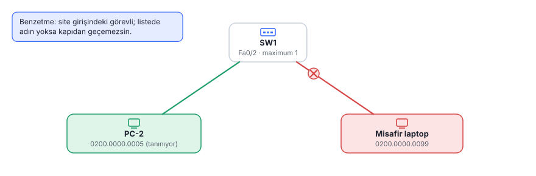
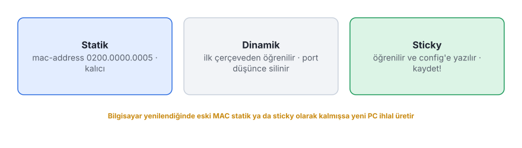
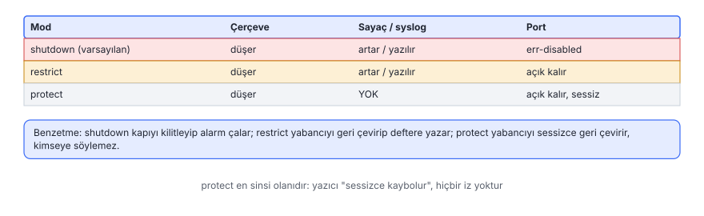
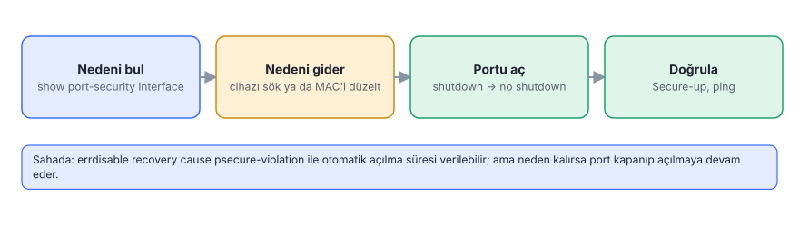
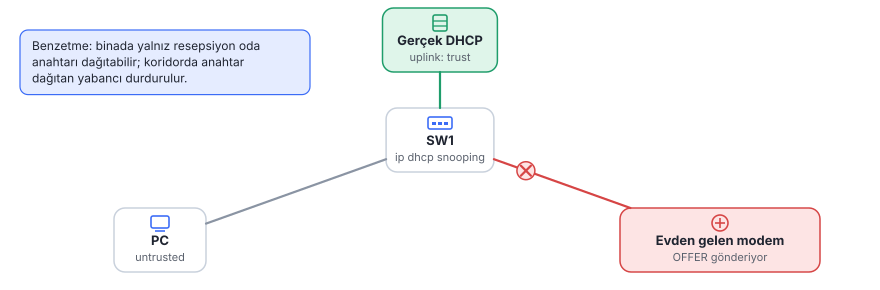
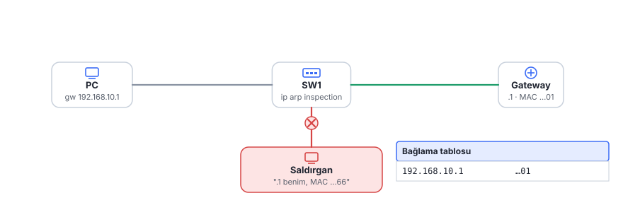
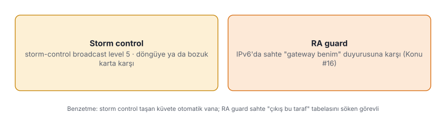

# AğLab Konu #21: L2 güvenlik: port security, DHCP snooping, DAI, storm control, RA guard

> Uygulamadaki `l2sec` dersi bu belgeyle uyumludur. Senaryolar Sorun Çöz'de `psec-*` kimlikleriyle
> Labber'da çalışır; eski tek adımlı `port-security` senaryosu da vardır. DHCP snooping, DAI,
> storm control ve RA guard motorda olmadığı için okuma konusudur. Ön koşul: Ethernet, MAC ve ARP
> (Konu #3), VLAN (Konu #5), DHCP (Konu #9). Şemalar: `docs/dersler/gorseller/l2-guvenlik.py`.

Bu konu bittiğinde öğrenci port security'yi bir erişim portunda kurar: maksimum adres sayısı, statik ve sticky MAC, ihlal modu. err-disabled bir portu nedenini gidererek açar. `show port-security` çıktılarıyla portun hangi MAC'i beklediğini ve neden trafik geçirmediğini bulur. DHCP snooping, DAI, storm control ve RA guard'ın hangi saldırıya ya da kazaya karşı koruduğunu açıklar. Seviye 2 (CCNA), süre yaklaşık 60 dakika.

## 0. Bir bakışta

- **Port security** bir erişim portuna yalnız tanınan MAC'lerin bağlanmasını sağlar.
- **Maximum** (varsayılan 1) dolunca gelen yabancı MAC **ihlaldir**.
- İhlal modu: **shutdown** (err-disabled), **restrict** (düşür + log), **protect** (sessizce düşür).
- **err-disabled** port kendiliğinden açılmaz: önce **neden** giderilir, sonra `shutdown` / `no shutdown`.
- **DHCP snooping** sahte DHCP sunucusunu, **DAI** sahte ARP'yi, **storm control** fırtınayı, **RA guard** sahte IPv6 router'ını durdurur.

> **Akılda kalsın:** Sahada port security olaylarının çoğu saldırı değil, iyi niyetli değişikliktir: yenilenen PC, yer değiştiren masa, toplantı odasına takılan laptop.



## 1. Neden önemli

Erişim portu binadaki herkesin dokunabildiği tek ağ noktasıdır. Port security o prize yalnız tanınan cihazın takılmasını sağlar. Ama sahada en sık görülen port security olayı saldırı değil, iyi niyetli bir değişikliktir: bilgisayar yenilenir, masalar yer değiştirir, biri toplantı odasında laptopunu takar. Port kapanır ve "internet yok" şikâyeti gelir. Bu korumaları bilen teknisyen kapanan portu neden kapandığını anlayarak açar; bilmeyen ise ya güvenliği kapatır ya da portu açıp yeniden kapanmasını izler.

## 2. Kavram

### 2.1 Port security'yi açmak

> **Benzetme:** Şantiye girişindeki görevli: elinde girmesine izin verilenlerin listesi var. Liste kaç kişilikse (maximum) o kadar kişi girer; listede olmayan biri gelirse görevli talimatına göre davranır.

- Yalnız **access** portta açılır: `switchport mode access` → `switchport port-security`.
- `switchport port-security maximum 2`: porttan kaç farklı MAC geçebilir.

### 2.2 Güvenli adresler



- **Statik:** `switchport port-security mac-address 0200.0000.0005`; yapılandırmaya yazılır.
- **Dinamik:** ilk çerçevelerden öğrenilir, port düşünce silinir.
- **Sticky:** `switchport port-security mac-address sticky`; öğrenilen adres yapılandırmaya yazılır, **kaydedilirse** kalıcı olur.

### 2.3 İhlal modları ve err-disabled



> **Dikkat:** `protect` hiçbir iz bırakmaz. "Yazıcı bazen çalışıyor, bazen çalışmıyor" ve sayaçlar sıfır ise protect modunu ve maximum değerini kontrol et.

### 2.4 err-disabled'dan çıkış



Neden giderilmeden açılan port ilk yabancı çerçevede yeniden kapanır. Yeni PC takıldıysa eski statik/sticky MAC'i sil (`no switchport port-security mac-address …`) ya da maximum'u artır; ancak sonra portu aç.

### 2.5 DHCP snooping

> **Simülatörde yok:** DHCP snooping, DAI, storm control ve RA guard Labber'da modellenmez; bu bölümler okuma konusudur.



- Portlar **güvenilir** (uplink, sunucu) ve **güvenilmez** (kullanıcı) olarak ayrılır.
- Güvenilmez porttan gelen OFFER/ACK düşer; evden getirilen modem şubeye adres dağıtamaz.
- Verilen kiralar bir **bağlama tablosuna** yazılır (MAC, IP, port, VLAN).
- `ip dhcp snooping`, `ip dhcp snooping vlan 10`, uplink'te `ip dhcp snooping trust`.

### 2.6 DAI



- ARP yanıtlarını snooping bağlama tablosuyla karşılaştırır, sahte ARP'yi (ARP zehirlemesi, ortadaki adam) düşürür.
- `ip arp inspection vlan 10`; uplink'te `ip arp inspection trust`.

### 2.7 Storm control ve RA guard



- **Storm control:** `storm-control broadcast level 5`: eşik aşılınca trafiği düşürür ya da portu kapatır.
- **RA guard:** kullanıcı portlarında Router Advertisement'ları engeller (Konu #16).

> **Sahada:** Bu korumalar katmanlıdır: DAI, DHCP snooping'in bağlama tablosu olmadan çalışmaz; ikisi birlikte açılır.

## 3. Çıktı okuma

```
SW1#show port-security
Secure Port  MaxSecureAddr  CurrentAddr  SecurityViolation  Security Action
                (Count)       (Count)          (Count)
---------------------------------------------------------------------------
      Fa0/2              1            1                  1         Shutdown

SW1#show port-security interface fa0/2
Port Security              : Enabled
Port Status                : Secure-shutdown          ← err-disabled
Violation Mode             : Shutdown
Maximum MAC Addresses      : 1
Total MAC Addresses        : 1
Configured MAC Addresses   : 1                        ← statik adres var
Last Source Address:Vlan   : 0200.0000.0006:1         ← ihlali yapan (yeni PC)
Security Violation Count   : 1

SW1#show port-security address
Vlan    Mac Address       Type                Ports
----    -----------       ----                -----
   1    0200.1111.2222    SecureConfigured    Fa0/2   ← port hâlâ eski PC'yi bekliyor

SW1#show interfaces status
Port      Name   Status       Vlan  ...
Fa0/2            err-disabled 1
```

| Soru | Nereye bakılır |
| --- | --- |
| Port neden kapalı? | `show interfaces status` → err-disabled; `show port-security interface` → Secure-shutdown |
| Port hangi MAC'i bekliyor? | `show port-security address`, `show running-config interface` |
| Kim ihlal etti? | Last Source Address |
| Port açık ama cihaz yok gibi mi? | Violation Mode protect/restrict; izinli MAC listesi |

## 4. Yönlendirmeli lab

Topoloji: SW1'e SRV (Gi0/1), PC-1 (Fa0/1), PC-2 (Fa0/2), PC-3 (Fa0/3), YAZICI (Fa0/4) bağlı.

1. **Önce dene:** her cihazdan SRV'ye ping. PC'lerin MAC'lerini `show ip` ile, switch'te `show mac address-table` ile not et.
2. **Yazıcı portu:** `interface fa0/4` → `switchport mode access` → `switchport port-security` → `switchport port-security mac-address <yazıcının MAC'i>` → `switchport port-security violation restrict`.
3. **Oku:** `show port-security interface fa0/4`, `show port-security address`.
4. **Kullanıcı portu:** Fa0/2'de port security (maksimum 1, shutdown).
5. **İhlal:** Fa0/4'teki statik MAC'i bilerek bir hane yanlış yaz; yazıcıdan ping düşer, sayaç artar, port açık kalır (restrict). Doğrusunu yaz.
6. **err-disabled:** Fa0/2'ye başka bir MAC'i statik yaz, PC-2'den ping at: port err-disabled. Yanlış MAC'i kaldır, `shutdown` / `no shutdown`. Kaydet.
7. **Okuma:** Bir uplink ve iki kullanıcı portu için DHCP snooping ve DAI satırlarını yaz; hangi portun trust olacağını açıkla.

> **Benzetme:** Lab, kapıdaki görevliye önce tek kişilik bir liste vermek, sonra yabancıyı kapıya göndermek ve görevlinin nasıl tepki verdiğini (kilitle, deftere yaz, sessizce geri çevir) izlemektir.

## 5. Sık hatalar

| Kod | Hata | Belirti | Kanıt | Düzeltme |
| --- | --- | --- | --- | --- |
| E1 | Eski cihazın statik MAC'i kalmış (yenileme, masa değişikliği) | Yeni cihaz takılınca port kapanıyor | `show port-security address`'te eski MAC; Last Source yeni cihaz | Statik MAC'i değiştir ya da kaldır, portu aç |
| E2 | Maksimum gerçek ihtiyaçtan düşük (IP telefon + PC, masa altı switch) | Bir cihaz çalışıyor, öteki çalışmıyor ya da port kapanıyor | Total = Maximum; ihlal sayacı artıyor | `maximum` değerini artır |
| E3 | err-disabled portu nedenini gidermeden açmak ya da hiç açmamak | Port kapalı kalıyor ya da açılıp yeniden kapanıyor | Port Status Secure-shutdown | Nedeni gider, `shutdown` / `no shutdown` |
| E4 | Statik MAC yanlış yazılmış (protect) | Port up, cihaz yokmuş gibi, uyarı yok | İzinli MAC cihazınkiyle aynı değil | Doğru MAC'i yaz |
| E5 | Güvenliği kapatıp geçmek | Şikâyet geçer, koruma kalmaz | `no switchport port-security` | Nedeni bul; korumayı açık bırak |

## 6. Arıza senaryoları

> **Uygulamada:** S1–S5 Sorun Çöz'de `psec-new-pc`, `psec-stale-errdisable`, `psec-printer-typo`,
> `psec-swapped-desks`, `psec-two-faults` kimlikleriyle Labber'da çalışır. Hedefler portun açık
> olmasını ve trafiğin geçmesini birlikte sınar: yalnız `shutdown` / `no shutdown` yetmez.
> E2 (maksimum aşımı) motorda henüz doğru sayılmadığı için okuma olarak kalır.
> Önce kendin çöz; neden ve çözüm kapalı kutularda.

### S1 · Başlangıç · Yeni bilgisayar takıldı, port kapandı (E1 + E3)

- **Belirti:** Eski PC yenisiyle değişti; yeni PC-2 bağlanamıyor, Fa0/2'nin ışığı sönük.
- **Hedef:** Fa0/2 err-disabled değil; PC-2 → SRV

<details><summary>Neden ve çözüm</summary>

Fa0/2'de eski PC'nin MAC'i (0200.1111.2222) statik; yeni PC ihlal etti, port err-disabled. Çözüm: SW1 → `interface fa0/2` → `no switchport port-security mac-address 0200.1111.2222` → `shutdown` → `no shutdown`

</details>

### S2 · Başlangıç · Laptop gitti, port hâlâ kapalı (E3)

- **Belirti:** Toplantı odasında takılan laptop portu kapattı; laptop gitti, PC-3 geri takıldı, hâlâ bağlanamıyor.
- **Hedef:** Fa0/3 err-disabled değil; PC-3 → SRV

<details><summary>Neden ve çözüm</summary>

Fa0/3 err-disabled kaldı; kendiliğinden açılmaz. Çözüm: SW1 → `interface fa0/3` → `shutdown` → `no shutdown`

</details>

### S3 · Orta · Yazıcı sessizce kayboldu (E4)

- **Belirti:** Yazıcı portuna port security eklendi; kimse yazdıramıyor, port up, uyarı yok.
- **Hedef:** PC-1 → YAZICI; YAZICI → SRV

<details><summary>Neden ve çözüm</summary>

Statik MAC 0200.0000.0050 yazılmış, doğrusu 0200.0000.0005; mod protect. Çözüm: SW1 → `interface fa0/4` → `no switchport port-security mac-address 0200.0000.0050` → `switchport port-security mac-address 0200.0000.0005`

</details>

### S4 · Orta · Masalar değişti, iki bilgisayar da kopuk (E1 + E3)

- **Belirti:** Masalar yer değiştirdi; PC-1 ve PC-3 bağlanamıyor, Fa0/1 ve Fa0/3 sönük.
- **Hedef:** iki port err-disabled değil; PC-1 ve PC-3 → SRV

<details><summary>Neden ve çözüm</summary>

Her portta eski sahibinin MAC'i statik; bilgisayarlar portları takas etti. Çözüm: SW1 → Fa0/3'ten 0200.0000.0004'ü kaldır; Fa0/1'de 0200.0000.0003 yerine 0200.0000.0004; Fa0/3'e 0200.0000.0003; iki portta `shutdown` / `no shutdown`

</details>

### S5 · İleri · Yazıcı ve toplantı odası birlikte (E3 + E4)

- **Belirti:** Kimse yazdıramıyor ve PC-3 bağlanamıyor; PC-3'ün portu açılınca yazıcı yine çalışmıyor.
- **Hedef:** Fa0/3 err-disabled değil; PC-3 → SRV; PC-1 → YAZICI

<details><summary>Neden ve çözüm</summary>

Fa0/3 err-disabled ve Fa0/4'te yazıcının MAC'i yanlış. Çözüm: S2 ve S3'ün çözümleri

</details>

## 7. Kısa sınav

**1.** Port security hangi port türünde açılır?

<details><summary>Cevap</summary>

Access port.

</details>

**2.** Hangi ihlal modu portu err-disabled yapar?

<details><summary>Cevap</summary>

`shutdown` (varsayılan).

</details>

**3.** Hangi mod sayaç ve syslog olmadan sessizce düşürür?

<details><summary>Cevap</summary>

`protect`.

</details>

**4.** err-disabled bir port nasıl açılır?

<details><summary>Cevap</summary>

Neden giderildikten sonra `shutdown` / `no shutdown` (ya da errdisable recovery).

</details>

**5.** Kullanıcı portundan gelen sahte DHCP sunucusunu ne engeller?

<details><summary>Cevap</summary>

DHCP snooping; kullanıcı portu güvenilmezdir.

</details>

**6.** Eski PC sökülüp yeni PC takıldı, port err-disabled oldu. Teknisyen `shutdown` / `no shutdown` yaptı, port birkaç saniye sonra yine kapandı. Neden?

<details><summary>Cevap</summary>

Neden giderilmedi: portta eski PC'nin MAC'i statik ya da sticky olarak duruyor. Önce o satırı sil (ya da maximum'u artır), sonra portu aç ve kaydet.

</details>

## 8. Özet kartı

| Komut | Ne işe yarar |
| --- | --- |
| `switchport port-security` | Port security'yi aç |
| `switchport port-security maximum n` | İzinli MAC sayısı |
| `switchport port-security mac-address <mac>` / `sticky` | Güvenli adres |
| `switchport port-security violation shutdown\|restrict\|protect` | İhlal modu |
| `show port-security interface <if>` | Durum, son MAC, ihlal sayacı |
| `show interfaces status err-disabled` | Kapanan portlar |
| `ip dhcp snooping`, `ip arp inspection vlan n` | Snooping ve DAI |

**Unutma:**

1. Yalnız access portta.
2. shutdown kilitler, restrict yazar, protect susar.
3. Önce neden, sonra `shutdown` / `no shutdown`.
4. Sticky'yi kaydet.
5. DAI, DHCP snooping tablosuna dayanır.

## 9. Doğrulama notları

**Lab'ın otomatik değerlendirmesi:** `q.errDisabled('SW1', 'fa0/2')` yanlış; `q.ping('PC-2', SRV).ok`; `q.ping('YAZICI', SRV).ok`.

Kaynaklar: INET CCNA 200-301 v1.1 ve INE ENCOR (L2 güvenlik); Cisco Catalyst güvenlik yapılandırma kılavuzu (port security: maksimum, statik/sticky, ihlal modları ve davranışları, `show port-security`; DHCP snooping; DAI; storm control), CCNA 200-301 5.7 (DHCP snooping, DAI, port security).

| İddia | Sonuç |
| --- | --- |
| Varsayılan maksimum 1, varsayılan mod shutdown | Doğru |
| protect sayaç ve syslog üretmez; restrict üretir, port açık kalır | Doğru |
| err-disabled port kendiliğinden açılmaz (errdisable recovery yoksa) | Doğru |
| DHCP snooping güvenilmez porttan gelen sunucu mesajlarını düşürür | Doğru |
| DAI ARP'yi snooping bağlama tablosuyla doğrular | Doğru |

**Motor gereksinimleri** (Labber'da denendi)

- [x] Port security: statik MAC, maksimum, ihlal modları, err-disabled ve `shutdown`/`no shutdown` ile çıkış, `show port-security [interface|address]`; senaryo sorgusu `errDisabled`
- [x] Beş senaryo başta başarısız, çözümle başarılı; yarım çözüm (yalnız portu açmak) başarısız kalıyor
- [ ] **Dinamik öğrenilen güvenli adresler sayılmıyor:** maksimum 1 olan porttan iki farklı MAC geçiyor, `Total MAC Addresses: 0`. Gerçek IOS'ta ikinci MAC ihlaldir (motor işi, öncelikli)
- [ ] Sticky AğLab modelinde yok (Labber'da var, kayda yazılamıyor)
- [ ] DHCP snooping, DAI, storm control, RA guard, `errdisable recovery` motorda yok (okuma)
