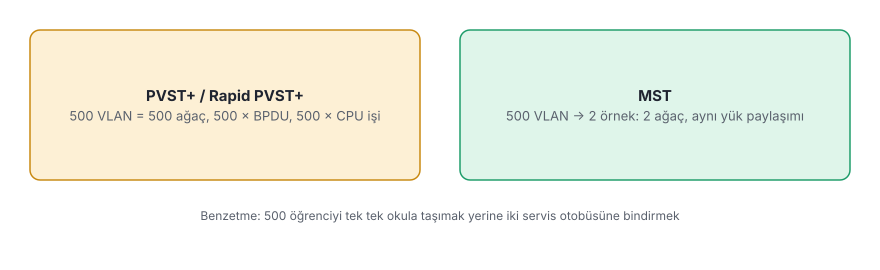
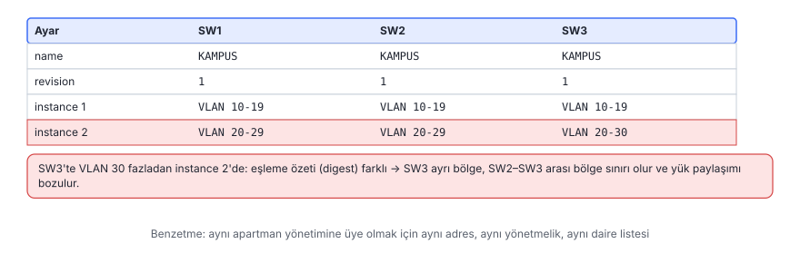
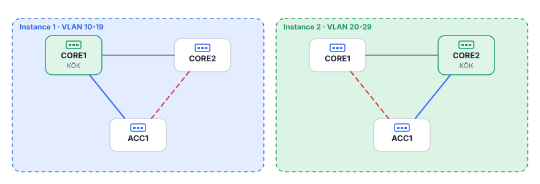
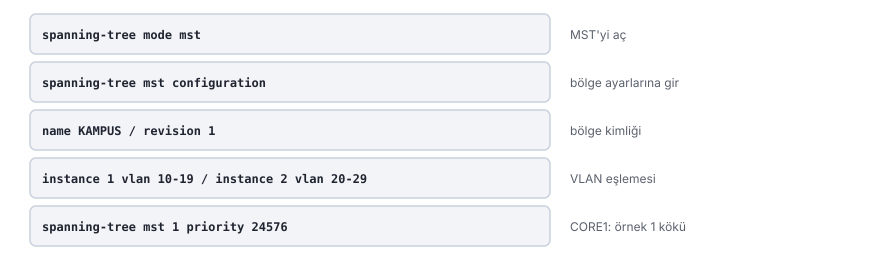
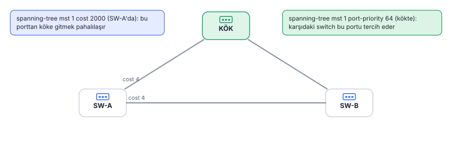
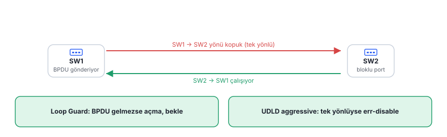
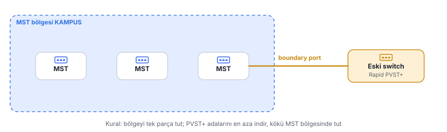

# AğLab Konu #29: İleri STP: MST, yol ayarı, Loop Guard ve UDLD

> Uygulamadaki `mst` dersi bu belgeyle uyumludur. **Okuma dersi + Simülatör labı (Seviye 3, CCNP):** Labber MST'yi çalıştırır (bölge adı/revizyon/eşleme, CIST ve MSTI kökleri, bölge sınırı): Simülatör'deki **mst-bolge** labı. Loop Guard ve UDLD yok.
> Ön koşul: STP/RSTP (Konu #13), EtherChannel (Konu #14), kampüs tasarımı (Konu #27). Şemalar: `docs/dersler/gorseller/mst.py`.

Bu konu bittiğinde öğrenci MST'nin PVST+'a göre neyi kazandırdığını açıklar; bir MST bölgesini (ad, revizyon, VLAN–örnek eşlemesi) kurar ve iki switch'in neden aynı bölgede olmadığını çıktıdan bulur. Örnek başına kök yerleştirerek iki yolu da kullanır; port maliyeti ve port önceliğiyle yolu değiştirir. Tek yönlü bağlantı arızasına karşı Loop Guard ve UDLD'nin nasıl koruduğunu anlatır. Süre yaklaşık 50 dakika.

## 0. Bir bakışta

- **MST** VLAN'ları birkaç **örneğe** (instance) toplar: 500 VLAN, 2 ağaç.
- Aynı **bölge** için üç şey aynı olmalı: **ad**, **revizyon**, **VLAN–örnek eşlemesi**.
- **MST0 (IST)** bölgenin ana ağacıdır; BPDU'ları o taşır, ek örnekler BPDU içinde bilgi olarak gider.
- Yük paylaşımı: örnek 1'in kökü CORE1, örnek 2'nin kökü CORE2.
- Yolu ayarlamak: **port cost** (uzaktaki switch'te kök port seçimi), **port-priority** (yukarıdaki switch'te karşının seçimi).
- **Loop Guard** BPDU'su kesilen bloklu portu açmaz; **UDLD** tek yönlü bağlantıyı yakalar.

> **Akılda kalsın:** MST'de en sık arıza teknik değil idari: bir switch'te eşleme farklıdır ve bölge ikiye bölünür.



## 1. Neden önemli

Büyük kampüslerde yüzlerce VLAN vardır. Rapid PVST+ her VLAN için ayrı ağaç hesaplar; bu, CPU ve BPDU yükü demektir ve bazı platformlarda örnek sayısı sınırlıdır. Ağda gerçekte yalnız iki-üç farklı yol olduğu için MST bu yolları birkaç örnekle temsil eder. Karşılığında yeni bir kavram gelir: bölge. Sahada MST arızalarının çoğu bir switch'in bölge ayarının diğerlerinden farklı olmasıdır.

## 2. Kavram

### 2.1 Örnekler (instances)

> **Benzetme:** 500 öğrenciyi her biri için ayrı araçla taşımak yerine iki servis güzergâhı belirlersin; her öğrenci (VLAN) bir servise (örnek) atanır. Güzergâh sayısı yol sayısı kadardır, öğrenci sayısı kadar değil.

- **MST0 / IST:** her zaman vardır; atanmamış bütün VLAN'lar buradadır; bölgenin BPDU'larını taşır.
- **MST1–MSTn:** yönetici tanımlar; her biri ayrı köke ve ayrı topolojiye sahip olabilir.
- Standart: IEEE 802.1s (bugün 802.1Q içinde). RSTP'nin hızlı yakınsamasını kullanır.

### 2.2 Bölge



- Switch'ler BPDU içinde bölge adı, revizyon ve eşleme tablosunun **özetini** (digest) gönderir. Özet farklıysa komşu başka bölgededir.
- Eşlemeyi değiştirirken bütün switch'lerde aynı anda değiştirmek gerekir; ara dönemde bölge bölünür. Bu yüzden VLAN'lar örneklere **önceden**, ileride açılacak aralıklarla birlikte atanır.

### 2.3 Kök yerleştirme ve yük paylaşımı





> **Dikkat:** `spanning-tree mst 1 priority` örnek 1 içindir; MST0'ın kökünü de bilinçli seçmek gerekir (`spanning-tree mst 0 priority …`). Bölge sınırında dış dünya MST0'ı görür.

### 2.4 Yolu ayarlamak



- **Port cost** kök port seçimini değiştirir; köke **uzak** switch'te ayarlanır.
- **Port priority** (0–240, 16'nın katı, varsayılan 128) eşit maliyetli iki porttan hangisinin tercih edileceğini belirler; **yukarıdaki** (belirlenmiş portun sahibi) switch'te ayarlanır, çünkü karşı taraf gönderen port kimliğine bakar.

### 2.5 Tek yönlü bağlantı: Loop Guard ve UDLD

> **Benzetme:** Bekçi her dakika "buradayım" diye telsizle seslenir. Telsizin hoparlörü bozulursa diğer bekçi sesi duymaz ve "bekçi gitti, kapıyı açayım" der. Loop Guard "ses kesildi diye kapıyı açma" kuralıdır.



- **Loop Guard:** kök ve alternatif portlarda BPDU kesilirse portu açmak yerine *loop-inconsistent* durumda tutar; BPDU gelince kendiliğinden düzelir.
- **UDLD:** fiber gibi bağlantılarda iki yönün de çalıştığını kendi mesajlarıyla denetler; *aggressive* modda tek yönlü bağlantıyı err-disable yapar.
- Root Guard (Konu #13) ile karıştırma: Root Guard daha iyi kök duyurusunu engeller, Loop Guard BPDU yokluğuna karşı korur; ikisi aynı portta birlikte kullanılmaz.

### 2.6 Bölge sınırı



> **Sahada:** Göç döneminde MST ve Rapid PVST+ bir süre birlikte yaşar. Kökü MST bölgesinde tutmak ve sınır sayısını az tutmak sürprizleri azaltır.

## 3. Çıktı okuma

```
SW3#show spanning-tree mst configuration
Name      [KAMPUS]
Revision  1     Instances configured 3
Instance  Vlans mapped
--------  ---------------------------------------------------------------------
0         1-9,31-4094
1         10-19
2         20-30
                                        ← VLAN 30 instance 2'de; SW1 ve SW2'de 20-29

SW2#show spanning-tree mst 2
##### MST2    vlans mapped:   20-29
Bridge        address aabb.cc00.0200  priority      24578 (24576 sysid 2)
Root          this switch for MST2

Interface        Role Sts Cost      Prio.Nbr Type
---------------- ---- --- --------- -------- --------------------------------
Gi1/0/1          Desg FWD 20000     128.1    P2p
Gi1/0/3          Desg FWD 20000     128.3    P2p Bound(RSTP)
                                        ← SW3'e bakan port bölge sınırı (Bound): SW3 ayrı bölgede

SW1#show spanning-tree inconsistentports
Name                 Interface                Inconsistency
-------------------- ------------------------ ------------------
MST1                 GigabitEthernet1/0/2     Loop Inconsistent
                                        ← Loop Guard: bu porttan BPDU gelmiyor, port açılmadı

SW1#show udld GigabitEthernet1/0/2
Port enable administrative configuration setting: Enabled / in aggressive mode
Current bidirectional state: Unidirectional
```

| Soru | Komut |
| --- | --- |
| Bölge ayarları aynı mı? | `show spanning-tree mst configuration [digest]` |
| Örneğin kökü ve roller? | `show spanning-tree mst <n>` |
| Sınır portları? | `Bound` ibaresi |
| Loop Guard / Root Guard tetiklendi mi? | `show spanning-tree inconsistentports` |
| Tek yönlü bağlantı? | `show udld` |

## 4. Yönlendirmeli lab

> **Kısmen simülatörde:** MST bölgesi, örnek kökleri ve sınır davranışı Simülatör'deki **mst-bolge** labında denenir (Pratik adımında). Loop Guard ve UDLD adımlarını kâğıt üstünde Bölüm 3'teki çıktılarla karşılaştır.

Topoloji: CORE1, CORE2, ACC1–ACC3; VLAN 10–19 kullanıcı, 20–29 ses ve kamera.

1. Bütün switch'lerde `spanning-tree mode mst`. *Neden:* MST ile PVST+ karışık çalışırsa her bağlantı bölge sınırı olur.
2. Bölge: `name KAMPUS`, `revision 1`, `instance 1 vlan 10-19`, `instance 2 vlan 20-29`; bütün switch'lerde aynen.
3. CORE1: `spanning-tree mst 0-1 priority 24576`, `spanning-tree mst 2 priority 28672`; CORE2 tersi.
4. ACC1'de `show spanning-tree mst 1` ve `mst 2`: kök portları farklı uplink'ler mi?
5. ACC3'te eşlemeye yanlışlıkla VLAN 30 ekle; CORE'larda `Bound` görünmesini incele, sonra düzelt.
6. Uplink'lere `spanning-tree guard loop`; fiber uplink'lerde `udld port aggressive`.

> **Benzetme:** 5. adım, bir apartman dairesinin yönetmeliği farklı yazması yüzünden ayrı site sayılmasıdır.

## 5. Sık hatalar

| Kod | Hata | Belirti | Kanıt | Düzeltme |
| --- | --- | --- | --- | --- |
| E1 | Eşleme farklı | Bölge bölünür, yük paylaşımı bozulur | `show … mst configuration` farklı, `Bound` portlar | Eşlemeyi bütün switch'lerde eşitle |
| E2 | Revizyon ya da ad farklı | Aynı belirti | Ad/revizyon satırı | Eşitle |
| E3 | Yalnız MST1/2 önceliği verilmiş, MST0 unutulmuş | Bölge sınırında beklenmeyen kök | `show spanning-tree mst 0` | MST0 önceliği |
| E4 | Port priority uzaktaki switch'te ayarlanmış | Değişiklik etkisiz | Roller değişmiyor | Yukarıdaki switch'te ayarla |
| E5 | Loop Guard/UDLD yok | Tek yönlü fiberde döngü | Bloklu port kendiliğinden FWD oldu | Loop Guard + UDLD aggressive |

## 6. Arıza senaryoları

> **Uygulamada:** Kâğıt üstü vakalar; motor ya da Gerçek Lab desteği gelince Sorun Çöz'e `mst-*` kimlikleriyle eklenecek. Önce kendin çöz; neden ve çözüm kapalı kutularda.

### S1 · Başlangıç · Yeni switch eklendi, yük paylaşımı bozuldu (E1)

- **Belirti:** ACC3 eklendikten sonra ACC3 üzerindeki ses VLAN'ları CORE1 üzerinden gidiyor; CORE2 uplink'i boşta.
- **Hedef:** ACC3 bölgeye katılsın.

<details><summary>Neden ve çözüm</summary>

ACC3'te eşleme `instance 2 vlan 20-30`; özet farklı, ACC3 ayrı bölge ve dış dünyaya MST0 ağacıyla görünüyor. Çözüm: eşlemeyi diğerleriyle aynı yap.

</details>

### S2 · Orta · Port önceliği değiştirildi, hiçbir şey olmadı (E4)

- **Belirti:** Teknisyen ACC1'in iki uplink'inden ikincisinin tercih edilmesi için ACC1'de `port-priority 64` yazdı; roller değişmedi.
- **Hedef:** İkinci uplink kök port olsun.

<details><summary>Neden ve çözüm</summary>

Port önceliği karşı tarafın kararını etkiler; ACC1'in kök port seçimi CORE'un gönderdiği port kimliğine bakar. Çözüm: CORE1'de ilgili porta `spanning-tree mst 1 port-priority 64` ya da ACC1'de birinci uplink'e daha yüksek cost.

</details>

### S3 · Orta · Bölge sınırında beklenmeyen kök (E3)

- **Belirti:** Eski PVST+ switch'i bağlanınca bölgenin kökü depodaki eski switch oldu.
- **Hedef:** Kök kampüs çekirdeğinde kalsın.

<details><summary>Neden ve çözüm</summary>

MST0 önceliği hiç ayarlanmamış; eski switch'in düşük önceliği CST kökünü dışarı taşıdı. Çözüm: CORE1'de `spanning-tree mst 0 priority 24576`; eski switch'e Root Guard.

</details>

### S4 · İleri · Gece kısa süreli döngü (E5)

- **Belirti:** Fiber uplink'te bir alıcı arızası oldu; birkaç dakika broadcast fırtınası yaşandı.
- **Hedef:** Bu türden arızanın tekrarını önle.

<details><summary>Neden ve çözüm</summary>

Tek yönlü bağlantıda bloklu port BPDU alamadı ve forwarding'e geçti. Çözüm: uplink'lerde Loop Guard ve UDLD aggressive.

</details>

## 7. Kısa sınav

**1.** Aynı MST bölgesi için aynı olması gereken üç ayar?

<details><summary>Cevap</summary>

Bölge adı, revizyon numarası, VLAN–örnek eşlemesi.

</details>

**2.** MST0'ın (IST) görevi?

<details><summary>Cevap</summary>

Bölgenin ana ağacı; BPDU'ları taşır, atanmamış VLAN'ları içerir ve bölge dışına görünen ağaçtır.

</details>

**3.** İki uplink'i de kullanmak için MST'de ne yapılır?

<details><summary>Cevap</summary>

Örneklerin köklerini farklı çekirdek switch'lerine yerleştir (örnek 1 CORE1, örnek 2 CORE2).

</details>

**4.** Port önceliği hangi switch'te ayarlanırsa etkili olur?

<details><summary>Cevap</summary>

Belirlenmiş portun sahibi olan, köke yakın (yukarıdaki) switch'te.

</details>

**5.** Loop Guard neye karşı korur?

<details><summary>Cevap</summary>

Tek yönlü bağlantı gibi nedenlerle BPDU'su kesilen bloklu portun forwarding'e geçmesine.

</details>

**6.** `Bound(RSTP)` ibaresi neyi gösterir?

<details><summary>Cevap</summary>

Portun MST bölgesi sınırında olduğunu; karşıdaki switch farklı bölgede ya da farklı STP türünde.

</details>

## 8. Özet kartı

| Komut | Ne işe yarar |
| --- | --- |
| `spanning-tree mode mst` | MST'yi aç |
| `spanning-tree mst configuration` | Ad, revizyon, eşleme |
| `spanning-tree mst <n> priority` | Örnek kökü |
| `spanning-tree mst <n> cost / port-priority` | Yolu ayarla |
| `spanning-tree guard loop` | Loop Guard |
| `udld port aggressive` | Tek yönlü bağlantı koruması |
| `show spanning-tree mst configuration digest` | Bölge karşılaştırma |

**Unutma:**

1. Ad + revizyon + eşleme aynı.
2. Eşlemeyi önceden, geniş aralıklarla yap.
3. MST0 kökünü de seç.
4. Port priority yukarıda, cost aşağıda.
5. Uplink'lere Loop Guard + UDLD.

## 9. Doğrulama notları

Kaynaklar: INE ENCOR (Advanced STP: MST, tuning, Loop Guard, UDLD) ve CCNP ENCOR v1.0 (yalnız kapsam kontrolü için); IEEE 802.1Q (MSTP); Cisco Catalyst STP yapılandırma kılavuzu. Ders metni, örnek çıktılar ve şemalar özgün yazıldı.

| İddia | Sonuç |
| --- | --- |
| MST bölgesi ad, revizyon ve VLAN-örnek eşlemesi özetiyle belirlenir | Doğru |
| IST (MST0) BPDU'ları taşır; diğer örnekler M-record olarak taşınır | Doğru |
| Port priority 0–240, 16'nın katı, varsayılan 128 | Doğru |
| Loop Guard BPDU kesilen portu loop-inconsistent yapar | Doğru |
| UDLD aggressive tek yönlü bağlantıyı err-disable yapar | Doğru |

**Motor gereksinimleri**

- [x] MST bölgesi (ad, revizyon, eşleme özeti), örnek başına kök, CIST ve bölge sınırı Labber'da var: Simülatör'deki **mst-bolge** labı (bölge uyuşmazlığı, kaybolan yük dengeleme, CIST kökü).
- [ ] Loop Guard ve UDLD Labber'da yok. Hazır olunca ilgili vakalar `mst-*` kimlikleriyle Sorun Çöz'e eklenir.
