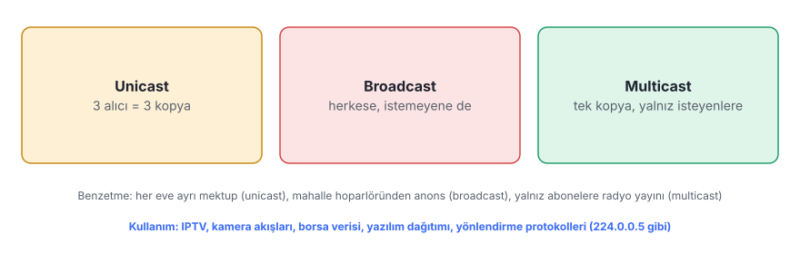
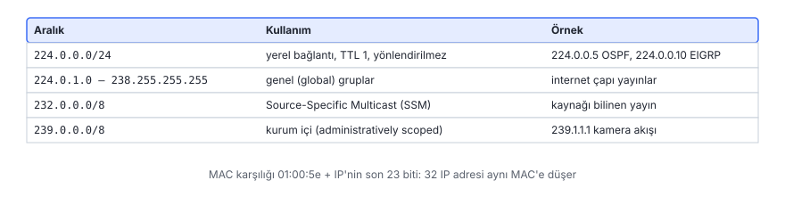
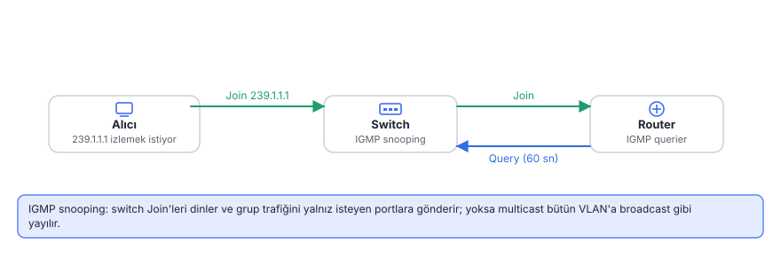
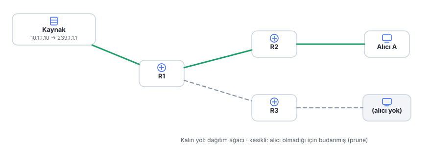
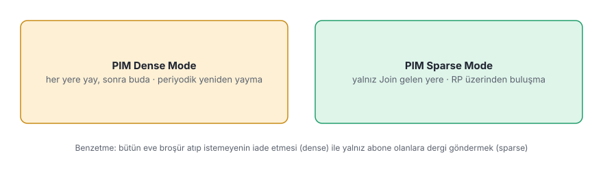
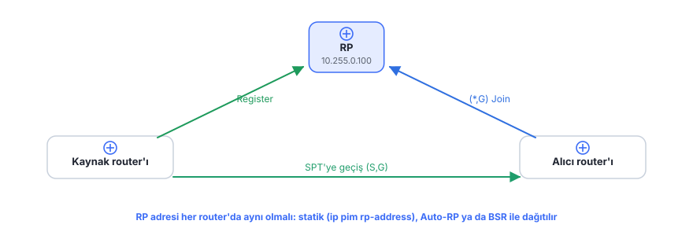
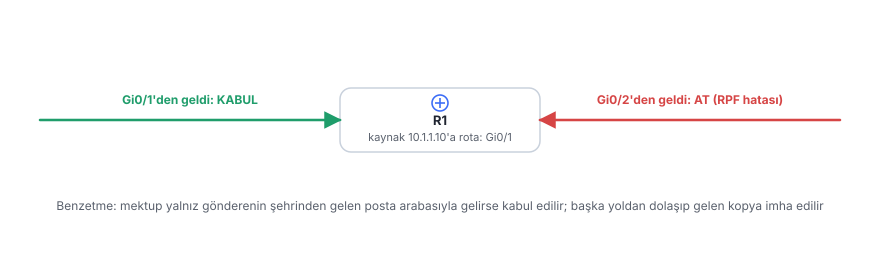

# AğLab Konu #49: Multicast: IGMP, PIM, RP ve RPF

> Uygulamadaki `multicast` dersi bu belgeyle uyumludur. **Okuma dersi (Seviye 3, CCNP):** Multicast Labber'da yok; Gerçek Lab (FRR pimd) PIM ve IGMP'yi destekler.
> Ön koşul: IP adresleme (Konu #2), OSPF (Konu #15), Ethernet ve MAC (Konu #3). Şemalar: `docs/dersler/gorseller/multicast.py`.

Bu konu bittiğinde öğrenci multicast'in unicast ve broadcast'ten farkını ve kullanım alanlarını açıklar; multicast adres aralıklarını ve MAC eşlemesini bilir. IGMP'nin alıcı ile ilk router arasında, PIM'in router'lar arasında çalıştığını; IGMP snooping'in switch'te neden gerektiğini söyler. PIM yoğun ve seyrek modu karşılaştırır, RP'nin rolünü ve (*,G)/(S,G) ağaçlarını anlatır. RPF kontrolünün döngüyü nasıl önlediğini ve unicast rota hatasının multicast'i nasıl bozduğunu açıklar. Süre yaklaşık 50 dakika.

## 0. Bir bakışta

- **Multicast** tek kopya gönderir; ağ kopyayı yalnız isteyenlerin olduğu yöne çoğaltır.
- Adresler **224.0.0.0/4**; **224.0.0.0/24** yerel (yönlendirilmez), **239/8** kurum içi, **232/8** SSM.
- **IGMP** alıcı ile ilk router arasında: Join/Report, Query, Leave (v2), kaynak seçimi (v3).
- **IGMP snooping** olmazsa switch multicast'i bütün VLAN'a yayar.
- **PIM** router'lar arasında dağıtım ağacı kurar; unicast rota tablosunu kullanır.
- **PIM-SM** kurumların seçimidir: buluşma noktası **RP**; önce (*,G), sonra kaynağa en kısa yol (S,G).
- **RPF**: paket, kaynağa giden unicast rotanın arayüzünden gelmiyorsa atılır.

> **Akılda kalsın:** Multicast arızasında üç soru: alıcı Join gönderiyor mu (IGMP), router'lar RP'yi biliyor mu, RPF kontrolü geçiyor mu?



## 1. Neden önemli

Bir şubede yirmi güvenlik kamerasının akışını üç izleme istasyonuna ayrı ayrı göndermek WAN'ı doldurur; IPTV, borsa verisi ve toplu yazılım dağıtımı da aynı sorunu yaşar. Multicast aynı veriyi bir kez gönderip ağın içinde çoğaltır. Arızaları ise alışılmadıktır: unicast her yerde çalışırken bir grubun akışı yalnız bir katta görünmez. CCNP ENCOR multicast temellerini (IGMP, PIM, RP, RPF) sorar.

## 2. Kavram

### 2.1 Neden multicast

> **Benzetme:** Bir radyo istasyonu her dinleyiciye ayrı telefon açmaz (unicast), şehrin bütün hoparlörlerinden de yayın yapmaz (broadcast). Frekansını duyurur; isteyen radyosunu açar, yayın yalnız onlara ulaşır.

### 2.2 Adresler



> **Dikkat:** IP'nin yalnız son 23 biti MAC'e kopyalandığı için 32 farklı grup aynı MAC adresine düşer (ör. 224.1.1.1 ve 239.129.1.1). Switch bu grupları ayırt edemez; adres planında çakışmadan kaçın.

### 2.3 IGMP ve snooping



- **IGMPv2:** Join, genel/grup sorgusu, Leave; varsayılan Cisco IOS sürümü.
- **IGMPv3:** alıcı "yalnız şu kaynaktan" diyebilir (SSM için gerekli).
- Bir VLAN'da birden çok router varsa bir tanesi **querier** olur (en düşük IP).

### 2.4 PIM ve dağıtım ağacı





### 2.5 RP



```
ip multicast-routing
ip pim rp-address 10.255.0.100
interface g0/0
 ip pim sparse-mode
```

- **(*,G):** "bu grubun herhangi bir kaynağı" için RP'den geçen ortak ağaç.
- **(S,G):** belirli kaynaktan en kısa yol ağacı (SPT).
- **SSM** (232/8 + IGMPv3): kaynak baştan bilindiği için RP gerekmez.

### 2.6 RPF



> **Sahada:** "Kamera akışı bazı katlarda var, bazılarında yok" şikâyetinde önce o kattaki switch'te IGMP snooping ve querier, sonra router'da `show ip mroute` ile ağacın o kata uzanıp uzanmadığı kontrol edilir.

## 3. Çıktı okuma

```
R2#show ip igmp groups
IGMP Connected Group Membership
Group Address    Interface                Uptime    Expires   Last Reporter
239.1.1.1        GigabitEthernet0/2       00:42:11  00:02:31  10.2.20.51
                                        ← Gi0/2'de bir alıcı 239.1.1.1'e katılmış

R2#show ip mroute 239.1.1.1
(*, 239.1.1.1), 00:42:11/00:02:58, RP 10.255.0.100, flags: SJC
  Incoming interface: GigabitEthernet0/0, RPF nbr 10.0.12.1
  Outgoing interface list:
    GigabitEthernet0/2, Forward/Sparse, 00:42:11/00:02:31

(10.1.1.10, 239.1.1.1), 00:41:50/00:02:59, flags: JT
  Incoming interface: GigabitEthernet0/0, RPF nbr 10.0.12.1
  Outgoing interface list:
    GigabitEthernet0/2, Forward/Sparse, 00:41:50/00:02:31
                                        ← (*,G) RP üzerinden, (S,G) kaynağa SPT; T bayrağı: SPT'ye geçildi

R3#show ip rpf 10.1.1.10
RPF information for ? (10.1.1.10) failed, no route exists
                                        ← R3 kaynağa unicast rota bilmiyor: RPF başarısız, akış gelmez

R3#show ip pim rp mapping
PIM Group-to-RP Mappings
                                        ← boş: R3 RP'yi bilmiyor
```

| Soru | Komut |
| --- | --- |
| Alıcı katıldı mı? | `show ip igmp groups`, switch'te `show ip igmp snooping groups` |
| Ağaç ve arayüzler? | `show ip mroute <grup>` |
| RP biliniyor mu? | `show ip pim rp mapping` |
| RPF geçiyor mu? | `show ip rpf <kaynak>` |
| PIM komşuları? | `show ip pim neighbor` |

## 4. Yönlendirmeli lab

> **Simülatörde yok:** Lab'ı kâğıt üstünde yürüt; her adımda Bölüm 3'teki beklenen çıktıyla karşılaştır.

Topoloji: g4'teki gibi; kaynak 10.1.1.10 (239.1.1.1 kamera akışı), RP R1'in loopback'i 10.255.0.100, alıcılar R2 ve R3 arkasında.

1. Bütün router'larda `ip multicast-routing`; bütün arayüzlerde `ip pim sparse-mode`. *Neden:* PIM komşulukları ağacın iskeletidir.
2. Bütün router'larda `ip pim rp-address 10.255.0.100`.
3. Alıcıdan IGMP Join; R2'de `show ip igmp groups`.
4. R2'de `show ip mroute 239.1.1.1`: önce (*,G), akış başlayınca (S,G) ve T bayrağı.
5. R3'te kaynağa rota yokken `show ip rpf 10.1.1.10`: RPF neden başarısız?
6. Erişim switch'inde IGMP snooping'i kapatıp açarak akışın hangi portlara gittiğini karşılaştır.

> **Benzetme:** 2. adım, şehirdeki bütün dağıtım merkezlerine abonelik merkezinin adresini bildirmektir; bilmeyen merkez abonelik isteğini kimseye iletemez.

## 5. Sık hatalar

| Kod | Hata | Belirti | Kanıt | Düzeltme |
| --- | --- | --- | --- | --- |
| E1 | ip multicast-routing yok | Akış router'dan geçmiyor | `show ip mroute` boş | `ip multicast-routing` |
| E2 | Arayüzde PIM yok | Bir yönde ağaç kurulmuyor | `show ip pim neighbor` eksik | Arayüzlere `ip pim sparse-mode` |
| E3 | RP tanımsız ya da farklı | Alıcılar Join verir, akış gelmez | `show ip pim rp mapping` boş/farklı | Aynı RP her router'da |
| E4 | RPF hatası | Akış belli bir router'da duruyor | `show ip rpf` başarısız ya da beklenmeyen arayüz | Unicast rotayı düzelt |
| E5 | IGMP snooping/querier yok | Multicast bütün VLAN'a taşıyor ya da hiç gelmiyor | Switch'te grup kaydı yok | Snooping + querier |

## 6. Arıza senaryoları

> **Uygulamada:** Kâğıt üstü vakalar; motor ya da Gerçek Lab desteği gelince Sorun Çöz'e `mcast-*` kimlikleriyle eklenecek. Önce kendin çöz; neden ve çözüm kapalı kutularda.

### S1 · Başlangıç · Kameralar bir katta izlenemiyor (E3)

- **Belirti:** Merkezdeki izleme istasyonları kamera akışını alıyor, 3. kattaki istasyon alamıyor; IGMP Join'ler 3. kat router'ı R3'e geliyor.
- **Hedef:** 3. kat akışı alsın.

<details><summary>Neden ve çözüm</summary>

R3'te RP tanımlı değil; (*,G) Join RP'ye gönderilemiyor. Çözüm: `ip pim rp-address 10.255.0.100`.

</details>

### S2 · Orta · Akış R3'te duruyor (E4)

- **Belirti:** R3 RP'yi biliyor, Join gönderiyor; ama akış R3'e ulaşınca düşüyor.
- **Hedef:** Akış alıcıya ulaşsın.

<details><summary>Neden ve çözüm</summary>

R3'ün kaynağa unicast rotası Gi0/2'yi, akış ise Gi0/1'den geliyor; RPF başarısız. Çözüm: unicast yönlendirmeyi düzelt (ya da gerekirse statik mroute).

</details>

### S3 · Orta · Multicast bütün kata yayılıyor (E5)

- **Belirti:** Kamera akışı başlayınca katın bütün PC'lerinin ağ kartı yoğun trafik görüyor.
- **Hedef:** Akış yalnız isteyen portlara gitsin.

<details><summary>Neden ve çözüm</summary>

Erişim switch'inde IGMP snooping kapalı; switch multicast'i bilinmeyen trafik gibi bütün VLAN'a yayıyor. Çözüm: IGMP snooping'i aç; VLAN'da querier olduğundan emin ol.

</details>

### S4 · İleri · İki farklı grup aynı portlara gidiyor (adres planı)

- **Belirti:** 239.1.1.1 ve 224.1.1.1 gruplarını izleyen iki ekip birbirinin akışını da alıyor.
- **Hedef:** Gruplar ayrışsın.

<details><summary>Neden ve çözüm</summary>

İki IP aynı MAC'e (01:00:5e:01:01:01) düşüyor; switch onları ayıramıyor. Çözüm: kurum içi grupları 239/8'de çakışmayan adreslerle yeniden planla.

</details>

## 7. Kısa sınav

**1.** Multicast'in unicast'e göre kazancı?

<details><summary>Cevap</summary>

Kaynak tek kopya gönderir; ağ yalnız alıcıların olduğu yöne çoğaltır.

</details>

**2.** 224.0.0.0/24 aralığının özelliği?

<details><summary>Cevap</summary>

Yerel bağlantı denetim trafiğidir (OSPF, EIGRP vb.), TTL 1, router'dan geçmez.

</details>

**3.** IGMP ile PIM arasındaki fark?

<details><summary>Cevap</summary>

IGMP alıcı ile ilk router arasında, PIM router'lar arasında çalışır.

</details>

**4.** IGMP snooping olmazsa ne olur?

<details><summary>Cevap</summary>

Switch multicast'i bütün VLAN'a yayar.

</details>

**5.** PIM-SM'de RP'nin görevi?

<details><summary>Cevap</summary>

Kaynaklar ve alıcılar için ortak buluşma noktası; (*,G) ağacının kökü.

</details>

**6.** RPF kontrolü neyi denetler?

<details><summary>Cevap</summary>

Paketin, kaynağa giden unicast rotanın çıkış arayüzünden gelip gelmediğini; gelmiyorsa atılır.

</details>

## 8. Özet kartı

| Komut | Ne işe yarar |
| --- | --- |
| `ip multicast-routing` | Multicast yönlendirmeyi aç |
| `ip pim sparse-mode` (arayüz) | PIM-SM |
| `ip pim rp-address <ip>` | RP |
| `show ip igmp groups` | Alıcılar |
| `show ip mroute` | (*,G) ve (S,G) ağaçları |
| `show ip rpf <kaynak>` | RPF kontrolü |
| `ip igmp snooping` | Switch'te gereksiz yayılmayı önle |

**Unutma:**

1. IGMP alıcı, PIM router'lar arası.
2. Snooping + querier.
3. RP her yerde aynı.
4. RPF unicast tabloya bakar.
5. 239/8 kurum içi; MAC çakışmasına dikkat.

## 9. Doğrulama notları

Kaynaklar: INE ENCOR (IP Services: Multicast) ve CCNP ENCOR v1.0 (yalnız kapsam kontrolü için); Layer8 Master Guide Bölüm 13 (Multicast, kapsam karşılaştırması); RFC 3376 (IGMPv3), RFC 7761 (PIM-SM), RFC 4607 (SSM). Ders metni, örnek çıktılar ve şemalar özgün yazıldı.

| İddia | Sonuç |
| --- | --- |
| IPv4 multicast 224.0.0.0/4; 224.0.0.0/24 yerel, 239/8 yönetimsel kapsamlı, 232/8 SSM | Doğru |
| Multicast MAC 01:00:5e + IP'nin son 23 biti; 32:1 çakışma | Doğru |
| IGMP alıcı–router, PIM router–router | Doğru |
| PIM-SM RP kullanır; (*,G) ve (S,G) ağaçları | Doğru |
| RPF unicast rotaya göre gelen arayüzü denetler | Doğru |
| SSM için IGMPv3 gerekir, RP gerekmez | Doğru |

**Motor gereksinimleri**

- [ ] Multicast Labber'da yok; Gerçek Lab (FRR pimd, IGMP) S1–S3'ü `mcast-*` kimlikleriyle çalıştırabilir.
