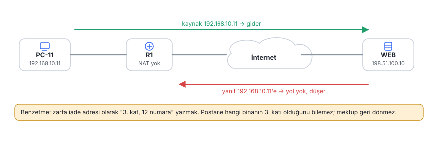
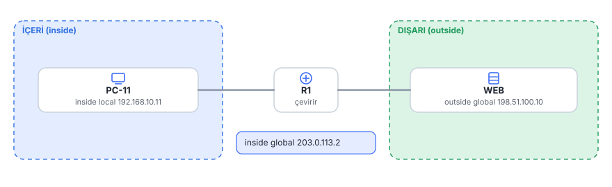
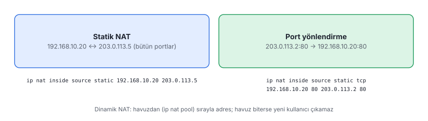
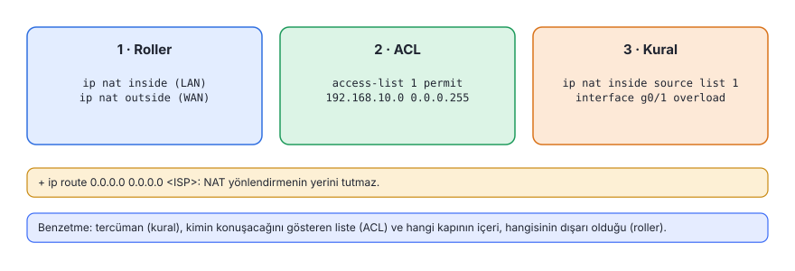
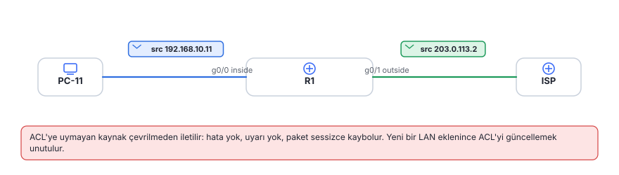
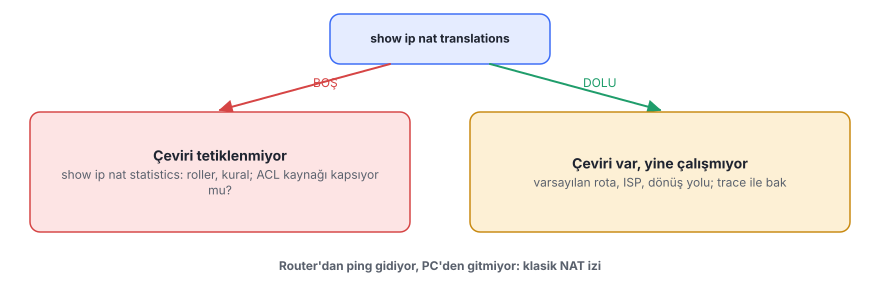
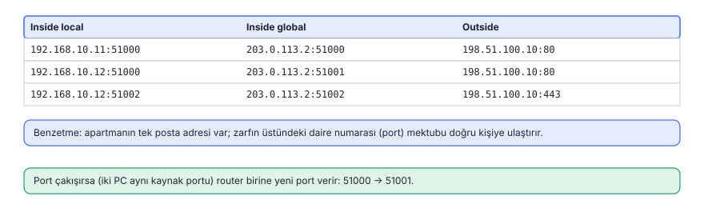

# AğLab Konu #20: NAT/PAT

> Uygulamadaki `nat` kısa dersi ve `natpat` ayrıntılı dersi bu belgeyle uyumludur. Senaryolar Sorun
> Çöz'de `nat-*` kimlikleriyle Labber'da çalışır; başlangıçtaki NAT ayarları kaydedilmiş yapılandırma
> olarak yüklenir (`pending`). Ayrıca tek adımlı `nat-pat` senaryosu vardır. Ön koşul: ACL ve
> wildcard (Konu #19), varsayılan rota (Konu #8). Şemalar: `docs/dersler/gorseller/nat-pat.py`.

Bu konu bittiğinde öğrenci özel adreslerin neden internete çevrilmeden çıkamayacağını açıklar. Şube router'ında PAT'ı (overload) üç parçasıyla kurar: inside/outside rolleri, çevrilecek trafiği seçen ACL ve ikisini bağlayan kural. `show ip nat translations` ve `show ip nat statistics` ile çevirinin olup olmadığını görür. Statik NAT ve port yönlendirmenin ne işe yaradığını açıklar. Seviye 2 (CCNA), süre yaklaşık 60 dakika.

## 0. Bir bakışta

- Özel adresle (192.168.x.x) internete çıkan paketin **yanıtı geri dönemez**.
- **NAT** çıkışta kaynak adresi genel adrese çevirir; dönüşte geri çevirir.
- **PAT (overload)**: bütün PC'ler **tek** genel adresi paylaşır; ayrım **port** numarasıyla.
- Üç parça: **roller** (inside/outside), **ACL** (kim çevrilecek), **kural** (`ip nat inside source list 1 interface g0/1 overload`). Artı varsayılan rota.
- Çeviri yalnız **inside'dan outside'a** geçerken olur.
- `show ip nat translations` **boşsa** çeviri tetiklenmiyor demektir.

> **Akılda kalsın:** Router'dan internete ping gidiyor, PC'lerden gitmiyor: NAT'tır. Router genel adresiyle çıkar, PC özel adresiyle.



## 1. Neden önemli

Şubedeki bütün bilgisayarlar 192.168.x.x gibi özel adresler kullanır; operatör ise şubeye bir ya da birkaç genel adres verir. İnternetteki hiçbir router özel adrese giden yolu bilmez. Paket özel kaynak adresiyle çıkarsa hedefe ulaşabilir ama yanıt geri dönemez. NAT arızalarının tipik izi şudur: router'dan internete ping gidiyor, PC'lerden gitmiyor. Router'ın ping'i genel adresiyle çıkar, PC'ninki çevrilmeden çıkıp kaybolur.

## 2. Kavram

### 2.1 Dört adres terimi

> **Benzetme:** Şirkette herkesin bir dahili numarası (inside local) vardır; dışarıyı aradığınızda karşı taraf yalnız şirketin santral numarasını (inside global) görür.



- **Inside local:** PC'nin gerçek (özel) adresi, ör. 192.168.10.11.
- **Inside global:** çeviriden sonra internette görünen adresi, ör. 203.0.113.2.
- **Outside local / global:** karşı tarafın adresi; şubede ikisi genelde aynıdır.

### 2.2 Üç tür

- **Statik NAT:** bir iç adres ↔ bir genel adres, kalıcı; içerideki sunucuya dışarıdan erişim.
- **Dinamik NAT:** havuzdan sırayla adres; havuz biterse yeni kullanıcı çıkamaz.
- **PAT (overload):** hepsi tek adresi paylaşır, port numarası ayırır. Şubelerin neredeyse hepsi bunu kullanır.



### 2.3 PAT'ın üç parçası



> **Dikkat:** ACL'ye uymayan trafik **çevrilmeden** iletilir; hata vermez, sessizce kaybolur. Şubeye yeni bir LAN eklenince NAT ACL'sini güncellemeyi unutmak klasik arızadır.

### 2.4 Çeviri ne zaman olur



Çeviri yalnız paket inside arayüzden girip outside arayüzden çıkarken yapılır. Roller ters yazılırsa (LAN outside, WAN inside) kural doğru olsa bile çeviri olmaz.

### 2.5 Tablo ve istatistikle teşhis



- `show ip nat translations`: o an çevrilen akışlar. Dinamik ve PAT girdileri yalnız trafik geçtikçe oluşur.
- `show ip nat statistics`: hangi arayüzler inside/outside, hangi kural, kaç çeviri.
- `clear ip nat translation *`: tabloyu boşaltır; yeni trafikle yeniden dolar.

> **Sahada:** Ev modemleri de PAT yapar; evdeki bütün telefon ve bilgisayarlar internette tek bir adresle görünür.

## 3. Çıktı okuma

```
R1#show ip nat translations
Pro  Inside global         Inside local          Outside local         Outside global
icmp 203.0.113.2:1         192.168.10.11:1       198.51.100.10:1       198.51.100.10:1
icmp 203.0.113.2:2         192.168.10.12:1       198.51.100.10:1       198.51.100.10:1
        ← iki PC aynı genel adresi farklı portlarla kullanıyor (PAT)

R1#show ip nat statistics
Total active translations: 2 (0 static, 2 dynamic; 2 extended)
Outside interfaces:
  GigabitEthernet0/1
Inside interfaces:
  GigabitEthernet0/0                       ← roller burada; boşsa ip nat inside/outside eksik
Hits: 6  Misses: 0
Dynamic mappings:
-- Inside Source
[Id: 1] access-list 1 interface GigabitEthernet0/1 overload refcount 2
                                           ← kural ve kullandığı ACL
```

| Belirti | Kanıt | Bakılacak |
| --- | --- | --- |
| Router'dan internete ping var, PC'den yok | Tablo boş | Roller, kural, ACL |
| Tablo boş, roller doğru | `Dynamic mappings` altında kural yok | `ip nat inside source …` |
| Bazı PC'ler çıkıyor, bazıları çıkamıyor | Çıkamayanın adresi tabloda yok | ACL'nin wildcard'ı ya da ağı |
| Inside/Outside listesi ters | statistics'te LAN outside, WAN inside | Rolleri değiştir |

## 4. Yönlendirmeli lab

Topoloji: PC-11, PC-12 (192.168.10.0/24) ─ SW1 ─ R1 g0/0 · R1 g0/1 (203.0.113.2/30) ─ ISP (203.0.113.1) ─ WEB (198.51.100.10). ISP'nin özel ağlara rotası yok, gerçek internet gibi.

1. **NAT'sız dene:** R1'de `ping 198.51.100.10` başarılı; PC-11'den başarısız. *Neden:* R1 genel adresiyle çıkar, PC özel adresiyle.
2. **Roller:** `interface g0/0` → `ip nat inside`; `interface g0/1` → `ip nat outside`. *Neden:* router hangi kapının içeri, hangisinin dışarı olduğunu bilmeli.
3. **ACL:** `access-list 1 permit 192.168.10.0 0.0.0.255`. *Neden:* ACL burada filtre değil, "kimin çevrileceği" listesidir.
4. **Kural:** `ip nat inside source list 1 interface g0/1 overload`.
5. **Test:** PC-11 ve PC-12'den `ping 198.51.100.10` ve `curl http://198.51.100.10`.
6. **Tablo:** `show ip nat translations`; iki PC'nin aynı genel adresi farklı portlarla kullandığını gör. `show ip nat statistics` ile rolleri ve kuralı oku.
7. **Temizle ve tekrarla:** `clear ip nat translation *`, tablo boşalır; PC'den yeni ping ile yeniden dolar.
8. **Okuma:** İçerideki bir web sunucusunu dışarı açmak için hangi satır yazılırdı? (statik port yönlendirme). Kaydet.



## 5. Sık hatalar

| Kod | Hata | Belirti | Kanıt | Düzeltme |
| --- | --- | --- | --- | --- |
| E1 | Rol eksik (`ip nat inside` ya da `outside`) | Kimse çıkamıyor, router'dan ping var | Tablo boş; statistics'te arayüz listesi eksik | Eksik rolü ekle |
| E2 | ACL yanlış ağı ya da eksik aralığı eşliyor | Kimse ya da bazı PC'ler çıkamıyor | Çıkamayanın adresi ACL'ye uymuyor | ACL'yi doğru ağ ve wildcard ile yaz |
| E3 | Roller ters | Kimse çıkamıyor | LAN outside, WAN inside | Rolleri değiştir |
| E4 | Kural yok | Roller ve ACL var, tablo boş | `Dynamic mappings` boş; running-config'te `ip nat inside source` yok | Kuralı yaz |
| E5 | Varsayılan rota yok | Router da çıkamıyor | `show ip route`'ta 0.0.0.0/0 yok | `ip route 0.0.0.0 0.0.0.0 <ISP>` |

## 6. Arıza senaryoları

> **Uygulamada:** S1–S5 Sorun Çöz'de `nat-missing-inside`, `nat-acl-old-subnet`, `nat-roles-swapped`,
> `nat-missing-rule`, `nat-two-faults` kimlikleriyle Labber'da çalışır.
> Önce kendin çöz; neden ve çözüm kapalı kutularda.

### S1 · Başlangıç · Şube internete çıkamıyor, çeviri tablosu boş (E1)

- **Belirti:** Router değişti, yapılandırma kopyalandı. PC'lerden 198.51.100.10'a ulaşılamıyor, R1'den ping başarılı; tablo boş.
- **Hedef:** PC-11 ve PC-12 → WEB ping; PC-11 → WEB sayfası

<details><summary>Neden ve çözüm</summary>

g0/0'da `ip nat inside` yok. Çözüm: R1 → `interface g0/0` → `ip nat inside`

</details>

### S2 · Orta · Yeniden numaralandırmadan sonra internet yok (E2)

- **Belirti:** Şube 192.168.1.0/24'ten 192.168.10.0/24'e taşındı; kimse çıkamıyor.
- **Hedef:** S1 ile aynı

<details><summary>Neden ve çözüm</summary>

ACL 1 hâlâ 192.168.1.0'ı eşliyor. Çözüm: R1 → `no access-list 1` → `access-list 1 permit 192.168.10.0 0.0.0.255`

</details>

### S3 · Orta · inside ile outside yer değiştirmiş (E3)

- **Belirti:** Yeni şube router'ında NAT yapıldı; kimse çıkamıyor, ACL ve kural doğru.
- **Hedef:** S1 ile aynı

<details><summary>Neden ve çözüm</summary>

g0/0 outside, g0/1 inside. Çözüm: R1 → g0/0: `no ip nat outside` → `ip nat inside`; g0/1: `no ip nat inside` → `ip nat outside`

</details>

### S4 · Orta · Roller ve ACL var, çeviri yok (E4)

- **Belirti:** "NAT'ı yaptım" deniyor; roller ve ACL var, tablo boş.
- **Hedef:** S1 ile aynı

<details><summary>Neden ve çözüm</summary>

`ip nat inside source` satırı yok. Çözüm: R1 → `ip nat inside source list 1 interface g0/1 overload`

</details>

### S5 · İleri · Önce kimse, sonra bir kişi çıkamıyor (E1 + E2)

- **Belirti:** Kimse çıkamıyor; bir düzeltmeden sonra PC-11 çıkıyor, PC-12 (192.168.10.150) çıkamıyor.
- **Hedef:** PC-11 ve PC-12 → WEB

<details><summary>Neden ve çözüm</summary>

g0/1'de `ip nat outside` yok ve ACL 1 `0.0.0.127` (yalnız .0–.127). Çözüm: R1 → g0/1: `ip nat outside`; `no access-list 1` → `access-list 1 permit 192.168.10.0 0.0.0.255`

</details>

## 7. Kısa sınav

**1.** PC'nin özel adresi hangi NAT terimidir?

<details><summary>Cevap</summary>

Inside local.

</details>

**2.** PAT'ta birçok iç adres tek genel adresi nasıl paylaşır?

<details><summary>Cevap</summary>

Port numaralarıyla.

</details>

**3.** Router'dan internete ping var, PC'den yok, çeviri tablosu boş. İlk şüphe?

<details><summary>Cevap</summary>

Rol, kural ya da ACL eksik; çeviri hiç tetiklenmiyor.

</details>

**4.** NAT ACL'sine uymayan trafik ne olur?

<details><summary>Cevap</summary>

Çevrilmeden iletilir; özel adresle çıkar ve yanıt dönmez.

</details>

**5.** İçerideki web sunucusunu dışarıya açmak için?

<details><summary>Cevap</summary>

Statik NAT ya da port yönlendirme: `ip nat inside source static tcp 192.168.10.20 80 203.0.113.2 80`.

</details>

**6.** Şubeye 192.168.20.0/24 eklendi. Eski LAN internete çıkıyor, yeni LAN çıkamıyor; tabloda yalnız 192.168.10.x girdileri var. Neden?

<details><summary>Cevap</summary>

NAT ACL'si yeni ağı kapsamıyor. `access-list 1 permit 192.168.20.0 0.0.0.255` ekle (ve yeni arayüze `ip nat inside`).

</details>

## 8. Özet kartı

| Komut | Ne işe yarar |
| --- | --- |
| `ip nat inside` / `ip nat outside` | Arayüz rolleri |
| `access-list 1 permit 192.168.10.0 0.0.0.255` | Kim çevrilecek |
| `ip nat inside source list 1 interface g0/1 overload` | PAT kuralı |
| `ip nat inside source static …` | Statik NAT / port yönlendirme |
| `show ip nat translations` | Çeviri tablosu |
| `show ip nat statistics` | Roller, kural, sayılar |
| `clear ip nat translation *` | Tabloyu boşalt |

**Unutma:**

1. Üç parça + varsayılan rota.
2. ACL dışı trafik sessizce çevrilmez.
3. Çeviri inside → outside.
4. Tablo boş = tetiklenmiyor.
5. Router çıkıyor, PC çıkamıyor = NAT.

## 9. Doğrulama notları

**Lab'ın otomatik değerlendirmesi:** `q.ping('PC-11', '198.51.100.10').ok`; `q.ping('PC-12', '198.51.100.10').ok`; `q.http('PC-11', '198.51.100.10').ok`.

Kaynaklar: INET CCNA 200-301 v1.1 ve INE ENCOR (NAT); Cisco IOS "Configuring NAT for IP Address Conservation" (inside/outside local/global, overload, `show ip nat translations|statistics`), RFC 1918 (özel adresler), RFC 3022 (NAPT); CCNA 200-301 4.1 (inside source NAT: statik ve havuz).

| İddia | Sonuç |
| --- | --- |
| Çeviri inside → outside geçişinde yapılır; arayüz rolleri zorunlu | Doğru |
| NAT ACL'sine uymayan trafik çevrilmeden yönlendirilir | Doğru |
| Dinamik/PAT girdileri yalnız trafikle oluşur; `clear ip nat translation *` dinamikleri siler | Doğru |
| IOS'ta NAT, inside→outside yönünde yönlendirmeden sonra uygulanır | Doğru (işlem sırası) |

**Motor gereksinimleri** (Labber'da denendi)

- [x] Roller, ACL ile PAT (interface overload), havuz, statik NAT ve port yönlendirme komutları; `show ip nat translations|statistics`, `clear ip nat translation *`
- [x] Beş senaryo başta başarısız, çözümle başarılı; iki hatalı senaryonun ara hali (yalnız bir PC çıkıyor) doğrulandı
- [ ] AğLab topoloji modeli yalnız "arayüze overload" PAT'ı ifade ediyor; statik NAT, port yönlendirme ve havuz Labber'da çalışıyor ama kayıt/dışa aktarmaya yazılamıyor. Bu yüzden senaryolar PAT'la sınırlı, statik NAT okuma konusu (model işi)
