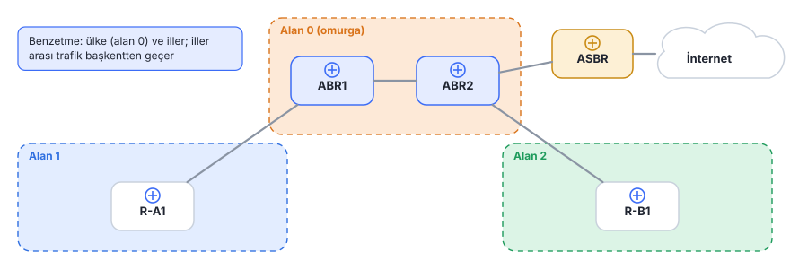
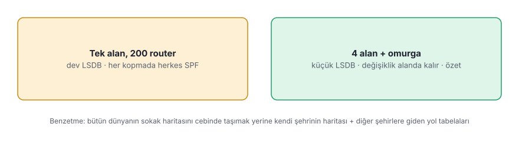
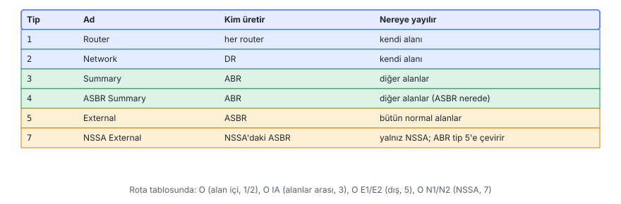
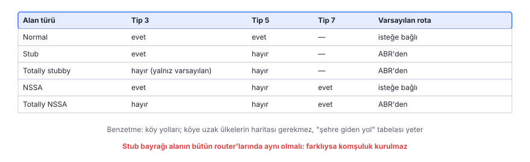
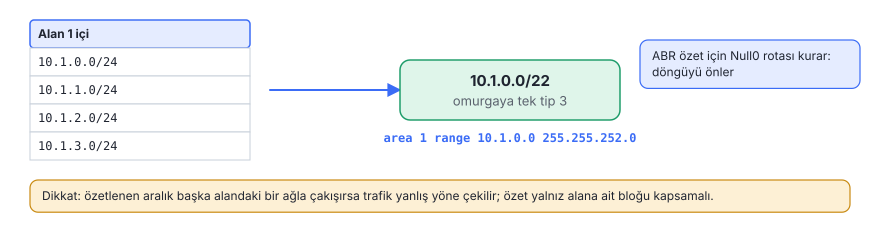
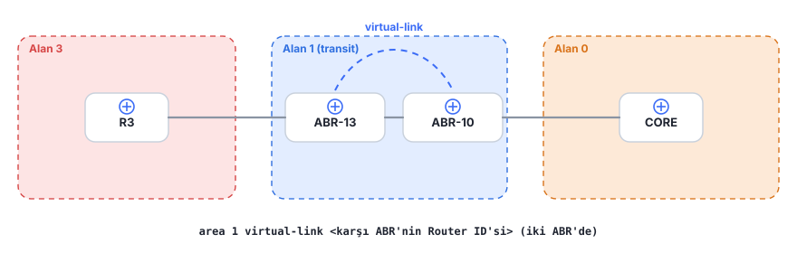
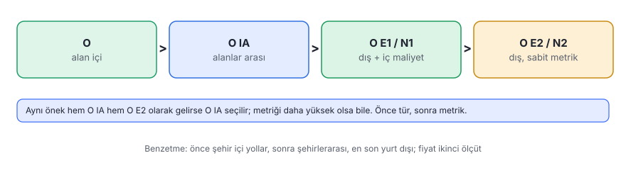

# AğLab Konu #31: OSPF çok alan: LSA türleri, alan türleri ve özetleme

> Uygulamadaki `ospfadv` dersi bu belgeyle uyumludur. **Okuma dersi + Simülatör labı (Seviye 3, CCNP):** Labber çok alanlı OSPF'i çalıştırır (ABR/ASBR, varsayılan rota, stub ve totally stubby): Simülatör'deki **ospf-cok-alan** ve **ospf-alan-ariza** labları. LSA veritabanı, özetleme, NSSA ve virtual-link Labber'da yok; Gerçek Lab (FRR) bunları çalıştırır.
> Ön koşul: OSPFv2 tek alan (Konu #15), wildcard ve özetleme mantığı (Konu #2, #19). Şemalar: `docs/dersler/gorseller/ospf-ileri.py`.

Bu konu bittiğinde öğrenci OSPF'i alanlara bölmenin nedenini açıklar; ABR ve ASBR'yi topolojide gösterir. LSA tip 1, 2, 3, 4, 5 ve 7'nin kim tarafından üretildiğini ve nereye yayıldığını söyler; rota tablosundaki O, O IA, O E1/E2 ve O N1/N2 kodlarını okur. Stub, totally stubby ve NSSA alanlarının neyi engellediğini karşılaştırır; ABR'de özet yapar, omurgaya bağlı olmayan alan sorununu tanır. Süre yaklaşık 60 dakika.

## 0. Bir bakışta

- Bütün alanlar **alan 0'a (omurga)** bağlanır; iki alanı bağlayan router **ABR**, dış rota getiren **ASBR**.
- **Tip 1/2** alan içini, **tip 3** diğer alanların öneklerini, **tip 5** dış rotaları, **tip 7** NSSA'daki dış rotaları taşır.
- Tabloda **O** alan içi, **O IA** alanlar arası, **O E1/E2** dış, **O N1/N2** NSSA dış.
- **Stub** tip 5 almaz; **totally stubby** tip 3'ü de almaz; ikisi de varsayılan rota alır. **NSSA** dış rota üretebilir.
- Özet **ABR'de** (`area x range`) ya da **ASBR'de** (`summary-address`) yapılır.
- Rota seçimi: önce **tür** (O > O IA > E1/N1 > E2/N2), sonra metrik.

> **Akılda kalsın:** Alan türü bir sözleşmedir: alandaki bütün router'lar aynı stub/NSSA bayrağını taşımazsa komşuluk kurulmaz.



## 1. Neden önemli

Tek alan OSPF küçük ağda kusursuzdur; ama router sayısı arttıkça her router dev bir harita tutar ve uzaktaki bir arayüzün her kopuşunda SPF hesaplar. Çok alanlı tasarım haritayı küçültür ve değişiklikleri alan içinde tutar. Karşılığında yeni arızalar gelir: alan türü uyuşmazlığı, omurgaya bağlı olmayan alan, yanlış özet. CCNP'nin en çok sorulan konularından biridir.

## 2. Kavram

### 2.1 Alanlar, ABR ve ASBR

> **Benzetme:** Bir ülke iller şeklinde yönetilir. Her il kendi sokaklarını bilir; diğer illerin yalnız "şu yöne gidince ulaşırsın" tabelasını görür. İller arası yolculuk başkentten (omurga) geçer.



- **İç router:** bütün arayüzleri tek alanda.
- **ABR:** en az bir arayüzü alan 0'da, bir arayüzü başka alanda; her alan için ayrı LSDB tutar.
- **ASBR:** başka bir kaynaktan (statik, BGP, EIGRP) rotayı OSPF'e dağıtır (redistribution, Konu #44).

### 2.2 LSA türleri



> **Benzetme:** Tip 1 her evin kendi tarifi, tip 2 apartman yöneticisinin (DR) "bu apartmanda kimler var" listesi, tip 3 il müdürlüğünün (ABR) diğer illere "bende şu mahalleler var" duyurusu, tip 5 gümrüğün (ASBR) "yurt dışına buradan çıkılır" duyurusudur.

### 2.3 Alan türleri



- `area 2 stub` (alandaki **bütün** router'larda), `area 2 stub no-summary` (yalnız ABR'de, totally stubby yapar).
- `area 3 nssa` alandaki bir ASBR'ye dış rota getirme izni verir; tip 7 olarak yayılır, ABR tip 5'e çevirir.

### 2.4 Özetleme



> **Dikkat:** OSPF özeti yalnız ABR ve ASBR'de yapılabilir; alan içindeki bir router özet yapamaz, çünkü alan içinde herkes aynı haritayı tutmak zorundadır.

### 2.5 Omurga kuralı ve virtual-link



### 2.6 Rota seçimi



- **E2** (varsayılan): ASBR'nin verdiği metrik değişmeden taşınır; ağın içindeki mesafe hesaba katılmaz.
- **E1:** dış metrik + ASBR'ye olan iç maliyet; birden çok ASBR varsa en yakını seçilir.

> **Sahada:** Çok alanlı bir ağda "bu rota neden O IA?" sorusu çoğu zaman bir arayüzün yanlış alana konduğunu ele verir.

## 3. Çıktı okuma

```
ABR1#show ip ospf border-routers
OSPF Router with ID (1.1.1.1) (Process ID 1)
i 2.2.2.2 [1] via 10.0.0.2, GigabitEthernet0/0, ABR, Area 0, SPF 7
I 9.9.9.9 [2] via 10.0.0.2, GigabitEthernet0/0, ASBR, Area 0, SPF 7
                                        ← ABR ve ASBR'ler ve onlara giden yol

R-A1#show ip route ospf
O IA  10.2.0.0/22 [110/3] via 10.1.12.1, 00:20:11, GigabitEthernet0/0
O*E2  0.0.0.0/0 [110/1] via 10.1.12.1, 00:20:11, GigabitEthernet0/0
O E2  172.16.0.0/16 [110/20] via 10.1.12.1, 00:20:11, GigabitEthernet0/0
                                        ← IA: alan 2'nin özeti; E2: dış, sabit metrik 20

R-A1#show ip ospf database summary 10.2.0.0
            OSPF Router with ID (11.11.11.11) (Process ID 1)
                Summary Net Link States (Area 1)
  LS Type: Summary Links(Network)
  Link State ID: 10.2.0.0 (summary Network Number)
  Advertising Router: 1.1.1.1
  Network Mask: /22
                                        ← tip 3, ABR1 (1.1.1.1) üretmiş

R-B1#show ip ospf | include Area|stub
 Area 2
        It is a stub area
                                        ← R-B1 alan 2'yi stub görüyor; ABR2'de de stub olmalı

ABR2#show ip ospf neighbor
                                        ← R-B1 listede yok: ABR2'de "area 2 stub" eksik
```

| Soru | Komut |
| --- | --- |
| ABR/ASBR'ler nerede? | `show ip ospf border-routers` |
| Hangi LSA'lar var? | `show ip ospf database [router\|network\|summary\|external\|nssa-external]` |
| Alan türü? | `show ip ospf` |
| Özetler? | `show ip ospf \| section range`, `show ip route \| include Null0` |

## 4. Yönlendirmeli lab

> **Simülatörde yok:** Lab'ı kâğıt üstünde yürüt; her adımda Bölüm 3'teki beklenen çıktıyla karşılaştır.

Topoloji: g1'deki gibi; alan 1 (10.1.0.0/22), alan 2 (10.2.0.0/22), ASBR internet varsayılan rotası ve 172.16.0.0/16 dış rotası.

1. ABR1 ve ABR2'nin hangi arayüzleri hangi alanda? `show ip ospf interface brief`. *Neden:* ABR tanımı arayüzlerden gelir.
2. R-A1'de rota tablosunu oku; her satırın kodunu (O, O IA, O E2) LSA türüyle eşleştir.
3. ABR1'de `area 1 range 10.1.0.0 255.255.252.0`; R-B1'de dört /24 yerine bir /22 görmeyi bekle. ABR1'de Null0 rotasını gör.
4. Alan 2'yi stub yap (R-B1 ve ABR2'de `area 2 stub`): R-B1'de E2 rotalarının kalkıp bir O*IA varsayılan rotanın geldiğini gör.
5. ABR2'de `area 2 stub no-summary`: R-B1'de yalnız varsayılan rota kalır.
6. Kâğıt üstü: alan 3 yalnız alan 1'e bağlı olsaydı ne olurdu? Virtual-link komutunu yaz.

> **Benzetme:** 4. ve 5. adım, köyün haritasından önce yurt dışını, sonra diğer illeri silip yerine "şehre giden yol" tabelası koymaktır.

## 5. Sık hatalar

| Kod | Hata | Belirti | Kanıt | Düzeltme |
| --- | --- | --- | --- | --- |
| E1 | Alan türü uyuşmazlığı | Komşuluk yok | Bir uçta stub, öbüründe normal; Hello'da bayrak farkı | Alandaki herkese aynı tür |
| E2 | Arayüz yanlış alanda | Komşuluk yok ya da rota O IA görünüyor | `show ip ospf interface brief` alan sütunu | Doğru alan |
| E3 | Omurgaya bağlı olmayan alan | Alanın rotaları diğer alanlara ulaşmıyor | Alanın ABR'si alan 0'a dokunmuyor | Tasarımı düzelt ya da virtual-link |
| E4 | Çakışan özet | Trafik yanlış ABR'ye çekiliyor | Özet başka alandaki ağı kapsıyor | Özet aralığını daralt |
| E5 | Totally stubby için ABR dışında no-summary | Etkisiz, kafa karışıklığı | İç router'da no-summary | `no-summary` yalnız ABR'de |

## 6. Arıza senaryoları

> **Uygulamada:** Kâğıt üstü vakalar; motor ya da Gerçek Lab desteği gelince Sorun Çöz'e `ospfm-*` kimlikleriyle eklenecek. Önce kendin çöz; neden ve çözüm kapalı kutularda.

### S1 · Başlangıç · Yeni router alan 2'de komşu olmuyor (E1)

- **Belirti:** R-B2 alan 2'ye eklendi; ABR2 ile Hello'lar görünüyor ama komşuluk yok.
- **Hedef:** R-B2 FULL olur.

<details><summary>Neden ve çözüm</summary>

Alan 2 stub; R-B2'de `area 2 stub` yok. Hello'daki stub bayrağı uyuşmuyor. Çözüm: R-B2'de `area 2 stub`.

</details>

### S2 · Orta · Alan 3'ün ağları kimsede yok (E3)

- **Belirti:** Yeni şube alan 3 olarak alan 1'deki R-A1'e bağlandı; alan 0'daki router'larda 10.3.x yok.
- **Hedef:** Alan 3 rotaları omurgada görünür.

<details><summary>Neden ve çözüm</summary>

Alan 3'ün ABR'si (R-A1) alan 0'a dokunmuyor; tip 3'ler omurgaya çıkamıyor. Çözüm: R-A1'i omurgaya bağla ya da R-A1 ile ABR1 arasında `area 1 virtual-link`.

</details>

### S3 · Orta · Özet sonrası bir şube kayboldu (E4)

- **Belirti:** ABR1'de `area 1 range 10.0.0.0 255.0.0.0` yazıldı; alan 2'deki 10.2.x ağlarına giden trafik alan 1'e gidip kayboluyor.
- **Hedef:** Doğru özet.

<details><summary>Neden ve çözüm</summary>

Özet alan 2'nin bloğunu da kapsıyor; diğer router'lar 10.2.x'i de ABR1'e gönderiyor, ABR1 Null0'a atıyor. Çözüm: `area 1 range 10.1.0.0 255.255.252.0`.

</details>

### S4 · İleri · Dış rota neden bu ASBR'den? (E2/E1)

- **Belirti:** İki ASBR aynı 172.16.0.0/16'yı E2 metrik 20 ile duyuruyor; R-A1 uzaktaki ASBR'yi kullanıyor.
- **Hedef:** Trafik en yakın ASBR'den çıksın.

<details><summary>Neden ve çözüm</summary>

E2'de iç maliyet hesaba katılmaz; eşitlikte ASBR'ye forwarding maliyetine bakılır ama tasarım netliği için E1 kullanmak daha iyidir. Çözüm: ASBR'lerde dağıtımı `metric-type 1` ile E1 yap.

</details>

## 7. Kısa sınav

**1.** ABR nedir?

<details><summary>Cevap</summary>

En az bir arayüzü alan 0'da, bir arayüzü başka alanda olan ve her alan için ayrı LSDB tutan router.

</details>

**2.** Tip 3 LSA'yı kim üretir, ne taşır?

<details><summary>Cevap</summary>

ABR; bir alanın öneklerini diğer alanlara (özet) taşır.

</details>

**3.** Rota tablosunda O IA ne demektir?

<details><summary>Cevap</summary>

Alanlar arası rota (tip 3'ten).

</details>

**4.** Stub ile totally stubby farkı?

<details><summary>Cevap</summary>

Stub tip 5'i almaz; totally stubby tip 3'ü de almaz, yalnız varsayılan rota alır.

</details>

**5.** Bir alan omurgaya doğrudan bağlı değilse geçici çözüm?

<details><summary>Cevap</summary>

Transit alan üzerinden iki ABR arasında virtual-link.

</details>

**6.** Aynı önek O IA ve O E2 olarak geliyor; hangisi seçilir?

<details><summary>Cevap</summary>

O IA: OSPF önce rota türüne bakar, metrik ikincidir.

</details>

## 8. Özet kartı

| Komut / kod | Anlamı |
| --- | --- |
| `area 1 range <ağ> <maske>` | ABR'de alanlar arası özet |
| `summary-address <ağ> <maske>` | ASBR'de dış özet |
| `area 2 stub [no-summary]` | Stub / totally stubby |
| `area 3 nssa` | NSSA |
| `area 1 virtual-link <RID>` | Omurgaya sanal bağlantı |
| O / O IA / O E1-E2 / O N1-N2 | İç / alanlar arası / dış / NSSA dış |
| `show ip ospf database …` | LSA'lar |

**Unutma:**

1. Her alan omurgaya dokunur.
2. Alan türü alanda herkeste aynı.
3. Özet yalnız ABR/ASBR'de ve yalnız kendi bloğu.
4. Önce tür, sonra metrik.
5. E2 iç maliyeti saymaz; E1 sayar.

## 9. Doğrulama notları

Kaynaklar: INE ENCOR (OSPF: multi-area, LSA types, area types, summarization) ve CCNP ENCOR v1.0 (yalnız kapsam kontrolü için); RFC 2328 (OSPFv2), RFC 3101 (NSSA); Cisco IOS OSPF yapılandırma kılavuzu. Ders metni, örnek çıktılar ve şemalar özgün yazıldı.

| İddia | Sonuç |
| --- | --- |
| Tip 3 ABR, tip 5 ASBR, tip 7 NSSA'daki ASBR tarafından üretilir | Doğru |
| Stub alan tip 5 almaz; totally stubby tip 3'ü de almaz | Doğru |
| Stub bayrağı Hello'da taşınır; uyuşmazlık komşuluğu engeller | Doğru |
| Rota tercihi: intra-area > inter-area > E1/N1 > E2/N2 | Doğru |
| ABR özetle birlikte Null0 discard rotası kurar | Doğru |
| E2 varsayılan dış tiptir, varsayılan metrik 20 | Doğru |

**Motor gereksinimleri**

- [x] Çok alan, ABR/ASBR, varsayılan rota, stub ve totally stubby alanlar Labber'da var: Simülatör'deki **ospf-cok-alan** (kurulum) ve **ospf-alan-ariza** (stub bayrağı, omurgasız ABR) labları.
- [ ] LSA veritabanı (`show ip ospf database`), özetleme (`area range`), NSSA ve virtual-link Labber'da yok; Gerçek Lab (FRR) bunları çalıştırır. Hazır olunca kalan vakalar `ospfm-*` kimlikleriyle eklenir.
