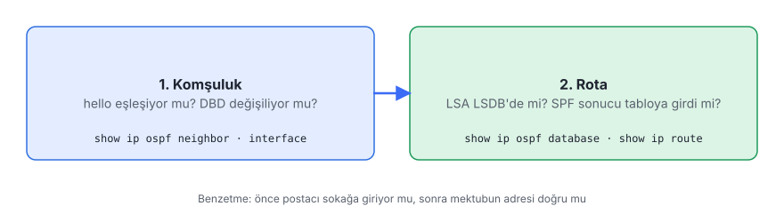
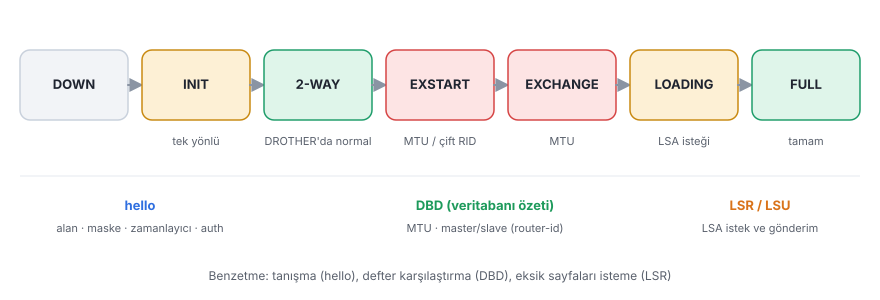
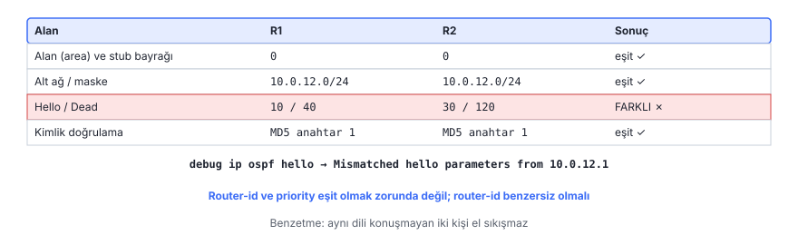
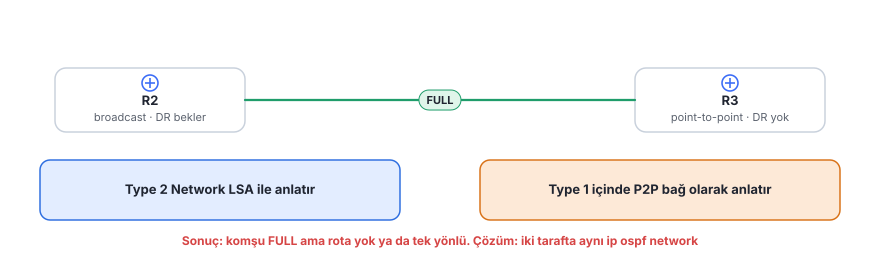
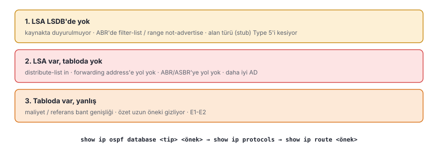
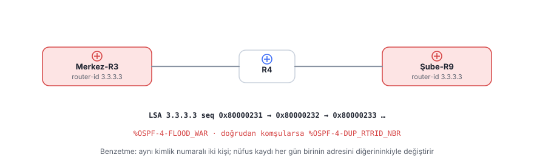
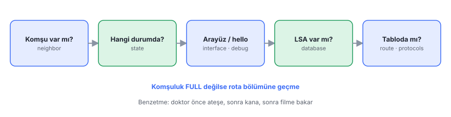

# AğLab Konu #42: İleri OSPF sorun giderme: komşuluk durumları, LSDB ve eksik rotalar

> Uygulamadaki `ospftshoot` dersi bu belgeyle uyumludur. **Okuma dersi (Seviye 3, CCNP):** Labber tek alan OSPF komşuluğunu ve temel rota kurulumunu çalıştırır; komşuluk durum makinesinin ara durumları, LSDB ve alan türleri Gerçek Lab (FRR) ile denenir.
> Ön koşul: OSPFv2 tek alan (Konu #15), OSPF çok alan (Konu #31), sorun giderme yöntemi (Konu #11). Şemalar: `docs/dersler/gorseller/ospf-sorun-giderme.py`.

Bu konu bittiğinde öğrenci OSPF arızasını iki soruya ayırır: "komşuluk kuruluyor mu?" ve "komşuluk var ama rota neden yok ya da neden yanlış?". Komşuluğun takıldığı durumdan (INIT, 2-WAY, EXSTART/EXCHANGE) olası nedeni çıkarır; hello parametreleri, MTU, ağ tipi, kimlik doğrulama ve router-id çakışmasını kanıtla ayırt eder. Komşuluk tamamken eksik rotayı LSDB'de arar: LSA hiç yok mu, var ama tabloya girmiyor mu? Filtreleri, alan türlerini, özetlemeyi ve forwarding address'i bu sırayla eler. Süre yaklaşık 60 dakika.

## 0. Bir bakışta

- OSPF arızası iki katmanlıdır: **komşuluk** (hello ve veritabanı değişimi) ve **rota** (LSDB → SPF → tablo).
- Komşuluk hiç görünmüyorsa: arayüz, IP alt ağı, alan, hello/dead, kimlik doğrulama, passive, ACL.
- **INIT**'te takılı: hello geliyor ama karşı taraf beni görmüyor (tek yönlü iletişim, ACL, multicast sorunu).
- **2-WAY**'de kalmak DR/BDR olmayan iki DROTHER için **normaldir**; noktadan noktaya bağlantıda değildir.
- **EXSTART/EXCHANGE**'te takılı: neredeyse her zaman **MTU uyuşmazlığı** (ya da çift router-id).
- Komşuluk FULL ama rota yok: önce `show ip ospf database` ile LSA'nın varlığına bak; sonra filtre, alan türü, özet.
- **Çift router-id** komşuluğu bozabilir ya da LSDB'de sürekli değişen LSA'lar üretir.

> **Akılda kalsın:** Önce "hangi durumda takıldı?" sor. OSPF durumları, hastanın ateşi gibidir: tek başına teşhis değildir ama nereye bakacağını söyler.



## 1. Neden önemli

OSPF bir kez kurulunca yıllarca çalışır; arıza da çoğu zaman bir değişiklikten sonra gelir: yeni bir router, değiştirilen bir MTU, eklenen bir kimlik doğrulama, kopyalanıp yapıştırılmış bir yapılandırma. Bu arızaların belirtisi tek cümledir ("şube erişilemiyor") ama nedeni on farklı yerde olabilir. Sahada iyi mühendisle ortalama mühendis arasındaki fark, rastgele komut yazmak yerine durum makinesinden ve LSDB'den giderek nedeni birkaç adımda daraltmaktır. ENARSI'nin en ağır sorun giderme konusu budur.

## 2. Kavram

### 2.1 İki soru: komşuluk mu, rota mı?

> **Benzetme:** Bir mektup gelmiyorsa önce postacının sokağa girip girmediğine bakarsın (komşuluk); postacı geliyorsa sorun zarfın üstündeki adrestedir ya da mektup postada ayıklanmıştır (rota).

```
show ip ospf neighbor          ← komşu var mı, hangi durumda?
show ip ospf interface brief   ← arayüz OSPF'te mi, alan, maliyet, durum
show ip ospf database          ← LSA'lar geldi mi?
show ip route ospf             ← SPF sonucu tabloya ne girdi?
```

Bu dört komut sırayla, arızanın hangi katmanda olduğunu söyler. Komşuluk FULL değilse rota bölümüne geçmenin anlamı yoktur.

### 2.2 Komşuluk durumları ve takıldığı yer



| Takıldığı durum | Anlamı | Tipik neden |
| --- | --- | --- |
| Hiç yok | Hello hiç gelmiyor ya da reddediliyor | Arayüz kapalı/passive, farklı alt ağ, alan, hello/dead, auth, ACL |
| INIT | Hello geliyor, karşı taraf beni listelemiyor | Tek yönlü iletişim, bir taraftaki ACL, multicast engeli |
| 2-WAY | Çift yönlü, veritabanı değişimi yok | DROTHER–DROTHER: normal. P2P'de: ağ tipi uyuşmazlığı |
| EXSTART / EXCHANGE | Veritabanı özeti değişilemiyor | MTU uyuşmazlığı, çift router-id |
| LOADING | LSA istekleri yanıtlanmıyor | Bozuk/eksik LSA, nadiren hata |
| FULL | Tamam | Rota sorunu varsa LSDB'ye geç |

### 2.3 Hello'da eşleşmesi gerekenler



Bir hello alındığında router şu alanları kendi değerleriyle karşılaştırır; biri tutmazsa hello sessizce atılır ve komşu hiç görünmez:

- Alan numarası ve alan türü bayrağı (stub/NSSA)
- Alt ağ ve maske (P2P ve sanal bağlantılar hariç)
- Hello ve dead aralıkları
- Kimlik doğrulama türü ve anahtarı

```
R2#debug ip ospf hello
OSPF-1 HELLO Gi0/0: Mismatched hello parameters from 10.0.12.1
OSPF-1 HELLO Gi0/0: Dead R 40 C 120, Hello R 10 C 30  Mask R 255.255.255.0 C 255.255.255.0
                                        ← R = alınan, C = benim yapılandırmam: hello/dead farklı
```

> **Dikkat:** MTU hello'da değil **DBD** paketinde karşılaştırılır. Bu yüzden MTU uyuşmazlığında komşu görünür ama EXSTART/EXCHANGE'te takılır. `ip ospf mtu-ignore` geçici çözümdür; asıl çözüm iki tarafın MTU'sunu eşitlemektir.

### 2.4 Ağ tipi uyuşmazlığı



- Bir taraf `broadcast` (DR seçer, hello 10 s), diğeri `point-to-point` (DR seçmez, hello 10 s) ise hello aralıkları aynı olduğundan komşuluk FULL olabilir, ama LSA'lar tutarsız olur: bir taraf ağı Type 2 (Network LSA) ile, diğeri Type 1 içinde stub ağ olarak tanımlar. Sonuç: komşuluk FULL, rota yok ya da tek yönlü.
- `non-broadcast` ile `broadcast` karşılaşırsa hello/dead (30/120 ve 10/40) farklıdır; komşuluk hiç kurulmaz.

### 2.5 Komşuluk tamam, rota yok



Sırayla eleyerek git:

1. **LSA LSDB'de var mı?** `show ip ospf database router|summary|external <önek>`. Yoksa: kaynağında duyurulmuyor (network komutu, passive değil ama arayüz OSPF'te değil), ABR'de `area … filter-list` ya da `area … range … not-advertise`, alan türü dış rotaları engelliyor (stub/totally stubby).
2. **LSA var, tabloda yok:** `distribute-list in` (LSA'yı silmez, yalnız tabloya girişi engeller), Type 5'te forwarding address'e ulaşılamıyor, Type 3/4'te ABR'ye ya da ASBR'ye yol yok, daha iyi AD'li başka kaynak (statik, EIGRP) seçilmiş.
3. **Tabloda var ama yanlış:** maliyet (referans bant genişliği tutarsız), özet daha uzun öneki gizliyor, E1/E2 karşılaştırması.

> **Sahada:** `distribute-list in` kullanılan bir router'da rota yoktur ama LSA vardır ve komşularına LSA'yı iletmeye devam eder. Yani bir router'da filtre, ondan sonraki router'ları etkilemez. Bu, "aynı alanda bir router rotayı görüyor, diğeri görmüyor" belirtisinin klasik nedenidir.

### 2.6 Çift router-id



Aynı alanda iki router aynı router-id'yi kullanırsa:

- Doğrudan komşularsa komşuluk kurulmaz (`%OSPF-4-DUP_RTRID_NBR`).
- Uzaktaysa iki router da aynı Type 1 LSA'yı kendi bilgisiyle sürekli yeniden üretir; LSDB'de sıra numarası durmadan artar, SPF sürekli çalışır, rotalar gelip gider (`%OSPF-4-FLOOD_WAR`).

Router-id elle (`router-id`) ya da en yüksek loopback'ten seçilir. Şablondan kopyalanmış yapılandırmalar en sık nedendir. Değiştirdikten sonra `clear ip ospf process` gerekir.

### 2.7 Yöntem: kanıttan nedene



> **Benzetme:** Doktorun önce ateşe, sonra kana, sonra filme bakması gibi: her test bir sonrakini seçer. Rastgele "clear ip ospf process" yazmak, teşhis koymadan antibiyotik vermektir: bazen geçer ama neden geçtiğini öğrenemezsin.

## 3. Çıktı okuma

```
R2#show ip ospf neighbor
Neighbor ID     Pri   State           Dead Time   Address         Interface
1.1.1.1           1   EXSTART/DR      00:00:36    10.0.12.1       GigabitEthernet0/0
3.3.3.3           0   FULL/  -        00:00:33    10.0.23.3       Serial0/1/0
                                        ← 1.1.1.1 EXSTART'ta: önce MTU'ya bak

R2#show interfaces g0/0 | include MTU
  MTU 1500 bytes, BW 1000000 Kbit/sec
R1#show interfaces g0/0 | include MTU
  MTU 1400 bytes, BW 1000000 Kbit/sec
                                        ← MTU farklı: DBD kabul edilmiyor

R2#show ip ospf interface g0/0
GigabitEthernet0/0 is up, line protocol is up
  Internet Address 10.0.12.2/24, Area 0, Attached via Network Statement
  Process ID 1, Router ID 2.2.2.2, Network Type BROADCAST, Cost: 1
  Timer intervals configured, Hello 10, Dead 40, Wait 40, Retransmit 5
  Neighbor Count is 1, Adjacent neighbor count is 0
                                        ← komşu sayısı 1, bitişik 0: değişim tamamlanmıyor

R4#show ip ospf database external 172.16.0.0
  LS age: 312
  Link State ID: 172.16.0.0 (External Network Number )
  Advertising Router: 5.5.5.5
  Metric Type: 2 (Larger than any link state path)
  Metric: 20
  Forward Address: 10.9.9.9
                                        ← LSA var; 10.9.9.9'a OSPF'te yol yoksa rota tabloya girmez

R4#show ip route 10.9.9.9
% Network not in table
```

| Soru | Komut |
| --- | --- |
| Komşu hangi durumda? | `show ip ospf neighbor` |
| Arayüzün alanı, ağ tipi, zamanlayıcıları? | `show ip ospf interface [arayüz]` |
| Hello neden reddediliyor? | `debug ip ospf hello` (kısa süre) |
| DBD neden ilerlemiyor? | `debug ip ospf adj`, `show interfaces … \| include MTU` |
| LSA geldi mi? | `show ip ospf database <tip> <önek>` |
| Filtre var mı? | `show ip protocols` (distribute-list), `show run \| section ospf` |

## 4. Yönlendirmeli lab

> **Kısmen simülatörde:** Komşuluğun kurulması ve rota oluşması Labber'da denenebilir; ara durumlar, debug ve LSDB adımları için kâğıt üstünde Bölüm 3'teki çıktılarla karşılaştır.

Topoloji: R1–R2–R3 zinciri, alan 0; R3'ün arkasında alan 1 ve R5 (ASBR, 172.16.0.0/16'yı aktarıyor).

1. R1'de `ip ospf hello-interval 30` yaz. R2'de komşunun düşmesini izle; dead süresi dolunca listeden çıkar. *Neden:* hello/dead uyuşmuyor.
2. Geri al. R1 g0/0'da `mtu 1400`. Komşunun EXSTART/EXCHANGE'te takıldığını gör; `show ip ospf interface`'te "Adjacent neighbor count is 0".
3. MTU'yu eşitle. R3'te `ip ospf network point-to-point`, R2'de bırak; komşuluk FULL olur mu, rota tablosu ne der?
4. R3'e R1'in router-id'sini ver (`router-id 1.1.1.1`, `clear ip ospf process`). Log'daki uyarıyı ve LSDB'deki sıra numarasını izle.
5. R4'te `distribute-list prefix BLOK in` ile 172.16.0.0'ı engelle; R4'te rota yok, R1'de var mı?
6. R5'te forwarding address'in neden 10.9.9.9 olduğunu ve R4'ün bu adrese yolu olmadığında ne olduğunu açıkla.

> **Benzetme:** 5. adım, bir apartman görevlisinin kendi dairesine gelen mektubu atması ama diğer dairelere dağıtmaya devam etmesidir.

## 5. Sık hatalar

| Kod | Hata | Belirti | Kanıt | Düzeltme |
| --- | --- | --- | --- | --- |
| E1 | Hello/dead ya da alan uyuşmuyor | Komşu hiç görünmüyor | `debug ip ospf hello`: Mismatched hello parameters | Değerleri eşitle |
| E2 | MTU farklı | EXSTART/EXCHANGE'te takılı | `show interfaces` MTU; bitişik komşu 0 | MTU'yu eşitle (geçici: mtu-ignore) |
| E3 | Ağ tipi uyuşmuyor | FULL ama rota yok/tek yönlü | `show ip ospf interface` Network Type | İki tarafta aynı tip |
| E4 | Çift router-id | Komşuluk yok ya da rotalar dalgalanıyor | DUP_RTRID / FLOOD_WAR log'u | Benzersiz router-id + clear |
| E5 | distribute-list in | Bir router'da rota yok, LSA var | `show ip protocols`, LSDB | Filtreyi düzelt; amaç LSA'yı durdurmaksa ABR'de filter-list |
| E6 | Forwarding address'e yol yok | Type 5 var, rota yok | `database external` Forward Address | FA'ya yol sağla ya da FA'yı 0 yaptır |

## 6. Arıza senaryoları

> **Uygulamada:** Kâğıt üstü vakalar; Gerçek Lab ve motor desteği geldikçe Sorun Çöz'e `ospft-*` kimlikleriyle eklenecek. Önce kendin çöz; neden ve çözüm kapalı kutularda.

### S1 · Başlangıç · Yeni bağlantıda komşu görünmüyor (E1)

- **Belirti:** R1–R2 arasındaki yeni hatta `show ip ospf neighbor` boş. Ping çalışıyor.
- **Hedef:** Komşuluk FULL olsun.

<details><summary>Neden ve çözüm</summary>

`show ip ospf interface` iki tarafta karşılaştırıldığında R1'de Hello 30/Dead 120 (ağ tipi non-broadcast yapılmış), R2'de 10/40. Hello'lar reddediliyor. Çözüm: iki tarafta aynı ağ tipi ve zamanlayıcılar.

</details>

### S2 · Orta · Komşuluk EXCHANGE'te takılı (E2)

- **Belirti:** Firewall değişiminden sonra R2–R3 komşuluğu EXCHANGE ile EXSTART arasında gidip geliyor.
- **Hedef:** FULL ol ve kalıcı çöz.

<details><summary>Neden ve çözüm</summary>

Yeni cihaz arayüzün MTU'sunu 1400'e indirmiş; diğer taraf 1500. DBD paketleri reddediliyor. Çözüm: MTU'ları eşitle. `ip ospf mtu-ignore` yalnız geçici; büyük LSA'lar parçalanırsa yine sorun çıkar.

</details>

### S3 · Orta · Bir router rotayı görüyor, yanındaki görmüyor (E5)

- **Belirti:** Alan 0'da R4'te 172.16.0.0/16 yok, R1'de var. İkisi de FULL.
- **Hedef:** R4 rotayı alsın ya da filtre doğru yere konsun.

<details><summary>Neden ve çözüm</summary>

R4'te `distribute-list prefix BLOK in` var. LSA LSDB'de duruyor (`show ip ospf database external`), yalnız tabloya girmiyor. Filtre amaçsızsa kaldır; amaç bu ağı bir alana hiç sokmamaksa ABR'de `area … filter-list` ya da ASBR'de aktarım route-map'i kullan.

</details>

### S4 · İleri · Rotalar dakikada bir kayboluyor (E4)

- **Belirti:** Yeni şube router'ı eklendikten sonra uzak alanlardaki bazı ağlar sürekli gelip gidiyor; CPU yüksek.
- **Hedef:** Kararlı tablo.

<details><summary>Neden ve çözüm</summary>

Yeni router merkezdeki bir router'ın yapılandırmasından kopyalanmış ve aynı `router-id 3.3.3.3`'ü taşıyor. İki router aynı Type 1 LSA'yı sürekli birbirinin üstüne yazıyor (FLOOD_WAR). Çözüm: benzersiz router-id, `clear ip ospf process`.

</details>

### S5 · İleri · Dış rota LSDB'de var, tabloda yok (E6)

- **Belirti:** R4'te `show ip ospf database external 172.16.0.0` LSA'yı gösteriyor, `show ip route` göstermiyor; filtre yok.
- **Hedef:** Rota tabloya girsin.

<details><summary>Neden ve çözüm</summary>

LSA'nın Forward Address'i 10.9.9.9 ve bu adres OSPF'te duyurulmuyor (R5'in o arayüzü passive ama network komutunda değil). Router FA'ya OSPF içi yol bulamayınca LSA'yı kullanmaz. Çözüm: 10.9.9.9'un ağını OSPF'e dahil et ya da arayüzü OSPF dışına alıp FA'nın 0.0.0.0 olmasını sağla.

</details>

## 7. Kısa sınav

**1.** Komşuluk EXSTART'ta takılı. İlk neye bakarsın?

<details><summary>Cevap</summary>

İki arayüzün MTU'suna (ve ardından çift router-id ihtimaline).

</details>

**2.** İki DROTHER arasında 2-WAY durumu bir arıza mıdır?

<details><summary>Cevap</summary>

Hayır. DROTHER'lar yalnız DR ve BDR ile FULL olur; birbirleriyle 2-WAY'de kalırlar.

</details>

**3.** Hello paketinde karşılaştırılan dört şey nedir?

<details><summary>Cevap</summary>

Alan (ve stub bayrağı), alt ağ/maske, hello/dead aralıkları, kimlik doğrulama.

</details>

**4.** `distribute-list in` LSA'yı LSDB'den siler mi?

<details><summary>Cevap</summary>

Hayır. Yalnız rota tablosuna girişi engeller; LSA komşulara iletilmeye devam eder.

</details>

**5.** Bir taraf broadcast, diğeri point-to-point ağ tipinde. Ne beklersin?

<details><summary>Cevap</summary>

Hello süreleri aynı olduğu için komşuluk FULL olabilir, ama LSA'lar tutarsız olur ve rotalar eksik ya da tek yönlü kalır.

</details>

**6.** Type 5 LSA var ama rota yok, filtre de yok. Hangi alana bakarsın?

<details><summary>Cevap</summary>

Forward Address'e: bu adrese OSPF içi bir yol yoksa LSA kullanılmaz.

</details>

## 8. Özet kartı

| Belirti | İlk şüphe |
| --- | --- |
| Komşu hiç yok | Alan, alt ağ, hello/dead, auth, passive, ACL |
| INIT | Tek yönlü iletişim, ACL, multicast |
| 2-WAY (P2P'de) | Ağ tipi |
| EXSTART/EXCHANGE | MTU, çift router-id |
| FULL ama rota yok | LSDB → filtre → alan türü → FA |
| Rotalar dalgalanıyor | Çift router-id, flap eden bağlantı |

**Unutma:**

1. Önce durum, sonra neden.
2. MTU hello'da değil DBD'de karşılaştırılır.
3. DROTHER–DROTHER 2-WAY normaldir.
4. distribute-list in yalnız o router'ı etkiler.
5. Router-id'yi kopyalamadan önce iki kez düşün.

## 9. Doğrulama notları

Kaynaklar: INE ENCOR OSPF Fundamentals ve CCNP ENCOR v1.0 (kapsam kontrolü için), ENARSI konu listesi (OSPF troubleshooting); RFC 2328 (komşuluk durum makinesi, hello ve DBD alanları); Cisco IOS OSPF yapılandırma kılavuzları. Ders metni, örnek çıktılar ve şemalar özgün yazıldı.

| İddia | Sonuç |
| --- | --- |
| Hello'da alan, maske (P2P hariç), hello/dead aralıkları, auth ve stub bayrağı eşleşmelidir | Doğru |
| MTU, DBD paketinde karşılaştırılır; uyuşmazlık EXSTART/EXCHANGE'te takılmaya yol açar | Doğru |
| DROTHER'lar arasında 2-WAY normal son durumdur | Doğru |
| distribute-list in OSPF'te LSA'yı değil yalnız rota tablosuna girişi filtreler | Doğru |
| Type 5 LSA'nın forwarding address'ine OSPF içi yol yoksa rota kullanılmaz | Doğru |
| Çift router-id komşuluğu engeller ya da LSA çekişmesine yol açar | Doğru |

**Motor gereksinimleri**

- [ ] Labber'da OSPF ara durumlarının (INIT, 2-WAY, EXSTART) modellenmesi, MTU ve hello/dead karşılaştırması, `show ip ospf interface` ve `show ip ospf database`. Hazır olunca S1–S5 `ospft-*` kimlikleriyle eklenir.
