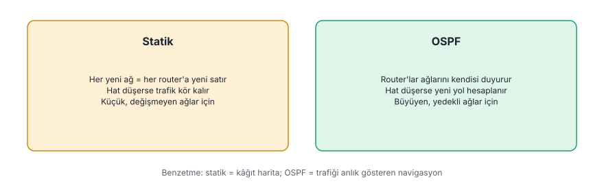
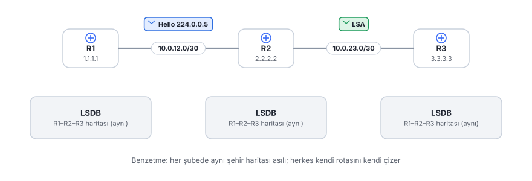
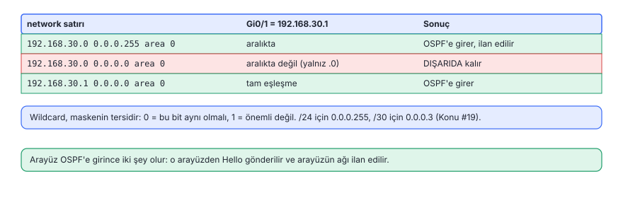
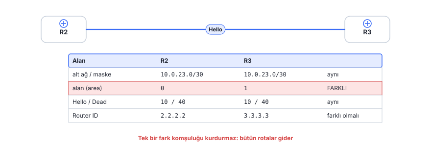
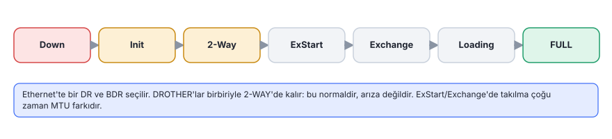
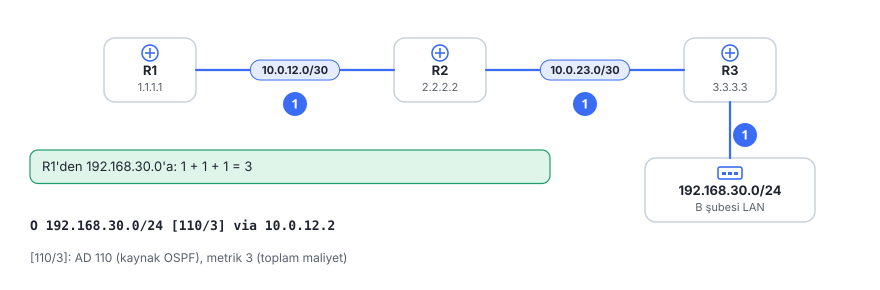
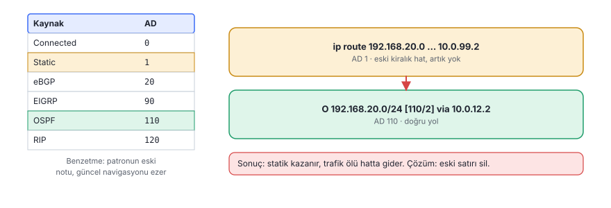

# AğLab Konu #15: OSPFv2 tek alan

> Uygulamadaki `ospf` dersi bu belgeyle uyumludur. Senaryolar Sorun Çöz'de `ospf-*` kimlikleriyle
> Labber'da çalışır; eski tek adımlı `ospf-area` senaryosu da vardır. Ön koşul: gateway ve statik
> routing (Konu #8), wildcard (Konu #19), teşhis araçları (Konu #24). Şemalar: `docs/dersler/gorseller/ospf.py`.

Bu konu bittiğinde öğrenci OSPF'i `router ospf` ve `network` satırlarıyla açar ve wildcard'ın hangi arayüzleri OSPF'e kattığını hesaplar. Komşuluğun kurulması için iki uçta nelerin aynı olması gerektiğini sayar. `show ip ospf neighbor`, `show ip ospf interface brief` ve `show ip route ospf` ile sorunun komşulukta mı yoksa ilan edilen ağlarda mı olduğunu ayırır. Aynı hedefe statik ve OSPF rotası varken hangisinin seçildiğini AD ile açıklar. Seviye 2 (CCNA), süre yaklaşık 75 dakika.

## 0. Bir bakışta

- OSPF router'ların ağlarını **birbirine kendisi duyurmasını** sağlar; hat düşünce yeni yol hesaplanır.
- `network <ağ> <wildcard> area <n>` bir ağı değil, adresi o aralığa düşen **arayüzleri** OSPF'e katar.
- **Komşuluk** için iki uçta alt ağ, alan, Hello/Dead, kimlik doğrulama aynı olmalı; Router ID'ler farklı.
- Komşular **FULL** olunca haritalar eşitlenir ve rotalar `O` ile tabloya girer: `[110/3]` = AD 110, maliyet 3.
- Aynı hedefe statik ve OSPF rotası varsa **düşük AD** kazanır: statik (1) OSPF'i (110) gölgeler.
- Teşhis: önce **komşu var mı**, sonra **arayüz OSPF'te mi**, sonra **rota hangi kaynaktan**.

> **Akılda kalsın:** OSPF arızası iki türlüdür: komşuluk yok (her şey gider) ya da komşuluk var ama bir ağ ilan edilmiyor (yalnız o ağ gider).



## 1. Neden önemli

Üç şube ve bir merkez statik rotayla yönetilebilir; ama her yeni ağda her router'a elle satır eklemek gerekir, bir hat düşünce de trafik kendiliğinden başka yola geçmez. OSPF router'ların ağlarını birbirine kendisi duyurmasını sağlar. OSPF arızaları iki türlüdür: ya komşuluk hiç kurulmaz (bütün rotalar gider), ya komşuluk kurulur ama bir ağ ilan edilmez (yalnız o ağ gider). İlk iş bunlardan hangisi olduğunu bulmaktır.

## 2. Kavram

### 2.1 Link-state: ortak harita

> **Benzetme:** Bir şehirdeki bütün taksi duraklarına aynı harita asılı. Bir yol kapanınca her durak haberi komşusuna verir, herkes haritasını günceller ve her şoför kendi en kısa yolunu kendi hesaplar.

- Router'lar komşularıyla **Hello** ile tanışır (224.0.0.5).
- Bağlantı bilgilerini **LSA** ile paylaşır; alandaki herkes aynı haritayı (**LSDB**) tutar.
- Her router en kısa yolu **SPF** (Dijkstra) ile kendisi hesaplar.



### 2.2 OSPF'i açmak ve network satırı

- `router ospf 1`: süreç numarası **yereldir**, komşuda farklı olabilir.
- `router-id 1.1.1.1`: yoksa en yüksek loopback, o da yoksa en yüksek aktif arayüz adresi. Alan içinde benzersiz olmalı.
- `network 10.0.12.0 0.0.0.3 area 0`: adresi bu aralığa düşen arayüzler Hello gönderir ve ağları ilan edilir.



> **Dikkat:** `network 192.168.30.0 0.0.0.0 area 0` yalnız 192.168.30.0 adresini eşler. Gateway 192.168.30.1 ise LAN OSPF'e hiç girmez; komşuluk kusursuz görünür ama şubenin ağı kimseye duyurulmaz.

### 2.3 Komşuluk şartları

> **Benzetme:** İki kişinin arkadaş olması için aynı dili konuşması, aynı mahallede (alt ağ) ve aynı kulüpte (alan) olması, telefonlaşma sıklığında (Hello/Dead) anlaşması gerekir. Tek bir uyuşmazlık tanışmayı engeller.



- Aynı **alt ağ ve maske**, aynı **alan**, aynı **Hello/Dead** (varsayılan 10/40 sn), aynı **kimlik doğrulama** ve **stub** bayrağı.
- FULL için **MTU** da uyuşmalı. Router ID'ler **farklı** olmalı.

### 2.4 Komşu durumları ve DR/BDR



Ethernet gibi yayın ağlarında herkesin herkesle konuşmaması için bir **DR** (sözcü) ve **BDR** (yedek sözcü) seçilir. Diğerleri (DROTHER) birbiriyle 2-WAY'de kalır; bu normaldir.

### 2.5 Maliyet



- Maliyet = referans bant genişliği / arayüz bant genişliği; varsayılan referans **100 Mbps**.
- FastEthernet de GigabitEthernet de 1 olur; sahada `auto-cost reference-bandwidth` **bütün** router'larda aynı değere yükseltilir.

### 2.6 AD: kim kazanır?



> **Sahada:** `passive-interface` (LAN'a Hello gönderme, ağı yine ilan et) ve `default-information originate` (internet çıkışını OSPF'le dağıt) çok kullanılır. Labber bunları çalıştırır ama AğLab kaydına yazamaz; okuma olarak kalırlar.

### 2.7 Teşhis sırası

1. `show ip ospf neighbor`: komşu var mı, FULL mü? Yoksa → alan, alt ağ, zamanlayıcı.
2. `show ip ospf interface brief`: beklenen arayüzler listede mi? Değilse → network satırı.
3. `show ip route <ağ>`: rota var mı, "Known via" hangi kaynak? Statikse → eski satır.

## 3. Çıktı okuma

```
R2#show ip ospf neighbor
Neighbor ID     Pri   State           Dead Time   Address         Interface
1.1.1.1           1   FULL/BDR        00:00:35    10.0.12.1       GigabitEthernet0/0
3.3.3.3           1   FULL/DR         00:00:35    10.0.23.2       GigabitEthernet0/1
                       ← R3 listede yoksa sorun komşulukta (alan, alt ağ, zamanlayıcı)

R3#show ip ospf interface brief
Interface    PID   Area            IP Address/Mask    Cost  State Nbrs F/C
Gi0/0        1     0               10.0.23.2/30       1     DR    1/1
                       ← Gi0/1 (LAN) listede yok: network satırı onu kapsamıyor

R1#show ip route ospf
O        10.0.23.0/30 [110/2] via 10.0.12.2, 00:12:34, GigabitEthernet0/1
O        192.168.20.0/24 [110/2] via 10.0.12.2, 00:12:34, GigabitEthernet0/1
O        192.168.30.0/24 [110/3] via 10.0.12.2, 00:12:34, GigabitEthernet0/1
                                  ← [AD/metrik]

R1#show ip route 192.168.20.0
Routing entry for 192.168.20.0/24
  Known via "static", distance 1, metric 0      ← OSPF değil: eski statik rota kazanıyor
```

| Soru | Komut |
| --- | --- |
| Komşu var mı, hangi durumda? | `show ip ospf neighbor` |
| Hangi arayüzler OSPF'te, hangi alanda? | `show ip ospf interface brief` |
| Hangi network satırları, router ID ne? | `show ip protocols` ya da `show running-config \| section router ospf` |
| Ağ öğreniliyor mu, hangi kaynaktan? | `show ip route ospf`, `show ip route <ağ>` |

## 4. Yönlendirmeli lab

Topoloji: R1 (A şubesi 192.168.10.0/24) ─ 10.0.12.0/30 ─ R2 (merkez 192.168.20.0/24, SRV) ─ 10.0.23.0/30 ─ R3 (B şubesi 192.168.30.0/24). Statik rota yok.

1. **OSPF'siz:** PC-10'dan SRV'ye ping başarısız; R1'de `show ip route` yalnız C ve L satırları.
2. **R1:** `router ospf 1` → `router-id 1.1.1.1` → `network 192.168.10.0 0.0.0.255 area 0` → `network 10.0.12.0 0.0.0.3 area 0`.
3. **R2 ve R3:** aynı mantıkla (R2'de üç, R3'te iki satır; router-id 2.2.2.2, 3.3.3.3).
4. **Komşuluk:** R2'de `show ip ospf neighbor`: iki komşu FULL. DR/BDR sütununu oku. *Neden:* FULL görmeden rota beklemek boşunadır; önce komşuluk.
5. **Arayüzler:** her router'da `show ip ospf interface brief`; hangi arayüzlerin girdiğini network satırlarıyla karşılaştır.
6. **Rotalar:** R1'de `show ip route ospf`; 192.168.30.0'ın metriği neden 3? *Neden:* R1, R2 ve R3'ün çıkış arayüzleri 1'er maliyetli.
7. **Test:** PC-10 → SRV, PC-10 → PC-30, `trace` ile yol.
8. **AD deneyi:** R1'e `ip route 192.168.30.0 255.255.255.0 10.0.12.2` ekle; `show ip route 192.168.30.0` artık "static" der. Satırı geri al; OSPF rotası döner. Kaydet.

> **Benzetme:** 8. adım, navigasyon doğru yolu gösterirken torpidodaki eski kâğıt haritaya uymaktır.

## 5. Sık hatalar

| Kod | Hata | Belirti | Kanıt | Düzeltme |
| --- | --- | --- | --- | --- |
| E1 | Alan uyuşmazlığı | Bir router kimseyle komşu değil | `show ip ospf interface brief`'te bağlantının iki ucu farklı alanda | Uçları aynı alana al |
| E2 | network satırı arayüzü kapsamıyor | Komşuluk var, bir ağ öğrenilmiyor | Arayüz `show ip ospf interface brief`'te yok; satırda yanlış ağ ya da wildcard | Satırı arayüzün adresini kapsayacak şekilde yaz |
| E3 | Bağlantıda farklı alt ağ | Port up, komşuluk yok, karşı uca ping yok | İki uç adresi farklı alt ağda | Adresi düzelt |
| E4 | Statik rota OSPF'i gölgeliyor | OSPF rotayı biliyor ama trafik yanlış yere gidiyor | `show ip route <ağ>`: Known via "static" | Eski statik rotayı kaldır |
| E5 | Hello/Dead uyuşmazlığı | Komşuluk yok, alan ve alt ağ doğru | `show ip ospf interface`'te Timer intervals farklı | İki uçta aynı süreler |

## 6. Arıza senaryoları

> **Uygulamada:** S1–S5 Sorun Çöz'de `ospf-lan-wildcard`, `ospf-area-mismatch`, `ospf-subnet-mismatch`,
> `ospf-static-overrides`, `ospf-two-faults` kimlikleriyle Labber'da çalışır. Hello/Dead uyuşmazlığı
> (E5) AğLab modelinde ifade edilemediği için okuma olarak kalır.
> Önce kendin çöz; neden ve çözüm kapalı kutularda.

### S1 · Başlangıç · Komşuluk var, B şubesinin ağı yok (E2)

- **Belirti:** 192.168.30.0/24'e kimse ulaşamıyor; R2'de R3 FULL.
- **Hedef:** PC-10 → PC-30; PC-30 → SRV

<details><summary>Neden ve çözüm</summary>

R3'te `network 192.168.30.0 0.0.0.0 area 0`; Gi0/1 (192.168.30.1) OSPF'e girmiyor. Çözüm: R3 → `router ospf 1` → `no network 192.168.30.0 0.0.0.0 area 0` → `network 192.168.30.0 0.0.0.255 area 0`

</details>

### S2 · Orta · R3 kimseyle komşu değil (E1)

- **Belirti:** B şubesi tamamen kopuk; R2'nin komşu listesinde yalnız R1.
- **Hedef:** R2–R3 FULL; PC-10 → PC-30; PC-30 → SRV

<details><summary>Neden ve çözüm</summary>

R3'te 10.0.23.0/30 area 1'de. Çözüm: R3 → `router ospf 1` → `no network 10.0.23.0 0.0.0.3 area 1` → `network 10.0.23.0 0.0.0.3 area 0`

</details>

### S3 · Orta · Kablo takılı, port up, komşuluk yok (E3)

- **Belirti:** R3 yeniden kuruldu; R2–R3 up/up, OSPF açık, komşuluk yok, R2'den 10.0.23.2'ye ping yok.
- **Hedef:** S2 ile aynı

<details><summary>Neden ve çözüm</summary>

R3 Gi0/0 = 10.0.23.6/30 (10.0.23.4/30 ağı). Çözüm: R3 → `interface g0/0` → `ip address 10.0.23.2 255.255.255.252`

</details>

### S4 · Orta · OSPF rotayı biliyor ama kullanılmıyor (E4)

- **Belirti:** A şubesi merkezdeki SRV'ye ulaşamıyor ama B şubesine ulaşıyor; eski kiralık hat kaldırılmış.
- **Hedef:** PC-10 → SRV; PC-10 → PC-30

<details><summary>Neden ve çözüm</summary>

R1'de `ip route 192.168.20.0 255.255.255.0 10.0.99.2` (AD 1) OSPF'i (AD 110) gölgeliyor. Çözüm: R1 → `no ip route 192.168.20.0 255.255.255.0 10.0.99.2`

</details>

### S5 · İleri · Komşuluk geldi, ağ yine yok (E1 + E2)

- **Belirti:** B şubesi kopuk; bir düzeltmeden sonra R3 FULL ama 192.168.30.0 hâlâ yok.
- **Hedef:** R2–R3 FULL; PC-10 → PC-30; PC-30 → SRV

<details><summary>Neden ve çözüm</summary>

R3'ün bağlantısı area 1'de ve LAN satırı 0.0.0.0 wildcard'lı. Çözüm: R3 → `router ospf 1` → bağlantıyı area 0'a al, LAN satırını 0.0.0.255 ile yeniden yaz

</details>

## 7. Kısa sınav

**1.** `network 192.168.30.0 0.0.0.0 area 0`, 192.168.30.1 adresli arayüzü OSPF'e katar mı?

<details><summary>Cevap</summary>

Hayır; 0.0.0.0 yalnız .0 adresini eşler. `0.0.0.255` yazılmalı.

</details>

**2.** Komşuluk için iki uçta aynı olması gereken üç şey?

<details><summary>Cevap</summary>

Alt ağ ve maske, alan, Hello/Dead süreleri (ayrıca kimlik doğrulama ve stub bayrağı).

</details>

**3.** `[110/3]` neyi gösterir?

<details><summary>Cevap</summary>

AD 110 (OSPF) ve metrik (toplam maliyet) 3.

</details>

**4.** Aynı ağa statik ve OSPF rotası varsa hangisi tabloya girer?

<details><summary>Cevap</summary>

Statik (AD 1 < 110).

</details>

**5.** Yayın ağında iki DROTHER arasında 2-WAY durumu arıza mı?

<details><summary>Cevap</summary>

Hayır; FULL yalnız DR ve BDR ile kurulur.

</details>

**6.** R2'de R3 FULL görünüyor ama B şubesinin LAN'ı hiçbir router'da yok. İlk nereye bakarsın?

<details><summary>Cevap</summary>

R3'te `show ip ospf interface brief`: LAN arayüzü listede değilse network satırı onu kapsamıyordur.

</details>

## 8. Özet kartı

| Komut | Ne işe yarar |
| --- | --- |
| `router ospf 1`, `router-id x.x.x.x` | Süreç ve kimlik |
| `network <ağ> <wildcard> area 0` | Arayüzleri OSPF'e kat |
| `show ip ospf neighbor` | Komşular ve durum |
| `show ip ospf interface brief` | OSPF'teki arayüzler, alan, maliyet |
| `show ip protocols` | network satırları, router ID |
| `show ip route ospf`, `show ip route <ağ>` | Öğrenilen rotalar, kaynak |

**Unutma:**

1. network satırı arayüzü seçer; wildcard'ı doğru yaz.
2. Komşuluk: alt ağ, alan, Hello/Dead aynı; Router ID farklı.
3. Önce komşu, sonra arayüz, sonra rota.
4. `[AD/metrik]`; statik OSPF'i gölgeler.
5. DROTHER'lar arası 2-WAY normaldir.

## 9. Doğrulama notları

**Lab'ın otomatik değerlendirmesi:** `q.ospfAdjacent('R1', 'R2')`, `q.ospfAdjacent('R2', 'R3')`, `q.ping('PC-10', '192.168.30.11').ok`.

Kaynaklar: INET CCNA 200-301 v1.1 ve INE ENCOR (OSPF); RFC 2328 (OSPFv2: komşu durumları, Hello'daki eşleşmesi gereken alanlar, DR/BDR), Cisco IOS OSPF yapılandırma kılavuzu (`network … area`, router ID seçimi, `auto-cost reference-bandwidth`, varsayılan AD 110), CCNA 200-301 3.4 (tek alan OSPFv2: komşuluk, noktadan noktaya, yayın, router ID).

| İddia | Sonuç |
| --- | --- |
| Hello'da alan, alt ağ maskesi (yayın ağı), Hello/Dead, kimlik doğrulama, stub bayrağı eşleşmeli | Doğru (RFC 2328 10.5) |
| Varsayılan referans bant genişliği 100 Mbps; FastE ve GigE maliyeti 1 | Doğru |
| Router ID: `router-id` > en yüksek loopback > en yüksek aktif arayüz | Doğru |
| DROTHER'lar arasında 2-WAY normal | Doğru |
| MTU uyuşmazlığı komşuluğu ExStart/Exchange'de bırakır | Doğru |

**Motor gereksinimleri** (Labber'da denendi)

- [x] `router ospf`, `network … area`, `router-id`, komşuluk ve DR/BDR, SPF, maliyet; `show ip ospf neighbor|interface [brief]`, `show ip protocols`, `show ip route ospf`, `show ip route <ağ>`
- [x] Senaryo sorgularına `ospfAdjacent` eklendi; beş senaryo başta başarısız, çözümle başarılı
- [ ] AğLab modeli yalnız süreç, router ID ve network satırlarını tutuyor; `passive-interface`, maliyet, Hello/Dead, öncelik, `default-information originate` Labber'da çalışıyor ama kaydedilemiyor (model işi)
- [ ] Aynı router ID algılanmıyor; gerçek IOS `%OSPF-4-DUP_RTRID` uyarısı verir ve komşuluk kurulmaz (motor işi)
- [ ] `show ip route`'ta tek /24 OSPF rotasının üstüne gerçek IOS'ta olmayan "is subnetted, 1 subnets" başlığı basılıyor (biçim)
