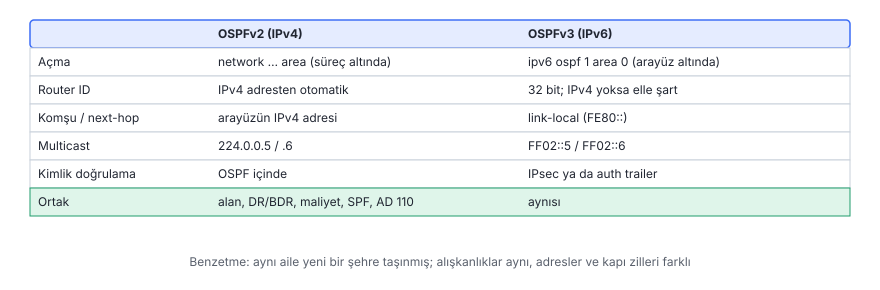
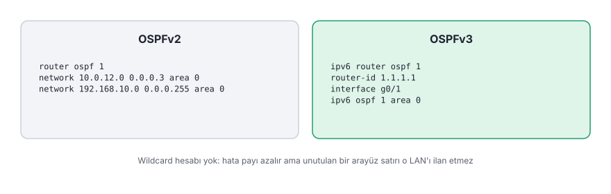
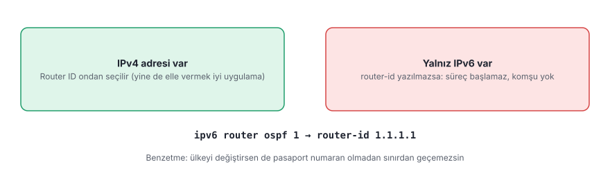
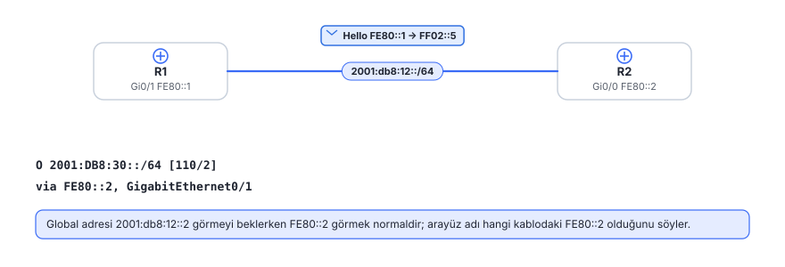
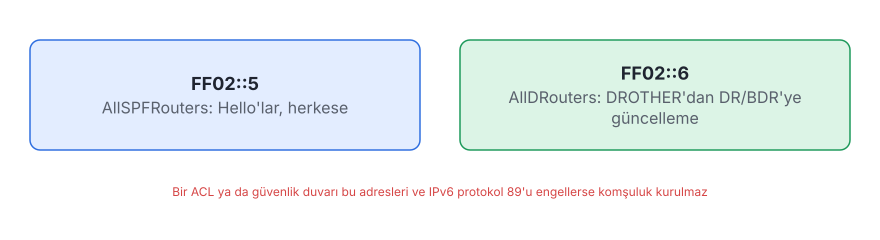
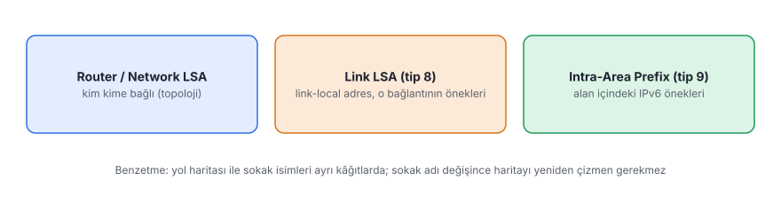
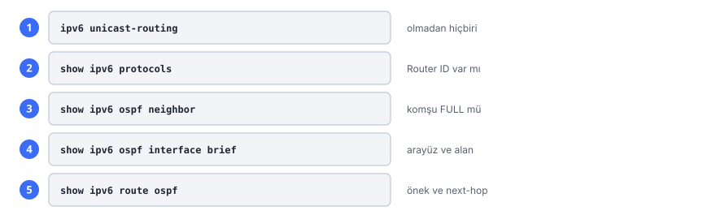

# AğLab Konu #17: OSPFv3 (IPv6 için OSPF)

> Uygulamadaki `ospfv3` dersi bu belgeyle uyumludur. **Okuma dersi:** IPv6 ve OSPFv3 Labber'da henüz yok;
> vakalar kâğıt üstünde, beklenen çıktılarla çözülür. Ön koşul: OSPFv2 (Konu #15), IPv6 (Konu #16).
> Şemalar: `docs/dersler/gorseller/ospfv3.py`.

Bu konu bittiğinde öğrenci OSPFv3'ün OSPFv2'den neyi aynen aldığını, neyi değiştirdiğini açıklar. IPv6 için OSPF'i arayüz altında açar ve Router ID'yi elle verir. `show ipv6 ospf neighbor` ve `show ipv6 route ospf` çıktısında link-local komşu ve next-hop adreslerini doğru okur. Komşuluğun kurulmamasının en sık iki nedenini (Router ID yok, `ipv6 unicast-routing` yok) tanır. Seviye 2 (CCNA), süre yaklaşık 45 dakika.

## 0. Bir bakışta

- OSPFv3, IPv6 için OSPF'tir. **Komşuluk, alan, DR/BDR, maliyet, SPF ve AD 110 aynıdır.**
- `network` satırı **yoktur**: OSPF arayüz altında açılır: `ipv6 ospf 1 area 0`.
- **Router ID** yine 32 bitlik, IPv4 biçimli bir sayıdır. Router'da IPv4 yoksa elle yazılmazsa süreç başlamaz.
- Komşular **link-local** adreslerle konuşur; rotalarda next-hop `FE80::…` ve çıkış arayüzüdür.
- Multicast: **FF02::5** (bütün OSPF router'ları), **FF02::6** (DR/BDR).
- Önce `ipv6 unicast-routing`; o olmadan hiçbir şey çalışmaz.

> **Akılda kalsın:** OSPFv2'yi biliyorsan OSPFv3'ün %80'ini biliyorsun. Farkları ezberle: arayüz altında açılır, Router ID elle, next-hop link-local.



## 1. Neden önemli

Çift yığın (IPv4 + IPv6) çalışan bir şubede IPv4 rotaları OSPFv2 ile dağıtılırken IPv6 önekleri de bir şekilde dağıtılmalıdır; her router'a IPv6 statik rotası yazmak IPv4'teki aynı sorunları getirir. OSPFv3 bunu çözer. Arızaları ise OSPFv2'yi bilen birini şaşırtır: "network satırı nerede?", "komşu neden FE80 adresinde?", "süreç neden hiç başlamıyor?" soruları bu dersin konusudur.

## 2. Kavram

### 2.1 Aynı olanlar

> **Benzetme:** Aynı aile yeni bir şehre taşınmış: sofra düzeni, ev kuralları, kimin ne iş yaptığı aynı. Değişen yalnız adresler ve kapı zilleri.

- Hello ile tanışma, komşu durumları (Down → FULL), DR/BDR seçimi.
- Alanlar, maliyet (referans bant genişliği / arayüz hızı), SPF ile en kısa yol.
- AD **110**; tabloda `O` harfi.
- Komşuluk şartları: aynı alan, aynı Hello/Dead, aynı stub bayrağı; **farklı** Router ID.

### 2.2 Arayüz altında açmak



```
R1(config)#ipv6 unicast-routing
R1(config)#ipv6 router ospf 1
R1(config-rtr)#router-id 1.1.1.1
R1(config-rtr)#interface g0/0
R1(config-if)#ipv6 ospf 1 area 0
R1(config-if)#interface g0/1
R1(config-if)#ipv6 ospf 1 area 0
```

- Arayüzün **bütün** IPv6 önekleri ilan edilir.
- Wildcard hesabı yoktur; ama bir arayüzde satırı unutmak o LAN'ı kimseye duyurmaz.
- Komşu arayüzlerin ikisi de aynı alanda açılmalıdır; IPv6'da bağlantının iki ucunun aynı önekte olması şart değildir, çünkü komşular link-local ile konuşur.

### 2.3 Router ID



> **Dikkat:** Yalnız IPv6 konuşan bir router'da `router-id` yazılmazsa IOS bir uyarı verir ve süreç Router ID alamaz; hiçbir arayüzde Hello gönderilmez. Belirti: "OSPFv3 açtım, `show ipv6 ospf neighbor` boş."

### 2.4 Link-local komşular ve next-hop



> **Benzetme:** Apartman içinde komşuna kapı numarasıyla seslenirsin (link-local); şehirlerarası posta adresini (global) kullanmazsın. Ama "3 numara" demek yetmez, hangi apartmanda olduğunu da söylersin (çıkış arayüzü).

### 2.5 Multicast adresleri



### 2.6 LSA'lar (kısa)



> **Sahada:** Yeni IOS sürümlerinde OSPFv3 "address family" yapısıyla IPv4'ü de taşıyabilir (`router ospfv3 1` → `address-family ipv6 unicast`). CCNA seviyesinde klasik `ipv6 router ospf` yazımı yeterlidir.

### 2.7 Teşhis sırası



## 3. Çıktı okuma

```
R1#show ipv6 ospf neighbor
            OSPFv3 Router with ID (1.1.1.1) (Process ID 1)
Neighbor ID     Pri   State           Dead Time   Interface ID    Interface
2.2.2.2           1   FULL/DR         00:00:34    3               GigabitEthernet0/1
                       ← komşu Router ID ile anılır; adres sütunu yok, Interface ID var

R1#show ipv6 ospf interface brief
Interface    PID   Area            Intf ID    Cost  State Nbrs F/C
Gi0/1        1     0               3          1     BDR   1/1
Gi0/0        1     0               2          1     DR    0/0
                       ← LAN (Gi0/0) listede: önekleri ilan ediliyor; komşusu olmaması normal

R1#show ipv6 route ospf
O   2001:DB8:20::/64 [110/2]
     via FE80::2, GigabitEthernet0/1
O   2001:DB8:30::/64 [110/3]
     via FE80::2, GigabitEthernet0/1
                       ← next-hop link-local + çıkış arayüzü
```

| Soru | Komut |
| --- | --- |
| Süreç ve Router ID var mı? | `show ipv6 protocols`, `show ipv6 ospf` |
| Komşu FULL mü? | `show ipv6 ospf neighbor` |
| Hangi arayüzler OSPFv3'te, hangi alanda? | `show ipv6 ospf interface brief` |
| Önek öğrenildi mi, hangi next-hop? | `show ipv6 route ospf` |

## 4. Yönlendirmeli lab

> **Simülatörde yok:** Lab'ı kâğıt üstünde yürüt; her adımda Bölüm 3'teki beklenen çıktıyla karşılaştır.

Topoloji: R1 (A LAN 2001:db8:10::/64) ─ 2001:db8:12::/64 ─ R2 (merkez 2001:db8:20::/64) ─ 2001:db8:23::/64 ─ R3 (B LAN 2001:db8:30::/64). IPv6 adresleri yazılı, IPv4 adresi yok.

1. Üç router'da `ipv6 unicast-routing`. *Neden:* IPv6 yönlendirme kapalıyken OSPFv3 anlamsızdır.
2. R1'de `ipv6 router ospf 1` yaz ama router-id **yazma**; `show ipv6 ospf` çıktısında Router ID olmadığını gör. *Neden:* router'da IPv4 yok.
3. `router-id 1.1.1.1`; R2'de 2.2.2.2, R3'te 3.3.3.3.
4. Her router'da bütün IPv6 arayüzlerine `ipv6 ospf 1 area 0`.
5. R2'de `show ipv6 ospf neighbor`: iki komşu FULL.
6. R1'de `show ipv6 route ospf`: 2001:db8:30::/64 [110/3] via FE80::2. Metrik neden 3?
7. R3'te LAN arayüzünden `ipv6 ospf 1 area 0` satırını kaldır; R1'de B LAN'ın kaybolduğunu, komşuluğun ise sürdüğünü gör. Geri ekle.

> **Benzetme:** 7. adım, komşunla konuşmaya devam edip evinin adresini söylemeyi unutmak gibidir: tanışıyorsunuz ama sana mektup gelemez.

## 5. Sık hatalar

| Kod | Hata | Belirti | Kanıt | Düzeltme |
| --- | --- | --- | --- | --- |
| E1 | `ipv6 unicast-routing` yok | Komşuluk ya da rota yok | running-config'te satır yok | `ipv6 unicast-routing` |
| E2 | Router ID yok (router'da IPv4 yok) | Süreç başlamıyor, Hello yok | `show ipv6 protocols`'ta Router ID yok | `router-id x.x.x.x` |
| E3 | Arayüzde `ipv6 ospf` satırı unutulmuş | Komşuluk var, bir LAN yok | `show ipv6 ospf interface brief`'te arayüz yok | Arayüze `ipv6 ospf 1 area 0` |
| E4 | Alan uyuşmazlığı | Komşuluk yok | İki uçta farklı alan | Aynı alan |
| E5 | Aynı Router ID iki router'da | Komşuluk kurulmuyor ya da kararsız | Komşu tablosunda kendi ID'si | Benzersiz Router ID |

## 6. Arıza senaryoları

> **Uygulamada:** Kâğıt üstü vakalar; IPv6 motoru gelince Sorun Çöz'e `ospf6-*` kimlikleriyle eklenecek. Önce kendin çöz; neden ve çözüm kapalı kutularda.

### S1 · Başlangıç · OSPFv3 açıldı, komşu yok (E2)

- **Belirti:** Yalnız IPv6 kullanan yeni şubede üç router'a OSPFv3 yazıldı; `show ipv6 ospf neighbor` üçünde de boş.
- **Hedef:** Komşuluklar FULL.

<details><summary>Neden ve çözüm</summary>

Router'larda IPv4 adresi yok ve `router-id` yazılmamış; süreçler Router ID alamadı. Çözüm: her router'da `ipv6 router ospf 1` → `router-id` ile benzersiz bir değer.

</details>

### S2 · Orta · Komşuluk var, B şubesi yok (E3)

- **Belirti:** R2'de R3 FULL; ama 2001:db8:30::/64 hiçbir router'da yok.
- **Hedef:** R1'den B LAN'a rota.

<details><summary>Neden ve çözüm</summary>

R3'ün LAN arayüzünde `ipv6 ospf 1 area 0` yok. Çözüm: R3 → `interface g0/1` → `ipv6 ospf 1 area 0`.

</details>

### S3 · Orta · Yeni router komşu olmuyor (E4)

- **Belirti:** R3 değiştirildi; R2–R3 arası link-local ping çalışıyor, komşuluk yok.
- **Hedef:** R2–R3 FULL.

<details><summary>Neden ve çözüm</summary>

R3'te bağlantı arayüzü `ipv6 ospf 1 area 1`. Çözüm: `no ipv6 ospf 1 area 1` → `ipv6 ospf 1 area 0`.

</details>

### S4 · İleri · Hiçbir şey çalışmıyor, yapılandırma kusursuz görünüyor (E1)

- **Belirti:** R2 yenilendi; OSPFv3 satırları ve Router ID doğru, ama R2 hiçbir komşuya FULL olmuyor ve hiçbir IPv6 rotası taşımıyor.
- **Hedef:** R2 iki komşuyla FULL; uçtan uca IPv6.

<details><summary>Neden ve çözüm</summary>

Yeni R2'de `ipv6 unicast-routing` unutulmuş. Çözüm: `ipv6 unicast-routing`.

</details>

## 7. Kısa sınav

**1.** OSPFv3'te bir arayüz OSPF'e nasıl katılır?

<details><summary>Cevap</summary>

Arayüz altında `ipv6 ospf 1 area 0`; `network` satırı yoktur.

</details>

**2.** Yalnız IPv6 adresi olan bir router'da OSPFv3 başlamıyor. En olası neden?

<details><summary>Cevap</summary>

Router ID yok; `router-id` elle verilmeli.

</details>

**3.** `show ipv6 route ospf` çıktısında next-hop neden `FE80::2`?

<details><summary>Cevap</summary>

OSPFv3 komşuları link-local adreslerle konuşur; next-hop komşunun link-local adresidir, yanında çıkış arayüzü yazar.

</details>

**4.** OSPFv3 Hello'ları hangi adrese gönderilir?

<details><summary>Cevap</summary>

FF02::5.

</details>

**5.** OSPFv3 rotasının AD'si?

<details><summary>Cevap</summary>

110, OSPFv2 ile aynı.

</details>

**6.** Komşuluk var ama bir LAN'ın öneki öğrenilmiyor. İlk hangi komutla, nereye bakarsın?

<details><summary>Cevap</summary>

O LAN'ın router'ında `show ipv6 ospf interface brief`: LAN arayüzü listede değilse `ipv6 ospf 1 area 0` satırı eksiktir.

</details>

## 8. Özet kartı

| Komut | Ne işe yarar |
| --- | --- |
| `ipv6 unicast-routing` | IPv6 yönlendirme |
| `ipv6 router ospf 1` → `router-id 1.1.1.1` | Süreç ve kimlik |
| `ipv6 ospf 1 area 0` (arayüzde) | Arayüzü OSPFv3'e kat |
| `show ipv6 ospf neighbor` | Komşular |
| `show ipv6 ospf interface brief` | Arayüzler ve alan |
| `show ipv6 route ospf` | Öğrenilen önekler |

**Unutma:**

1. Önce `ipv6 unicast-routing`.
2. Router ID elle.
3. Arayüz altında aç; her arayüzü unutma.
4. Next-hop link-local + arayüz.
5. Gerisi OSPFv2 ile aynı.

## 9. Doğrulama notları

Kaynaklar: INET CCNA 200-301 v1.1 ve INE ENCOR (OSPFv3 bölümleri, yalnız kapsam kontrolü için); RFC 5340 (OSPF for IPv6); Cisco IOS IPv6 OSPFv3 yapılandırma kılavuzu. Ders metni, örnek çıktılar ve şemalar özgün yazıldı.

| İddia | Sonuç |
| --- | --- |
| OSPFv3 Router ID 32 bit; IPv4 yoksa elle verilmeli | Doğru |
| Komşuluk ve next-hop link-local adreslerle | Doğru (RFC 5340) |
| Multicast FF02::5 (AllSPFRouters), FF02::6 (AllDRouters) | Doğru |
| Link LSA tip 8, Intra-Area-Prefix LSA tip 9 | Doğru (0x0008, 0x2009) |
| OSPFv3 kimlik doğrulamada IPsec kullanır (RFC 4552); RFC 7166 auth trailer | Doğru |
| Bağlantının iki ucunun aynı global önekte olması komşuluk için şart değil | Doğru (link-local ile kurulur) |

**Motor gereksinimleri**

- [ ] IPv6 ve OSPFv3 Labber'da yok: `ipv6 router ospf`, `ipv6 ospf … area`, `show ipv6 ospf …`, link-local next-hop (motor işi). Hazır olunca S1–S4 `ospf6-*` kimlikleriyle Sorun Çöz'e eklenir.
