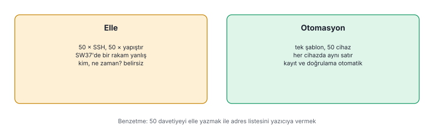
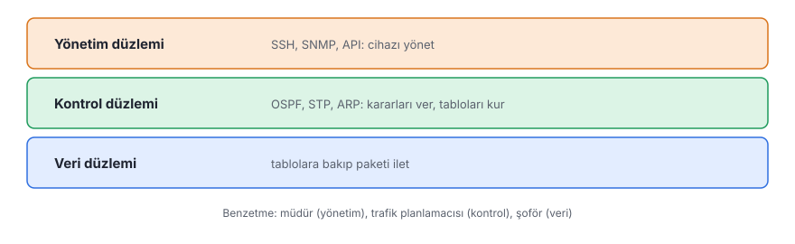
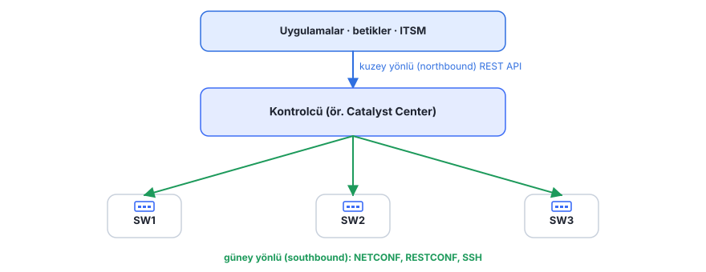
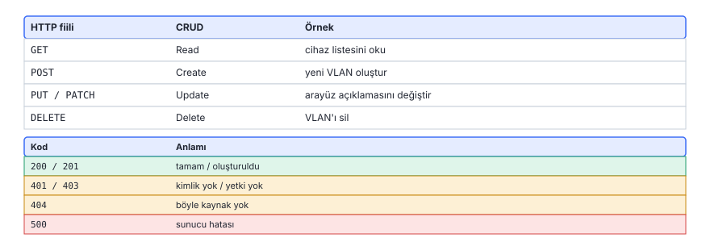
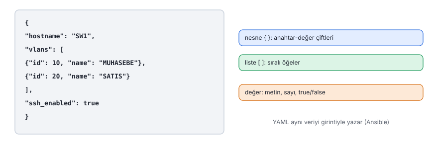
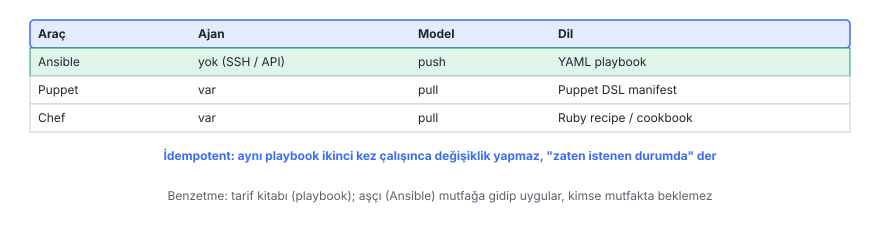
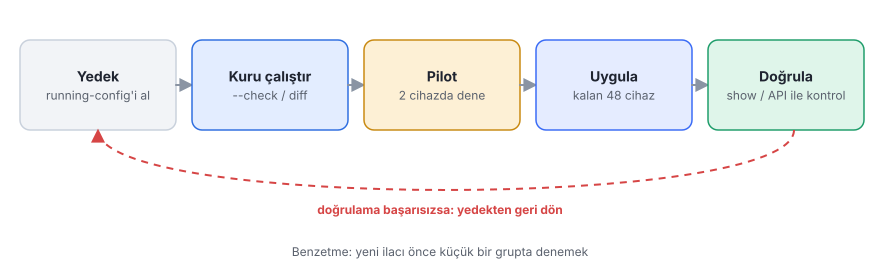

# AğLab Konu #26: Ağ otomasyonu ve programlanabilirlik

> Uygulamadaki `automation` dersi bu belgeyle uyumludur. **Okuma dersi:** API ve otomasyon araçları
> Labber'da yok; vakalar kâğıt üstünde çözülür. Ön koşul: cihaz yönetimi (Konu #11), erişim güvenliği
> (Konu #22), ağ servisleri (Konu #23). Şemalar: `docs/dersler/gorseller/otomasyon.py`.

Bu konu bittiğinde öğrenci ağ otomasyonunun neyi çözdüğünü ve hangi riski getirdiğini açıklar. Veri, kontrol ve yönetim düzlemlerini ayırır; kontrolcü tabanlı ağda kuzey ve güney yönlü API'lerin yerini gösterir. Bir REST isteğinin parçalarını (URI, fiil, durum kodu, JSON gövde) okur ve basit bir JSON belgesini yorumlar. Ansible, Puppet ve Chef'i ajan ve çalışma modeline göre karşılaştırır. Bir değişikliği güvenle otomatikleştirmenin adımlarını sıralar. Seviye 2 (CCNA), süre yaklaşık 50 dakika.

## 0. Bir bakışta

- Otomasyon aynı değişikliği **her cihaza aynı biçimde** uygular ve doğrular; elle yapılan işte yazım hatası ve belirsizlik kalır.
- **Veri düzlemi** iletir, **kontrol düzlemi** karar verir, **yönetim düzlemi** cihazı yönetir.
- **Kontrolcü** ağı tek yerden görür: uygulamalar ona **kuzey yönlü REST API**, o cihazlara **güney yönlü** protokollerle (NETCONF, RESTCONF, SSH) bağlanır.
- **REST**: HTTP fiilleri (GET, POST, PUT/PATCH, DELETE) = CRUD; durum kodları 2xx tamam, 4xx istemci hatası, 5xx sunucu hatası.
- **JSON**: nesne `{ }`, liste `[ ]`, anahtar-değer. YAML aynı veriyi girintiyle yazar.
- **Ansible** ajansız ve push; **Puppet/Chef** ajanlı ve pull. İyi otomasyon **idempotent**tir.

> **Akılda kalsın:** Otomasyon hatayı da aynı hızla yayar. Önce yedek, kuru çalıştırma ve küçük bir pilot.



## 1. Neden önemli

Bir kurumun 40 şubesinde 120 switch varsa yeni bir syslog sunucusu eklemek, bir VLAN açmak ya da bir güvenlik açığı için ayar değiştirmek elle günler sürer. Her elle yapılan değişiklik bir yazım hatası ve "bu cihazda neden farklı?" sorusu bırakır. CCNA artık bu yüzden otomasyonun temel kavramlarını ister: bir API'nin ne olduğunu, JSON okumayı ve araçların farkını bilmeyen bir ağcı, kontrolcülerle yönetilen modern ağlarda kör kalır.

## 2. Kavram

### 2.1 Neden otomasyon

> **Benzetme:** 50 davetiyeyi elle yazarsan biri mutlaka yanlış adrese gider ve kime ne yazdığını hatırlamazsın. Adres listesini ve şablonu yazıcıya verirsen hepsi aynı çıkar, liste de elinde kalır.

- **Tutarlılık:** her cihazda aynı satır.
- **Hız:** değişiklik dakikalar içinde bütün ağa.
- **İz:** kim, neyi, ne zaman değiştirdi; şablonlar sürüm denetiminde (Git) tutulur.
- **Doğrulama:** değişiklikten sonra durumu otomatik kontrol etmek.

### 2.2 Üç düzlem



Geleneksel ağda her cihaz kendi kontrol düzlemini çalıştırır (her router OSPF'i kendisi hesaplar). **SDN** ve kontrolcü tabanlı ağlarda kontrol ve yönetimin bir kısmı merkezdeki kontrolcüye taşınır.

### 2.3 Kontrolcü ve API'ler

> **Benzetme:** Restoranda müşteri (uygulama) garsona (kuzey yönlü API) sipariş verir; garson mutfağa (kontrolcü) iletir, mutfak da her istasyona (cihazlar) kendi diliyle talimat verir (güney yönlü). Müşterinin mutfağın iç dilini bilmesi gerekmez.



- **Kuzey yönlü (northbound):** kontrolcünün dışarıya sunduğu REST API.
- **Güney yönlü (southbound):** kontrolcünün cihazlarla konuştuğu NETCONF, RESTCONF, SSH/CLI, OpenFlow.
- Örnekler: Catalyst Center (eski adıyla DNA Center) kampüs ağları için, SD-WAN kontrolcüleri WAN için (Seviye 3).

### 2.4 REST API



Bir REST isteğinin parçaları:

```
GET https://catc.sube.local/dna/intent/api/v1/network-device
Accept: application/json
X-Auth-Token: eyJhbGciOi...        ← önce kimlik doğrulama ile alınan belirteç

HTTP/1.1 200 OK
Content-Type: application/json
{"response": [{"hostname": "SW1", "managementIpAddress": "192.168.99.2", ...}]}
```

- **Durumsuz (stateless):** her istek kendi kimliğini ve bilgisini taşır.
- **401** kimlik doğrulama yok ya da belirtecin süresi dolmuş; **403** kimlik var, yetki yok; **404** böyle bir kaynak yok.

### 2.5 JSON ve YAML



```
hostname: SW1
vlans:
  - id: 10
    name: MUHASEBE
  - id: 20
    name: SATIS
ssh_enabled: true
```

> **Dikkat:** JSON'da sondaki fazla virgül, tek tırnak ya da kapanmayan parantez bütün belgeyi geçersiz yapar; YAML'da tek bir yanlış girinti veriyi başka bir yere bağlar.

### 2.6 Yapılandırma yönetimi araçları



- **İdempotent:** istenen durum zaten varsa araç hiçbir şey değiştirmez. Aynı playbook'u ikinci kez çalıştırmak güvenlidir.
- **NETCONF** (TCP 830, XML) ve **RESTCONF** (HTTPS, JSON/XML) cihaz verisini **YANG** modelleriyle yapılandırılmış biçimde sunar; CLI çıktısını metin olarak ayrıştırmaktan çok daha güvenilirdir.

### 2.7 Güvenli otomasyon



> **Sahada:** API anahtarları ve parolalar betiklerin içine yazılmaz; kasada (vault) ya da ortam değişkenlerinde tutulur. Bir betikle 120 cihaza erişebilen hesap, en değerli hesaptır.

## 3. Çıktı okuma

Bir API yanıtından gereken bilgiyi çıkarmak:

```
{
  "response": [
    {"hostname": "SW1", "managementIpAddress": "192.168.99.2",
     "softwareVersion": "17.9.4", "reachabilityStatus": "Reachable"},
    {"hostname": "SW2", "managementIpAddress": "192.168.99.3",
     "softwareVersion": "17.6.1", "reachabilityStatus": "Unreachable"}
  ],
  "version": "1.0"
}
```

| Soru | Cevap ve nereden |
| --- | --- |
| Kaç cihaz var? | `response` listesinde 2 nesne |
| Hangi cihaza ulaşılamıyor? | SW2: `reachabilityStatus` |
| Hangi cihaz eski yazılımda? | SW2: `softwareVersion` 17.6.1 |
| SW1'in yönetim adresi? | `managementIpAddress` 192.168.99.2 |

Ansible çalıştırma özeti:

```
PLAY RECAP ****************************************************
SW1   : ok=3  changed=1  unreachable=0  failed=0
SW2   : ok=0  changed=0  unreachable=1  failed=0
SW3   : ok=3  changed=0  unreachable=0  failed=0     ← zaten istenen durumda (idempotent)
```

## 4. Yönlendirmeli lab

> **Simülatörde yok:** Lab'ı kâğıt üstünde yürüt.

Görev: 3 switch'e yeni syslog sunucusu (192.168.99.60) eklemek.

1. Elle yapılacak komutları yaz: `logging host 192.168.99.60`, `logging trap 5`. *Neden:* otomasyon, elle yapılan işi tarif etmekle başlar.
2. Bu iki satırı bir YAML değişken dosyasına çevir (sunucu adresi ve seviye).
3. Adımları sırala: yedek → `--check` ile kuru çalıştırma → SW1'de pilot → SW2 ve SW3 → `show logging` ile doğrulama.
4. Bölüm 3'teki PLAY RECAP'i yorumla: SW2 neden değişmedi, SW3 neden `changed=0`?
5. Bölüm 3'teki JSON yanıtından ulaşılamayan cihazı ve eski yazılımı bul.
6. Playbook'u ikinci kez çalıştırınca ne beklersin? (Her cihazda `changed=0`.)

> **Benzetme:** 6. adım, tarif zaten uygulanmış bir yemeği yeniden pişirmeye kalkmamaktır: araç "yemek zaten hazır" der.

## 5. Sık hatalar

| Kod | Hata | Belirti | Kanıt | Düzeltme |
| --- | --- | --- | --- | --- |
| E1 | Yedeksiz ve pilotsuz toplu değişiklik | Hata bütün cihazlarda | Hepsinde aynı bozuk satır | Yedekten dön; akışı uygula |
| E2 | Belirteç süresi dolmuş | API 401 dönüyor | Durum kodu 401 | Yeniden kimlik doğrula |
| E3 | Yanlış URI ya da fiil | 404 ya da 405 | Durum kodu | Belgeye göre düzelt |
| E4 | Bozuk JSON/YAML | Araç ayrıştırma hatası | Satır numarası | Virgül, tırnak, girinti |
| E5 | Parola betiğin içinde | Depoya sızan kimlik bilgisi | Git geçmişi | Vault / ortam değişkeni, parolayı değiştir |

## 6. Arıza senaryoları

> **Uygulamada:** Kâğıt üstü vakalar. Önce kendin çöz; neden ve çözüm kapalı kutularda.

### S1 · Başlangıç · Betik dün çalışıyordu, bugün 401 (E2)

- **Belirti:** Envanter betiği sabah `401 Unauthorized` döndürüyor; URI ve kod değişmemiş.
- **Hedef:** Betik yeniden veri alır.

<details><summary>Neden ve çözüm</summary>

Belirteç (token) süreli ve süresi dolmuş. Çözüm: betik her çalıştığında önce kimlik doğrulama uç noktasından yeni belirteç alsın.

</details>

### S2 · Orta · Playbook 40 switch'te hata verdi (E4)

- **Belirti:** `ERROR! Syntax Error while loading YAML` ve bir satır numarası; hiçbir cihaz değişmedi.
- **Hedef:** Playbook çalışır.

<details><summary>Neden ve çözüm</summary>

Değişken dosyasında bir liste öğesinin girintisi bir boşluk eksik. Hiçbir cihazın değişmemesi iyi haberdir: ayrıştırma çalıştırmadan önce yapılır. Çözüm: girintiyi düzelt, önce `--check`.

</details>

### S3 · Orta · Toplu değişiklik bütün şubeleri kopardı (E1)

- **Belirti:** Yeni yönetim ACL'si 120 switch'e aynı anda uygulandı; kimse uzaktan bağlanamıyor.
- **Hedef:** Erişimi geri getir ve süreci düzelt.

<details><summary>Neden ve çözüm</summary>

ACL'de yönetim ağı yanlış yazılmış ve pilot yapılmamış. Çözüm: konsol ya da bant dışı erişimle yedekten dön; bundan sonra yedek → kuru çalıştırma → 2 cihazda pilot → kalanlar → doğrulama.

</details>

### S4 · İleri · Parola GitHub'da (E5)

- **Belirti:** Ekip, betik deposunun herkese açık olduğunu fark etti; betikte `password = "Sube2026!"` satırı var.
- **Hedef:** Riski kapat.

<details><summary>Neden ve çözüm</summary>

Kimlik bilgisi depoya yazılmış; satırı silmek yetmez, Git geçmişinde durur. Çözüm: parolayı hemen bütün cihazlarda ve AAA'da değiştir, depoyu özel yap, kimlik bilgilerini vault ya da ortam değişkenine taşı.

</details>

## 7. Kısa sınav

**1.** REST'te var olan bir kaynağı okumak için hangi HTTP fiili?

<details><summary>Cevap</summary>

GET.

</details>

**2.** Kontrolcünün uygulamalara sunduğu API hangi yöndedir?

<details><summary>Cevap</summary>

Kuzey yönlü (northbound).

</details>

**3.** JSON'da köşeli parantez neyi gösterir?

<details><summary>Cevap</summary>

Liste (dizi).

</details>

**4.** Ajansız ve push modeliyle çalışan araç?

<details><summary>Cevap</summary>

Ansible.

</details>

**5.** Bir API isteği 403 döndü. Anlamı?

<details><summary>Cevap</summary>

Kimlik doğrulandı ama bu işlem için yetki yok.

</details>

**6.** Aynı playbook ikinci kez çalıştırıldı ve bütün cihazlarda `changed=0` çıktı. Bu bir sorun mu?

<details><summary>Cevap</summary>

Hayır; idempotent davranış: cihazlar zaten istenen durumda.

</details>

## 8. Özet kartı

| Kavram | Hatırla |
| --- | --- |
| Düzlemler | Veri iletir, kontrol karar verir, yönetim yönetir |
| Kuzey / güney | Uygulama ↔ kontrolcü (REST) / kontrolcü ↔ cihaz (NETCONF, RESTCONF, SSH) |
| REST | GET/POST/PUT-PATCH/DELETE = CRUD; 2xx, 4xx, 5xx |
| JSON | `{ }` nesne, `[ ]` liste, anahtar-değer |
| Ansible / Puppet / Chef | Ajansız push / ajanlı pull |
| İdempotent | İkinci çalıştırma değişiklik yapmaz |

**Unutma:**

1. Önce elle tarif et, sonra otomatikleştir.
2. Yedek → kuru çalıştırma → pilot → uygula → doğrula.
3. 401 kimlik, 403 yetki, 404 kaynak.
4. Parola betikte durmaz.
5. Hata da otomasyonla aynı hızla yayılır.

## 9. Doğrulama notları

Kaynaklar: INET CCNA 200-301 v1.1 ve INE ENCOR (otomasyon ve programlanabilirlik bölümleri, yalnız kapsam kontrolü için); RFC 9110 (HTTP anlamı ve durum kodları), RFC 8259 (JSON), RFC 6241 (NETCONF), RFC 8040 (RESTCONF), RFC 7950 (YANG); Ansible, Puppet, Chef belgeleri. Ders metni, örnek çıktılar ve şemalar özgün yazıldı.

| İddia | Sonuç |
| --- | --- |
| NETCONF SSH üzerinde TCP 830, XML | Doğru |
| RESTCONF HTTPS üzerinde, JSON ya da XML | Doğru |
| 401 kimlik doğrulama gerekli/başarısız, 403 yetki yok | Doğru |
| Ansible ajansız (SSH/API), push; Puppet ve Chef ajanlı, pull | Doğru |
| Ansible playbook YAML; Puppet manifest DSL; Chef recipe Ruby | Doğru |
| Catalyst Center (eski DNA Center) REST API sunar; örnek yol `/dna/intent/api/v1/network-device` | Doğru |

**Motor gereksinimleri**

- [ ] API ve otomasyon araçları Labber'da yok. AğLab'da ileride: Labber cihaz durumunu JSON olarak dışa veren salt okunur bir "API" paneli, S1–S4'ün `auto-*` kimlikleriyle uygulanmasını sağlar.
