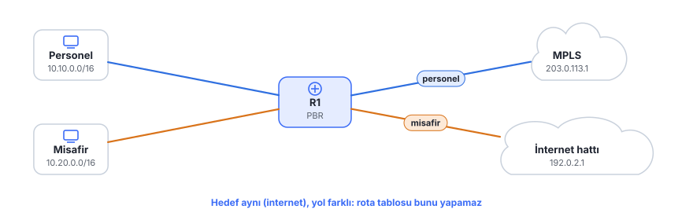
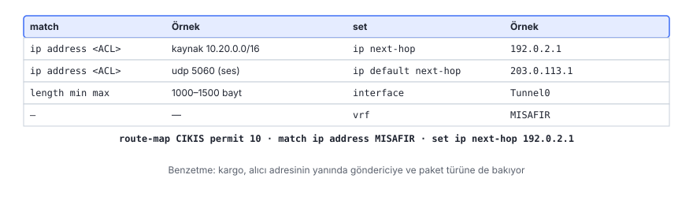
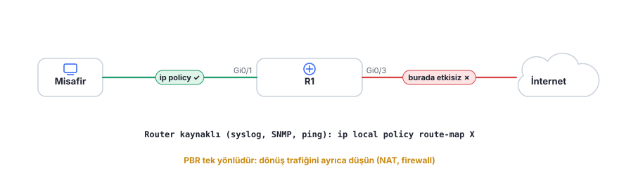
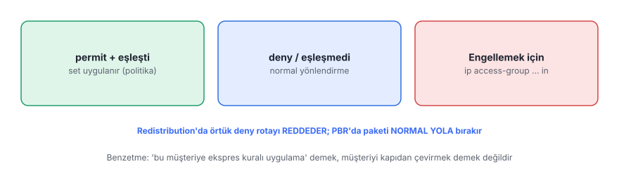
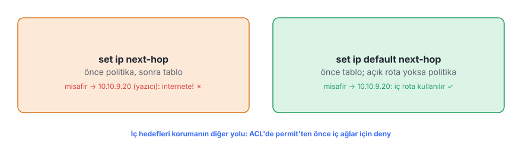
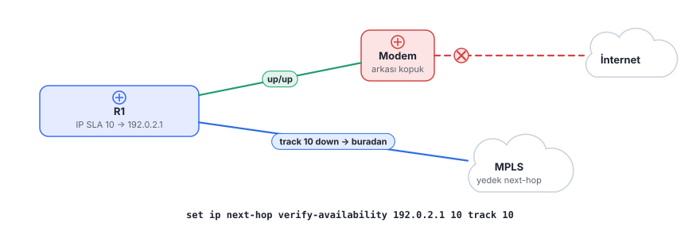
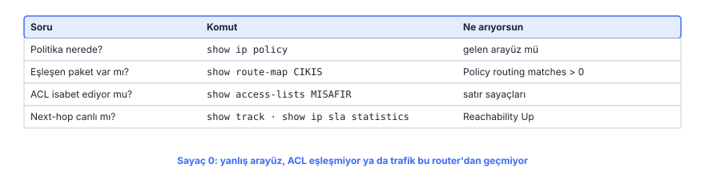

# AğLab Konu #45: PBR: politika tabanlı yönlendirme ve IP SLA ile yedekleme

> Uygulamadaki `pbr` dersi bu belgeyle uyumludur. **Okuma dersi (Seviye 3, CCNP):** PBR Labber'da yok; Gerçek Lab (FRR `pbrd`) bunu destekler. VRF-lite ayrı derste (Konu #33).
> Ön koşul: Statik routing (Konu #8), ACL (Konu #19), route-map (Konu #44), ağ izleme ve IP SLA (Konu #37). Şemalar: `docs/dersler/gorseller/pbr.py`.

Bu konu bittiğinde öğrenci normal yönlendirmenin yalnız hedef adrese baktığını, PBR'ın ise kaynak, protokol ya da port gibi başka ölçütlerle yol seçtiğini açıklar. Route-map'te `match` ve `set` satırlarıyla bir politika yazar, arayüze doğru yönde uygular. `set ip next-hop` ile `set ip default next-hop` arasındaki farkı bilir. ACL'deki `deny`'ın paketi düşürmediğini, yalnız normal yönlendirmeye bıraktığını gösterir. Next-hop öldüğünde trafiğin kara deliğe gitmemesi için IP SLA ve `track` ile doğrulama ekler. Süre yaklaşık 50 dakika.

## 0. Bir bakışta

- Normal yönlendirme yalnız **hedef IP**'ye bakar; **PBR** kaynak IP, protokol, port, paket boyu gibi ölçütlerle yol seçer.
- PBR bir **route-map**'tir: `match ip address <ACL>` → `set ip next-hop …`.
- **Gelen** arayüze uygulanır: `ip policy route-map <ad>`. Router'ın kendi ürettiği trafik için: `ip local policy route-map`.
- ACL'de `deny` ya da route-map'te `deny` bloku paketi **düşürmez**: **normal yönlendirmeye** bırakır.
- `set ip next-hop`: tablodan **önce**; `set ip default next-hop`: yalnız tabloda **açık bir rota yoksa** (varsayılan rota hariç).
- Next-hop ölürse trafik kara deliğe gidebilir: `set ip next-hop verify-availability … track n` + IP SLA.

> **Akılda kalsın:** PBR'da "deny" engellemek değil, "bu pakete politika uygulama, normal yolundan gitsin" demektir. Engellemek istiyorsan ACL'i arayüze `ip access-group` ile koy.



## 1. Neden önemli

İki çıkışlı bir şubede misafir trafiğinin ucuz internet hattından, muhasebenin ise MPLS hattından gitmesi istenir; ikisinin hedefi aynı internet olduğu için rota tablosu bunu ayıramaz. Sesin düşük gecikmeli hattan, yedeklemenin gece ucuz hattan gitmesi, bir test ağının trafiğinin bir güvenlik cihazından geçirilmesi de aynı ihtiyaçtır. PBR güçlüdür ama görünmezdir: `show ip route` yanlış bir şey göstermez, trafik yine de başka yerden gider. Bu yüzden sahada en çok "rota doğru ama trafik yanlış yoldan gidiyor" arızasının arkasından çıkar.

## 2. Kavram

### 2.1 Hedefe değil, kime ve neye bakarak yönlendirmek

> **Benzetme:** Normal yönlendirme kargo şirketinin yalnız alıcı adresine bakmasıdır. PBR, "bu gönderici kurumsal müşteri, ekspres hattan gönder; şu gönderici ekonomi paketi, kara yolundan" diyen bir ek kuraldır. Adres aynı olsa da yol farklıdır.



```
ip access-list extended MISAFIR
 permit ip 10.20.0.0 0.0.255.255 any
route-map CIKIS permit 10
 match ip address MISAFIR
 set ip next-hop 192.0.2.1
interface GigabitEthernet0/1
 description Misafir VLAN (gelen yön)
 ip policy route-map CIKIS
```

- `match ip address` bir ya da daha çok ACL; `match length` paket boyu.
- `set ip next-hop` (bir ya da daha çok adres; ilk ulaşılabilen), `set interface` (noktadan noktaya bağlantılarda), `set ip default next-hop`, `set vrf`.

### 2.2 Nereye ve hangi yöne uygulanır



- PBR paket **router'a girerken** karar verir; bu yüzden **kaynak tarafındaki** arayüze uygulanır, çıkış arayüzüne değil.
- Router'ın kendi ürettiği trafik (ping, SNMP, syslog, BGP) bir arayüzden "girmez": `ip local policy route-map`.
- Dönüş trafiği ayrı düşünülür: PBR tek yönlüdür. Dönüş başka hattan gelirse asimetrik yol oluşur; NAT veya firewall varsa oturum bozulur.

### 2.3 Deny ne demek?



| Durum | Sonuç |
| --- | --- |
| route-map permit + ACL permit eşleşti | `set` uygulanır (politika) |
| route-map permit + ACL deny eşleşti | Bu blok uygulanmaz, sonraki bloğa bakılır |
| route-map deny bloku eşleşti | Politika uygulanmaz → **normal yönlendirme** |
| Hiçbir blok eşleşmedi | **Normal yönlendirme** (düşürülmez) |

> **Dikkat:** Redistribution'daki route-map'te sondaki örtük deny rotayı **reddeder**; PBR'da ise paketi **normal yola bırakır**. Aynı yapı, farklı sonuç: bağlamı unutma.

### 2.4 next-hop mı, default next-hop mı?



- `set ip next-hop 192.0.2.1`: Rota tablosuna **bakmadan** önce uygulanır. Tabloda daha spesifik bir rota olsa bile paket 192.0.2.1'e gider.
- `set ip default next-hop 192.0.2.1`: Önce rota tablosuna bakılır; hedef için **açık bir rota varsa** o kullanılır. Yalnız açık rota yoksa (ya da yalnız varsayılan rota varsa) politika devreye girer.
- Kullanım: "İç ağlara her zaman normal yoldan git, internete misafirleri ucuz hattan çıkar" için `default next-hop` daha güvenlidir; iç trafiği yanlışlıkla internet hattına göndermezsin.

### 2.5 Next-hop öldüğünde: IP SLA ve track



```
ip sla 10
 icmp-echo 192.0.2.1 source-interface GigabitEthernet0/2
 frequency 5
ip sla schedule 10 life forever start-time now
track 10 ip sla 10 reachability
route-map CIKIS permit 10
 match ip address MISAFIR
 set ip next-hop verify-availability 192.0.2.1 10 track 10
 set ip next-hop verify-availability 203.0.113.1 20 track 20
```

- Next-hop doğrudan bağlı bir arayüzdeyse ve arayüz kapanırsa PBR onu kullanmaz. Ama arayüz açık, karşı taraf ölüyse (ör. modemin arkası koptu) PBR fark etmez ve trafiği kara deliğe gönderir.
- `verify-availability … track`: track kapalıysa o next-hop atlanır; sıradakine geçilir; hiçbiri yoksa normal yönlendirme.

### 2.6 PBR ve VRF

- `set vrf <ad>` paketi başka bir VRF tablosunda yönlendirmek için kullanılır (VRF seçimi; ayrıntı Konu #33).
- PBR'ın donanımda (TCAM) yapıldığı switch'lerde karmaşık politikalar kaynak sınırına takılabilir; platform belgelerinde PBR desteğini kontrol et.

### 2.7 Doğrulama



> **Sahada:** PBR'ı tanıtan sayaçlar `show route-map` çıktısındaki "Policy routing matches"tır. Sıfır ise ya politika yanlış arayüzde, ya ACL eşleşmiyor, ya trafik hiç bu router'dan geçmiyor.

## 3. Çıktı okuma

```
R1#show ip policy
Interface      Route map
Gi0/1          CIKIS
                                        ← politika misafir VLAN arayüzünde (gelen yön): doğru yer

R1#show route-map CIKIS
route-map CIKIS, permit, sequence 10
  Match clauses:
    ip address (access-lists): MISAFIR
  Set clauses:
    ip next-hop verify-availability 192.0.2.1 10 track 10  [down]
    ip next-hop verify-availability 203.0.113.1 20 track 20  [up]
  Policy routing matches: 18342 packets, 9811220 bytes
                                        ← internet next-hop'unun track'i kapalı; misafir trafiği yedek MPLS'e (203.0.113.1) kaymış

R1#show track 10
Track 10
  IP SLA 10 reachability
  Reachability is Down
    3 changes, last change 00:04:12
  Latest operation return code: Timeout

R1#show ip route 8.8.8.8
Routing entry for 0.0.0.0/0, supernet
  Known via "static", distance 1, metric 0, candidate default path
  * 203.0.113.1
                                        ← rota tablosu yalnız MPLS çıkışını gösterir; hat sağlamken misafir
                                          trafiği PBR ile 192.0.2.1'den gider: show ip route PBR'ı göstermez
```

| Soru | Komut |
| --- | --- |
| Politika hangi arayüzde? | `show ip policy` |
| Eşleşen paket var mı, set durumu? | `show route-map <ad>` |
| ACL satırlarına isabet? | `show access-lists <ad>` |
| Next-hop doğrulaması? | `show track`, `show ip sla statistics` |
| Bir paketin kararı? | `debug ip policy` (dikkatle, ACL ile sınırla) |

## 4. Yönlendirmeli lab

> **Simülatörde yok:** Lab'ı kâğıt üstünde (ya da Gerçek Lab'da) yürüt; her adımda Bölüm 3'teki beklenen çıktıyla karşılaştır.

Topoloji: R1'in arkasında personel (10.10.0.0/16, Gi0/0) ve misafir (10.20.0.0/16, Gi0/1); çıkışlar MPLS (Gi0/2 → 203.0.113.1) ve internet (Gi0/3 → 192.0.2.1). Varsayılan rota MPLS'ten.

1. MISAFIR ACL'i ve CIKIS route-map'ini yaz; politikayı Gi0/3'e (çıkış) uygula. Sayaçlar artıyor mu? *Neden:* PBR gelen yöndedir; Gi0/1'e taşı.
2. Misafirden 10.10.5.10'a (personel sunucusu) ping at. Paket internet hattına mı gitti? `set ip next-hop` ile `set ip default next-hop` farkını dene.
3. ACL'e `deny ip any 10.0.0.0 0.255.255.255` satırını permit'ten önce ekle: iç hedefler normal yoldan gitsin.
4. İnternet modeminin arkasını kopar (arayüz açık kalsın). Misafir trafiğinin kara deliğe gittiğini gör.
5. IP SLA + track ekle, `verify-availability` ile ikinci next-hop'u (MPLS) yedek yap. 4. adımı tekrarla.
6. R1'den syslog sunucusuna giden trafiği MPLS'ten göndermek için `ip local policy` yaz.

> **Benzetme:** 3. adım, ekonomi paketlerini kara yoluna yönlendiren kurala "aynı binanın içindeki teslimatlar hariç" maddesini eklemektir.

## 5. Sık hatalar

| Kod | Hata | Belirti | Kanıt | Düzeltme |
| --- | --- | --- | --- | --- |
| E1 | Politika çıkış arayüzünde | Politika hiç çalışmıyor | `show route-map` sayaç 0 | Gelen arayüze uygula |
| E2 | `set ip next-hop` iç trafiği de yakaladı | İç sunuculara erişim yok | Misafir → iç hedef internet hattına gidiyor | ACL'e iç hedef deny ya da default next-hop |
| E3 | Next-hop doğrulaması yok | Hat ölünce trafik kara deliğe | Arayüz up, karşı taraf yok; sayaç artıyor | IP SLA + track + verify-availability |
| E4 | Deny'ı engelleme sanmak | "Engellenen" trafik geçiyor | Normal yönlendirmeye düşüyor | Engelleme için ip access-group |
| E5 | Router kaynaklı trafik politikaya girmiyor | Syslog/SNMP yanlış hattan | Arayüz politikası etkisiz | ip local policy route-map |
| E6 | Asimetrik dönüş | NAT/firewall oturumları kopuyor | Gidiş bir hattan, dönüş diğerinden | Dönüşü de aynı hatta zorla ya da NAT'ı çıkışa göre yap |

## 6. Arıza senaryoları

> **Uygulamada:** Kâğıt üstü vakalar; Gerçek Lab desteği geldikçe Sorun Çöz'e `pbr-*` kimlikleriyle eklenecek. Önce kendin çöz; neden ve çözüm kapalı kutularda.

### S1 · Başlangıç · Politika yazıldı, hiçbir şey değişmedi (E1)

- **Belirti:** Misafir trafiği hâlâ MPLS'ten çıkıyor. `show route-map CIKIS`: 0 paket.
- **Hedef:** Misafir internet hattından çıksın.

<details><summary>Neden ve çözüm</summary>

`ip policy route-map CIKIS` internet hattının arayüzüne (Gi0/3) yazılmış. PBR paket girerken karar verir. Çözüm: Gi0/3'ten kaldır, misafir VLAN arayüzüne (Gi0/1) uygula.

</details>

### S2 · Orta · Misafirler yazıcıya ulaşamıyor (E2)

- **Belirti:** PBR sonrası misafirler internete çıkıyor ama ortak alandaki yazıcıya (10.10.9.20, izinli) ulaşamıyor.
- **Hedef:** İç hedefler normal yoldan gitsin.

<details><summary>Neden ve çözüm</summary>

`set ip next-hop` rota tablosundan önce uygulanır; yazıcıya giden paket de internet hattına gönderiliyor. Çözüm: ACL'e iç ağlar için deny satırı (permit'ten önce) ya da `set ip default next-hop`.

</details>

### S3 · Orta · Modem çalışıyor görünüyor, misafirler internetsiz (E3)

- **Belirti:** İnternet hattının arayüzü up/up; misafirlerin hiçbir sitesi açılmıyor; `show route-map` sayaçları artıyor.
- **Hedef:** Hat ölünce misafirler MPLS'ten çıksın.

<details><summary>Neden ve çözüm</summary>

Modemle router arası sağlam ama modemin arkası kopuk; PBR bunu bilmez. Çözüm: 192.0.2.1'e (ya da daha iyisi ISP'nin ötesindeki bir adrese) IP SLA, track ve `set ip next-hop verify-availability` ile yedek next-hop.

</details>

### S4 · İleri · Gece yedeklemesi yanlış hattan gidiyor (E5)

- **Belirti:** Router'ın kendi TFTP yedeklemesi ve syslog'u pahalı internet hattından çıkıyor; ACL ve route-map doğru.
- **Hedef:** Router kaynaklı yönetim trafiği MPLS'ten gitsin.

<details><summary>Neden ve çözüm</summary>

Router'ın ürettiği trafik bir arayüzden girmez; arayüz politikası uygulanmaz. Çözüm: `ip local policy route-map YONETIM`.

</details>

### S5 · İleri · Web açılıyor, oturumlar birkaç saniyede kopuyor (E6)

- **Belirti:** Misafir PBR ile internet hattından çıkıyor; NAT ise yalnız MPLS çıkışında (Gi0/2) tanımlı. Bazı siteler hiç açılmıyor.
- **Hedef:** Tutarlı oturumlar.

<details><summary>Neden ve çözüm</summary>

Misafir paketleri Gi0/3'ten NAT'sız (özel adresle) çıkıyor ya da NAT çıkış arayüzü kuralı yüzünden yanlış adresle; dönüşler gelmiyor. Çözüm: Gi0/3'ü de `ip nat outside` yap ve route-map tabanlı NAT ile her çıkışa kendi adresini ver.

</details>

## 7. Kısa sınav

**1.** PBR route-map'i hangi arayüze ve hangi yönde uygulanır?

<details><summary>Cevap</summary>

Trafiğin router'a girdiği arayüze; `ip policy route-map` gelen trafiğe uygulanır.

</details>

**2.** Hiçbir route-map bloğuna uymayan paket ne olur?

<details><summary>Cevap</summary>

Düşürülmez; normal yönlendirmeyle iletilir.

</details>

**3.** `set ip next-hop` ile `set ip default next-hop` farkı?

<details><summary>Cevap</summary>

İlki rota tablosundan önce uygulanır; ikincisi yalnız tabloda hedef için açık bir rota yoksa.

</details>

**4.** Next-hop'un arayüzü açık ama karşı taraf ölü. PBR ne yapar?

<details><summary>Cevap</summary>

Fark etmez ve trafiği göndermeye devam eder; IP SLA + track + verify-availability gerekir.

</details>

**5.** Router'ın kendi ürettiği trafiğe PBR nasıl uygulanır?

<details><summary>Cevap</summary>

`ip local policy route-map <ad>`.

</details>

**6.** `show ip route` PBR kararını gösterir mi?

<details><summary>Cevap</summary>

Hayır. PBR'ı `show ip policy`, `show route-map` sayaçları ve `debug ip policy` gösterir.

</details>

## 8. Özet kartı

| Komut | Ne işe yarar |
| --- | --- |
| `route-map X permit 10` · `match ip address ACL` | Hangi trafik |
| `set ip next-hop a.b.c.d` | Tablodan önce yol |
| `set ip default next-hop a.b.c.d` | Açık rota yoksa yol |
| `set ip next-hop verify-availability a.b.c.d n track t` | Doğrulamalı yol |
| `ip policy route-map X` (gelen arayüz) | Uygula |
| `ip local policy route-map X` | Router kaynaklı trafik |
| `show ip policy`, `show route-map`, `show track` | Doğrula |

**Unutma:**

1. Gelen arayüz.
2. Deny = normal yol, düşürmek değil.
3. İç hedefleri politikadan çıkar.
4. Next-hop'u track ile doğrula.
5. Dönüş yolunu ve NAT'ı düşün.

## 9. Doğrulama notları

Kaynaklar: INE ENCOR VRF-lite ve Network Assurance (IP SLA) modülleri, CCNP ENCOR v1.0 (kapsam kontrolü için), ENARSI konu listesi (PBR, IP SLA, object tracking); Cisco IOS "Policy-Based Routing" ve "IP SLAs" yapılandırma kılavuzları. Ders metni, örnek çıktılar ve şemalar özgün yazıldı.

| İddia | Sonuç |
| --- | --- |
| `ip policy route-map` arayüze gelen trafiğe uygulanır | Doğru |
| PBR'da eşleşmeyen ya da deny ile eşleşen paket normal yönlendirilir | Doğru |
| `set ip next-hop` rota tablosundan önce, `set ip default next-hop` açık rota yoksa uygulanır | Doğru |
| Router kaynaklı trafik için `ip local policy route-map` kullanılır | Doğru |
| `set ip next-hop verify-availability` track nesnesiyle next-hop'u doğrular | Doğru |
| `show ip route` PBR kararını yansıtmaz | Doğru |

**Motor gereksinimleri**

- [ ] PBR (route-map match ACL / set next-hop), `ip local policy`, IP SLA ve track Labber'da yok; Gerçek Lab'da FRR `pbrd` ile kısmen denenebilir. Hazır olunca S1–S5 `pbr-*` kimlikleriyle eklenir.
