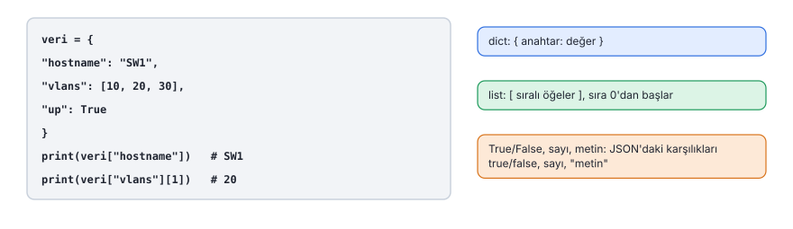
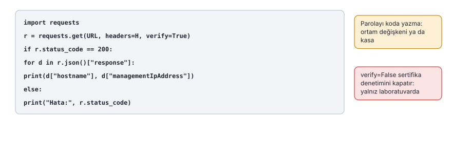
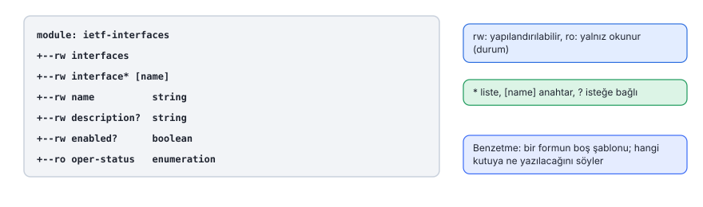
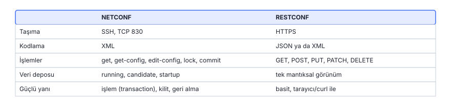
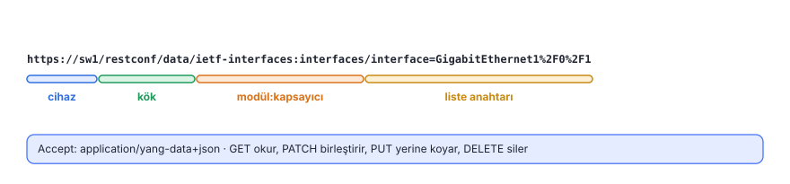
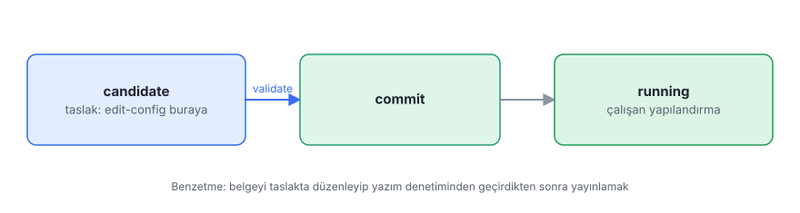
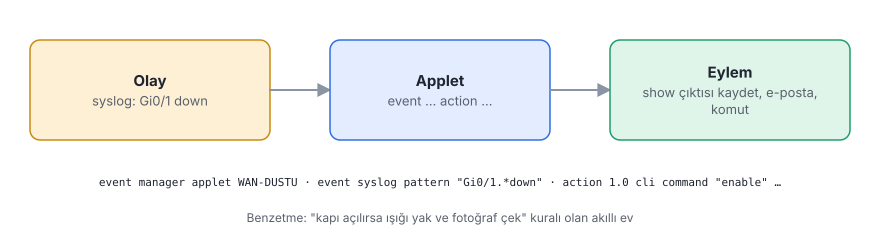

# AğLab Konu #39: Programlanabilirlik: Python, YANG, NETCONF/RESTCONF ve EEM

> Uygulamadaki `programmability` dersi bu belgeyle uyumludur. **Okuma dersi (Seviye 3, CCNP):** API ve betik çalıştırma Labber'da yok; örnekler kâğıt üstünde ya da bir sandbox'ta (DevNet) denenir.
> Ön koşul: Ağ otomasyonu (Konu #26), cihaz yönetimi (Konu #11), ağ izleme (Konu #37). Şemalar: `docs/dersler/gorseller/programlanabilirlik.py`.

Bu konu bittiğinde öğrenci bir JSON yanıtını Python sözlük ve listesi olarak okur ve basit bir REST çağrısı betiğini satır satır açıklar. Bir YANG ağacında yapılandırılabilir ve salt okunur alanları, listeleri ve anahtarları ayırt eder. NETCONF ile RESTCONF'u taşıma, kodlama, işlemler ve veri depoları açısından karşılaştırır; bir RESTCONF adresini parçalarına ayırır. EEM ile cihaz içinde olay tabanlı küçük bir otomasyon yazar. Süre yaklaşık 55 dakika.

## 0. Bir bakışta

- JSON Python'da **dict** (`{anahtar: değer}`) ve **list** (`[ ]`, sıra 0'dan) olur.
- `requests.get(…)` → `status_code` kontrol → `r.json()` → döngü.
- **YANG** verinin şemasıdır: `rw` yapılandırılabilir, `ro` durum, `*` liste, `[name]` anahtar.
- **NETCONF**: SSH TCP 830, XML, `get-config`/`edit-config`/`commit`, **candidate** ve **running** depoları.
- **RESTCONF**: HTTPS, JSON/XML, GET/PUT/PATCH/DELETE; URL YANG yolunu izler.
- **EEM**: olay (syslog, arayüz, track, zaman) → eylem (komut, kayıt); cihazın içinde çalışır.

> **Akılda kalsın:** CLI çıktısını metin olarak ayrıştırmak kırılgandır; yapılandırılmış veri (YANG + NETCONF/RESTCONF) aynı bilgiyi her sürümde aynı yerde verir.



## 1. Neden önemli

Konu #26 otomasyonun neden ve hangi araçlarla yapıldığını anlattı; bu ders işin içine girer. CCNP ENCOR bir Python parçasını okumanızı, bir JSON yanıtından değer çıkarmanızı, bir YANG ağacını ve NETCONF/RESTCONF farklarını yorumlamanızı ister. Sahada da en basit otomasyon "bütün switch'lerden yazılım sürümünü topla" gibi birkaç satırlık betiklerdir; bunları okuyup güvenle değiştirebilmek gerekir.

## 2. Kavram

### 2.1 Python'un ağcıya yetecek kadarı

> **Benzetme:** Python bir yemek tarifine benzer: malzemeler (değişkenler), ölçü kapları (sözlük ve liste), "her domates için doğra" adımı (döngü) ve "ocak sönerse dur" kontrolü (if).

- **Değişken ve türler:** metin (`"SW1"`), sayı (`10`), mantıksal (`True`), liste, sözlük.
- **Döngü:** `for d in cihazlar:` her öğe için girintili blok çalışır. Python girintiye duyarlıdır.
- **Koşul:** `if r.status_code == 200:` … `else:`
- **Fonksiyon:** `def surum_al(cihaz):` tekrar eden işi adlandırır.

### 2.2 REST çağrısı



> **Dikkat:** `verify=False` sertifika doğrulamasını kapatır; ortadaki adam saldırısına kapı açar. Üretimde sertifika zinciri doğru kurulur.

### 2.3 YANG



- **Standart modeller:** IETF (ietf-interfaces), OpenConfig (çok üreticili); **yerel modeller:** Cisco-IOS-XE-native.
- Aynı model hem yapılandırma (rw) hem durum (ro) verisini tanımlar.

### 2.4 NETCONF ve RESTCONF







```
SW1(config)#netconf-yang
SW1(config)#restconf
SW1(config)#ip http secure-server
```

### 2.5 EEM



```
event manager applet WAN-DUSTU
 event syslog pattern "Interface GigabitEthernet0/1, changed state to down"
 action 1.0 cli command "enable"
 action 2.0 cli command "show ip route | append flash:wan-dustu.txt"
 action 3.0 syslog msg "WAN dustu, rota tablosu kaydedildi"
```

> **Sahada:** EEM, arızanın tam anındaki durumu yakalamak için çok değerlidir: gece 03:00'te düşen bir bağlantının o anki rota tablosu ve arayüz sayaçları sabah hazır olur.

## 3. Çıktı okuma

RESTCONF ile bir arayüzü okumak:

```
$ curl -s -u admin:*** -H "Accept: application/yang-data+json" \
  https://sw1/restconf/data/ietf-interfaces:interfaces/interface=GigabitEthernet1%2F0%2F1
{
  "ietf-interfaces:interface": {
    "name": "GigabitEthernet1/0/1",
    "description": "Uplink DIST1",
    "type": "iana-if-type:ethernetCsmacd",
    "enabled": true
  }
}
                                        ← 200 OK; enabled true: arayüz yönetsel açık
```

NETCONF yanıtında hata:

```
<rpc-reply message-id="101" xmlns="urn:ietf:params:xml:ns:netconf:base:1.0">
  <rpc-error>
    <error-type>application</error-type>
    <error-tag>invalid-value</error-tag>
    <error-message>"enabled" must be a boolean</error-message>
  </rpc-error>
</rpc-reply>
                                        ← değer YANG'deki türe uymuyor ("yes" yerine true)
```

Python betiği çıktısı:

```
SW1 192.168.99.2 17.9.4
SW2 192.168.99.3 17.6.1
Hata: 401
                                        ← üçüncü kontrolcü çağrısında belirtecin süresi dolmuş
```

| Soru | Nereye bak |
| --- | --- |
| İstek başarılı mı? | HTTP durum kodu (200, 201, 204, 401, 404) / `rpc-reply` içinde `ok` ya da `rpc-error` |
| Hangi alan nerede? | YANG ağacı (`pyang -f tree`), RESTCONF yolu |
| Cihazda NETCONF/RESTCONF açık mı? | `show netconf-yang status`, `show platform software yang-management process` |
| EEM tetiklendi mi? | `show event manager history events` |

## 4. Yönlendirmeli lab

> **Simülatörde yok:** Lab'ı kâğıt üstünde yürüt; her adımda Bölüm 3'teki beklenen çıktıyla karşılaştır.

Kâğıt üstü ya da sandbox.

1. g1'deki sözlükten üçüncü VLAN'ı yazdıran satırı yaz. *Neden:* liste sırası 0'dan başlar.
2. g2'deki betiğe yazılım sürümü yazdırmayı ekle (`d["softwareVersion"]`).
3. YANG ağacında `oper-status` alanını RESTCONF ile değiştirmeye çalışırsan ne olur? (ro: değiştirilemez.)
4. Gi1/0/2'nin açıklamasını değiştiren RESTCONF isteği için yöntemi ve URL'yi yaz (PATCH, `…/interface=GigabitEthernet1%2F0%2F2`).
5. NETCONF ile değişikliği candidate'te hazırla, validate, commit; hata olursa ne olur?
6. WAN arayüzü düşünce `show ip route` ve `show interfaces g0/1` çıktısını flash'a kaydeden bir EEM applet'i yaz.

> **Benzetme:** 5. adım, yayınlamadan önce taslağı kontrol etmektir; hata çıkarsa yayındaki sürüm hiç bozulmaz.

## 5. Sık hatalar

| Kod | Hata | Belirti | Kanıt | Düzeltme |
| --- | --- | --- | --- | --- |
| E1 | Girinti hatası | IndentationError | Python hata satırı | Bloğu doğru girintile |
| E2 | Yanlış anahtar adı | KeyError | JSON'daki gerçek alan adı | Yanıtı yazdırıp doğru anahtarı kullan |
| E3 | RESTCONF'ta '/' kodlanmamış | 404 Not Found | URL'de Gi1/0/1 | %2F ile kodla |
| E4 | ro alanı değiştirmeye çalışmak | Hata / etkisiz | YANG'de `ro` | Yapılandırılabilir (rw) alanı kullan |
| E5 | NETCONF/RESTCONF kapalı | Bağlantı reddedildi | TCP 830/443 kapalı | `netconf-yang`, `restconf`, `ip http secure-server` |

## 6. Arıza senaryoları

> **Uygulamada:** Kâğıt üstü vakalar; motor ya da Gerçek Lab desteği gelince Sorun Çöz'e `prog-*` kimlikleriyle eklenecek. Önce kendin çöz; neden ve çözüm kapalı kutularda.

### S1 · Başlangıç · Betik ikinci gün çalışmıyor (401)

- **Belirti:** Dünkü envanter betiği bugün `Hata: 401` yazıyor.
- **Hedef:** Betik veri alsın.

<details><summary>Neden ve çözüm</summary>

Kontrolcü belirteci süreli; betik dün alınmış sabit bir belirteci kullanıyor. Çözüm: her çalıştırmada önce kimlik doğrulama uç noktasından yeni belirteç al.

</details>

### S2 · Orta · RESTCONF 404 (E3)

- **Belirti:** `…/interface=GigabitEthernet1/0/1` isteği 404 dönüyor; arayüz var.
- **Hedef:** Arayüz verisi gelsin.

<details><summary>Neden ve çözüm</summary>

URL'deki '/' karakterleri yol ayırıcı sanılıyor. Çözüm: `GigabitEthernet1%2F0%2F1`.

</details>

### S3 · Orta · NETCONF değişikliği reddedildi

- **Belirti:** edit-config `invalid-value` hatası döndü; running değişmedi.
- **Hedef:** Değişiklik uygulansın.

<details><summary>Neden ve çözüm</summary>

`enabled` alanına "yes" gönderilmiş; YANG türü boolean. Çözüm: `true`. Running'in değişmemesi candidate + validate akışının yararıdır.

</details>

### S4 · İleri · Gece kopan WAN'ın izi yok (EEM)

- **Belirti:** WAN her gece birkaç dakika kopuyor; sabah her şey normal, kayıtlarda yalnız up/down var.
- **Hedef:** Kopma anındaki durum kaydedilsin.

<details><summary>Neden ve çözüm</summary>

Kopma anını yakalayan bir mekanizma yok. Çözüm: syslog desenini (Gi0/1 down) bekleyen ve rota tablosu, arayüz sayaçları, IP SLA istatistiklerini flash'a yazan bir EEM applet'i.

</details>

## 7. Kısa sınav

**1.** `veri["vlans"][1]` ifadesi `{"vlans": [10, 20, 30]}` için ne döndürür?

<details><summary>Cevap</summary>

20 (liste sırası 0'dan başlar).

</details>

**2.** YANG ağacında `ro` ne demektir?

<details><summary>Cevap</summary>

Salt okunur durum verisi; yapılandırılamaz.

</details>

**3.** NETCONF hangi taşıma ve portu kullanır?

<details><summary>Cevap</summary>

SSH, TCP 830.

</details>

**4.** RESTCONF'ta bir alanı mevcut yapılandırmayla birleştirerek değiştiren yöntem?

<details><summary>Cevap</summary>

PATCH (PUT tamamen yerine koyar).

</details>

**5.** candidate veri deposunun yararı?

<details><summary>Cevap</summary>

Değişiklik hazırlanıp doğrulanır, commit edilmeden running bozulmaz; hata olursa atılır.

</details>

**6.** EEM applet'inin iki temel parçası?

<details><summary>Cevap</summary>

event (tetikleyici) ve action (eylemler).

</details>

## 8. Özet kartı

| Kavram / komut | Hatırla |
| --- | --- |
| dict / list | `{anahtar: değer}` / `[ ]`, sıra 0'dan |
| `requests.get` → `status_code` → `.json()` | REST çağrısı |
| YANG `rw` / `ro` / `*` / `[key]` | Yapılandırma / durum / liste / anahtar |
| NETCONF | SSH 830, XML, get-config/edit-config/commit |
| RESTCONF | HTTPS, JSON/XML, GET/PUT/PATCH/DELETE |
| `netconf-yang`, `restconf` | Cihazda aç |
| `event manager applet` | EEM |

**Unutma:**

1. Python girintiye duyarlı.
2. Önce durum kodu, sonra veri.
3. YANG şemadır; ro değiştirilemez.
4. URL'de / → %2F.
5. EEM arıza anını yakalar.

## 9. Doğrulama notları

Kaynaklar: INE ENCOR (Automation and Programmability: Python, JSON, YANG, NETCONF, RESTCONF, EEM) ve CCNP ENCOR v1.0 (yalnız kapsam kontrolü için); RFC 6241 (NETCONF), RFC 8040 (RESTCONF), RFC 7950 (YANG), RFC 8343 (ietf-interfaces); Cisco IOS XE programlanabilirlik kılavuzu. Ders metni, örnek çıktılar ve şemalar özgün yazıldı.

| İddia | Sonuç |
| --- | --- |
| NETCONF SSH üzerinde TCP 830, XML kodlama | Doğru |
| RESTCONF HTTPS üzerinde, JSON veya XML | Doğru |
| NETCONF candidate ve running veri depolarını destekler | Doğru |
| RESTCONF PATCH birleştirir, PUT yerine koyar | Doğru |
| YANG ağacında rw yapılandırma, ro durum verisidir | Doğru |
| EEM applet event ve action bölümlerinden oluşur | Doğru |

**Motor gereksinimleri**

- [ ] API ve betik çalıştırma Labber'da yok. İleride Labber cihaz durumunu YANG benzeri JSON olarak sunan salt okunur bir 'RESTCONF' paneli ve basit EEM tetikleyicileri eklenirse S2–S4 `prog-*` kimlikleriyle uygulanabilir.
