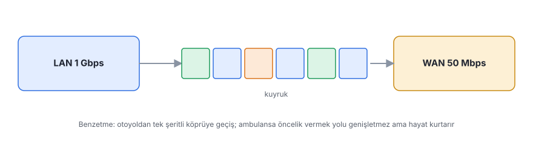
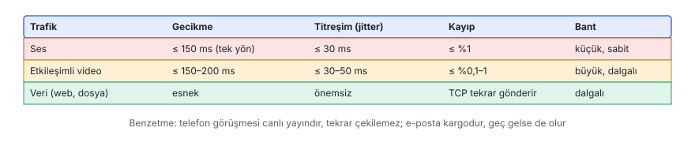
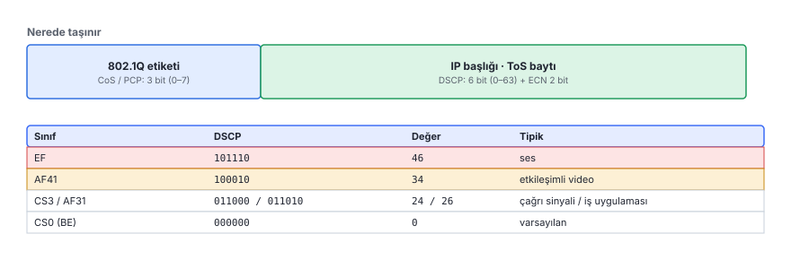
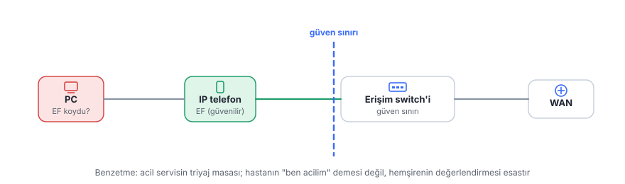
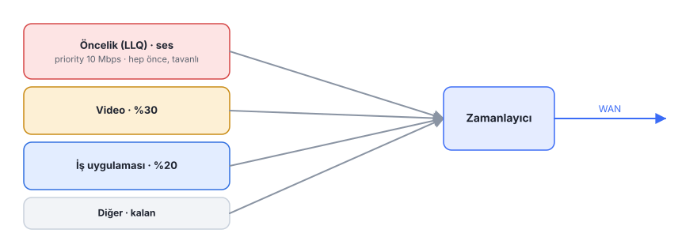
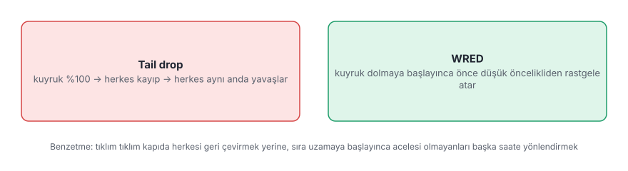
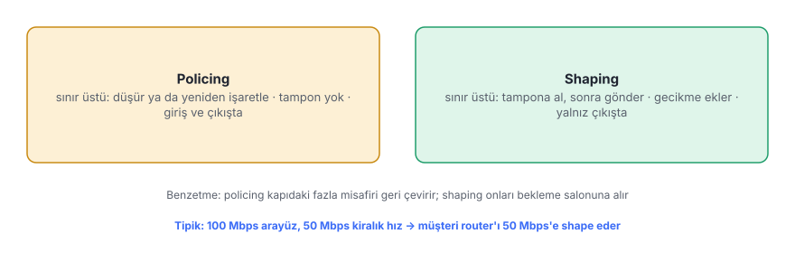

# AğLab Konu #36: QoS: sınıflandırma, işaretleme, kuyruklama, policing ve shaping

> Uygulamadaki `qos` dersi bu belgeyle uyumludur. **Okuma dersi (Seviye 3, CCNP):** Labber'da gecikme ve kuyruk modellenmez; QoS kavramları ve MQC yapılandırması kâğıt üstünde çalışılır.
> Ön koşul: ACL (Konu #19), WAN ve kampüs tasarımı (Konu #27), kablosuz (Konu #25, ses SSID'si). Şemalar: `docs/dersler/gorseller/qos.py`.

Bu konu bittiğinde öğrenci QoS'un bant genişliği yaratmadığını, dar boğazda sırayı yönettiğini açıklar. Ses ve videonun gecikme, titreşim ve kayıp gereksinimlerini sayar. CoS ve DSCP'yi, EF ve AF sınıflarını tanır; güven sınırını doğru yere koyar. CBWFQ/LLQ ile kuyruklamayı, tail drop ile WRED farkını, policing ile shaping farkını anlatır ve MQC (class-map, policy-map, service-policy) yapısını okur. Süre yaklaşık 55 dakika.

## 0. Bir bakışta

- QoS **bant genişliği yaratmaz**; dar boğazda **kimin önce gideceğini** ve **kimin atılacağını** belirler.
- Ses: tek yönde **≤ 150 ms**, titreşim **≤ 30 ms**, kayıp **≤ %1**.
- İşaret: L2'de **CoS** (3 bit), L3'te **DSCP** (6 bit). Ses **EF (46)**, video **AF41 (34)**.
- **Güven sınırı** kaynağa yakın: IP telefona güven, PC'nin işaretine güvenme.
- **LLQ** = sıkı öncelikli ses kuyruğu (tavanlı) + sınıflara bant payı (CBWFQ).
- **WRED** kuyruk dolmadan düşük öncelikliden atar; **tail drop** herkesi birden vurur.
- **Policing** fazlayı atar, **shaping** tampona alır; kiralık hız arayüzden düşükse **shape**.

> **Akılda kalsın:** QoS kuyruk varken çalışır: LAN'da bol bant varken etkisi görünmez, WAN çıkışında hayat kurtarır.



## 1. Neden önemli

Bir şubede herkes aynı WAN hattını paylaşır. Biri büyük bir dosya yüklerken telefon görüşmeleri kesilir, video toplantıda görüntü donar. Hattı büyütmek her zaman mümkün değildir; QoS aynı hattın içinde ses ve kritik uygulamalara öncelik verir. CCNP ENCOR QoS modellerini, işaretleme değerlerini ve araçların farkını sorar; sahada en sık iş güven sınırını kurmak ve WAN çıkışına LLQ politikası yazmaktır.

## 2. Kavram

### 2.1 Neden ve nerede

> **Benzetme:** Hastanenin acil kapısı: ambulans geldiğinde sıra bekleyenleri kenara alıp önce ambulansı alırsın. Bu kapıyı genişletmez ama doğru kişinin önce girmesini sağlar.

- Dar boğaz: hızlı arayüzden yavaş arayüze geçiş (LAN → WAN), çok portun tek uplink'e toplanması.
- Modeller: **Best effort** (QoS yok), **IntServ** (RSVP ile akış başına rezervasyon, ölçeklenmez), **DiffServ** (sınıflara göre hop başına davranış; günümüzde kullanılan).



### 2.2 Sınıflandırma ve işaretleme



- **Sınıflandırma:** trafiği tanı (ACL, NBAR ile uygulama tanıma, gelen DSCP).
- **İşaretleme:** sınıfı pakete yaz ki sonraki cihazlar yeniden tanımak zorunda kalmasın.
- **AF** sınıfları AFxy: x sınıf (1–4, büyük olan daha önemli), y atılma önceliği (1–3, büyük olan önce atılır).

### 2.3 Güven sınırı



> **Dikkat:** Her portta işarete güvenmek, kullanıcının kendi trafiğini EF ile işaretleyip ses kuyruğunu doldurmasına izin vermektir. Erişim portunda yalnız IP telefona koşullu güven (CDP/LLDP ile telefon algılanırsa) verilir.

### 2.4 Kuyruklama



```
class-map match-any SES
 match dscp ef
class-map match-any VIDEO
 match dscp af41
policy-map WAN-CIKIS
 class SES
  priority percent 20
 class VIDEO
  bandwidth percent 30
 class class-default
  fair-queue
interface g0/1
 service-policy output WAN-CIKIS
```

### 2.5 Tıkanıklıktan kaçınma



### 2.6 Policing ve shaping



> **Sahada:** Şubenin arayüzü 1 Gbps, kiralık hız 100 Mbps ise kuyruk router'da değil sağlayıcıda oluşur ve LLQ hiç devreye girmez. Önce 100 Mbps'e **shape** et, kuyruk politikasını shaper'ın içine yerleştir (iç içe politika).

## 3. Çıktı okuma

```
R1#show policy-map interface g0/1 output
 GigabitEthernet0/1
  Service-policy output: WAN-CIKIS
    Class-map: SES (match-any)
      52310 packets, 8420110 bytes
      5 minute offered rate 1020000 bps, drop rate 0000 bps
      Match: dscp ef (46)
      Priority: 20% (20000 kbps), burst bytes 500000, b/w exceed drops: 0
                                        ← ses kuyruğu: kayıp yok
    Class-map: VIDEO (match-any)
      Match: dscp af41 (34)
      Queueing
      queue limit 64 packets
      (queue depth/total drops/no-buffer drops) 0/0/0
      bandwidth 30% (30000 kbps)
    Class-map: class-default (match-any)
      (queue depth/total drops/no-buffer drops) 41/8812/0
                                        ← kayıplar varsayılan sınıfta: beklenen davranış

R1#show policy-map interface g0/1 output | include Match|packets
    Class-map: SES (match-any)
      0 packets, 0 bytes
                                        ← başka bir gün: ses sınıfı boş → işaret yok/sıfırlanmış mı?

SW1#show mls qos interface gi1/0/5
GigabitEthernet1/0/5
trust state: not trusted
trust mode: trust cos
trust enabled flag: dis
                                        ← telefon portunda güven yok: işaretler 0'a çekiliyor
```

| Soru | Komut |
| --- | --- |
| Politika hangi arayüzde, hangi yönde? | `show policy-map interface <if>` |
| Sınıf eşleşiyor mu, kayıp var mı? | Sınıf satırlarındaki paket ve drop sayaçları |
| İşaretler nerede siliniyor? | Erişim switch'inde güven durumu, paket yakalama ile DSCP |
| Kuyruk gerçekten router'da mı? | Arayüz hızı ile kiralık hız; shaper var mı? |

## 4. Yönlendirmeli lab

> **Simülatörde yok:** Lab'ı kâğıt üstünde yürüt; her adımda Bölüm 3'teki beklenen çıktıyla karşılaştır.

Şube: 1 Gbps arayüz, 100 Mbps kiralık WAN; IP telefonlar, video toplantı, dosya sunucusu.

1. Trafiği sınıflara ayır: SES (EF), VIDEO (AF41), IS-UYG (AF31), diğer. *Neden:* politika sınıflar üzerine kurulur.
2. Erişim portlarında güven: telefon algılanınca CoS/DSCP'ye güven, PC'nin işaretini sıfırla.
3. WAN çıkışına iç içe politika: dışta `shape average 100000000`, içte LLQ (ses %20 öncelik, video %30, iş %20, kalan fair-queue).
4. Bölüm 3'teki çıktıda ses sınıfının sayaçlarını yorumla; kayıplar hangi sınıfta?
5. Ses sınıfında 0 paket çıktısı için iki olası nedeni yaz (işaret silinmiş, sınıf eşleşmesi yanlış).
6. Kâğıt üstü: sağlayıcı 100 Mbps üstünü police ediyorsa shaper olmadan ne olur?

> **Benzetme:** 3. adım, köprüye çıkmadan önce kendi otoparkında sırayı düzenlemektir; köprü girişinde (sağlayıcı) sıra senin elinde olmaz.

## 5. Sık hatalar

| Kod | Hata | Belirti | Kanıt | Düzeltme |
| --- | --- | --- | --- | --- |
| E1 | Shaper yok, kiralık hız arayüzden düşük | QoS politikası var ama ses yine bozuk | Sayaçlarda drop yok; kayıp sağlayıcıda | Kiralık hıza shape + iç politika |
| E2 | Güven sınırı yok ya da yanlış | Ses sınıfı boş | `show mls qos interface` not trusted; DSCP 0 | Telefon portunda koşullu güven |
| E3 | Her porta güven | Kullanıcı trafiği EF ile öncelikli | Ses sınıfında beklenmedik büyük trafik | PC portlarında güvenme, yeniden işaretle |
| E4 | Öncelik kuyruğu tavansız/çok büyük | Diğer uygulamalar aç kalıyor | priority yüzdesi çok yüksek | Ses için gerçek ihtiyaç kadar (≈ %33'ü aşmama) |
| E5 | Politika yanlış yönde | Etki yok | service-policy input | Kuyruklama çıkış yönünde |

## 6. Arıza senaryoları

> **Uygulamada:** Kâğıt üstü vakalar; motor ya da Gerçek Lab desteği gelince Sorun Çöz'e `qos-*` kimlikleriyle eklenecek. Önce kendin çöz; neden ve çözüm kapalı kutularda.

### S1 · Başlangıç · QoS var, ses yine kesik (E1)

- **Belirti:** Şubede LLQ politikası WAN arayüzünde; görüşmeler yoğun saatte kesiliyor, policy-map sayaçlarında hiç kayıp yok.
- **Hedef:** Ses kesintisiz olsun.

<details><summary>Neden ve çözüm</summary>

Arayüz 1 Gbps, kiralık hız 100 Mbps; kuyruk router'da oluşmuyor, sağlayıcı fazlayı atıyor. Çözüm: `shape average 100000000` içine LLQ politikasını koy.

</details>

### S2 · Orta · Ses sınıfı hep boş (E2)

- **Belirti:** `show policy-map interface` ses sınıfında 0 paket; telefonlar EF işaretliyor.
- **Hedef:** Ses trafiği ses sınıfına düşsün.

<details><summary>Neden ve çözüm</summary>

Erişim switch'inde telefon portlarında güven yok; switch işaretleri 0'a çekiyor. Çözüm: telefon portunda `trust device cisco-phone` + CoS/DSCP güveni (platforma göre).

</details>

### S3 · Orta · Bir kullanıcı herkesi yavaşlatıyor (E3)

- **Belirti:** Ses kuyruğunda beklenmedik büyük trafik; bir PC'nin oyun/indirme trafiği EF işaretli.
- **Hedef:** Önceliği yalnız gerçek ses kullansın.

<details><summary>Neden ve çözüm</summary>

Bütün erişim portlarında DSCP'ye güveniliyor. Çözüm: PC portlarında güveni kaldır; gerekirse ACL/NBAR ile sınıflandırıp işaretle.

</details>

### S4 · İleri · Video açınca dosya aktarımları duruyor (E4)

- **Belirti:** Video toplantı başlayınca iş uygulamaları zaman aşımına düşüyor.
- **Hedef:** Video ve iş uygulaması birlikte çalışsın.

<details><summary>Neden ve çözüm</summary>

Video da öncelik kuyruğuna konmuş ve öncelik %70 ayrılmış; diğer sınıflar aç kalıyor. Çözüm: ses önceliğini gerçek ihtiyaçla sınırla, videoyu bandwidth sınıfına al.

</details>

## 7. Kısa sınav

**1.** QoS bant genişliğini artırır mı?

<details><summary>Cevap</summary>

Hayır; dar boğazda sırayı ve atılacak paketleri belirler.

</details>

**2.** Ses için tipik tek yön gecikme, titreşim ve kayıp sınırları?

<details><summary>Cevap</summary>

≈ 150 ms, ≈ 30 ms, ≈ %1.

</details>

**3.** EF'nin DSCP değeri ve tipik kullanımı?

<details><summary>Cevap</summary>

46; ses.

</details>

**4.** Güven sınırı nerede olmalı?

<details><summary>Cevap</summary>

Kaynağa en yakın güvenilir noktada: IP telefon/erişim switch'i; PC'nin işaretine güvenilmez.

</details>

**5.** LLQ ile CBWFQ farkı?

<details><summary>Cevap</summary>

CBWFQ sınıflara bant payı ayırır; LLQ buna tavanlı sıkı öncelik kuyruğu ekler (ses için).

</details>

**6.** Policing ile shaping farkı?

<details><summary>Cevap</summary>

Policing fazlayı atar ya da yeniden işaretler; shaping tampona alıp sonra gönderir (gecikme ekler, atmaz).

</details>

## 8. Özet kartı

| Komut / kavram | Hatırla |
| --- | --- |
| `class-map … match dscp ef` | Sınıflandır |
| `policy-map` → `priority` / `bandwidth` | LLQ / CBWFQ |
| `service-policy output` | Arayüze uygula (kuyruk çıkışta) |
| `shape average <bps>` | Kiralık hıza uydur |
| `random-detect dscp-based` | WRED |
| EF 46 · AF41 34 · CS3 24 · BE 0 | Önemli DSCP'ler |
| `show policy-map interface` | Sayaçlar ve kayıplar |

**Unutma:**

1. QoS bant yaratmaz.
2. Güven sınırı kaynağa yakın.
3. Ses EF, öncelik tavanlı.
4. Kiralık hız düşükse önce shape.
5. Kuyruklama çıkışta.

## 9. Doğrulama notları

Kaynaklar: INE ENCOR (QoS: classification, marking, queuing, policing, shaping) ve CCNP ENCOR v1.0 (yalnız kapsam kontrolü için); RFC 2474 (DSCP), RFC 3246 (EF), RFC 2597 (AF); Cisco QoS tasarım kılavuzları. Ders metni, örnek çıktılar ve şemalar özgün yazıldı.

| İddia | Sonuç |
| --- | --- |
| DSCP 6 bit, CoS 3 bit | Doğru |
| EF = DSCP 46; AF41 = 34; CS3 = 24 | Doğru |
| Ses için tipik sınırlar ~150 ms gecikme, ~30 ms jitter, ~%1 kayıp | Doğru |
| LLQ sıkı öncelikli ve tavanlıdır | Doğru |
| Shaping tamponlar, policing atar ya da yeniden işaretler | Doğru |
| WRED düşük öncelikli trafiği kuyruk dolmadan rastgele atar | Doğru |

**Motor gereksinimleri**

- [ ] Gecikme, kuyruk ve QoS Labber'da modellenmez; ileride Paket Dedektifi'ne DSCP alanı ve basit bir kuyruk görselleştirmesi eklenirse S2–S3 `qos-*` kimlikleriyle uygulanabilir.
