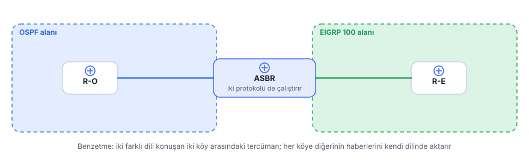
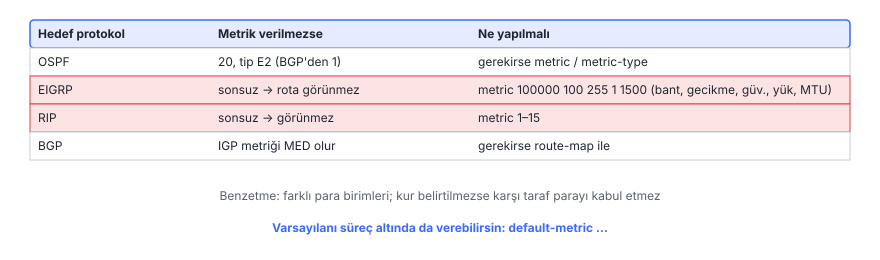
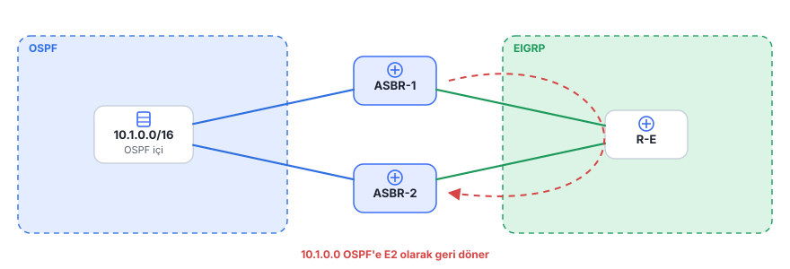
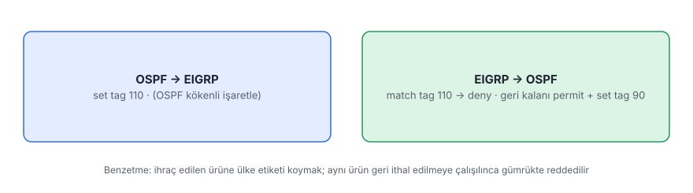
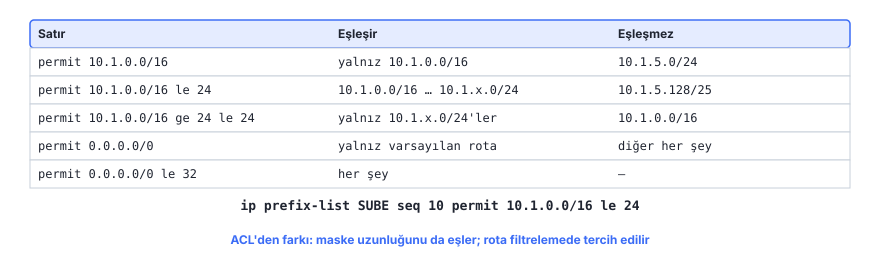
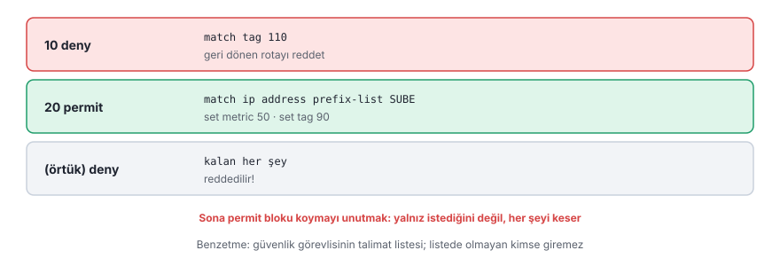
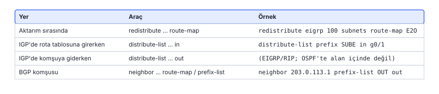

# AğLab Konu #44: Redistribution ve rota filtreleme: prefix-list, route-map, etiket

> Uygulamadaki `redistribution` dersi bu belgeyle uyumludur. **Okuma dersi (Seviye 3, CCNP):** Redistribution ve route-map Labber'da yok; Gerçek Lab (FRR) bunları destekler.
> Ön koşul: OSPF çok alan (Konu #31), EIGRP (Konu #41), BGP (Konu #32), ACL ve wildcard (Konu #19). Şemalar: `docs/dersler/gorseller/redistribution.py`.

Bu konu bittiğinde öğrenci redistribution'ın neden gerektiğini ve tohum metriğin her protokolde nasıl davrandığını açıklar; EIGRP'ye metriksiz aktarımın rotayı neden görünmez yaptığını bilir. İki noktadan karşılıklı aktarımda geri besleme döngüsünün nasıl oluştuğunu gösterir ve etiketle önler. Prefix-list satırlarını (ge/le) okuyup yazar, route-map bloklarının sırasını ve örtük deny'ı uygular. Filtrenin nereye (aktarım, distribute-list, BGP komşusu) konacağına karar verir. Süre yaklaşık 60 dakika.

## 0. Bir bakışta

- **Redistribution** bir protokolün rotalarını diğerine aktarır; aktarımı yapan router **ASBR**'dir.
- **Tohum metrik**: OSPF varsayılan **20/E2**; **EIGRP ve RIP metriksiz aktarılan rotayı kullanmaz**.
- İki noktadan karşılıklı aktarım **geri besleme döngüsü** yaratabilir: rota çıktığı alana geri döner.
- Çözüm: bir yönde **set tag**, ters yönde **match tag → deny**.
- **Prefix-list** önek + uzunluk eşler; `ge`/`le` aralık verir; sonda örtük deny.
- **Route-map** sıra numaralı **match/set** bloklarıdır; hiçbirine uymayan rota **reddedilir**.
- Filtre yeri: aktarımda route-map, IGP'de distribute-list, BGP'de komşu başına.

> **Akılda kalsın:** Route-map'in sonunda örtük deny vardır: 'şunu engelle' yazıp sona boş bir permit bloku koymazsan her şeyi engellemiş olursun.



## 1. Neden önemli

Şirket birleşmelerinde bir tarafta OSPF, diğerinde EIGRP olur; geçiş aylarca sürer. Şube statik rotaları, bağlı ağlar ve BGP'den gelen önekler de bir IGP'ye aktarılmak zorundadır. Redistribution kolay yazılır ama yanlış yazıldığında en zor arızaları üretir: kaybolan rotalar, döngüler, yanlış yönden giden trafik. ENARSI'nin ve sahadaki ileri sorun gidermenin merkezindedir.

## 2. Kavram

### 2.1 Aktarım ve tohum metrik

> **Benzetme:** İki köy farklı uzunluk birimleri kullanıyor: biri adım, diğeri kulaç. Tercüman "bu kuyu bize 300 adım" bilgisini aktarırken diğer köyün birimine çeviremez; bir başlangıç değeri koyar. Hiç değer koymazsa diğer köy "sonsuz uzak" der ve o kuyuya hiç gitmez.



```
router ospf 1
 redistribute eigrp 100 subnets route-map E2O
router eigrp 100
 redistribute ospf 1 metric 100000 100 255 1 1500 route-map O2E
```

> **Dikkat:** Eski IOS sürümlerinde OSPF'e aktarımda `subnets` yazılmazsa yalnız sınıflı (ana ağ) rotalar aktarılır; alt ağlar sessizce kaybolur. Yeni sürümlerde varsayılan olarak alt ağlar dahildir, ama sınavda ve eski cihazlarda dikkat.

### 2.2 Geri besleme döngüsü



- OSPF iç rota AD 110, EIGRP dış rota AD 170, EIGRP iç rota 90: ASBR-2, ASBR-1'in EIGRP'ye aktardığı bir OSPF rotasını EIGRP dış (170) olarak görür; OSPF'teki (110) yine kazanır. Ama tersinde EIGRP kökenli bir rota OSPF'e E2 olarak girip diğer ASBR'de EIGRP iç rotayla yarışabilir; metrik ve AD karışınca optimal olmayan yollar ve döngüler oluşur.



### 2.3 Prefix-list



- Kural: önek uzunluğu ≤ `ge` ≤ `le` ≤ 32.
- `ge` verilip `le` verilmezse üst sınır 32'dir.

### 2.4 Route-map



```
route-map E2O deny 10
 match tag 110
route-map E2O permit 20
 match ip address prefix-list SUBE
 set metric 50
 set tag 90
route-map E2O permit 30
```

- Bir blokta birden çok `match` satırı varsa **hepsi** (VE) sağlanmalı; aynı satırda birden çok değer varsa **biri** (VEYA) yeterli.
- `match` olmayan permit bloku her şeyi eşler (ör. son satırdaki `permit 30`).

### 2.5 Filtrenin yeri



> **Sahada:** Aktarımı her zaman route-map ile yap, "çıplak" redistribute yazma: hangi rotanın geçtiği belgelenir ve ileride bir satır eklemek kolaylaşır.

## 3. Çıktı okuma

```
R-O#show ip route 10.2.0.0
Routing entry for 10.2.0.0/16
  Known via "ospf 1", distance 110, metric 50, type extern 2, forward metric 2
  Redistributing via ospf 1
  Last update from 10.0.1.1 on GigabitEthernet0/0
  Route tag 90
                                        ← EIGRP'den aktarılmış: E2, metrik 50 ve etiket 90 route-map'in set satırlarından

ASBR-1#show ip eigrp topology 10.1.0.0/16
  Composite metric is (28160/0), route is External
  External data:
    Originating router is 10.255.0.1 (this system)
    External protocol is OSPF, external metric is 2
    Administrator tag is 110 (0x0000006E)
                                        ← OSPF kökenli, etiket 110: ters yönde geri alınmamalı

ASBR-2#show route-map E2O
route-map E2O, deny, sequence 10
  Match clauses:
    tag 110
  Policy routing matches: 0 packets, 0 bytes
route-map E2O, permit, sequence 20
  Match clauses:
    ip address prefix-lists: SUBE
  Set clauses:
    metric 50
    tag 90
                                        ← sona permit 30 eklenmemiş: SUBE dışındaki her şey düşüyor

ASBR-2#show ip prefix-list SUBE
ip prefix-list SUBE: 1 entries
   seq 10 permit 10.2.0.0/16 le 24
```

| Soru | Komut |
| --- | --- |
| Rota nereden, hangi tip, hangi etiketle? | `show ip route <önek>` |
| EIGRP dış rota ayrıntısı? | `show ip eigrp topology <önek>` |
| Route-map blokları ve sırası? | `show route-map` |
| Prefix-list satırları ve sayaçları? | `show ip prefix-list [detail]` |
| OSPF dış LSA'lar? | `show ip ospf database external` |

## 4. Yönlendirmeli lab

> **Simülatörde yok:** Lab'ı kâğıt üstünde yürüt; her adımda Bölüm 3'teki beklenen çıktıyla karşılaştır.

Topoloji: g3'teki gibi; OSPF alanında 10.1.0.0/16, EIGRP alanında 10.2.0.0/16; ASBR-1 ve ASBR-2 iki yönde aktarım yapıyor.

1. ASBR-1'de yalnız OSPF → EIGRP, metriksiz yaz; EIGRP tarafında rotanın görünmediğini gör. *Neden:* EIGRP tohum metrik ister.
2. `metric 100000 100 255 1 1500` ekle; rotalar EIGRP'de D EX (170) olarak görünsün.
3. İki ASBR'de iki yönlü aktarım; bir OSPF rotasının ASBR-2 üzerinden OSPF'e E2 olarak geri girip girmediğini incele.
4. O2E route-map'ine `set tag 110`, E2O route-map'ine `deny 10 match tag 110`; tersi için tag 90.
5. Prefix-list SUBE ile yalnız 10.2.0.0/16 ve /24'e kadar alt ağlarını OSPF'e aktar; sona `permit 30` eklemeyi unutursan ne olur?
6. Bölüm 3'teki route-map çıktısındaki eksikliği bul.

> **Benzetme:** 4. adım, ihraç ürünlerine etiket koyup aynı etiketi taşıyan ürünün geri ithalatını yasaklamaktır.

## 5. Sık hatalar

| Kod | Hata | Belirti | Kanıt | Düzeltme |
| --- | --- | --- | --- | --- |
| E1 | EIGRP/RIP'e metriksiz aktarım | Rota hedef protokolde yok | `show ip eigrp topology`'de yok | metric ya da default-metric |
| E2 | Eski IOS'ta `subnets` yok | Alt ağlar OSPF'e geçmiyor | Yalnız sınıflı önek | `subnets` |
| E3 | İki noktadan etiketsiz karşılıklı aktarım | Optimal olmayan yol, döngü, dalgalanma | Rota çıktığı alana E2 olarak geri dönüyor | Tag + deny |
| E4 | Route-map sonunda permit yok | Beklenenden çok rota kayboldu | `show route-map`'te son blok deny ya da eşleşmeli permit | Boş `permit` bloku ekle |
| E5 | Prefix-list ge/le yanlış | Alt ağlar eşleşmiyor ya da fazla eşleşiyor | `show ip prefix-list detail` hit sayaçları | Aralığı düzelt |

## 6. Arıza senaryoları

> **Uygulamada:** Kâğıt üstü vakalar; motor ya da Gerçek Lab desteği gelince Sorun Çöz'e `redis-*` kimlikleriyle eklenecek. Önce kendin çöz; neden ve çözüm kapalı kutularda.

### S1 · Başlangıç · Aktarılan rotalar görünmüyor (E1)

- **Belirti:** ASBR-1'de `redistribute ospf 1` yazıldı; EIGRP alanındaki router'larda hiçbir OSPF rotası yok.
- **Hedef:** OSPF rotaları EIGRP'de görünsün.

<details><summary>Neden ve çözüm</summary>

EIGRP'ye metrik verilmeden aktarıldı; rotalar sonsuz metrikle kullanılmıyor. Çözüm: `redistribute ospf 1 metric 100000 100 255 1 1500` (ya da `default-metric`).

</details>

### S2 · Orta · Filtre eklenince her şey kayboldu (E4)

- **Belirti:** Yalnız bir test ağını engellemek için route-map'e `deny 10 match ip address prefix-list TEST` yazıldı; ardından bütün EIGRP rotaları OSPF'ten kayboldu.
- **Hedef:** Yalnız test ağı engellensin.

<details><summary>Neden ve çözüm</summary>

Route-map'te başka blok yok; örtük deny geri kalan her şeyi reddediyor. Çözüm: `route-map E2O permit 20` (match'siz).

</details>

### S3 · Orta · Trafik uzun yoldan dolaşıyor (E3)

- **Belirti:** OSPF alanındaki bir router 10.1.5.0'a (kendi alanında) E2 rota ile ASBR-2 üzerinden gidiyor.
- **Hedef:** Trafik OSPF içinden gitsin.

<details><summary>Neden ve çözüm</summary>

10.1.5.0 OSPF içinde bir an kaybolup geri gelirken ASBR-2 onu EIGRP'den geri aktarmış; etiket yok. Çözüm: iki yönde tag + match tag deny; ayrıca iç yol geri gelince E2'nin çekilmesini sağla.

</details>

### S4 · İleri · Yalnız /16 geçiyor, /24'ler geçmiyor (E5)

- **Belirti:** Prefix-list `permit 10.2.0.0/16` yazıldı; şube /24'leri OSPF'te yok.
- **Hedef:** /24'ler de aktarılsın.

<details><summary>Neden ve çözüm</summary>

Satır yalnız tam /16'yı eşler. Çözüm: `permit 10.2.0.0/16 le 24`.

</details>

## 7. Kısa sınav

**1.** EIGRP'ye metrik vermeden aktarılan rotalara ne olur?

<details><summary>Cevap</summary>

Sonsuz metrik sayılır, kullanılmaz (rota tabloda görünmez).

</details>

**2.** OSPF'e aktarılan rotanın varsayılan metriği ve tipi?

<details><summary>Cevap</summary>

20, E2 (BGP'den gelenler için 1).

</details>

**3.** İki noktadan karşılıklı aktarımda döngü nasıl önlenir?

<details><summary>Cevap</summary>

Bir yönde aktarılan rotaya etiket koyup ters yönde o etiketi taşıyanları reddederek.

</details>

**4.** `ip prefix-list X permit 10.1.0.0/16 le 24` neleri eşler?

<details><summary>Cevap</summary>

10.1.0.0/16 içinde, uzunluğu 16 ile 24 arasındaki bütün önekleri.

</details>

**5.** Route-map'te hiçbir bloka uymayan rota ne olur?

<details><summary>Cevap</summary>

Örtük deny ile reddedilir.

</details>

**6.** Aynı route-map blokundaki iki ayrı match satırı nasıl değerlendirilir?

<details><summary>Cevap</summary>

VE: ikisi de sağlanmalı. Aynı satırdaki birden çok değer VEYA'dır.

</details>

## 8. Özet kartı

| Komut | Ne işe yarar |
| --- | --- |
| `redistribute <protokol> [metric …] route-map …` | Aktarım |
| `default-metric …` | Varsayılan tohum metrik |
| `ip prefix-list <ad> seq n permit <önek> [ge] [le]` | Önek + uzunluk eşle |
| `route-map <ad> permit/deny n` · `match` · `set` | Koşullu aktarım |
| `set tag` / `match tag` | Döngü önleme |
| `distribute-list prefix … in/out` | IGP'de filtre |
| `show route-map`, `show ip prefix-list detail` | Doğrulama |

**Unutma:**

1. EIGRP/RIP'e metrik ver.
2. Karşılıklı aktarımda etiket.
3. Route-map sonunda örtük deny.
4. prefix-list'te le/ge'yi düşün.
5. Aktarımı her zaman route-map ile yap.

## 9. Doğrulama notları

Kaynaklar: INE ENCOR ve CCNP ENCOR v1.0 (kapsam kontrolü için), ENARSI konu listesi (route redistribution, route maps, prefix lists); Cisco IOS IP routing yapılandırma kılavuzları. Ders metni, örnek çıktılar ve şemalar özgün yazıldı.

| İddia | Sonuç |
| --- | --- |
| OSPF'e aktarılan rotalar varsayılan metrik 20, tip E2 (BGP için 1) | Doğru |
| EIGRP ve RIP'e metriksiz aktarılan rotalar kullanılmaz | Doğru |
| Route-map sonunda örtük deny vardır | Doğru |
| Aynı blokta ayrı match satırları VE, aynı satırdaki değerler VEYA mantığıyla değerlendirilir | Doğru |
| Prefix-list'te önek uzunluğu ≤ ge ≤ le ≤ 32 olmalıdır | Doğru |
| EIGRP dış rotaların AD'si 170 | Doğru |

**Motor gereksinimleri**

- [ ] Redistribution, route-map ve prefix-list Labber'da yok; Gerçek Lab (FRR) bunları destekler. Hazır olunca S1–S4 `redis-*` kimlikleriyle eklenir.
