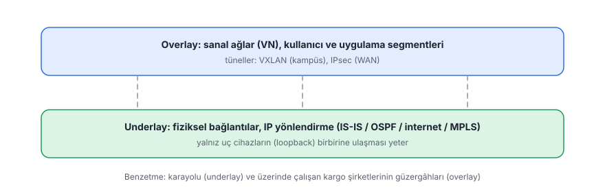
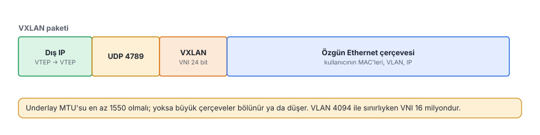
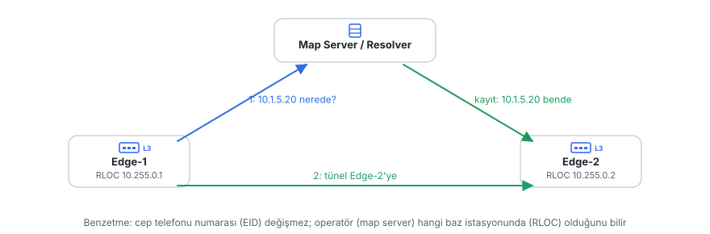
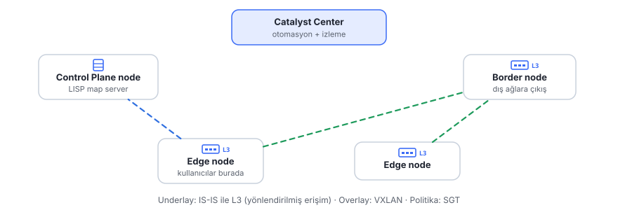
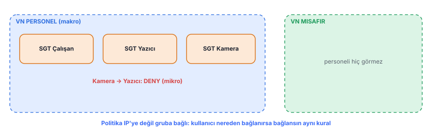
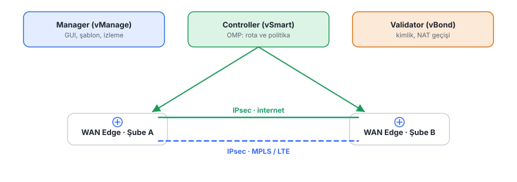
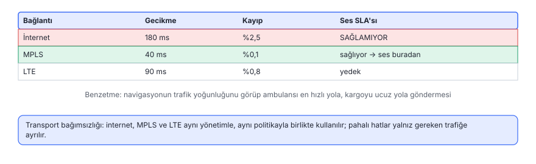

# AğLab Konu #35: Yazılım tanımlı ağlar: VXLAN, LISP, SD-Access ve SD-WAN

> Uygulamadaki `sdwan` dersi bu belgeyle uyumludur. **Okuma dersi (Seviye 3, CCNP):** mimari bir konudur; simülatörde karşılığı yoktur, kavramlar ve kontrolcü ekranları üzerinden çalışılır.
> Ön koşul: Kampüs tasarımı (Konu #27), VRF ve GRE (Konu #33), IPsec (Konu #34), otomasyon (Konu #26). Şemalar: `docs/dersler/gorseller/sdwan-sda.py`.

Bu konu bittiğinde öğrenci underlay ile overlay'i ayırır ve neden overlay kullanıldığını açıklar. VXLAN'ın L2 çerçevesini nasıl taşıdığını (VNI, VTEP, UDP 4789, MTU etkisi) ve LISP'in kimlik/konum ayrımını anlatır. SD-Access'in kontrol (LISP), veri (VXLAN) ve politika (SGT) düzlemlerini ve edge/border/control plane rollerini sayar; makro ve mikro segmentasyonu karşılaştırır. SD-WAN bileşenlerinin (Manager, Controller, Validator, WAN Edge) görevlerini ve uygulama farkındalıklı yönlendirmeyi açıklar. Süre yaklaşık 50 dakika.

## 0. Bir bakışta

- **Underlay** fiziksel IP ağıdır; **overlay** onun üstündeki tünellerle kurulan sanal ağdır.
- **VXLAN** Ethernet çerçevesini UDP 4789 içinde taşır; **VNI** 24 bit (16 milyon); uçları **VTEP**; underlay MTU ≥ 1550.
- **LISP** kimliği (**EID**) ve konumu (**RLOC**) ayırır; map server 'kim nerede' bilgisini tutar.
- **SD-Access**: kontrol LISP, veri VXLAN, politika **SGT**; roller **edge, border, control plane**; yönetim **Catalyst Center**.
- **VN** (VRF) makro segmentasyon; **SGT** aynı VN içinde mikro segmentasyon.
- **SD-WAN**: Manager (yönetim), Controller (OMP ile rota/politika), Validator (ilk kimlik), **WAN Edge** (şube); veri IPsec tünellerinde.
- Uygulama farkındalıklı yönlendirme: gecikme/kayıp ölçülür, trafik SLA'yı sağlayan bağlantıya kaydırılır.

> **Akılda kalsın:** Overlay ne kadar akıllı olursa olsun underlay bozuksa hiçbir şey çalışmaz: önce loopback'lerin birbirine ulaşması ve MTU.



## 1. Neden önemli

Büyük kampüslerde ve çok şubeli kurumlarda her switch'i ve router'ı tek tek yapılandırmak, VLAN'ları binalara yaymak ve şube trafiğini pahalı MPLS hatlarına mahkûm etmek sürdürülemez hale geldi. Yazılım tanımlı mimariler politikayı merkeze, taşımayı tünellere taşır. CCNP ENCOR bu mimarilerin bileşenlerini ve düzlemlerini sorar; sahada da bir SD-Access ya da SD-WAN ağında "sorun overlay'de mi underlay'de mi?" sorusunu sorabilmek gerekir.

## 2. Kavram

### 2.1 Underlay ve overlay

> **Benzetme:** Karayolları (underlay) herkese aittir ve yalnız şehirleri birbirine bağlar. Kargo şirketleri (overlay) bu yolların üstünde kendi güzergâhlarını, depolarını ve kurallarını işletir; müşteri yalnız kargo şirketini görür.

### 2.2 VXLAN



- L2 segmenti bir L3 ağın üzerinden uzatılır: aynı VNI'deki iki cihaz farklı binalarda olsa da aynı "VLAN"dadır, ama arada STP yoktur.
- VTEP'ler hangi MAC'in hangi VTEP arkasında olduğunu öğrenmelidir: flood-and-learn, BGP EVPN ya da (SD-Access'te) LISP.

### 2.3 LISP



- **ITR** paketi tünele sokan, **ETR** tünelden çıkaran uçtur; **Map Server** kayıtları tutar, **Map Resolver** sorguları yanıtlar.
- Kullanıcı başka bir kata taşınınca IP adresi değişmez; yalnız EID'nin RLOC'u güncellenir.

### 2.4 SD-Access



- **Edge node:** kullanıcıların bağlandığı switch; VTEP ve ITR/ETR; varsayılan ağ geçidi (anycast gateway: her edge'de aynı adres).
- **Control plane node:** LISP map server/resolver.
- **Border node:** fabric'i dış ağlara (veri merkezi, internet, WAN) bağlar.
- **Fabric WLC / AP:** kablosuz da aynı fabric'e katılır.



> **Dikkat:** SD-Access'te underlay genelde IS-IS ile yönlendirilmiş erişimdir; underlay'de MTU (VXLAN için ≥ 1550) ve loopback erişimi bozuksa overlay'deki kullanıcı "ağ yok" der.

### 2.5 SD-WAN



- **OMP** (Overlay Management Protocol): Controller ile Edge'ler arasında rota, TLOC ve politika bilgisini taşır.
- **TLOC:** bir edge'in bir taşıma bağlantısı (ör. internet rengi, MPLS rengi).
- Edge'ler arası veri **IPsec** ile şifrelidir; **BFD** her tünelde canlılık ve kalite ölçer.
- **Sıfır temaslı kurulum (ZTP):** yeni edge kutusu açılınca Validator'ı bulur, kimliğini doğrular, yapılandırmasını Manager'dan alır.



> **Sahada:** "SD-WAN'da ses kalitesi kötü" şikâyetinde önce Manager'daki tünel istatistiklerine (gecikme, kayıp) ve uygulama yönlendirme politikasına bakılır; tek tek router'a bağlanmak son çaredir.

## 3. Çıktı okuma

SD-WAN Edge (cEdge) ve SD-Access edge'inde sık bakılan çıktılar:

```
cEdge#show sdwan control connections
PEER    PEER    PEER            SITE  DOMAIN PEER            PRIV  PEER            PUB
TYPE    PROT    SYSTEM IP       ID    ID     PRIVATE IP      PORT  PUBLIC IP       PORT  STATE
vsmart  dtls    10.255.255.3    1     1      198.51.100.30   12446 198.51.100.30   12446 up
vbond   dtls    0.0.0.0         0     0      198.51.100.20   12346 198.51.100.20   12346 up
vmanage dtls    10.255.255.1    1     0      198.51.100.10   12446 198.51.100.10   12446 up
                                        ← üç denetim bağlantısı da up: overlay'in yönetimi sağlam

cEdge#show sdwan bfd sessions
SYSTEM IP     SITE ID  STATE  SOURCE TLOC COLOR  REMOTE TLOC COLOR  DETECT MULTIPLIER  TX INTERVAL
10.255.0.12   12       up     biz-internet       biz-internet       7                  1000
10.255.0.12   12       down   mpls               mpls               7                  1000
                                        ← şube 12'ye MPLS tüneli down: underlay (MPLS hattı) sorunu

Edge-1#show lisp instance-id 4099 ipv4 database
LISP ETR IPv4 Mapping Database for EID-table vrf PERSONEL (IID 4099), LSBs: 0x1
10.1.5.20/32, dynamic-eid PERSONEL-IPV4, inherited from default locator-set rloc_…
  Locator       Pri/Wgt  Source     State
  10.255.0.1      10/10   cfg-intf   site-self, reachable
                                        ← bu EID bu edge'de (RLOC 10.255.0.1) kayıtlı
```

| Soru | Nereye bak |
| --- | --- |
| SD-WAN edge denetçilere bağlı mı? | `show sdwan control connections` |
| Tüneller ve kaliteleri? | `show sdwan bfd sessions`, Manager istatistikleri |
| SD-Access: kullanıcı hangi edge'de? | `show lisp … database`, Catalyst Center Assurance |
| Underlay sağlam mı? | Loopback'ler arası ping (büyük paket, DF), IS-IS komşulukları |

## 4. Yönlendirmeli lab

> **Simülatörde yok:** Lab'ı kâğıt üstünde yürüt; her adımda Bölüm 3'teki beklenen çıktıyla karşılaştır.

Kâğıt üstü tasarım: 2 binalı kampüs + 30 şube.

1. Kampüs için SD-Access rollerini dağıt: hangi switch'ler edge, hangisi border, control plane nerede? *Neden:* roller düzlemlere karşılık gelir.
2. İki VN tanımla (PERSONEL, MISAFIR); PERSONEL içinde üç SGT (Çalışan, Yazıcı, Kamera) ve bir yasak kuralı yaz.
3. Underlay için MTU değerini ve yönlendirme protokolünü seç.
4. Şubeler için SD-WAN: her şubede internet + LTE; merkezde internet + MPLS. TLOC renklerini yaz.
5. Ses trafiği için SLA sınıfı yaz (gecikme, kayıp, titreşim) ve Bölüm 3'teki BFD çıktısına göre şube 12'nin sesinin hangi bağlantıdan gideceğini söyle.

> **Benzetme:** Lab, bir kargo şirketinin hem şehir içi dağıtım ağını (SD-Access) hem şehirlerarası hatlarını (SD-WAN) planlamaktır.

## 5. Sık hatalar

| Kod | Hata | Belirti | Kanıt | Düzeltme |
| --- | --- | --- | --- | --- |
| E1 | Underlay MTU küçük | Küçük paketler geçer, büyükler kaybolur | Loopback'ler arası 1550 bayt DF ping başarısız | Underlay MTU ≥ 1550 (jumbo) |
| E2 | Underlay'de loopback erişimi yok | Overlay tünelleri kurulmuyor | IS-IS/OSPF komşuluğu ya da rota eksik | Önce underlay yönlendirmesi |
| E3 | SGT politikası eksik | Segmentler birbirini görüyor ya da hiç görmüyor | Politika matrisi | Kuralı Catalyst Center'da düzelt |
| E4 | SD-WAN edge denetçiye bağlanamıyor | Edge yapılandırma alamıyor | `control connections` down; sertifika/saat/Validator adresi | NTP, sertifika, Validator erişimi |
| E5 | Tek taşımaya bağımlılık | Hat sorunu bütün uygulamaları etkiliyor | Tek TLOC | İkinci taşıma + uygulama politikası |

## 6. Arıza senaryoları

> **Uygulamada:** Kâğıt üstü vakalar; motor ya da Gerçek Lab desteği gelince Sorun Çöz'e `sdx-*` kimlikleriyle eklenecek. Önce kendin çöz; neden ve çözüm kapalı kutularda.

### S1 · Başlangıç · Yeni binada büyük dosyalar kopyalanamıyor (E1)

- **Belirti:** SD-Access fabric'e eklenen binada web sayfaları açılıyor, dosya kopyalama ve bazı uygulamalar takılıyor.
- **Hedef:** Büyük paketler de geçsin.

<details><summary>Neden ve çözüm</summary>

Yeni binanın underlay bağlantılarında MTU 1500; VXLAN ile 1550'ye çıkan paketler düşüyor. Çözüm: underlay arayüzlerinde MTU'yu (jumbo, ör. 9100) artır.

</details>

### S2 · Orta · Kamera yazıcıya erişebiliyor (E3)

- **Belirti:** Güvenlik denetimi aynı VN'deki bir kameranın yazıcı yönetim arayüzüne ulaştığını gösterdi.
- **Hedef:** Kamera yazıcıya ulaşamasın, çalışanlar ulaşsın.

<details><summary>Neden ve çözüm</summary>

Kamera ve yazıcı aynı VN'de; aralarında SGT kuralı yok (varsayılan izin). Çözüm: politika matrisinde Kamera → Yazıcı DENY.

</details>

### S3 · Orta · Yeni şube kutusu yapılandırma almıyor (E4)

- **Belirti:** Şubeye gönderilen WAN Edge açıldı, internete çıkıyor ama Manager'da görünmüyor.
- **Hedef:** Edge overlay'e katılsın.

<details><summary>Neden ve çözüm</summary>

Kutunun saati yanlış (NTP yok); sertifika doğrulaması 'henüz geçerli değil' hatasıyla başarısız, Validator bağlantısı kurulmuyor. Çözüm: saat/NTP, ardından ZTP yeniden.

</details>

### S4 · İleri · Ses kalitesi öğleden sonra bozuluyor (E5)

- **Belirti:** Şube 12'de öğleden sonra ses kesik; şubenin yalnız internet hattı var.
- **Hedef:** Ses kalitesini koru.

<details><summary>Neden ve çözüm</summary>

Tek taşıma; internet hattı yoğun saatte kayıp gösteriyor, SLA'yı sağlayan başka yol yok. Çözüm: LTE ya da ikinci hat ekle ve sesi SLA politikasıyla oraya yönlendir.

</details>

## 7. Kısa sınav

**1.** Underlay ile overlay farkı?

<details><summary>Cevap</summary>

Underlay fiziksel IP ağıdır; overlay onun üzerinde tünellerle kurulan sanal ağdır.

</details>

**2.** VXLAN hangi UDP portunu kullanır, VNI kaç bittir?

<details><summary>Cevap</summary>

UDP 4789; VNI 24 bit (yaklaşık 16 milyon segment).

</details>

**3.** LISP'te EID ve RLOC nedir?

<details><summary>Cevap</summary>

EID cihazın kimliği (IP adresi), RLOC bağlı olduğu yerin (edge'in) adresidir.

</details>

**4.** SD-Access'in kontrol, veri ve politika düzlemleri?

<details><summary>Cevap</summary>

Kontrol LISP, veri VXLAN, politika Cisco TrustSec (SGT).

</details>

**5.** SD-WAN'da rotaları ve politikaları edge'lere dağıtan bileşen ve protokol?

<details><summary>Cevap</summary>

Controller (vSmart), OMP ile.

</details>

**6.** Uygulama farkındalıklı yönlendirme neye göre karar verir?

<details><summary>Cevap</summary>

Tünellerin ölçülen gecikme, kayıp ve titreşim değerlerine ve uygulamanın SLA sınıfına.

</details>

## 8. Özet kartı

| Kavram | Hatırla |
| --- | --- |
| Underlay / overlay | Fiziksel IP / üstteki tüneller |
| VXLAN | UDP 4789, VNI 24 bit, VTEP, MTU ≥ 1550 |
| LISP | EID (kim) ↔ RLOC (nerede), map server |
| SD-Access | LISP + VXLAN + SGT; edge, border, control plane; Catalyst Center |
| VN / SGT | Makro / mikro segmentasyon |
| SD-WAN | Manager, Controller (OMP), Validator, WAN Edge; IPsec + BFD |

**Unutma:**

1. Önce underlay: erişim ve MTU.
2. VNI 16 milyon, VLAN 4094.
3. EID değişmez, RLOC değişir.
4. VN ayırır, SGT süzer.
5. SD-WAN: politikayla birden çok taşıma.

## 9. Doğrulama notları

Kaynaklar: INE ENCOR (Virtualization: VXLAN ve LISP; Architecture: SD-Access, SD-WAN) ve CCNP ENCOR v1.0 (yalnız kapsam kontrolü için); RFC 7348 (VXLAN), RFC 9300/9301 (LISP); Cisco SD-Access ve SD-WAN tasarım kılavuzları. Ders metni, örnek çıktılar ve şemalar özgün yazıldı.

| İddia | Sonuç |
| --- | --- |
| VXLAN UDP 4789 kullanır, VNI 24 bittir | Doğru |
| VXLAN yaklaşık 50 bayt ek yük getirir | Doğru |
| SD-Access: kontrol LISP, veri VXLAN, politika TrustSec/SGT | Doğru |
| SD-WAN bileşenleri: vManage, vSmart (OMP), vBond, WAN Edge | Doğru |
| SD-WAN edge'ler arası veri IPsec, kalite ölçümü BFD ile | Doğru |
| LISP'te EID kimlik, RLOC konumdur | Doğru |

**Motor gereksinimleri**

- [ ] Mimari konu; simülatörde karşılığı planlanmıyor. İleride Labber'da 'underlay MTU' ve 'loopback erişimi' vakaları (S1, S4'ün underlay kısmı) GRE/tünel motoruyla `sdx-*` kimlikleriyle canlandırılabilir.
