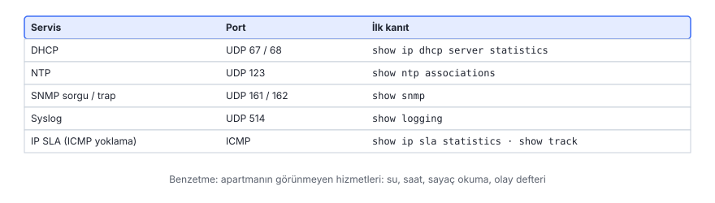
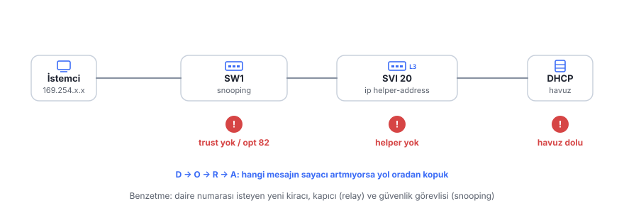
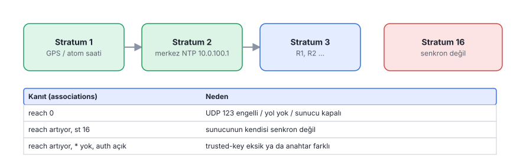
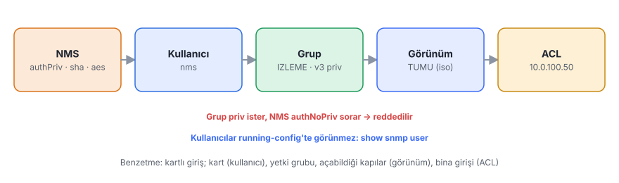
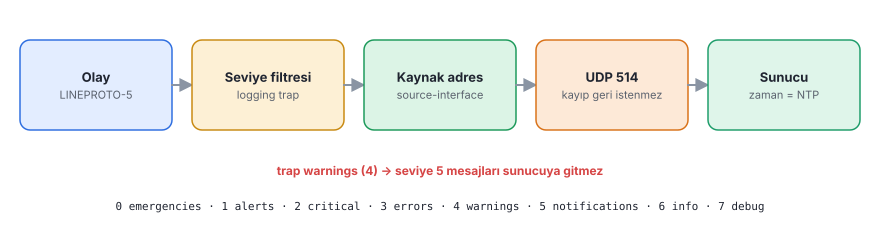
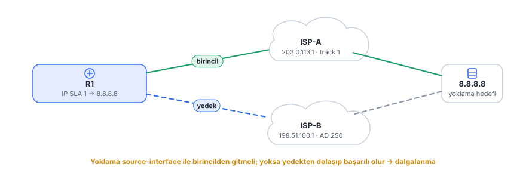
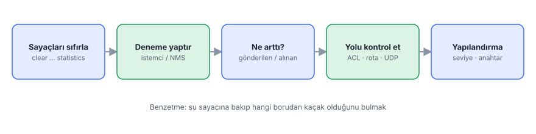

# AğLab Konu #48: Altyapı servisleri sorun giderme: DHCP, NTP, SNMP, Syslog ve IP SLA

> Uygulamadaki `svctshoot` dersi bu belgeyle uyumludur. **Okuma dersi (Seviye 3, CCNP):** Labber DHCP sunucusunu ve relay'i çalıştırır (Konu #9); NTP, SNMP, Syslog ve IP SLA motorda yok, kâğıt üstü lab ve çıktı okumayla işlenir.
> Ön koşul: DHCP (Konu #9), ağ servisleri: NTP, Syslog, SNMP (Konu #23), ağ izleme ve IP SLA (Konu #37), L2 güvenlik: DHCP snooping (Konu #21). Şemalar: `docs/dersler/gorseller/servis-sorun-giderme.py`.

Bu konu bittiğinde öğrenci "ağ çalışıyor ama servis çalışmıyor" türündeki arızaları servis servis ayırır. DHCP'de DORA'nın hangi adımda koptuğunu bulur: istemci, relay, snooping, havuz ya da sunucu. NTP'de "unsynchronized" bir saatin neden senkronize olmadığını (erişim, stratum, kimlik doğrulama) kanıtla gösterir. SNMPv3'te kullanıcı, grup ve görünüm zincirini, Syslog'da seviye ve kaynak arayüzü kontrol eder. IP SLA ve track ile statik rotanın yedeklenmesini kurar ve "yedek hat devreye girmedi" arızasını çözer. Süre yaklaşık 70 dakika.

## 0. Bir bakışta

- **DHCP**: DORA'yı adım adım izle. Discover sunucuya ulaşıyor mu (relay: `ip helper-address`), Offer geri dönüyor mu (snooping güvenilir port, option 82), havuzda adres var mı?
- **NTP**: `show ntp status` "unsynchronized" ise: sunucuya UDP 123 erişimi, sunucunun kendisinin senkron olması (stratum 16 = senkron değil), kimlik doğrulama (`trusted-key`).
- **SNMPv3**: kullanıcı → grup → görünüm zinciri ve güvenlik seviyesi (noAuthNoPriv / authNoPriv / authPriv) iki tarafta tutmalı.
- **Syslog**: mesaj gönderiliyor mu (`logging trap` seviyesi), hangi kaynak adresten (`logging source-interface`), zaman damgası doğru mu (NTP)?
- **IP SLA + track**: statik rotayı gerçek erişilebilirliğe bağlar; yedek rota daha yüksek AD ile bekler (floating static).
- Ortak nokta: servislerin çoğu **UDP**'dir; bir ACL ya da firewall sessizce düşürür, hata mesajı gelmez.

> **Akılda kalsın:** Servis arızasında önce "paket gidiyor mu, yanıt geliyor mu?" sor. Sayaçlar (`show ip dhcp server statistics`, `show ntp associations`, `show snmp`, `show logging`) gönderilen ve alınan mesajları ayrı ayrı sayar: hangisinin sıfır olduğu arızanın yönünü söyler.



## 1. Neden önemli

Bu servisler doğrudan kullanıcı trafiği taşımadığı için arızaları geç fark edilir: saat iki gündür yanlış olduğu için log'lar sıralanamaz, SNMP haftalardır grafik çizmediği için bir bağlantının dolduğu görülmemiştir, yedek hat aylardır devreye girmeye hazır görünüp aslında girmiyordur. DHCP ise tersine en görünür servistir: çalışmadığında sabah bütün kat "internet yok" der. Hepsi IP bağlantısına dayanır ama hepsinin kendine özgü arıza noktaları vardır; ENARSI bunları "altyapı servisleri sorun giderme" başlığı altında ister.

## 2. Kavram

### 2.1 DHCP: DORA'nın koptuğu yer

> **Benzetme:** Yeni taşınan biri apartman yönetimine "bana daire numarası verin" diye bağırır (Discover). Yönetim başka binadaysa kapıcı bu isteği iletmelidir (relay). Yönetim bir numara önerir (Offer), kişi kabul eder (Request), yönetim kayda geçer (Ack). Kapıcı yoksa, numaralar bitmişse ya da güvenlik görevlisi yönetimin cevabını "sahte" sanıp kapıda tutuyorsa kişi dairesiz kalır.



| Belirti | Olası kopma | Kanıt |
| --- | --- | --- |
| İstemci 169.254.x.x alıyor | Discover sunucuya ulaşmıyor ya da Offer dönmüyor | Sunucu sayaçlarında Discover yok / Offer var |
| Uzak VLAN'da kimse adres almıyor | Relay yok ya da yanlış arayüzde | Geçit SVI'ında `ip helper-address` yok |
| Bir süre çalıştı, yeni gelenler adres alamıyor | Havuz tükendi | `show ip dhcp pool`: leased = total |
| Snooping açılınca durdu | Sunucu tarafı port güvenilmez ya da option 82 | `show ip dhcp snooping statistics` drop |
| Adres çakışması uyarısı | Statik verilmiş adres havuzda | `show ip dhcp conflict` |

```
SW1(config)#interface vlan 20
SW1(config-if)#ip helper-address 10.0.100.10
SW1(config)#ip dhcp snooping trust          ← sunucuya/uplink'e giden portta (arayüz altında)
R1(config)#ip dhcp excluded-address 10.20.0.1 10.20.0.20
```

> **Dikkat:** DHCP snooping'i açan switch, relay olmadan da DHCP paketlerine **option 82** ekler ve giaddr alanını 0 bırakır. Bazı Cisco IOS DHCP sunucuları bu paketleri reddeder. Belirti: snooping açılınca adres dağıtımı durur. Çözüm: sunucuda `ip dhcp relay information trust-all` (ya da arayüz altında `ip dhcp relay information trusted`) veya switch'te `no ip dhcp snooping information option`.

### 2.2 NTP: neden senkronize olmuyor?



```
R1(config)#ntp server 10.0.100.1
R1(config)#ntp authentication-key 1 md5 SAATANAHTARI
R1(config)#ntp authenticate
R1(config)#ntp trusted-key 1
R1(config)#ntp server 10.0.100.1 key 1
```

- **Stratum**: saat kaynağına uzaklık. Stratum 16 "senkron değil" demektir; senkron olmayan bir sunucudan senkron olunmaz.
- Senkronizasyon dakikalar sürebilir; saat farkı çok büyükse (ör. 1000 saniyeden fazla) bazı uygulamalar senkronu reddeder: önce `clock set` ile kabaca düzelt.
- Kimlik doğrulama açıksa anahtar numarası, anahtar değeri ve **trusted-key** üçü de tutmalı.
- `ntp master` yalnız internete erişimi olmayan izole ağlarda iç referans için kullanılır; yanlışlıkla birden çok cihazda açılırsa farklı saatler dağıtılır.

### 2.3 SNMPv3: kullanıcı, grup, görünüm



```
snmp-server view TUMU iso included
snmp-server group IZLEME v3 priv read TUMU access SNMP-ACL
snmp-server user nms IZLEME v3 auth sha AuthParola priv aes 128 PrivParola
ip access-list standard SNMP-ACL
 permit 10.0.100.50
```

- İzleme sistemi kullanıcı adı, auth ve priv algoritmaları/parolaları ve **güvenlik seviyesiyle** sorgular. Grupta `priv` yazılıysa, `authNoPriv` ile gelen sorgu reddedilir.
- Grupta `read` görünümü yoksa ya da görünüm istenen OID'yi içermiyorsa sorgu boş döner.
- `access` ACL'i izleme sunucusunun adresine izin vermiyorsa yanıt hiç gelmez.
- SNMPv3 kullanıcıları `show running-config`'te görünmez: `show snmp user` kullan.
- Trap'ler için ayrıca `snmp-server host <adres> version 3 priv <kullanıcı>` ve `snmp-server enable traps …` gerekir.

### 2.4 Syslog: mesaj nerede kayboldu?



- **Seviye**: `logging trap warnings` yazılıysa seviye 5 (notifications) olan "arayüz düştü/kalktı" mesajları sunucuya gitmez (LINEPROTO mesajları seviye 5'tir).
- **Kaynak adres**: sunucu ya da firewall belirli bir kaynak adresi bekliyorsa `logging source-interface Loopback0`.
- **Zaman**: `service timestamps log datetime msec localtime show-timezone` ve NTP; yoksa log'lar router açılışından beri geçen süreyle damgalanır ve cihazlar arasında karşılaştırılamaz.
- UDP 514 kayıp paketi geri istemez; yoğun anlarda mesaj kaybolabilir. Kritik ortamlarda TCP ya da TLS syslog kullanılır.

### 2.5 IP SLA ve track ile statik rota yedekleme



```
ip sla 1
 icmp-echo 8.8.8.8 source-interface GigabitEthernet0/0
 frequency 10
ip sla schedule 1 life forever start-time now
track 1 ip sla 1 reachability
 delay down 10 up 30
ip route 0.0.0.0 0.0.0.0 203.0.113.1 track 1
ip route 0.0.0.0 0.0.0.0 198.51.100.1 250
```

- Birinci varsayılan rota track 1'e bağlı: SLA başarısız olunca rota tablodan çıkar; AD'si 250 olan yedek (floating static) devreye girer.
- **Kaynak arayüz önemlidir**: SLA yoklaması varsayılan rota üzerinden gider. Birincil hat ölünce yoklama yedek hattan dolaşıp başarılı olursa birincil rota geri gelir ve dalgalanma başlar. Çözüm: `source-interface` + yoklama hedefine birincil hattan giden bir host rotası.
- `delay down/up` kısa kesintilerde dalgalanmayı önler.
- Yalnız çıkış arayüzü yazılmış statik rota (`ip route 0.0.0.0 0.0.0.0 g0/0`) arayüz açık kaldıkça tablodan çıkmaz; track olmadan yedek hiç devreye girmez.

### 2.6 Ortak yöntem



> **Sahada:** Servis arızalarında en hızlı kanıt, servisin kendi sayaçlarıdır. Bir sayacı sıfırla (`clear ip dhcp server statistics`), istemciye bir deneme yaptır, sayaçlara tekrar bak: hangi mesaj artmadıysa yol oradan kopuyordur.

## 3. Çıktı okuma

```
R1#show ip dhcp server statistics
Message              Received
DHCPDISCOVER         412
DHCPREQUEST          16
Message              Sent
DHCPOFFER            412
DHCPACK              16
                                        ← 412 Discover'a 412 Offer, ama yalnız 16 Request: Offer'lar istemciye ulaşmıyor

SW1#show ip dhcp snooping statistics detail
 Packets Dropped Because
   Untrusted server messages                     396
                                        ← Offer'lar switch'te düşüyor: sunucu tarafı port trust değil

R1#show ip dhcp pool SUBE20
Pool SUBE20 :
 Total addresses                : 254
 Leased addresses               : 233
 Excluded addresses             : 20
                                        ← 233 + 20 ≈ 254: havuz neredeyse dolu

R2#show ntp status
Clock is unsynchronized, stratum 16, no reference clock
R2#show ntp associations
  address         ref clock       st   when   poll reach  delay  offset   disp
 ~10.0.100.1      .INIT.          16      -     64     0  0.000   0.000 15937.
 * sys.peer, # selected, + candidate, - outlyer, x falseticker, ~ configured
                                        ← reach 0: hiç yanıt yok (ACL, rota ya da sunucu kapalı)

R1#show logging | include Trap
    Trap logging: level warnings, 1203 message lines logged
        Logging to 10.0.100.40  (udp port 514, audit disabled,
                                        ← trap seviyesi warnings (4): LINEPROTO (5) sunucuya gitmez

R1#show track 1
Track 1
  IP SLA 1 reachability
  Reachability is Up
    12 changes, last change 00:00:41
  Delay up 30 secs, down 10 secs
                                        ← 12 değişiklik: yoklama yedek hattan dolaşıp birincili geri getiriyor olabilir
```

| Soru | Komut |
| --- | --- |
| DHCP mesajları gidip geliyor mu? | `show ip dhcp server statistics`, `debug ip dhcp server packet` |
| Snooping düşürüyor mu? | `show ip dhcp snooping statistics detail` |
| Havuz dolu mu, çakışma var mı? | `show ip dhcp pool`, `show ip dhcp conflict` |
| NTP senkron mu, neden değil? | `show ntp status`, `show ntp associations detail` |
| SNMP kullanıcı ve grup? | `show snmp user`, `show snmp group`, `show snmp` (sayaçlar) |
| Syslog seviyesi ve hedef? | `show logging` |
| SLA ve track? | `show ip sla statistics`, `show track` |

## 4. Yönlendirmeli lab

> **Kısmen simülatörde:** DHCP sunucusu, havuz ve relay adımları Labber'da denenebilir (Konu #9 görevleri); IP SLA + track (8. adım) Simülatör'deki **statik-yedek** labıdır (Pratik adımında). NTP, SNMP ve Syslog adımlarını Bölüm 3'teki çıktılarla kâğıt üstünde karşılaştır.

Topoloji: R1 merkez (DHCP sunucusu 10.0.100.10 arkasında, NTP 10.0.100.1, syslog 10.0.100.40, NMS 10.0.100.50); SW1 şube switch'i, VLAN 20 (10.20.0.0/24) geçidi SW1 SVI; R1'in iki internet çıkışı.

1. VLAN 20'deki istemciler adres almıyor. SW1 SVI'ında helper yok; ekle ve sunucu sayaçlarını izle.
2. SW1'de DHCP snooping aç; adres dağıtımının durduğunu gör. Uplink'i trust yap; hâlâ sorun varsa option 82'yi incele.
3. Havuzu küçült (yalnız 10 adres) ve tükendiğini `show ip dhcp pool` ile göster.
4. R2'de NTP: sunucuya giden yolda UDP 123'ü engelleyen bir ACL var; `reach 0`'ı gör, ACL'i düzelt, `*` (sys.peer) işaretini bekle.
5. NTP kimlik doğrulamasını aç ama `trusted-key` yazma; senkronun gelmediğini gör.
6. SNMPv3 grubunu `priv`, NMS'yi `authNoPriv` ile sorgulat; hata mesajını yorumla.
7. Syslog trap seviyesini warnings yap, bir arayüzü kapatıp aç; sunucuda mesaj var mı? notifications'a çek.
8. IP SLA + track ile varsayılan rotayı yedekle. Birincil hattı kopar; yedeğe geçişi ve source-interface eksikse dalgalanmayı gör.

## 5. Sık hatalar

| Kod | Hata | Belirti | Kanıt | Düzeltme |
| --- | --- | --- | --- | --- |
| E1 | Relay yok / yanlış arayüzde | Uzak VLAN adres alamıyor | Sunucuda Discover yok | İstemci VLAN'ının geçidinde `ip helper-address` |
| E2 | Snooping: uplink trust değil ya da option 82 | Snooping sonrası dağıtım durdu | Snooping drop sayaçları | trust; sunucuda option 82 güveni |
| E3 | Havuz tükendi / excluded eksik | Yeni gelenler adres alamıyor; çakışma | `show ip dhcp pool`, `conflict` | Havuzu büyüt, kira süresini kısalt, statikleri dışla |
| E4 | NTP erişimi ya da sunucu senkron değil | unsynchronized, stratum 16 | `associations`: reach 0 ya da sunucu st 16 | ACL/rota; sunucuyu düzelt |
| E5 | NTP auth eksik | Erişim var, senkron yok | `associations detail`: authenticated değil | trusted-key + server … key |
| E6 | SNMPv3 güvenlik seviyesi/görünüm | NMS yanıt alamıyor ya da boş | `show snmp group`, NMS hata mesajı | Seviye ve görünümü eşitle |
| E7 | Syslog trap seviyesi düşük | Arayüz olayları sunucuda yok | `show logging` Trap level | Seviyeyi ayarla |
| E8 | SLA kaynağı yok | Yedek rota dalgalanıyor | track'te çok sayıda değişiklik | source-interface + host rotası, delay |

## 6. Arıza senaryoları

> **Uygulamada:** S1–S2 Labber'ın DHCP desteğiyle Sorun Çöz'e `svct-*` kimlikleriyle eklenebilir; diğerleri kâğıt üstü vakalardır. Önce kendin çöz; neden ve çözüm kapalı kutularda.

### S1 · Başlangıç · Yeni VLAN'da kimse adres almıyor (E1)

- **Belirti:** VLAN 30 eklendi; istemciler 169.254.x.x alıyor. VLAN 20'de DHCP çalışıyor; sunucuda VLAN 30 havuzu var.
- **Hedef:** VLAN 30 adres alsın.

<details><summary>Neden ve çözüm</summary>

VLAN 30'un SVI'ında `ip helper-address` yok; Discover yayını VLAN dışına çıkmıyor (sunucu sayaçlarında artış yok). Çözüm: `interface vlan 30` altında `ip helper-address 10.0.100.10`.

</details>

### S2 · Orta · Güvenlik denetiminden sonra DHCP durdu (E2)

- **Belirti:** Erişim switch'lerinde DHCP snooping açıldı; o andan beri yeni istemciler adres alamıyor. Sunucu Offer gönderdiğini sayıyor.
- **Hedef:** Snooping açıkken DHCP çalışsın.

<details><summary>Neden ve çözüm</summary>

Uplink portu güvenilir değil; Offer/Ack'ler "untrusted server messages" ile düşüyor. Uplink'e `ip dhcp snooping trust`. Hâlâ sorun varsa sunucu option 82'li, giaddr'ı boş paketleri reddediyordur: sunucuda `ip dhcp relay information trust-all` ya da switch'te `no ip dhcp snooping information option`.

</details>

### S3 · Orta · Log'lar ve sertifikalar "geçersiz tarih" diyor (E4/E5)

- **Belirti:** Bir router'ın log'ları 1993 tarihini gösteriyor; SSH sertifika uyarısı veriyor. `show ntp status`: unsynchronized.
- **Hedef:** Saat merkezdeki NTP sunucusuyla senkron olsun.

<details><summary>Neden ve çözüm</summary>

`show ntp associations`'ta reach 0 ise yol ya da ACL (UDP 123); reach artıyor ama `*` yoksa ve kimlik doğrulama açıksa `trusted-key` eksik ya da anahtar farklıdır; sunucunun stratum'u 16 ise sunucunun kendisi senkron değildir. Bu vakada `ntp authenticate` yazılmış ama `ntp trusted-key 1` unutulmuş. Çözüm: trusted-key ekle; büyük saat farkı varsa önce `clock set`.

</details>

### S4 · İleri · İzleme sistemi bir router'dan veri alamıyor (E6)

- **Belirti:** NMS diğer cihazları SNMPv3 ile sorgulayabiliyor; R5'ten "authorization error" ya da zaman aşımı alıyor.
- **Hedef:** R5 izlensin.

<details><summary>Neden ve çözüm</summary>

R5'te grup `v3 priv` ile tanımlı, NMS bu cihaz için `authNoPriv` profiliyle sorguluyor; ya da grubun `access` ACL'inde NMS'in yeni adresi yok. `show snmp group` ve `show snmp user` ile seviye ve kullanıcıyı, ACL'in isabetlerini kontrol et; NMS profilini `authPriv` yap ya da ACL'e yeni adresi ekle.

</details>

### S5 · İleri · Birincil hat koptu, şube internetsiz kaldı (E8)

- **Belirti:** Yedek hat var ve `ip route 0.0.0.0 0.0.0.0 198.51.100.1 250` yazılı; birincil ISP'nin ötesinde arıza olduğunda şube internetsiz kaldı, birincil arayüz up/up.
- **Hedef:** Arıza anında yedeğe geçilsin.

<details><summary>Neden ve çözüm</summary>

Birincil varsayılan rota track'e bağlı değil; arayüz açık olduğu için rota tablodan çıkmıyor, floating static hiç devreye girmiyor. Çözüm: IP SLA (source-interface birincil arayüz) + `track 1` + `ip route 0.0.0.0 0.0.0.0 203.0.113.1 track 1`; yoklama hedefi için birincil hattan host rotası ve `delay` ile dalgalanmayı önle.

</details>

## 7. Kısa sınav

**1.** Sunucu Discover alıyor ve Offer gönderiyor, ama Request gelmiyor. Nereye bakarsın?

<details><summary>Cevap</summary>

Offer'ın istemciye dönüş yoluna: snooping (uplink trust), ACL, relay'in dönüş yolu.

</details>

**2.** `show ntp status` stratum 16 gösteriyor. Ne demek?

<details><summary>Cevap</summary>

Saat senkron değil; geçerli bir referansı yok.

</details>

**3.** NTP kimlik doğrulamasında üç gerekli parça nedir?

<details><summary>Cevap</summary>

`ntp authentication-key`, `ntp authenticate` ve `ntp trusted-key` (ve sunucu satırında `key`).

</details>

**4.** SNMPv3 grubu `priv` ile tanımlı; NMS `authNoPriv` ile soruyor. Sonuç?

<details><summary>Cevap</summary>

Sorgu reddedilir; güvenlik seviyeleri tutmalı.

</details>

**5.** `logging trap warnings` yazılıyken arayüz kapanıp açılırsa sunucuya mesaj gider mi?

<details><summary>Cevap</summary>

LINEPROTO mesajları seviye 5 olduğu için gitmez (LINK mesajları seviye 3 ise gider); seviyeyi notifications'a çek.

</details>

**6.** Track'li statik rotada SLA yoklaması neden kaynak arayüzle sabitlenir?

<details><summary>Cevap</summary>

Birincil hat ölünce yoklamanın yedek hattan dolaşıp başarılı olmasını ve rotanın dalgalanmasını önlemek için.

</details>

## 8. Özet kartı

| Servis | İlk kanıt | Tipik neden |
| --- | --- | --- |
| DHCP | `show ip dhcp server statistics` | helper, snooping trust/option 82, havuz |
| NTP | `show ntp associations` (reach, st) | UDP 123, sunucu senkron değil, trusted-key |
| SNMPv3 | `show snmp group/user` | güvenlik seviyesi, görünüm, ACL |
| Syslog | `show logging` | trap seviyesi, kaynak arayüz, zaman damgası |
| IP SLA | `show track`, `show ip sla statistics` | track yok, kaynak arayüz, delay |

**Unutma:**

1. Sayaçlar arızanın yönünü söyler.
2. Relay, istemci VLAN'ının geçidine yazılır.
3. Stratum 16 = senkron değil.
4. SNMPv3'te güvenlik seviyesi iki tarafta aynı.
5. Statik rotayı arayüze değil, gerçek erişilebilirliğe bağla.

## 9. Doğrulama notları

Kaynaklar: INE ENCOR IP Services (NTP) ve Network Assurance (Syslog, SNMP, IP SLA) modülleri, CCNP ENCOR v1.0 (kapsam kontrolü için), ENARSI konu listesi (infrastructure services troubleshooting: DHCP, NTP, SNMP, Syslog, IP SLA, object tracking); RFC 2131 (DHCP), RFC 5905 (NTPv4), RFC 3414 (SNMPv3 USM); Cisco IOS yapılandırma kılavuzları. Ders metni, örnek çıktılar ve şemalar özgün yazıldı.

| İddia | Sonuç |
| --- | --- |
| DHCP snooping varsayılan olarak option 82 ekler; bazı IOS sunucuları giaddr'ı 0 olan bu paketleri reddeder | Doğru |
| NTP'de stratum 16 senkron olmayan saat demektir | Doğru |
| NTP kimlik doğrulaması için anahtar, authenticate ve trusted-key gerekir | Doğru |
| SNMPv3 kullanıcıları running-config'te görünmez, `show snmp user` ile görülür | Doğru |
| LINEPROTO-5-UPDOWN mesajları seviye 5 (notifications) | Doğru |
| Track'e bağlı statik rota, track düşünce tablodan çıkar; daha yüksek AD'li yedek devreye girer | Doğru |

**Motor gereksinimleri**

- [x] IP SLA, track ve track'li statik rota Labber'da var: S5 Simülatör'deki **statik-yedek** labıdır (yoklama kaynağı ve host rotasıyla dalgalanmayı önleme dahil).
- [ ] DHCP sunucusu ve relay Labber'da var: S1 (helper eksik) `svct-*` kimliğiyle Sorun Çöz'e eklenebilir. DHCP snooping'in option 82 davranışı, NTP, SNMPv3 ve Syslog seviyeleri motorda yok; eklenince S2–S4 eklenir.
