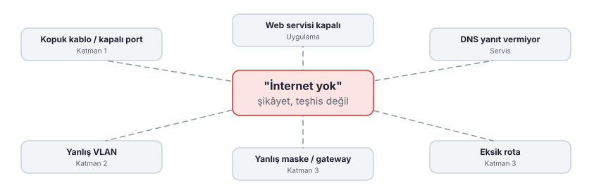
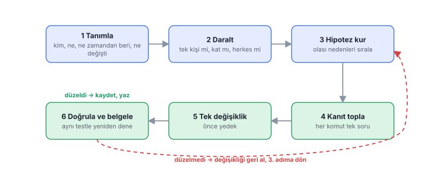
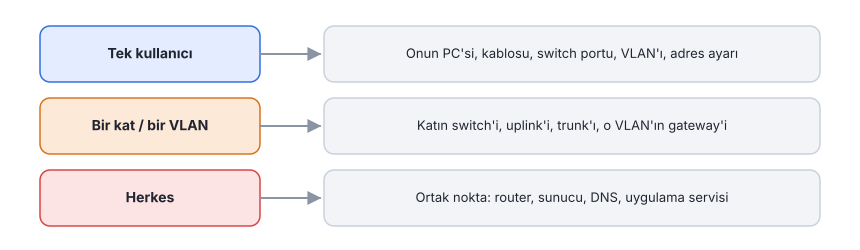
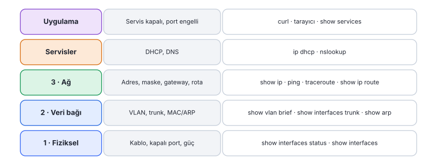
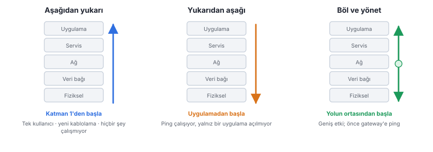
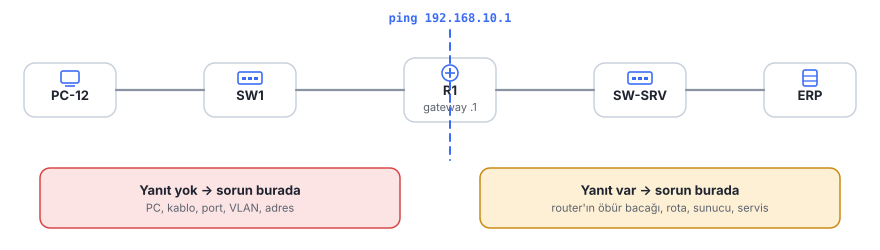
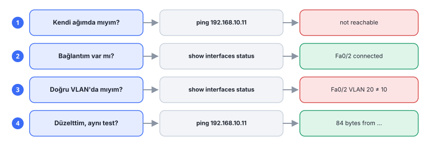

# AğLab Konu #1: Sorun giderme yöntemi

> Uygulamadaki `method` dersi bu belgeden üretildi ve listede en başta durur. Araç ayrıntıları
> Konu #24'te (`commands`). Senaryolar Sorun Çöz'de `method-*` kimlikleriyle Labber'da çalışır.
> Bu konu Seviye 1'in diğer konularını bağlar; en iyi, onlardan birkaçı görüldükten sonra tekrar
> okunur. Şemalar: `docs/dersler/gorseller/sorun-giderme-yontemi.py`.

Bu konu bittiğinde öğrenci bir şikâyeti ölçülebilir bir soruna çevirir: kim, ne, ne zamandan beri, ne değişti? Etki alanından başlayıp katman katman ilerler ve her adımda bir komutla bir soruyu cevaplar. Bir değişikliği ancak kanıtla ve öncesinde yedek alarak yapar; düzeltmeden sonra ilk belirtiyi yeniden test eder. Seviye 1, süre yaklaşık 60 dakika (ders 20, lab 15, senaryolar 20, sınav 5).

## 0. Bir bakışta

- **"İnternet yok" bir teşhis değil, bir şikâyettir.** Arkasında kablo, VLAN, adres, rota, DNS ya da kapalı bir servis olabilir.
- Yöntem **önce bakmak, sonra dokunmaktır**: tanımla → daralt → hipotez kur → kanıt topla → tek değişiklik → doğrula.
- **Etki alanı yeri söyler:** tek kullanıcı → onun cihazı ve portu; bir kat → katın switch'i; herkes → ortak nokta.
- Üç yaklaşım: **aşağıdan yukarı** (kablodan başla), **yukarıdan aşağı** (uygulamadan başla), **böl ve yönet** (yolun ortasından, genelde gateway'den başla).
- Her komut **tek bir soruyu** cevaplar. Düzelttikten sonra **ilk belirtiyi aynı testle** yeniden dene.

> **Akılda kalsın:** Bir arızada en pahalı hata, kanıt olmadan bir şeyi değiştirmektir. Sorun geçse bile neden geçtiğini bilmezsin; geçmezse bir arızaya ikincisini eklemiş olursun.



## 1. Neden önemli

Yöntemsiz çalışan biri aklına gelen ilk şeyi değiştirir: switch'i yeniden başlatır, IP'yi elle yazar, kabloyu değiştirir. Bazen sorun geçer ama neden geçtiği bilinmez; ertesi hafta aynı arıza geri gelir. Çoğu zaman da yeni bir sorun eklenir ve arıza ikiye katlanır.

Yöntem bunun tersidir. AğLab'daki her arıza senaryosu da bu yüzden üç şeyle değerlendirilir: **bağlantı geri geldi mi**, **kök neden doğru bulundu mu**, **gereksiz değişiklik yapıldı mı?**

## 2. Kavram

### 2.1 Doktor gibi düşün: önce muayene, sonra ilaç

> **Benzetme:** Doktora "başım ağrıyor" dersin. İyi doktor hemen ilaç yazmaz: ne zamandan beri, nerede, ne yaptın, başka şikâyet var mı diye sorar; sonra ateşini ölçer, tahlil ister. İlacı ancak teşhisten sonra verir; bir hafta sonra "geçti mi?" diye kontrole çağırır. Ağda da aynısı: önce sorular, sonra ölçüm (komut), en son tedavi (değişiklik) ve kontrol (doğrulama).

### 2.2 Altı adım

1. **Tanımla.** Kim etkileniyor, tam olarak ne çalışmıyor, ne zamandan beri, **ne değişti?** "İnternet yok" yerine: "PC-12 sabahtan beri ERP'nin sayfasını açamıyor; PC-11 açabiliyor; PC-12'nin kabloları sabah düzenlenmiş."
2. **Etki alanını daralt.** Tek kullanıcı mı, bir kat mı, herkes mi? Tek bir uygulama mı, her şey mi?
3. **Hipotez kur.** Belirtiyi açıklayabilecek birkaç olası nedeni say ve en olasıdan başla.
4. **Kanıt topla.** Her komut tek bir soruyu cevaplasın: "Port açık mı?" → `show interfaces status`. "Gateway'e ulaşıyor mu?" → `ping`. Kanıt hipotezi ya doğrular ya eler.
5. **Tek değişiklik yap.** Önce yedek al (`show running-config` çıktısını sakla, kaydedilmiş hâlin farkında ol). Sonra kanıtın gösterdiği **tek** şeyi değiştir.
6. **Doğrula ve belgele.** İlk belirtiyi **aynı testle** yeniden dene. Düzeldiyse kaydet (`copy running-config startup-config`) ve ne yaptığını yaz. Düzelmediyse değişikliği **geri al** ve 3. adıma dön.



> **Dikkat:** Birden fazla şeyi aynı anda değiştirirsen hangisinin işe yaradığını bilemezsin. Bir hata bulmak da tek hata olduğu anlamına gelmez: düzelttikten sonra ilk belirti hâlâ varsa ikinci bir hata vardır.

### 2.3 Etki alanı: sorun nerede?

> **Benzetme:** Apartmanda tek dairenin elektriği kesikse sigortası atmıştır; bütün kat karanlıksa kat panosu; bütün mahalle karanlıksa trafo. Kimlerin etkilendiğine bakmak, nereye bakacağını söyler.



### 2.4 Katmanlar: nereye, hangi komutla bakılır?

Ağ katmanlıdır: üstteki katman alttakine güvenir. Kablo kopuksa VLAN'a, VLAN yanlışsa adrese, adres yanlışsa DNS'e bakmanın anlamı yoktur.

| Katman | Tipik arızalar | İlk komutlar | Ayrıntı |
| --- | --- | --- | --- |
| 1 Fiziksel | Kapalı port, kopuk kablo, kapalı cihaz | `show interfaces status`, `show interfaces` | Konu #4 |
| 2 Veri bağı | Yanlış VLAN, trunk, MAC/ARP | `show vlan brief`, `show interfaces trunk`, `show mac address-table`, `show arp` | Konu #3, #5–6 |
| 3 Ağ | Yanlış adres/maske/gateway, eksik rota | `show ip`, `ping`, `traceroute`, `show ip route` | Konu #2, #8 |
| Servisler | DHCP, DNS | `ip dhcp`, `nslookup` | Konu #9, #10 |
| Uygulama | Servis kapalı, port engelli | `curl`, tarayıcı, `show services` | Konu #23 |



### 2.5 Üç yaklaşım

- **Aşağıdan yukarı (bottom-up):** Katman 1'den başla. Tek kullanıcı, "hiçbir şey çalışmıyor" ya da yeni kablolama varsa doğru başlangıçtır.
- **Yukarıdan aşağı (top-down):** Uygulamadan başla. Ağın büyük kısmı çalışıyor, yalnız bir uygulama açılmıyorsa zaman kazandırır. Ping çalışıyorsa alt katmanları tek tek kontrol etmeye gerek yoktur.
- **Böl ve yönet (divide and conquer):** Yolun ortasından test et, genellikle gateway'den. Gateway'e ping gidiyorsa sorun ötesindedir; gitmiyorsa kullanıcı ile gateway arasındadır. Her testte arama alanı yarıya iner.



> **Benzetme:** Böl ve yönet, uzun bir yılbaşı ışık zincirinde yanmayan ampulü bulmaya benzer. Her ampulü tek tek denemek yerine zinciri ortadan ayırırsın: sorun hangi yarıdaysa onu yine ortadan bölersin. 100 ampulde 7 denemede sonuca varırsın.



### 2.6 İki yardımcı alışkanlık

- **Çalışanla karşılaştır:** Yan masadaki sağlam bilgisayarın ayarlarını (adres, gateway, DNS, port, VLAN) arızalıdakiyle yan yana koy. Fark çoğu zaman cevaptır.
- **"Ne değişti?"** Dün çalışan bir şey bugün çalışmıyorsa bir şey değişmiştir. Kaydedilmemiş bir değişiklik `show running-config` ile `show startup-config` farkında görünür (Konu #11).

> **Sahada:** Arıza kaydına kanıt zincirini aynen yazmak (hangi komut, hangi satır, ne çıkarıldı) bir sonraki nöbetçinin işini yarıya indirir. "Düzeldi" yazmak yetmez; "neden düzeldi" yazılır.

## 3. Çıktı okuma

Bu konunun çıktısı tek bir komut değil, bir **kanıt zinciridir**. Aşağıdaki örnekte PC-12 "ERP açılmıyor" diyor; her satır bir soruyu cevaplıyor.

```
! Soru 1: Kendi ağımda mıyım?            → Katman 3, yerel
PC-12> ping 192.168.10.11
host (192.168.10.11) not reachable

! Soru 2: Bağlantım var mı?               → Katman 1
SW1#show interfaces status
Fa0/2                        connected    20         a-full  a-100 10/100BaseTX

! Soru 3: Doğru VLAN'da mıyım?            → Katman 2
!   Fa0/2 VLAN 20'de; kattaki diğer portlar VLAN 10'da.  ← kök neden
SW1(config)#interface fa0/2
SW1(config-if)#switchport access vlan 10

! Doğrula: ilk belirtiyi aynı testle dene
PC-12> ping 192.168.10.11
84 bytes from 192.168.10.11 icmp_seq=1 ttl=64
PC-12> ping 192.168.100.20
84 bytes from 192.168.100.20 icmp_seq=1 ttl=63
```

Her satırda **cevabı değiştiren** tek bir komut var; hiçbir şey tahminle değiştirilmedi.



Hata mesajlarının dili de kanıttır:

| Mesaj | Söylediği |
| --- | --- |
| `host (x) not reachable` (VPCS) | Hedefin ya da gateway'in MAC'i bulunamadı (ARP yanıtsız): yerel yol sorunu |
| `Destination host unreachable` (router'dan) | Router o hedefe giden yolu bilmiyor |
| `timeout` | Paket gitti ama yanıt gelmedi: hedef, dönüş yolu ya da filtre |
| `Connection refused` | Hedef ayakta ama o portta servis yok (uygulama) |
| `Non-existent domain` / `timed out` (nslookup) | DNS sunucusu yanıt verdi ama kayıt yok / hiç yanıt yok |

> **Akılda kalsın:** "refused" ile "timeout" farklı şeylerdir. Reddedildiyse karşı taraf **ayakta ve cevap veriyor** (servis kapalı); zaman aşımıysa paket ya ulaşmadı ya cevap dönmedi.

## 4. Yönlendirmeli lab

Topoloji: SW1'de PC-11 (Fa0/1) ve PC-12 (Fa0/2), VLAN 10, gateway R1 (192.168.10.1). Sunucu odasında DNS sunucusu SRV (.10) ve ERP (.20, web servisi). Bu labda arıza yok; amaç sağlam bir ağın **referans kanıtlarını** toplamak. Arıza anında karşılaştıracağın şey bunlardır.

1. **Tanım kartı.** Bir kâğıda dört başlık aç: kim, ne, ne zamandan beri, ne değişti. Senaryolarda her seferinde önce bunu doldur.
2. **Katman 1.** SW1'de `show interfaces status`: PC'lerin portları connected. Hangi portun hangi VLAN'da olduğunu yaz.
3. **Katman 2.** `show vlan brief`; PC-11'de `ping 192.168.10.12`, sonra `show arp`. *Neden:* aynı ağdaki komşuya ulaşmak katman 1–2'nin sağlam olduğunu gösterir.
4. **Katman 3.** PC-11'de `show ip` (adres, maske, gateway, DNS), `ping 192.168.10.1`, `ping 192.168.100.20`, `trace 192.168.100.20`.
5. **Servisler.** `nslookup ERP`: adı adrese çeviriyor mu?
6. **Uygulama.** `curl http://ERP`: sayfa geliyor.
7. **Yolu ikiye böl.** Gateway'e ping'in, kullanıcı ile sunucu arasındaki yolu nasıl ikiye ayırdığını kendi cümlenle yaz.
8. **Değişiklikten önce.** SW1'de `show running-config` ve `show startup-config`: ikisi aynı mı? *Neden:* "Ne değişti?" sorusunun cevabı arıza anında bu karşılaştırmadan çıkar. Bu çıktıyı saklamak yedek almaktır.

> **Benzetme:** Sağlıklıyken çektirilen tahlil, hastalandığında karşılaştırma için altın değerindedir. Bu lab ağın "sağlıklı tahlili"dir.

## 5. Sık hatalar

Bu konunun hataları ağın değil, sorun gidericinin hatalarıdır.

| Kod | Hata | Belirti | Kanıt | Doğrusu |
| --- | --- | --- | --- | --- |
| E1 | Tanımlamadan başlamak | Saatlerce yanlış yerde arama | Etki alanı hiç sorulmamış | Önce kim, ne, ne zamandan beri, ne değişti |
| E2 | Yanlış yönden başlamak | Uygulama arızasında kablo, tek kullanıcı arızasında sunucu kurcalanıyor | Ping çalışırken kablo değiştirilmiş | Etki alanına ve belirtiye göre aşağıdan, yukarıdan ya da ortadan başla |
| E3 | Kanıtsız ve toplu değişiklik | Sorun geçti ama nedeni bilinmiyor; ya da yeni sorun çıktı | Aynı anda birkaç ayar değiştirilmiş, yedek yok | Kanıtın gösterdiği tek şeyi değiştir; önce yedek |
| E4 | "Ne değişti?" sorusunu atlamak | Dün çalışan şey için sıfırdan teşhis | running ve startup farkına bakılmamış | Önce değişiklikleri bul, gerekirse geri al |
| E5 | İlk hatada durmak | "Düzelttim" denmiş ama kullanıcı hâlâ şikâyetçi | Düzeltmeden sonra ilk belirti yeniden test edilmemiş | Her düzeltmeden sonra aynı testi tekrarla; kalan belirti başka bir hatadır |

## 6. Arıza senaryoları

> **Uygulamada:** S1–S5 Sorun Çöz'de `method-one-pc-bottom-up`, `method-app-top-down`,
> `method-divide-at-gateway`, `method-what-changed`, `method-two-layers` kimlikleriyle
> Labber'da çalışır. Her senaryo bir yaklaşımı öne çıkarır; hataların kendisi önceki konulardan
> tanıdıktır. Önce kendin çöz; neden ve çözüm kapalı kutularda.

### S1 · Başlangıç · "İnternet yok" diyen tek kullanıcı (aşağıdan yukarı)

- **Belirti:** PC-12 "internet yok, ERP açılmıyor" diyor; PC-11'de her şey çalışıyor. Kullanıcı sabah kablolarını düzenlemiş.
- **Hedef:** PC-12 → gateway ve ERP başarılı.

<details><summary>Neden ve çözüm</summary>

SW1 Fa0/2 (PC-12) VLAN 20'de. Çözüm: SW1 → `interface fa0/2` → `switchport access vlan 10`.

</details>

### S2 · Başlangıç · Ağ sağlam görünüyor, ERP sayfası açılmıyor (yukarıdan aşağı)

- **Belirti:** Herkes ERP sayfasını açamıyor; ERP'nin adresine ping gidiyor, `nslookup ERP` doğru adresi veriyor.
- **Hedef:** PC-11 ve PC-12'den ERP sayfası açılıyor.

<details><summary>Neden ve çözüm</summary>

ERP'de web servisi kapalı (`curl` "Connection refused" der). Çözüm: ERP → `service http on`.

</details>

### S3 · Orta · Kimse sunuculara ulaşamıyor (böl ve yönet)

- **Belirti:** Hiçbir kullanıcı ERP'ye ve sunucu odasına ulaşamıyor; kullanıcılar birbirine ulaşıyor.
- **Hedef:** PC'lerden sunuculara ping başarılı.

<details><summary>Neden ve çözüm</summary>

R1 Gi0/1 (sunucu ağı) `shutdown`. Gateway'e ping gider; sorun ötesindedir. Çözüm: R1 → `interface g0/1` → `no shutdown`.

</details>

### S4 · Orta · Gece bakımından sonra bütün kat kopuk ("ne değişti?")

- **Belirti:** Bakımı yapan izinde; sabah kattaki hiçbir bilgisayar gateway'e ulaşamıyor. Değişiklikler kaydedilmemiş.
- **Hedef:** PC-11 → ERP başarılı; SW1 kaydedilmiş; güç döngüsünden sonra da çalışıyor.

<details><summary>Neden ve çözüm</summary>

SW1 Gi0/1 (R1'e giden) kaydedilmeden VLAN 20'ye alınmış; running ile startup farklı. Çözüm: Gi0/1'i `switchport access vlan 10` yapıp kaydetmek ya da `reload` → "Save?" sorusuna `no` deyip kaydedilmiş hâle dönmek.

</details>

### S5 · İleri · Bir hatayı bulunca durma (iki katman)

- **Belirti:** Teknisyen VLAN'ı düzeltip "tamam" demiş; PC-12 PC-11'e ulaşıyor ama hâlâ ERP'ye ulaşamıyor.
- **Hedef:** PC-12 → PC-11 ve ERP başarılı.

<details><summary>Neden ve çözüm</summary>

SW1 Fa0/2 VLAN 20'de **ve** PC-12'nin gateway'i 192.168.10.254. Çözüm: SW1 → `switchport access vlan 10`; PC-12 → `ip 192.168.10.12 255.255.255.0 192.168.10.1`.

</details>

## 7. Kısa sınav

**1.** "İnternet yok" şikâyetinde ilk yapılacak iş hangisi? (A) Switch'i yeniden başlatmak (B) Kim, ne, ne zamandan beri, ne değişti diye sormak (C) Kabloyu değiştirmek (D) DNS'i değiştirmek

<details><summary>Cevap</summary>

**B.** Etki alanı ve değişiklik bilgisi nereye bakılacağını söyler.

</details>

**2.** Ping ve nslookup çalışıyor, yalnız bir web uygulaması açılmıyor. Hangi yaklaşım zaman kazandırır?

<details><summary>Cevap</summary>

Yukarıdan aşağı. Alt katmanların sağlam olduğu zaten kanıtlanmış.

</details>

**3.** Kullanıcı gateway'e ping atabiliyor ama sunucuya atamıyor. Bu test ne söyler?

<details><summary>Cevap</summary>

Sorun gateway'de ya da ötesinde (router'ın öbür bacağı, rota, sunucu). Böl ve yönet: yol ikiye bölündü.

</details>

**4.** Bir değişiklikten önce neden yedek alınır?

<details><summary>Cevap</summary>

Değişiklik işe yaramaz ya da yeni sorun çıkarırsa geri dönebilmek için.

</details>

**5.** Bir hatayı düzelttin, `show` çıktısı doğru görünüyor. Sonraki adım?

<details><summary>Cevap</summary>

İlk belirtiyi aynı testle yeniden denemek. Kalan belirti başka bir hata olabilir.

</details>

**6.** `curl` "Connection refused" diyor. Sorun hangi katmanda?

<details><summary>Cevap</summary>

Uygulama: hedef ayakta ve yanıt veriyor ama o portta dinleyen servis yok.

</details>

## 8. Özet kartı

| Adım / komut | Ne işe yarar |
| --- | --- |
| Kim · ne · ne zamandan beri · ne değişti | Şikâyeti ölçülebilir soruna çevirir |
| `show interfaces status` | Katman 1: port bağlı mı, hangi VLAN'da |
| `show vlan brief`, `show interfaces trunk` | Katman 2: VLAN ve trunk |
| `show ip`, `ping`, `traceroute` | Katman 3: adres, gateway, yol |
| `nslookup`, `curl` | Servis ve uygulama |
| `show running-config` / `show startup-config` | Ne değişti? Yedek |
| `copy running-config startup-config` | Doğrulanmış düzeltmeyi kaydeder |

**Unutma:**

1. Önce bak, sonra dokun.
2. Etki alanı yeri söyler.
3. Her komut tek soru; her değişiklik tek şey.
4. Değişiklikten önce yedek.
5. Düzelttikten sonra ilk belirtiyi aynı testle dene.

## 9. Doğrulama notları

Kaynaklar: INET CCNA 200-301 v1.1 (sorun giderme adımları); Cisco sorun giderme yöntemleri (aşağıdan yukarı, yukarıdan aşağı, böl ve yönet, yolu izle, karşılaştır; CCNA ve ENARSI sorun giderme bölümleri), CCNA 200-301 sınav konusu "sorun giderme" (bütün alanlara yayılmış). Eski "Ağ teşhis komutları" ve "İleri sorun giderme ve ağ tasarımı" derslerinin yöntem kısımları kaynak oldu; araç ayrıntıları `commands` dersinde kaldı.

**Kontrol edilen iddialar**

| İddia | Sonuç |
| --- | --- |
| Yaygın yaklaşımlar: aşağıdan yukarı, yukarıdan aşağı, böl ve yönet, yolu izle, karşılaştır | Doğru (Cisco sorun giderme modeli) |
| "Connection refused": hedef ayakta, portta dinleyen servis yok (TCP RST) | Doğru |
| Router'dan "Destination host unreachable": router o hedef için rota bilmiyor (ICMP tip 3) | Doğru |
| Kaydedilmemiş değişiklik running-config ile startup-config farkında görünür | Doğru |

Lab'ın otomatik değerlendirmesi: `q.ping('PC-12', '192.168.100.20').ok`; `q.http('PC-11', '192.168.100.20').ok`; `q.saved('SW1')`.

**Motor gereksinimleri** (Labber'da denendi)

- [x] Önceki konuların bütün komutları; VPCS `curl` (Connection refused) ve sunucuda `service http on|off` — L5-g
- [x] Kaydedilmemiş başlangıç değişikliği (`pending`) ve güç döngüsünden sonra doğrulama (`survivesReload`) — Konu #11 altyapısı
- [x] Senaryo sorgu listesine `http` eklendi (`simulator/network-scenarios.js` `SHARED_QUERY_FNS`)
- [x] Beş senaryo başta başarısız, terminalden çözümle başarılı
- [ ] Değerlendirmenin "doğru kök neden" ve "gereksiz değişiklik yok" ölçütleri henüz otomatik değil; bugün yalnız bağlantı ve kayıt durumu ölçülüyor. Gereksiz değişiklik, başlangıç ile bitiş yapılandırması arasındaki farkın çözümün farkıyla karşılaştırılmasıyla ölçülebilir (motor/arayüz işi).
