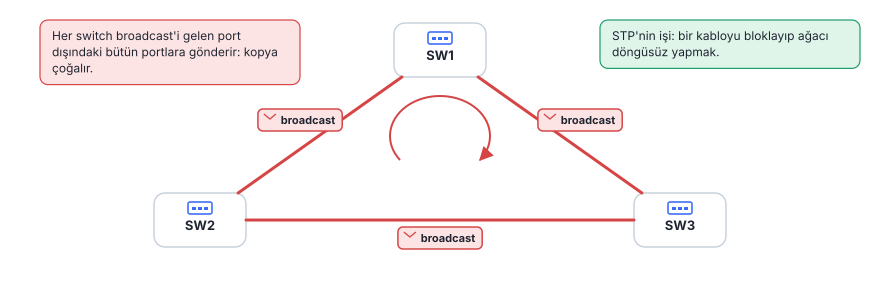
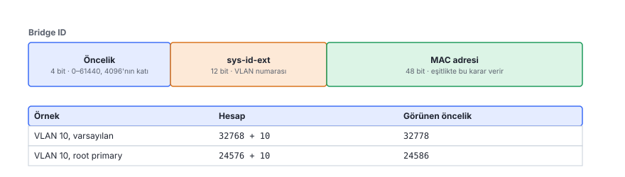
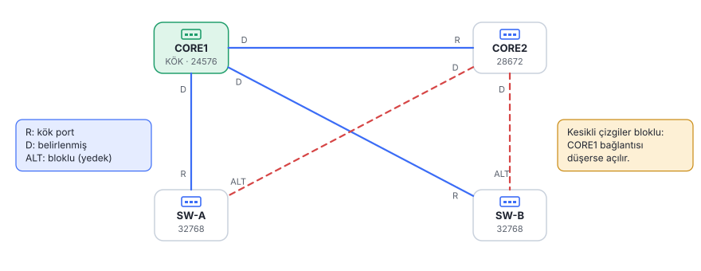
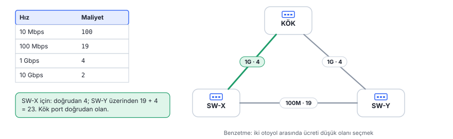
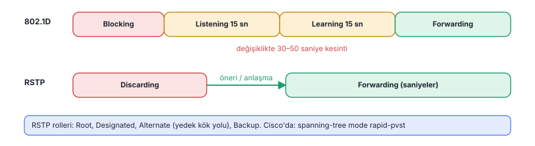
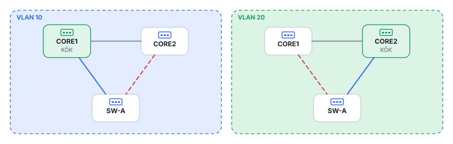
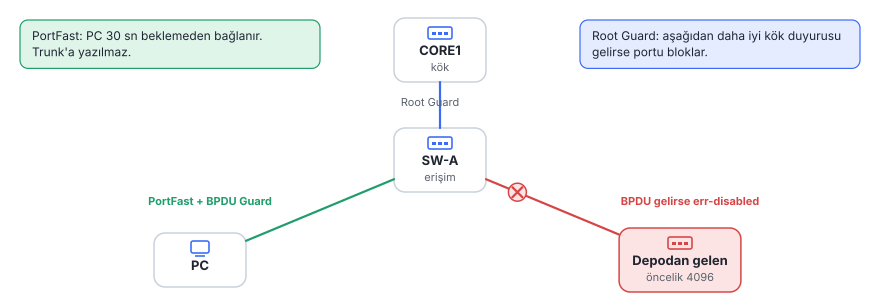

# AğLab Konu #13: STP/RSTP, PortFast, BPDU Guard ve Root Guard

> Uygulamadaki `stp` dersi bu belgeyle uyumludur. Senaryolar Sorun Çöz'de `stp-*` kimlikleriyle
> Labber'da çalışır; eski tek adımlı `stp-loop` senaryosu da vardır. Ön koşul: VLAN ve trunk
> (Konu #5–6). Şemalar: `docs/dersler/gorseller/stp.py`.

Bu konu bittiğinde öğrenci STP'nin neden gerektiğini ve kök köprünün nasıl seçildiğini açıklar. `show spanning-tree` çıktısından kökü, kök portu, belirlenmiş ve bloklu portları okur. PVST'de her VLAN'ın ayrı kökü olduğunu bilir ve kökü öncelikle (`root primary/secondary`) tasarıma göre yerleştirir. PortFast, BPDU Guard ve Root Guard'ın neyi koruduğunu açıklar. Seviye 2 (CCNA), süre yaklaşık 70 dakika.

## 0. Bir bakışta

- Yedek kablolar **döngü** yaratır; Ethernet'te TTL olmadığı için broadcast sonsuza kadar döner.
- **STP** fazla portları bloklayıp ağı bir **ağaca** çevirir; açık yol düşünce bloklu portu açar.
- En küçük **köprü kimliği** (öncelik + MAC) **kök** olur. Kök asla şansa bırakılmaz: `root primary` / `root secondary`.
- Her switch köke en ucuz portunu **kök port** yapar; her bağlantıda bir **belirlenmiş** uç vardır; kalanlar **bloklu**.
- Cisco'da **her VLAN'ın ayrı ağacı** vardır (PVST+); öncelik her VLAN için yazılır.
- **RSTP** saniyeler içinde yakınsar; klasik STP 30–50 sn.
- Uç portlara **PortFast + BPDU Guard**, çekirdekten aşağı bakan portlara **Root Guard**.

> **Akılda kalsın:** STP arızası çoğu zaman "ağ çöktü" değildir; kök yanlış yere kaymıştır ve trafik ağın ters köşesinden dolaşır.



## 1. Neden önemli

Switch'ler arasında yedek kablo çekmek iyi fikirdir, ama Ethernet çerçevesinde TTL yoktur. Bir döngüde broadcast'ler sonsuza kadar döner, MAC tabloları sürekli değişir ve ağ dakikalar içinde durur (broadcast fırtınası). STP her an yalnız bir yol açık kalacak şekilde fazla portları bloklar. STP arızaları çoğunlukla daha sinsidir: kök yanlış switch'e kaymıştır ve trafik ağın uygun olmayan bir köşesinden dolaşır, ya da bir kullanıcı portu açılırken 30 saniye bekler.

## 2. Kavram

### 2.1 Döngü neden felakettir

> **Benzetme:** Çıkışı olmayan bir döner kavşak düşün. İçeri giren her araba sonsuza kadar döner, arkasından yenileri gelir; bir süre sonra kimse kıpırdayamaz. Router'daki TTL arabaya "en fazla 64 tur" der; Ethernet'te böyle bir sayaç yoktur.

- Switch broadcast'i, geldiği port dışındaki **bütün** portlara gönderir. Döngüde her switch kopyayı yeniden çoğaltır.
- Aynı MAC farklı portlardan gelir; MAC tablosu sürekli yer değiştirir (MAC flapping).
- Çözüm yedek kabloyu sökmek değil, **geçici olarak bloklamaktır**: asıl yol düşünce yedek açılır.

### 2.2 Köprü kimliği ve kök seçimi

> **Benzetme:** Sınıfta başkan seçimi: önce en düşük öncelik numarası kazanır; eşitse en küçük okul numarası (MAC). Kimse aday olmazsa, okul numarası en küçük olan (çoğu zaman en eski switch) başkan olur.



- Öncelik 0–61440 arası, **4096'nın katıdır**; varsayılan 32768.
- PVST'de VLAN numarası önceliğe eklenir: VLAN 10'da varsayılan **32778** görünür.
- `root primary` önceliği 24576'ya (ya da mevcut kökün altına), `root secondary` 28672'ye çeker.

### 2.3 Port rolleri

Kök seçildikten sonra roller sırayla belirlenir:

1. **Kök port** (kök dışındaki her switch'te bir tane): köke en düşük toplam maliyetli port. Eşitlikte komşunun BID'i, sonra port kimliği.
2. **Belirlenmiş port** (her bağlantıda bir tane): o bağlantıdan köke en ucuz yolu sunan uç. Kökün bütün portları belirlenmiştir.
3. Kalan portlar **bloklu**dur (RSTP'de *alternate*).



Maliyet, hıza göre belirlenir (kısa yöntem): 10 Mbps 100, 100 Mbps 19, 1 Gbps 4, 10 Gbps 2.



> **Dikkat:** Maliyet "bu switch'ten köke" toplanır, kablo kablo. Tek bir yavaş bağlantı (100 Mbps = 19) dört hızlı bağlantıdan pahalıdır.

### 2.4 Klasik STP ve RSTP

> **Benzetme:** Klasik STP, kavşakta ışık yeşile dönünce 30 saniye "etrafa bakıp" sonra geçen sürücüdür. RSTP, karşıdaki sürücüyle göz göze gelip anında anlaşan sürücü.



- 802.1D: Blocking → Listening (15 sn) → Learning (15 sn) → Forwarding.
- RSTP (802.1w, Cisco'da `spanning-tree mode rapid-pvst`): Discarding, Learning, Forwarding; roller Root, Designated, Alternate, Backup.

### 2.5 PVST+: VLAN başına ağaç



Cisco varsayılanı her VLAN için ayrı ağaçtır. Bu bir fırsattır: VLAN 10'un kökünü CORE1, VLAN 20'ninkini CORE2 yaparak iki çekirdek kablosunu da kullanırsın. Ama tehlikedir de: öncelik yazarken bir VLAN'ı unutursan o VLAN'ın kökü şansa kalır: `spanning-tree vlan 1,10,20 priority 24576`.

### 2.6 Koruma özellikleri

> **Simülatörde yok:** Labber PortFast ve BPDU Guard'ı çalıştırır ama AğLab kaydına yazamaz; Root Guard yok. Bu bölüm okuma konusudur.

- **PortFast:** uç cihaz portu bekleme olmadan Forwarding'e geçer (RSTP'de edge port). Yalnız PC, yazıcı gibi uç portlara.
- **BPDU Guard:** PortFast portundan BPDU gelirse (biri oraya switch takmıştır) portu **err-disabled** yapar.
- **Root Guard:** çekirdekten erişime bakan portta, aşağıdan daha iyi bir kök duyurulursa portu "root-inconsistent" yapıp bloklar.



> **Sahada:** "PC açılınca DHCP alamıyor, bir dakika sonra düzeliyor" şikâyeti çoğu zaman PortFast'in eksik olduğu bir erişim portudur.

## 3. Çıktı okuma

```
SW-A#show spanning-tree vlan 10
VLAN0010
  Spanning tree enabled protocol ieee
  Root ID    Priority    24586                   ← kökün önceliği (24576 + 10)
             Address     0200.0000.0300          ← kökün MAC'i: kim?
             Cost        4                       ← bu switch'ten köke maliyet
             Port        1 (GigabitEthernet0/1)  ← kök port
  Bridge ID  Priority    32778  (priority 32768 sys-id-ext 10)
             Address     0200.0000.0100          ← bu switch
Interface           Role Sts Cost      Prio.Nbr Type
------------------- ---- --- --------- -------- --------------------------------
Gi0/1               Root FWD 4         128.1    P2p
Gi0/2               Altn BLK 4         128.2    P2p     ← yedek yol, bloklu
Fa0/1               Desg FWD 19        128.4    P2p
```

Kökün kendisinde Root ID altında **"This bridge is the root"** yazar ve bütün portlar Desg'dir.

| Soru | Nereye bakılır |
| --- | --- |
| Kök kim? | Root ID'deki Address; switch'lerin `show spanning-tree` Bridge ID'siyle eşleştir |
| Kök doğru yerde mi? | Her VLAN için ayrı bak; tasarımdaki kökle karşılaştır |
| Hangi yol bloklu? | Role Altn/Sts BLK satırları |
| Öncelik nereden geliyor? | `show running-config \| include spanning-tree` |

## 4. Yönlendirmeli lab

Topoloji: CORE1 ve CORE2 birbirine ve her ikisi de SW-A ile SW-B'ye bağlı (trunk, VLAN 1, 10, 20). Her erişim switch'inde VLAN 10 ve 20'de birer PC. Başlangıçta bütün öncelikler varsayılan.

1. **Kök kim?** Her switch'te `show spanning-tree vlan 10`. Kök büyük olasılıkla bir erişim switch'idir (en küçük MAC). Bloklu portları işaretle. *Neden:* öncelikler eşitken en küçük MAC kazanır; o da çoğu zaman en eski switch'tir.
2. **Kökü yerleştir:** CORE1 → `spanning-tree vlan 1,10,20 root primary`; CORE2 → `spanning-tree vlan 1,10,20 root secondary`.
3. **Yeniden oku:** kök CORE1; SW-A ve SW-B'nin kök portu CORE1'e bakıyor, CORE2'ye bakan portlar Altn BLK.
   *Neden:* kök belli olunca bütün roller ondan hesaplanır.
4. **VLAN başına:** CORE1'de `no spanning-tree vlan 20 priority` yaz; `show spanning-tree vlan 20` kökün CORE2'ye geçtiğini gösterir. Geri al.
5. **Yedek kök:** CORE1'i kapat (uygulama terminalinde `device power off`); kök CORE2 olur. Aç; kök CORE1'e döner.
6. **Test:** PC-A10 → PC-B10 ve PC-A20 → PC-B20 her adımda çalışır; değişen yalnız yoldur.
7. **Okuma:** bir erişim portu için PortFast ve BPDU Guard satırlarını yaz; neden trunk portuna yazılmadıklarını açıkla.

> **Benzetme:** Kökü elle seçmek, şehrin ana meydanını belediyenin belirlemesi gibidir; bırakırsan en eski köy meydanı "merkez" olur ve bütün yollar oraya döner.

## 5. Sık hatalar

| Kod | Hata | Belirti | Kanıt | Düzeltme |
| --- | --- | --- | --- | --- |
| E1 | Kökün yanlış switch'e kayması (eski switch ya da unutulmuş test ayarı) | Trafik ağın kenarından dolaşıyor, bir çekirdek bağlantısı bloklu | Root ID başka switch'in; o switch'in running-config'inde düşük öncelik | Yanlış önceliği kaldır; sahada Root Guard |
| E2 | VLAN başına önceliği eksik yazmak | Yalnız bir VLAN'ın kökü yanlış | `show spanning-tree vlan <n>` VLAN'lara göre farklı kök | Eksik VLAN'a önceliği yaz |
| E3 | Yedek kök tanımlamamak | Çekirdek düşünce kök erişim switch'ine kaçıyor | CORE2'nin önceliği varsayılan | `root secondary` |
| E4 | Uç portlarda PortFast yok | PC açılınca ağa 30 sn geç bağlanıyor, DHCP zaman aşımı | Port Listening/Learning'de bekliyor | `spanning-tree portfast` (yalnız uç portlar) |
| E5 | PortFast portuna switch takılması | Döngü riski ya da kök değişimi | BPDU Guard varsa port err-disabled | Switch'i kaldır; portu `shutdown` / `no shutdown` ile aç |

## 6. Arıza senaryoları

> **Uygulamada:** S1–S5 Sorun Çöz'de `stp-old-switch-root`, `stp-vlan-priority-missing`, `stp-no-secondary`,
> `stp-root-primary-access`, `stp-two-faults` kimlikleriyle Labber'da çalışır. Bağlantı başta da
> çalışır; hedefler kökün tasarıma uygun yerde olmasını sınar. PortFast ve BPDU Guard arızaları
> (E4, E5) AğLab modelinde ifade edilemediği için okuma olarak kalır.
> Önce kendin çöz; neden ve çözüm kapalı kutularda.

### S1 · Orta · Depodan gelen switch kök oldu (E1)

- **Belirti:** Katlar arasına eski bir switch takıldı; erişim switch'leri arası trafik çekirdek yerine ondan geçiyor.
- **Hedef:** VLAN 1, 10, 20 kökü CORE1; PC'ler arası ping

<details><summary>Neden ve çözüm</summary>

SW-ESKI'de öncelik 4096 (CORE1 24576). Çözüm: SW-ESKI → `no spanning-tree vlan 1,10,20 priority`

</details>

### S2 · Başlangıç · VLAN 20'nin kökü yanlış çekirdekte (E2)

- **Belirti:** Tasarımda bütün VLAN'ların kökü CORE1; VLAN 20'nin kökü CORE2.
- **Hedef:** S1 ile aynı

<details><summary>Neden ve çözüm</summary>

CORE1'de öncelik yalnız VLAN 1 ve 10 için yazılmış. Çözüm: CORE1 → `spanning-tree vlan 20 priority 24576`

</details>

### S3 · Orta · Çekirdek düştü, kök erişim switch'ine kaçtı (E3)

- **Belirti:** CORE1 kapalı; kök CORE2 değil SW-A.
- **Hedef:** VLAN 1, 10, 20 kökü CORE2; PC'ler arası ping

<details><summary>Neden ve çözüm</summary>

CORE2'nin önceliği varsayılan 32768. Çözüm: CORE2 → `spanning-tree vlan 1,10,20 root secondary`

</details>

### S4 · Orta · Test sırasında yazılan root primary (E1)

- **Belirti:** Geçen haftaki testten beri yalnız VLAN 10 trafiği SW-B üzerinden dolaşıyor.
- **Hedef:** VLAN 1, 10, 20 kökü CORE1; VLAN 10 ping

<details><summary>Neden ve çözüm</summary>

SW-B'de VLAN 10 önceliği 20480 kalmış. Çözüm: SW-B → `no spanning-tree vlan 10 priority`

</details>

### S5 · İleri · Eski switch söküldü, satış hâlâ dolaşıyor (E1 + E2)

- **Belirti:** Eski switch'in önceliği kaldırılınca muhasebe düzeldi, satış (VLAN 20) düzelmedi.
- **Hedef:** S1 ile aynı

<details><summary>Neden ve çözüm</summary>

SW-ESKI önceliği ve CORE1'de VLAN 20 önceliğinin eksikliği. Çözüm: SW-ESKI → `no spanning-tree vlan 1,10,20 priority`; CORE1 → `spanning-tree vlan 20 priority 24576`

</details>

## 7. Kısa sınav

**1.** Bütün öncelikler varsayılansa kök kim olur?

<details><summary>Cevap</summary>

En küçük MAC'li switch; çoğu zaman en eski cihaz.

</details>

**2.** VLAN 10'da varsayılan öncelikle `show spanning-tree` hangi bridge priority'yi gösterir?

<details><summary>Cevap</summary>

32778 (32768 + sys-id-ext 10).

</details>

**3.** Kök olmayan bir switch'te kaç kök port vardır?

<details><summary>Cevap</summary>

Bir. Belirlenmiş port ise her bağlantıda birdir.

</details>

**4.** `root secondary` önceliği kaça çeker?

<details><summary>Cevap</summary>

28672.

</details>

**5.** BPDU Guard'lı bir PortFast portuna switch takılırsa ne olur?

<details><summary>Cevap</summary>

Port err-disabled olur; `shutdown` / `no shutdown` ile açılır.

</details>

**6.** VLAN 10'un kökü CORE1, VLAN 20'nin kökü SW-A. CORE1'in running-config'inde `spanning-tree vlan 1,10 priority 24576` var. Sorun ne?

<details><summary>Cevap</summary>

VLAN 20 için öncelik yazılmamış; o VLAN'da kök en küçük MAC'e kalmış. `spanning-tree vlan 20 priority 24576`.

</details>

## 8. Özet kartı

| Komut | Ne işe yarar |
| --- | --- |
| `show spanning-tree [vlan n]` | Kök, roller, durumlar |
| `spanning-tree vlan 1,10,20 root primary` | Kök yap |
| `spanning-tree vlan 1,10,20 root secondary` | Yedek kök |
| `spanning-tree vlan n priority 24576` | Önceliği elle yaz |
| `spanning-tree mode rapid-pvst` | RSTP |
| `spanning-tree portfast`, `spanning-tree bpduguard enable` | Uç port korumaları |
| `spanning-tree guard root` | Root Guard |

**Unutma:**

1. En küçük BID kök olur; kökü sen seç.
2. Her VLAN'a öncelik yaz.
3. Yedek kökü (secondary) unutma.
4. PortFast yalnız uç portlara; BPDU Guard ile birlikte.
5. Root Guard çekirdekten aşağı bakan portlara.

## 9. Doğrulama notları

Kaynaklar: INET CCNA 200-301 v1.1 ve INE ENCOR (Spanning Tree, RSTP); IEEE 802.1D-2004 ve 802.1w (RSTP rolleri ve durumları), Cisco Catalyst STP yapılandırma kılavuzu (PVST+, `root primary/secondary` makrosu, PortFast, BPDU Guard, Root Guard, kısa maliyet değerleri), CCNA 200-301 2.5 (Rapid PVST+: kök, port rolleri ve durumları, PortFast, Root Guard, BPDU Guard).

**Lab'ın otomatik değerlendirmesi:** `q.stpRoot(1)`, `q.stpRoot(10)`, `q.stpRoot(20)` CORE1; PC'ler arası ping.

| İddia | Sonuç |
| --- | --- |
| Öncelik 4096'nın katı; sys-id-ext VLAN numarasını ekler | Doğru |
| `root primary`: 24576 ya da mevcut kökün 4096 altı; `root secondary`: 28672 | Doğru |
| Kısa maliyetler: 100 / 19 / 4 / 2 | Doğru |
| 802.1D'de Listening ve Learning 15'er sn (forward delay), Max Age 20 sn | Doğru |
| Root Guard: daha iyi BPDU gelince port root-inconsistent | Doğru |

**Motor gereksinimleri** (Labber'da denendi)

- [x] PVST+ kök seçimi, VLAN başına öncelik, `root primary/secondary`, `show spanning-tree [vlan]`; güç kapanınca kökün yer değiştirmesi
- [x] Beş senaryo `stpRoot` sorgusuyla başta başarısız, çözümle başarılı
- [ ] AğLab modeli yalnız köprü önceliğini tutuyor; PortFast ve BPDU Guard Labber'da çalışıyor ama kaydedilemiyor; Root Guard yok (model ve motor işi)
- [ ] PortFast açık olmadığı halde erişim portları `show spanning-tree`'de "P2p Edge" görünüyor; gerçek IOS'ta "Edge" yalnız PortFast/edge portta yazar (motor işi)
