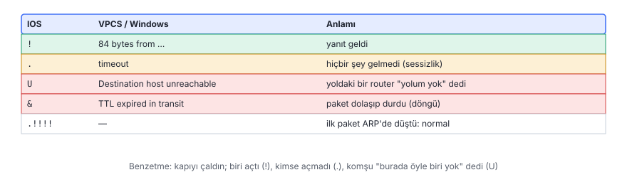
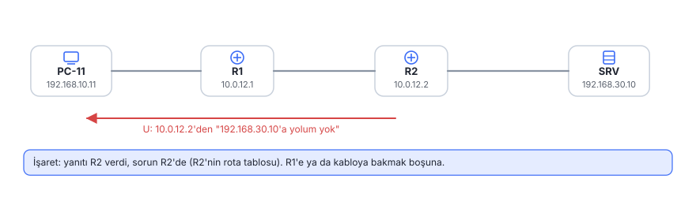
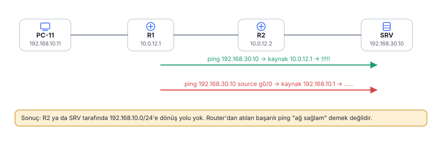
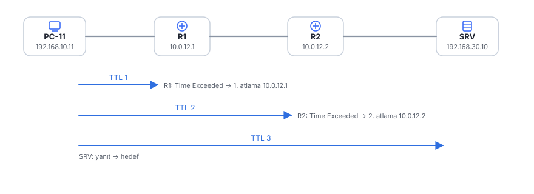
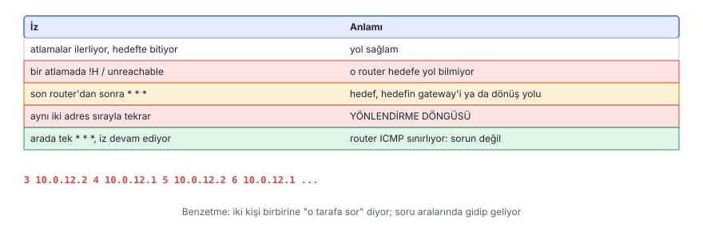
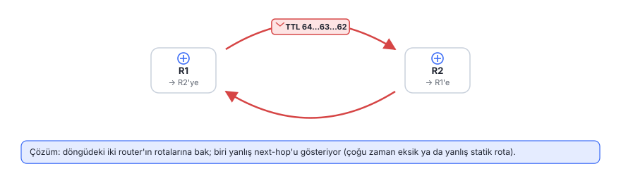
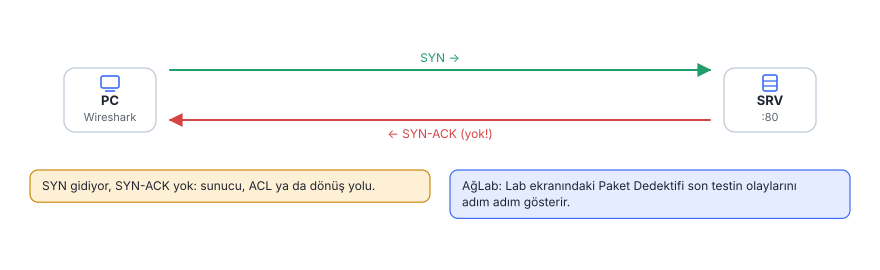

# AğLab Konu #24: Teşhis araçları: ping, extended ping, traceroute, paket yakalama

> Uygulamadaki `commands` kısa dersi ve `diagnostics` ayrıntılı dersi bu belgeyle uyumludur.
> Senaryolar Sorun Çöz'de `diag-*` kimlikleriyle Labber'da çalışır. Bu konu Konu #1'in (yöntem)
> araç tarafıdır; rota bilgisi için Konu #8 ön koşuldur. Şemalar: `docs/dersler/gorseller/teshis-araclari.py`.

Bu konu bittiğinde öğrenci ping ve traceroute çıktısındaki her işareti okuyup "paket nerede kayboldu, kim haber verdi?" sorusunu cevaplar. Extended ping'de kaynak adresi değiştirerek dönüş yolunu sınar. Yönlendirme döngüsünü traceroute izinden tanır. Paket yakalamanın ne zaman gerektiğini ve neyi gösterdiğini açıklar. Seviye 2 (CCNA), süre yaklaşık 60 dakika.

## 0. Bir bakışta

- Ping'in işaretleri: `!` yanıt, `.` sessizlik, `U` bir router "yolum yok" dedi, `&` paket dolaştı (döngü).
- **Kim haber verdi?** Unreachable'ın kaynağı sorunun yeridir.
- **Sessizlik** çoğu zaman dönüş yolunun olmamasıdır.
- **Extended ping** (`source g0/0`): router'ın ping'ini kullanıcı ağının adresinden at.
- **Traceroute** yolu atlama atlama gösterir; iz nerede kesiliyorsa sorun oradadır; tekrar eden iki adres **döngüdür**.
- Ping ve traceroute dolaylı kanıttır; uygulamanın ne yaptığını **paket yakalama** gösterir.

> **Akılda kalsın:** Router'dan başarılı ping, kullanıcının ağının sağlam olduğunu kanıtlamaz.



## 1. Neden önemli

Ping "çalışıyor/çalışmıyor" demekten fazlasını söyler. Hatayı kimin bildirdiği, hangi işaretle bildirdiği ve paketin hangi kaynak adresle çıktığı çoğu zaman sorunun yerini doğrudan gösterir. En pahalı yanlışlardan biri, router'dan atılan başarılı bir ping'e bakıp "ağ sağlam" demektir. Router kendi arayüz adresiyle ping atar; kullanıcının ağından gelen paketin dönüş yolu hiç sınanmamış olabilir.

## 2. Kavram

### 2.1 Ping ne söyler?

> **Benzetme:** Ping, bir evin kapısını çalmaktır. Biri açarsa (!) ev de yol da sağlamdır. Kimse açmazsa (.) ya evde kimse yok ya da cevabın sana dönecek yolu yok. Komşu çıkıp "burada öyle biri oturmuyor" derse (U), en azından kimin bildiğini öğrenmişsindir.


| Cisco IOS işareti | VPCS / Windows karşılığı | Anlamı |
| --- | --- | --- |
| `!` | `84 bytes from …` / Reply from | Yanıt geldi |
| `.` | `timeout` / Request timed out | Süre içinde **hiçbir şey** gelmedi: paket kayboldu, yanıt dönemedi ya da filtrelendi |
| `U` | `Destination host unreachable` (bir router adresinden) | Yoldaki bir router "bu hedefe yolum yok" dedi (ICMP tip 3) |
| `&` | `TTL expired in transit` | Paket TTL'i bitene kadar dolaştı (çoğu zaman döngü) |
| `.!!!!` | — | İlk paket ARP çözümü sırasında düştü; normaldir |

İki kural:
- **Kim haber verdi?** "Unreachable" yanıtının **kaynağı** sorunun yeridir. 10.0.12.2'den gelen unreachable, sorunun 10.0.12.2'yi taşıyan router'da olduğunu söyler.
- **Sessizlik başka şeydir.** `.` ya da timeout'ta kimse haber vermemiştir. Sık neden dönüş yolunun olmamasıdır: paket hedefe varır ama yanıt kaybolur.



### 2.2 Extended ping: kaynak adresi değiştir

> **Benzetme:** Şube müdürü merkezi kendi cep telefonundan arayıp "hat çalışıyor" diyor; ama merkez şubenin sabit numarasını hiç kaydetmemiş. Kullanıcıların numarasından aramadıkça sorunu görmezsin.

Router'ın ping'i varsayılan olarak **çıktığı arayüzün adresiyle** gider. R1'den merkeze atılan ping 10.0.12.1 kaynağıyla çıkar; merkez bu adrese dönmeyi biliyorsa ping başarılıdır. Şube kullanıcısının ağını (192.168.10.0/24) bilmiyor olabilir.

```
R1#ping 192.168.30.10 source g0/0          ← kısa biçim
R1#ping                                     ← etkileşimli: Target, Repeat, Size, Extended commands [n]: y, Source address
R1#ping 192.168.30.10 repeat 100 size 1500  ← kesintili bağlantı ve büyük paket testi
```



> **Dikkat:** Router'dan atılan başarılı ping "ağ sağlam" demek değildir. Kullanıcı şikâyetini, kullanıcının adresinden test et.

### 2.3 Traceroute: yol boyunca kim var?

> **Benzetme:** Bir mektuba "en fazla 1 postaneden geç" yazarsın; ilk postane mektubu açıp "ben buradayım" diye geri yollar. Sonra "en fazla 2", "en fazla 3"... Her seferinde yol bir postane daha uzar ve bütün güzergâh ortaya çıkar.



Traceroute TTL'i 1'den başlatarak sonda paketleri gönderir; her router TTL'i bitirdiğinde "Time Exceeded" ile kendini tanıtır. IOS her atlamaya 3 sonda (UDP 33434'ten), Windows `tracert` ICMP kullanır.

| İz | Anlamı |
| --- | --- |
| Atlamalar ilerliyor, hedefte bitiyor | Yol sağlam |
| Bir atlamada `!H` (IOS) / unreachable (VPCS) | O router hedefe yol bilmiyor |
| Son router'dan sonra `* * *` | Paket o noktadan ileri gitti ama yanıt dönmedi: hedefin kendisi, hedefin gateway'i ya da dönüş yolu |
| Aynı iki adres sırayla tekrar ediyor | **Yönlendirme döngüsü**: iki router birbirini işaret ediyor |
| Arada tek bir `* * *`, sonra iz devam ediyor | O router ICMP yanıtı vermiyor ya da sınırlıyor; trafik geçiyor (sorun değil) |





### 2.4 Paket yakalama

Ping ve traceroute ICMP/UDP ile **dolaylı** kanıt verir. Asıl uygulama trafiğinde ne olduğunu görmek için paket yakalanır: istemcide Wireshark, switch'te portu kopyalayan SPAN (Konu #37), router'da Embedded Packet Capture. Yakalama şu sorulara doğrudan cevap verir: istek çıktı mı, yanıt geldi mi, TCP el sıkışması nerede kaldı (SYN gidiyor, SYN-ACK yok)? AğLab'da Lab ekranındaki **Paket Dedektifi** son testin olaylarını (ARP, ICMP, iletim, düşürülen) adım adım gösterir.



> **Sahada:** Teşhis sırası: önce ping (çalışıyor mu?), sonra traceroute (nerede kesiliyor?), gerekirse extended ping (dönüş yolu?), en son paket yakalama (uygulama ne yapıyor?).

## 3. Çıktı okuma

Aynı hedefe dört ayrı arızanın izi:

```
! A) R2 hedefe yol bilmiyor
PC-11> ping 192.168.30.10
*10.0.12.2 icmp_seq=1 ttl=255 time=1.100 ms (ICMP type:3, code:1, Destination host unreachable)
R1#traceroute 192.168.30.10
  1 10.0.12.2 1 msec 0 msec 1 msec
  2 10.0.12.2 !H  !H  !H

! B) Dönüş yolu yok: router'ın ping'i başarılı, kaynak değişince değil
R1#ping 192.168.30.10
.!!!!
Success rate is 80 percent (4/5)
R1#ping 192.168.30.10 source g0/0
Packet sent with a source address of 192.168.10.1
.....
Success rate is 0 percent (0/5)

! C) Döngü
PC-11> trace 192.168.30.10
 1   192.168.10.1
 2   10.0.12.2
 3   10.0.12.1        ← geri döndü
 4   10.0.12.2
 5   10.0.12.1

! D) Hedef tarafında sorun (yanıt dönmüyor)
PC-11> trace 192.168.30.10
 1   192.168.10.1
 2   10.0.12.2
 3   10.0.23.2        ← son router
 4     *  *  *
```

## 4. Yönlendirmeli lab

Topoloji: PC-11, PC-12 ─ SW1 ─ R1 ═ R2 ═ R3 ─ SW3 ─ SRV (192.168.30.10). Ağ sağlam; amaç her aracın sağlam ağdaki **referans çıktısını** görmek.

1. PC-11'de `ping 192.168.30.10`: TTL değerine bak (61 = 3 router geçildi; 64'ten başlar).
2. PC-11'de `trace 192.168.30.10`: üç router adresi ve hedefte "port unreachable" (izin bittiği yer).
3. R1'de `ping 192.168.30.10`: ilk `.` neden var? Aynı komutu tekrarla. *Neden:* ilk paket ARP çözülürken düşer; ikinci denemede ARP hazırdır.
4. R1'de `ping 192.168.30.10 source g0/0`: çıktıdaki "source address" satırı.
5. R1'de etkileşimli `ping`: Repeat 20, Size 1500, Extended commands `y`, Source `g0/0`.
6. R1'de `traceroute 192.168.30.10`.
7. Paket Dedektifi'nde son ping'in ARP ve ICMP olaylarını sırayla izle.
8. Bir cümleyle yaz: router'dan başarılı ping neden kullanıcının ağının sağlam olduğunu kanıtlamaz?

> **Benzetme:** Bu lab, sağlıklı bir hastanın tahlil sonuçlarını görmektir. Normalin neye benzediğini bilmeyen, anormali tanıyamaz.

## 5. Sık hatalar

| Kod | Hata | Belirti | Kanıt | Doğrusu |
| --- | --- | --- | --- | --- |
| E1 | Ping başarısız = hedef kapalı sanmak | Sunucu ekibi boşuna aranır | Unreachable bir router adresinden geliyor | Yanıtın kaynağını oku |
| E2 | Rota eksikliğini atlamak | `U` / unreachable, iz bir router'da bitiyor | O router'da `show ip route`'ta hedef ağ yok | Eksik rotayı ekle |
| E3 | Router ping'ine güvenmek | Router'dan başarılı, kullanıcıdan başarısız | `ping … source <LAN arayüzü>` başarısız | Dönüş yolunu kaynakla sına; eksik rotayı ekle |
| E4 | Döngüyü tanımamak | Timeout ya da TTL expired | İzde iki adres sırayla tekrar ediyor | İki router'dan hangisinin yanlış next-hop'u olduğunu bul |
| E5 | `* * *`'yı ağın sonu sanmak | İz son router'da bitiyor | Son router'dan hedefe ping başarılı | Hedefin gateway'ine ve dönüş yoluna bak |

## 6. Arıza senaryoları

> **Uygulamada:** S1–S5 Sorun Çöz'de `diag-trace-stops`, `diag-return-source`, `diag-routing-loop`,
> `diag-dest-gateway`, `diag-two-faults` kimlikleriyle Labber'da çalışır. Topoloji aynıdır;
> her senaryo bir aracın izini öne çıkarır.
> Önce kendin çöz; neden ve çözüm kapalı kutularda.

### S1 · Başlangıç · İz ikinci router'da kesiliyor (E2)

- **Belirti:** PC-11'in ping'i her seferinde 10.0.12.2'den "Destination host unreachable" alıyor.
- **Hedef:** PC-11 → SRV, PC-12 → SRV

<details><summary>Neden ve çözüm</summary>

R2'de 192.168.30.0/24 rotası yok. Çözüm: R2 → `ip route 192.168.30.0 255.255.255.0 10.0.23.2`

</details>

### S2 · Orta · Router'dan ping gidiyor, PC'den gitmiyor (E3)

- **Belirti:** Teknisyen R1'den sunucuya ping attı, başarılı; "ağda sorun yok" diyor. Kullanıcılar ulaşamıyor.
- **Hedef:** PC-11 → SRV, PC-12 → SRV

<details><summary>Neden ve çözüm</summary>

R3 yalnız 10.0.12.0/30'a dönmeyi biliyor, şube ağına değil. Çözüm: R3 → `ip route 0.0.0.0 0.0.0.0 10.0.23.1`

</details>

### S3 · Orta · İz iki router arasında gidip geliyor (E4)

- **Belirti:** Gece R2'de bir rota "düzeltildi"; sabah ping yanıtsız.
- **Hedef:** PC-11 → SRV, PC-12 → SRV

<details><summary>Neden ve çözüm</summary>

R2'de 192.168.30.0/24'ün next-hop'u 10.0.12.1 (R1); R1 varsayılan rotayla geri yolluyor. Çözüm: R2 → `no ip route 192.168.30.0 255.255.255.0 10.0.12.1` → `ip route 192.168.30.0 255.255.255.0 10.0.23.2`

</details>

### S4 · Orta · İz son router'a varıyor, sonrası yıldız (E5)

- **Belirti:** Sunucu dün yeni makineye taşındı; şubeden kimse ulaşamıyor, R3'ten ping başarılı.
- **Hedef:** PC-11 → SRV, PC-12 → SRV

<details><summary>Neden ve çözüm</summary>

SRV'nin gateway'i 192.168.30.254. Çözüm: SRV → `ip 192.168.30.10 255.255.255.0 192.168.30.1`

</details>

### S5 · İleri · İki hata: önce unreachable, sonra sessizlik (E2 + E3)

- **Belirti:** Ping 10.0.12.2'den unreachable alıyor; bir rota eklenince mesaj kayboluyor ama yanıt da gelmiyor.
- **Hedef:** PC-11 → SRV, PC-12 → SRV

<details><summary>Neden ve çözüm</summary>

R2'de ileri rota ve R3'te dönüş yolu eksik. Çözüm: R2 → `ip route 192.168.30.0 255.255.255.0 10.0.23.2`; R3 → `ip route 0.0.0.0 0.0.0.0 10.0.23.1`

</details>

## 7. Kısa sınav

**1.** IOS ping çıktısında `U.U.U` ne söyler?

<details><summary>Cevap</summary>

Yoldaki bir router hedefe yol bilmediğini bildiriyor; yanıtın kaynağına bak.

</details>

**2.** R1'den ping başarılı, `source g0/0` ile başarısız. En olası neden?

<details><summary>Cevap</summary>

Karşı tarafta R1'in LAN ağına dönüş yolu yok.

</details>

**3.** Traceroute'ta 10.0.12.2 ve 10.0.12.1 sırayla tekrar ediyor. Ne var?

<details><summary>Cevap</summary>

Yönlendirme döngüsü.

</details>

**4.** `.!!!!` çıktısındaki ilk nokta?

<details><summary>Cevap</summary>

ARP çözümü sırasında düşen ilk paket; normal.

</details>

**5.** Ping ve traceroute başarılı ama web uygulaması açılmıyor; TCP'nin nerede kaldığını görmek için?

<details><summary>Cevap</summary>

Paket yakalama (Wireshark, SPAN, EPC; AğLab'da Paket Dedektifi).

</details>

**6.** PC-11'in ping'i 192.168.30.10'a TTL 61 ile dönüyor. Arada kaç router var?

<details><summary>Cevap</summary>

Üç (64 − 61). VPCS ve Linux TTL'e 64'ten başlar.

</details>

## 8. Özet kartı

| Komut | Ne işe yarar |
| --- | --- |
| `ping <hedef>` | Çalışıyor mu? İşaretleri oku |
| `ping <hedef> source <if>` | Dönüş yolunu kullanıcı adresiyle sına |
| `ping <hedef> repeat 100 size 1500` | Kesinti ve büyük paket |
| `traceroute <hedef>` / `trace` (VPCS) | Nerede kesiliyor? |
| `show ip route <hedef>` | İzin kesildiği router'da rota |
| Paket Dedektifi / Wireshark | Uygulama trafiği |

**Unutma:**

1. Kim haber verdi? Yerini o söyler.
2. Sessizlik = çoğu zaman dönüş yolu.
3. Router'dan değil, kullanıcının adresinden test et.
4. Tekrar eden adresler = döngü.
5. Uygulama için paket yakala.

## 9. Doğrulama notları

**Lab'ın otomatik değerlendirmesi:** `q.ping('PC-11', '192.168.30.10').ok`; `q.ping('PC-12', '192.168.30.10').ok`.

Kaynaklar: INET CCNA 200-301 v1.1 (ping, traceroute, sorun giderme araçları); Cisco "Understanding the Ping and Traceroute Commands" (IOS ping karakterleri `! . U Q M ? &`, traceroute `!H !N !P`, UDP 33434), RFC 792 (ICMP tip 3, 11), RFC 1393; CCNA 200-301 1.0/3.0 kapsamı (ping, traceroute, extended ping).

| İddia | Sonuç |
| --- | --- |
| IOS ping: `.` zaman aşımı, `U` destination unreachable, `&` TTL aşıldı | Doğru |
| IOS traceroute UDP sondası, hedef port 33434'ten başlar, her TTL'e 3 sonda | Doğru |
| `!H` host unreachable (router hedefe yol bilmiyor ya da hedef yanıtsız) | Doğru |
| Router ping'i varsayılan olarak çıkış arayüzünün adresini kaynak alır | Doğru |
| Windows tracert ICMP Echo kullanır | Doğru |

**Motor gereksinimleri** (Labber'da denendi)

- [x] IOS `ping`, `ping … repeat/size/source`, etkileşimli extended ping, `traceroute`; VPCS `ping -c/-T`, `trace`
- [x] Beş senaryo başta başarısız, terminalden çözümle başarılı
- [ ] Döngüde router `traceroute`'u her atlamada aynı adresi (10.0.12.2) gösteriyor, 16. atlamadan sonra yıldız; gerçek IOS'ta adresler sırayla değişir (motor hatası)
- [ ] Döngüde IOS ping `&`, VPCS "TTL expired in transit" göstermeli; motor `.`/timeout gösteriyor
- [ ] Paket Dedektifi'nin Labber senaryolarında olay kaydı gösterip göstermediği arayüzde doğrulanmadı
- [ ] Etkileşimli ping'de DF biti, sweep ve kayıt seçenekleri varsayılan kabul ediliyor (MTU modellenmiyor)
