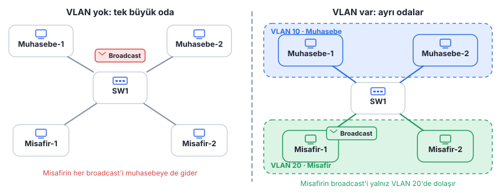
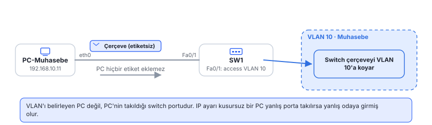
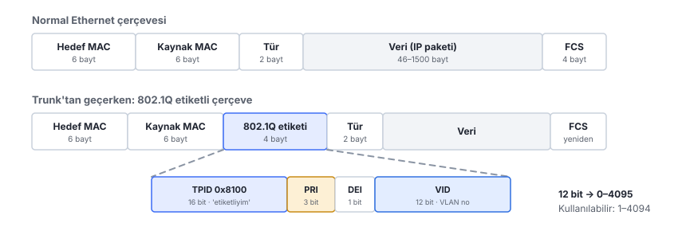
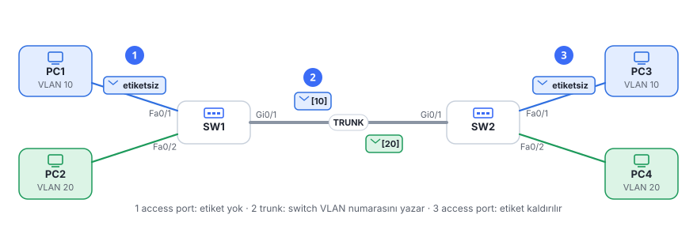
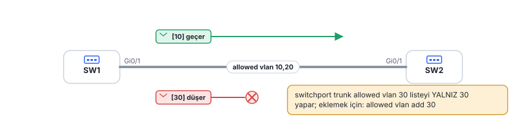
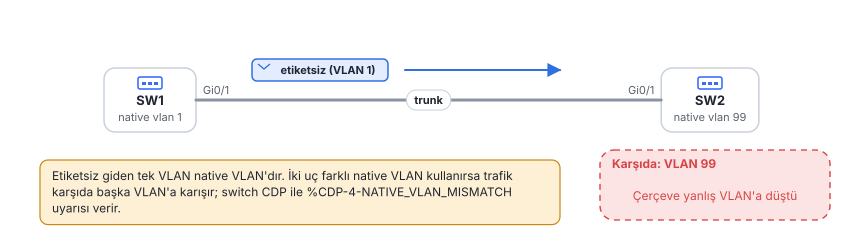
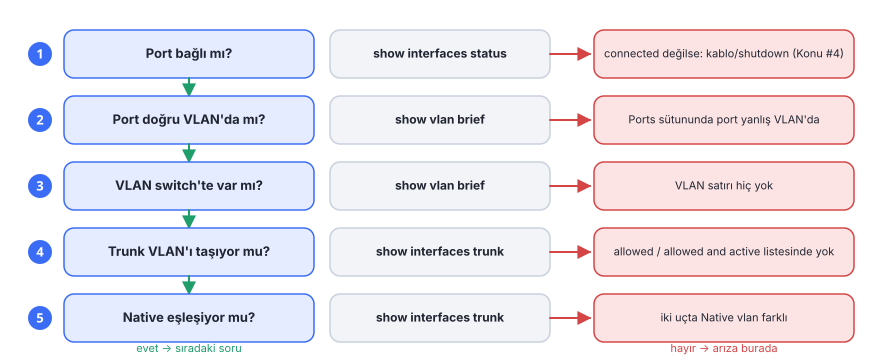

# AğLab Konu #5–6: VLAN ve trunk

> Uygulamadaki `vlan` dersi (kısa ders ve ayrıntılı ders) bu belgeyle uyumludur. Senaryolar Sorun Çöz'de
> `vlan-*` kimlikleriyle Labber'da çalışır (`verify.kind: "query"`). Ayrıca `access-vlan`,
> `trunk-allowed` ve `native-vlan` tek adımlı senaryoları vardır. VLAN'lar arası yönlendirme
> Konu #7'dir. Şemalar: `docs/dersler/gorseller/vlan-trunk.py`.

Bu konu bittiğinde öğrenci bir switch'te VLAN oluşturur ve portları VLAN'lara atar. İki switch'i 802.1Q trunk ile bağlar, izinli VLAN listesini ve native VLAN'ı ayarlar. `show interfaces status`, `show vlan brief` ve `show interfaces trunk` çıktılarını okuyarak en sık beş VLAN/trunk arızasını kanıtla ayırır. Seviye 1, süre yaklaşık 75 dakika (ders 25, lab 15, senaryolar 30, sınav 5).

## 0. Bir bakışta

- **VLAN**, tek bir switch'i birbirini duymayan ayrı odalara böler. Her oda ayrı bir yayın alanıdır (broadcast domain) ve genelde ayrı bir IP ağıdır.
- **Access port** tek bir odaya açılan kapıdır. PC kapının hangi odaya açıldığını bilmez; bunu switch portu belirler.
- **Trunk**, iki switch arasında birden çok odanın trafiğini taşıyan ortak koridordur. Koridorda her çerçevenin üstüne "hangi odadan" etiketi (802.1Q) yapıştırılır.
- Trunk'ın üç ayarı arızaların çoğunu açıklar: **izinli VLAN listesi**, **native VLAN** ve **VLAN'ın iki switch'te de var olması**.
- Teşhis dört komutla yapılır: `show interfaces status` → `show vlan brief` → `show interfaces trunk` → karşı switch'te aynısı.

> **Akılda kalsın:** "IP doğru, ışık yanıyor ama kimseye ulaşamıyorum" cümlesinin arkasında çoğu zaman yanlış odaya açılan bir kapı (yanlış access VLAN) ya da o odayı taşımayan bir koridor (trunk) vardır.



## 1. Neden önemli

Şubede muhasebe, satış ve misafir cihazları aynı switch'lere bağlıdır. VLAN olmasaydı misafirin telefonundan atılan her yayın (broadcast) muhasebe bilgisayarlarına da ulaşır, misafir ağı muhasebe sunucusunu doğrudan görürdü. Ağ büyüdükçe bu "herkes her şeyi duyar" hali hem yavaşlık hem güvenlik açığı demektir.

Sahada VLAN sorunu çoğunlukla tek cümleyle gelir: *"Kablo takılı, ışık yanıyor, IP doğru ama hiçbir yere ulaşamıyorum."* Bu dersin sonunda bu cümleyi duyduğunda hangi dört komutu hangi sırayla yazacağını bileceksin.

## 2. Kavram

### 2.1 VLAN: tek binada ayrı daireler

> **Benzetme:** Bir apartmanı düşün. Bina tek (switch tek), ama içinde ayrı daireler var. 3 numaralı dairede bağıran birini yalnız o dairedekiler duyar; komşu daire duymaz. VLAN, switch'in portlarını böyle dairelere ayırır. Bir dairede "Ahmet kim?" diye bağırmak (ARP broadcast'i) yalnız o dairede yankılanır.

- VLAN (Virtual LAN), bir switch'in portlarını **mantıksal olarak** ayrı ağlara böler. Kablolar aynı kalır; ayrım switch'in yazılımındadır.
- Her VLAN **ayrı bir yayın alanıdır**. ARP sorguları, DHCP Discover gibi broadcast'ler VLAN dışına çıkmaz.
- Pratikte her VLAN'a **ayrı bir IP ağı** verilir: VLAN 10 = 192.168.10.0/24, VLAN 20 = 192.168.20.0/24. Numarayı ağın üçüncü oktetine eşlemek okumayı kolaylaştırır.
- Switch MAC adreslerini de **VLAN başına** öğrenir: MAC tablosunda her satırın bir VLAN sütunu vardır.

**Numaralar:**

| Aralık | Anlamı |
| --- | --- |
| 1 | Varsayılan VLAN. Her port başlangıçta buradadır; silinemez. |
| 2–1001 | Normal aralık. Şubede kullanılan VLAN'lar genelde buradadır. |
| 1002–1005 | Eski teknolojiler (Token Ring, FDDI) için ayrılmış; otomatik oluşur, silinemez. |
| 1006–4094 | Genişletilmiş aralık. |
| 0 ve 4095 | Kullanılamaz (protokol için ayrılmış). |

> **Dikkat:** VLAN bir güvenlik duvarı değildir. VLAN'lar arasında yönlendirme açılınca (Konu #7) trafiği süzmek ACL'nin işidir (Konu #19).

### 2.2 Access port: kapı hangi daireye açılıyorsa

> **Benzetme:** Daire kapısının numarasını kapıdan giren kişi seçmez, bina yönetimi seçmiştir. PC de hangi VLAN'da olduğunu bilmez; bunu takıldığı switch portu belirler.

- **Access port** tek bir VLAN'a aittir. PC, yazıcı, IP kamera gibi **uç cihazlar** bağlanır.
- PC çerçevesini **etiketsiz** gönderir. Switch, portun ayarına (`switchport access vlan 10`) bakıp çerçeveyi o VLAN'a koyar.
- Çerçeve PC'ye geri giderken de etiketsizdir. PC "VLAN" kavramından habersiz yaşar.



Bu yüzden en sık VLAN arızası şöyledir: IP ayarları kusursuz bir PC **yanlış VLAN'daki porta** takılır. PC kendi ağındaki komşularını arar ama başka bir dairededir; kimse cevap vermez.

### 2.3 Trunk ve 802.1Q etiketi: ortak koridor

> **Benzetme:** İki apartman bloğu arasında tek bir kapalı koridor var. Koridordan her daireden insan geçiyor. Karışmasınlar diye her birinin yakasına daire numarası yazan bir yaka kartı takılıyor. Karşı bloğa varınca kart çıkarılıyor ve kişi kendi dairesine yönlendiriliyor. Trunk bu koridor, 802.1Q etiketi bu yaka kartıdır.

- **Trunk**, birden çok VLAN'ı **tek kabloda** taşır. Switch–switch ve switch–router (Konu #7) bağlantıları trunk olur.
- Trunk'tan çıkan her çerçeveye switch **4 baytlık 802.1Q etiketi** ekler. Etiket, kaynak MAC adresi ile Tür (EtherType) alanı arasına girer.
- Etiketin son 12 biti **VID**'dir, yani VLAN numarası. 12 bit 0–4095 eder; 0 ve 4095 ayrılmış olduğundan kullanılabilir aralık **1–4094**'tür.
- Etiketin ilk 16 biti (TPID = 0x8100) "bu çerçeve etiketli" demektir. 3 bitlik PRI alanı ses gibi trafiğe öncelik vermek için kullanılır (QoS, Konu #36).
- Etiket eklenince çerçeve değiştiği için sondaki hata denetimi (FCS) yeniden hesaplanır.



Etiket **yalnız trunk üzerinde** vardır. Access porttan girerken eklenmez, trunk'a çıkarken eklenir, karşı switch'te access porttan çıkarken kaldırılır:



### 2.4 Trunk'ın üç ayarı

**1. İzinli VLAN listesi** (`switchport trunk allowed vlan`): Listede olmayan VLAN o koridordan geçemez. Varsayılan "hepsi"dir.

> **Dikkat:** Çalışan bir trunk'a VLAN eklerken **`add`** kullanılır. `switchport trunk allowed vlan 30` listeyi **yalnız 30** yapar ve diğer VLAN'ları anında keser. Şubelerde en sık "dün bir şey ekledik, bu sabah muhasebe koptu" arızası budur. Çıkarmak için `remove`, tamamen sıfırlamak için `all` kullanılır.



**2. Native VLAN** (`switchport trunk native vlan`): Trunk'ta **etiketsiz** taşınan tek VLAN'dır. Varsayılanı 1'dir. Karşı uç etiketsiz bir çerçeve görünce onu kendi native VLAN'ına koyar.

> **Benzetme:** Koridorda yaka kartı takmadan yürüyen kişiyi görevli "kartsızlar zemin kata" diye zemin kata gönderir. Bir blokta zemin kat 1. daire, öbüründe 99. daire sayılıyorsa kartsız kişi yanlış daireye düşer.

İki uçta native VLAN farklıysa bir uçtaki VLAN'ın etiketsiz trafiği karşıda **başka VLAN'a** karışır. Gerçek switch bunu CDP ile fark eder ve `%CDP-4-NATIVE_VLAN_MISMATCH` uyarısı yazar.



> **Sahada:** Güvenlik için native VLAN'ı kullanılmayan bir VLAN'a (örneğin 999) taşımak ve VLAN 1'i kullanıcı trafiği için kullanmamak yaygın bir uygulamadır. Önemli olan iki ucun aynı olmasıdır.

**3. VLAN'ın kendisi:** VLAN, trafiğin geçtiği **her switch'te** `vlan <numara>` ile oluşturulmuş olmalıdır. İzinli listede olmak tek başına yetmez: `show interfaces trunk`'ta "allowed" bloğunda görünür ama "allowed and active" bloğunda görünmez.

### 2.5 Sahada: DTP ve VTP

> **Simülatörde yok:** DTP ve VTP Labber'da modellenmez; bu bölüm okuma konusudur.

**DTP** (Dynamic Trunking Protocol), Cisco switch'lerin bir portun trunk mı access mi olacağını kendi aralarında **pazarlık** etmesidir. Port modları:

| SW1 \ SW2 | dynamic auto | dynamic desirable | trunk | access |
| --- | --- | --- | --- | --- |
| **dynamic auto** | access | trunk | trunk | access |
| **dynamic desirable** | trunk | trunk | trunk | access |
| **trunk** | trunk | trunk | trunk | sorunlu |
| **access** | access | access | sorunlu | access |

İki uç da `dynamic auto` ise ikisi de "karşı istesin" diye bekler ve port **access** kalır; trunk kurulmaz. Doğru uygulama pazarlığa bırakmamaktır: portu `switchport mode access` ya da `switchport mode trunk` ile sabitlemek ve trunk'ta `switchport nonegotiate` ile DTP'yi kapatmak.

**VTP** (VLAN Trunking Protocol), VLAN listesini switch'ler arasında dağıtır. Tehlikesi şudur: daha yüksek revizyon numaralı eski bir switch ağa takılınca kendi (belki boş) VLAN listesini herkese yayıp VLAN'ları silebilir. Bu yüzden şubelerde genelde `vtp mode transparent` kullanılır ve VLAN'lar her switch'te elle oluşturulur.

### 2.6 VLAN'lar arası iletişim

Farklı VLAN'lar Katman 2'de **hiç** konuşmaz; ayrı daireler gibi. VLAN 10'daki muhasebe ile VLAN 20'deki satışın konuşması için bir **router** ya da **L3 switch** gerekir (Konu #7). Bu dersin labında muhasebeden satışa ping'in **gitmemesi** doğru sonuçtur.

## 3. Çıktı okuma

Üç komut, VLAN arızalarının neredeyse hepsini ortaya çıkarır.

```
SW1#show interfaces status
Port      Name               Status       Vlan       Duplex  Speed Type
Fa0/1                        connected    20         a-full  a-100 10/100BaseTX
Fa0/2                        connected    10         a-full  a-100 10/100BaseTX
Gi0/24                       connected    trunk      a-full a-1000 10/100/1000BaseTX
```

- **Status:** `connected` kablo takılı ve port açık demektir. `notconnect` kablo/karşı uç, `disabled` shutdown, `err-disabled` güvenlik ihlali (Konu #21).
- **Vlan:** access portun VLAN'ı. Trunk portta `trunk` yazar.
- Burada **Fa0/1 VLAN 20'de**. Muhasebe PC'si Fa0/1'e takılıysa arıza bulundu: kapı yanlış daireye açılıyor.

```
SW1#show vlan brief
VLAN Name                             Status    Ports
---- -------------------------------- --------- -------------------------------
1    default                          active
10   MUHASEBE                         active    Fa0/2
20   SATIS                            active    Fa0/1
```

- Her satır bir VLAN: numara, ad, durum ve o VLAN'daki **access portlar**.
- **Gi0/24 hiçbir satırda yok:** trunk portlar bu tabloda listelenmez. Bu bir arıza değildir.
- Aradığın VLAN'ın satırı hiç yoksa VLAN bu switch'te oluşturulmamıştır.

```
SW1#show interfaces trunk
Port        Mode         Encapsulation  Status        Native vlan
Gi0/24      on           802.1q         trunking      1

Port        Vlans allowed on trunk
Gi0/24      30

Port        Vlans allowed and active in management domain
Gi0/24      30

Port        Vlans in spanning tree forwarding state and not pruned
Gi0/24      30
```

- **Birinci blok:** trunk portlar, modları (`on` = elle trunk), etiket türü (`802.1q`), durum ve **Native vlan**. Port bu listede hiç yoksa trunk değildir.
- **"Vlans allowed on trunk":** izinli liste. Burada **yalnız 30**: biri `add` demeyi unutmuş, 10 ve 20 kesilmiş.
- **"allowed and active":** izinli **ve** bu switch'te oluşturulmuş VLAN'lar. Bir VLAN birinci blokta olup burada yoksa bu switch'te `vlan <n>` eksiktir.
- **Son blok:** STP'nin iletime izin verdiği VLAN'lar (Konu #13).

| Ne arıyorsun | Nereye bakarsın |
| --- | --- |
| Port hangi VLAN'da? | `show interfaces status` → Vlan sütunu |
| VLAN bu switch'te var mı? | `show vlan brief` |
| Port trunk mı? | `show interfaces trunk` (portu listede ara) ya da status'ta "trunk" |
| Trunk hangi VLAN'ları taşıyor? | "Vlans allowed on trunk" |
| İzinli ama switch'te yok mu? | "allowed" ile "allowed and active" farkı |
| Native VLAN iki uçta aynı mı? | İki switch'te "Native vlan" sütunu |

## 4. Yönlendirmeli lab

Topoloji: SW1 ve SW2, aralarında Gi0/24 bağlantısı. Her switch'te bir muhasebe (VLAN 10, Fa0/1) ve bir satış (VLAN 20, Fa0/2) PC'si. PC'ler 192.168.10.0/24 ve 192.168.20.0/24 ağlarında.

1. **VLAN'ları oluştur (iki switch'te):**
   ```
   SW1(config)#vlan 10
   SW1(config-vlan)#name MUHASEBE
   SW1(config-vlan)#vlan 20
   SW1(config-vlan)#name SATIS
   ```
   *Neden:* VLAN, trafiğin geçtiği her switch'te olmalı. *Doğrula:* `show vlan brief`'te iki satır.
2. **Access portları ata:**
   ```
   SW1(config)#interface fa0/1
   SW1(config-if)#switchport mode access
   SW1(config-if)#switchport access vlan 10
   SW1(config-if)#interface fa0/2
   SW1(config-if)#switchport mode access
   SW1(config-if)#switchport access vlan 20
   ```
   *Neden:* `mode access` portu sabitler, DTP pazarlığını kapatır. *Doğrula:* `show interfaces status`'ta Vlan sütunu 10 ve 20.
3. **Trunk'ı kur (iki uçta):**
   ```
   SW1(config)#interface gi0/24
   SW1(config-if)#switchport mode trunk
   SW1(config-if)#switchport trunk allowed vlan 10,20
   ```
   *Neden:* yalnız gereken VLAN'ları taşımak gereksiz broadcast'i azaltır. *Doğrula:* `show interfaces trunk`'ta Gi0/24 "trunking", allowed 10,20.
4. **Test:** muhasebe PC'leri katlar arası ping atabilir; muhasebeden satışa ping **gitmemeli** (router yok).
5. **VLAN ekle, bozmadan:** iki switch'te `vlan 30`, trunk'ta `switchport trunk allowed vlan add 30`. Önce ve sonra `show interfaces trunk` karşılaştır. *Neden:* `add` olmadan liste yalnız 30 olurdu.
6. **Kaydet:** `copy running-config startup-config`.

> **Benzetme:** Labı "önce daireleri aç (VLAN), sonra kapıları daireye bağla (access), en son koridoru aç (trunk)" sırasıyla düşün. Sorun çıkınca da aynı sırayla kontrol edersin.

## 5. Sık hatalar

| Kod | Hata | Belirti | Kanıt | Düzeltme |
| --- | --- | --- | --- | --- |
| E1 | Yanlış access VLAN | IP doğru, aynı ağdaki kimseye ulaşamıyor | `show interfaces status` Vlan sütunu | `switchport access vlan <doğru>` |
| E2 | Ara bağlantı trunk değil | Katlar arası hiçbir VLAN geçmiyor (ya da yalnız biri) | `show interfaces trunk`'ta port yok | İki uçta `switchport mode trunk` |
| E3 | İzinli listede eksik VLAN (`add` unutulmuş) | Bir VLAN dışında her şey çalışıyor; çoğu zaman yeni VLAN eklendikten sonra | "Vlans allowed on trunk" | `switchport trunk allowed vlan add <n>` |
| E4 | VLAN karşı switch'te yok | Aynı switch'tekiler konuşuyor, öbür uçtakilere ulaşılmıyor | Karşı switch'te `show vlan brief`; "allowed and active" bloğunda yok | `vlan <n>` |
| E5 | Native VLAN uyuşmazlığı | Etiketsiz trafik yanlış VLAN'a düşer; gerçek switch'te `%CDP-4-NATIVE_VLAN_MISMATCH` | İki uçta "Native vlan" farklı | İki uçta aynı native VLAN |



> **Akılda kalsın:** Aşağıdan yukarı git: önce port bağlı mı, sonra doğru VLAN'da mı, sonra VLAN var mı, sonra trunk taşıyor mu. Her soruya bir komut, her komuta bir satır.

## 6. Arıza senaryoları

> **Uygulamada:** S1–S5 Sorun Çöz'de `vlan-wrong-access`, `vlan-uplink-not-trunk`,
> `vlan-allowed-overwritten`, `vlan-missing-on-switch`, `vlan-two-faults` kimlikleriyle Labber'da çalışır.
> Native VLAN uyuşmazlığı ayrı `native-vlan` senaryosundadır. Önce kendin çöz; neden ve çözüm kapalı kutularda.

### S1 · Başlangıç · Yeni muhasebe PC'si kimseyi görmüyor (E1)

- **Belirti:** PC-01 yeni bağlandı; IP doğru, ışık yanıyor ama aynı VLAN'daki PC-02'ye ping gitmiyor.
- **Hedef:** PC-01 → PC-02 başarılı; PC-01 → PC-03 (VLAN 20) başarısız kalır.

<details><summary>Neden ve çözüm</summary>

SW1 Fa0/1 VLAN 20'de; VLAN 10 olmalı. Çözüm: SW1 → `interface fa0/1` → `switchport access vlan 10`.

</details>

### S2 · Başlangıç · Katlar arası hiçbir şey çalışmıyor (E2)

- **Belirti:** Aynı kattakiler sorunsuz; ne muhasebe ne satış diğer kata ulaşıyor.
- **Hedef:** PC-01 → PC-02 ve PC-03 → PC-04 başarılı.

<details><summary>Neden ve çözüm</summary>

SW2 Gi0/24 access portu olarak kalmış. Çözüm: SW2 → `interface gi0/24` → `switchport mode trunk` → `switchport trunk allowed vlan 10,20`.

</details>

### S3 · Orta · Misafir ağı eklendi, muhasebe koptu (E3)

- **Belirti:** Dün akşam VLAN 30 (MISAFIR) eklendi; bu sabah muhasebe katlar arası ulaşamıyor.
- **Hedef:** iki VLAN da katlar arası çalışıyor.

<details><summary>Neden ve çözüm</summary>

SW1 Gi0/24'te `switchport trunk allowed vlan 30` yazılmış; liste yalnız 30. Çözüm: SW1 → `interface gi0/24` → `switchport trunk allowed vlan add 10,20`.

</details>

### S4 · Orta · Satış diğer kattaki satışçılara ulaşamıyor (E4)

- **Belirti:** VLAN 20 katlar arası çalışmıyor; SW1'de izinli listede 20 var.
- **Hedef:** iki VLAN da katlar arası çalışıyor.

<details><summary>Neden ve çözüm</summary>

VLAN 20, SW2'de oluşturulmamış. Çözüm: SW2 → `vlan 20` → `name SATIS`.

</details>

### S5 · İleri · İki hata birden (E3 + E1)

- **Belirti:** PC-01 (VLAN 20) diğer kattaki PC-02'ye ulaşamıyor; bir hatayı düzeltince sorun geçmiyor.
- **Hedef:** PC-01 → PC-02 ve PC-03 → PC-04 başarılı; VLAN'lar arası başarısız kalır.

<details><summary>Neden ve çözüm</summary>

SW1 Gi0/24 izinli listesinde 20 yok **ve** SW2 Fa0/1 yanlış VLAN'da (10). Çözüm: SW1 → `switchport trunk allowed vlan add 20`; SW2 → `interface fa0/1` → `switchport access vlan 20`.

</details>

## 7. Kısa sınav

**1.** `show vlan brief`'te Gi0/24 hiçbir VLAN'da görünmüyor, port connected. Olası açıklama?

<details><summary>Cevap</summary>

Port trunk; trunk portlar bu tabloda listelenmez. Arıza değildir.

</details>

**2.** "Vlans allowed on trunk: 1,10,30". Hangi VLAN geçemez: 10, 20, 30?

<details><summary>Cevap</summary>

20. Listede yok.

</details>

**3.** "allowed: 1,10,20", "allowed and active: 1,10". Anlamı?

<details><summary>Cevap</summary>

VLAN 20 izinli ama bu switch'te oluşturulmamış. Çözüm `vlan 20`.

</details>

**4.** Çalışan trunk'a VLAN 40'ı diğerlerini kesmeden ekleyen komut?

<details><summary>Cevap</summary>

`switchport trunk allowed vlan add 40`. `add` olmadan liste yalnız 40 olur.

</details>

**5.** VLAN 10 ile VLAN 20 arasında IP erişimi için ne gerekir?

<details><summary>Cevap</summary>

Router ya da L3 switch (Konu #7). VLAN'lar Katman 2'de birbirini görmez.

</details>

**6.** İki switch arasındaki port iki uçta da `dynamic auto`. Trunk kurulur mu?

<details><summary>Cevap</summary>

Hayır, port access kalır. İki uç da karşının istemesini bekler. Çözüm iki uçta `switchport mode trunk`.

</details>

## 8. Özet kartı

| Komut | Ne işe yarar |
| --- | --- |
| `vlan 10` → `name MUHASEBE` | VLAN oluşturur ve adlandırır |
| `switchport mode access` + `switchport access vlan 10` | Portu VLAN 10'un kapısı yapar |
| `switchport mode trunk` | Portu trunk yapar |
| `switchport trunk allowed vlan add 30` | İzinli listeye VLAN ekler (diğerlerini kesmeden) |
| `switchport trunk native vlan 999` | Native VLAN'ı değiştirir (iki uçta aynı olmalı) |
| `show interfaces status` | Port durumu ve VLAN'ı |
| `show vlan brief` | VLAN'lar ve access portları |
| `show interfaces trunk` | Trunk'lar, izinli/aktif VLAN'lar, native VLAN |

**Unutma:**

1. VLAN'ı PC değil, switch portu belirler.
2. Trunk portlar `show vlan brief`'te görünmez.
3. Trunk'a VLAN eklerken `add`.
4. VLAN, trafiğin geçtiği her switch'te oluşturulmalı.
5. Native VLAN iki uçta aynı olmalı.

## 9. Doğrulama notları

Kaynaklar: IEEE 802.1Q (etiket 4 bayt, TPID 0x8100, VID 12 bit, 0 ve 4095 ayrılmış); Cisco Catalyst VLAN ve trunk yapılandırma kılavuzları (`switchport trunk allowed vlan add`, `show interfaces trunk` blokları, DTP modları, VTP transparent); CCNA 200-301 2.1–2.2; INET CCNA 200-301 v1.1 (VLAN aralıkları, VLAN 1 ve 1002–1005'in otomatik oluşması); INET ENCOR "VLAN, Trunk, EtherChannel, STP" (DTP mod tablosu, `switchport nonegotiate`).

| İddia | Sonuç |
| --- | --- |
| Kullanılabilir VLAN'lar 1–4094 (0 ve 4095 ayrılmış) | Doğru |
| VLAN 1 ve 1002–1005 otomatik oluşur, silinemez | Doğru |
| 802.1Q etiketi kaynak MAC ile Tür arasına girer; FCS yeniden hesaplanır | Doğru |
| `allowed vlan <liste>` mevcut listeyi değiştirir, `add` ekler | Doğru |
| Trunk portlar `show vlan brief` Ports sütununda listelenmez | Doğru |
| İki uç `dynamic auto` → access | Doğru |
| Native VLAN uyuşmazlığında CDP `%CDP-4-NATIVE_VLAN_MISMATCH` logu | Doğru |

Lab'ın otomatik değerlendirmesi: `q.ping('PC-01', <PC-02>).ok` ve `q.ping('PC-03', <PC-04>).ok` doğru; farklı VLAN'lar arası `q.ping` yanlış.

**Motor gereksinimleri** (Labber'da denendi)

- [x] VLAN, access, trunk, izinli liste (`add`, `remove`), native VLAN, `show interfaces status|trunk`, `show vlan brief`
- [x] Beş senaryo `query` doğrulamasıyla: başta başarısız, terminalden çözümle başarılı; VLAN'lar arası yalıtım da sınanıyor
- [ ] DTP ve VTP yok (okuma)
- [ ] `NATIVE_VLAN_MISMATCH` uyarısı yalnız durum değişince yazılıyor; başlangıçta ve periyodik olmalı (motor işi)
- [ ] Trunk'ın varsayılan "allowed vlan" değeri running-config'te görünüyor; gerçek IOS'ta varsayılan (all) yazılmaz
