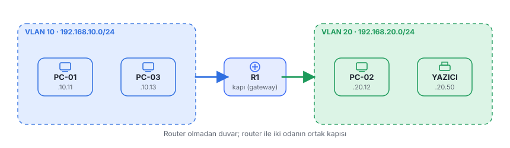
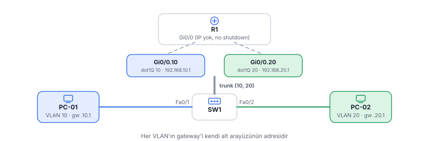
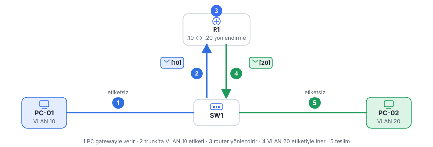
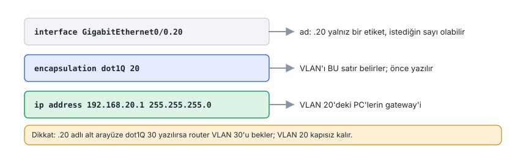
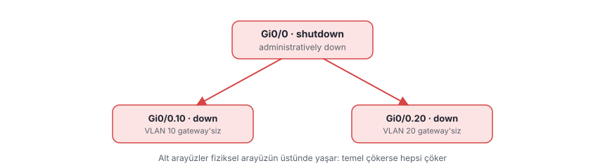
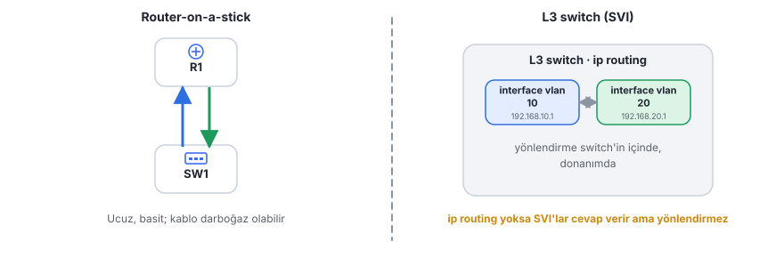
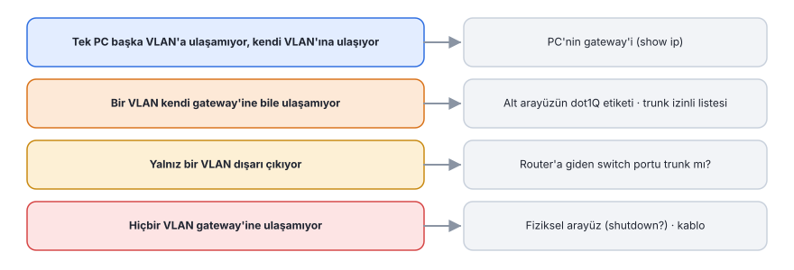

# AğLab Konu #7: VLAN'lar arası yönlendirme

> Uygulamadaki `intervlan` dersi bu belgeyle uyumludur. Senaryolar Sorun Çöz'de `roas-*`
> kimlikleriyle Labber'da çalışır (`verify.kind: "query"`). Ön koşul: Konu #5–6 (VLAN ve trunk),
> varsayılan ağ geçidi (Konu #8). Şemalar: `docs/dersler/gorseller/vlanlar-arasi-yonlendirme.py`.

Bu konu bittiğinde öğrenci VLAN'ların neden bir yönlendirici olmadan haberleşemediğini açıklar. Router-on-a-stick'i alt arayüz ve 802.1Q trunk ile kurar; L3 switch'te SVI ve `ip routing` ile yönlendirmenin nasıl çalıştığını açıklar. Yanlış etiket, trunk olmayan port, yanlış gateway ve kapalı fiziksel arayüz arızalarını kanıtla ayırır. Seviye 1, süre yaklaşık 80 dakika.

## 0. Bir bakışta

- VLAN'lar ayrı odalardır; aralarında konuşmak için bir **kapı**, yani **router** ya da **L3 switch** gerekir.
- Her VLAN ayrı bir IP ağıdır ve her VLAN'ın **kendi gateway adresi** vardır.
- **Router-on-a-stick:** router'ın tek fiziksel portu switch'e **trunk** ile bağlanır; her VLAN için bir **alt arayüz** açılır.
- Alt arayüzün hangi VLAN'ı alacağını **numarası değil**, `encapsulation dot1Q` satırı belirler.
- **L3 switch:** her VLAN için bir **SVI** (`interface vlan 10`) ve `ip routing`. Yönlendirme switch'in içinde yapılır.

> **Akılda kalsın:** "Kendi bölümüme ulaşıyorum, diğerine ulaşamıyorum" cümlesi sorunu daraltır: katman 2 o VLAN içinde sağlam, sorun gateway ile router arasındaki yolda.



## 1. Neden önemli

VLAN'lar ağı bilerek böler (Konu #5–6). Ama muhasebe yine de satıştaki yazıcıya, herkes sunucuya ulaşmak zorundadır. Bu yüzden şubelerin neredeyse hepsinde VLAN'lar arası yönlendirme vardır.

Tipik şikâyet *"kendi bölümüme ulaşıyorum, diğerine ulaşamıyorum"*dur. Bu dersin sonunda bu cümleyi duyunca etki alanına bakıp (tek PC mi, tek VLAN mı, herkes mi) doğru yere gideceksin.

## 2. Kavram

### 2.1 Her VLAN ayrı bir ağ, her ağın bir kapısı

> **Benzetme:** Bir binada muhasebe ve satış ayrı odalarda çalışıyor. Odalar arasında duvar var (VLAN). İki oda arasında evrak taşımak için ortak bir sekreterlik (router) var: her oda evrakı kendi kapısındaki sekretere verir, sekreter öbür odanın kapısından içeri bırakır. Her odanın kendi kapısı (gateway adresi) vardır.

- Muhasebe VLAN 10 (192.168.10.0/24), satış VLAN 20 (192.168.20.0/24).
- PC başka ağdaki hedefe paketi doğrudan göndermez, **kendi VLAN'ındaki gateway'e** verir (Konu #2).
- Bu yüzden her VLAN'ın **o VLAN'da duran** bir gateway adresi olmalıdır: VLAN 10 için 192.168.10.1, VLAN 20 için 192.168.20.1.

### 2.2 Router-on-a-stick: tek kablo, birden çok kapı

> **Benzetme:** Sekreterlik odasının tek kapısı var ama kapının üstünde iki ayrı pencere açılmış: "Muhasebe evrakı" ve "Satış evrakı". Hepsi aynı koridordan (trunk) gelir; yaka kartına (802.1Q etiketi) bakılıp doğru pencereye alınır.

- Router'ın tek fiziksel portu switch'e **trunk** olarak bağlanır.
- Fiziksel porta IP verilmez, yalnız `no shutdown` yapılır.
- Her VLAN için bir **alt arayüz** (subinterface) açılır:

```
R1(config)#interface g0/0
R1(config-if)#no shutdown
R1(config-if)#interface g0/0.10
R1(config-subif)#encapsulation dot1Q 10
R1(config-subif)#ip address 192.168.10.1 255.255.255.0
R1(config-subif)#interface g0/0.20
R1(config-subif)#encapsulation dot1Q 20
R1(config-subif)#ip address 192.168.20.1 255.255.255.0
```



### 2.3 Bir paketin yolculuğu

1. PC-01 (VLAN 10), PC-02'nin başka ağda olduğunu görür ve paketi gateway'e (192.168.10.1) verir. Çerçeve access porttan **etiketsiz** girer.
2. SW1 çerçeveyi router'a giden trunk'a **VLAN 10 etiketiyle** çıkarır.
3. R1 çerçeveyi .10 alt arayüzünde alır, IP paketine bakar, hedefin 192.168.20.0/24'te (.20 alt arayüzünde) olduğunu görür ve **yönlendirir**.
4. R1 paketi yeni bir çerçeveyle, **VLAN 20 etiketiyle** aynı kablodan geri gönderir.
5. SW1 etiketi kaldırır ve çerçeveyi PC-02'nin access portundan teslim eder.



### 2.4 Üç kural

1. **Alt arayüzün numarası yalnız bir addır;** VLAN'ı `encapsulation dot1Q` belirler. `.20` adlı alt arayüze `dot1Q 30` yazılırsa router VLAN 30'u bekler.
2. **Fiziksel arayüz kapalıysa bütün alt arayüzler düşer.** Alt arayüzler fiziksel arayüzün üstünde yaşar.
3. **Router'a giden switch portu trunk olmalı** ve VLAN'lar izinli listede olmalı; değilse router'a yalnız o portun VLAN'ı ulaşır.





> **Dikkat:** `encapsulation` satırı IP'den **önce** gelir. IOS, etiketi olmayan bir LAN alt arayüzüne adres vermez.

### 2.5 L3 switch ve SVI

> **Benzetme:** Sekreterliği ayrı bir odaya koymak yerine koridorun içine yerleştirmek gibi: evrak odadan çıkıp başka odaya gitmek için uzun yoldan dolaşmaz, koridorda el değiştirir.

- **SVI** (Switch Virtual Interface): her VLAN için switch'in içinde açılan sanal arayüz. `interface vlan 10` → `ip address 192.168.10.1 255.255.255.0` → `no shutdown`.
- Yönlendirme `ip routing` ile açılır (Catalyst'te çoğu modelde varsayılan **kapalı**). `ip routing` yoksa switch SVI adreslerine yanıt verir ama VLAN'lar arasında paket taşımaz.
- SVI'nın up/up olması için VLAN switch'te olmalı, o VLAN'da en az bir **forwarding port** bulunmalı ve SVI `no shutdown` olmalı.
- Router-on-a-stick ucuz ve basittir ama VLAN'lar arası trafik tek kablodan **iki kez** geçer. L3 switch bunu donanımda yapar; büyük şubelerde tercih edilir.



> **Simülatörde kısmen:** L3 switch ve SVI yönlendirmesi bu derste okuma konusudur; senaryolar router-on-a-stick ile kuruludur.

## 3. Çıktı okuma

```
R1#show ip interface brief
Interface              IP-Address      OK? Method Status                Protocol
GigabitEthernet0/0     unassigned      YES unset  up                    up
GigabitEthernet0/0.10  192.168.10.1    YES manual up                    up
GigabitEthernet0/0.20  192.168.20.1    YES manual up                    up
        ← G0/0 "administratively down" olsaydı alt arayüzler de down olurdu

R1#show running-config interface g0/0.20
interface GigabitEthernet0/0.20
 encapsulation dot1Q 30                  ← adı .20 ama VLAN 30'u bekliyor
 ip address 192.168.20.1 255.255.255.0

R1#show ip route connected
C        192.168.10.0/24 is directly connected, GigabitEthernet0/0.10
C        192.168.20.0/24 is directly connected, GigabitEthernet0/0.20

SW1#show interfaces trunk
Port        Mode         Encapsulation  Status        Native vlan
Gi0/1       on           802.1q         trunking      1
Port        Vlans allowed on trunk
Gi0/1       10,20                        ← router'a giden trunk iki VLAN'ı da taşıyor
```



| Belirti | İlk bakılacak |
| --- | --- |
| Tek PC başka VLAN'a ulaşamıyor, kendi VLAN'ına ulaşıyor | PC'nin gateway'i |
| Bir VLAN kendi gateway'ine bile ulaşamıyor | Alt arayüzün etiketi, trunk izinli listesi |
| Yalnız bir VLAN dışarı çıkıyor | Router'a giden switch portu trunk mı? |
| Hiçbir VLAN gateway'ine ulaşamıyor | Fiziksel arayüz, kablo |

## 4. Yönlendirmeli lab

> **Simülatörde:** bu labın hazır topolojisi ve otomatik kontrolü Simülatör'deki **roas-kurulum** labıdır (dersin Pratik adımı). Simülatör labı bu adımların özüdür; ayrıntılar labın görev metnindedir.

Topoloji: R1 G0/0 ─ SW1 Gi0/1; SW1'de PC-01 ve PC-03 VLAN 10, PC-02 VLAN 20.

1. **Switch tarafı:**
   ```
   SW1(config)#interface gi0/1
   SW1(config-if)#switchport mode trunk
   SW1(config-if)#switchport trunk allowed vlan 10,20
   ```
   *Neden:* router'a iki VLAN da tek kablodan gidecek. *Doğrula:* `show interfaces trunk`'ta Gi0/1 trunking, allowed 10,20.
2. **Router fiziksel arayüz:** `interface g0/0` → `no shutdown` (IP yok). *Neden:* alt arayüzler fiziksel arayüzün üstünde yaşar.
3. **Alt arayüzler:** `interface g0/0.10` → `encapsulation dot1Q 10` → `ip address 192.168.10.1 255.255.255.0`; aynısı .20 için. *Neden:* encapsulation önce gelir; etiketsiz LAN alt arayüzüne IP verilemez.
4. **Doğrula:** `show ip interface brief` (alt arayüzler up/up), `show ip route connected` (iki C satırı).
5. **PC'ler:** gateway'leri kendi VLAN'larındaki alt arayüz adresi olmalı (`show ip`).
6. **Test:** PC-01 → 192.168.10.1, PC-01 → PC-02. `trace 192.168.20.12` ile gateway'in yolda göründüğünü gör.
7. **Kaydet:** iki cihazda `copy running-config startup-config`.

> **Benzetme:** Labı "koridoru aç (trunk), sekreterliğin kapısını aç (fiziksel arayüz), pencereleri aç (alt arayüzler), çalışanlara hangi pencereye gideceklerini söyle (gateway)" sırasıyla düşün.

## 5. Sık hatalar

| Kod | Hata | Belirti | Kanıt | Düzeltme |
| --- | --- | --- | --- | --- |
| E1 | Alt arayüzde yanlış etiket | Bir VLAN gateway'ine ulaşamıyor, diğerleri çalışıyor | running-config'te `encapsulation dot1Q 30` | Doğru etiket |
| E2 | Router'a giden port trunk değil | Yalnız portun access VLAN'ı çıkabiliyor | `show interfaces trunk`'ta port yok | `switchport mode trunk` + izinli liste |
| E3 | PC'de yanlış gateway | Tek PC; kendi VLAN'ı çalışıyor | PC'nin gateway'i alt arayüz adresinden farklı | Doğru gateway |
| E4 | Fiziksel arayüz kapalı | Hiçbir VLAN gateway'ine ulaşamıyor | G0/0 administratively down | Fiziksel arayüzde `no shutdown` |
| E5 | L3 switch'te `ip routing` yok (okuma) | SVI'lar up, gateway'e ping var, VLAN'lar arası yok | `show ip route` tablo göstermiyor | `ip routing` |

## 6. Arıza senaryoları

> **Uygulamada:** S1–S5 Sorun Çöz'de `roas-wrong-tag`, `roas-switch-port-access`, `roas-pc-gateway`,
> `roas-physical-shutdown`, `roas-two-faults` kimlikleriyle Labber'da çalışır. Önce kendin çöz;
> neden ve çözüm kapalı kutularda.

### S1 · Başlangıç · Muhasebe satışa ulaşamıyor (E1)

- **Belirti:** PC-01 (VLAN 10) kendi VLAN'ına ve gateway'ine ulaşıyor, PC-02'ye (VLAN 20) ulaşamıyor.
- **Hedef:** PC-01 → PC-02 başarılı.

<details><summary>Neden ve çözüm</summary>

R1 g0/0.20'de `encapsulation dot1Q 30`. Çözüm: R1 → `interface g0/0.20` → `encapsulation dot1q 20`.

</details>

### S2 · Başlangıç · Yalnız bir VLAN dışarı çıkabiliyor (E2)

- **Belirti:** VLAN 10 gateway'ine ulaşıyor; VLAN 20'deki PC-02 kendi gateway'ine bile ulaşamıyor.
- **Hedef:** PC-02 → PC-01 başarılı.

<details><summary>Neden ve çözüm</summary>

SW1 Gi0/1 VLAN 10'da access port. Çözüm: SW1 → `interface gi0/1` → `switchport mode trunk` → `switchport trunk allowed vlan 10,20`.

</details>

### S3 · Orta · Yeni PC yalnız kendi bölümünü görüyor (E3)

- **Belirti:** PC-02 yeni kuruldu; satışa ulaşıyor, muhasebeye ulaşamıyor. Diğer satış PC'leri ulaşıyor.
- **Hedef:** PC-02 → PC-01 ve PC-03 başarılı.

<details><summary>Neden ve çözüm</summary>

PC-02'nin gateway'i 192.168.20.254; R1'in adresi .1. Çözüm: PC-02 → `ip 192.168.20.12 255.255.255.0 192.168.20.1`.

</details>

### S4 · Orta · Alt arayüzler doğru ama hiçbiri çalışmıyor (E4)

- **Belirti:** Bakımdan sonra hiçbir VLAN diğerine, PC'ler gateway'lerine bile ulaşamıyor.
- **Hedef:** PC-01 → PC-02 ve PC-03 → PC-02 başarılı.

<details><summary>Neden ve çözüm</summary>

R1 g0/0 `shutdown`; alt arayüzler de düştü. Çözüm: R1 → `interface g0/0` → `no shutdown`.

</details>

### S5 · İleri · İki hata birden (izinli liste + E3)

- **Belirti:** Muhasebe satışa ulaşamıyor; bir hatayı düzeltince de erişim gelmiyor.
- **Hedef:** PC-01 → PC-02 başarılı.

<details><summary>Neden ve çözüm</summary>

SW1 Gi0/1 trunk'ında VLAN 20 izinli değil **ve** PC-02'nin gateway'i yanlış. Çözüm: SW1 → `switchport trunk allowed vlan add 20`; PC-02 → `ip 192.168.20.12 255.255.255.0 192.168.20.1`.

</details>

## 7. Kısa sınav

**1.** g0/0.20 alt arayüzünün hangi VLAN'ı alacağını ne belirler?

<details><summary>Cevap</summary>

`encapsulation dot1Q` satırı. Numara yalnız bir addır.

</details>

**2.** Fiziksel G0/0 kapalıysa alt arayüzler ne olur?

<details><summary>Cevap</summary>

Hepsi düşer; hiçbir VLAN gateway'ine ulaşamaz.

</details>

**3.** Router-on-a-stick'te switch'in router'a bakan portu hangi modda olmalı?

<details><summary>Cevap</summary>

Trunk; ve VLAN'lar izinli listede olmalı.

</details>

**4.** L3 switch'te SVI'lar up, gateway'e ping gidiyor ama VLAN'lar arası trafik yok. Olası eksik?

<details><summary>Cevap</summary>

`ip routing`. Olmadan switch SVI'larına yanıt verir ama yönlendirmez.

</details>

**5.** Tek PC başka VLAN'a ulaşamıyor, aynı VLAN'daki diğer PC'ler ulaşıyor. İlk bakılacak?

<details><summary>Cevap</summary>

O PC'nin gateway'i (`show ip`).

</details>

**6.** Yalnız VLAN 10 dışarı çıkabiliyor, VLAN 20 kendi gateway'ine bile ulaşamıyor; router doğru. Nereye bakarsın?

<details><summary>Cevap</summary>

Router'a giden switch portuna: trunk mı, VLAN 20 izinli mi? Port VLAN 10'da access ise yalnız VLAN 10 geçer.

</details>

## 8. Özet kartı

| Komut | Ne işe yarar |
| --- | --- |
| `interface g0/0.10` | Alt arayüz açar (numara yalnız ad) |
| `encapsulation dot1Q 10` | Alt arayüzü VLAN 10'a bağlar (IP'den önce) |
| `ip address 192.168.10.1 255.255.255.0` | VLAN 10'un gateway adresi |
| `show ip interface brief` | Fiziksel ve alt arayüzlerin durumu |
| `show ip route connected` | Router'ın bildiği VLAN ağları |
| `show interfaces trunk` (switch) | Router'a giden trunk ve izinli VLAN'lar |
| `interface vlan 10` + `ip routing` (L3 switch) | SVI ve yönlendirme |

**Unutma:**

1. Her VLAN'ın kendi ağı ve kendi gateway'i var.
2. Alt arayüzün VLAN'ını `encapsulation dot1Q` belirler.
3. Fiziksel arayüz kapalıysa bütün alt arayüzler düşer.
4. Router'a giden switch portu trunk olmalı.
5. L3 switch'te `ip routing` yoksa yönlendirme yok.

## 9. Doğrulama notları

Kaynaklar: INET CCNA 200-301 v1.1 (inter-VLAN routing, router-on-a-stick, SVI); INET ENCOR "VLAN, Trunk, EtherChannel, STP" (L3 switch); Cisco IOS alt arayüz ve 802.1Q yapılandırması (`encapsulation dot1Q`), Catalyst L3 switch `ip routing` ve SVI durumu; CCNA 200-301 3.0 (inter-VLAN routing), 2.2.

| İddia | Sonuç |
| --- | --- |
| LAN alt arayüzüne encapsulation olmadan IP verilemez | Doğru (IOS uyarı verir) |
| Fiziksel arayüz kapalıysa alt arayüzler de down | Doğru |
| Catalyst L3 switch'lerde `ip routing` varsayılan kapalı | Doğru (çoğu model) |
| SVI up/up için VLAN var olmalı ve o VLAN'da en az bir forwarding port olmalı | Doğru (autostate) |

Lab'ın otomatik değerlendirmesi: `q.ping('PC-01', '192.168.20.12').ok`; `q.ping('PC-02', '192.168.10.11').ok`.

**Motor gereksinimleri** (Labber'da denendi)

- [x] Alt arayüz, `encapsulation dot1q`, trunk, PC gateway; beş senaryo `query` doğrulamasıyla başta başarısız, çözümle başarılı
- [ ] L3 switch: Labber motoru `ip routing` ve SVI yönlendirmesini destekliyor, ancak AğLab modeli `ip routing`'i kaydedemiyor ve switch'in L3 olup olmadığına SVI'ya bakarak karar veriyor; L3 switch senaryoları model işiyle gelecek
