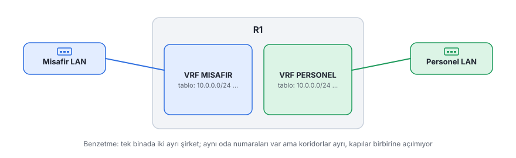
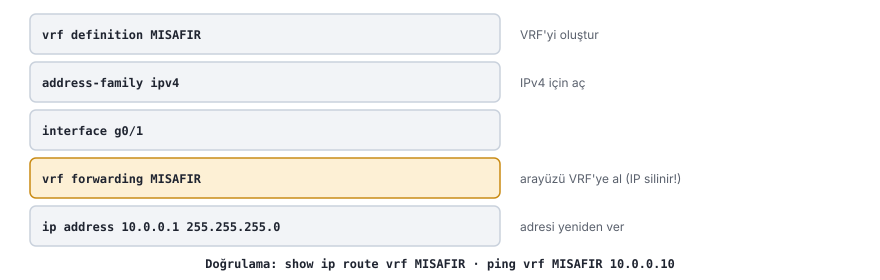
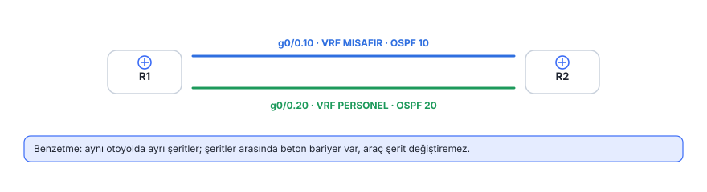
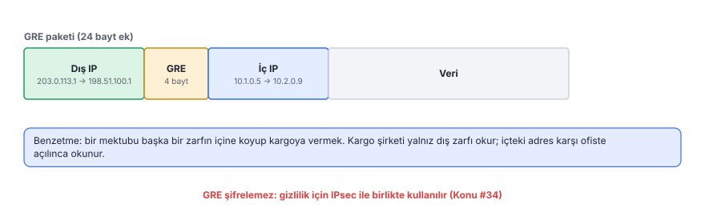
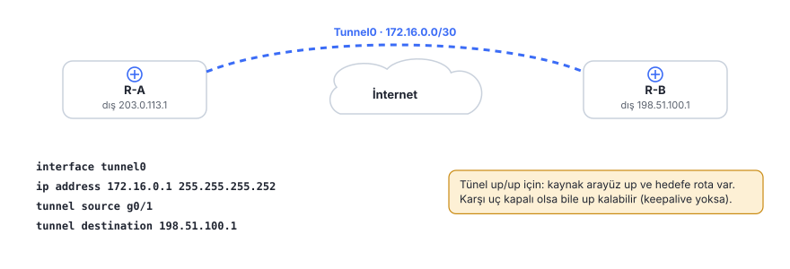
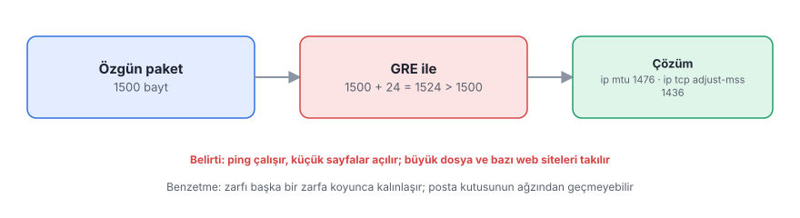
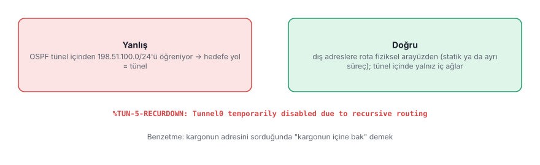

# AğLab Konu #33: VRF-lite ve GRE tünelleri

> Uygulamadaki `vrfgre` dersi bu belgeyle uyumludur. **Okuma dersi (Seviye 3, CCNP):** VRF ve tünel arayüzleri Labber'da yok; Gerçek Lab (FRR/Linux) bunları destekler.
> Ön koşul: Statik routing (Konu #8), OSPF (Konu #15), VLAN'lar arası yönlendirme ve alt arayüzler (Konu #7). Şemalar: `docs/dersler/gorseller/vrf-gre.py`.

Bu konu bittiğinde öğrenci VRF'nin bir router içinde ayrı rota tabloları oluşturduğunu ve çakışan adres bloklarını nasıl mümkün kıldığını açıklar. VRF-lite tanımlar, arayüzü VRF'ye alır ve VRF'ye özel `show`/`ping` komutlarını kullanır. GRE tünelinin kapsülleme mantığını, tünel arayüzünün kaynak/hedef ayarlarını ve up/up şartlarını bilir. GRE'nin MTU etkisini ve özyinelemeli yönlendirme hatasını tanır ve düzeltir. Süre yaklaşık 55 dakika.

## 0. Bir bakışta

- **VRF** bir router içinde ayrı **rota tabloları** oluşturur; tablolar birbirini görmez.
- Aynı adres bloğu iki VRF'de **çakışmadan** kullanılabilir.
- `vrf forwarding` arayüzün **IP adresini siler**; adres yeniden verilir.
- Komutlar VRF ister: `show ip route vrf X`, `ping vrf X …`.
- **GRE** paketi yeni bir IP başlığına sarar (**24 bayt**); **şifrelemez**.
- Tünel: `tunnel source`, `tunnel destination`; hedefe **fiziksel** yoldan rota olmalı.
- MTU: tünelde `ip mtu 1476`, `ip tcp adjust-mss 1436`; hedefe rota tünelden öğrenilirse **recursive routing**.

> **Akılda kalsın:** VRF'de kaybolan bir rota çoğu zaman yanlış tabloya bakmaktır: komutun sonuna vrf adını eklemeyi unutma.



## 1. Neden önemli

Aynı şube router'ında misafir ağı ile personel ağının birbirini hiç görmemesi, bir ortaklık sonrası iki şirketin aynı 10.0.0.0/8 bloklarıyla birleşmesi, iki şube arasında internet üzerinden özel adreslerin taşınması: VRF ve GRE bu ihtiyaçların temel yapı taşlarıdır. MPLS VPN, SD-WAN ve DMVPN gibi büyük çözümler de aynı iki fikre dayanır: tabloları ayırmak ve paketi bir başka paketin içinde taşımak.

## 2. Kavram

### 2.1 VRF nedir

> **Benzetme:** Bir iş merkezinde iki ayrı şirket aynı katı paylaşır: ikisinde de "101 numaralı oda" vardır, ama koridorlar ayrıdır ve kapılar birbirine açılmaz. Danışma (router) hangi şirketin misafiri olduğuna bakarak doğru koridora yönlendirir.

- Her VRF'nin kendi **RIB/FIB**'i, kendi arayüzleri ve kendi yönlendirme süreçleri (ya da address-family'leri) vardır.
- Varsayılan tablo **global** tablodur; VRF'siz komutlar oraya bakar.
- **VRF-lite**: MPLS olmadan, her hop'ta ayrı arayüz/alt arayüz ile; **MPLS L3VPN**: sağlayıcı ağında etiketlerle (okuma).

### 2.2 Yapılandırma



> **Dikkat:** Var olan bir arayüze `vrf forwarding` yazmak IP adresini (ve o arayüzdeki OSPF ayarlarını) siler. Uzaktan bağlıyken yönetim arayüzünde bunu yapmak, oturumunu kesmek demektir.

### 2.3 Router'lar arasında VRF



- Her VRF için ayrı alt arayüz (802.1Q VLAN) ya da ayrı fiziksel bağlantı.
- OSPF: `router ospf 10 vrf MISAFIR`; statik: `ip route vrf MISAFIR 0.0.0.0 0.0.0.0 10.9.0.1`.
- VRF'ler arası erişim gerekiyorsa (ör. ortak yazıcı) bilinçli olarak sızdırılır (route leaking) ya da bir güvenlik duvarından geçirilir.

### 2.4 GRE





- Tünel içinde OSPF/EIGRP çalıştırılabilir: iki şube tünel üzerinden birbirinin LAN'larını dinamik öğrenir.
- GRE multicast ve yönlendirme protokollerini taşır; saf IPsec (kriptomap) taşımaz. Bu yüzden "GRE over IPsec" yaygındır.
- `keepalive 10 3` karşı uç yanıt vermezse tüneli down yapar.

### 2.5 MTU



### 2.6 Özyinelemeli yönlendirme



> **Sahada:** Tünel içinde OSPF açarken `network` satırının dış (internet) arayüzü kapsamamasına dikkat et; kapsarsa hedef adres tünelden öğrenilir ve tünel kendini kapatır.

## 3. Çıktı okuma

```
R1#show vrf
  Name                             Default RD            Protocols   Interfaces
  MISAFIR                          <not set>             ipv4        Gi0/0.10
  PERSONEL                         <not set>             ipv4        Gi0/0.20 Gi0/2
                                        ← hangi arayüz hangi VRF'de

R1#show ip route 10.0.0.0
% Network not in table
                                        ← global tabloda yok…
R1#show ip route vrf PERSONEL 10.0.0.0
Routing Table: PERSONEL
Routing entry for 10.0.0.0/24
  Known via "connected", distance 0, metric 0 (connected, via interface)
                                        ← …ama PERSONEL VRF'sinde var

R-A#show interfaces tunnel0
Tunnel0 is up, line protocol is up
  Internet address is 172.16.0.1/30
  MTU 17916 bytes, BW 100 Kbit/sec
  Tunnel source 203.0.113.1 (GigabitEthernet0/1), destination 198.51.100.1
  Tunnel protocol/transport GRE/IP
  Tunnel transport MTU 1476 bytes
                                        ← GRE 24 bayt: taşıma MTU'su 1476

R-A#show logging | include TUN
%TUN-5-RECURDOWN: Tunnel0 temporarily disabled due to recursive routing
                                        ← hedefe rota tünelden öğrenilmiş
```

| Soru | Komut |
| --- | --- |
| VRF'ler ve arayüzleri? | `show vrf`, `show ip vrf interfaces` |
| VRF tablosu? | `show ip route vrf <ad>` |
| VRF içinden test? | `ping vrf <ad> <ip>`, `traceroute vrf …` |
| Tünel durumu ve uçları? | `show interfaces tunnel0`, `show ip interface brief` |
| Hedefe hangi yoldan? | `show ip route <tünel hedefi>` |

## 4. Yönlendirmeli lab

> **Simülatörde yok:** Lab'ı kâğıt üstünde yürüt; her adımda Bölüm 3'teki beklenen çıktıyla karşılaştır.

Bölüm A — VRF-lite: R1'de misafir (Gi0/0.10) ve personel (Gi0/0.20, Gi0/2) ağları; ikisinde de 10.0.0.0/24 kullanılıyor.

1. `vrf definition MISAFIR` ve `PERSONEL`, ikisinde `address-family ipv4`.
2. Alt arayüzleri VRF'ye al, sonra IP adreslerini ver. *Neden:* `vrf forwarding` adresi siler.
3. `show ip route` ile `show ip route vrf PERSONEL` farkını gör.
4. `ping 10.0.0.10` ile `ping vrf PERSONEL 10.0.0.10` farkını açıkla.

Bölüm B — GRE: R-A (dış 203.0.113.1) ile R-B (dış 198.51.100.1) arasında Tunnel0 (172.16.0.0/30).

5. Her iki uçta tünel arayüzünü kur; `show interfaces tunnel0` up/up olsun.
6. Tünel içinde OSPF: yalnız 172.16.0.0/30 ve LAN'ları kapsayan network satırları.
7. `ip mtu 1476`, `ip tcp adjust-mss 1436`.
8. Kâğıt üstü: OSPF dış arayüzü de kapsasaydı ne olurdu?

> **Benzetme:** B bölümü, iki ofis arasında kargo şirketiyle iç yazışma taşımaktır: zarfın içi şirket içi adresler, dışı kargonun anladığı adres.

## 5. Sık hatalar

| Kod | Hata | Belirti | Kanıt | Düzeltme |
| --- | --- | --- | --- | --- |
| E1 | VRF'ye alınan arayüzde IP yok | Arayüz up, ping yok | `show ip interface brief`'te unassigned | IP'yi yeniden ver |
| E2 | Global tabloda aramak | "Rota yok" yanılgısı | `show ip route` boş, vrf'li komut dolu | `vrf <ad>` ekle |
| E3 | Tünel hedefine fiziksel rota yok | Tunnel0 up/down | `show ip route <hedef>` yok | Dış rotayı (varsayılan) ekle |
| E4 | Recursive routing | Tünel düşüp kalkıyor | `%TUN-5-RECURDOWN` | Dış adresleri tünel içi protokolden çıkar |
| E5 | MTU ayarlanmamış | Büyük aktarımlar takılıyor | ping büyük paket + DF başarısız | `ip mtu 1476`, `adjust-mss 1436` |

## 6. Arıza senaryoları

> **Uygulamada:** Kâğıt üstü vakalar; motor ya da Gerçek Lab desteği gelince Sorun Çöz'e `vrf-*` kimlikleriyle eklenecek. Önce kendin çöz; neden ve çözüm kapalı kutularda.

### S1 · Başlangıç · Misafir ağı personel sunucusunu görüyor (VRF tasarımı)

- **Belirti:** Misafirlerin personel ağındaki dosya sunucusuna erişebildiği fark edildi; ikisi aynı router'da.
- **Hedef:** Misafirler yalnız internete çıksın.

<details><summary>Neden ve çözüm</summary>

İki ağ global tabloda; router aralarında yönlendiriyor. Çözüm: misafir alt arayüzünü VRF MISAFIR'e al, misafir VRF'sine yalnız internet çıkışı için varsayılan rota ver.

</details>

### S2 · Orta · VRF'ye alınan arayüz konuşmuyor (E1)

- **Belirti:** Gi0/0.20 VRF PERSONEL'e alındı; arayüz up ama kullanıcılar gateway'e ping atamıyor.
- **Hedef:** Kullanıcılar gateway'e ulaşsın.

<details><summary>Neden ve çözüm</summary>

`vrf forwarding` IP adresini sildi; arayüz unassigned. Çözüm: `ip address 10.0.0.1 255.255.255.0`.

</details>

### S3 · Orta · Tünel her birkaç dakikada düşüyor (E4)

- **Belirti:** Tunnel0 up olur, OSPF komşuluğu kurulur, ardından tünel kapanır; döngü tekrar ediyor.
- **Hedef:** Tünel kararlı olsun.

<details><summary>Neden ve çözüm</summary>

Tünel içindeki OSPF dış arayüzü de kapsıyor; 198.51.100.0/24 tünelden öğrenilince hedefe yol tünel oluyor. Çözüm: OSPF network satırlarını yalnız tünel ve LAN ağlarıyla sınırla.

</details>

### S4 · İleri · Web siteleri yarım açılıyor (E5)

- **Belirti:** Tünel üzerinden şube A'dan B'deki uygulamaya ping çalışıyor, küçük sayfalar açılıyor; dosya indirme takılıyor.
- **Hedef:** Büyük aktarımlar çalışsın.

<details><summary>Neden ve çözüm</summary>

1500 baytlık paketler GRE ile 1524 oluyor ve DF bitli olanlar düşüyor. Çözüm: tünelde `ip mtu 1476` ve `ip tcp adjust-mss 1436`.

</details>

## 7. Kısa sınav

**1.** VRF'nin temel işlevi?

<details><summary>Cevap</summary>

Bir router içinde birbirinden ayrı rota tabloları (ve arayüz grupları) oluşturmak.

</details>

**2.** Bir arayüze `vrf forwarding` yazınca ne olur?

<details><summary>Cevap</summary>

Arayüz VRF'ye geçer ve IP adresi silinir; adres yeniden verilmelidir.

</details>

**3.** VRF içindeki bir hedefe ping atmak için komut?

<details><summary>Cevap</summary>

`ping vrf <ad> <ip>`.

</details>

**4.** GRE kaç bayt ek yük getirir ve şifreler mi?

<details><summary>Cevap</summary>

24 bayt (20 dış IP + 4 GRE); şifrelemez.

</details>

**5.** Tünel arayüzünün up/up olması için iki şart?

<details><summary>Cevap</summary>

Tunnel source arayüzü up ve tunnel destination'a rota var.

</details>

**6.** `%TUN-5-RECURDOWN` neyi gösterir?

<details><summary>Cevap</summary>

Tünel hedefine giden rotanın tünelin kendisinden öğrenildiğini (özyinelemeli yönlendirme).

</details>

## 8. Özet kartı

| Komut | Ne işe yarar |
| --- | --- |
| `vrf definition <ad>` → `address-family ipv4` | VRF oluştur |
| `vrf forwarding <ad>` (arayüzde) | Arayüzü VRF'ye al, IP'yi yeniden ver |
| `show ip route vrf <ad>`, `ping vrf <ad> …` | VRF'de doğrula |
| `interface tunnel0`, `tunnel source/destination` | GRE tüneli |
| `ip mtu 1476`, `ip tcp adjust-mss 1436` | Tünel MTU'su |
| `keepalive 10 3` | Karşı uç kontrolü |

**Unutma:**

1. VRF = ayrı tablo; komutlara vrf ekle.
2. vrf forwarding IP'yi siler.
3. GRE şifrelemez.
4. Tünel hedefine fiziksel yoldan rota.
5. Tünelde MTU 1476.

## 9. Doğrulama notları

Kaynaklar: INE ENCOR (VRF-lite; GRE ve tünelleme) ve CCNP ENCOR v1.0 (yalnız kapsam kontrolü için); RFC 2784 (GRE); Cisco IOS VRF-lite ve tünel yapılandırma kılavuzları. Ders metni, örnek çıktılar ve şemalar özgün yazıldı.

| İddia | Sonuç |
| --- | --- |
| vrf forwarding arayüzün mevcut IP adresini kaldırır | Doğru |
| GRE 24 bayt ek yük getirir (20 IP + 4 GRE) | Doğru |
| GRE tünel taşıma MTU'su 1500 ağda 1476 | Doğru |
| GRE şifreleme sağlamaz | Doğru |
| Tünel hedefi tünel üzerinden öğrenilirse IOS tüneli recursive routing ile kapatır | Doğru |

**Motor gereksinimleri**

- [ ] VRF ve tünel arayüzleri Labber'da yok; Gerçek Lab (FRR/Linux VRF ve GRE) hazır olunca S1–S4 `vrf-*` kimlikleriyle eklenir.
